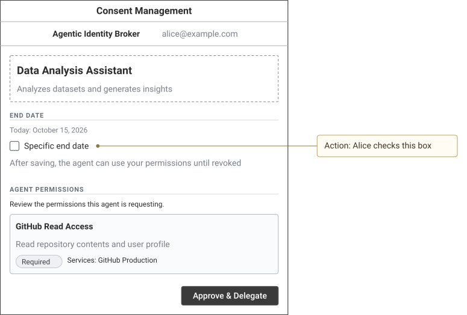
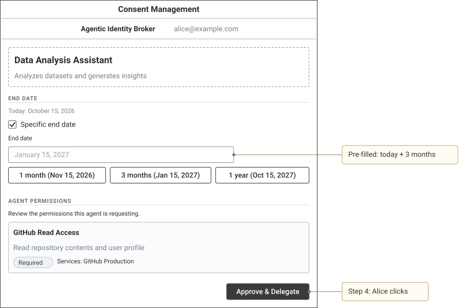

# Specification by Example: Worked Journey

This file is the reference example for Constitution Principle XIV and the "Concrete Example
Journeys" section of [`spec-template.md`](../templates/overrides/spec-template.md). Copy its
structure and level of detail, not its values. The authoring rules are in that template section.

The journey follows the local-mode OAuth2 authorization-code flow with first-time consent. It was
checked on 2026-10-15 against `api/enduser/openapi.yaml`, `internal/ports/config.go`,
`examples/config/oauth2-server-mode.yaml`, the consent SPA in `web/src/`, and the local token
minting code in `internal/domain/oauth2server/`.

## Worked journey

### Journey 1 — Alice lets an agent act for her for three months (User Story 1, Scenarios 1–2)

**Cast**: Alice (`alice@example.com`, asserted by the corporate SSO proxy as `X-Remote-User`);
agent *Data Analysis Assistant* (`550e8400-e29b-41d4-a716-446655440000`, public client without
broker credentials, `redirect_uris: [https://agent.example.com/callback]`,
`allowed_scopes: [openid, profile]`); required permission set *GitHub Read Access*
(`770e8400-e29b-41d4-a716-446655440001`) for service *GitHub Production*
(`880e8400-e29b-41d4-a716-446655440010`), where Alice already has an active session. Alice has no
grant for the agent. All times are 2026-10-15 UTC, and Alice's browser time zone is UTC (the SPA
computes the end date in browser-local time). All IDs, codes, keys, and tokens are synthetic.

**Step 1 — Broker configuration (initial state; excerpt, other required settings omitted)**

```yaml
server:
  enduser:
    public_url: "https://broker.example.com"     # becomes the token issuer (iss)
    authentication:
      preauth:
        principal_header_name: "X-Remote-User"   # authenticated principal becomes sub
oauth2_authorization_server:
  mode: "local"                                  # the broker mints its own tokens
  local:
    token_ttl: "1h"                              # expires_in 3600; exp = iat + 3600
    token_claims_expression: '{"team": agent.display_name}'  # adds the "team" claim
```

**Step 2 — 09:30:00: the agent sends Alice to the broker, which asks for consent**

```http
GET /oauth2/authorize?client_id=550e8400-e29b-41d4-a716-446655440000&response_type=code
    &redirect_uri=https%3A%2F%2Fagent.example.com%2Fcallback&scope=openid%20profile
    &state=af0ifjsldkj&code_challenge=E9Melhoa2OwvFrEMTJguCHaoeK1t8URWbuGJSstw-cM
    &code_challenge_method=S256 HTTP/1.1
Host: broker.example.com
X-Remote-User: alice@example.com

HTTP/1.1 302 Found
Location: https://broker.example.com/agents/550e8400-e29b-41d4-a716-446655440000?session_token=eyJ...
```

Line breaks in the query are for display only. `session_token` is an opaque JWE that expires
after 10 minutes. The consent page loads the agent through the existing
`GET /api/consent/agents/{agentId}` contract; that unchanged call is not shown.

**Step 3 — 09:30:12: Alice reviews the consent screen and sets an end date**

State A — consent screen as loaded:



<details><summary>Wireloom source</summary>

```wireloom
window "Consent Management":
  header:
    row:
      text "Agentic Identity Broker" bold
      spacer
      text "alice@example.com" muted
  panel:
    text "Data Analysis Assistant" bold size=large
    text "Analyzes datasets and generates insights" muted
  section "End Date":
    text "Today: October 15, 2026" muted size=small
    checkbox "Specific end date" label-right id="end-date"
    text "After saving, the agent can use your permissions until revoked" muted
  section "Agent Permissions":
    text "Review the permissions this agent is requesting." size=small
    slot "GitHub Read Access":
      text "Read repository contents and user profile" muted
      row:
        chip "Required"
        text "Services: GitHub Production" size=small
  row align=right:
    button "Approve & Delegate" primary

annotation "Action: Alice checks this box" target="end-date" position=right
```

</details>

Action: Alice checks **Specific end date**. The page pre-fills today + 3 months.

State B — end date set:



<details><summary>Wireloom source</summary>

```wireloom
window "Consent Management":
  header:
    row:
      text "Agentic Identity Broker" bold
      spacer
      text "alice@example.com" muted
  panel:
    text "Data Analysis Assistant" bold size=large
    text "Analyzes datasets and generates insights" muted
  section "End Date":
    text "Today: October 15, 2026" muted size=small
    checkbox "Specific end date" checked label-right
    text "End date" size=small
    input placeholder="January 15, 2027" id="end-date-value"
    row:
      button "1 month (Nov 15, 2026)"
      button "3 months (Jan 15, 2027)"
      button "1 year (Oct 15, 2027)"
  section "Agent Permissions":
    text "Review the permissions this agent is requesting." size=small
    slot "GitHub Read Access":
      text "Read repository contents and user profile" muted
      row:
        chip "Required"
        text "Services: GitHub Production" size=small
  row align=right:
    button "Approve & Delegate" primary id="approve"

annotation "Pre-filled: today + 3 months" target="end-date-value" position=right
annotation "Step 4: Alice clicks" target="approve" position=right
```

</details>

**Step 4 — 09:30:15: Alice clicks Approve & Delegate**

```http
POST /api/consent/agents/550e8400-e29b-41d4-a716-446655440000/grants?session_token=eyJ... HTTP/1.1
Host: broker.example.com
X-Remote-User: alice@example.com
Content-Type: application/json

{
  "granted_permission_sets": {
    "770e8400-e29b-41d4-a716-446655440001": ["880e8400-e29b-41d4-a716-446655440010"]
  },
  "valid_until": "2027-01-15T09:30:12.000Z"
}

HTTP/1.1 201 Created
Content-Type: application/json

{
  "data": {
    "id": "990e8400-e29b-41d4-a716-446655440020",
    "principal": "alice@example.com",
    "agent_id": "550e8400-e29b-41d4-a716-446655440000",
    "valid_until": "2027-01-15T09:30:12Z",
    "granted_permission_sets": {
      "770e8400-e29b-41d4-a716-446655440001": ["880e8400-e29b-41d4-a716-446655440010"]
    },
    "created_at": "2026-10-15T09:30:15Z",
    "updated_at": "2026-10-15T09:30:15Z"
  },
  "redirect_url": "/oauth2/authorize?client_id=550e8400-e29b-41d4-a716-446655440000&response_type=code&..."
}
```

The SPA navigates to `redirect_url`, which repeats the step 2 query unchanged.
Variant (Scenario 2): after the 10-minute session expires, the same request returns
`400 Bad Request` with
`{"error": "session_expired", "message": "authorization session has expired, please restart the authorization flow"}`.

**Step 5 — 09:30:16: the broker returns an authorization code to the agent**

```http
GET /oauth2/authorize?client_id=550e8400-e29b-41d4-a716-446655440000&response_type=code&... HTTP/1.1
Host: broker.example.com
X-Remote-User: alice@example.com

HTTP/1.1 302 Found
Location: https://agent.example.com/callback?code=SplxlOBeZQQYbYS6WxSbIA&state=af0ifjsldkj
```

The code is single-use and expires after 60 seconds.

**Step 6 — 09:31:02: the agent exchanges the code for a broker token**

```http
POST /oauth2/token HTTP/1.1
Host: broker.example.com
Content-Type: application/x-www-form-urlencoded

grant_type=authorization_code&code=SplxlOBeZQQYbYS6WxSbIA
&redirect_uri=https%3A%2F%2Fagent.example.com%2Fcallback
&client_id=550e8400-e29b-41d4-a716-446655440000
&code_verifier=dBjftJeZ4CVP-mB92K27uhbUJU1p1r_wW1gFWFOEjXk

HTTP/1.1 200 OK
Content-Type: application/json
Cache-Control: no-store
Pragma: no-cache

{
  "access_token": "eyJhbGciOiJFUzI1NiIsImtpZCI6...",
  "token_type": "Bearer",
  "issued_token_type": "urn:ietf:params:oauth:token-type:access_token",
  "expires_in": 3600,
  "scope": "openid profile"
}
```

Line breaks in the form body are for display only. No `refresh_token` is returned because the
agent did not request `offline_access`.

Decoded `access_token` (synthetic):

```json
{
  "header": { "alg": "ES256", "kid": "3f1c2b4a-8d7e-4f60-9a1b-2c3d4e5f6a7b" },
  "payload": {
    "iss": "https://broker.example.com",
    "sub": "alice@example.com",
    "iat": 1792056662,
    "exp": 1792060262,
    "jti": "6e2f0c9a-1b3d-4e5f-8a7b-9c0d1e2f3a4b",
    "agent_id": "550e8400-e29b-41d4-a716-446655440000",
    "scope": "openid profile",
    "team": "Data Analysis Assistant"
  }
}
```

`iat` is 09:31:02 and `exp` is 10:31:02. There is no `aud` claim: local mode adds one only when
`token_claims_expression` returns it. The grant's `valid_until` does not change the token `exp`.

**Observable result**: the agent holds a one-hour token that identifies Alice as `sub`, and Alice's
grant for the agent is valid until 2027-01-15T09:30:12Z.

## Render Wireloom wireframes

Wireloom 0.7.0 has no command-line interface. `tools/wireloom/render.mjs` calls its library
function `wireloom.render`, which returns a self-contained SVG string. `just install-tools`
installs the pinned `wireloom` version from `tools/wireloom/package-lock.json`.

In a spec, put each SVG image in its own paragraph, followed by a collapsed
`<details><summary>Wireloom source</summary>` block containing its fenced `wireloom` source.
Close it with `</details>` after the fence, with blank lines around the fence. GitHub shows the
image by default and reveals the editable source when expanded. The image path is relative to
the spec and MUST stay inside its directory. The renderer pairs adjacent top-level Markdown
blocks, so reference-style image links and blank-line spacing also work.

From the repository root, render every image and source pair in one or more specs:

```bash
just install-tools                                   # once, and after a Wireloom version change
just render-wireframes specs/NNN-feature-name/spec.md
```

The recipe writes each SVG to the path in its image link and prints that path. It rejects
unpaired `wireloom` blocks and fails when a file has no image and source pair. Run it again
after each source change, and commit the SVGs with the spec.
The wireframes in this file were rendered with
`just render-wireframes .specify/examples/specification-by-example.md`.
