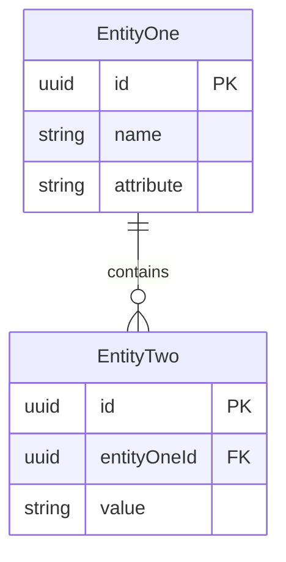
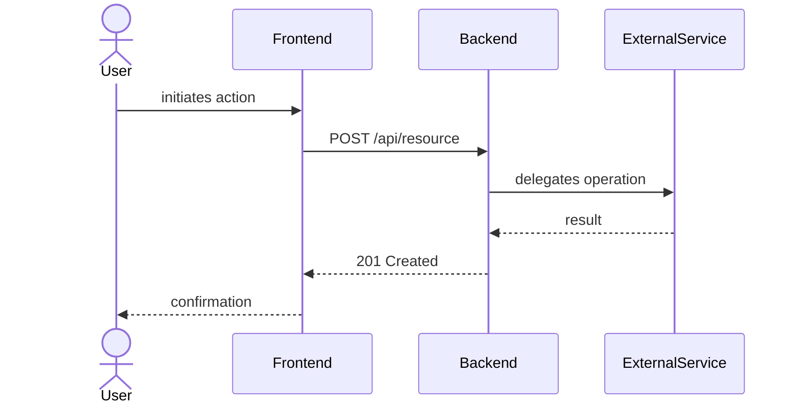

# Feature Specification: [FEATURE NAME]

**Feature Branch**: `[###-feature-name]`

**Created**: [DATE]

**Status**: Draft

**Input**: User description: "$ARGUMENTS"

## User Scenarios & Testing *(mandatory)*

<!--
  IMPORTANT: User stories should be PRIORITIZED as user journeys ordered by importance.
  Each user story/journey must be INDEPENDENTLY TESTABLE - meaning if you implement just ONE of them,
  you should still have a viable MVP (Minimum Viable Product) that delivers value.

  Assign priorities (P1, P2, P3, etc.) to each story, where P1 is the most critical.
  Think of each story as a standalone slice of functionality that can be:
  - Developed independently
  - Tested independently
  - Deployed independently
  - Demonstrated to users independently

  E2E ACCEPTANCE TESTING (Constitution Principle XIII):
  Each acceptance scenario below MUST have a corresponding end-to-end (E2E) test in tests/e2e/.
  - Each scenario maps 1:1 to one It() block in E2E tests
  - E2E tests MUST be written BEFORE implementation begins (red-green development)
  - E2E tests MUST FAIL initially, proving they test actual functionality
  - E2E tests change minimally during implementation (fixture adjustments only)
  - E2E tests turn GREEN when implementation satisfies acceptance criteria
  - Use Ginkgo/Gomega framework following patterns in tests/e2e/README.md
  - Test file naming: tests/e2e/[feature]_test.go
  - Include comment references to spec scenarios in E2E test files
-->

### User Story 1 - [Brief Title] (Priority: P1)

[Describe this user journey in plain language]

**Why this priority**: [Explain the value and why it has this priority level]

**Independent Test**: [Describe how this can be tested independently - e.g., "Can be fully tested by [specific action] and delivers [specific value]"]

**Acceptance Scenarios**:

1. **Given** [initial state], **When** [action], **Then** [expected outcome]
2. **Given** [initial state], **When** [action], **Then** [expected outcome]

---

### User Story 2 - [Brief Title] (Priority: P2)

[Describe this user journey in plain language]

**Why this priority**: [Explain the value and why it has this priority level]

**Independent Test**: [Describe how this can be tested independently]

**Acceptance Scenarios**:

1. **Given** [initial state], **When** [action], **Then** [expected outcome]

---

### User Story 3 - [Brief Title] (Priority: P3)

[Describe this user journey in plain language]

**Why this priority**: [Explain the value and why it has this priority level]

**Independent Test**: [Describe how this can be tested independently]

**Acceptance Scenarios**:

1. **Given** [initial state], **When** [action], **Then** [expected outcome]

---

[Add more user stories as needed, each with an assigned priority]

### Edge Cases

<!--
  ACTION REQUIRED: The content in this section represents placeholders.
  Fill them out with the right edge cases.
-->

- What happens when [boundary condition]?
- How does system handle [error scenario]?

## Concrete Example Journeys *(mandatory)*

<!--
  Constitution Principle XIV: include at least one chronological, end-to-end journey for each
  distinct user-facing flow. Link each journey to its user story and Given/When/Then scenarios;
  journeys do NOT replace those scenarios or their 1:1 E2E test mapping.
  - Define one cast of actors, IDs, and times, and reuse those exact values in every step.
  - Number the steps. Put each configuration, HTTP, UI, or JWT block under the step it explains.
  - Configuration: real keys only; comment how each value changes the outcome.
  - HTTP: RFC-style request and response that match the applicable OpenAPI contract. Use `...`
    only for values that are clear from context and immaterial to the behavior; keep
    security-critical inputs and observable outcomes explicit.
  - UI: one `wireloom` block per meaningful state, rendered to SVG with the `wireloom` npm package
    (`wireloom.render`) under `specs/[###-feature-name]/wireframes/` and linked; name the user
    action between states. Follow https://github.com/StardockCorp/Wireloom/blob/main/AGENTS.md
  - JWT: synthetic token marker plus decoded header and claims. Never use real tokens or secrets.
  The journey below is a WORKED EXAMPLE of the expected depth and style. Replace it entirely with
  this feature's journeys, and omit block types that do not apply.
-->

### Journey 1 — Alice lets an agent act for her for three months (User Story 1, Scenarios 1–2)

**Cast**: Alice (`alice@example.com`, asserted by the corporate SSO proxy as `X-Remote-User`);
agent *Data Analysis Assistant* (`550e8400-e29b-41d4-a716-446655440000`, public client without
broker credentials, `redirect_uris: [https://agent.example.com/callback]`,
`allowed_scopes: [openid, profile]`); required permission set *GitHub Read Access*
(`770e8400-e29b-41d4-a716-446655440001`) for service *GitHub Production*
(`880e8400-e29b-41d4-a716-446655440010`), where Alice already has an active session. Alice has no
grant for the agent. All times are 2026-10-15 UTC, and Alice's browser time zone is UTC (the SPA
computes the end date in browser-local time). All IDs, codes, keys, and tokens are synthetic.

**Step 1 — Broker configuration (initial state; excerpt, other required settings omitted)**

```yaml
server:
  enduser:
    public_url: "https://broker.example.com"     # becomes the token issuer (iss)
    authentication:
      preauth:
        principal_header_name: "X-Remote-User"   # authenticated principal becomes sub
oauth2_authorization_server:
  mode: "local"                                  # the broker mints its own tokens
  local:
    token_ttl: "1h"                              # expires_in 3600; exp = iat + 3600
    token_claims_expression: '{"team": agent.display_name}'  # adds the "team" claim
```

**Step 2 — 09:30:00: the agent sends Alice to the broker, which asks for consent**

```http
GET /oauth2/authorize?client_id=550e8400-e29b-41d4-a716-446655440000&response_type=code
    &redirect_uri=https%3A%2F%2Fagent.example.com%2Fcallback&scope=openid%20profile
    &state=af0ifjsldkj&code_challenge=E9Melhoa2OwvFrEMTJguCHaoeK1t8URWbuGJSstw-cM
    &code_challenge_method=S256 HTTP/1.1
Host: broker.example.com
X-Remote-User: alice@example.com

HTTP/1.1 302 Found
Location: https://broker.example.com/agents/550e8400-e29b-41d4-a716-446655440000?session_token=eyJ...
```

Line breaks in the query are for display only. `session_token` is an opaque JWE that expires
after 10 minutes. The consent page loads the agent through the existing
`GET /api/consent/agents/{agentId}` contract; that unchanged call is not shown.

**Step 3 — 09:30:12: Alice reviews the consent screen and sets an end date**

State A — consent screen as loaded ([SVG](wireframes/journey-1-a-consent.svg)):

```wireloom
window "Consent Management":
  header:
    row:
      text "Agentic Identity Broker" bold
      spacer
      text "alice@example.com" muted
  panel:
    text "Data Analysis Assistant" bold size=large
    text "Analyzes datasets and generates insights" muted
  section "End Date":
    text "Today: October 15, 2026" muted size=small
    checkbox "Specific end date" label-right id="end-date"
    text "After saving, the agent can use your permissions until revoked" muted
  section "Agent Permissions":
    text "Review the permissions this agent is requesting." size=small
    slot "GitHub Read Access":
      text "Read repository contents and user profile" muted
      row:
        chip "Required"
        text "Services: GitHub Production" size=small
  row align=right:
    button "Approve & Delegate" primary

annotation "Action: Alice checks this box" target="end-date" position=right
```

Action: Alice checks **Specific end date**. The page pre-fills today + 3 months.

State B — end date set ([SVG](wireframes/journey-1-b-end-date.svg)):

```wireloom
window "Consent Management":
  header:
    row:
      text "Agentic Identity Broker" bold
      spacer
      text "alice@example.com" muted
  panel:
    text "Data Analysis Assistant" bold size=large
    text "Analyzes datasets and generates insights" muted
  section "End Date":
    text "Today: October 15, 2026" muted size=small
    checkbox "Specific end date" checked label-right
    text "End date" size=small
    input placeholder="January 15, 2027" id="end-date-value"
    row:
      button "1 month (Nov 15, 2026)"
      button "3 months (Jan 15, 2027)"
      button "1 year (Oct 15, 2027)"
  section "Agent Permissions":
    text "Review the permissions this agent is requesting." size=small
    slot "GitHub Read Access":
      text "Read repository contents and user profile" muted
      row:
        chip "Required"
        text "Services: GitHub Production" size=small
  row align=right:
    button "Approve & Delegate" primary id="approve"

annotation "Pre-filled: today + 3 months" target="end-date-value" position=right
annotation "Step 4: Alice clicks" target="approve" position=right
```

**Step 4 — 09:30:15: Alice clicks Approve & Delegate**

```http
POST /api/consent/agents/550e8400-e29b-41d4-a716-446655440000/grants?session_token=eyJ... HTTP/1.1
Host: broker.example.com
X-Remote-User: alice@example.com
Content-Type: application/json

{
  "granted_permission_sets": {
    "770e8400-e29b-41d4-a716-446655440001": ["880e8400-e29b-41d4-a716-446655440010"]
  },
  "valid_until": "2027-01-15T09:30:12.000Z"
}

HTTP/1.1 201 Created
Content-Type: application/json

{
  "data": {
    "id": "990e8400-e29b-41d4-a716-446655440020",
    "principal": "alice@example.com",
    "agent_id": "550e8400-e29b-41d4-a716-446655440000",
    "valid_until": "2027-01-15T09:30:12Z",
    "granted_permission_sets": {
      "770e8400-e29b-41d4-a716-446655440001": ["880e8400-e29b-41d4-a716-446655440010"]
    },
    "created_at": "2026-10-15T09:30:15Z",
    "updated_at": "2026-10-15T09:30:15Z"
  },
  "redirect_url": "/oauth2/authorize?client_id=550e8400-e29b-41d4-a716-446655440000&response_type=code&..."
}
```

The SPA navigates to `redirect_url`, which repeats the step 2 query unchanged.
Variant (Scenario 2): after the 10-minute session expires, the same request returns
`400 Bad Request` with
`{"error": "session_expired", "message": "authorization session has expired, please restart the authorization flow"}`.

**Step 5 — 09:30:16: the broker returns an authorization code to the agent**

```http
GET /oauth2/authorize?client_id=550e8400-e29b-41d4-a716-446655440000&response_type=code&... HTTP/1.1
Host: broker.example.com
X-Remote-User: alice@example.com

HTTP/1.1 302 Found
Location: https://agent.example.com/callback?code=SplxlOBeZQQYbYS6WxSbIA&state=af0ifjsldkj
```

The code is single-use and expires after 60 seconds.

**Step 6 — 09:31:02: the agent exchanges the code for a broker token**

```http
POST /oauth2/token HTTP/1.1
Host: broker.example.com
Content-Type: application/x-www-form-urlencoded

grant_type=authorization_code&code=SplxlOBeZQQYbYS6WxSbIA
&redirect_uri=https%3A%2F%2Fagent.example.com%2Fcallback
&client_id=550e8400-e29b-41d4-a716-446655440000
&code_verifier=dBjftJeZ4CVP-mB92K27uhbUJU1p1r_wW1gFWFOEjXk

HTTP/1.1 200 OK
Content-Type: application/json
Cache-Control: no-store
Pragma: no-cache

{
  "access_token": "eyJhbGciOiJFUzI1NiIsImtpZCI6...",
  "token_type": "Bearer",
  "issued_token_type": "urn:ietf:params:oauth:token-type:access_token",
  "expires_in": 3600,
  "scope": "openid profile"
}
```

Line breaks in the form body are for display only. No `refresh_token` is returned because the
agent did not request `offline_access`.

Decoded `access_token` (synthetic):

```json
{
  "header": { "alg": "ES256", "kid": "3f1c2b4a-8d7e-4f60-9a1b-2c3d4e5f6a7b" },
  "payload": {
    "iss": "https://broker.example.com",
    "sub": "alice@example.com",
    "iat": 1792056662,
    "exp": 1792060262,
    "jti": "6e2f0c9a-1b3d-4e5f-8a7b-9c0d1e2f3a4b",
    "agent_id": "550e8400-e29b-41d4-a716-446655440000",
    "scope": "openid profile",
    "team": "Data Analysis Assistant"
  }
}
```

`iat` is 09:31:02 and `exp` is 10:31:02. There is no `aud` claim: local mode adds one only when
`token_claims_expression` returns it. The grant's `valid_until` does not change the token `exp`.

**Observable result**: the agent holds a one-hour token that identifies Alice as `sub`, and Alice's
grant for the agent is valid until 2027-01-15T09:30:12Z.

## Requirements *(mandatory)*

<!--
  ACTION REQUIRED: The content in this section represents placeholders.
  Fill them out with the right functional requirements.
-->

### Functional Requirements

- **FR-001**: System MUST [specific capability, e.g., "allow users to create accounts"]
- **FR-002**: System MUST [specific capability, e.g., "validate email addresses"]
- **FR-003**: Users MUST be able to [key interaction, e.g., "reset their password"]
- **FR-004**: System MUST [data requirement, e.g., "persist user preferences"]
- **FR-005**: System MUST [behavior, e.g., "log all security events"]

*Example of marking unclear requirements:*

- **FR-006**: System MUST authenticate users via [NEEDS CLARIFICATION: auth method not specified - email/password, SSO, OAuth?]
- **FR-007**: System MUST retain user data for [NEEDS CLARIFICATION: retention period not specified]

### Domain Model *(if applicable - document before API or database design)*

<!--
  Per Constitution Principle V (Domain-Driven Design & Glossary Management):
  Domain concepts must be explicitly modeled and documented.

  GITHUB-COMPATIBLE MERMAID RULES:
  - erDiagram: { } in attribute blocks is correct Mermaid syntax — GitHub renders it fine
  - classDiagram: { } enclosing class members is correct Mermaid syntax — also fine
  - flowchart/graph TD: NEVER put { } inside node text — it breaks the parser
    Use ["label text"] or ("label text") node forms instead
  - Do NOT put newlines inside node text or relationship labels in any diagram type
  - Wrap relationship labels that contain colons or special characters in double quotes
-->

**Domain Entity Diagram** *(replace entities and fields with this feature's actual domain model)*:



**Activity / Flow Diagram** *(use for non-trivial workflows, state transitions, or multi-party flows)*:

<!--
  Choose the right diagram type:
  - flowchart TD: simple linear flows and decision trees
    - {Decision text?} creates a diamond node (valid in flowchart — { } is Mermaid node syntax)
    - ["Action text"] creates a rectangular node
    - NEVER nest { } inside node text: {bad {nesting}} breaks the parser
    - Keep decision labels short (no newlines, no colons outside quotes)
  - sequenceDiagram: interactions between components/actors over time (recommended for HTTP flows)
  - stateDiagram-v2: state machines and lifecycle transitions
-->



*Replace with the actual flow for this feature. Use `flowchart TD` for simpler decision-tree flows,
`sequenceDiagram` for HTTP/component interactions, or `stateDiagram-v2` for lifecycle transitions.*

**Entities** (things with unique identity):
- **[Entity 1]**: [Brief description, key attributes, lifecycle, invariants]
- **[Entity 2]**: [Brief description, relationships to other entities]

**Aggregates** (consistency boundaries):
- **[Aggregate]**: [Root entity, contained entities, invariants]

**Value Objects** (things without identity):
- **[Value Object]**: [What it represents, immutability constraints]

**Domain Events** (state changes of business significance):
- **[Event 1]**: [When it occurs, what changed]

*All domain terms should be added to `ARCHITECTURE.md` Glossary section*

### Configuration Requirements *(if applicable - document before implementation)*

<!--
  Per Constitution Principle VII (Configuration-Driven Design):
  Configuration requirements must be designed with examples before implementation.
-->

**Configuration Parameters**:
- **[PARAMETER_NAME]**: [Type, purpose, default value, example]

**Example YAML Configuration**:
```yaml
# Feature-specific configuration
[feature_name]:
  [parameter_1]: [example_value]
  [parameter_2]: [example_value]
  nested:
    [parameter_3]: [example_value]
```

**Configuration Location**: Will be added to `examples/config/[feature_name].yaml` and referenced in `examples/config/README.md`

### API Requirements *(if applicable - design before database)*

<!--
  Per Constitution Principle IV (API Documentation & OpenAPI Transparency) and
  Principle X (API-First Development): APIs must be designed before implementation.
-->

- **API-001**: All end-user APIs MUST be documented in `/api/enduser/openapi.yaml` (OpenAPI 3.0+ format)
- **API-002**: All administrative APIs MUST be documented in `/api/admin/openapi.yaml` (OpenAPI 3.0+ format)
- **API-003**: API documentation MUST include: endpoint paths, HTTP methods, parameters, request/response bodies, error codes, examples, authentication requirements
- **API-004**: End-user API documentation MUST be rendered in `docs/api/` with examples for typical use cases
- **API-005**: APIs MUST follow Zalando RESTful API and Event Guidelines (https://opensource.zalando.com/restful-api-guidelines/)
- **API-006**: All API changes MUST be confirmed by user/stakeholder before implementation begins
- **API-007**: API design decisions (naming conventions, error response format, pagination) MUST be documented in `ARCHITECTURE.md` or ADR

*Example of API requirement clarification:*

- **API-008**: System exposes [endpoint name] via [NEEDS CLARIFICATION: HTTP method and path not yet designed - coordinate with user]

### Database Requirements *(if applicable)*

<!--
  Per Constitution Principle IX (Persistence Pattern Consistency & Database Migration Management):
  All database schema changes must use go-migrate naming conventions and be tested.
-->

- **DB-001**: All database schema changes MUST be in `/migrations/` directory using go-migrate naming conventions
- **DB-002**: Migration file format MUST be: `[NNN]_[description].up.sql` and `[NNN]_[description].down.sql` (where NNN is sequential: 004, 005, 006...)
  - Example: `004_create_sessions_table.up.sql`, `004_create_sessions_table.down.sql`
- **DB-003**: Each migration MUST be atomic (fully apply or fully rollback on failure)
- **DB-004**: All migrations MUST be tested in PostgreSQL integration tests (apply, rollback, repeat without data loss)
- **DB-005**: All PostgreSQL-backed repositories MUST have integration tests verifying persistence behavior
- **DB-006**: If adding new entities with persistence, implementations MUST follow `specs/004-persistence-layer/quickstart.md` patterns

### Security Requirements *(mandatory for security-critical features)*

<!--
  Per Constitution Principle I: Security-First Development
  Security features must be enabled by default and fail closed.
-->

- **SR-001**: Security controls MUST be enabled by default (explicit configuration required to disable)
- **SR-002**: Cryptographic operations MUST use vetted libraries (per Constitution Principle III)
- **SR-003**: System MUST fail closed on security verification failures (no silent fallbacks)
- **SR-004**: Security-critical operations MUST emit structured audit logs

*Example of security requirements that need library verification:*

- **SR-005**: Signature verification MUST use [IMPLEMENTATION NOTE: Go crypto/* or golang.org/x/crypto packages]
- **SR-006**: Encryption MUST NOT have plaintext fallbacks [IMPLEMENTATION NOTE: No optional security]

### Frontend/Design System Requirements *(if applicable - document before implementation)*

<!--
  Per Constitution Principle XI (Design System Compliance & Consistency):
  Frontend components must use the design system; universal patterns must be contributed back.
-->

**Design System Compliance**:
- All frontend components MUST use design system located at `web/src/design-system/`
- Documentation entrypoint: [web/src/design-system/docs/INDEX.md](../web/src/design-system/docs/INDEX.md)
- Before implementation, review:
  - [DECISION_TREES.md](../web/src/design-system/docs/DECISION_TREES.md) for variant selection
  - [COMPONENT_PAIRING_GUIDE.md](../web/src/design-system/docs/COMPONENT_PAIRING_GUIDE.md) for composition patterns
  - [COMMON_MISTAKES.md](../web/src/design-system/docs/COMMON_MISTAKES.md) to avoid anti-patterns

**Component Classification**:
- **Application-Specific Components**: [List components specific to this feature]
  - Location: `web/src/components/[feature]/`
  - Must use design system primitives (Button, Card, Badge, etc.)
- **Universal Components** (if any): [List components applicable across the application]
  - Location: `web/src/design-system/components/[category]/`
  - Must include Storybook stories
  - Must follow Refined Trust Architecture aesthetic

**Design Tokens Usage**:
- Use semantic tokens: `trust-deep`, `trust`, `success-primary`, `error-primary`, `neutral-*`
- DO NOT use extended palettes: `navy-700`, `emerald-600`, `gray-*`
- DO NOT bypass design tokens with custom CSS

**Accessibility Requirements**:
- WCAG 2.1 AA compliance mandatory (4.5:1 text contrast, 3:1 UI component contrast)
- Semantic HTML with proper ARIA attributes
- Keyboard navigation support for all interactive elements

*Example clarification needed:*

- **FE-001**: Feature requires [component type] component with [specific behavior] [NEEDS CLARIFICATION: Is this universal or app-specific? Should it be added to design system?]

### Key Entities *(include if feature involves data)*

- **[Entity 1]**: [What it represents, key attributes without implementation]
- **[Entity 2]**: [What it represents, relationships to other entities]

*Domain concepts should be added to `ARCHITECTURE.md` Glossary (per Constitution Principle V)*

## Success Criteria *(mandatory)*

<!--
  ACTION REQUIRED: Define measurable success criteria.
  These must be technology-agnostic and measurable.
-->

### Measurable Outcomes

- **SC-001**: [Measurable metric, e.g., "Users can complete account creation in under 2 minutes"]
- **SC-002**: [Measurable metric, e.g., "System handles 1000 concurrent users without degradation"]
- **SC-003**: [User satisfaction metric, e.g., "90% of users successfully complete primary task on first attempt"]
- **SC-004**: [Business metric, e.g., "Reduce support tickets related to [X] by 50%"]

## Assumptions

<!--
  ACTION REQUIRED: The content in this section represents placeholders.
  Fill them out with the right assumptions based on reasonable defaults
  chosen when the feature description did not specify certain details.
-->

- [Assumption about target users, e.g., "Users have stable internet connectivity"]
- [Assumption about scope boundaries, e.g., "Mobile support is out of scope for v1"]
- [Assumption about data/environment, e.g., "Existing authentication system will be reused"]
- [Dependency on existing system/service, e.g., "Requires access to the existing user profile API"]
