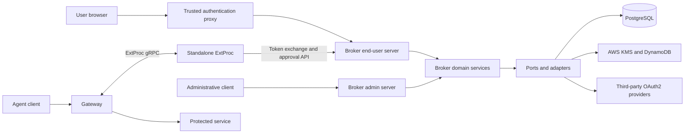

# Architecture Overview

This document describes the broker, its standalone ExtProc service, and their trust boundaries.
The [constitution](.specify/memory/constitution.md) and accepted decisions in [the ADR index](#10-architecture-decision-records-adrs) govern changes.
Source links identify the implementation or contract behind each overview.

## 1. Project Structure

| Path | Responsibility |
|---|---|
| [cmd/](cmd/) | Broker and ExtProc executable entry points |
| [internal/domain/](internal/domain/) | Broker domain models and services |
| [internal/ports/](internal/ports/) | Configuration and infrastructure contracts |
| [internal/adapters/](internal/adapters/) | HTTP, storage, encryption, and external-service adapters |
| [internal/app/](internal/app/) | Broker dependency construction |
| [internal/config/](internal/config/) | Broker configuration loading and validation |
| [internal/extproc/](internal/extproc/) | Standalone ExtProc configuration and request processing |
| [web/src/](web/src/) | React pages, hooks, API clients, and shared design system |
| [api/](api/) | End-user and administrative OpenAPI contracts |
| [migrations/](migrations/) | PostgreSQL up and down migrations |
| [tests/](tests/) | Backend, ExtProc, browser, and integration suites |
| [configs/](configs/) and [examples/config/](examples/config/) | Environment configuration and operator examples |
| [build/docker/](build/docker/) | Broker, ExtProc, migration, and development container definitions |
| [charts/agentic-identity-broker/](charts/agentic-identity-broker/) | Broker Helm deployment |
| [infra/cdk/](infra/cdk/) | AWS encryption infrastructure |
| [mocks/](mocks/) | Local OAuth2, CIMD, gateway, and MCP services |
| [scripts/](scripts/) and [justfile](justfile) | Development and verification commands |
| [docs/](docs/) and [assets/docusaurus/](assets/docusaurus/) | Operator documentation and documentation-site tooling |
| [specs/](specs/) and [adrs/](adrs/) | Feature artifacts and architecture decisions |
| [.github/workflows/](.github/workflows/) | CI, security, coverage, and release workflows |

Generated outputs are not source packages. The [build recipes](justfile) produce binaries in `bin/` and the [Vite build](web/vite.config.ts) produces `web/dist/`.
Dependency versions belong to [go.mod](go.mod), [web/package.json](web/package.json), [web/package-lock.json](web/package-lock.json), and [infra/cdk/go.mod](infra/cdk/go.mod).

## 2. High-Level System Diagram



The diagram shows the trusted-header deployment model, not a universal authentication configuration.
The end-user and administrative listeners have separate routing and authentication configuration.
The deployment must restrict administrative access and prevent clients from forging trusted proxy headers.
Sources: [004-dual-server-isolation.md](adrs/004-dual-server-isolation.md), [end-user routing](internal/adapters/http/routing/enduser.go), [admin routing](internal/adapters/http/routing/admin.go), and [security assurance case](docs/resources/assurance-case.md).

The [builder](internal/app/builder.go) connects broker domain services to their ports and adapters.
Production persistence uses the [PostgreSQL adapter](internal/adapters/storage/postgres/).
The [memory adapter](internal/adapters/storage/memory/) provides process-local development and test storage.
ExtProc has its own process and configuration under accepted [011-extproc-standalone-binary.md](adrs/011-extproc-standalone-binary.md).
Its metadata trust boundary is defined by accepted [036-extproc-metadata-token-exchange-input.md](adrs/036-extproc-metadata-token-exchange-input.md).

## 3. Core Components

### 3.1. Identity Broker Service

The broker manages agent delegation, third-party OAuth2 sessions, token exchange, and tool approvals.
The [end-user contract](api/enduser/openapi.yaml) and [admin contract](api/admin/openapi.yaml) define its HTTP surfaces.
Its Go dependencies and toolchain are declared in [go.mod](go.mod), rather than copied into this overview.

#### 3.1.1. Configuration Subsystem

The [configuration port](internal/ports/config.go) defines broker configuration.
The [loader](internal/config/loader.go) applies defaults, loads environment files and YAML, expands environment references, binds CLI flags, and validates the result.
Explicit environment bindings override YAML. Bound CLI flags have higher precedence.
The loader rejects invalid configuration instead of starting with an unvalidated result.
The [configuration reference](docs/configuration.md) documents supported inputs and environment variables.

Runtime reload is not available: `Loader.Reload` returns an error.
Server, storage, authentication, encryption, and telemetry configuration already exist in the [configuration schema](internal/ports/config.go).
The separate [ExtProc loader](internal/extproc/config/loader.go) owns `EXTPROC_*` configuration, as required by accepted [011-extproc-standalone-binary.md](adrs/011-extproc-standalone-binary.md).

#### 3.1.2. Single Page Application (Consent Frontend)

The frontend manages delegations, third-party sessions, and tool approvals.
It uses React, TypeScript, React Router, Axios, and Tailwind CSS.
Exact dependencies and scripts belong to [web/package.json](web/package.json) and [its lockfile](web/package-lock.json).

**Source map**:

| Source | Responsibility |
|---|---|
| [App.tsx](web/src/App.tsx) | Root router, lazy page imports, error boundary, and toast provider |
| [pages/](web/src/pages/) | Delegation, session, and approval views |
| [components/](web/src/components/) | Application components |
| [design-system/](web/src/design-system/) | Shared components, semantic tokens, and design guidance |
| [hooks/](web/src/hooks/) | Page data and interaction hooks |
| [services/api/](web/src/services/api/) | Typed API calls and response handling |
| [vite.config.ts](web/vite.config.ts) | Development proxy, aliases, and production build |
| [vitest.config.ts](web/vitest.config.ts) | Frontend unit-test configuration |
| [tests/e2e/frontend/](tests/e2e/frontend/) | Ginkgo browser journeys through Playwright |

**Routing and serving**:

The [root-mounted SPA decision](adrs/035-root-mounted-spa.md) replaces the mount and build-path portions of [005-spa-serving-pattern.md](adrs/005-spa-serving-pattern.md).
The broker serves `web/dist` from its working directory.
The [end-user router](internal/adapters/http/routing/enduser.go) reserves `/api`, `/oauth2`, `/.well-known`, and `/health` before the SPA fallback.
It mounts the SPA for browser `GET` and `HEAD` requests.

The [React router](web/src/App.tsx) redirects `/` to `/delegations` with history replacement.
It also serves `/agents/:agentId`, `/sessions`, `/approvals`, and `/approvals/:id`.
The [API client](web/src/services/api/client.ts) uses the relative base URL `/api` and normalizes error responses.

**Development and build**:

The [Vite configuration](web/vite.config.ts) uses base `/`, output directory `dist`, and Terser minification.
Its development server requests port 3000 but permits a fallback port.
It proxies backend namespaces to `VITE_API_URL`, or `http://localhost:8000` by default, and injects the development principal `dev@example.com`.
This proxy identity is development behavior, not a production authentication control.
The [justfile](justfile) provides `just web-dev`, `just web-build`, `just web-test`, and `just test-e2e-frontend`.

**Security and accessibility**:

The [end-user routing](internal/adapters/http/routing/enduser.go) applies `http.CrossOriginProtection` to consent mutations and browser approval decisions.
These protections do not use the previously documented CSRF cookie and request-token scheme.
Authentication belongs to the configured server middleware, not the React client.

The [constitution, Principle XI](.specify/memory/constitution.md#xi-design-system-compliance--consistency) requires semantic tokens and WCAG 2.1 AA checks in both themes.
Component-library selection alone does not prove accessibility compliance.
The [design-system index](web/src/design-system/docs/INDEX.md) routes contributors to component and accessibility guidance.

**Verification**:

Vitest runs through [web/package.json](web/package.json).
Browser acceptance tests already exist in the [frontend suite](tests/e2e/frontend/frontend_suite_test.go).
The [E2E guide](tests/e2e/README.md) distinguishes built-bundle tests from development-server tests.
The [improvement plan](specs/agentic-engineering-improvements.md#4-make-frontend-development-tests-safe-by-default) records the unresolved development-worker and fixture-identity conflicts.

Consent selections across OAuth redirects have implementation and specification evidence, but their ADR remains proposed.
Sources: [AgentGrantDetailPage.tsx](web/src/pages/AgentGrantDetailPage.tsx), [Feature 008](specs/008-thirdparty-oauth2-sessions/spec.md), and proposed [037-consent-selection-oauth-redirect-state.md](adrs/037-consent-selection-oauth-redirect-state.md).

#### 3.1.3. Builder Pattern and Dependency Injection

**Purpose**: Central DI wiring for all application components. All service instantiation happens in `internal/app/builder.go` via the `Builder` struct and `NewBuilder().With*().Build()` pattern.

**OTel Provider Wiring** (Feature 017):

The OTel provider is initialized in `Build()` and follows the app-layer provider pattern documented in [ADR 011](adrs/011-opentelemetry-provider-pattern.md):

```
Build()
  ├── NewProvider(ctx, cfg.Telemetry, logger)    // Initialize TracerProvider, MeterProvider, LoggerProvider
  ├── otel.SetTracerProvider(tp)                  // Register globally for child spans in adapters
  ├── otel.SetMeterProvider(mp)                   // Register globally (otelchi uses this for HTTP metrics)
  └── store shutdown func on App.ShutdownTelemetry
```

**Test Override Pattern** (mirrors `WithEncryption`):

```go
// WithTracerProvider sets a custom TracerProvider for testing.
// When set, this provider is registered as the global provider instead of
// the one created by NewProvider().
func (b *Builder) WithTracerProvider(tp *sdktrace.TracerProvider) *Builder
```

Tests use `bootstrap.NewInMemoryTracerProvider()` to get a `*tracetest.SpanRecorder`-backed provider and inject it via `builder.WithTracerProvider(tp)`.

**Graceful Shutdown Sequence**:

```
HTTP servers drain → tp.Shutdown(ctx) → mp.Shutdown(ctx) → lp.Shutdown(ctx) → process exit
```

The composite shutdown function is stored as `App.ShutdownTelemetry func(context.Context) error` and called after HTTP servers have drained all in-flight requests.

**Token exchange diagnostic boundary**:

Domain errors expose immutable, typed, credential-free diagnostics. Telemetry excludes wrapped causes and sensitive request data. Recovery URLs remain in direct protocol responses, not telemetry. ExtProc derives its own diagnostics without importing broker domain packages. The [token-exchange reference](docs/reference/token-exchange.md#diagnostic-attributes) defines attribute values and classification rules.

#### 3.1.4. End-to-End Testing Architecture

The E2E suites exercise backend HTTP contracts, ExtProc processing, and browser journeys.
Accepted [007-e2e-testing-with-ginkgo.md](adrs/007-e2e-testing-with-ginkgo.md) defines the Ginkgo acceptance-test pattern.
The [constitution, Principle XIII](.specify/memory/constitution.md#xiii-end-to-end-acceptance-testing--spec-traceability) requires traceability from acceptance scenarios to complete journeys.

The [bootstrap](tests/e2e/bootstrap/) wraps production construction and server routing.
The [test server](tests/e2e/bootstrap/test_server.go) exposes separate end-user and admin URLs.
The [frontend suite](tests/e2e/frontend/frontend_suite_test.go) adds Playwright browser setup.
Fixtures and helpers belong to [tests/e2e/fixtures/](tests/e2e/fixtures/) and [tests/e2e/helpers/](tests/e2e/helpers/).

The [justfile](justfile) defines the maintained commands:

| Command | Scope |
|---|---|
| `just test` | Fast Go/package tests, excluding E2E and integration suites |
| `just test-e2e-backend` | Backend functional E2E, after a frontend build |
| `just test-e2e-extproc` | ExtProc E2E |
| `just test-e2e-frontend` | Browser E2E against the built frontend |
| `just test-e2e` | All three E2E suites |
| `just test-e2e-performance` | Separate performance-labelled measurement |
| `just test-integration` | Default self-contained integration suites |
| `just test-integration-infra` | Tagged infrastructure-backed suites |
| `just test-integration-all` | Both integration layers |

Current test totals and timings come from each run, not a historical scenario count.
The [E2E guide](tests/e2e/README.md) and [storage integration guide](tests/integration/storage/README.md) document harness boundaries and prerequisites.

#### 3.1.5. Tool Approval Domain

**Purpose**: Human-in-the-loop authorization for agent tool calls. When an AI agent attempts to invoke a tool that requires human-in-the-loop authorization, the system creates a pending approval record, presents it to the user, and blocks the tool call until the user approves or denies it.

**Domain Model**:
- **ToolApproval**: Aggregate root representing an approval record with lifecycle status (pending → approved/denied), persistence scope (once/session/permanent), consumption tracking, and an exact server-derived tool matcher with editable parameter constraints.
- **ApprovalService**: Core business logic (`internal/domain/approval/service.go`) — create, get, approve, deny, consume, list permanent, revoke, sync state. Enforces principal-matching, expiry checks, rate limiting, idempotency, and server-owned exact tool coverage.

**API Endpoints** (8 routes on end-user server):
```
POST   /api/approvals              # Create pending (ExtProc → Broker)
GET    /api/approvals              # Long-poll sync (ExtProc polling)
GET    /api/approvals/permanent    # List permanent (Consent UI)
GET    /api/approvals/{id}         # Get detail (Approval UI)
POST   /api/approvals/{id}/approve # Approve with persistence choice
POST   /api/approvals/{id}/deny    # Deny (optional permanent)
POST   /api/approvals/{id}/consume # Consume once-use approval
POST   /api/approvals/{id}/revoke  # Revoke permanent approval
```

**Storage**: Migrations 008 (tool_approvals table) and 009 (approval_sync_state table). PostgreSQL adapter with JSONB for arguments column. In-memory adapter for testing.

**Rate Limiting**: Per (principal, agent) pair using `golang.org/x/time/rate` token bucket. Configured via `approvals.rate_limit.max_pending_per_pair` and `approvals.rate_limit.max_requests_per_minute`.

**Approval creation reads**: A narrow lookup by `(principal, agent_id, tool_name, arguments_hash)` lets existing pending approvals bypass rate limits before insertion. The service rechecks expiry after retrieval so an approval that expires during the lookup is not reused. The partial unique index and repository upsert remain the final concurrent deduplication guard. The separate pair-wide pending count enforces `max_pending_per_pair`; the index cannot replace it.

**Trace Context**: `POST /api/approvals` accepts an optional W3C `traceparent` header. The broker persists the validated remote context so later browser lifecycle spans can link to the originating tool call.

#### 3.1.6. Long-Poll Sync with PostgreSQL LISTEN/NOTIFY

**Purpose**: Enable real-time approval state synchronization between ExtProc gateway instances and the broker without polling overhead.

**Architecture** (see [ADR 014](adrs/014-long-poll-listen-notify.md)):

- **Long-Poll HTTP**: `GET /api/approvals` blocks using `select{}` on change channel, timeout timer, or client disconnect. Uses `If-None-Match` / `ETag` with monotonic version counter.
- **ApprovalSyncBroadcaster**: In-process fan-out with configurable coalesce window (default 1s). Subscribers register buffered channels; broadcast wakes all subscribers after coalesce delay.
- **ApprovalSyncSubscriber**: One goroutine per broker instance holds a dedicated `pgx.Conn` for `LISTEN approval_sync`. On notification receipt, triggers broadcaster.
- **Cross-Instance**: PostgreSQL `NOTIFY approval_sync` issued in the same transaction as `approval_sync_state.version` increment. All broker instances receive the notification and wake their local long-poll connections.

**Components**:
```
internal/domain/approval/sync_broadcaster.go      # Subscribe/Unsubscribe/Broadcast with coalesce
internal/domain/approval/rate_limiter.go          # Per-pair token bucket rate limiting
internal/adapters/storage/postgres/
    approval_sync_subscriber.go                   # pgx LISTEN goroutine with reconnect
```

#### 3.1.4. Public API Documentation

**Purpose**: Comprehensive OpenAPI 3.0.3 documentation of all HTTP APIs exposed by the Identity Broker service.

**Architecture**: Dual-port HTTP server with clear separation between end-user and administrative APIs.

**API Specifications**:

- **[api/enduser/openapi.yaml](api/enduser/openapi.yaml)** - End-user server (Port 8000)
  - Canonical OpenAPI documentation for all end-user facing APIs
  - Endpoints: Health check, user info, consent management (agent delegations, service grants)
  - Authentication: Pre-authentication via reverse proxy (X-Remote-User header) + session-based
  - Response envelope: Consistent `{"data": ...}` structure for resource endpoints
  - Error handling: Standardized error response format with code and message

- **[api/admin/openapi.yaml](api/admin/openapi.yaml)** - Admin server (Port 14000)
  - Canonical OpenAPI documentation for all administrative APIs
  - Endpoints: Health check, agent management (CRUD), service management (CRUD)
  - Authentication: Pre-authentication via reverse proxy (admin-level access controlled upstream)
  - Security emphasis: Client secrets always redacted in responses (SR-003)
  - Referential integrity: 409 Conflict responses when deleting services with active grants
  - OAuth2 support: Service metadata for OIDC discovery

**Key Features**:

- **OpenAPI 3.0.3 Compliant**: Specifications follow OpenAPI 3.0.3 standard for interoperability
- **Zalando Guidelines Compliant**: APIs follow Zalando RESTful API and Event Guidelines (<https://opensource.zalando.com/restful-api-guidelines/>)
- **Pre-Implementation Design**: All APIs designed and documented before implementation (Constitution Principle X)
- **Examples Included**: Realistic examples for all endpoints covering success and error cases
- **User-Confirmed**: API specifications confirmed with users/stakeholders before implementation (Constitution Principle IV & X)

**Dual-Port Architecture**:

```
End-User Server (Port 8000):
  ├── GET /health
  ├── GET /api/me
  └── /api/consent/*
      ├── GET /agents
      ├── GET /agent/{agent-id}
      ├── POST /agent/{agent-id}/grants

Admin Server (Port 14000):
  ├── GET /health
  ├── /api/agents/*
  │   ├── POST / (create)
  │   ├── GET / (list)
  │   ├── GET /{id}
  │   ├── PUT /{id}
  │   └── DELETE /{id}
  └── /api/services/*
      ├── POST / (create)
      ├── GET / (list)
      ├── GET /{id}
      ├── PUT /{id}
      └── DELETE /{id}
```

**Admin browser boundary**: All admin `/api` routes validate the request Host
against the required `server.admin.public_url` authority before CORS handling.
Hostname comparison is case-insensitive, default HTTP/HTTPS ports are equivalent,
and forwarded Host headers are ignored. This blocks DNS-rebinding requests,
including same-origin reads. Reverse proxies must preserve the public Host.
Go's `http.CrossOriginProtection` rejects cross-origin mutations without trusted
origin exceptions. POST, PUT, and PATCH require `application/json` even without
a body; any other request carrying a body also requires JSON. Host/cross-origin
rejections return 403; media-type rejections return 415. `/health` is excluded.

**Usage**:

- Import specifications into Swagger UI, Redoc, or other OpenAPI tooling
- Generate API client libraries for multiple languages via OpenAPI generators
- Validate API implementation compliance against documented spec
- Reference for integration testing and contract validation

#### 3.1.4.1. OAuth2 Server Modes (`proxy`, `local`, `hybrid`)

**Mode Selection**: The broker operates in one of three mutually exclusive modes, configured via `oauth2_authorization_server.mode`:

| Mode | Value | Behavior |
|------|-------|----------|
| Proxy (default) | `proxy` | Forwards authorization and token requests to an upstream authorization server. The broker still serves RFC 8414 metadata and a broker-hosted JWKS endpoint that republishes the upstream public keys. |
| Local | `local` | Acts as a standalone OAuth2 authorization server, minting its own JWT access tokens signed with managed asymmetric keys. Metadata and JWKS expose only broker-managed local keys. |
| Hybrid | `hybrid` | Combines proxy and local issuance. The builder wires both strategy sets at startup and dispatches per request based on the resolved agent `ClientType`. Metadata and JWKS expose the broker-hosted verification surface for both local and upstream tokens. |

**Strategy Pattern**: Handler behavior is fixed at startup by injected strategies rather than runtime mode checks:

- `OAuth2AuthorizeHandler` always exists; the builder injects `proxyProceedStrategy`, `localProceedStrategy`, or `hybridProceedStrategy` based on the selected mode.
- `OAuth2TokenHandler` always exists; the builder injects `proxyTokenGrantStrategy`, `localGrantStrategy`, or `hybridTokenGrantStrategy` based on the selected mode.
- When local issuance is part of the active mode (`local` or `hybrid`), the local strategies are backed by `internal/domain/oauth2server.Provider`, which contains all fosite-specific authorization-server logic.

**Authorization code expiry**: Locally issued codes expire after 60 seconds. Repository lookups exclude expired records in PostgreSQL and memory storage. `FositeStorage` checks the stored expiry before replay handling and hydrates the caller's session for `RandomCodeStrategy` to check again. Expired codes return `invalid_grant` without replay revocation. Unexpired, previously used codes retain replay protection.

**Authorization-code exchange reads**: The provider authenticates the client once and passes it through the request context to fosite's storage handler. Each code-session hydration still reads the code and checks its original client ID and agent ID; invalidation retains its atomic single-use update. No authorization-code record is cached across validation steps, so replay and expiry checks observe current state.

**OAuth2 record retention**: In local and hybrid modes, the builder starts `SessionCleanup` after successful application construction. It deletes expired authorization codes, PKCE sessions, and refresh-token sessions at startup and every minute. A repository error does not stop the remaining deletions or future sweeps. Application shutdown cancels the worker and waits for its current operation to finish. Expiry enforcement does not depend on cleanup success.

**Type Containment**: All [fosite](https://github.com/ory/fosite) OAuth2 server types are contained in `internal/domain/oauth2server/`. This package encapsulates the OAuth2 authorization server domain logic (authorization code storage, client authentication, token signing) and **never leaks fosite types** into ports, adapters/http, or app packages.

**Import Rules**:

- `internal/domain/oauth2server/` may import `internal/ports/` and `internal/domain/` packages.
- `internal/domain/oauth2server/` must **never** import adapter packages or `internal/app/`.
- No other package in the codebase may import fosite types directly — all interaction flows through `oauth2server` domain interfaces.

**Public protocol endpoints** (served on the End-User server in all modes):

```
End-User Server (Port 8000):
  ├── GET  /.well-known/oauth-authorization-server                    (RFC 8414 discovery)
  ├── GET  /.well-known/oauth-client/{service-id}                     (anonymous CIMD metadata)
  ├── GET  /.well-known/oauth-client/{service-id}/jwks.json           (anonymous CIMD verification keys)
  ├── GET  /oauth2/jwks.json                                          (broker token-verification surface)
  ├── GET  /oauth2/authorize                                          (proxy, local, or hybrid proceed path)
  └── POST /oauth2/token                                              (proxy, local, hybrid, and token-exchange flows)
```

**Public JWK trust surfaces**: `/oauth2/jwks.json` publishes only mode-appropriate `token_signing` and upstream verification sources. It never publishes CIMD client-authentication keys. `/.well-known/oauth-client/{service-id}/jwks.json` publishes only public ES256 keys from `cimd_client_authentication`. It never publishes token-signing keys, upstream keys, private key material, or secrets.

**Upstream JWKS bootstrap policy**: In `proxy` and `hybrid` modes the upstream JWKS remains required by the public `/oauth2/jwks.json` publisher and multi-agent upstream-token verification. The builder resolves upstream OAuth2 metadata at startup for those surfaces, so proxy/hybrid mode does not start with an unknown upstream verifier configuration. If that metadata discovery fails, startup fails. RFC 8693 client-assertion validation instead uses the dedicated `token_exchange.client_assertion.issuer_uri` trust anchor: it defaults to the proxy upstream in `proxy` and `hybrid` modes and works independently in `proxy`, `local`, and `hybrid` modes. A configured anchor without an explicit `jwks_uri` is discovered at startup; discovery or verifier initialization failure prevents startup. An explicit `jwks_uri` supports IdPs without discovery. After startup, upstream JWKS refresh failures return HTTP 503 from `/oauth2/jwks.json`, and client-assertion or other verification-dependent flows fail closed until their required JWKS source recovers.

**Multi-issuer JWT validation**: Token exchange fetches the role-specific JWKS and verifies the signature once per credential, then applies issuer, audience, and time-claim validation for each permitted issuer. The client assertion retains its separate trust anchor; a failed signature never yields claims for authorization.

**Local issuance admin endpoints** (served only when local issuance is active: `local` or `hybrid`):

```
Admin Server (Port 14000):
  ├── /api/agents/{id}/client-credentials/*
  │   ├── POST   /                (generate broker-issued credentials)
  │   ├── GET    /                (get credential metadata)
  │   └── DELETE /                (revoke credentials)
  └── /api/oauth2-server/signing-keys/*
      ├── POST   /                (add signing key)
      ├── GET    /                (list active keys)
      ├── PUT    /{kid}/current   (promote key to current)
      └── DELETE /{kid}           (remove key)
```

**CIMD key administrative endpoints** (served in `proxy`, `local`, and `hybrid` modes):

```
Admin Server (Port 14000):
  └── /api/cimd-client-keys
      ├── POST   /                (generate an ES256 CIMD key)
      ├── GET    /                (list active CIMD keys)
      ├── PUT    /{kid}/current   (promote a CIMD key)
      └── DELETE /{kid}           (remove a non-signing CIMD key)
```

These routes use the existing administrative authentication boundary. They operate only on the `cimd_client_authentication` domain. Token-signing key routes remain unavailable in `proxy` mode.

#### 3.1.4.2. Request Security Context Propagation (Feature 033)

**Purpose**: Capture one immutable, request-scoped security context at the broker perimeter and propagate it through handlers, services, repositories, and audit logs without per-endpoint metadata plumbing.

**Scope**:

- Applies to both HTTP servers and to the ExtProc gRPC perimeter by log-semantics parity.
- Adds **no new endpoints** and **no request/response body schema changes**. The only HTTP contract change is the additive global W3C `traceresponse` response header.
- Adds **no persisted entities**, **no database schema changes**, and **no files under `migrations/`**.
- Backend-only feature: no files under `web/` or `tests/e2e/frontend/` are in scope.

**HTTP middleware ordering** (outermost → innermost):

1. `RecoveryMiddleware`
2. `TraceContextNormalizationMiddleware`
3. `otelchi` span middleware
4. `OptionalPrincipalMiddleware`
5. `SecurityContextMiddleware`
6. `LoggingMiddleware`
7. `ContextRecoveryMiddleware`
8. Route setup and handlers

This ordering is intentional. `TraceContextNormalizationMiddleware` collapses duplicate `traceparent` headers to the first value the configured propagator accepts, so `otelchi` can reuse the first valid inbound trace identifier instead of falling back to a fresh trace. `otelchi` then establishes the authoritative request trace before security-context capture. `OptionalPrincipalMiddleware` resolves the ordinary authenticated principal. `SecurityContextMiddleware` then builds the request-scoped forensic value object and writes the additive `traceresponse` header unless disabled by configuration. `LoggingMiddleware` and the inner recovery layer run after finalization so their records can carry the resolved `trace_id`, `actor`, and optional `calling_peer`.

**Trace correlation contract**:

- `SecurityContext.TraceID` is the single authority for request correlation.
- When a valid span exists, `SecurityContext.TraceID` equals the span trace ID.
- When tracing is disabled or no valid span exists, the broker mints a `crypto/rand` fallback trace ID.
- The global `traceresponse` header uses W3C form `00-<trace-id>-<child-id>-<flags>`, and its `<trace-id>` field matches the `trace_id` written to logs for that request.
- The response header is additive and non-breaking; it is enabled by default and suppressed only via `request_context.trace.response_enabled: false`.

**Token-exchange effective perimeter**:

`SecurityContextMiddleware` finalizes the `SecurityContext` immediately for ordinary HTTP requests, but defers every `POST /oauth2/token`: it cannot read `grant_type` to distinguish a delegated exchange from an ordinary grant without consuming the one-shot request body, so it installs a capture holder and leaves finalization to the request's effective perimeter:

- **Non-RFC 8693 grants** (`client_credentials`, `authorization_code`) finalize in `OAuth2TokenHandler` at the `/oauth2/token` seam, before the grant handler runs, so its context-aware `TokenIssued` audit logs already carry `Actor` and `TraceID`. These requests have no distinct calling peer.
- **Delegated RFC 8693 token exchange** finalizes at the post-validation token-exchange seam (`tokenexchange.Exchange`), the only seam with a distinct authenticated peer. There the broker finalizes the immutable `SecurityContext` exactly once from the previously captured transport metadata, the validated subject-token principal as `Actor`, and `client_assertion.sub` as `CallingPeer`. Finalization precedes the privileged-client authorization decision, so a denied exchange whose tokens validated still carries `Actor`/`CallingPeer` on the failure audit path.

A last-resort net in `LoggingMiddleware` finalizes any still-open holder after the handler returns, so perimeter access logs and early-error `/oauth2/token` responses still carry a finalized context. `CallingPeer` is omitted when unavailable or when it resolves to the same identity as `Actor`.

**Security and performance constraints**:

- **SR-001 / FR-011**: capture is always enabled; operators may only tune trusted-proxy behavior and response-header emission.
- **SR-002 / FR-003**: trace IDs reuse the distributed-tracing identifier when present and otherwise use a `crypto/rand` fallback.
- **SR-003 / FR-009**: the feature is fail-open for observability but does not change fail-closed authentication and authorization behavior.
- **SR-004 / FR-006**: security-relevant logs carry `trace_id`, `actor`, and optional `calling_peer`.
- **SR-005 / FR-012**: credentials, cookies, authorization codes, and query strings are not copied into the security context or its logs.
- **SR-006 / FR-010**: forwarding headers are ignored unless trusted proxy mode is explicitly enabled; when enabled, the broker treats the right-most configured forwarded-header entry as authoritative.
- **Log-forging protection**: access and recovery middleware escape line-break characters and literal backslashes in logged methods, paths, client addresses, and panic messages. Escapes preserve distinct values for CR, LF, vertical tab, form feed, NEL, and Unicode line and paragraph separators. Ordinary values use an unchanged, allocation-free fast path. Requests and diagnostic stack traces remain unchanged.
- **SC-008**: the design budget is under 1 ms median per-request overhead with no additional heap allocations beyond one context value and one response header on the hot path.

#### 3.1.5. Encryption Vault for OAuth Tokens (Feature 012)

**Purpose**: Secure at-rest encryption of OAuth2 tokens using envelope encryption with AWS Encryption SDK, protecting tokens from unauthorized access while maintaining developer transparency.

**Architecture**: Port-adapter pattern implementing EncryptionPort interface with AWS KMS hierarchical keyring (production) and environment variable KEK injection (development).

**Core Components**:

- **EncryptionPort** (internal/ports/encryption.go): Domain interface defining Encrypt/Decrypt methods with encryption context parameter
- **AWSAdapter** (internal/adapters/encryption/aws/): AWS Encryption SDK implementation with:
  - Envelope encryption: DEK-per-token with KEK wrapping
  - Context binding: Service isolation via encryption context AAD
  - Support for AWS KMS ARN (production) and ${ENV_VAR} (development)
  - Memory protection via AWS SDK baseline
  - Hierarchical keyring with DynamoDB branch key caching (production)

**Encryption Model**:

```
Token Encryption Flow:
  1. Generate fresh DEK (Data Encryption Key) for this token
  2. Encrypt token plaintext with DEK using AESGCMSIV
  3. Bind encryption context (service_id) to DEK encryption as AAD
  4. Wrap DEK with KEK (from AWS KMS or environment)
  5. Bind same encryption context to KEK wrapping as AAD
  6. Return serialized envelope: [wrapped_DEK || ciphertext || auth_tag]

Token Decryption Flow:
  1. Extract wrapped DEK, ciphertext, auth_tag from envelope
  2. Provide encryption context (service_id) to decoder
  3. Unwrap DEK with KEK, verifying context matches (context mismatch = fail-closed)
  4. Decrypt ciphertext with DEK, verifying auth tag
  5. Verify context at both DEK and KEK layers
  6. Return plaintext token or error
```

**KEK Storage Mechanisms**:

1. **Production (AWS KMS backend)**:
   - KEK reference via AWS KMS customer-managed key ARN
   - Hierarchical keyring uses DynamoDB for branch key caching
   - Reduces KMS API calls while maintaining security
   - Configuration: `encryption.aws_kms.key_arn: "arn:aws:kms:region:account:key/key-id"`
   - No plaintext KEK in application memory (AWS SDK handles)

2. **Development (Memory backend)**:
   - KEK provided as base64-encoded AES-256 key (typically from environment variable)
   - Raw AES keyring (no AWS KMS dependency)
   - Configuration: `encryption.memory.raw_key: "${IDENTITY_BROKER_ENCRYPTION_MEMORY_RAW_KEY}"`
   - Environment variable interpolation allows flexible key injection

Exactly one backend must be configured: `encryption.aws_kms` or `encryption.memory`.

**Service Integration**:

- **OAuth2SessionService**: Transparently encrypts tokens on CreateSession, decrypts on retrieval
- **UserSessionRepository**: Stores EncryptedAccessToken and EncryptedRefreshToken as BYTEA columns
- **Listing reads**: Consent delegations and session/consent requirements batch-load existing agents and providers by ID; missing records are omitted. Batch provider reads decrypt static confidential secrets and leave public and CIMD confidential providers unchanged. Consent connection status uses a narrow active-service-ID query instead of loading encrypted tokens per requirement. User-visible session summaries include expired sessions and derive refresh-token presence in PostgreSQL without selecting token ciphertext. PostgreSQL session repository reads and writes use configured read/write timeouts; refresh's row-lock transaction retains separate bounded acquisition and query phases.
- **Refresh concurrency**: Automatic refresh coalesces calls per `(principal, service_id)` with an in-process singleflight. Provider metadata is loaded before the session lock, then automatic and explicit refresh re-read the latest session under that lock. PostgreSQL holds a row lock through the provider exchange and commits rotated encrypted tokens before releasing it; database acquisition, reads, and writes have separate configured timeouts. The in-memory adapter serializes refresh, upsert, and deletion per session while holding its map mutex only for lookup and commit. Replicas therefore use the latest refresh token without racing on a stale one.
- **Refresh cancellation and audit**: Automatic refresh has an operation deadline covering the configured upstream HTTP timeout and storage work. Caller cancellation stops that caller's wait without aborting a shared refresh that may already have rotated the provider token. Success audit events are emitted only after session persistence succeeds.
- **Upstream provider HTTP**: The builder shares one transport cloned from Go's defaults across session refresh, authorization-code exchange, proxied token grants, and JWKS fetches. It allows 100 idle connections per host. The configured upstream timeout and optional OTel transport apply to these calls. After background workers stop, app shutdown closes the shared transport's idle connections.
- **Upstream response limits and retries**: The OAuth2 library already limits code-exchange responses to 1 MiB. The broker also rejects JWKS, refresh, and buffered proxy responses over 1 MiB. Unverified proxied responses stream unchanged. Authorization-code exchange retries network failures and HTTP 5xx, but not permanent OAuth errors.
- **ThirdpartyOAuth2ProviderService** (`internal/domain/thirdparty/`): Exclusively owns encryption and decryption of confidential provider `client_secret` values via the `Secret` value object. Public services have no client secret. No other layer touches `EncryptionPort` for provider secrets.
- Protected-resource resolution leaves confidential provider secrets encrypted and public-provider secrets absent. Token exchange uses only the provider ID and display name; a refresh retrieves credentials separately through `ThirdpartyOAuth2ProviderService.Get()`. Successful secret decryption is logged at Debug.
- No manual encryption steps required in calling code - encryption is transparent

**Secret Value Object** (`internal/domain/model/secret.go`):

The `Secret` value object enforces encryption safety at the type level for provider credentials:

```
Create flow:
  Handler → ThirdpartyOAuth2ProviderEntity{Secret: NewPlaintextSecret(req.ClientSecret)}
  ThirdpartyOAuth2ProviderService.Create():
    → Secret.GetPlaintext() → encrypt via EncryptionPort → NewEncryptedSecret(ciphertext)
    → repo.Create(entity)  ← entity.Secret is now encrypted; plaintext is gone
  Repository adapter:
    → Secret.GetCiphertext() → store as BYTEA  ← fails if not encrypted first

Retrieval flow:
  Repository adapter → NewEncryptedSecret(row.SecretCiphertext)
  ThirdpartyOAuth2ProviderService.Get():
    → Secret.GetCiphertext() → decrypt via EncryptionPort → NewPlaintextSecret(plaintext)
    → return entity  ← plaintext available to caller only through service boundary
  Public service flow:
  Handler → ThirdpartyOAuth2ProviderEntity{Secret: NewAbsentSecret()}
  ThirdpartyOAuth2ProviderService.Create():
    → skip client-secret encryption → repo.Create(entity)  ← no credential is stored
  Repository adapter → NewAbsentSecret() when the stored credential is absent
  ThirdpartyOAuth2ProviderService.Get():
    → return entity  ← no credential is decrypted
```

**Mandatory Encryption**: Encryption is required in all environments. Builder returns a startup error if no encryption configuration is provided — there is no NoOp fallback. This is enforced in `internal/app/builder.go`.

**Security Properties**:

- **Context Binding**: Service-level isolation - tokens encrypted for service A cannot be used for service B (context verification at DEK and KEK layers)
- **Fail-Closed**: No plaintext fallback on encryption/decryption failure (errors propagate)
- **Authenticated Encryption**: AESGCMSIV provides both confidentiality and authenticity
- **Fresh DEK Per Token**: Unique DEK for each token prevents cross-token analysis
- **Audit Logging**: All operations logged with error_kind, service_id, and operation type

**Performance**:

- Local encryption/decryption: <5ms per operation
- AWS KMS operations: 50-200ms (depends on KMS latency + DynamoDB branch key caching)
- Session operations: <100ms typical (includes token encryption overhead)
- Branch key cache improves production performance by reducing KMS calls

**Testing**:

- E2E tests (24 scenarios) covering all acceptance criteria from spec
- Unit tests for adapter error handling, context verification, DEK uniqueness
- Integration tests with a LocalStack-compatible AWS emulator for KMS and real PostgreSQL storage
- Integration tests that cover KEK rotation and token decryption

**Encryption Architecture Pattern**:

The project follows **Domain Service Encryption** for all sensitive data encryption. This pattern maintains hexagonal architecture purity by placing encryption logic in the domain service layer rather than the storage adapter layer.

**Standard Pattern**:

- Encryption logic resides in domain service layer (business concern)
- Repository stores opaque encrypted bytes (infrastructure concern)
- Clean hexagonal architecture boundaries
- No encryption dependencies in storage adapters

**Data Flow**:

```
Service Layer (OAuth2SessionService):
  ↓ Encrypts tokens with EncryptionPort
  ↓ Creates domain entity with encrypted bytes
Repository Layer (UserSessionRepository):
  ↓ Stores encrypted bytes as BYTEA (opaque)
  ↓ Returns encrypted bytes on retrieval
Service Layer (OAuth2SessionService):
  ↓ Decrypts tokens with EncryptionPort
  ↓ Returns plaintext to caller
```

**Example Implementations**: UserSessionRepository + OAuth2SessionService (tokens); ThirdpartyOAuth2ProviderRepository + ThirdpartyOAuth2ProviderService (provider client_secret via `Secret` VO)

**See Also**:

- ADR 009: Envelope Encryption Design (cryptographic approach)
- ADR 012: Encryption Layer Separation (architectural pattern)

#### 3.1.x. Client ID Metadata Document (CIMD) Subsystem

**Purpose**: Allow AI agents to identify themselves via a publicly resolvable HTTPS URL as `client_id`. The broker fetches a JSON document from that URL, validates it, and presents its metadata on the consent screen. Enabled via `oauth2_authorization_server.cimd.enabled`.

**New Port**: `internal/ports/cimd.go` defines `CIMDFetcher` (outbound, infrastructure-side) and `ClientResolver` (strategy interface injected into `OAuth2AuthorizationService`).

**New Domain Packages**: `internal/domain/oauth2/cimd/` contains the document, SSRF blocklist, cache, and CIMD service. `internal/domain/urivalidation/` validates CIMD client URLs and matches registered URI patterns.

**Authorization Flow with URL-based `client_id`**:

```
OAuth2 /authorize request
  ↓ ClientResolver.ResolveClient(client_id)
  ↓  ├─ URL detected → AgentClientResolver (cimdService != nil)
  ↓  │    ↓ Validate URL (scheme, path, no credentials, no dot-segments, no wildcard, no literal or encoded path separators)
  ↓  │    ↓ AgentRepository.GetByClientURI → exact URI, then whole-segment URI pattern
  ↓  │    ↓ CIMDService.FetchAndValidate(url, agent)
  ↓  │         ↓ Cache hit? → return cached document
  ↓  │         ↓ CIMDFetcher.Fetch (SSRF blocklist enforced at dial time)
  ↓  │         ↓ Validate: client_id match, redirect_uris present, auth_method safe
  ↓  │         ↓ Cache store with HTTP-header-derived TTL (clamped to operator bounds)
  ↓  │    ↓ Return ClientResolution{Agent, CIMDDocument}

  ↓  └─ UUID detected → AgentClientResolver (opaque path, cimdService may be nil)
  ↓ HandleAuthorization: ALL agent modes create a JWE session token (cimd_metadata nil for non-CIMD)
  ↓ Redirect to consent with ?session_token= (JWE seals agent_id, principal, original_url, TTL)
  ↓ Consent handler decrypts and validates session token (expiry, principal, agent ID binding)
  ↓ User grants → grants endpoint consumes session → authorization code redirect
```

**CIMD Client URI Resolution**: `AgentRepository.GetByClientURI` looks for an exact URI before it evaluates patterns. A pattern uses `*` as a complete path segment. It matches one non-empty segment. The broker rejects literal `\`, encoded `/`, and encoded `\` in paths before matching. If patterns on different Agents match, the resolver logs the event. It then returns `invalid_client`.

**Security Properties**: SSRF blocked at TCP-connect time (TOCTOU-safe). The fetcher rejects non-global IP addresses, known private and special-purpose ranges, and IPv6 translation/tunnel prefixes that can reach IPv4 destinations. Authorization context never relays through browser URL as plain params (JWE session_token seals context server-side, SR-013/SR-014). All agent modes (local, proxy, CIMD) use session_token — no redirect_uri fallback.

**CIMD bypass configuration**: The configuration loader rejects `security.skip_cimd_ssrf_validation: true` unless `GO_ENV` is explicitly `development`. This check runs before application initialization, even when CIMD is disabled. The flag disables both the dial-time IP blocklist and TLS certificate verification for local CIMD mock testing. The startup configuration summary reports its effective value and source for configuration audits.

**Redirect URI Matching**: `urivalidation.MatchesRedirectURI` (`internal/domain/urivalidation/redirect.go`) compares a registered URI against the runtime request URI. For loopback hosts (`localhost`, `127.0.0.1`, `::1`) the port component is ignored per RFC 8252 §7.3 and OAuth 2.1 §2.3.1 — any ephemeral port is accepted as long as scheme, host, and path match exactly. For all other hosts all four URI components (scheme, host, port, path) must match exactly. This rule applies to both CIMD clients (redirect_uris from the fetched document) and opaque clients (redirect_uris registered on the Agent entity).

**See Also**: ADR 015 — CIMD Fetcher Architecture (SSRF hardening, caching, strategy pattern)

#### 3.1.z. Outbound CIMD Client Authentication (Feature 046)

**Purpose**: Authenticate the broker to a third-party OAuth2 token endpoint for a CIMD confidential service. This outbound client-authentication feature does not change **inbound CIMD client resolution**, where the broker fetches and validates an agent's client metadata document before authorization.

**Service modes**: Third-party OAuth2 service authentication is explicit:

| `token_endpoint_auth_method` | Service identity | Token endpoint credential |
|---|---|---|
| Omitted or `null` | Operator-supplied client ID | Existing encrypted shared secret |
| `none` | Operator-supplied client ID | No client credential |
| `private_key_jwt` | Broker-hosted HTTPS client ID URL | Fresh ES256 client assertion |

`private_key_jwt` is confidential authentication. The broker generates its stable client ID URL and stores no shared secret. A service request with a caller client ID or non-empty secret is rejected before provider traffic.

**Key-domain boundary (ADR 037)**: Each signing-key record has a required `key_domain`. `token_signing` signs broker-issued access tokens. `cimd_client_authentication` signs outbound CIMD client assertions. The domains share encrypted storage and lifecycle mechanics, but each has separate selection, publication, and lifecycle operations. `kid` values are globally unique, and each domain has at most one active current key.

CIMD client-authentication keys use ES256 only. Their private material uses a CIMD branch-key namespace and an encryption context with one `kid` subject. The token issuer uses only `token_signing`. `/oauth2/jwks.json` uses `token_signing` and mode-appropriate upstream sources. It never uses `cimd_client_authentication`. The CIMD metadata service, public JWK publisher, and assertion signer use only `cimd_client_authentication`.

On create and update, the broker provisions a service-scoped branch key before it stores the service configuration. This includes CIMD services without shared secrets. The token vault encrypts their session tokens with the service ID as authenticated context. The broker-global CIMD assertion key uses a separate `kid` subject.

**Outbound client-authentication flow**:

```
Authorization-code exchange after PKCE, or token refresh
  ↓ Select the current usable CIMD client-authentication key
  ↓ Create a fresh ES256 client assertion with an advertised `kid`
  ↓ Send `client_id` and one JWT-bearer `client_assertion_type` / `client_assertion` pair to the configured token endpoint
  ↓ Store the resulting user session through the existing token vault
```

The assertion has `iss` and `sub` equal to the broker-hosted client ID URL. Its sole `aud` equals the configured token endpoint. It expires within five minutes and has a new `jti` for every attempt. Authorization-code exchange uses `AuthStyleInParams`, an empty client secret, and a fresh assertion pair inside the existing retry loop. Refresh uses the manual form-post path and adds a fresh assertion pair. No CIMD request sends a shared secret or HTTP Basic credential. A metadata, key, assertion, or provider-validation error fails the affected operation closed without an authentication downgrade.

CIMD token refresh emits a credential-free token-acquisition audit record with the service ID, operation `refresh`, and outcome `rejected` on failure, including response-drain read errors and responses over the 1 MiB limit. Other client modes do not emit CIMD token-acquisition events.

**Public documents**: The anonymous metadata route returns the broker-hosted Client ID Metadata Document only for an existing CIMD confidential service with a usable published key. Its JWK route publishes public CIMD verification keys only. Both routes use `Cache-Control: public, max-age=300`. All unavailable service states return the existing JSON `404` response without a redirect, partial document, or key material.

An advertised CIMD key can remain pending during its activation grace period. Metadata and JWK routes require an effective signing key whose `kid` appears in the public JWK set. The set still includes pending and retained prior keys. A pending-only set produces JSON `404` responses.

The broker caches only the public CIMD JWK set for 45 seconds per process. Each read checks the database-backed key-set revision. A revision change rebuilds the set, so another replica sees a committed key removal on its next read. Concurrent rebuilds share one bounded operation. Revision or rebuild errors never return a stale set.

**SC-008 normal load**: After one warm-up request per route, ten concurrent clients send 100 anonymous requests to each public metadata and CIMD JWK route. Each request must return `200 OK`. The p95 retrieval latency for each route, measured through reading and closing the response body, must be less than one second.

**Client-ID continuity**: The broker persists the complete HTTPS client ID derived from `server.enduser.public_url` and the immutable service ID. Startup validates every persisted outbound CIMD identity before key bootstrap or route serving. A changed public origin fails startup rather than rewriting an identity or returning metadata from a fallback location. Restore the prior origin for immediate recovery; any re-registration or identity migration is an explicit, separately approved operation.

**See Also**: [ADR 037: CIMD Client-Authentication Key Domain](adrs/037-cimd-client-authentication-key-domain.md)

#### 3.1.y. User Impersonation Domain (Feature 037)

**Purpose**: Orchestrate the broker's user-impersonation capability on `POST /oauth2/token` so a privileged client can mint a broker-issued access token that represents a specified subject while explicitly attributing the acting party via the standard `act` claim. Because the issued token carries both `sub` and `act`, this is *delegation* in RFC 8693 §1.1 terms, not impersonation; the broker keeps **impersonation** as the operator-facing capability name but implements RFC 8693 delegation semantics for actor accountability. It separately requires the repo's user-consented `UserGrant` delegation before minting. Available only in `local` mode.

**New Bounded Context**: `internal/domain/impersonation/` independently orchestrates credential validation, authorization, audience-target resolution, user-delegation enforcement, and local minting. It depends only on ports and domain; `ports.ImpersonationTokenIssuer` insulates it from the fosite signer and `ports.UserDelegationVerifier` insulates it from the consent bounded context. It resolves existing registered target agents through `ports.AgentRepository`; no new persistence exists.

**Responsibility / Flow**:

```
POST /oauth2/token (grant_type=urn:ietf:params:oauth:grant-type:token-exchange)
  ↓ Activate: exactly one audience == <audience_prefix>/<canonical lower-case AgentID UUID or canonical_id>; resolve registered target
  ↓   bare suffix or suffix matching neither identifier form → invalid_request; missing target of either form → invalid_target; validate optional non-reserved scope against target AllowedScopes (`offline` and `offline_access` are always permitted); reject resource
  ↓ Walk oauth2_authorization_server.impersonation.rules in configured order, first-match:
  ↓   ├─ Validate signed client_assertion, actor, and subject against the rule's per-issuer JWKS
  ↓   │    (signature, algorithm allow-list, iss, per-role expected audience, exp, nbf)
  ↓   ├─ Extract privileged-client, actor-token issuer, actor, and subject identities (+ optional subject email)
  ↓   └─ Evaluate the rule's single CEL authorization predicate (ADR-009 pattern)
  ↓ Verify an active UserGrant for (extracted subject principal, target agent)
  ↓   missing/expired → terminal access_denied + error_uri=<public-url>/agents/<target-id>; lookup failure → server_error
  ↓ Mint through normal local access-token path: target agent_id + local CEL agent.*, sub=subject, act.iss=validated actor-token issuer, act.sub=actor, granted scope
  ↓ Local token_claims_expression alone emits aud (or omits it); RFC 8693 response returns non-empty granted scope; audit target and privileged client
```

**Invariants**:

- Signature validation is never optional for signed roles (client assertion, actor, subject).
- Impersonation keeps verified signed credentials in a request-local memo by role, token, and JWKS provider instance. The builder shares one provider for identical issuer and JWKS settings across rules; independently refreshed providers never share verification results, even when their configured URIs match. Each rule still enforces its own authorized signing roles, algorithm allow-list, audience policy, issuer, expiration, and not-before checks. No verification result is reused across requests, and the unsigned subject exception is unchanged.
- `actor == subject` is permitted and yields `act.sub == sub`; `act.iss` remains the validated actor-token issuer.
- The issued token uses normal local issuer, lifetime, signing-key, base claims, token-claims policy, and JWT `scope` claim. The target supplies minted `agent_id`, CEL `agent.*`, request `agent_id`, audit identity, and `AllowedScopes`: empty is unrestricted, listed values are exact, and reserved refresh-token scopes retain normal handling. A rejected scope returns credential-free `invalid_scope`; absent scope yields JWT `scope == ""` and no response field. The assertion supplies privileged-client authorization/audit identity only. `aud` remains policy-owned.
- A rule-authorized request mints only when the extracted subject (as `id.Principal`) has an active `UserGrant` for the target agent. This check is mandatory for signed and unverified subjects, terminal rather than rule fall-through, and has no configuration opt-out. Missing or expired delegation returns generic `access_denied` with the existing token-error `error_uri`; its credential-free audit category distinguishes the cases. An unavailable verifier fails closed with `server_error`.
- Fail-closed on validation, extraction, predicate denial, delegation verification, or CEL timeout; no-match precedence is `access_denied` > `invalid_request` > `invalid_client`.
- Local-mode only; proxy and hybrid modes reject impersonation and never forward upstream.

**Reused Machinery**: the JWKS adapter (`internal/adapters/jwks`), the ADR-009 CEL evaluator pattern (`internal/domain/tokenexchange/cel_evaluator.go`), the signed-JWT validation pattern, and the local issuer's signing key + `token_claims_expression` principal context (`internal/domain/oauth2server`).

**See Also**: ADR 032 (accepted) — mandatory user delegation for impersonation; spec `037-oauth2-user-impersonation` (FR-013–019, CR-001–010).

### 3.2. Envoy External Processor (ExtProc) Token Exchange Service

**Name**: extproc-token-exchange

**Purpose**: A standalone gRPC service performs RFC 8693 token exchange for gateway requests. The gateway supplies validated exchange inputs through metadata, not raw bearer-header extraction. Accepted [036-extproc-metadata-token-exchange-input.md](adrs/036-extproc-metadata-token-exchange-input.md) governs this boundary. The [exchanger](internal/extproc/server/exchanger.go) caches results and deduplicates concurrent refreshes.

**Architecture**: Hexagonal (ports and adapters)

**Components**:

#### 3.2.1. Domain Model

**Exchanger** (Port): Interface defining token exchange logic as a port. Implementations perform RFC 8693 token exchange and manage token caching independently of the gRPC protocol.

**TokenExchanger** (Adapter): Concrete implementation of Exchanger. Manages:

- In-memory token cache keyed by `(subjectToken, resourceURI)` struct
- Background client assertion refresh goroutine (startup + 80% TTL/30s threshold)
- Singleflight deduplication for concurrent exchange requests
- HTTP client for RFC 8693 token exchange requests

**Broker HTTP Transport**: ExtProc clones Go's default transport, preserving proxy and keep-alive behavior while enabling HTTP/2 with its configured TLS trust. Each client allows up to 100 idle and 100 total connections per host. New connections have a 1s TCP dial timeout and, for HTTPS, a 2s TLS handshake timeout. These are failure ceilings, not the <200ms typical cache-miss target. The separately configured `oauth2.exchange_timeout` defaults to 5s as an overall failure bound for token exchange and client-credentials grants.

**CachedToken**: The [cache entry](internal/extproc/server/exchanger.go) holds the token, broker-issued identity and permission metadata, expiry, and a separate stale deadline. It can instead hold a short-lived re-authentication error. [012-extproc-in-memory-token-cache.md](adrs/012-extproc-in-memory-token-cache.md#implementation-clarification) separates the implemented lifecycle from unresolved policy conflicts.

**TokenCacheKey**: Struct used as Go map key: `{subjectToken, resourceURI}`. Using struct keys prevents separator-injection attacks compared to string concatenation.

**Approval Cache**: An ExtProc-local `sync.RWMutex` cache of broker approval summaries. It is keyed by the verified `(principal, agent_id)` pair. `internal/domain/approval/toolpattern` provides single-pattern matching. `internal/extproc/approval/precedence.go` ranks matching candidates under ADR 035. A cache match requires a successful sync within `tool_approvals.max_staleness`, which defaults to 60s. The cache stores no permission sets.

**Approval Gate**: The request-path component that handles standalone `approval_required` MCP tool calls. It matches the cache, performs a targeted broker read on a miss, and creates an approval only after that read succeeds. It denies on every broker or identity error.

**Long-Poll Syncer**: One background ExtProc goroutine that receives broker approval snapshots. It uses ETags, replaces returned pair state, and retries with bounded backoff.

**Three policy gates on one request chain**:

| Gate | Service / Boundary | Question Answered | Inputs | Config Surface | Default |
|------|--------------------|-------------------|--------|----------------|---------|
| Broker CEL | Broker `POST /oauth2/token` token-exchange boundary | May this gateway perform token exchange for this resource? | `CELAuthorizationContext` built from client assertion claims and RFC 8693 request fields | `token_exchange.authorization.cel.*` in broker config | CEL expression defaults to `true` |
| ExtProc OPA | `extproc-token-exchange` request path | May this proxied request or MCP tool call proceed? | `OPAInput` built from ExtProc metadata, headers, and optional request body | `authorization.*` in ExtProc config | Disabled |
| ExtProc approval gate | `extproc-token-exchange` request path | May this standalone MCP tool call proceed after OPA returns `approval_required`? | OPA action, broker-issued `principal` and `agent_id`, invocation data, and cache or broker approval state | `tool_approvals.*` in ExtProc config | Disabled |

All three gates fail closed. Broker CEL gates token exchange. ExtProc OPA can further restrict the request after broker token exchange. The approval gate runs only for a standalone MCP tool call after OPA returns `approval_required`.

**Body input construction**: In OPA mode, ExtProc decodes each body or JSON-RPC batch element once, preserving JSON numbers with `json.Number` and the original raw bytes for `attributes.request.http.body`. MCP fields and approval invocations use the decoded value. `InputBuilder` converts Envoy-compatible headers once per request; batch elements receive independent input documents. The authorizer converts each document to `ast.Value` before policy evaluation. Header-only requests retain their separate input path, and requests without OPA do not inspect bodies.

**MCP member ambiguity**: With OPA enabled, ExtProc rejects standalone requests and batch elements with repeated JSON-RPC envelope members, including case-folded variants of `jsonrpc`, `id`, `method`, and `params`. It also rejects repeated `params.name` and `params.arguments`, including case-folded variants, before policy or approval evaluation. Unique case-insensitive spellings of these members are normalized for policy input and approval correlation, while the forwarded body remains unchanged. This keeps decisions aligned with downstream struct decoders.

#### 3.2.2. gRPC Server

**Server**: Implements Envoy's `ExternalProcessorServer` interface with:

- **Process RPC**: Streaming bidirectional RPC handling all Envoy ExtProc phases (RequestHeaders, RequestBody, ResponseHeaders, ResponseBody, RequestTrailers, ResponseTrailers)
- **RequestHeaders Phase**: Primary processing phase where Bearer token extraction and exchange occurs
- **Other Phases**: Pass-through responses with phase-specific response types
- **ImmediateResponse**: Error response mechanism (500 on exchange failure, 503 on invalid URI)

#### 3.2.3. Request Processing

**RequestHeaders Processing**:

1. Extract Bearer token from Authorization header (pass through if absent or non-Bearer)
2. Extract resource URI from `:path` pseudo-header
3. Validate URI (absolute, http/https scheme, non-empty host) — SSRF mitigation
4. Call `Exchanger.Exchange()` with (token, uri)
5. On success: replace Authorization header with `"Bearer " + exchangedToken`
6. On failure: return 500 ImmediateResponse, reject request, log failure

**Helper Functions**:

- `extractBearerToken()`: Parse "Bearer <token>" format
- `extractHeader()`: Case-insensitive header lookup
- `validateResourceURI()`: URI parsing and scheme validation
- `replaceAuthorizationHeader()`: Build HeadersResponse with header mutation
- `immediateResponse()`: Build ImmediateResponse with status code and JSON body

#### 3.2.4. Configuration

**Configuration Subsystem**: Separate from broker config, uses `EXTPROC_` environment prefix.

**Deployment Boundary**: ExtProc is independently deployed and is not a workload of `charts/agentic-identity-broker/`. Its `EXTPROC_*` settings and YAML file MUST NOT be added to the broker chart's ConfigMap or Deployment. Any chart that later deploys ExtProc must give it a distinct workload and configuration path, as required by ADR 011 and Constitution Principle VII.

**Config Structure**:

- **GRPCConfig**: `bind`, `port`, `max_concurrent_streams`
- **OAuth2Config**: `issuer`, `token_endpoint`, `client_id`, `client_secret`, `client_credentials_endpoint`, `client_credentials_scopes`, `client_assertion_type`, `exchange_timeout`, `tls`
- **TLSConfig**: `allow_http` (fail-closed unless true), `insecure_skip_verify`, `ca_bundle_path`
- **CacheConfig**: `default_ttl`, `max_ttl`
- **LogConfig**: `level`, `format`
- **CircuitBreakerConfig**: `max_failures`, `reset_timeout`
- **MetricsConfig**: `enabled`, `export_interval`
- **LogsConfig**: `enabled`
- **TelemetryConfig**: `enabled`, `service_name`, `resource_attributes`, `traces` (enabled, sampling_rate, propagators), `metrics` (enabled, export_interval), `logs` (enabled), `exporter` (protocol, endpoint, insecure, headers, timeout, compression)
- **ToolApprovalsConfig**: `enabled`, `url`, `long_poll_timeout_seconds`, `approval_cache_idle_ttl`, `request_timeout`, and `max_staleness`
- **SessionsConfig**: `extraction.http_header` sets the agent-session header.

**Validation Rules**: `Validate()` has 19 numbered base and telemetry rules. It has nine authorization rules when authorization is enabled. It has eight tool-approval rules when `tool_approvals.enabled` is true. The session-header rule always applies. `Validate()` collects all errors and fails early.

1. grpc.port must be 1–65535
2. grpc.bind must not be empty
3. oauth2.token_endpoint must be a valid URL with http/https scheme
4. oauth2.issuer must be a valid URL with http/https scheme
5. oauth2.client_id must not be empty
6. oauth2.client_secret must not be empty after env var expansion
7. cache.default_ttl must be a positive duration
8. Token endpoint and issuer must use https:// unless `oauth2.tls.allow_http: true`
9. cache.max_ttl must be a positive duration
10. oauth2.exchange_timeout must be a positive duration
11. log.level must be one of debug, info, warn, error
12. log.format must be one of text, json
13. oauth2.client_assertion_type must be one of id_token, access_token
14. circuit_breaker.max_failures must be >= 1
15. circuit_breaker.reset_timeout must be a positive duration
16. telemetry.exporter.endpoint must not be empty when telemetry enabled
17. telemetry.exporter.protocol must be one of grpc, http, https
18. telemetry.traces.sampling_rate must be in range [0.0, 1.0]
19. telemetry.exporter.timeout must be a positive duration when telemetry enabled

**Configuration Loading**:

- Viper-based loader with EXTPROC_ prefix
- YAML file with `${VAR}` expansion for secret injection
- Example config: `examples/config/extproc-token-exchange.yaml`

#### 3.2.5. Security Features

**Exchange outcomes**: Accepted [036-extproc-metadata-token-exchange-input.md](adrs/036-extproc-metadata-token-exchange-input.md) defines rejection, re-authentication, and forwarding outcomes. The [exchanger](internal/extproc/server/exchanger.go) can return a cached token after a transient refresh failure. The [token-cache policy conflict](adrs/012-extproc-in-memory-token-cache.md#unresolved-policy-conflict) remains unresolved.

**SSRF Mitigation**: `validateResourceURI()` enforces absolute URIs with http/https schemes only.

**Token Redaction**: Bearer tokens and exchanged tokens absent from all logs and error responses.

**Client Secret Protection**: client_secret stored in memory only (config), never logged (logged as `[REDACTED]`), redacted from error responses.

**Client Assertion Refresh**: The [background loop](internal/extproc/server/exchanger.go#L559-L618) refreshes assertions when remaining lifetime falls below the larger of 20% of total lifetime and 30 seconds.

**Cache Expiry**: The [sweep](internal/extproc/server/exchanger.go#L559-L596) runs every `max(cache.default_ttl / 2, 1s)`. Success entries remain through their stale deadline. Expiry does not guarantee immediate deletion, and no capacity eviction exists. See [012-extproc-in-memory-token-cache.md](adrs/012-extproc-in-memory-token-cache.md#retention-capacity-and-cleanup).

**TLS Enforcement**: Token endpoint and issuer must use https:// unless `oauth2.tls.allow_http: true` (development only).

#### 3.2.6. Performance

The [exchanger](internal/extproc/server/exchanger.go) avoids broker calls for fresh cache hits and deduplicates concurrent refreshes through singleflight.
Its background sweep takes the cache write lock, so eviction can delay concurrent cache access.
This design does not establish a universal latency or throughput guarantee.
The [ExtProc specification](specs/015-extproc-token-exchange/spec.md#success-criteria-mandatory) defines startup criteria.
The [approval-sync specification](specs/026-extproc-approval-sync/spec.md#measurable-outcomes) defines gate latency and propagation targets.
Reported performance requires measurement under the relevant workload.

#### 3.2.7. Deployment

**Entry Point**: `cmd/extproc-token-exchange/main.go` with Cobra CLI

**Binary**: `extproc-token-exchange` (single Go binary, ~24MB)

**Containerization**: `build/docker/Dockerfile.extproc` for Docker Compose integration

**Lifecycle**:

- Load configuration (fail-fast on invalid)
- Initialize logger
- Initialize telemetry provider (if enabled; bounded by exporter timeout, interruptible by signal)
- Wire slog-to-OTel bridge (if telemetry + logs enabled)
- Create TokenExchanger (acquires client assertion; credential-free transport traces outbound HTTP)
- Create gRPC server
- Register ExternalProcessorServer
- Listen on configured bind/port
- Handle graceful shutdown on signal (GracefulStop → telemetry flush with 5s deadline)

#### 3.2.8. Testing

**E2E Test Suite** (separate from main broker tests): `tests/e2e/extproc/`

- 12 acceptance tests (1:1 mapping to spec scenarios)
- Ginkgo/Gomega BDD framework
- In-process bootstrap (gRPC server + mock OAuth2 servers)
- Comprehensive coverage: token exchange, caching, singleflight, URI validation, startup validation

**Unit Tests**: `internal/extproc/server/*_test.go`, `internal/extproc/config/*_test.go`

- 50+ tests covering all paths
- RFC 8693 request/response format validation
- Client assertion acquisition and refresh
- Cache TTL capping and eviction
- Error handling and security features
- Race detector clean

**Coverage**: 79.9% (server + config packages)

**Technologies**:

- Ginkgo v2 (BDD test framework)
- Gomega (assertion library)
- `google.golang.org/grpc` (gRPC framework)
- `github.com/envoyproxy/go-control-plane` (ExtProc protocol)
- `golang.org/x/sync/singleflight` (concurrent request deduplication)

#### 3.2.9. Dependencies

**Direct**: google.golang.org/grpc, github.com/envoyproxy/go-control-plane, golang.org/x/sync/singleflight, spf13/cobra, spf13/viper

**Testing**: github.com/onsi/ginkgo/v2, github.com/onsi/gomega, httptest (standard library)

**Storage**: In-memory only (no database required)

#### 3.2.10. Directory Structure

```
cmd/extproc-token-exchange/
├── main.go                    # Entry point
└── root.go                    # Cobra root command, gRPC server lifecycle

internal/extproc/
├── config/
│   ├── config.go              # Configuration types
│   ├── loader.go              # Viper loader + validation
│   ├── validate.go            # Validation rules
│   └── loader_test.go         # Config tests
└── server/
    ├── server.go              # ExtProc gRPC Process RPC
    ├── exchanger.go           # TokenExchanger with cache & singleflight
    ├── server_test.go         # Server unit tests
    └── exchanger_test.go      # Exchange unit tests
├── approval/
│   ├── cache.go              # Approval cache, scope filtering, reservation, eviction
│   ├── client.go             # Broker API client
│   ├── gate.go               # Request-path approval gate
│   └── syncer.go             # ETag long-poll lifecycle

tests/e2e/extproc/
├── extproc_suite_test.go      # Ginkgo suite runner
├── token_exchange_test.go     # 12 acceptance tests
├── bootstrap/
│   └── bootstrap.go           # Server setup + mock servers
├── helpers/
│   ├── grpc_helpers.go        # gRPC utilities
│   └── matchers.go            # Gomega matchers
└── fixtures/
    ├── tokens.go              # Test token fixtures
    └── configs.go             # Configuration fixtures

examples/config/
└── extproc-token-exchange.yaml # Documented example config
```

#### 3.2.11. Telemetry Support

ExtProc leverages the broker's shared OpenTelemetry infrastructure (ADR 011, ADR 027) for distributed tracing, metrics, and log correlation. The `cmd/extproc-token-exchange/` composition layer imports `internal/adapters/telemetry` to initialize and manage the OTel provider lifecycle. The ExtProc domain and gRPC server use the global OTel tracer and meter patterns; no changes to adapter constructors are required. See ADR 027 for the cross-boundary dependency rationale and implementation approach.

## 4. Data Stores

Production state is in PostgreSQL. The development and test storage adapter keeps the same entities in memory without persistence (ADR 004). AWS KMS holds the root encryption key, not application records.

### 4.1. PostgreSQL application store

Name: Broker transactional store

Type: PostgreSQL, accessed through sqlx repositories

Purpose: Persists agents, services, permission sets, user grants, encrypted third-party sessions, hashed agent credentials, encrypted signing keys, authorization codes, and tool approvals. The runtime account has data permissions; the separate migration job has schema permissions.

Key tables: `agents`, `thirdparty_oauth2_services`, `permission_sets`, `user_grants`, `user_sessions`, `client_credentials`, `signing_keys`, `authorization_codes`, `tool_approvals`, `approval_sync_state`.

### 4.2. DynamoDB branch-key store

Name: AWS Encryption SDK branch-key store

Type: DynamoDB table keyed by `branch-key-id` and `type` (ADR 010)

Purpose: Stores branch-key records for the KMS hierarchical keyring. The broker caches active branch keys in memory and uses fresh data keys to encrypt individual values (ADR 009). This table does not store grants or user sessions.

## 5. External Integrations / APIs

The broker's external integrations have distinct owners:

| Integration | Contract and source |
|---|---|
| Third-party OAuth2 providers | Session authorization and token exchange in the [end-user API](api/enduser/openapi.yaml) |
| Upstream OAuth2 authorization server | Proxy and hybrid modes under [014-oauth2-server-mode.md](adrs/014-oauth2-server-mode.md) |
| JWKS endpoints | Key retrieval and caching under [008-token-exchange-jwks-adapter-pattern.md](adrs/008-token-exchange-jwks-adapter-pattern.md) |
| Client ID Metadata Documents | Metadata retrieval under [015-cimd-fetcher-architecture.md](adrs/015-cimd-fetcher-architecture.md) |
| AWS KMS and DynamoDB | Encryption resources under [010-cdk-encryption-infrastructure.md](adrs/010-cdk-encryption-infrastructure.md) |
| Gateway ExtProc protocol | Standalone gRPC processing under [011-extproc-standalone-binary.md](adrs/011-extproc-standalone-binary.md) |
| Open Policy Agent | Embedded ExtProc authorization under [028-opa-extproc-authorization.md](adrs/028-opa-extproc-authorization.md) |
| OpenTelemetry collector | Configurable export under [011-opentelemetry-provider-pattern.md](adrs/011-opentelemetry-provider-pattern.md) |

The [end-user](api/enduser/openapi.yaml) and [admin](api/admin/openapi.yaml) OpenAPI files define public HTTP contracts.
The [constitution, Principles IV and X](.specify/memory/constitution.md) requires stakeholder approval before API changes.
Released breaking changes require a major version bump or a new endpoint, not an undocumented route change.

## 6. Deployment & Infrastructure

The [broker Helm chart](charts/agentic-identity-broker/templates/deployment.yaml) deploys the broker, not ExtProc.
Its [migration job](charts/agentic-identity-broker/templates/job-migrate.yaml) uses a separate image when PostgreSQL migrations are enabled.
Accepted [009-separate-migration-docker-image.md](adrs/009-separate-migration-docker-image.md) defines this separation.

The container definitions are [Dockerfile](build/docker/Dockerfile), [Dockerfile.migrate](build/docker/Dockerfile.migrate), and [Dockerfile.extproc](build/docker/Dockerfile.extproc).
The [justfile](justfile) owns build recipes.
The [Compose configuration](docker-compose.yml) provides the local multi-service environment.
The [CDK stack](infra/cdk/stack.go) defines encryption resources, not a complete broker hosting platform.
Accepted [030-vendor-neutral-oidc-trust.md](adrs/030-vendor-neutral-oidc-trust.md) governs its OIDC trust configuration.

The [CI workflow](.github/workflows/ci.yml), [release workflow](.github/workflows/release.yml), and [delivery configuration](delivery.yaml) define automation.
The [telemetry configuration reference](docs/configuration.md) and [011-opentelemetry-provider-pattern.md](adrs/011-opentelemetry-provider-pattern.md) describe optional OpenTelemetry export.
The repository does not prescribe a universal monitoring backend.

The workload-identity annotation contract still needs deployment evidence.
The conflicting guide and chart claims are recorded in [workpackage 5](specs/agentic-engineering-improvements.md#5-prove-the-deployment-identity-contract).
This documentation repair does not select a webhook or claim that a pod can assume the intended role.

## 7. Security Considerations

The [security assurance case](docs/resources/assurance-case.md) records the assets, attackers, trust boundaries, secure design controls, and weakness-to-verification mapping. [Security posture](docs/resources/security.md) gives the operator-facing summary.

- **Authentication:** The trusted proxy authenticates end users and injects `X-Remote-User`. It restricts port 14000 to administrators. The broker validates signed machine client assertions and subject tokens for token exchange.
- **Authorization:** Domain services check principal ownership and active delegation. Machine and browser approval endpoints have distinct authentication rules under ADR 018.
- **Encryption:** Production uses AWS KMS and DynamoDB branch keys to encrypt secrets, sessions, and signing-key material before PostgreSQL storage. Failed encryption or decryption has no plaintext fallback. TLS termination and private backend connectivity are deployment responsibilities.
- **Verification:** The required `CI gate` runs E2E suites for consent, approval, OAuth2, and token exchange, plus dependency review on pull requests. CodeQL analyzes Go and JavaScript/TypeScript on pull requests. A separate scheduled security workflow runs gosec, govulncheck, and OSV-Scanner. Parser fuzzing is scheduled separately.

## 8. Development & Testing Environment

The [contributor guide](CONTRIBUTING.md) documents local startup and prerequisites.
The [justfile](justfile) defines commands and their dependencies, including the full `just verify` gate.
The [Go manifest](go.mod) and [frontend manifest](web/package.json) define test and quality-tool dependencies.
The [E2E guide](tests/e2e/README.md) explains acceptance suites.
The [storage integration guide](tests/integration/storage/README.md) distinguishes self-contained tests from container-backed tests.

## 9. Open Architecture Questions

These items require review or evidence, not approval by documentation cleanup:

- **JWT pre-authentication policy:** [Workpackage 0](specs/agentic-engineering-improvements.md#0-resolve-the-jwt-security-policy-conflict) records a source/policy conflict. The unsigned-subject exception does not authorize unsigned end-user pre-authentication.
- **Workload identity:** [Workpackage 5](specs/agentic-engineering-improvements.md#5-prove-the-deployment-identity-contract) requires one verified CDK-to-pod identity contract.
- **Frontend verification:** [Workpackages 4 and 6](specs/agentic-engineering-improvements.md) record development-test and theme-evidence gaps.
- **Pending decisions:** The proposed ADRs in the index remain proposals, even where implementation exists. Maintainers must resolve their status through review under [Constitution II](.specify/memory/constitution.md#ii-architecture-documentation--decision-records).

## 10. Architecture Decision Records (ADRs)

Full filenames identify decisions because ADR numbers are not unique.
The status column reflects each linked file's decision status, not its implementation progress.
Only accepted decisions are binding under [Constitution II](.specify/memory/constitution.md#ii-architecture-documentation--decision-records).
Partial supersessions and amendments apply only to the subjects named in those decisions.

| Decision file | Status | Scope or later decision |
|---|---|---|
| [002-configuration-libraries.md](adrs/002-configuration-libraries.md) | Accepted | Viper, Cobra, and godotenv |
| [003-chi-framework.md](adrs/003-chi-framework.md) | Accepted | HTTP routing |
| [004-dual-server-isolation.md](adrs/004-dual-server-isolation.md) | Accepted | Separate end-user and admin listeners |
| [004-storage-layer-architecture.md](adrs/004-storage-layer-architecture.md) | Accepted | Segregated storage ports and sqlx adapters |
| [005-spa-serving-pattern.md](adrs/005-spa-serving-pattern.md) | Accepted, partly superseded | Mount, build paths, and SPA configuration replaced by [035-root-mounted-spa.md](adrs/035-root-mounted-spa.md) |
| [006-frontend-stack.md](adrs/006-frontend-stack.md) | Accepted | Frontend stack decision. Current versions are in [web/package.json](web/package.json) |
| [007-e2e-testing-with-ginkgo.md](adrs/007-e2e-testing-with-ginkgo.md) | Accepted | Ginkgo acceptance tests |
| [008-encryption-context-optimization.md](adrs/008-encryption-context-optimization.md) | Accepted, amended | Single-subject context. Amendment adds `kid` for non-session assets |
| [008-token-exchange-jwks-adapter-pattern.md](adrs/008-token-exchange-jwks-adapter-pattern.md) | Accepted | JWKS retrieval and caching |
| [009-cel-for-authorization-policies.md](adrs/009-cel-for-authorization-policies.md) | Accepted | CEL authorization and claim extraction |
| [009-envelope-encryption-design.md](adrs/009-envelope-encryption-design.md) | Accepted, configuration clarified | Original configuration is historical. See its implementation note and the amendment in [008-encryption-context-optimization.md](adrs/008-encryption-context-optimization.md) |
| [009-separate-migration-docker-image.md](adrs/009-separate-migration-docker-image.md) | Accepted | Separate migration image |
| [010-cdk-encryption-infrastructure.md](adrs/010-cdk-encryption-infrastructure.md) | Accepted | Encryption infrastructure. OIDC trust clarified by [030-vendor-neutral-oidc-trust.md](adrs/030-vendor-neutral-oidc-trust.md) |
| [011-extproc-standalone-binary.md](adrs/011-extproc-standalone-binary.md) | Accepted | Separate ExtProc process and configuration |
| [011-opentelemetry-provider-pattern.md](adrs/011-opentelemetry-provider-pattern.md) | Accepted | Broker telemetry lifecycle |
| [012-encryption-layer-separation.md](adrs/012-encryption-layer-separation.md) | Accepted, partly superseded | Two-state `Secret` description replaced by [036-public-client-token-endpoint-auth.md](adrs/036-public-client-token-endpoint-auth.md) |
| [012-extproc-in-memory-token-cache.md](adrs/012-extproc-in-memory-token-cache.md) | Accepted | Token freshness, stale retention, and eviction |
| [013-strongly-typed-entity-ids.md](adrs/013-strongly-typed-entity-ids.md) | Accepted | Typed entity identifiers |
| [014-long-poll-listen-notify.md](adrs/014-long-poll-listen-notify.md) | Accepted | Broker approval long polling and PostgreSQL notifications |
| [014-oauth2-server-mode.md](adrs/014-oauth2-server-mode.md) | Accepted | Proxy, local, and hybrid OAuth2 modes |
| [015-cimd-fetcher-architecture.md](adrs/015-cimd-fetcher-architecture.md) | Accepted | CIMD fetch boundary |
| [016-authorization-session-anti-spoofing.md](adrs/016-authorization-session-anti-spoofing.md) | Accepted, amended | Amendment extends sealed authorization sessions to all modes |
| [017-optional-agent-client-id.md](adrs/017-optional-agent-client-id.md) | Accepted | Optional agent client ID |
| [018-approval-endpoint-auth-boundaries.md](adrs/018-approval-endpoint-auth-boundaries.md) | Accepted | Browser and machine approval authentication |
| [027-extproc-telemetry-shared-dependency.md](adrs/027-extproc-telemetry-shared-dependency.md) | Accepted | ExtProc telemetry dependencies |
| [028-opa-extproc-authorization.md](adrs/028-opa-extproc-authorization.md) | Accepted, amended | Amendment requires MCP `target_server_name` |
| [029-token-exchange-client-assertion-trust-anchor.md](adrs/029-token-exchange-client-assertion-trust-anchor.md) | Proposed | Dedicated client-assertion trust anchor |
| [030-normalize-protected-resources.md](adrs/030-normalize-protected-resources.md) | Accepted | Normalized protected-resource children |
| [030-vendor-neutral-oidc-trust.md](adrs/030-vendor-neutral-oidc-trust.md) | Accepted | Parameterized OIDC trust |
| [031-unverified-subject-unsigned-jwt.md](adrs/031-unverified-subject-unsigned-jwt.md) | Accepted | Bounded local-impersonation subject exception under Constitution I |
| [032-impersonation-requires-user-delegation.md](adrs/032-impersonation-requires-user-delegation.md) | Accepted | Delegation required for impersonation |
| [033-request-security-context-propagation.md](adrs/033-request-security-context-propagation.md) | Proposed | Request security context and audit identity |
| [034-audience-absent-impersonation-credentials.md](adrs/034-audience-absent-impersonation-credentials.md) | Accepted | Explicit absent-audience policy |
| [035-root-mounted-spa.md](adrs/035-root-mounted-spa.md) | Accepted | Partly supersedes [005-spa-serving-pattern.md](adrs/005-spa-serving-pattern.md) |
| [035-shared-tool-pattern-matching.md](adrs/035-shared-tool-pattern-matching.md) | Accepted | Shared matcher in [internal/domain/approval/toolpattern/](internal/domain/approval/toolpattern/) |
| [036-extproc-approval-cache-and-gate.md](adrs/036-extproc-approval-cache-and-gate.md) | Accepted | Approval snapshots, cache, and request gate |
| [036-extproc-metadata-token-exchange-input.md](adrs/036-extproc-metadata-token-exchange-input.md) | Accepted | Supersedes Feature 015 raw-input descriptions, not its standalone or cache decisions |
| [036-public-client-token-endpoint-auth.md](adrs/036-public-client-token-endpoint-auth.md) | Accepted | Explicit public clients and absent secrets. CIMD key domain extended by [037-cimd-client-authentication-key-domain.md](adrs/037-cimd-client-authentication-key-domain.md) |
| [037-cimd-client-authentication-key-domain.md](adrs/037-cimd-client-authentication-key-domain.md) | Accepted | Separate CIMD authentication keys |
| [037-consent-selection-oauth-redirect-state.md](adrs/037-consent-selection-oauth-redirect-state.md) | Proposed | Claims a replacement for Feature 008 selection transport. Acceptance remains unresolved |

## 11. Project Identification

Project Name: Agentic Identity Broker

Repository: [zalando-incubator/agentic-identity-broker](https://github.com/zalando-incubator/agentic-identity-broker), also linked from [README.md](README.md).

Maintainer contacts: [MAINTAINERS](MAINTAINERS).

## 12. Glossary / Acronyms

The terms that follow describe domain models and their relationships.

### Configuration Domain

**Configuration Schema**: The complete structure defining all valid configuration options including their types, default values, validation rules, and sensitivity level. Represented by the Config struct in code.

**Configuration Source**: A source of configuration data (defaults, .env files, YAML file, CLI flags) with associated precedence level and loading mechanism. Each source contributes values that may override lower-precedence sources.

**Environment Variable Reference**: A placeholder in configuration (using ${VAR_NAME} syntax) that references an environment variable for runtime substitution. Supports nested expansion with circular reference detection.

**Source Precedence**: The [configuration loader](internal/config/loader.go) applies defaults, YAML, explicit environment bindings, and bound CLI flags in increasing priority. Environment files populate environment values before YAML loading.

**Sensitive Value**: Configuration value that should be redacted in logs and output. Identified by IDENTITY_BROKER_ prefix or keywords (password, secret, token, key, credential, auth).

**ConfigPort**: Hexagonal architecture port (interface) for accessing configuration. Domain logic depends on this interface, not concrete implementations.

**Configuration Adapter**: Implementation of ConfigPort using Viper/Cobra/godotenv. Located in internal/config/ directory.

### Encryption Domain

**Envelope Encryption**: A cryptographic pattern where data is encrypted with a Data Encryption Key (DEK), then the DEK is encrypted with a Key Encryption Key (KEK). This enables secure storage with only a single KMS call per session while protecting token material with symmetric encryption.

**DEK**: Data Encryption Key. A symmetric encryption key (AES-256) used to encrypt sensitive data like OAuth2 tokens. Generated randomly per session, never stored in plaintext, and always wrapped by the KEK before storage.

**KEK**: Key Encryption Key. A key used to encrypt/wrap the DEK. In AWS implementation, this is an AWS KMS customer-managed key (CMK) referenced by ARN. The KEK never leaves the secure boundary and is managed by AWS KMS.

**EncryptionContext**: Additional authenticated data (AAD) bound to ciphertext during encryption but not encrypted itself. Constrained to exactly one stable, non-secret subject key per ciphertext namespace. The approved single-subject keys are `service_id` for service-scoped secrets and `kid` for signing-key private material (ADR 008 amendment). Implemented as a `map[string]string` with exactly one approved subject key present.

**BranchKeySubject**: Domain value object in `internal/domain/encryption/` identifying the logical namespace that should map to a branch key. Wraps either a service subject (`service_id`) or a signing-key subject (`kid`) and produces the corresponding single-subject `EncryptionContext`.

**BranchKeySubjectKind**: Enum discriminating which `BranchKeySubject` variant is in use: `service` or `signing_key`. Used to keep branch-key routing explicit and to fail closed on ambiguous subjects.

**ContextKeyKID**: The `EncryptionContext` field name `kid`, used when encrypting broker signing-key private material. Mutually exclusive with `service_id`; contexts containing both or neither are invalid.

**EncryptionPort**: Hexagonal architecture interface for encryption operations. Abstracts the domain from specific encryption implementations (AWS KMS, envelope encryption, etc.), allowing testability and implementation flexibility while ensuring consistent encryption behavior.

**AAD**: Additional Authenticated Data. Data that is authenticated but not encrypted as part of AEAD (Authenticated Encryption with Associated Data) schemes. Used in encryption context to prevent cross-context token usage.

**AESGCMSIV**: AES in Galois/Counter Mode with Synthetic Initialization Vector. A misuse-resistant authenticated encryption mode that provides both confidentiality and authenticity. Used for DEK-based token encryption with deterministic nonce generation.

### Request Security Context

**SecurityContext**: Immutable request-scoped value object carrying the request Trace ID, Actor, optional CallingPeer, client IP, user agent, request method, request target, and receipt timestamp. Built exactly once at the perimeter, propagated through `context.Context`, never persisted, and never mutated after construction.

**Actor**: Authenticated identity on whose behalf the request is acting. Always populated on `SecurityContext`; when no authenticated identity is available, the broker uses the sentinel `anonymous`.

**CallingPeer**: Authenticated peer that directly wielded the request when it is distinct from `Actor` (for example, a validated token-exchange `client_assertion.sub`). Omitted when unavailable or equal to `Actor`.

**anonymous**: Sentinel actor value recorded for unauthenticated or degraded requests. It is a forensic label only and never grants access to protected routes.

**Trace ID**: Request correlation identifier stored on `SecurityContext.TraceID`. It is always a 32-character lower-case hex value, reused from the active span when possible and otherwise generated as a fallback. The `<trace-id>` field in the W3C `traceresponse` response header matches this value.

### Session Management Domain

**Principal**: The authenticated user identifier extracted from an HTTP header set by a reverse proxy after user authentication. Typically an email address, username, or unique ID. Examples: "<alice@example.com>", "user-123". Maximum length: 200 characters. Retrieved from context using principal.FromContext(ctx).

**Principal Extraction**: The process of reading a principal value from a configured HTTP header, validating it, and making it available throughout request processing. Implemented by RequirePrincipalMiddleware (rejects invalid) and OptionalPrincipalMiddleware (non-rejecting).

**Request Context**: Go context.Context object passed through an HTTP request and its downstream handlers, carrying request-scoped values including the authenticated principal. Context is created per-request and cancelled when the request completes. Principal is stored using an unexported context key type for type safety.

**RequirePrincipalMiddleware**: HTTP middleware that validates principal presence and validity, rejecting requests with missing/empty principals (401 Unauthorized) or oversized principals (400 Bad Request). Applied to protected routes requiring authentication. Located in internal/adapters/http/principal_middleware.go.

**OptionalPrincipalMiddleware**: HTTP middleware that extracts principals if present and valid, but never rejects requests. Applied globally to all routes, allowing downstream handlers to check for optional authentication. Located in internal/adapters/http/principal_middleware.go.

**Principal Header Name**: Configuration key specifying which HTTP header contains the principal value (e.g., "X-Remote-User", "X-Authenticated-User"). Configurable per server via servers.*.authentication.preauth.principal_header_name. Default: "X-Remote-User".

**PreAuthenticationConfig**: Configuration structure enabling pre-authentication mode where a trusted reverse proxy handles authentication and provides the principal via HTTP header. Supports future extension with JWT and other authentication methods. Located in internal/ports/config.go.

### Domain Model and Consent Management

**Canonical ID**: Optional case-sensitive administrative identifier for an Agent, ThirdpartyOAuth2Provider, or PermissionSet. It is a 1–128-character URL-safe, non-UUID token, unique only within its resource type. Canonical IDs are resolved at the administrative boundary and never replace UUID primary keys, foreign keys, JSONB references, or encryption contexts.

**Stable Identifier**: The UUID primary key of a managed resource. It remains the `id` in every API representation and is the only identifier persisted in relationships; a canonical ID is optional metadata and a valid administrative input alias.

**Agent**: An AI agent registered in the identity broker system. Each agent has a unique client_id (the `ClientID` field — a short opaque identifier used in existing OAuth2/consent flows via `GetByClientID`; optional in the Admin API, and when omitted there is no auto-generation fallback per ADR 017, so `client_id` remains NULL), display name, description, and optional URLs for governance documentation and user interface. Agents may additionally register one or more **client_uris** (Client ID Metadata Document URLs per IETF draft-parecki-oauth-client-id-metadata-document) which provide an alternative resolution path via `GetByClientURI` for CIMD-aware clients. The `client_id` remains the canonical primary identifier when present; client_uris are supplementary discovery handles that resolve to the same Agent entity. Agents request delegated OAuth2 permissions from users through the consent flow. Optionally, agents may specify service requirements (mandatory and optional third-party services with required scopes).

**CIMD Client URI Pattern**: A pre-registered `client_uri` that contains `*` as a complete path segment. It identifies a controlled set of concrete CIMD URLs for one Agent. The pattern has a literal scheme, host, and port. `*` matches one non-empty path segment. It never matches an encoded or literal path separator.

**ServiceRequirement**: A value object representing a single third-party OAuth2 service that an agent requires or can optionally use. Each requirement specifies: (1) service_id - which third-party service (UUID reference), (2) requirement_type - whether "mandatory" or "optional", and (3) either required_scopes - the per-agent OAuth2 scope ceiling (string array), or require_all_scopes - a boolean that consumes the full scope union from granted Permission Sets for that service. When require_all_scopes is true, required_scopes must be empty; when false, required_scopes defines the ceiling. Stored as JSONB in the agent's service_requirements column. Validates structure at domain layer and referential integrity at application layer.

**RequirementType**: Enum with two values: "mandatory" (agent cannot function without this service, authorization blocked until requirement satisfied) and "optional" (agent can use if available, authorization proceeds regardless). Case-sensitive, lowercase only. Controls authorization flow behavior - only mandatory requirements block authorization.

**Mandatory Service**: A third-party OAuth2 service marked with requirement_type="mandatory" in an agent's service requirements. Authorization flow validates that user has an active, non-expired OAuth2 session with all mandatory services and that session scopes are a superset of required_scopes (case-sensitive). If validation fails, user is redirected to consent screen to establish missing sessions before authorization continues.

**Optional Service**: A third-party OAuth2 service marked with requirement_type="optional" in an agent's service requirements. Displayed in consent UI with visual distinction (neutral badge vs trust-deep for mandatory). Does not block authorization flow - if user lacks session or scopes, authorization proceeds anyway. Allows agents to degrade gracefully when optional integrations unavailable.

**ThirdpartyOAuth2Provider**: External OAuth2 provider (e.g., GitHub, Google, Microsoft) registered in the system. Each provider defines a set of OAuth scopes that can be delegated to agents. Each provider has a client ID and an authentication mode. Static confidential providers have a client secret stored as a `Secret` value object. Public and CIMD confidential providers have no secret. Providers also have a display name. The Go entity is `model.ThirdpartyOAuth2ProviderEntity` in `internal/domain/model/`. `ThirdpartyOAuth2ProviderService` in `internal/domain/thirdparty/` exclusively owns client-secret encryption and decryption.

**Provider Authorization Parameters**: Static provider-defined authorization request parameters owned by a `ThirdpartyOAuth2Provider`. They are administrator-managed service configuration, not end-user input, and are appended only when the broker constructs the upstream authorization URL.

**TokenEndpointAuthMethod**: Optional attribute of a `ThirdpartyOAuth2Service`. Its accepted values are `none` and `private_key_jwt`. An omitted or `null` value selects static confidential authentication.

**Public client**: A `ThirdpartyOAuth2Service` that declares `token_endpoint_auth_method: none`. It stores no client credential. At the upstream token endpoint, it sends its client identifier and PKCE code verifier but no client credential.

**Static confidential client**: A `ThirdpartyOAuth2Service` with an omitted or `null` authentication method. It stores an encrypted client credential. It uses the existing upstream client-authentication negotiation for code exchange and token refresh.

**Secret**: Immutable value object in `internal/domain/` with exclusive plaintext, encrypted, or absent state. `NewPlaintextSecret(value)`, `NewEncryptedSecret(ciphertext)`, and `NewAbsentSecret()` construct these states. The absent state represents a secretless public or CIMD confidential service. `GetPlaintext()` fails on encrypted or absent state. `GetCiphertext()` fails on plaintext or absent state. `Redacted()` always returns `"REDACTED"`. The zero value remains plaintext-uninitialized, never absent. This prevents accidental plaintext persistence because `GetCiphertext()` errors until encryption occurs.

**OAuth Scope**: A specific permission defined by an OAuth2 provider (e.g., "repo", "user:email"). Each scope has a scope_value (the OAuth scope string) and a human-readable description. Scopes are defined per service and validated during grant creation.

**User Grant**: A record of a user (principal) delegating specific OAuth2 scopes to an agent for one or more third-party services. Grants have an optional expiration time (valid_until) and can be revoked at any time. Each user can have at most one active grant per agent (upsert semantics).

**GrantRevoked** — Domain event representing a user's explicit deletion of their grant for an agent. Emitted as a structured audit log entry carrying principal, agent_id, grant_id, and revoked_at.

**Delegated Token**: Component of a grant specifying which OAuth2 service and which scopes from that service are delegated to the agent. A single grant can contain multiple delegated tokens for different services. Format: {thirdparty_oauth2_service_id, scopes[]}.

**Grant Expiration**: The point at which a grant becomes inactive (valid_until < NOW()). Expired grants are filtered out when listing grants. Grants with valid_until=null never expire (indefinite grants). Users must specify future timestamps when creating grants.

**Consent Flow**: The process where a user reviews agent metadata and available OAuth2 services, then decides which permissions to grant. Implemented via GET /api/consent/agent/:agent-id (view info) and POST /api/consent/agent/:agent-id/grants (grant permissions).

**Scope Validation**: Business rule (FR-018) enforcing that all requested scopes in a grant must exist in the corresponding service's scope configuration. Invalid scopes are rejected with a 400 error listing which scopes are not defined.

**Cascade Delete**: When an agent is deleted, all user grants referencing that agent are automatically deleted (FR-020). This maintains referential integrity and prevents orphaned grants. Implemented at the repository layer.

**PermissionSet**: Admin-defined bundle of OAuth2 scopes spanning one or more third-party services. Has a stable UUID, display name, description, and `ServiceScope` list. Grouped for human-readable display in the consent screen. Deletion is blocked (409) if any agent references the set.

**ServiceScope**: Value object within a `PermissionSet` pairing a `ThirdpartyOAuth2Service` reference with a list of OAuth2 scopes. Immutable within its containing `PermissionSet`. Deleted when the parent `PermissionSet` is deleted (CASCADE). Cannot reference a deleted service (RESTRICT FK).

**AgentPermissionSetEntry**: One element of `Agent.PermissionSets` — pairs a `PermissionSetID` with a `RequirementType` ("mandatory" or "optional"). Stored as JSONB in the `agents.permission_sets` column; ordering reflects declaration order and is preserved in storage.

**granted_permission_set_ids**: Flat `UUID[]` stored in `UserGrant`; contains all mandatory + user-selected optional permission set IDs submitted during consent. OAuth2 scopes are derived at token exchange time from the referenced `PermissionSet` definitions via `PermissionSetService.GetByIDs()`.

**Service Protection**: Business rule preventing deletion of an OAuth2 service if any active grants reference it (returns 409 Conflict). Ensures grants don't reference non-existent services. Requires revocation of all referencing grants before service deletion.

**OAuth2Flavor**: Named enumeration on `ThirdpartyOAuth2Service` identifying the credential format and future token acquisition mechanism. Current values: `standard` (plain client secret string), `google` (Google service account JSON key). Designed for extension. Stored in the `oauth2_flavor` column of `thirdparty_oauth2_services`. Default: `standard`.

**ClientCredential**: The authentication material stored in the `client_secret` field of a confidential `ThirdpartyOAuth2Service`. Structure varies by `OAuth2Flavor`: a plain secret string for `standard`, a serialized Google service account JSON string for `google`. When present, the credential is always encrypted at rest. The API uses the field name `client_secret`.

**GoogleServiceAccountKey**: Structured value object representing the parsed contents of a Google service account JSON key file. Required fields: `type` (must be `"service_account"`), `private_key`, `client_email`, `token_uri`, `client_id`. Validated structurally; cryptographic format of the private key is not verified at configuration time. Parsed exclusively during request validation; not stored as a separate entity.

### AWS Encryption Vault Domain Model

**UserSession**: Domain aggregate representing the complete lifecycle of a user's session with a third-party OAuth2 provider. Contains encrypted access/refresh tokens, expiration metadata, and manages token encryption/decryption through the EncryptionPort. Enforces one session per (principal, service_id) with automatic token refresh and secure deletion.

**EncryptionContext**: Domain value object containing metadata that cryptographically binds encrypted material to its usage context. Implemented as an immutable single-subject `map[string]string`: `service_id` for user-session tokens and other service-scoped secrets, `kid` for broker signing-key private material. Preserves ADR 008's minimal-context rule while keeping non-service assets semantically correct.

**BranchKeySubject**: Domain value object representing the single encryption subject used for branch-key routing. `service` subjects preserve existing service-backed branch-key identities; `signing_key` subjects give broker signing keys their own namespace.

**BranchKeySubjectKind**: Enum identifying whether a `BranchKeySubject` is service-scoped or signing-key-scoped. Used by branch-key ID generation and validation.

**ContextKeyKID**: The literal `kid` context key used for signing-key encryption contexts. Mutually exclusive with `service_id`.

**EncryptionPort**: Port interface defining the boundary between domain logic and encryption adapters. Provides Encrypt/Decrypt methods with context parameter, enabling the domain to remain independent of specific encryption implementations (AWS KMS, local encryption, etc.). Implementations perform envelope encryption with DEK-per-session pattern and context binding validation.

### Multi-Agent OAuth2 Client Delegation

**MultiAgentClientConfig**: Configuration value object enabling multiple agents to share one upstream OAuth2 client ID. Contains feature gate (`enabled`), `agent_id_param_name`, and `agent_id_claim_name`.

**resolveAgentIdByClientId**: CEL helper function (registered only when feature is disabled) that maps an upstream `client_id` claim value to the broker's internal `agent.id`. Safe because client_id uniqueness is enforced in disabled mode.

### Third-Party OAuth2 Session Management

**UserSession**: An authenticated OAuth2 session between a user (principal) and a third-party service. Contains encrypted access/refresh tokens, scope, and expiration metadata. One session per (principal, service_id) pair enforced by database unique constraint. Aggregate root that owns the encrypted tokens and manages session lifecycle.

**OAuth2StateToken**: A JWE-encrypted ephemeral token that binds an OAuth2 callback to the initiating request. Contains principal, PKCE verifier, service_id, and redirect_uri claims. Short-lived (10 min TTL, max 15 min per spec) to limit CSRF exposure. Uses authenticated encryption (A256GCMKW + A256GCM) for tamper detection.

**AuthorizationSessionToken**: A JWE-encrypted ephemeral token that binds a consent session to the initiating authorization request (ADR 016). Contains agent_id, principal, original authorize URL, and optional CIMD metadata snapshot. Short-lived (10 min TTL). Prevents consent screen spoofing by ensuring all displayed metadata originates from server-attested claims. Used for all authorization modes (local, proxy, CIMD).

**PKCE**: Proof Key for Code Exchange (RFC 7636). Security extension for OAuth2 that prevents authorization code interception attacks. Uses code_verifier (random 32-128 byte secret, base64url-encoded) and code_challenge (SHA256 hash of verifier). Mandatory for all OAuth2 flows with no bypass allowed.

**Upstream Client Authentication**: Third-party OAuth2 services use three explicit modes:

- **Static confidential clients** leave `Endpoint.AuthStyle` at `AuthStyleAutoDetect` and keep the existing client-secret negotiation.
- **Public clients** use an empty `ClientSecret` and pin `Endpoint.AuthStyle` to `AuthStyleInParams`. This sends `client_id` in the request body and sends no client credential.
- **CIMD confidential services** use `private_key_jwt`, a broker-hosted client ID URL, and no shared secret. The broker uses the dedicated broker-global `cimd_client_authentication` key set.

For a CIMD confidential service, code exchange uses `AuthStyleInParams`, an empty `ClientSecret`, and one fresh JWT-bearer assertion pair inside the retry loop. Refresh uses the manual form post with one fresh assertion pair. The assertion uses ES256, an advertised `kid`, and the exact client ID URL for `iss` and `sub`. Its sole audience is the configured token endpoint. It expires within five minutes and has a new `jti` for every request attempt. The broker never sends a shared secret or HTTP Basic credential for this mode. A metadata, key, assertion, or provider-validation error fails closed without fallback to public or static authentication.

Every third-party authorization request uses PKCE with `code_challenge_method=S256`. This is unconditional for public and confidential clients. Every code exchange sends the flow-bound code verifier.

**Session Termination**: User-initiated action to delete their OAuth2 session with a third-party service. Removes encrypted tokens from storage and displays warning about affected agents before deletion. Idempotent operation (safe to terminate non-existent sessions).

**OAuth2SessionService**: Domain service that orchestrates OAuth2 authorization flows and session lifecycle. Handles PKCE generation, JWE state token management, authorization URL construction, callback processing, token exchange with retry logic, session encryption/storage, and termination with dependent agent warnings.

**Encryption Context**: Additional authenticated data (AAD) included in token encryption. Binds ciphertext to principal, service_id, session_id, and purpose ("oauth2_token"). Stored as JSONB in PostgreSQL. Used for auditing and prevents cross-context token usage (tokens encrypted for one session cannot be decrypted for another).

### RFC 8693 Token Exchange

**TokenExchangeRequest**: RFC 8693 token exchange request containing grant_type, subject_token, client_assertion, and resource parameters. Parsed from form-urlencoded POST body to /oauth2/token endpoint. Immutable value object after parsing.

**TokenExchangeResponse**: RFC 8693 compliant response containing access_token, token_type, issued_token_type, and optional expires_in. Returned as JSON from successful token exchange. Format enables clients to use the exchanged token with third-party services.

**ServiceRef**: Registered third-party service ID carried by exchange responses and errors. It contains no display name or credentials and is excluded from response JSON.

**AuthorizationRef**: Scalar observation context for the registered agent and found user-agent grant evaluated by third-party token exchange. It holds IDs, the stored grant update time, and optional expiry by value, including on expired-grant errors. Responses exclude it from JSON; only broker logs and spans project it, never metric labels. It retains no credentials or grant pointer.

**Grant and Definition Lifecycle Audit**: A domain-owned structured operational log emitted after a successful grant, agent, or permission-set mutation. Committed grant metadata and atomic deletion outcomes identify the actual mutation; unchanged consent and absent deletes do not emit success. Typed purpose-limited snapshots exclude credentials and profile text. The request-security logger supplies actor/trace context, distinct from grant ownership. `previous_observed_*` fields represent state read before a write, not a transactionally guaranteed predecessor. These logs are not a durable audit ledger, outbox, protocol field or metric label.

**Diagnostic**: Immutable token-exchange classification: outcome, failure stage/detail, recovery recommendation/target, and exchange kind. It contains no credentials or free-form errors.

**Session Operation Metadata**: Immutable classification at a session-operation origin, with bounded operation, detail, kind, dependency, HTTP status, and allowlisted OAuth code. Exchange diagnostics derive from this metadata, not error descriptions.

**ClientAssertion**: JWT authenticating the privileged client (API gateway or reverse proxy) making the token exchange request. Contains privileged client identifier in the `sub` claim. Validated against the external client-assertion trust anchor's JWKS, not against broker-minted credentials. Represents the privileged client's identity and authorization to perform token exchange.

**ClientAssertion Trust Anchor**: The external identity provider configured by `token_exchange.client_assertion.issuer_uri` whose issuer and JWKS validate privileged-client `ClientAssertion` JWTs. It may use an explicit `token_exchange.client_assertion.jwks_uri` when the IdP has no discovery endpoint. It defaults to the proxy upstream in `proxy` and `hybrid` modes; `local` mode has no proxy upstream and therefore requires an explicit external issuer. The broker's own issuer is rejected as this anchor so broker-minted tokens can never authenticate as privileged-client assertions.

**SubjectToken**: JWT containing both user principal and agent identifier from the upstream OAuth2 server. Principal extracted via configurable CEL expression (default: sub claim). Agent identifier extracted via configurable CEL expression (default: azp claim). Identifies the end-user and agent on whose behalf token exchange is requested.

**ResourceURI**: URI identifying the target resource or third-party service for token exchange. Normalized (trailing slashes removed) before storage and lookup. Matched against service protected_resources to determine which third-party service to exchange tokens for. Example: "<https://api.github.com>" or "<https://github.com/api/v3>".

**Privileged Client**: API gateway or reverse proxy that initiates token exchange on behalf of agents. Authenticates using client_assertion JWT. Acts as intermediary between agent and identity broker, passing through user's subject_token for exchange.

**CEL Authorization**: Common Expression Language policy evaluation for privileged client authorization. Expression evaluated against client_assertion claims and request context. Expression must return boolean; defaults to "true" (allow all valid privileged clients). Enables flexible authorization policies beyond basic JWT validation.

**Protected Resources (Feature 035)**: An unordered set of normalized resource URIs owned by a `ThirdpartyOAuth2Provider` that identifies which resources map to that provider for RFC 8693 token exchange. Migration `027` replaces the provider's `TEXT[]` column and GIN index with `service_protected_resources`, a child table whose `resource_uri` is the global primary key and whose `service_id` references the owning provider. This makes one normalized URI claimable by at most one service. The provider has a monotonic `version` counter, exposed as a strong ETag: every resource-set mutation increments it; a full-service update that supplies `protected_resources` must use the current ETag to replace the set, while an update that omits or sets the field to `null` preserves it. Single-resource add, remove, and rename operations are atomic deltas and do not require `If-Match`.

### RFC 8693 User Impersonation (Feature 037)

**Target Agent**: The existing registered `storage.Agent` selected from the canonical suffix of the routing `audience_prefix`. It supplies issued `agent_id`, local-token CEL `agent.*`, request `agent_id`, audit identity, and `AllowedScopes` policy for the optional impersonation scope request; an empty allow-list is unrestricted. It is not the privileged client.

**Impersonation Rule**: An ordered, self-contained configuration entry (`oauth2_authorization_server.impersonation.rules[]`) bundling per-role semantics keyed by role name (`client_assertion`, `actor`, `subject`) — each declaring its expected audience and CEL identity extraction — a non-empty list of trusted-issuer anchors that declare which roles they may sign (`signs_roles`), and exactly one CEL authorization predicate. Rules are evaluated first-match; a rule matches only when every required credential validates against its issuers AND its predicate returns true, otherwise evaluation falls through to the next rule. The same issuer identifier may appear across multiple rules. Represented by `ImpersonationRuleConfig` in `internal/ports/config.go`.

**Trusted Token Issuer**: An operator-configured external identity authority, scoped within a single rule, that specifies how its signing keys are trusted (`issuer_uri`, optional `jwks_uri`, `jwks_min_refresh`/`jwks_max_refresh` bounds), its explicit non-empty permitted signing-algorithm allow-list (`allowed_algorithms` — asymmetric only; `none` and `HS*` always rejected, CR-007), and which signed credential roles it is permitted to sign (`signs_roles`, CR-008). Identity extraction and expected audience are declared per role on the rule, not on the issuer. Within a rule each `issuer_uri` MUST be unique; the broker's local issuer is rejected for the `client_assertion` role. Represented by `TrustedTokenIssuerConfig` in `internal/ports/config.go`.

**Privileged Client Identity**: The non-empty identity extracted from a cryptographically validated client assertion. It is used only for rule authorization and audit; it is never presented to local issuance as a broker Agent.

**Actor Identity**: The non-empty identity extracted from the validated actor token via the selected rule's `actor` role `principal_expression`, represented with its validated issuer as the standardized `act.iss` and `act.sub` claims in a successful impersonated broker token.

**Subject Identity**: The non-empty user identity extracted from a validated signed subject token or an allowed unverified subject JWT via the selected rule's `subject` role `principal_expression`. It is represented as the `sub` claim and, byte-for-byte, as `id.Principal` for the mandatory `(principal, target agent)` user-delegation check. It may be accompanied by an optional `email` claim produced from the role's optional `email_expression`, fed through the existing local-token `principal` CEL context so `token_claims_expression` mints it unchanged.

**Impersonated Broker Token**: A locally issued token minted by the normal local access-token path, carrying target-derived `agent_id`, subject identity, protected `act.iss`/`act.sub`, optional email, granted JWT `scope`, and normal local-policy claims. The routing URI never forces `aud`; local token policy may emit it or omit it.

**User Delegation (UserGrant)**: The active existing delegation from a subject principal to a target agent. After rule authorization and before minting, impersonation checks it through `ports.UserDelegationVerifier`; it never creates, changes, or infers a delegation. A missing or expired delegation returns `access_denied` with an `error_uri` to the target's consent-management page; the token-error body intentionally does not distinguish the two states.

### ExtProc (Envoy External Processor) Domain

**ExtProc**: Envoy's External Processor (ExtProc) gRPC protocol allowing a standalone microservice to intercept and modify HTTP requests/responses in real-time. The extproc-token-exchange service implements this protocol to transparently exchange OAuth2 tokens.

**agentgateway**: Envoy-based reverse proxy deployed alongside the identity broker and ExtProc service. Configures Envoy's ExtProc filter to delegate token exchange decisions to the extproc-token-exchange microservice. Routes requests from agents through the ExtProc filter before forwarding to upstream services.

**Exchanged Token**: OAuth2 access token obtained via RFC 8693 token exchange, scoped to a specific downstream service (resource URI). Replaces the original Bearer token in request headers. Used by agents to access third-party services without exposing their original credentials.

**Singleflight Refresh**: Deduplication pattern preventing concurrent duplicate token exchange requests for identical (subjectToken, resourceURI) pairs. Uses `golang.org/x/sync/singleflight` to ensure exactly one exchange request completes while others wait for the result. Improves performance and reduces load on identity broker.

**Client Assertion**: JWT containing privileged client credentials (API gateway or reverse proxy) used to authenticate the token exchange request to the identity broker. Generated via client_credentials grant at ExtProc startup. Automatically refreshed in background goroutine within 30 seconds of expiry.

**MCP Streamable HTTP**: Model Context Protocol transport mode allowing JSON-RPC communication over HTTP with streaming capabilities. Used by ExtProc to forward tool calls to MCP servers while maintaining transparent token exchange for authentication.

**Approval Identity**: The verified `principal` and canonical `agent_id` returned by the broker token-exchange response. ExtProc uses it as the only approval-cache key source.

**Approval Cache**: Per-process approval records returned by the broker. Records are matchable only when approved, in scope, unconsumed, and timestamped with `approved_at`. A match requires a successful broker sync within `tool_approvals.max_staleness`, which defaults to 60s.

**Long-Poll Syncer**: The ExtProc worker that refreshes approval records with the broker ETag protocol.

**Approval Gate**: The ExtProc component that applies cached approvals only after OPA returns `approval_required` for a standalone MCP tool call.

### OAuth2 Server Mode

**BrokerClientCredential**: OAuth2 client credentials generated by the broker and bound to exactly one Agent. Contains hashed client secret (Argon2id, PHC format). `client_id` equals the agent's UUID string — no separate field needed. One credential per agent enforced by UNIQUE on `client_credentials.client_id`. Lifecycle: generated on demand via Admin API, replaced atomically on rotation, cascade-deleted with agent. Source: [client_credential.go](internal/domain/storage/client_credential.go).

**CredentialService**: Domain service in `internal/domain/oauth2server/credential_service.go` that owns broker credential creation, rotation, and revocation. It checks agent existence and selects creation or replacement through repository ports. The builder injects it into the admin handler through `ClientCredentialManager`. The handler retains HTTP response formatting and existing success logs.

**StorageTransactionManager**: Shared context-based transaction contract in `internal/ports/storage.go`. Participating PostgreSQL repositories select the ambient transaction through `storageExecutor`. The in-memory factory currently returns a no-op transaction manager. The shared name does not imply memory rollback or nested transaction ownership.

**SigningKey**: An asymmetric key pair scoped to a `key_domain`. `token_signing` keys support ES256 or RS256 and sign locally-issued JWT access tokens; `cimd_client_authentication` keys support ES256 only and sign outbound client assertions. Each domain has separate current-key and activation-grace state, while `kid` remains globally unique. Private material is PEM-encoded and encrypted via `EncryptionPort`; the corresponding public JWK is stored alongside it for publication without decryption. Migration 033 leaves existing public JWKs nullable; the first JWKS rebuild for an older token-signing key derives and backfills its public JWK once. Newly added current keys may wait behind an `activates_at` grace period so JWKS caches can learn them before they begin signing; if local or hybrid mode starts with no active token-signing key, `Builder` calls `SigningKeyService.EnsureInitialKey` to auto-generate one immediately. Keys remain in their public key set until explicitly soft-deleted via `removed_at`. Located in `internal/domain/storage/signing_key.go`.

**SigningKeySetVersion**: Database-backed, monotonically increasing revision of signing-key rows. Migration 033 updates it in the same transaction as each PostgreSQL key mutation; the memory adapter tracks it under the store lock. Every broker JWKS request and broker-local token validation reads the revision before using the 45-second in-process JWKS cache and rechecks after a rebuild. A failed revision read fails closed. A validation or direct JWKS request started after a key removal commits therefore rejects or omits that key on every replica under a healthy shared database; a JWKS error never serves a stale set. Requests already in flight are not covered. HTTP `max-age=300` only bounds compliant consumers of successful JWKS responses; independent verifier caches and intermediaries have no broker-enforced revocation deadline. New current keys start their 600-second activation grace immediately before persistence, leaving 270 seconds beyond one 300-second cache lifetime and a 30-second rebuild under healthy-service conditions.

The outbound CIMD public JWK cache uses the same revision and 45-second lifetime. It stays separate from the broker token-signing JWK cache. It does not cache decrypted CIMD private keys.

The public JWK is a verification trust anchor: write access to `signing_keys.public_jwk` must be protected as strictly as write access to signing keys, since substituting it could authorize tokens signed outside the broker without decrypting the stored private key.

Legacy JWKS rebuilds share work across requests but have their own 30-second deadline; canceling one request does not cancel a rebuild needed by other callers. If a legacy public key was derived but the backfill write fails, the broker logs a warning and publishes the derived key for that rebuild. A not-found result from concurrent key removal still prevents publication; malformed stored public JWKs are never replaced with decrypted material.

The conditional legacy public-JWK backfill reports whether this call wrote the trust anchor or another writer already set it. A structured event records `kid`, `outcome` (`written` or `already_set`), UTC `at`, and an RFC 7638 SHA-256 public-key thumbprint; for `already_set`, the fingerprint is read from the persisted key. No private material is logged.

**Token signing cache**: `SigningKeyService` caches the current signer's parsed private JWK, identified by `kid` and its published public key, for up to 45 seconds per process; a deadline timer clears idle entries. Repeated local-token issuance reuses it without decrypting or parsing the PEM again; simultaneous misses, including failed decryptions, share one in-flight load with a 30-second deadline, and each request can cancel its wait independently. Keys without persisted public material are never cached because their JWKS availability still depends on decrypting the private key on each request. Successful key generation, promotion, and deletion invalidate the local cache; loads still in progress when invalidation occurs are discarded and reselect the current key. Every mint still reads `GetCurrent` from the repository before using cached material, so a different replica's promotion or deletion changes key selection immediately rather than allowing an old signer to issue tokens against a newer JWKS. Failed lookups or decryptions do not fall back to cached material.

**SigningKeyBootstrapCoordinator**: Port in `internal/ports/oauth2server.go` that serializes `EnsureInitialKey` across broker replicas sharing a backend. Memory uses an in-process lock; PostgreSQL uses an advisory transaction lock. Callers must perform all bootstrap work with the callback context supplied by the coordinator.

**AuthorizationCode**: Ephemeral, single-use code issued by the authorization endpoint and exchanged for an access token. Stored as SHA-256 hash. Expires after 60 seconds. Invalidated atomically on first use via `UPDATE ... SET used_at WHERE used_at IS NULL`. PKCE (S256) always required. Located in `internal/domain/storage/authorization_code.go`.

**ClientID** (credential): String-typed identifier for broker-issued OAuth2 client credentials. Always equals the agent's UUID string. Globally unique. Bound to authorization codes for rotation safety. Located in `internal/domain/id/string_ids.go`.

**KeyID**: String-typed identifier for JWT signing keys (`kid` claim). UUID format, immutable after creation. Used in JWT headers to identify the signing key for token validation. Located in `internal/domain/id/string_ids.go`.

**OAuth2ServerProvider**: Domain service (`Provider` struct) in `internal/domain/oauth2server/provider.go` that wires fosite protocol handlers (AuthorizeExplicitGrantHandler, ClientCredentialsGrantHandler, pkce.Handler) with custom strategies (JWXAccessTokenStrategy, RandomCodeStrategy). Exposes domain-native methods (HandleClientCredentials, HandleAuthorize, HandleAuthorizationCodeExchange). Fosite types are contained within this package and never leak into ports or HTTP handlers.

**TokenClaimsExpression**: CEL expression evaluated at token issuance time to produce custom JWT claims. Has access to `agent`, `principal`, and `request` variables. Return type must be `map[string]dyn`. Base claim keys (iss, sub, iat, exp, jti, kid, agent_id, scope) are silently stripped from the result to prevent override. Compiled at startup — invalid expressions cause startup failure (fail-closed). Located in `internal/domain/oauth2server/token_claims_cel.go`.

**Domain Model Invariants**: (1) One credential per agent — enforced by UNIQUE constraint on `client_credentials.client_id`. (2) At most one `is_current` signing key among active keys in each `key_domain` — enforced in layers: domain-service preflight, atomic adapter checks in memory/PostgreSQL delete and promotion paths, and PostgreSQL partial unique index `idx_signing_keys_single_current_active_per_domain` from migration 034. (3) Authorization codes are single-use with 60-second TTL — enforced by atomic `MarkUsed` (UPDATE WHERE used_at IS NULL) and expiry check before token exchange.

**ModeStrategy**: Domain interface that determines whether a classified agent is permitted in the active OAuth server mode. Single method: `AcceptsClientType(ClientType) bool`. Three implementations wired by the builder at startup: `proxyModeStrategy` (accepts ProxyClient only), `localModeStrategy` (accepts CIMDClient and LocalClient), `hybridModeStrategy` (accepts all client types). Strategy is injected once at startup — no runtime mode checks in handlers. Located in `internal/domain/oauth2/mode_strategy.go`.

**OAuthServerMode**: Enumeration (`internal/domain/oauth2/servermode`) defining the three legal broker operating modes: `proxy` (all agents forwarded to an upstream OAuth2 server), `local` (all tokens minted locally by the broker), `hybrid` (both proxy and local agents coexist; dispatch per request based on `ClientType`). Stored as a string in config; typed as `servermode.Mode` to prevent unchecked string comparisons in handler and service code.

**ClientType**: Enum (`internal/domain/storage`) classifying an Agent at request time based on its registered identifiers. `ProxyClient` — has a `ClientID`; requests forwarded to upstream. `LocalClient` — no `ClientID` and no `ClientURIs`; tokens minted locally. `CIMDClient` — has `ClientURIs` but no `ClientID`; tokens minted locally after CIMD document fetch. `AmbiguousClient` — has both `ClientID` and `ClientURIs`; rejected as `invalid_client` during client resolution. Computed by `Agent.ClientType()` — never stored.

**ProxyModeConfig**: Configuration value object (`internal/ports/config.go`) carrying the upstream OAuth2 server coordinates required when `mode` is `proxy` or `hybrid`: `upstream_issuer_uri`, `upstream_authorize_endpoint`, `upstream_token_endpoint`, `upstream_timeout`, `upstream_jwks_min_refresh`, and `upstream_jwks_max_refresh`. The JWKS refresh bounds apply a floor and ceiling to the upstream JWKS cache cadence. All proxy fields are ignored (and must be empty) in `local` mode.

**LocalModeConfig**: Configuration value object (`internal/ports/config.go`) carrying local token issuance parameters required when `mode` is `local` or `hybrid`: `token_ttl`, `token_claims_expression`, and optional `issuer_uri`. `issuer_uri` overrides the JWT `iss` claim independently of `server.enduser.public_url`, enabling deployments behind CDNs or reverse proxies. Defaults to `server.enduser.public_url` when absent. All fields are ignored (and must be empty) in `proxy` mode.

**TokenGrantResolution**: Port-layer DTO (`internal/ports/oauth2.go`) returned by `OAuth2Service.ResolveForTokenGrant`. Carries `AgentID`, `ClientID` (nil for local/CIMD agents), and `ClientType` — the minimal scalar projection of `storage.Agent` that the token grant adapter layer needs. The domain entity itself (`storage.Agent`) is consumed by the service and never crosses the adapter boundary.

**TokenGrantStrategy**: Adapter-layer interface (`internal/adapters/http/enduser`) for processing OAuth2 token grant requests. Receives `*ports.TokenGrantResolution` rather than a domain entity. Three implementations: `proxyTokenGrantStrategy` (forwards to upstream, replaces broker UUID with upstream `client_id`), `localGrantStrategy` (delegates to fosite via `TokenMintingStrategy`), `hybridTokenGrantStrategy` (dispatches to proxy or local sub-strategy based on `resolution.ClientType`).

**TokenOutcomeService**: Domain service in `internal/domain/oauth2/token_outcome_service.go` that applies proxy client association and response-verification policy. `OAuth2TokenProxy` handles upstream HTTP through an adapter. The response port lets the domain request complete bytes for agent-ID verification without an HTTP dependency. The HTTP strategy owns tracing, header forwarding, response closure, and unchanged streaming when verification is disabled. `OAuth2TokenHandler` retains its existing resolution and dispatch interface.

**AuthorizationProceedStrategy**: Adapter-layer interface for the "proceed" branch of an authorization decision — invoked when a grant exists and the broker should advance the flow. `proxyProceedStrategy` issues a 302 to `decision.RedirectURL` (the upstream authorize URL). `localProceedStrategy` calls `AuthorizationCodeIssuer.IssueAuthorizationCode` and redirects with `code=` to the client's `redirect_uri`. `hybridProceedStrategy` dispatches to proxy or local based on `decision.ClientType`.

**Mode Strategy Pattern**: The mechanism by which `OAuthServerMode` drives the entire request-handling topology at startup time rather than via runtime branching. The builder selects and wires the appropriate `ModeStrategy` (domain, controls `AcceptsClientType`) and `AuthorizationProceedStrategy`/`TokenGrantStrategy` (adapters) based on the configured mode. For hybrid mode, both proxy and local strategies are created and wrapped in dispatching composites. Handlers and services never inspect the configured mode string — they receive pre-wired strategies.

### JWKS Aggregation Domain

**AggregatedKeySet**: The `jwk.Set` value returned by `JWKSPublisherService.PublishJWKS()` for `/oauth2/jwks.json`. It is assembled from mode-appropriate `token_signing` sources: local signing keys only (`local` mode), upstream keys republished verbatim (`proxy` mode), or both sets merged with kid-uniqueness enforcement (`hybrid` mode). The publisher does not persist a separate snapshot; upstream material comes from the cached `JWKSPort` adapter state, while local public keys come from `SigningKeyService`'s in-process cache. It never contains CIMD client-authentication keys or private key material.

**KeySource**: A conceptual origin of public JWK material used during `PublishJWKS()`, not a standalone interface in the current code. Two sources are used directly by the publisher service: the broker's local `SigningKeyManager` (local signing keys generated by the admin API) and the upstream JWKS adapter (`JWKSPort`) that fetches and caches the upstream authorization server's public keys. Only the sources relevant to the active `OAuthServerMode` are consulted at request time.

**Local JWKS refresh**: `SigningKeyService` caches the public key set for 45 seconds and deduplicates concurrent rebuilds with singleflight. Each request checks the shared key-set revision, rebuilding on a change and failing closed when that revision cannot be read. Successful generation, promotion, and deletion also invalidate the instance-local cache. The separate HTTP JWKS `Cache-Control` max-age remains 300 seconds, within the existing 600-second activation grace period.

**JWKSPublisher**: Domain service (`JWKSPublisherService` in `internal/domain/oauth2/jwks_publisher.go`) implementing the `JWKSPublisherPort` interface. On each request it reads the current mode-appropriate key sources, merges them, enforces kid-uniqueness across local and upstream keys, tracks upstream freshness, and returns `ErrUpstreamUnavailable` or `ErrKidConflict` sentinel errors when the verification surface is incomplete. Mapped to HTTP 503 at the handler layer.

### Inbound Client ID Metadata Document (CIMD) Domain

**ClientIDMetadataDocument**: Immutable value object representing a parsed and validated CIMD JSON document fetched from a client's registered HTTPS URL. Validated at construction time: `client_id` field must exactly match the fetch URL, `redirect_uris` must not be empty, `token_endpoint_auth_method` must not be a client-secret variant, and `client_name` must not match the keyword blocklist. Located in `internal/domain/oauth2/cimd/`.

**CIMDCacheEntry**: In-process (non-persisted) cache record keyed by the Client ID Metadata Document URL. Fields: URL (cache key), parsed Document, FetchedAt timestamp, ExpiresAt (computed from HTTP cache headers clamped to operator TTL bounds). Stored in a `sync.RWMutex`-protected map; expired entries are lazily evicted on next access. Located in `internal/domain/oauth2/cimd/`.

**ClientIDMetadataDocumentURL**: A validated HTTPS URL used as a concrete `client_id`. Invalid URLs cannot enter client resolution. The validator requires HTTPS, a non-empty path, no `.` or `..` path segments, no fragment, no userinfo, port 443 or absent, no wildcard, and no percent-encoded `/` or `\` in the path. Located in `internal/domain/urivalidation/`.

**SSRFBlocklist**: Immutable value object holding the set of CIDR ranges blocked for CIMD HTTP fetches. Initialized at startup from RFC 6890 Special-Purpose Address Registry defaults plus operator `extra_blocked_cidrs`. Consulted by the SSRF-hardened fetcher adapter's custom `net.Dialer.Control` callback to reject resolved IP addresses before TCP connect. Located in `internal/domain/oauth2/cimd/`.

**BrandPinMismatchDetected**: Domain audit event emitted as a structured log entry when a CIMD document's `client_name` differs from the registered Agent's `DisplayName`. Non-blocking — authorization proceeds, but the mismatch is recorded. Fields: AgentID, Agent.DisplayName, CIMD client_name.

**ClientResolver**: Strategy interface injected into `OAuth2AuthorizationService` that resolves a `client_id` from an authorization request to an Agent and optional CIMD metadata. One implementation — `AgentClientResolver` — serves both modes, selected by `cimdService` presence: when nil (CIMD disabled), URL-format client IDs are rejected with `invalid_client`; when set (CIMD enabled), URL-format client IDs are routed through CIMD fetch/validate/cache, non-URL IDs fall through to UUID lookup. Located in `internal/ports/cimd.go` (interface) and `internal/domain/oauth2/client_resolver.go`.

**CIMDFetcher**: Hexagonal port interface (outbound, infrastructure-side) for fetching Client ID Metadata Documents from remote HTTPS endpoints with SSRF protection, configurable timeout, and response size limits. Analogous to `JWKSPort`. Implemented by the SSRF-hardened HTTP fetcher adapter in `internal/adapters/cimd/fetcher.go` which uses a custom `net.Dialer.Control` callback for TOCTOU-safe IP address validation before TCP connect.

**ClientResolution**: DTO returned by `ClientResolver.ResolveClient()`. Contains the resolved `*storage.Agent` and an optional `*cimd.ClientIDMetadataDocument` (nil for opaque UUID client IDs). Used by `OAuth2AuthorizationService` to carry CIMD metadata into the consent session.

**OPAInput**: Map-based OPA document constructed by ExtProc for policy evaluation. Starts with the opa-envoy-plugin-compatible base document and adds top-level `type`, `mcp`, and `context` keys so policies can use both Envoy-compatible fields and protocol-specific ExtProc fields.

**OPADecision**: Result of OPA policy evaluation — a structured object with an action (`allow` or `deny`) and an optional `reasons` array of strings. ExtProc parses the configured decision document and includes deny reasons in the 403 response body.

**Authorizer**: Interface for evaluating authorization policies in ExtProc. Accepts an `OPAInput` document and returns an `OPADecision`. The production implementation wraps `rego.PreparedEvalQuery` or the OPA SDK depending on policy source. Authorization is disabled by constructing the server with `authorizer == nil`.

**ProtocolParser**: Conceptual stage implemented by `ParseMCPMessage` over already-decoded JSON-RPC messages; `InputBuilder` builds the body-bearing policy input, while `BuildOPAInputHeadersOnly` handles requests without a body.

### Outbound CIMD Client-Authentication Domain

**CIMD confidential service**: A third-party OAuth2 service that uses `private_key_jwt`. It has a broker-hosted HTTPS client ID URL and no shared secret.

**CIMD client-authentication key**: A broker-global ES256 key in the `cimd_client_authentication` key domain. It signs outbound client assertions only. Its public JWK appears only through a CIMD service JWK route.

**Broker-hosted Client ID Metadata Document**: The public document at a CIMD confidential service's client ID URL. It identifies the broker client, its callback URI, `private_key_jwt`, ES256, and its CIMD JWK URL. It never contains private material, secrets, user data, or token data.

**Client assertion**: An ephemeral ES256 JWT that authenticates the broker to one configured third-party token endpoint. It uses a CIMD client-authentication key. It is distinct from the RFC 8693 `ClientAssertion` that authenticates a privileged token-exchange client.

**Key domain**: A persisted purpose boundary for asymmetric broker keys. `token_signing` signs broker-issued access tokens. `cimd_client_authentication` signs outbound CIMD client assertions. `kid` remains globally unique across both domains.

### General Acronyms

**ADR**: Architecture Decision Record - Documents important architectural decisions and their rationale

**CLI**: Command-Line Interface

**YAML**: Yet Another Markup Language (configuration file format)

**TLS**: Transport Layer Security

**RBAC**: Role-Based Access Control

### JWT Pre-Authentication

**PrincipalProfile**: Enriched user identity value object containing principal identifier, display name, email, and picture URL. Extracted from pre-authentication source (JWT or plain header). Request-scoped, immutable. Stored in request context via `principal.WithProfile()` alongside the string principal. Located in `internal/domain/principal/profile.go`.

**JWTAuthConfig**: Configuration value object defining JWT-based pre-authentication behavior: HTTP header name, verification mode (`jwks` or `none`), JWKS endpoint, audience/issuer constraints, and CEL claim extraction expressions. Validated at startup with mutual exclusivity rules (`verification: none` + `jwks_uri` → startup error). Located in `internal/ports/config.go` as `JWTConfig`.

**JWTAuthenticator**: Port interface for JWT authentication in the pre-auth layer. Abstracts JWT parsing, signature verification (JWKS or none), temporal validation, and CEL-based claim extraction. Returns `AuthResult` containing extracted principal and optional profile attributes. Implemented by jwx adapter in `internal/adapters/jwtauth/`. Located in `internal/domain/jwtauth/authenticator.go`.

**JWTVerificationMode**: String enum (`"jwks"` or `"none"`) controlling JWT signature verification behavior. `"jwks"` (default) requires JWKS URI and validates cryptographic signatures against published key sets. `"none"` accepts unsigned JWTs (alg: "none") for trusted upstream environments such as service meshes. Unsigned mode requires explicit opt-in and is mutually exclusive with `jwks_uri`.

**JWTValidationFailed**: Domain event emitted when JWT pre-authentication fails. Contains failure reason (e.g., `invalid_signature`, `token_expired`, `audience_mismatch`), header name, and remote address. Logged as structured audit data for security monitoring per FR-020/SR-005. Not persisted — emitted as structured log entries.

### Tool Approval Domain

**ToolApproval**: Aggregate root representing a human-in-the-loop authorization record for a tool invocation. Contains tool name, arguments, principal, agent reference, lifecycle status, persistence scope, and `ToolPattern`/`ParamsPattern` for future calls. `ToolPattern` is server-derived from the exact tool name. `ParamsPattern` is the browser-editable scope. Located in `internal/domain/storage/tool_approval.go`. Identified by `ApprovalID` (typed UUID per ADR 013).

**ApprovalStatus**: Value object enum with three states: `pending` (awaiting user decision), `approved` (user authorized the tool call), `denied` (user rejected the tool call). State transitions are one-way: pending → approved or pending → denied.

**ApprovalPersistence**: Value object enum controlling how long an approval decision persists: `once` (single use, consumed after first match), `session` (valid for the agent session duration, scoped by `agent_session_id`), `permanent` (persists indefinitely, visible in consent management UI). Set by the user during approve/deny action.

**ToolPattern**: The server derives this exact matcher from the approval tool name with `toolpattern.EscapeLiteral`. Browser decisions cannot change it. Together with ParamsPattern it describes the future invocations covered by the decision.

**ParamsPattern**: A map from top-level argument names to glob strings for an approval decision. Argument names absent from the map are unconstrained; a present key must match the canonical rendering of that argument value. An empty map leaves every argument unconstrained.

**Approval pattern authority**: `arguments_hash` is the exact identity used to de-duplicate pending approvals. `ToolPattern` is server-owned exact coverage, and `ParamsPattern` defines editable coverage consumed by ExtProc's approval matcher. `ComputeArgumentsHash` and `toolpattern.Canonical` intentionally serve different purposes and must not be unified.

**ApprovalSyncState**: Single-row entity tracking a monotonically increasing version counter. Incremented on every approval mutation. Used as the ETag source for the long-poll sync endpoint. Source: [025_create_approval_sync_state.up.sql](migrations/025_create_approval_sync_state.up.sql).

**ApprovalCreated**: Domain event emitted when ExtProc creates a new pending approval. Carries approval_id, principal, agent_id, tool_name, and captured W3C traceparent request context for span linking.

**ApprovalApproved**: Domain event emitted when a user approves a pending tool call. Carries approval_id, principal, persistence scope, and timestamp. Triggers sync version increment.

**ApprovalDenied**: Domain event emitted when a user denies a pending tool call. Carries approval_id, principal, optional persistence scope, and timestamp. Triggers sync version increment.

**ApprovalConsumed**: Domain event emitted when a once-persistence approval is consumed by ExtProc after use. Carries approval_id and timestamp. Triggers sync version increment.

**ApprovalExpired**: Domain event emitted lazily when an expired approval is first accessed. Carries approval_id and expiry timestamp. Emitted as OTel span linked to originating trace if present.
