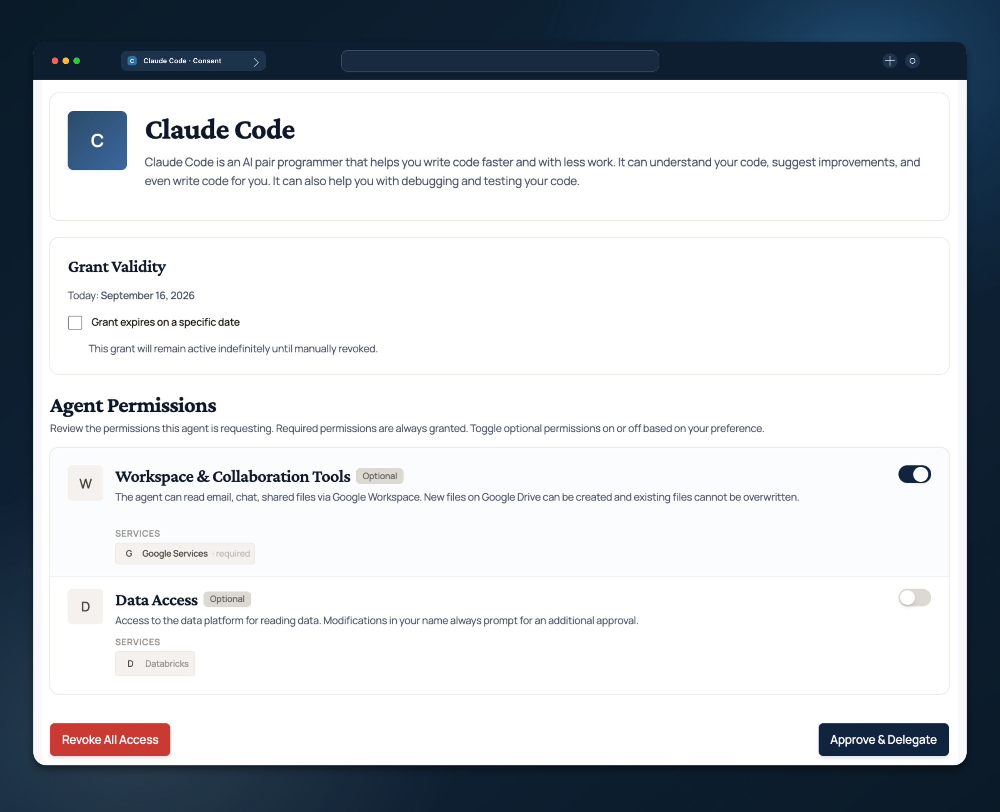

  <picture>
    <source media="(prefers-color-scheme: dark)" srcset="assets/docusaurus/static/img/AIB_Wordmark_White.svg" />
    <source media="(prefers-color-scheme: light)" srcset="assets/docusaurus/static/img/AIB_Wordmark_Black.svg" />
    
  </picture>
  

    
    
    
    
    
    
    
  

  

    Delegate <strong>scoped, revocable access</strong> to AI agents — without handing them your credentials.
  

---

AI agents now read tickets, review code, and send email for the people they work for. Each of those actions uses somebody's access to a third-party service. **Agentic Identity Broker** decides which agent can use which part of that access, for which person, and for how long. It keeps the provider tokens out of the agents and gives every user one place to approve and revoke access.

## Why does this exist?

A normal Monday: Lena asks the company assistant in Slack to *"summarize my team's open Linear tickets, check which GitHub pull requests are blocked, and email a status update to the launch stakeholders."* IT approved the assistant. The company runs MCP servers for Linear, GitHub, and Gmail. Plain OAuth still leaves these questions open:

- **Which agent is this?** GitHub sees one OAuth app. It cannot tell the assistant from the coding agent that uses the same app.
- **How much access?** GitHub's `repo` scope lets the assistant merge and delete, but it only needs to read.
- **Is this email acceptable?** Lena approved "Gmail access" once. Nobody asks her about *this* email to external people, even if a prompt injection in a ticket wrote it.
- **Who is asking?** The request starts in Slack. Nobody is at a browser to click an OAuth consent screen.
- **How does she take it back?** Next month Lena changes teams. She wants to remove the assistant's GitHub access and keep the coding agent's access. Today, every MCP server has its own consent flow and its own token store.

IT approval answers *which agents may exist in the company*. The broker answers *what each agent can do for each person, right now*: per-agent grants in business terms, expiry and revocation in one consent interface, approvals for sensitive tool calls, and token exchange at the gateway so that MCP servers only implement tools.

Read [Why does this exist?](https://agenticidentitybroker.dev/docs/introduction/why) for the full answers to *"Why is OAuth delegation not enough?"*, *"What is left after IT approves an agent?"*, and *"Is this only for enterprises?"*

## Key Features

- **Secure Identity Management** 
  Agent registration, principal authentication, and session management

- **OAuth2 Delegation & Consent** 
  Manage OAuth2 scopes and user consent for third-party service integrations

- **Security-First Design** 
  Sensitive value redaction, command injection prevention, cryptographic validation, and fail-closed architecture

- **Rich Consent Experience** 
  Modern UX for managing OAuth2 delegations with design system compliance

- **Comprehensive Audit Logging** 
  Structured JSON logging for compliance and security monitoring

## Use Cases

### Internal MCP Servers

**The problem:** An MCP server that calls GitHub or Google must get, store, encrypt, and refresh a token for every user. With twenty internal MCP servers, you run twenty authorization flows and twenty token stores, and users consent again for every server. **With the broker:** a gateway such as [Agentgateway](https://agentgateway.dev) exchanges the agent's token for the correct provider token on each request. MCP servers only implement tools, and agents reach hundreds of MCP servers through one channel.

### MCP Servers for SaaS

**The problem:** You offer an MCP server to your customers. They connect any agent they like, and you cannot see which agent acted or prove that the customer approved a sensitive action. **With the broker:** you get your own consent surface that records which agents were used, and an audit trail of tool approvals on your side, whatever agent the customer runs.

### Hosted Agents

**The problem:** A hosted agent must collect and protect a separate provider token for every MCP server it calls. **With the broker:** the agent holds one user token. A portal can collect consent up front, and the gateway exchanges that one token for each upstream MCP server.

### Delegation Chains Without User Presence

**The problem:** A user asks for something in Slack or Google Chat. There is no browser and no OAuth redirect, but the work still needs that user's permissions in another system. **With the broker:** a trusted chat bridge requests a token for the user with impersonation. The broker issues it only when the user has already delegated access to that agent. Otherwise the bridge gets a link to the consent page.

### Central Authorization Prompts

**The problem:** An agent is about to send an email to an external address or share a document. Some agent products ask the user first, others do not, and you cannot enforce it across products. **With the broker:** the gateway holds the tool call until the user approves it once, for the session, or permanently. This works for every agent that goes through the gateway and leaves a central audit trail.

## Documentation

Check out the following docs:

- [Quickstart](https://agenticidentitybroker.dev/docs/get-started) — Get started with Agentic Identity Broker in minutes.
- [Why does this exist?](https://agenticidentitybroker.dev/docs/introduction/why) — The problem, in day-to-day terms.
- [agenticidentitybroker.dev](https://agenticidentitybroker.dev/docs/introduction) – Underlying concepts, guides and API specs.

The [architecture overview](ARCHITECTURE.md) describes the system design, component boundaries, and domain glossary.

Agentic Identity Broker has a built-in consent management UI:

  

## Contributing

For contribution rules, test commands, and coverage reports, see [CONTRIBUTING.md](CONTRIBUTING.md).

## Roadmap

**Agentic Identity Broker** is currently in active development. We use this project in production internally for several MCP servers and have seen good potential. We are coding in the open to gauge our approach. If you find it useful, let us know. If you'd like a feature that's missing, open an issue in our [GitHub repo](https://github.com/zalando-incubator/agentic-identity-broker/issues).

While this project was created by professionals with decades of experience in the identity space (including building multiple OIDC and OAuth2 providers), it was developed with a strong focus on agentic engineering and spec-driven development. We review every PR and prioritize sound engineering practices over convenience.

Major roadmap topics include: (a) formalizing token exchange for agent-to-agent calls, (b) intent based authorization and (c) user facing acticity logs.

## Contributors

Thanks to all contributors who are helping to make the Agentic Identity Broker better.

### Star History

<a href="https://www.star-history.com/#zalando-incubator/agentic-identity-broker&Date">
 <picture>
   <source media="(prefers-color-scheme: dark)" srcset="https://api.star-history.com/svg?repos=zalando-incubator/agentic-identity-broker&type=Date&theme=dark" />
   <source media="(prefers-color-scheme: light)" srcset="https://api.star-history.com/svg?repos=zalando-incubator/agentic-identity-broker&type=Date" />
   
 </picture>
</a>

---

  <picture>
   <source media="(prefers-color-scheme: dark)" srcset="assets/docusaurus/static/img/Zalando_Wordmark_White_RGB.png" />
   <source media="(prefers-color-scheme: light)" srcset="assets/docusaurus/static/img/Zalando_Wordmark_Black_RGB.png" />
   
 </picture>
    
Agentic Identity Broker is a <a href="https://engineering.zalando.com/">Zalando Engineering</a> project.

