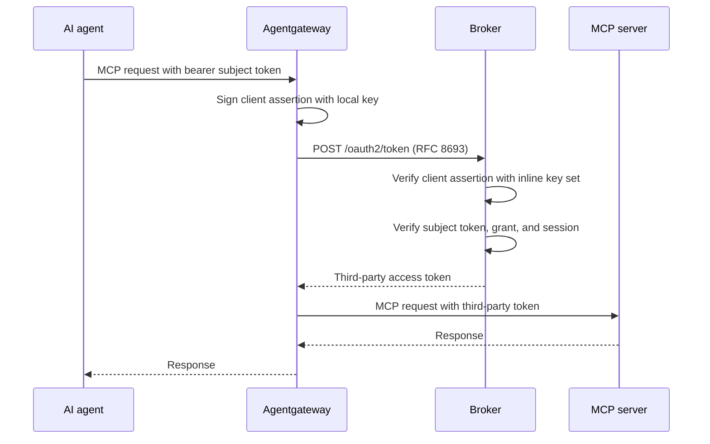

# Use the agentgateway token-exchange policy

Agentgateway v1.5.0 and later include an RFC 8693 client: the `oauthTokenExchange` backend
authentication policy. Agentgateway calls the broker `POST /oauth2/token` endpoint itself.
You do not deploy the [ExtProc sidecar](/docs/guides/token-exchange-gateway).

Agentgateway authenticates to the broker with `private_key_jwt`. It signs each client
assertion with a key that it holds locally. The broker verifies the assertion against an
inline key set. No service has to publish the gateway's public key.

This guide is tested with agentgateway v1.5.0.

## Choose the policy or the ExtProc sidecar

Both options perform the same broker exchange. They differ in what the agent sees and in the
extra gates that they offer.

| | `oauthTokenExchange` policy | ExtProc sidecar |
|---|---|---|
| Extra component | None | `extproc-token-exchange` gRPC sidecar |
| Gateway authentication | `private_key_jwt`, signed by agentgateway | Client assertion from an upstream client-credentials grant |
| Resource selection | Fixed `resources` list on the backend | CEL `resource_uri` expression on the route |
| Broker rejection | HTTP 500 with JSON-RPC error `-32603`. The broker `error_uri` is not passed on. | JSON-RPC error `-32042` URL elicitation with the broker `error_uri` |
| OPA gate and tool approvals | Not available | Optional |

Use the policy when you need only transparent exchange. Use the ExtProc sidecar when agents
must receive the re-consent or re-authentication link, or when you need the OPA gate or tool
approvals.

## What you need

- Agentgateway v1.5.0 or later.
- A reachable broker token endpoint at `POST /oauth2/token` on end-user port 8000.
- An RSA key pair for agentgateway. Agentgateway reads the private key from a PEM file. The
  broker receives the public key as a JWK.
- A registered third-party service whose `protected_resources` contains each URI in the
  agentgateway `resources` list. See
  [Manage agents and services](/docs/guides/manage-agents-and-services).
- Agents that send agentgateway a subject token that the broker accepts. Its `aud` must
  contain the broker audience. This guide uses the broker token endpoint URL. See
  [OAuth2 server modes](/docs/concepts/oauth2-server-modes).

## How the exchange flows



1. The agent calls agentgateway with its broker or upstream token as the bearer credential.
2. Agentgateway sends that credential unchanged as `subject_token`. It does not validate the
   credential. The broker validates it.
3. Agentgateway signs a client assertion. Its `iss` and `sub` are the configured `clientId`.
4. The broker verifies the assertion, the subject token, the user grant, and the stored
   provider session. It then returns the stored third-party token.
5. Agentgateway sends `Authorization: Bearer <third-party token>` to the backend.

## Step 1: Create the gateway key pair

Create an RSA private key for agentgateway. Then write its public half as a JWK Set. The
`kid` and `alg` values must match the agentgateway `clientAuth` settings in step 2.

```bash
openssl genpkey -algorithm RSA -pkeyopt rsa_keygen_bits:2048 -out gateway-signing.key

N=$(openssl rsa -in gateway-signing.key -noout -modulus | cut -d= -f2 \
  | python3 -c 'import base64, sys; print(base64.urlsafe_b64encode(bytes.fromhex(sys.stdin.read().strip())).rstrip(b"=").decode())')
printf '{"keys":[{"kty":"RSA","kid":"gateway-2026-09","alg":"RS256","use":"sig","e":"AQAB","n":"%s"}]}\n' "$N" > gateway-jwks.json
```

`e` is `AQAB` because `openssl genpkey` uses the public exponent 65537.
`gateway-signing.key` is a secret. Mount it only into agentgateway.
`gateway-jwks.json` holds only public key material.

## Step 2: Configure agentgateway

Add the `oauthTokenExchange` policy to the backend that receives the exchanged token:

```yaml
binds:
- port: 4000
  listeners:
  - routes:
    - backends:
      - mcp:
          targets:
          - name: tools
            mcp:
              host: https://mcp.example.com/mcp
        policies:
          backendAuth:
            oauthTokenExchange:
              host: https://broker.example.com
              path: /oauth2/token
              resources:
              - https://api.example.com
              clientAuth:
                method: privateKeyJwt
                clientId: https://gateway.example.com
                assertionAudience: https://broker.example.com/oauth2/token
                signingKey:
                  file: /etc/agentgateway/keys/gateway-signing.key
                alg: RS256
                kid: gateway-2026-09
```

Each agentgateway setting must match a broker setting:

| Agentgateway setting | Broker setting |
|---|---|
| `host` and `path` | The broker end-user URL and `/oauth2/token` |
| `resources` | A `protected_resources` entry of the service whose token the backend needs |
| `clientAuth.clientId` | `token_exchange.client_assertion.issuer_uri`. It is also the client assertion `sub` that the CEL policy sees. |
| `clientAuth.assertionAudience` | `token_exchange.expected_audience`. Use the full broker token endpoint URL. |
| `clientAuth.alg` and `clientAuth.kid` | `alg` and `kid` of a key in `token_exchange.client_assertion.jwks` |

## Step 3: Configure the broker

Make the gateway `clientId` the client-assertion issuer. Then put the JWK Set from step 1 inline:

```yaml
token_exchange:
  expected_audience: "https://broker.example.com/oauth2/token" # agentgateway assertionAudience
  client_assertion:
    issuer_uri: "https://gateway.example.com" # agentgateway clientId; never contacted
    jwks: |
      {"keys":[{"kty":"RSA","kid":"gateway-2026-09","alg":"RS256","use":"sig","e":"AQAB","n":"<base64url modulus>"}]}
  claim_extraction:
    principal_expression: "subject_token.sub"
    # Broker-issued tokens carry agent_id. Upstream tokens carry the client ID in azp.
    agent_id_expression: "has(subject_token.agent_id) ? subject_token.agent_id : resolveAgentIdByClientId(subject_token.azp)"
  authorization:
    type: "cel"
    cel:
      expression: 'client_assertion.sub == "https://gateway.example.com"' # only agentgateway may exchange
```

The broker makes no request to `issuer_uri` and no key-set request for this trust anchor.
You can also set the key set through `IDENTITY_BROKER_TOKEN_EXCHANGE_CLIENT_ASSERTION_JWKS`.
Use `jwks_file` to rotate keys without a restart.
See [Trust-anchor key sets](/docs/configuration#trust-anchor-key-sets) for the key-set rules.

The broker checks the same `expected_audience` in client assertions and subject tokens. The
default is `token-exchange-broker`. When you set it to the token endpoint URL, subject tokens
must carry that URL in `aud` too. In `local` mode, set it through the issued-token claims:

```yaml
oauth2_authorization_server:
  local:
    token_claims_expression: '{"agent_id": agent.id, "azp": agent.id, "aud": "https://broker.example.com/oauth2/token"}'
```

## The request that agentgateway sends

Agentgateway sends this form to the broker. Line breaks in the body are for display only:

```http
POST /oauth2/token HTTP/1.1
Host: broker.example.com
Content-Type: application/x-www-form-urlencoded
Accept: application/json

grant_type=urn%3Aietf%3Aparams%3Aoauth%3Agrant-type%3Atoken-exchange
&subject_token=eyJhbGciOiJFUzI1NiIsImtpZCI6ImJyb2tlci0xIn0.SYNTHETIC-SUBJECT.sig
&subject_token_type=urn%3Aietf%3Aparams%3Aoauth%3Atoken-type%3Aaccess_token
&resource=https%3A%2F%2Fapi.example.com
&client_id=https%3A%2F%2Fgateway.example.com
&client_assertion_type=urn%3Aietf%3Aparams%3Aoauth%3Aclient-assertion-type%3Ajwt-bearer
&client_assertion=eyJ0eXAiOiJKV1QiLCJhbGciOiJSUzI1NiIsImtpZCI6ImdhdGV3YXktMjAyNi0wOSJ9.SYNTHETIC-ASSERTION.sig
```

Decoded `client_assertion` (synthetic):

```json
{
  "header": { "typ": "JWT", "alg": "RS256", "kid": "gateway-2026-09" },
  "payload": {
    "iss": "https://gateway.example.com",
    "sub": "https://gateway.example.com",
    "aud": "https://broker.example.com/oauth2/token",
    "jti": "417174fe-17bf-4212-a4bf-46bccf33ff9e",
    "nbf": 1792683407,
    "iat": 1792683407,
    "exp": 1792683717
  }
}
```

The broker authenticates the gateway only through `client_assertion`. It ignores `client_id`
in a token-exchange request. The response and error contract is in the
[token exchange reference](/docs/reference/token-exchange).

## Operational notes

- **Token reuse.** Agentgateway reuses an exchanged token for later requests that carry the
  same subject token. It does not call the broker for each request. A revoked grant stops new
  exchanges. It does not recall a token that agentgateway already holds.
- **Failures.** When the broker rejects an exchange, an MCP client receives HTTP 500 with
  JSON-RPC error `-32603`. The message names only the broker HTTP status. To find the cause,
  use the broker `token_exchange.*` log and span attributes. See
  [diagnostic attributes](/docs/reference/token-exchange#diagnostic-attributes).
- **Key rotation.** Add the new public key to the broker key set first. Then switch the
  agentgateway `signingKey` and `kid`. Remove the old public key last. An inline `jwks` value
  changes only on restart. A `jwks_file` is re-read every `jwks_min_refresh`.

## Related

- [Set up token exchange at the gateway](/docs/guides/token-exchange-gateway) — the ExtProc
  sidecar alternative.
- [Token exchange](/docs/concepts/token-exchange) — the concept and the broker-side flow.
- [Token exchange reference](/docs/reference/token-exchange) — the RFC 8693 request and
  response contract.
- [Configuration](/docs/configuration#trust-anchor-key-sets) — inline and file key sets for
  trust anchors.
