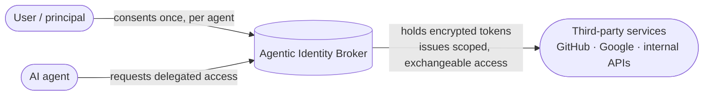

# What is the Agentic Identity Broker?

The Agentic Identity Broker is an open-source **OAuth2 broker for delegation and consent**.
It lets a user give an AI agent access to third-party services. Access is scoped to
specific permissions. The user can limit it by time or revoke it.

The broker sits between three parties:

A user gives consent once for each agent and service. The broker stores third-party tokens
**encrypted at rest**. It gives agents scoped, exchangeable, auditable access. An agent
never sees the user's long-lived credentials.

## The problem

AI agents often call services for the people they work for. Picture a normal morning. An
employee asks the company AI assistant in a Google Chat to summarize the open Linear tickets of the
team, check the blocked GitHub pull requests, and email a status update to the launch
stakeholders. That one sentence needs the employee's Linear, GitHub, and Gmail access.
Somebody must decide which part of that access the assistant gets, whether the email to
external people is acceptable, and how to take the access back next month.

OAuth lets the employee connect each service. It does not show which agent uses the
token, it cannot ask about one specific email, and it expects the employee at a browser,
not in GChat. Read [Why does this exist?](/docs/introduction/why) for the full story and
answers to the common questions.

Each common access method has a failure mode that an IAM team can recognize:

| Approach | Why it breaks down |
|---|---|
| Hand the agent the user's OAuth token | The token is too broad. You cannot revoke it per agent. There is no record of agent activity. Tokens spread to every agent. |
| Give each agent its own third-party client | It does not scale. There is no shared consent interface. Provider secrets are copied to every agent. |
| Static API keys or shared service accounts | There is no per-user delegation or expiry. Consent and audit are weak. |

Each option loses **least privilege**, **user consent**, **revocability**, or
**auditability**. Most options lose several. With many agents and users, token sprawl
creates security and operational problems.

## The approach

The broker inserts a single, governed trust boundary:

- **The user consents** to a specific permission set for a specific agent and service. A
  grant can expire.
- **The broker holds the third-party tokens.** It encrypts each token with per-service
  envelope encryption and refreshes tokens when necessary.
- **Agents receive scoped access.** At request time, a gateway can exchange an agent
  token for the appropriate third-party token with
  [RFC 8693 token exchange](/docs/concepts/token-exchange). Agents never hold provider
  credentials.
- **The broker records every delegation.** A user can withdraw a grant or end a
  third-party session. Dependent agents then lose access.

The broker supports standard OAuth2. It exposes an
[authorization-server surface](/docs/concepts/oauth2-server-modes) (RFC 6749
authorization code + PKCE, RFC 8414 metadata, and a JWKS endpoint). It can proxy an
existing corporate authorization server or issue its own tokens.

## Who it is for

- **IAM and security teams.** They can apply current consent, least-privilege, and audit
  rules to agent access.
- **Platform and infrastructure operators.** They can use a broker rather than repeat
  token storage and refresh in each agent.
- **Teams that use an agent gateway.** They can use policy-checked token exchange at the
  edge.

## What it is not

- It is **not a user identity provider**. The broker does not authenticate humans. A
  trusted reverse proxy authenticates the user and sends the identity in a header.
  Continue to use Keycloak, Auth0, Okta, or your corporate IdP for human login. See
  [Why not a traditional IdP?](/docs/introduction/why-not-idp).
- It is **not a general secrets manager**. It stores OAuth2 delegations and their
  third-party tokens. It does not store arbitrary application secrets.

## Where to go next

- **[Why does this exist?](/docs/introduction/why)** — why OAuth delegation alone is not
  enough, and what is left after IT approves an agent.
- **[Use cases](/docs/introduction/use-cases)** — concrete scenarios where delegated agent
  access is the hard part.
- **[Why not a traditional IdP?](/docs/introduction/why-not-idp)** — how the broker
  complements, rather than replaces, your identity provider.
- **[Concepts](/docs/concepts)** — the delegation model, architecture, server modes, token
  exchange, and encryption.
- **[Get started](/docs/get-started)** — run the full stack locally and walk a delegation
  end to end.
