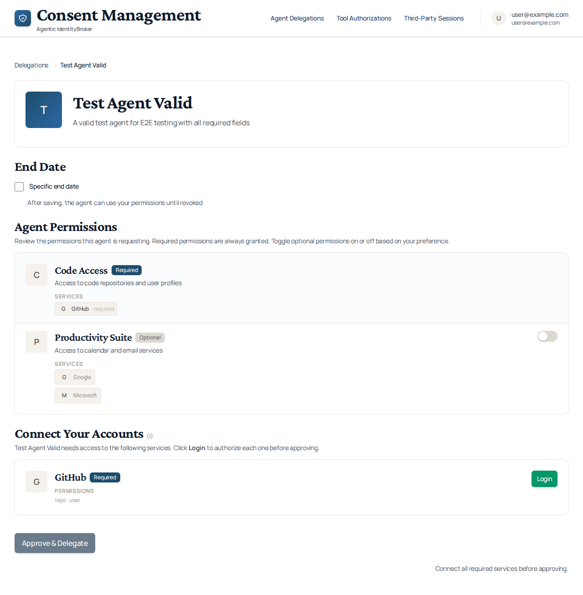
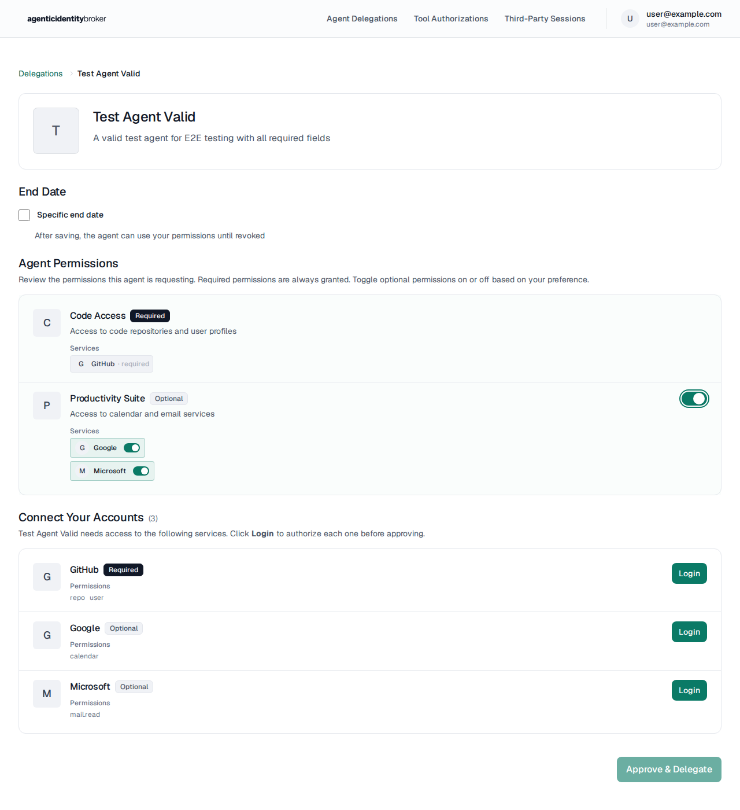
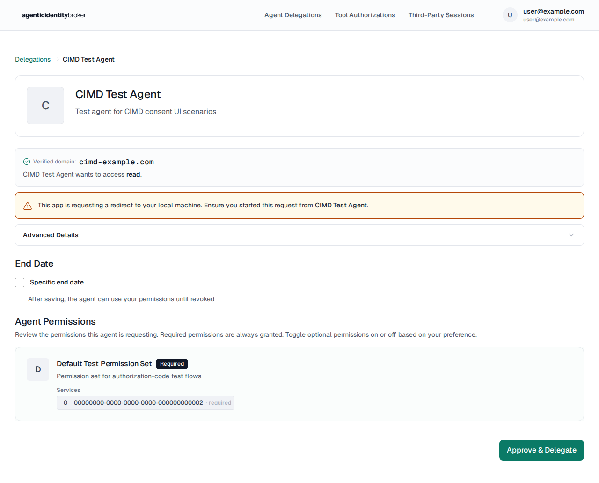
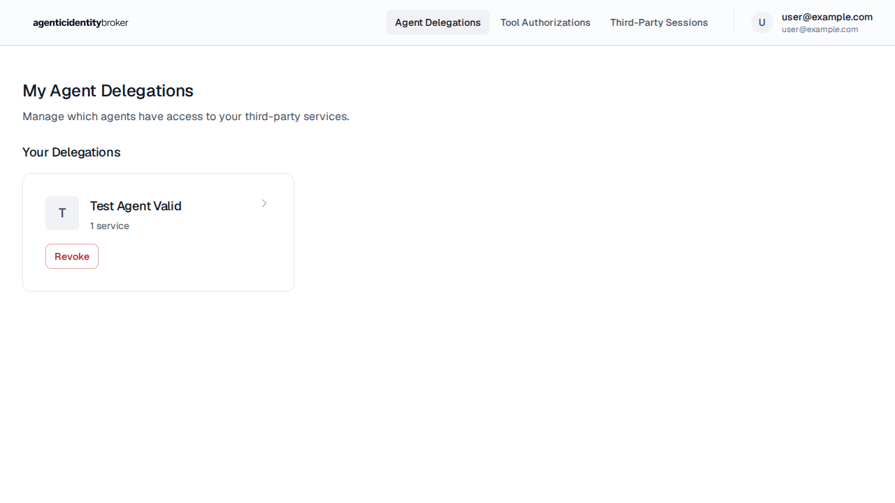
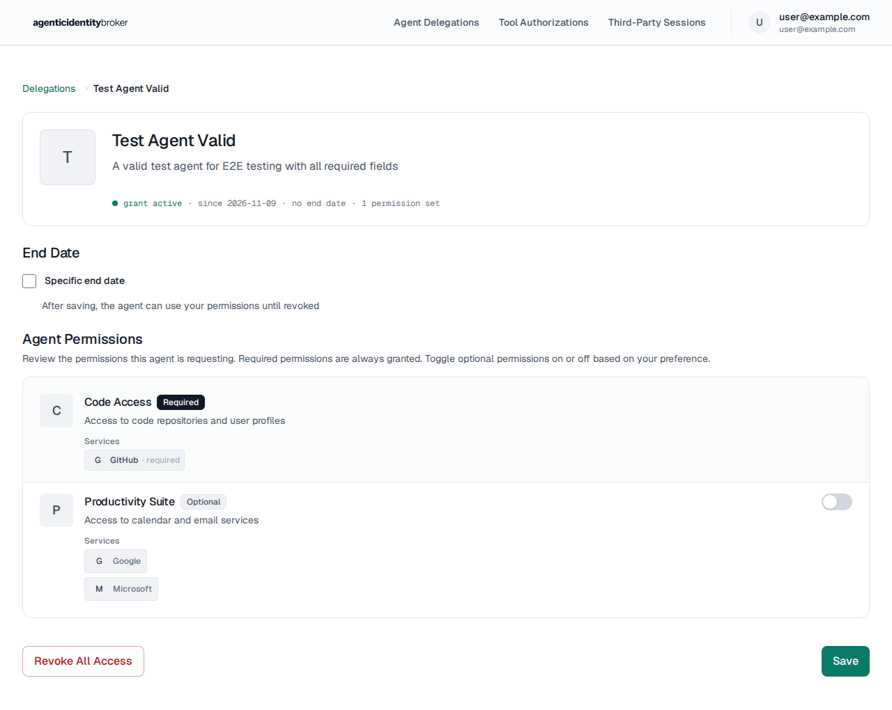
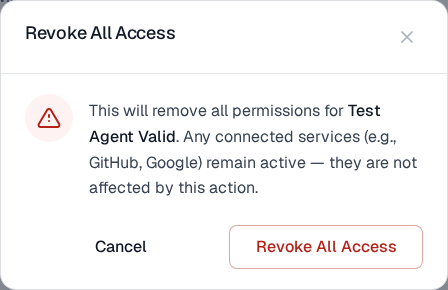

# Consent and delegation

An agent can act for a user only after the user said yes. This page describes how Alice gives
that consent, what the broker records, how she reviews it later, and how she takes it back.

:::note How to read this page
This is a living specification. A badge such as "tested" after a sentence links to the acceptance
scenario that proves it. Each HTTP exchange shown here is compared with what that scenario really
sent and received. `just living-docs` runs the comparison and fails when the page and the broker
disagree. UUIDs and timestamps are synthetic. The check compares timestamps by shape and UUIDs by
which of them are equal.
:::

## The cast

Alice (`alice@example.com`) wants the agent *Research Assistant* to read her repositories on the
provider *GitHub*. An administrator has registered the agent and has given it the permission set
`github-read` as mandatory and a calendar permission set as optional.

Alice reaches the broker through the company's sign-in proxy. The proxy tells the broker who she
is, and the broker calls that identity the **Principal**. A **UserGrant** is the record of what a
principal allowed one agent to do. A **UserSession** is Alice's connection to one provider, with
its stored tokens.

The exchanges and screenshots on this page come from test scenarios, so they keep the names of
the test data. Alice appears as `user@example.com`. The agent and the permission sets carry
fixture names such as "Consent Screen Test Agent", "Mandatory PS", and "Code Access".

## An authorization request leads to the consent screen

The agent starts an OAuth2 authorization request. Alice has no grant for this agent yet, so the
broker does not continue the flow. It sends her browser to the consent screen for the agent: `example:consent-and-delegation.authorize.sends-to-consent`

```http example="consent-and-delegation.authorize.sends-to-consent"
GET /oauth2/authorize?client_id=550e8400-e29b-41d4-a716-446655440000&redirect_uri=https%3A%2F%2Fclient.example.com%2Fcb&response_type=code&state=state123 HTTP/1.1
X-Remote-User: user@example.com

HTTP/1.1 302 Found
Location: http://localhost:8000/agents/550e8400-e29b-41d4-a716-446655440000?session_token=…

<a href="…">Found</a>.
```

The consent URL names the agent and carries one parameter, `session_token`. It does not repeat
the agent's `redirect_uri` or any other part of the request. The token is sealed: the browser
can pass it on but cannot read or change it. Inside are the **AuthorizationSessionClaims**: the
agent, the principal, the original request URL, and an expiry ten minutes after issue. `example:consent-and-delegation.session-token.claims`

The reason is trust in what the screen shows. If the request details travelled as plain URL
parameters, an attacker could build a consent link with a false name or a false return address.
With a sealed token, everything the screen shows about the request comes from the broker itself.

### The token works for one user, one agent, and ten minutes

The token is bound to Alice. Another user who gets hold of her consent link cannot open the
request with it: `example:consent-and-delegation.session-token.other-user`

```http example="consent-and-delegation.session-token.other-user"
GET /api/consent/agents/550e8400-e29b-41d4-a716-446655440000?session_token=… HTTP/1.1
X-Remote-User: another-user@example.com

HTTP/1.1 400 Bad Request

{
  "error": "bad request",
  "message": "invalid authorization session"
}
```

The other user cannot approve with it either. The broker refuses that attempt with
`403 Forbidden`. `example:consent-and-delegation.session-token.other-user-save`

The token is also bound to the agent. A token that was issued for one agent is refused on the
consent screen of another, with the message
`authorization session does not match requested agent`. `example:consent-and-delegation.session-token.other-agent`

If Alice leaves the consent screen open for more than ten minutes and then approves, the broker
stores nothing and answers `400 Bad Request` with the error `session_expired`. She has to start
the request again from the agent. `example:consent-and-delegation.session-token.expired`

## What the consent screen shows

The screen asks the broker what the agent wants. The answer lists the agent, its permission
sets in the order the administrator declared them, and the providers they need: `example:consent-and-delegation.consent-screen.permission-sets`

```http example="consent-and-delegation.consent-screen.permission-sets"
GET /api/consent/agents/550e8400-e29b-41d4-a716-446655440000 HTTP/1.1
X-Remote-User: user@example.com

HTTP/1.1 200 OK

{
  "data": {
    "agent": {
      "agentId": "550e8400-e29b-41d4-a716-446655440000",
      "display_name": "Consent Screen Test Agent",
      "description": "Agent for consent screen tests",
      "…": "…"
    },
    "permission_sets": [
      {
        "permission_set": {
          "id": "770e8400-e29b-41d4-a716-446655440001",
          "name": "Mandatory PS",
          "description": "Required permissions",
          "service_scopes": [
            {"service_id": "880e8400-e29b-41d4-a716-446655440010", "requirement_type": "optional"}
          ]
        },
        "requirement_type": "mandatory"
      },
      {
        "permission_set": {
          "id": "770e8400-e29b-41d4-a716-446655440002",
          "name": "Optional PS",
          "description": "Optional permissions",
          "service_scopes": [
            {"service_id": "880e8400-e29b-41d4-a716-446655440011", "requirement_type": "optional"}
          ]
        },
        "requirement_type": "optional"
      }
    ],
    "active_session_service_ids": [],
    "service_requirements": [
      {"service_id": "880e8400-e29b-41d4-a716-446655440010", "requirement_type": "mandatory"},
      {"service_id": "880e8400-e29b-41d4-a716-446655440011", "requirement_type": "optional"}
    ],
    "…": "…"
  }
}
```

A permission set reaches Alice as a name and a description, not as a list of OAuth2 scopes.
`service_requirements` says which provider connections the agent needs and which of them are
mandatory. `active_session_service_ids` is empty here because Alice has connected no provider
yet. After she connects GitHub, the GitHub service ID appears in that list. `example:consent-and-delegation.consent-screen.connected-providers`

The screen turns this answer into four parts: the agent, the end date, the permission sets, and
the accounts to connect.



A mandatory permission set has the badge "Required" and no switch. Alice cannot approve the
agent without it. `example:consent-and-delegation.screen.mandatory-locked` An optional
permission set has a switch that starts in the off position. When Alice turns it on, its
providers join the list of accounts to connect. When she turns it off, they leave the list
again. `example:consent-and-delegation.screen.optional-adds-providers`



Under "End Date", Alice can leave the grant open-ended or pick a date in the future. `example:consent-and-delegation.screen.end-date`

### Approve waits for the provider connections

A grant is of no use while the agent cannot reach a provider that Alice included. The button
"Approve & Delegate" therefore stays disabled while a required provider is not connected. `example:consent-and-delegation.screen.approve-disabled`
Each missing provider has a "Login" button. Connecting a provider account is described on the
page "Third-party sessions".

A provider that Alice has already connected is not listed for another login. `example:consent-and-delegation.screen.existing-grant`
Once every provider that her selection needs is connected, she can approve. `example:consent-and-delegation.screen.approve`

### An agent that identifies itself with a metadata document

Some agents are not known by a UUID. They present a URL that points to a client metadata
document. For such a request the sealed token also carries what the broker verified about the
client, and the consent answer returns it as `cimd_metadata`: `example:consent-and-delegation.consent-screen.cimd-client`

```http example="consent-and-delegation.consent-screen.cimd-client"
GET /api/consent/agents/550e8400-e29b-41d4-a716-446655440000?session_token=… HTTP/1.1
X-Remote-User: user@example.com

HTTP/1.1 200 OK

{
  "data": {
    "cimd_metadata": {
      "client_id_url": "https://agent.example.com/client",
      "redirect_uri": "https://agent.example.com/callback",
      "verified_domain": "agent.example.com",
      "requested_scopes": ["repo"]
    },
    "…": "…"
  }
}
```

The screen shows the domain of that URL as "Verified domain", so that Alice can see who is
asking. `example:consent-and-delegation.screen.cimd-domain-badge` When the request would
return to an address on her own computer, the screen adds a warning that asks her to make sure
she started the request herself. `example:consent-and-delegation.screen.cimd-localhost-warning`



## What a grant records

Alice has connected GitHub and Google, kept the mandatory permission set, and turned on the
optional one. She approves. The screen sends her choice: each chosen permission set, and under
it the providers she included. `example:consent-and-delegation.grant.record`

```http example="consent-and-delegation.grant.record"
POST /api/consent/agents/550e8400-e29b-41d4-a716-446655440000/grants HTTP/1.1
X-Remote-User: user@example.com
Content-Type: application/json

{
  "granted_permission_sets": {
    "770e8400-e29b-41d4-a716-446655440001": ["880e8400-e29b-41d4-a716-446655440010"],
    "770e8400-e29b-41d4-a716-446655440002": ["880e8400-e29b-41d4-a716-446655440011"]
  }
}

HTTP/1.1 201 Created

{
  "data": {
    "id": "990e8400-e29b-41d4-a716-446655440020",
    "principal": "user@example.com",
    "agent_id": "550e8400-e29b-41d4-a716-446655440000",
    "granted_permission_sets": {
      "770e8400-e29b-41d4-a716-446655440001": ["880e8400-e29b-41d4-a716-446655440010"],
      "770e8400-e29b-41d4-a716-446655440002": ["880e8400-e29b-41d4-a716-446655440011"]
    },
    "created_at": "2026-10-30T09:00:00Z",
    "updated_at": "2026-10-30T09:00:00Z"
  }
}
```

The UserGrant holds the principal, the agent, and the chosen permission sets with their
providers. It holds no tokens. The grant has no `valid_until` member here, because Alice set no
end date.

There is one UserGrant for each pair of user and agent. When Alice approves the same agent
again with only the mandatory permission set, the broker answers with the same grant `id`, and
the new choice replaces the old one. `example:consent-and-delegation.grant.one-per-user-and-agent`

The broker checks the choice on its side too. A request that leaves out the mandatory
permission sets is refused, whatever the screen allowed: `example:consent-and-delegation.grant.mandatory-required`

```http example="consent-and-delegation.grant.mandatory-required"
POST /api/consent/agents/550e8400-e29b-41d4-a716-446655440000/grants HTTP/1.1
X-Remote-User: user@example.com
Content-Type: application/json

{
  "granted_permission_sets": {}
}

HTTP/1.1 400 Bad Request

{
  "error": "missing mandatory permission set",
  "message": "missing mandatory permission set: at least one permission set must be granted for agents that use permission sets"
}
```

## Back to the agent

Alice came from an authorization request, so the screen sends the `session_token` along when
she approves. The broker stores the grant, opens the token, and returns the original request
URL as `redirect_url`: `example:consent-and-delegation.grant.return-to-agent`

```http example="consent-and-delegation.grant.return-to-agent"
POST /api/consent/agents/550e8400-e29b-41d4-a716-446655440000/grants?session_token=… HTTP/1.1
X-Remote-User: user@example.com
Content-Type: application/json

{
  "granted_permission_sets": {
    "770e8400-e29b-41d4-a716-446655440001": ["880e8400-e29b-41d4-a716-446655440010"]
  }
}

HTTP/1.1 201 Created

{
  "data": {
    "id": "990e8400-e29b-41d4-a716-446655440020",
    "agent_id": "550e8400-e29b-41d4-a716-446655440000",
    "…": "…"
  },
  "redirect_url": "/oauth2/authorize?client_id=550e8400-e29b-41d4-a716-446655440000&redirect_uri=https%3A%2F%2Fclient.example.com%2Fcb&response_type=code&state=originalstate456&code_challenge=…&code_challenge_method=S256"
}
```

The URL is the agent's request as it first arrived, with its `state` and its PKCE challenge. The
browser follows it. This time the grant exists, so the broker completes the request. In this
example the broker is its own authorization server and returns Alice to the agent with a code:

```http example="consent-and-delegation.grant.return-to-agent"
GET /oauth2/authorize?client_id=550e8400-e29b-41d4-a716-446655440000&redirect_uri=https%3A%2F%2Fclient.example.com%2Fcb&response_type=code&state=originalstate456&code_challenge=…&code_challenge_method=S256 HTTP/1.1
X-Remote-User: user@example.com

HTTP/1.1 302 Found
Location: https://client.example.com/cb?code=…&state=originalstate456

<a href="…">Found</a>.
```

Alice can also open the consent screen on her own, without any request from the agent. Then
there is no token and nowhere to return to, and the answer has no `redirect_url`. `example:consent-and-delegation.grant.without-authorization-request`

## Seeing what she allowed

The page "My Agent Delegations" lists the agents that hold a grant from Alice. Each card shows
the agent and a "Revoke" action. `example:consent-and-delegation.screen.overview`



A card opens the same screen that Alice used for consent. Because a grant exists, the screen now
offers "Save" for changes and "Revoke All Access". `example:consent-and-delegation.screen.existing-grant`
For an agent without a grant, the screen has no revoke button. `example:consent-and-delegation.screen.no-grant-no-revoke`



## Taking it back

Alice decides that the Research Assistant should no longer act for her. Both revoke actions
first ask for confirmation. The dialog names the agent and says that her connected providers
remain active. `example:consent-and-delegation.screen.revoke-dialog` If she cancels, nothing
changes. `example:consent-and-delegation.screen.revoke-cancel`



Revoking deletes the UserGrant. It is not kept in a "revoked" state. Afterwards Alice has no
grant for the agent: `example:consent-and-delegation.revoke.grant-deleted`

```http example="consent-and-delegation.revoke.grant-deleted"
DELETE /api/consent/agents/550e8400-e29b-41d4-a716-446655440000/grants HTTP/1.1
X-Remote-User: user@example.com

HTTP/1.1 204 No Content
```

```http example="consent-and-delegation.revoke.grant-deleted"
GET /api/consent/agents/550e8400-e29b-41d4-a716-446655440000/grants HTTP/1.1
X-Remote-User: user@example.com

HTTP/1.1 200 OK

{
  "data": null
}
```

The effect is immediate. A token exchange that the agent made for Alice a moment before the
revocation succeeded. The same exchange right after it is refused with `403 Forbidden`. `example:consent-and-delegation.revoke.token-exchange-refused`

Alice can revoke only her own grant. When another user sends the same request for the same
agent, the broker answers `404 Not Found`, as if no grant existed. The answer does not reveal
that Alice has one. `example:consent-and-delegation.revoke.other-user`

## When consent is asked again

A grant that no longer covers the agent's request sends Alice back to the consent screen at the
next authorization request.

- **The grant has passed its end date.** The broker treats it as if it did not exist. `example:consent-and-delegation.reconsent.expired-grant`
- **The grant was revoked.** It is deleted, so the next request is like the first one on this
  page.
- **A provider that the grant includes is no longer connected.** The broker asks again even if
  that provider belongs to an optional permission set, because Alice included it. `example:consent-and-delegation.reconsent.missing-provider-session`
  She can reconnect the provider, or she can save the grant without it. After that, the request
  goes through. `example:consent-and-delegation.reconsent.deselect-provider`

## Not yet on this page

- No scenario saves a grant with an end date through the API. The page therefore shows the end
  date only as a control on the screen, not as the `valid_until` member of a grant.
- No browser scenario confirms a revocation. The page shows the dialog and the API call, but not
  the screen after the grant is gone. No scenario checks that a UserSession still exists after
  a revocation; the page reports only what the dialog says.
- No acceptance scenario sends an authorization request after a revocation, and none reads the
  list of delegated agents through the API.
- The broker also refuses, on its side, a grant that includes a provider without a connection.
  Only unit tests cover that rule, so the page describes the disabled button and not the
  refusal.
- The Advanced Details of a metadata-document client, its name and logo, and the per-provider
  switches inside a permission set are specified but not described here.
- Tool approvals and the definition of permission sets have their own pages.

## Sources

The behavior on this page was decided in `specs/006-domain-model-apis/spec.md`,
`specs/007-consent-frontend/spec.md`, `specs/011-agent-permission-requirements/spec.md`,
`specs/019-permission-sets/spec.md`, `specs/022-revoke-agent-consent/spec.md`,
`specs/031-unified-session-token/spec.md`, and, for parts of it, `specs/009-oauth2-auth-server/spec.md`
and `specs/028-cimd-support/spec.md`. The decisions are in
`adrs/016-authorization-session-anti-spoofing.md` and `adrs/035-root-mounted-spa.md`. The
contract is `api/enduser/openapi.yaml`.

The API scenarios are in `tests/e2e/unified_session_token_test.go`,
`tests/e2e/session_token_consumption_test.go`, `tests/e2e/permission_sets_test.go`,
`tests/e2e/revoke_grant_test.go`, `tests/e2e/cimd_consent_test.go`, and
`tests/e2e/oauth2_authorize_test.go`. The browser scenarios are in
`tests/e2e/frontend/consent_flow_test.go`, `tests/e2e/frontend/permission_sets_frontend_test.go`,
`tests/e2e/frontend/revoke_grant_flow_test.go`, and `tests/e2e/frontend/cimd_consent_test.go`.
