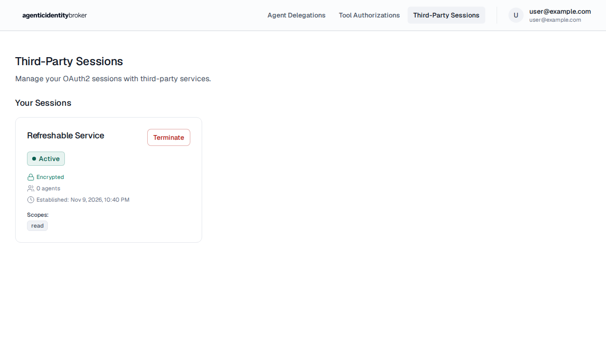
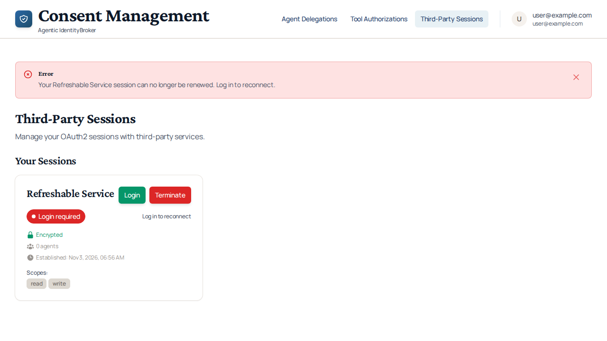
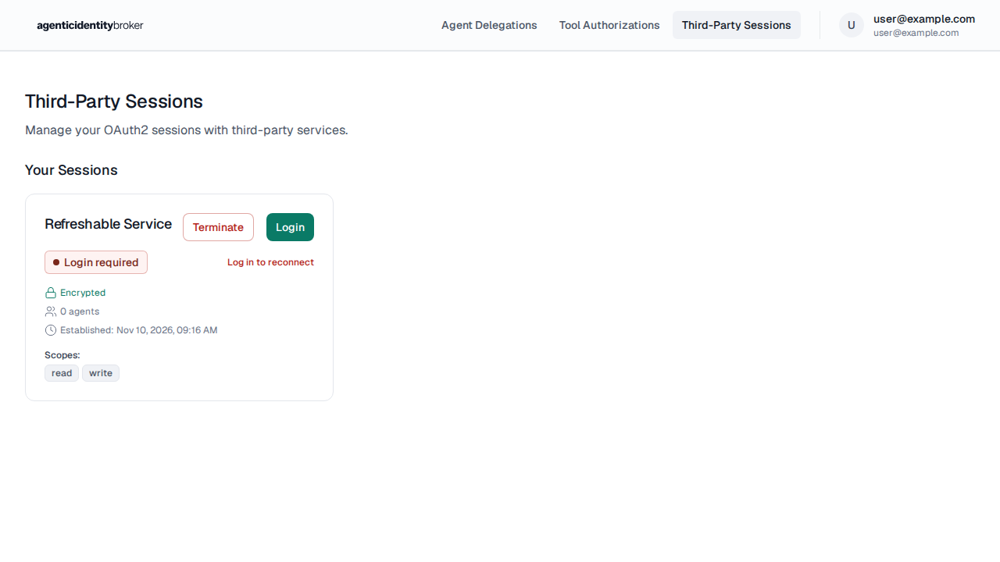

# Third-party sessions

An agent can act for Alice at a provider such as GitHub only while the broker holds working GitHub
tokens for her. This page describes how Alice connects her account, what she sees afterwards, how
the broker keeps the tokens fresh, and what happens when GitHub stops accepting them.

:::note How to read this page
This is a living specification. A badge such as "tested" after a sentence links to the acceptance
scenario that proves it. Each HTTP exchange shown here is compared with what that scenario really
sent and received. `just living-docs` runs the comparison and fails when the page and the broker
disagree. UUIDs and timestamps are synthetic. The check compares timestamps by shape and UUIDs by
which of them are equal.
:::

## The cast

Alice uses the agent *Research Assistant*. In the acceptance suite her **Principal** is
`user@example.com`. The provider *GitHub* is registered as a **ThirdpartyOAuth2Service** with the
client ID `github-client-id` and the scopes `repo`, `user`, and `read:org`. In these examples its
UUID is `660e8400-e29b-41d4-a716-446655440010`.

A **UserSession** is the broker's record of Alice's connection to one service. It holds her
access token and, when the provider issues one, her refresh token. Both are stored encrypted.

The platform operator `admin@example.com` keeps sessions healthy through the admin API. The broker
runs at `http://localhost:8000` in these examples.

## Alice connects her GitHub account

Alice starts a login for one service and says where she wants to return to. The broker does not
show a page of its own. It redirects her browser to GitHub's authorization page: `example:third-party-sessions.connect.reconnect`

```http example="third-party-sessions.connect.reconnect"
GET /api/third-party/660e8400-e29b-41d4-a716-446655440010/oauth2/authorize?redirect_uri=http%3A%2F%2Flocalhost%3A8000%2Fsessions HTTP/1.1
X-Remote-User: user@example.com

HTTP/1.1 302 Found
Location: http://127.0.0.1:…/oauth/authorize?client_id=github-client-id&code_challenge=…&code_challenge_method=S256&redirect_uri=http%3A%2F%2Flocalhost%3A8000%2Fapi%2Fthird-party%2F660e8400-e29b-41d4-a716-446655440010%2Foauth2%2Fcallback&response_type=code&scope=repo+user+read%3Aorg&state=…

<a href="http://127.0.0.1:…">Found</a>.
```

The redirect is an authorization code request with PKCE:

- `client_id` and `scope` come from the registered service, not from the browser.
- `redirect_uri` is the broker's own callback for this service.
- `code_challenge` with the method `S256` starts PKCE. The broker keeps the verifier.
- `state` is an encrypted token. It carries who started the login, for which service, the PKCE
  verifier, and where Alice wants to return to.

A second test checks these parameters for a service that is registered with GitHub's public
addresses. `example:third-party-sessions.connect.authorization-request`

An administrator can register extra authorization parameters for a service. The broker then adds
them to this redirect and to its token requests. `example:third-party-sessions.connect.provider-parameters`

### GitHub sends Alice back

Alice approves at GitHub. GitHub redirects her browser to the broker's callback with a code and
the `state`. The broker exchanges the code for tokens, stores them, and sends Alice to the page
she named:

```http example="third-party-sessions.connect.reconnect"
GET /api/third-party/660e8400-e29b-41d4-a716-446655440010/oauth2/callback?code=mock-auth-code-123&state=… HTTP/1.1
X-Remote-User: user@example.com

HTTP/1.1 302 Found
Location: http://localhost:8000/sessions?service_id=660e8400-e29b-41d4-a716-446655440010&success=true

<a href="http://localhost:8000/sessions?service_id=660e8400-e29b-41d4-a716-446655440010&amp;success=true">Found</a>.
```

The broker stores the access token and the refresh token as ciphertext. `example:third-party-sessions.connect.tokens-encrypted`
For a service registered as a public client, the code exchange carries the client ID and the PKCE
verifier and no client secret. `example:third-party-sessions.connect.public-client`

Alice can also start the login from an agent's page while she chooses what to delegate. Her
selections are still there when she comes back from the provider. `example:third-party-sessions.connect.from-agent-page`

### When the login does not complete

If Alice refuses at GitHub, GitHub calls the callback with an error such as `access_denied`. The
broker redirects her to `/sessions` with that error code and with its own fixed description,
"Authorization failed - please try again". Text that the provider sent does not reach the
redirect. `example:third-party-sessions.connect.provider-denies`

A callback whose `state` the broker cannot decrypt is answered the same way, with
`error=invalid_state`. `example:third-party-sessions.connect.invalid-state`

### One session per user and service

Alice has at most one session with GitHub. When she logs in again, the broker replaces the tokens
in the same session; the session keeps its ID. `example:third-party-sessions.connect.reconnect`

A browser can have two logins for the same service in flight, for example in two tabs. The tokens
of the callback that completes first stay. The later callback also ends with `success=true`, but
it does not replace them. A login that Alice starts after that replaces them as usual. `example:third-party-sessions.connect.concurrent-logins`

## What Alice sees

The broker's sessions API answers for the calling user only. Alice's list has one entry for each
service she connected: `example:third-party-sessions.sessions.list`

```http example="third-party-sessions.sessions.list"
GET /api/third-party/sessions HTTP/1.1
X-Remote-User: user@example.com

HTTP/1.1 200 OK

{
  "data": {
    "sessions": [
      {
        "id": "880e8400-e29b-41d4-a716-446655440020",
        "service_id": "660e8400-e29b-41d4-a716-446655440010",
        "token_type": "Bearer",
        "scope": ["read", "write"],
        "initiated_at": "2026-10-30T09:00:00Z",
        "requires_reauthentication": false,
        "is_expired": false,
        "access_token_expired": false,
        "has_refresh_token": true,
        "dependent_agent_count": 1,
        "is_encrypted": true,
        "…": "…"
      }
    ]
  }
}
```

The entry never contains a token. It says three things about the session's health:

- `requires_reauthentication`: Alice must log in again before the session is usable.
  `is_expired` is an older name for the same value.
- `access_token_expired`: the stored access token is past its expiry.
- `has_refresh_token`: the provider issued a refresh token and the broker stores it.

`dependent_agent_count` is the number of agents that Alice allowed to use this service. Another
user has a session and an agent for the same service in this scenario, and neither is counted.

The detail of one session names those agents. It also shows when the access token expires:

```http example="third-party-sessions.sessions.detail"
GET /api/third-party/660e8400-e29b-41d4-a716-446655440010/session HTTP/1.1
X-Remote-User: user@example.com

HTTP/1.1 200 OK

{
  "data": {
    "dependent_agent_count": 1,
    "dependent_agents": [
      {
        "id": "550e8400-e29b-41d4-a716-446655440000",
        "display_name": "Test Agent Valid"
      }
    ],
    "session": {
      "id": "880e8400-e29b-41d4-a716-446655440020",
      "service_id": "660e8400-e29b-41d4-a716-446655440010",
      "principal": "user@example.com",
      "access_token_expires_at": "2026-10-30T10:00:00Z",
      "encryption_context": {
        "service_id": "660e8400-e29b-41d4-a716-446655440010"
      },
      "…": "…"
    }
  }
}
```

A user who asks for a session of a service that only someone else connected gets `404 Not Found`,
the same answer as for no session at all. `example:third-party-sessions.sessions.other-user`
The session store lists sessions by Principal, so one user's list never contains another user's
session. `example:third-party-sessions.sessions.per-user`

### The sessions page

The page "Third-Party Sessions" shows one card for each session. A card shows the service name,
a status, that the tokens are encrypted, the number of agents, when the session was established,
and the scopes. This card belongs to a usable session without a refresh token. It offers
Terminate and nothing else: `example:third-party-sessions.page.access-only`



A session with a refresh token also offers Refresh. Refresh asks the provider for new tokens at
once, and the page confirms with "Session token refreshed successfully." `example:third-party-sessions.page.refresh`

## The broker keeps the tokens fresh

Access tokens expire. Alice does not have to act while the provider still accepts her refresh
token. How a gateway obtains Alice's token is described on the page "Token exchange". This section
describes only what happens to the session.

- **The access token expires soon.** Alice's token is valid for two more minutes, which is inside
  the configured refresh lookahead of five minutes. A token exchange returns the current token at
  once. The broker refreshes the session in the background, and a later exchange returns the new
  token. The provider is asked once. `example:third-party-sessions.refresh.near-expiry`
- **The access token has expired.** The broker refreshes the session during the exchange, stores
  the new tokens, and returns the new access token. `example:third-party-sessions.refresh.expired`
- **Alice asks for it.** The Refresh button calls
  `POST /api/third-party/660e8400-e29b-41d4-a716-446655440010/session/refresh`. The broker sends
  the stored refresh token to the provider and answers with the updated session summary. `example:third-party-sessions.refresh.manual`
  For a session without a refresh token the answer is `409 Conflict` with the error
  `refresh_unavailable`. `example:third-party-sessions.refresh.manual-unavailable`

## When the provider rejects the refresh token

GitHub can answer a refresh with `invalid_grant`, for example after Alice revoked the broker's
access at GitHub. The broker cannot repair that. It records a **Refresh Rejection** on the
session and leaves the stored tokens and the access-token expiry unchanged. The token exchange
that caused the refresh is answered with `400 invalid_grant` and an `error_uri`. `example:third-party-sessions.rejection.observed`

The `error_uri` is the login address from the start of this page, for this service, with the
sessions page as the place to return to. A gateway can show this link to the user of the agent.

From then on the session requires reauthentication:

- The next token exchange gets the same answer, and the broker does not ask GitHub again. `example:third-party-sessions.rejection.remembered`
- A manual refresh is answered with `409 Conflict` and the error `refresh_rejected`. In Alice's
  list the session has `requires_reauthentication: true`, while `access_token_expired` and
  `has_refresh_token` still describe the stored tokens. `example:third-party-sessions.rejection.api-state`

The broker reports only a rejection that it observed. It does not know how long a refresh token
lives, so the list has no refresh-token expiry, and the page shows no such date and no
"Expiring Soon" status. `example:third-party-sessions.page.rejected-with-valid-token`

On the sessions page, the rejection appears as soon as Alice clicks Refresh. The page explains
what happened, and the card changes to "Login required" with the hint "Log in to reconnect": `example:third-party-sessions.page.rejection-banner`



The card no longer offers Refresh. It offers Login next to Terminate, and Login starts the login
for this service with the sessions page as the return address. `example:third-party-sessions.page.login-required`
The card looks the same when Alice opens the page later and the stored access token has not
expired yet: `example:third-party-sessions.page.rejected-with-valid-token`



### Logging in again repairs the session

A completed login clears the Refresh Rejection. The session is usable again, also when the
provider issues no refresh token this time. Such a session works until its access token expires.
After that it requires reauthentication, because the broker has nothing to refresh it with. `example:third-party-sessions.connect.reconnect`

## The operator's session sweep

The broker refreshes a session on its own only when someone uses it. A session that no agent uses
for a while expires quietly. The **Session Sweep** is the operator's tool against that: one call
to the admin API refreshes every session whose access token expires within a lookahead window.

Four sessions exist. One expires in two minutes, one has expired, one is valid for longer than
the window, and one has no recorded expiry. The operator asks for a ten-minute window: `example:third-party-sessions.sweep.due-sessions`

```http example="third-party-sessions.sweep.due-sessions"
POST /api/sessions/sweep HTTP/1.1
X-Remote-User: admin@example.com
Content-Type: application/json

{"lookahead_duration":"PT10M","page_size":1}

HTTP/1.1 200 OK

{
  "refreshed": 2,
  "skipped": 0,
  "failed": 0,
  "total_evaluated": 2,
  "dry_run": false
}
```

The sweep refreshed the two due sessions and did not touch the other two. `page_size` is only the
size of the pages in which the broker reads candidates; here each page holds one session, and the
sweep still finds both. The answer comes when the sweep is finished. The broker logs each sweep
once, with the operator as the actor. `example:third-party-sessions.sweep.due-sessions`

### Preview with a dry run

With `dry_run` the sweep only counts. It reports the sessions that it would refresh under
`refreshed`, calls no provider, and changes no session. Here two sessions are due, and the request
names no window, so the configured lookahead applies: `example:third-party-sessions.sweep.dry-run`

```http example="third-party-sessions.sweep.dry-run"
POST /api/sessions/sweep HTTP/1.1
X-Remote-User: admin@example.com
Content-Type: application/json

{"dry_run":true}

HTTP/1.1 200 OK

{
  "refreshed": 2,
  "skipped": 0,
  "failed": 0,
  "total_evaluated": 2,
  "dry_run": true
}
```

### What the sweep cannot refresh

- **No refresh token.** An expired session without a refresh token counts under `failed`, and the
  sweep continues with the next session. The session stays as it is, so every later sweep counts
  it again until its user logs in or terminates it. `example:third-party-sessions.sweep.no-refresh-token`
- **Refresh Rejection.** A session whose refresh token the provider rejected is not a candidate.
  It appears in no count, and the provider is not asked. `example:third-party-sessions.sweep.rejected-skipped`

Two broker replicas can receive a sweep at the same moment. A session that both find is refreshed
once, and the provider sees one request. `example:third-party-sessions.sweep.two-replicas`

### The scheduled run

The broker has no scheduler of its own. The Helm chart can run the sweep for the operator: when
the option is enabled, it creates a CronJob that calls `POST /api/sessions/sweep` on the admin
service every hour with a lookahead of `PT2H`, and never runs two jobs at once. `example:third-party-sessions.sweep.scheduled`

The operator can watch the result in metrics. A gauge reports, for each service, how many sessions
are valid, expiring, or expired, and whether they can be refreshed. `example:third-party-sessions.metrics.health-per-service`
The page "Observability and audit" describes the metrics.

## Alice terminates a session

Alice can end a session at any time. The broker deletes the session with its tokens: `example:third-party-sessions.terminate.pending-login`

```http example="third-party-sessions.terminate.pending-login"
DELETE /api/third-party/660e8400-e29b-41d4-a716-446655440010/session HTTP/1.1
X-Remote-User: user@example.com

HTTP/1.1 200 OK

{
  "message": "session terminated successfully"
}
```

In this scenario Alice had started a login in another tab before she terminated the session. When
that login completes afterwards, the broker does not bring the session back. It sends her to the
sessions page with an error:

```http example="third-party-sessions.terminate.pending-login"
GET /api/third-party/660e8400-e29b-41d4-a716-446655440010/oauth2/callback?code=mock-auth-code-123&state=… HTTP/1.1
X-Remote-User: user@example.com

HTTP/1.1 302 Found
Location: /sessions?error=callback_failed&error_description=Authorization+failed+-+please+try+again

<a href="/sessions?error=callback_failed&amp;error_description=Authorization+failed+-+please+try+again">Found</a>.
```

Agents that depended on the session can no longer get Alice's GitHub token. The next token
exchange is answered with `400 invalid_grant`. `example:third-party-sessions.terminate.pending-login`

## Not yet on this page

- The warning dialog that lists the dependent agents before Alice confirms Terminate, and
  cancelling it. No browser scenario covers the dialog.
- A callback that a different user completes with Alice's `state`, and an expired `state`. The
  specification requires both to fail; no acceptance scenario on this page proves it.
- The validation of the sweep request (the range of `page_size`, the format of
  `lookahead_duration`, unknown properties), the `skipped` count, and the sweep without an
  operator identity.
- The limit on background refreshes, and what happens to background refreshes at shutdown.
- A short provider outage during a refresh. The page "Token exchange" has that example.
- The other options of the scheduled run: its target URL, headers from files, TLS client
  certificates, retries, and the rendering errors.
- The sweep and refresh metrics and the session log events.

## Sources

The behavior on this page was decided in `specs/008-thirdparty-oauth2-sessions/spec.md`,
`specs/029-proactive-token-refresh/spec.md`, `specs/053-session-auto-refresh/spec.md`,
`specs/023-extproc-mcp-elicitation/spec.md`, `specs/034-provider-auth-params/spec.md`,
`specs/042-thirdparty-public-pkce/spec.md`, `adrs/038-proactive-token-refresh.md`, and
`adrs/046-observed-refresh-token-rejection.md`. The contracts are `api/enduser/openapi.yaml` and
`api/admin/openapi.yaml`. The scenarios are in `tests/e2e/session_reliability_test.go`,
`tests/e2e/proactive_token_refresh_test.go`, `tests/e2e/third_party_session_tenant_isolation_test.go`,
`tests/e2e/session_metrics_test.go`, `tests/e2e/provider_authorization_params_test.go`,
`tests/e2e/thirdparty_public_client_test.go`, `tests/e2e/frontend/session_refresh_button_test.go`,
`tests/e2e/frontend/selection_preservation_test.go`, `tests/integration/oauth2_sessions_api_test.go`,
`tests/integration/user_sessions_test.go`, and `tests/integration/helm_chart_test.go`.
