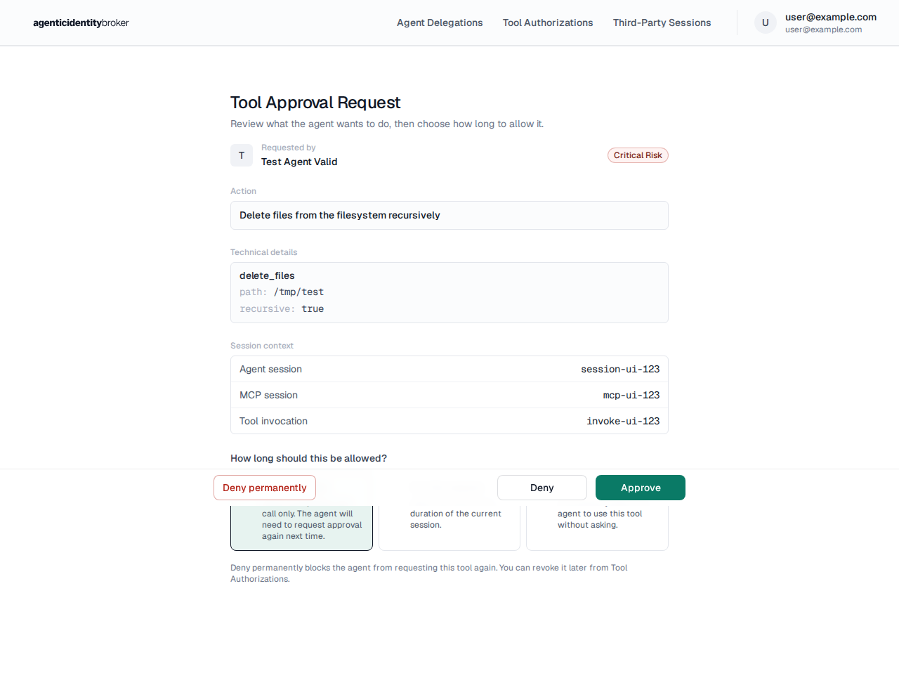
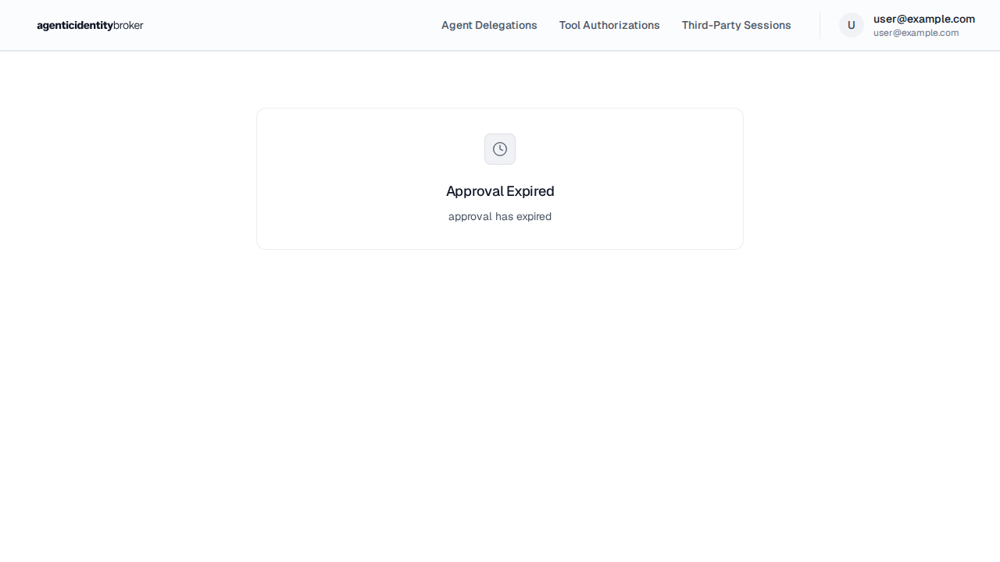
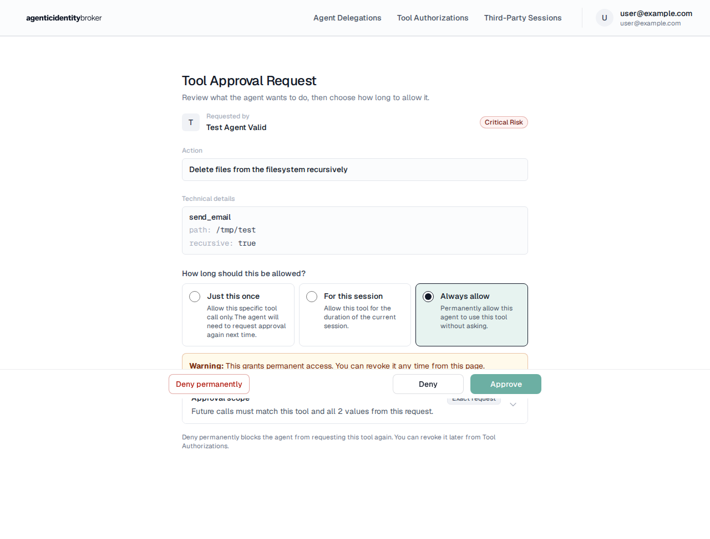
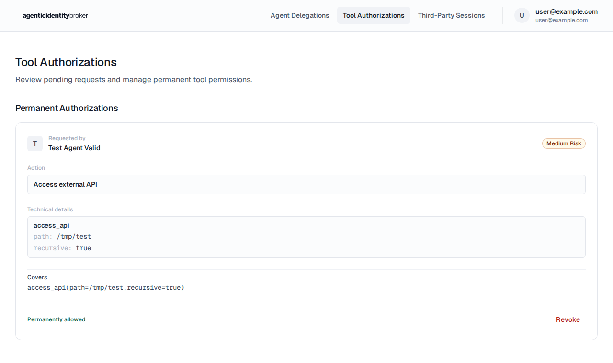

# Tool approvals

Some tool calls are too sensitive to run on a standing grant alone. For those calls a person
decides. This page describes that decision in the order Alice meets it: the request appears, she
reviews it, she approves or denies it, and later she can take a lasting decision back.

:::note How to read this page
This is a living specification. A badge such as "tested" after a sentence links to the acceptance
scenario that proves it. Each HTTP exchange shown here is compared with what that scenario really
sent and received. `just living-docs` runs the comparison and fails when the page and the broker
disagree. UUIDs and timestamps are synthetic. The check compares timestamps by shape and UUIDs by
which of them are equal.
:::

## The cast

Alice (`alice@example.com`) works with the agent *Code Assistant*. The agent calls tools on an
MCP server through a **gateway**. The gateway is the only party that sees each tool call. A
policy in the gateway gives one of three answers for a call: allow, deny, or `approval_required`.
How to write that policy is the subject of the page "Gateway policy authorization".

The broker keeps one **ToolApproval** for each decision that Alice is asked to make. A
ToolApproval is `pending`, `approved`, or `denied`. It belongs to one user and one agent.

Three kinds of caller use the approval API, and each proves a different thing:

| Caller | Proof | What it may do |
|---|---|---|
| The gateway, for one user's tool call | Alice's subject token and the gateway's client assertion | Create a pending ToolApproval |
| The gateway, for itself | Its client assertion | Read the snapshot of all approvals |
| The gateway, after it used an approval | Alice's subject token | Consume a one-time approval |
| Alice's browser | The authenticated user | Read, approve, deny, revoke, and list her own approvals |

In the exchanges below, `X-Remote-User` carries the authenticated user. `Authorization` carries a
bearer token: the subject token, or on the snapshot call the client assertion. The evidence
recorder removes its value.

## The gateway asks for a decision

The Code Assistant calls `create_pull_request` for the repository `acme/app`. The policy answers
`approval_required`, and the gateway knows no approval that covers the call. The gateway asks the
broker for a pending ToolApproval: `example:tool-approvals.create.pending`

```http example="tool-approvals.create.pending"
POST /api/approvals HTTP/1.1
Authorization: …
X-Client-Assertion: …
Content-Type: application/json

{
  "metadata": {
    "mcp_session_id": "mcp-123",
    "agent_session_id": "sess-xyz",
    "tool_invocation_id": "inv-abc",
    "description": "Create a pull request in acme/app"
  },
  "tool_name": "create_pull_request",
  "arguments": {
    "repo": "acme/app",
    "title": "Fix bug"
  }
}

HTTP/1.1 201 Created

{
  "data": {
    "id": "9b2f6c1e-3a4d-4e5f-8a6b-7c8d9e0f1a2b",
    "status": "pending",
    "approval_url": "http://localhost:8000/approvals/9b2f6c1e-3a4d-4e5f-8a6b-7c8d9e0f1a2b",
    "created_at": "2026-10-30T09:00:00Z"
  }
}
```

The body names no user and no agent. The broker takes both from the subject token, so a gateway
cannot ask in the name of a user whose token it does not hold. Without a subject token the broker
answers `401`. `example:tool-approvals.create.subject-token-required` With a subject token but an
invalid client assertion it also answers `401`. `example:tool-approvals.create.client-assertion-required`

Agents retry. A second request for the same user, agent, tool, and arguments returns the same
pending ToolApproval, not a second one. `example:tool-approvals.create.idempotent`

### What the agent receives

The tool call does not reach the MCP server. The gateway answers the agent with a JSON-RPC error
with the code `-32042`. The error carries one URL: the `approval_url` of the pending
ToolApproval. `example:tool-approvals.gateway.elicitation` The agent shows that link to Alice.

The gateway never invents a link. If the broker cannot create the ToolApproval, the gateway
denies the call with `403`. `example:tool-approvals.gateway.create-fails` A policy answer of
`ciba_required` is also denied, and no ToolApproval is created. `example:tool-approvals.gateway.ciba-denied`

## Alice reviews the request

The link opens the approval page. The page reads the ToolApproval as Alice: `example:tool-approvals.review.detail`

```http example="tool-approvals.review.detail"
GET /api/approvals/9b2f6c1e-3a4d-4e5f-8a6b-7c8d9e0f1a2b HTTP/1.1
X-Remote-User: alice@example.com

HTTP/1.1 200 OK

{
  "data": {
    "id": "9b2f6c1e-3a4d-4e5f-8a6b-7c8d9e0f1a2b",
    "principal": "alice@example.com",
    "agent_id": "550e8400-e29b-41d4-a716-446655440000",
    "agent_display_name": "Code Assistant",
    "mcp_session_id": "mcp-123",
    "agent_session_id": "sess-xyz",
    "tool_invocation_id": "inv-abc",
    "tool_name": "create_pull_request",
    "arguments": {
      "repo": "acme/app",
      "title": "Fix bug"
    },
    "tool_pattern": "create_pull_request",
    "params_pattern": {
      "repo": "acme/app",
      "title": "Fix bug"
    },
    "pattern_preview": "create_pull_request(repo=acme/app,title=Fix bug)",
    "description": "Create a pull request in acme/app",
    "risk_level": "critical",
    "status": "pending",
    "persistence": null,
    "consumed": false,
    "approval_url": "http://localhost:8000/approvals/9b2f6c1e-3a4d-4e5f-8a6b-7c8d9e0f1a2b",
    "created_at": "2026-10-30T09:00:00.000000000Z",
    "expires_at": "2026-10-30T09:10:00.000000000Z"
  }
}
```

Three details are worth noticing:

- `agent_display_name` comes from the agent's registration. Alice sees a name, not a UUID.
- `tool_pattern` and `params_pattern` say which later calls an approval of this request covers.
  A new request covers exactly the reviewed call.
- In this scenario the gateway sent the risk level `dangerous`. The broker stores it as
  `critical`.

The page shows the agent, the description, the tool with each argument, the session identifiers,
and the risk. `example:tool-approvals.page.pending-review` The screenshots on this page come from
the browser suite, which uses the user `user@example.com` and an agent named *Test Agent Valid*.



### Only the owner can decide, and only in time

Bob cannot approve a request that was made for Alice. The broker answers `403 Forbidden` with
the message "you do not have access to this approval". `example:tool-approvals.approve.other-user`

A pending ToolApproval has an expiry time. In the detail above it is ten minutes after creation.
After that time the request is gone: `example:tool-approvals.review.expired`

```http example="tool-approvals.review.expired"
GET /api/approvals/9b2f6c1e-3a4d-4e5f-8a6b-7c8d9e0f1a2b HTTP/1.1
X-Remote-User: alice@example.com

HTTP/1.1 410 Gone

{
  "error": "gone",
  "message": "approval has expired"
}
```

The approval page then shows "Approval Expired" and offers no retry. `example:tool-approvals.page.expired`



## Alice approves

Alice chooses how long her approval lasts. The page calls this "Just this once", "For this
session", and "Always allow". The API calls it `persistence`:

```http example="tool-approvals.approve.once"
POST /api/approvals/9b2f6c1e-3a4d-4e5f-8a6b-7c8d9e0f1a2b/approve HTTP/1.1
X-Remote-User: alice@example.com
Content-Type: application/json

{
  "persistence": "once"
}

HTTP/1.1 200 OK

{
  "data": {
    "id": "9b2f6c1e-3a4d-4e5f-8a6b-7c8d9e0f1a2b",
    "status": "approved",
    "persistence": "once",
    "approved_at": "2026-10-30T09:01:00Z"
  }
}
```

| `persistence` | What the gateway does with it |
|---|---|
| `once` | It lets one matching call through. The next matching call needs a new decision. `example:tool-approvals.gateway.once-approval` |
| `session` | It lets matching calls through in the agent session of the request. `example:tool-approvals.approve.session` `example:tool-approvals.gateway.session-approval` |
| `permanent` | It lets matching calls through in any agent session, without asking the broker. `example:tool-approvals.approve.permanent` `example:tool-approvals.gateway.permanent-approval` |

A permanent approval has no end date, so the page warns Alice when she selects "Always allow". `example:tool-approvals.page.permanent-warning`



### A lasting approval can cover more than the reviewed call

An approval for the exact arguments `repo=acme/app, title=Fix bug` would rarely match again. For
a session or permanent approval, Alice can therefore widen the arguments with a `params_pattern`.
The character `*` matches any text. Here she allows pull requests in every repository of `acme`,
with any title: `example:tool-approvals.scope.params-pattern`

```http example="tool-approvals.scope.params-pattern"
POST /api/approvals/9b2f6c1e-3a4d-4e5f-8a6b-7c8d9e0f1a2b/approve HTTP/1.1
X-Remote-User: alice@example.com
Content-Type: application/json

{
  "persistence": "permanent",
  "params_pattern": {
    "repo": "acme/*"
  }
}

HTTP/1.1 200 OK

{
  "data": {
    "id": "9b2f6c1e-3a4d-4e5f-8a6b-7c8d9e0f1a2b",
    "status": "approved",
    "persistence": "permanent",
    "approved_at": "2026-10-30T09:01:00Z"
  }
}
```

An argument that the pattern does not name is not constrained. The rules are:

- Without `params_pattern`, the approval covers exactly the reviewed arguments. `example:tool-approvals.scope.exact-default`
- The pattern must cover the call that Alice reviewed. The pattern `repo: other/*` for a call to
  `acme/app` is rejected with `422` and `invalid_pattern`, and the request stays pending. `example:tool-approvals.scope.non-covering`
- Alice cannot widen the tool. A request with `tool_pattern` is rejected with `400`, and the
  request stays pending. `example:tool-approvals.scope.tool-pattern-rejected`
- A one-time approval cannot carry a pattern. `example:tool-approvals.scope.once-rejected`

On the approval page, Alice edits this under "Approval scope". The page shows a preview such as
`create_pull_request(repo=acme/*,title=Fix bug)` and stores what the preview says. `example:tool-approvals.page.parameter-scope`

## Alice denies

A denial needs no further choice: `example:tool-approvals.deny.once`

```http example="tool-approvals.deny.once"
POST /api/approvals/9b2f6c1e-3a4d-4e5f-8a6b-7c8d9e0f1a2b/deny HTTP/1.1
X-Remote-User: alice@example.com
Content-Type: application/json

{}

HTTP/1.1 200 OK

{
  "data": {
    "id": "9b2f6c1e-3a4d-4e5f-8a6b-7c8d9e0f1a2b",
    "status": "denied",
    "denied_at": "2026-10-30T09:01:00Z"
  }
}
```

A plain denial answers this one request. If the agent tries the same call again, the gateway
receives a new pending ToolApproval, and Alice is asked again. `example:tool-approvals.deny.new-request`
Alice can also deny with `"persistence": "permanent"`, and the broker records the denial as
permanent. `example:tool-approvals.deny.permanent`

## A one-time approval is used once

When the gateway lets a call through on a `once` approval, it tells the broker, with Alice's
subject token, that the approval is used. The broker marks it consumed. `example:tool-approvals.consume.once`
Only the owner's subject token can do that: with Bob's token the broker answers `403`. `example:tool-approvals.consume.owner`
A session or permanent approval cannot be consumed; the broker answers `422`. `example:tool-approvals.consume.not-once`

The whole round trip with a real gateway looks like this: the first call returns the approval
link, the user approves once, the retried call reaches the MCP server, and the third call returns
a link again. `example:tool-approvals.gateway.one-time-journey` After the retried call, the
ToolApproval reads:

```http example="tool-approvals.gateway.one-time-journey"
GET /api/approvals/9b2f6c1e-3a4d-4e5f-8a6b-7c8d9e0f1a2b HTTP/1.1

HTTP/1.1 200 OK

{
  "data": {
    "id": "9b2f6c1e-3a4d-4e5f-8a6b-7c8d9e0f1a2b",
    "status": "approved",
    "persistence": "once",
    "consumed": true,
    "approved_at": "2026-10-30T09:01:00.000000000Z",
    "consumed_at": "2026-10-30T09:01:01.000000000Z",
    "…": "…"
  }
}
```

## Alice looks at her permanent decisions

The page "Tool Authorizations" lists Alice's pending requests and her permanent approvals. Each
permanent approval shows the agent, the tool, what the approval covers, and a "Revoke" action. `example:tool-approvals.authorizations.permanent-list`
Alice can also deny a pending request directly from this list. `example:tool-approvals.authorizations.deny-from-list`



The list of permanent approvals comes from `GET /api/approvals/permanent`. `example:tool-approvals.permanent.list`
Alice revokes one with `POST /api/approvals/…/revoke`. The broker answers `200 OK`, and the
ToolApproval is now `denied`. `example:tool-approvals.permanent.revoke`

With a real gateway, calls that passed on the permanent approval stop passing soon after the
revocation. `example:tool-approvals.gateway.revoke-journey`

## How the gateway learns about decisions

The gateway does not ask the broker on every tool call. It keeps a cache of approvals and reads
them from one endpoint. The answer is always a complete snapshot, grouped by user and agent. This
is the snapshot after the permanent approval with the pattern above: `example:tool-approvals.scope.params-pattern`

```http example="tool-approvals.scope.params-pattern"
GET /api/approvals?principal=alice@example.com HTTP/1.1
Authorization: …

HTTP/1.1 200 OK
ETag: "v2"

{
  "data": {
    "pairs": [
      {
        "principal": "alice@example.com",
        "agent_id": "550e8400-e29b-41d4-a716-446655440000",
        "approvals": [
          {
            "id": "9b2f6c1e-3a4d-4e5f-8a6b-7c8d9e0f1a2b",
            "tool_name": "create_pull_request",
            "arguments_hash": "…",
            "tool_pattern": "create_pull_request",
            "params_pattern": {
              "repo": "acme/*"
            },
            "status": "approved",
            "persistence": "permanent",
            "consumed": false,
            "approved_at": "2026-10-30T09:01:00.000000000Z"
          }
        ],
        "granted_permission_sets": {}
      }
    ]
  }
}
```

The snapshot holds what the gateway needs to match a call and nothing more: no arguments, no
description. The `ETag` is a version. The broker raises it on every change: here the creation was
version 1 and the approval is version 2.

- The call needs the gateway's client assertion and no user. `example:tool-approvals.sync.snapshot`
  An invalid assertion gets `401`. `example:tool-approvals.sync.client-assertion-required`
- The gateway sends the last version in `If-None-Match` and a wait time in `X-Long-Poll-Timeout`.
  The broker holds the request. If nothing changes in that time, it answers `304 Not Modified`. `example:tool-approvals.sync.not-modified`
- If Alice decides while the request waits, the broker answers at once with the new snapshot and
  a new `ETag`. `example:tool-approvals.sync.wake`
- The gateway starts its first long-poll with the version it received at startup. `example:tool-approvals.gateway.long-poll-etag`

Because every answer is a full snapshot, the gateway replaces its cache with it. An approval that
is missing from the new snapshot is gone from the cache, so a revoked approval cannot survive
there. `example:tool-approvals.gateway.snapshot-replaces`

The long-poll can be a moment behind. Before the gateway creates a new pending ToolApproval, it
therefore reads the current approvals of that one user from the broker. `example:tool-approvals.gateway.read-before-create`

## Not yet on this page

- The limits on how many requests a gateway can create for one user and agent.
- What a permanent denial does at the gateway, and permanent denials on the "Tool
  Authorizations" page. The scenarios prove only that the broker records the denial.
- Which approval wins when several match one call, the escape character in patterns, and how
  argument values are compared.
- How the gateway forgets session approvals of an idle agent session, how long it trusts its
  cache when the broker is unreachable, and batched tool calls.
- How several broker instances wake each other's waiting requests, and the short delay that
  groups changes before waiting requests are answered.
- The pending list `GET /api/approvals/pending`, and the "not found" and "already decided"
  states of the approval page.

## Sources

The behavior on this page was decided in `specs/024-approval-api-ui/spec.md` and
`specs/026-extproc-approval-sync/spec.md`, with the `approval_required` decision from
`specs/020-extproc-opa-authorization/spec.md`. The binding decisions are
`adrs/018-approval-endpoint-auth-boundaries.md`, `adrs/035-shared-tool-pattern-matching.md`,
`adrs/036-extproc-approval-cache-and-gate.md`, and `adrs/014-long-poll-listen-notify.md`. The
contract is `api/enduser/openapi.yaml`. The scenarios are in `tests/e2e/approval_api_test.go`,
`tests/e2e/extproc_approval_journey_test.go`, `tests/e2e/extproc/approval_sync_test.go`,
`tests/e2e/frontend/approval_ui_test.go`, and `tests/e2e/frontend/tool_authorizations_test.go`.
