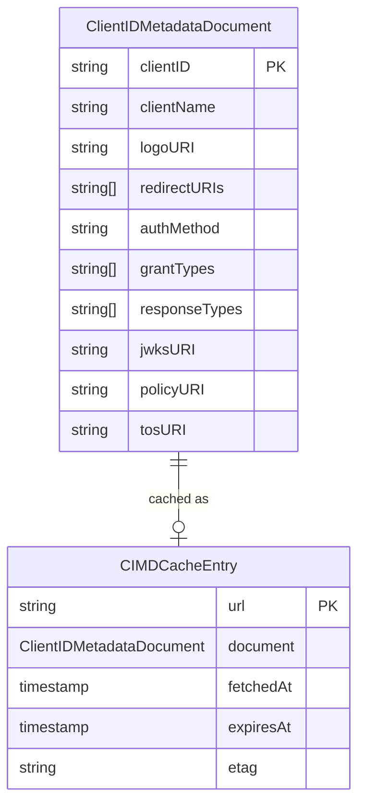
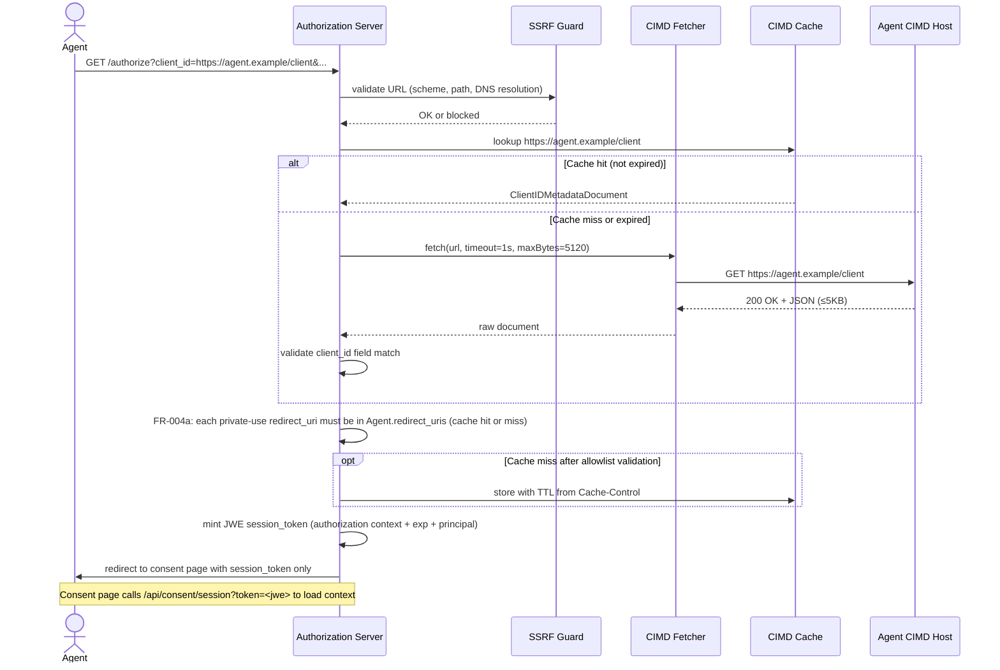
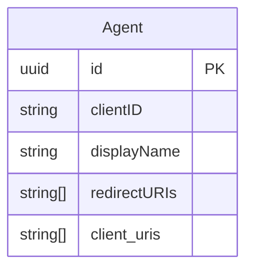

# Feature Specification: Client ID Metadata Document (CIMD) Support

**Feature Branch**: `028-cimd-support`
**Created**: 2026-04-21
**Status**: Draft
**Spec**: [draft-ietf-oauth-client-id-metadata-document-01](https://datatracker.ietf.org/doc/html/draft-ietf-oauth-client-id-metadata-document-01)

## User Scenarios & Testing *(mandatory)*

### User Story 1 - Agent Authenticates with URL-Based Client ID (Priority: P1)

An AI agent identifies itself to the authorization server by using its own HTTPS URL as the `client_id` value in an authorization request. The operator has pre-registered that URL on the corresponding Agent record. The authorization server resolves the Agent, fetches the metadata document at the `client_id` URL, validates it, and uses the contained metadata (name, redirect URIs, logo) to drive the consent screen.

**Why this priority**: This is the core capability of the feature. All other stories depend on the broker successfully fetching, validating, and presenting CIMD-sourced agent metadata.

**Independent Test**: Can be fully tested by sending a valid HTTPS URL `client_id` in an authorization request to a live broker instance backed by a mock CIMD endpoint, and verifying the consent screen renders metadata from the document.

**Acceptance Scenarios**:

1. **Given** a valid CIMD document is served at `https://agent.example.com/client`, **When** an authorization request arrives with `client_id=https://agent.example.com/client`, **Then** the broker fetches the document, validates the `client_id` field matches, and presents `client_name` from the document on the consent screen.
2. **Given** the CIMD document's `client_id` field does not exactly match the request URL, **When** the broker fetches the document, **Then** the authorization request is rejected with an error indicating client metadata mismatch.
3. **Given** the CIMD document is absent or returns a non-200 HTTP status, **When** the broker attempts to fetch it, **Then** the authorization request is rejected and no redirect is issued.
4. **Given** the authorization request uses a `redirect_uri` not listed in the CIMD document, **When** the redirect URI is validated after authorization, **Then** the request is rejected.
5. **Given** CIMD support is disabled (`cimd.enabled: false`), **When** an authorization request arrives with a URL-format `client_id` (e.g. `client_id=https://agent.example.com/client`), **Then** the request is rejected with `invalid_client` error and no CIMD fetch is attempted.

---

### User Story 2 - SSRF-Hardened Fetcher Blocks Malicious URLs (Priority: P1)

An operator needs confidence that accepting untrusted HTTPS URLs as `client_id` values cannot be weaponized to make the broker perform Server-Side Request Forgery (SSRF) against internal infrastructure. The CIMD fetcher must proactively reject URLs targeting private networks, loopback addresses, and link-local IP ranges (including cloud metadata endpoints such as 169.254.169.254) before any network connection is established.

**Why this priority**: Without SSRF protection, any external party can craft a `client_id` URL that causes the broker to probe internal services. This is a critical pre-condition for enabling CIMD at all.

**Independent Test**: Can be fully tested by sending authorization requests whose `client_id` points to blocked IP ranges (loopback, RFC 1918 private, link-local) and verifying each is rejected before a DNS lookup or TCP connection is made.

**Acceptance Scenarios**:

1. **Given** a `client_id` URL whose hostname resolves to a private IP range (10.x, 172.16–31.x, 192.168.x), **When** the broker validates the URL, **Then** the request is rejected without issuing any outbound connection.
2. **Given** a `client_id` URL whose hostname resolves to a loopback address (127.x or ::1), **When** the broker validates the URL, **Then** the request is rejected.
3. **Given** a `client_id` URL whose hostname resolves to a link-local address (169.254.x.x or fe80::/10, including cloud metadata endpoints such as 169.254.169.254), **When** the broker validates the URL, **Then** the request is rejected.
4. **Given** a `client_id` URL using an HTTP (non-HTTPS) scheme, **When** the broker receives the request, **Then** the request is rejected immediately without a network call.
5. **Given** a `client_id` URL with a path containing single or double dot segments (`../`), **When** the URL is parsed, **Then** the request is rejected due to invalid client ID format.
6. **Given** a CIMD endpoint that streams a response larger than the configured size limit, **When** the broker fetches the document, **Then** the download is aborted and the request is rejected.
7. **Given** a CIMD endpoint that does not respond within the configured timeout, **When** the broker waits, **Then** the connection is terminated and the request is rejected.

---

### User Story 3 - CIMD Response Caching Reduces Latency (Priority: P2)

For repeated authorization requests from the same agent, the broker caches the previously fetched CIMD document according to HTTP cache semantics (ETag, Cache-Control, Expires), avoiding a network round-trip on every request while respecting operator-configured minimum and maximum TTL bounds.

**Why this priority**: Without caching, every authorization request triggers a network fetch to an external host, adding latency and creating a dependency on the CIMD host's availability. Caching makes the system resilient and performant.

**Independent Test**: Can be fully tested by issuing two sequential authorization requests for the same URL-based `client_id` and verifying the second request does not trigger an outbound HTTP fetch (observable via mock server request counts or cache metrics).

**Acceptance Scenarios**:

1. **Given** a CIMD document was successfully fetched and has a `Cache-Control: max-age=3600` header, **When** a second authorization request with the same `client_id` URL arrives within the TTL, **Then** the broker serves the cached document without a network call.
2. **Given** a cached CIMD document has expired (Cache-Control max-age elapsed), **When** an authorization request arrives, **Then** the broker re-fetches the document and refreshes the cache.
3. **Given** a CIMD fetch returns an error (non-200 status or network failure), **When** the broker evaluates caching, **Then** the error response is never cached and subsequent requests always retry the fetch.
4. **Given** operator configuration sets a maximum cache TTL shorter than the document's `max-age`, **When** the broker stores the document, **Then** the operator-configured TTL takes precedence.
---

### User Story 4 - Authorization Server Advertises CIMD Support (Priority: P3)

The authorization server's own metadata endpoint (`/.well-known/oauth-authorization-server` or `/.well-known/openid-configuration`) includes `"client_id_metadata_document_supported": true`, signaling to well-behaved clients that URL-based `client_id` values are accepted, preventing them from sending users to incompatible servers.

**Why this priority**: Provides standard interoperability signaling. Agents can check this field before initiating a flow. Lower priority because the feature works without it, but it is required for spec compliance.

**Independent Test**: Can be fully tested by fetching the broker's authorization server metadata document and asserting the field is present and `true` when CIMD support is enabled, and absent (or `false`) when disabled.

**Acceptance Scenarios**:

1. **Given** CIMD support is enabled in broker configuration, **When** a client fetches the authorization server metadata, **Then** the response includes `"client_id_metadata_document_supported": true`.
2. **Given** CIMD support is disabled in broker configuration, **When** a client fetches the authorization server metadata, **Then** the field is absent or `false`.

---

### User Story 5 - CIMD-Enhanced Consent Screen (Priority: P1)

When a user arrives at the consent screen for an Agent identified by a Client ID Metadata Document URL, the screen must communicate clearly who is requesting access, where credentials will be sent, and surface a prominent warning for localhost redirects — giving the user enough information to make an informed consent decision without needing to inspect raw OAuth parameters.

**Why this priority**: The consent screen is the primary user-facing trust boundary. Without explicit display of redirect destination and domain verification, users cannot detect phishing or misdirected consent flows. Elevated to P1 because it is the security-critical companion to the CIMD fetch and validation flow.

**Independent Test**: Can be fully tested by rendering the consent screen for a CIMD-based authorization request in isolation and asserting each required UI element is present with the correct content.

**Acceptance Scenarios**:

1. **Given** a CIMD-based authorization request with a non-localhost `redirect_uri`, **When** the consent screen is rendered, **Then** it displays: (a) summary "The application [client_name] wants to access [Access Target].", (b) "Verified domain: [hostname]", and (c) a collapsed "Advanced Details" section.
2. **Given** a CIMD-based authorization request whose `redirect_uri` resolves to `localhost` or `127.0.0.1`, **When** the consent screen is rendered, **Then** a prominent warning is displayed: "This app is requesting a redirect to your local machine. Ensure you started this request from [Agent.DisplayName]."
3. **Given** the "Advanced Details" section is collapsed, **When** the user expands it, **Then** it reveals: Client Name, Client ID, Redirect URI, and Requested Scopes.
4. **Given** a brand mismatch has been detected (CIMD `client_name` differs from `Agent.DisplayName`), **When** the consent screen is rendered, **Then** the displayed `client_name` is the CIMD value and the mismatch audit event has already been logged before the screen is shown.

---

### User Story 6 - End-to-End CIMD Authorization Flow (Priority: P1)

The individual CIMD components (authorize redirect, consent context decode, grant submission) are each verified in isolation by separate tests. However a regression in JWE token format, embedded URL encoding, or grant-check sequencing could break the full flow without any individual test catching it. The complete round-trip must be exercised as a single connected sequence to close this gap.

**Why this priority**: The full flow is the only thing users and agents actually experience. Component isolation tests are necessary but not sufficient; format drift between the authorize handler and the consent decoder is exactly the kind of defect they cannot catch.

**Independent Test**: Can be fully tested without a real browser by driving the full sequence programmatically: authorize → extract `session_token` from redirect Location → load consent API with token → submit grant → re-authorize → assert authorization code redirect.

**Acceptance Scenarios**:

1. **Given** a CIMD agent is registered and a valid document is served at its `client_id` URL, **When** a user initiates an authorization request (no grant exists), is redirected to the consent page, loads the consent context using the `session_token` extracted from the redirect, approves the grant using that same token, and the `redirect_url` from the grant response is requested again, **Then** the broker issues an authorization code redirect to the agent's registered `redirect_uri` carrying the original `state` value.
2. **Given** a CIMD agent is registered and a valid document is served at its `client_id` URL, **When** a user's browser navigates to `/oauth2/authorize` with a URL-based `client_id`, follows the redirect to the consent screen, sees the CIMD consent UI components (summary, verified-domain badge), and clicks "Approve & Delegate", **Then** the browser is redirected to the `redirect_uri` carrying a valid authorization code and the original `state` value.

---

### User Story 7 - Native App Uses an Operator-Allowlisted Private-Use Callback (Priority: P2)

A native desktop agent such as GitHub Copilot Desktop publishes a CIMD document. Its `redirect_uris` list a private-use URI scheme callback (`github-app://oauth/callback`, RFC 8252 §7.1) with loopback callbacks. For each Agent, the operator decides whether the broker may redirect to that callback by listing the exact URI in the Agent's `redirect_uris`. The broker then accepts the document and completes the authorization code flow with PKCE through the custom-scheme callback. Without that Agent entry, the whole document stays invalid.

**Why this priority**: It lets the broker serve a widely used native client class without trusting arbitrary schemes from remote documents.

**Independent Test**: Serve the GitHub Copilot Desktop document from a mock CIMD endpoint. Register the Agent with and without `github-app://oauth/callback`. Then drive authorize, consent, code issuance, and token exchange.

**Acceptance Scenarios**:

1. **Given** the CIMD document at `https://github.com/copilot/desktop/client-metadata.json` lists `redirect_uris: ["github-app://oauth/callback", "http://127.0.0.1/", "http://127.0.0.1/callback"]`, and the Agent that pre-registers this URL in `client_uris` lists `github-app://oauth/callback` in `redirect_uris`, **When** an authorization request arrives with that `client_id` and `redirect_uri=github-app://oauth/callback`, **Then** the broker accepts the document and redirects to the consent page with a `session_token`.
2. **Given** the same document and an Agent whose `redirect_uris` does not contain `github-app://oauth/callback`, **When** an authorization request arrives with `redirect_uri=http://127.0.0.1/callback`, **Then** the broker rejects the request with `invalid_client`, issues no redirect, and makes none of the document's callbacks available.
3. **Given** the document and Agent from scenario 1, **When** an authorization request uses a callback that only resembles the allowlisted one (`GITHUB-APP://oauth/callback`, `github-app://OAUTH/callback`, `github-app://oauth/callback/extra`, `github-app://oauth/callback?x=1`, or `github-app://evil/callback`), **Then** the broker rejects the request with `invalid_request` and issues no redirect.
4. **Given** an Agent that lists `github-app://oauth/callback` in `redirect_uris` and a CIMD document that lists only `http://127.0.0.1/callback`, **When** an authorization request arrives with `redirect_uri=github-app://oauth/callback`, **Then** the broker rejects the request with `invalid_request` and issues no redirect. The Agent entry does not replace document registration (FR-004).
5. **Given** the document and Agent from scenario 1 and a user without a grant, **When** the user completes authorize, consent, and re-authorize with an S256 `code_challenge`, and the client exchanges the code at `POST /oauth2/token` with `redirect_uri=github-app://oauth/callback`, the `code_verifier`, and no client secret, **Then** the broker redirects to `github-app://oauth/callback?code=...&state=...` and returns a Bearer access token.
6. **Given** an authorization code issued for `github-app://oauth/callback`, **When** the token request presents `redirect_uri=http://127.0.0.1/callback`, **Then** the broker returns `invalid_grant` and issues no token.
7. **Given** an authorization code issued for `github-app://oauth/callback`, **When** the token request presents a `code_verifier` that does not match the `code_challenge`, **Then** the broker returns `invalid_grant` and issues no token.
8. **Given** that the document from scenario 1 is cached after an accepted authorization request, **When** the operator removes `github-app://oauth/callback` from the Agent's `redirect_uris` and a new authorization request arrives, **Then** the broker rejects it with `invalid_client` without fetching the document again.

---

### Edge Cases

- What happens when `cimd.enabled: true` is configured but the broker is in `proxy` mode? (Startup validation error; the broker refuses to start. CIMD requires `issue_token` mode.)
- What happens when the CIMD URL contains query parameters? (Per spec: discouraged but permitted; query parameters must not alter the document identity check.)
- What happens when DNS resolution for the CIMD hostname succeeds but returns multiple A records — some safe, some blocked? (All resolved addresses must be checked; any blocked address causes rejection.)
- What happens when a CIMD document omits `redirect_uris`? (Authorization request is rejected; `redirect_uris` is mandatory for the flow to proceed.)
- What happens when a public-only CIMD document's `token_endpoint_auth_method` is anything other than `none` (e.g. `client_secret_post`, `client_secret_basic`, `private_key_jwt`)? (This spec's public-only clients must use `none`; feature 050 supersedes this edge case only for pre-registered CIMD clients that use broker-enforced `private_key_jwt`. Shared-secret methods remain rejected.)
- What happens when a brand mismatch is detected (current `client_name` differs from `Agent.DisplayName`)? (Authorization flow continues; mismatch is logged as a structured audit event per FR-023a — blocking is not automatic.)
- What happens when a CIMD document's `client_name` matches a blacklisted keyword? (Document is rejected per FR-023b; the authorization request fails with an error, no redirect is issued.)
- What happens when the broker is configured with an empty SSRF blocklist override? (Default RFC 6890 blocklist is always enforced regardless of operator configuration; it cannot be disabled.)
- What happens during a CIMD cache eviction under memory pressure? (Document is treated as expired; next request triggers a re-fetch.)
- What happens when a `client_id` URL has a non-443 port? (Always rejected; port 443 is the only permitted port.)
- What happens when a Client ID Metadata Document URL matches pre-registered entries in more than one Agent? (Ambiguous match — request is rejected; operator must ensure pre-registered Client ID Metadata Document URLs are unique across all agents.)
- What happens when a Client ID Metadata Document URL is not pre-registered under any Agent? (Request is rejected per FR-027; clients presenting an unregistered Client ID Metadata Document URL are not permitted.)
- What happens when a CIMD document declares a `redirect_uri` on a different origin than the `client_id` URL (e.g. a CDN or a partner domain)? (Rejected per FR-004a; cross-origin HTTPS redirect URIs are not permitted. The only exceptions are loopback hosts and private-use scheme callbacks that the Agent allowlists.)
- What happens when a CIMD document declares a `redirect_uri` of `http://localhost:3000` but the `client_id` URL is `https://agent.example.com/client`? (Permitted; localhost is an unconditional exception regardless of the client_id origin.)
- A document that declares a private-use callback such as `github-app://oauth/callback` is permitted only when the resolved Agent lists the identical URI in `redirect_uris`. Otherwise, the whole document is rejected and none of its callbacks are usable, as FR-004a requires.
- A document that declares `javascript://…`, `data:…`, `file:///…`, or a non-canonical private-use URI such as `GitHub-App://oauth/callback` is rejected under FR-004a. Agent writes reject these values under 025 FR-006e, so they cannot be allowlisted.
- If the operator removes an allowlisted private-use callback while the document is cached, the next authorization request returns `invalid_client`. The allowlist check also runs on cache hits (US7 Scenario 8).
- What happens when a consent page is loaded with an expired or invalid `session_token`? (The decode endpoint returns an error indicating the authorization request has expired; the user must re-initiate the flow.)
- What happens when consent is submitted with a `session_token` that has expired? (Rejected; the consent submission returns an error. The `exp` claim is validated on every submission.)

## Concrete Example Journeys *(mandatory)*

### Journey 1 — Alice signs in to GitHub Copilot Desktop through its github-app callback (User Story 7, Scenarios 1–6)

**Cast**: The operator is `admin@example.com`. Alice is `alice@example.com`. Both authenticate through `X-Remote-User`. The Agent is *GitHub Copilot* (`3c9d2e7a-5b1f-4c8e-9a6d-2f4b8c1e7d90`). It requires permission set `770e8400-e29b-41d4-a716-446655440001` for service *GitHub Production* (`880e8400-e29b-41d4-a716-446655440010`). Alice has an active service session but no grant. All times are 2026-10-22 UTC. All values are synthetic.

**Step 1 — Broker configuration (initial state; other required settings omitted)**

```yaml
server:
  enduser:
    public_url: "https://broker.example.com" # token issuer (iss)
    authentication:
      preauth:
        principal_header_name: "X-Remote-User"
  admin:
    authentication:
      preauth:
        principal_header_name: "X-Remote-User"
oauth2_authorization_server:
  mode: "local"
  local:
    token_ttl: "1h" # expires_in 3600
  cimd:
    enabled: true # resolve URL-format client_id values through CIMD
```

**Step 2 — 09:00:00: the operator registers GitHub Copilot**

```http
POST /api/agents HTTP/1.1
Host: broker.example.com:14000
X-Remote-User: admin@example.com
Content-Type: application/json

{
  "display_name": "GitHub Copilot",
  "description": "GitHub Copilot Desktop",
  "client_uris": ["https://github.com/copilot/desktop/client-metadata.json"],
  "redirect_uris": ["github-app://oauth/callback"],
  "permission_sets": [{"permission_set_id": "770e8400-e29b-41d4-a716-446655440001", "requirement_type": "mandatory"}]
}

HTTP/1.1 201 Created
Content-Type: application/json

{
  "id": "3c9d2e7a-5b1f-4c8e-9a6d-2f4b8c1e7d90",
  "client_uris": ["https://github.com/copilot/desktop/client-metadata.json"],
  "redirect_uris": ["github-app://oauth/callback"],
  "...": "..."
}
```

**Step 3 — The broker fetches the published document**

```http
GET /copilot/desktop/client-metadata.json HTTP/1.1
Host: github.com

HTTP/1.1 200 OK
Content-Type: application/json

{
  "client_id": "https://github.com/copilot/desktop/client-metadata.json",
  "client_name": "GitHub Copilot",
  "client_uri": "https://github.com/github/app",
  "application_type": "native",
  "grant_types": ["authorization_code", "refresh_token", "urn:ietf:params:oauth:grant-type:device_code"],
  "response_types": ["code"],
  "token_endpoint_auth_method": "none",
  "redirect_uris": ["github-app://oauth/callback", "http://127.0.0.1/", "http://127.0.0.1/callback"]
}
```

**Step 4 — 09:30:00: Alice starts authorization (Scenarios 1–2)**

```http
GET /oauth2/authorize?client_id=https%3A%2F%2Fgithub.com%2Fcopilot%2Fdesktop%2Fclient-metadata.json&response_type=code&redirect_uri=github-app%3A%2F%2Foauth%2Fcallback&scope=read&state=af0ifjsldkj&code_challenge=E9Melhoa2OwvFrEMTJguCHaoeK1t8URWbuGJSstw-cM&code_challenge_method=S256 HTTP/1.1
Host: broker.example.com
X-Remote-User: alice@example.com

HTTP/1.1 302 Found
Location: https://broker.example.com/agents/3c9d2e7a-5b1f-4c8e-9a6d-2f4b8c1e7d90?session_token=eyJ...
```

FR-004a accepts `github-app://oauth/callback` because the Agent allowlists it. It accepts `http://127.0.0.1/` and `http://127.0.0.1/callback` under the loopback exception.

Variant (Scenario 2): Without the Agent entry, the broker rejects the entire document:

```http
HTTP/1.1 400 Bad Request
Content-Type: application/json

{"error": "invalid_client", "error_description": "CIMD document validation failed"}
```

The broker logs `cimd_document_invalid` with `error="redirect_uris[0]: private-use redirect_uri \"github-app://oauth/callback\" is not listed in the agent's redirect_uris"`.

**Step 5 — 09:30:15: Alice approves on the existing consent screen**

Advanced Details shows Redirect URI `github-app://oauth/callback`. No local-machine warning appears because the host is not loopback. The UI does not change, so this journey has no wireframe.

```http
POST /api/consent/agents/3c9d2e7a-5b1f-4c8e-9a6d-2f4b8c1e7d90/grants?session_token=eyJ... HTTP/1.1
Host: broker.example.com
X-Remote-User: alice@example.com
Content-Type: application/json

{"granted_permission_sets": {"770e8400-e29b-41d4-a716-446655440001": ["880e8400-e29b-41d4-a716-446655440010"]}}

HTTP/1.1 201 Created
Content-Type: application/json

{
  "data": {"id": "990e8400-e29b-41d4-a716-446655440020", "principal": "alice@example.com", "agent_id": "3c9d2e7a-5b1f-4c8e-9a6d-2f4b8c1e7d90", "...": "..."},
  "redirect_url": "/oauth2/authorize?client_id=https%3A%2F%2Fgithub.com%2Fcopilot%2Fdesktop%2Fclient-metadata.json&response_type=code&..."
}
```

**Step 6 — 09:30:16: the SPA requests `redirect_url` (Scenarios 3 and 5)**

```http
GET /oauth2/authorize?client_id=https%3A%2F%2Fgithub.com%2Fcopilot%2Fdesktop%2Fclient-metadata.json&response_type=code&redirect_uri=github-app%3A%2F%2Foauth%2Fcallback&scope=read&state=af0ifjsldkj&code_challenge=E9Melhoa2OwvFrEMTJguCHaoeK1t8URWbuGJSstw-cM&code_challenge_method=S256 HTTP/1.1
Host: broker.example.com
X-Remote-User: alice@example.com

HTTP/1.1 302 Found
Location: github-app://oauth/callback?code=SplxlOBeZQQYbYS6WxSbIA&state=af0ifjsldkj
```

The OS opens GitHub Copilot. Variant (Scenario 3): With `redirect_uri=GITHUB-APP%3A%2F%2Foauth%2Fcallback`, the broker does not redirect:

```http
HTTP/1.1 400 Bad Request
Content-Type: application/json

{"error": "invalid_request", "error_description": "redirect_uri not registered for this client"}
```

**Step 7 — 09:31:02: Copilot exchanges the code (Scenario 6)**

```http
POST /oauth2/token HTTP/1.1
Host: broker.example.com
Content-Type: application/x-www-form-urlencoded

grant_type=authorization_code&code=SplxlOBeZQQYbYS6WxSbIA&redirect_uri=github-app%3A%2F%2Foauth%2Fcallback&client_id=https%3A%2F%2Fgithub.com%2Fcopilot%2Fdesktop%2Fclient-metadata.json&code_verifier=dBjftJeZ4CVP-mB92K27uhbUJU1p1r_wW1gFWFOEjXk

HTTP/1.1 200 OK
Cache-Control: no-store
Pragma: no-cache
Content-Type: application/json

{"access_token": "eyJhbGciOiJFUzI1NiIsImtpZCI6...", "expires_in": 3600, "scope": "read", "token_type": "Bearer"}
```

No client secret is sent. No `refresh_token` is returned because `offline_access` was not requested. Variant (Scenario 6): With `redirect_uri=http%3A%2F%2F127.0.0.1%2Fcallback`, the broker returns `400 Bad Request` with `{"error": "invalid_grant", "error_description": "..."}`.

The synthetic access token decodes to this header and payload:

```json
{"alg": "ES256", "kid": "3f1c2b4a-8d7e-4f60-9a1b-2c3d4e5f6a7b"}
{"iss": "https://broker.example.com", "sub": "alice@example.com", "iat": 1792661462, "exp": 1792665062, "jti": "a5c8e4f0-6b9d-4e23-8c71-9217e30a5f60", "agent_id": "https://github.com/copilot/desktop/client-metadata.json", "scope": "read"}
```

`iat` is 09:31:02, and `exp` is 10:31:02. `strategies.go:103` sets `agent_id` from the fosite client ID, which is the CIMD URL for CIMD clients.

**Observable result**: Copilot holds a one-hour token for Alice. Without the operator entry, the broker would have rejected the document.

## Requirements *(mandatory)*

### Functional Requirements

- **FR-000**: CIMD support MUST only be available when the broker operates in `issue_token` mode (`oauth2_authorization_server.mode: issue_token`). Enabling `cimd.enabled: true` while the broker is in `proxy` mode MUST cause a startup validation error. In proxy mode the broker forwards authorization requests to an upstream OAuth2 server that has no knowledge of CIMD semantics; CIMD resolution, session binding, and local authorization code issuance are fundamentally incompatible with the proxy flow. A future hybrid token issuing mode (combining local issuance with selective upstream proxying) is expected to support CIMD; that mode will be defined in a separate spec.
- **FR-001**: System MUST accept HTTPS URLs as `client_id` values in authorization requests when CIMD support is enabled.
- **FR-001a**: System MUST reject HTTPS URL-format `client_id` values with an `invalid_client` error when CIMD support is disabled. No CIMD infrastructure (fetcher, cache, resolver) may be instantiated when CIMD is disabled; the rejection MUST be structural (strategy selection), not a runtime conditional.
- **FR-002**: System MUST fetch the CIMD document at the `client_id` URL using a hardened HTTP client (SSRF-safe, timeout-bounded, size-limited).
- **FR-003**: System MUST reject any CIMD document where the `client_id` field does not exactly match the request URL (byte-for-byte string comparison).
- **FR-004**: System MUST reject authorization requests where the `redirect_uri` is not listed in the CIMD document's `redirect_uris` array.
- **FR-004a**: System MUST reject a CIMD document when any declared `redirect_uri` is not permitted. A declared `redirect_uri` is permitted only when it is (a) an HTTPS URI that is same-origin with the `client_id` URL (same scheme, host, and port); (b) an `http` or `https` URI whose host is `localhost`, `127.0.0.1`, or `::1` (any port), to support locally-running agents; or (c) a valid private-use scheme redirect URI (025 FR-006e) that the resolved Agent's `redirect_uris` lists byte for byte. Option (c) is the operator's explicit exception to this local same-origin policy, which draft-ietf-oauth-client-id-metadata-document-02 §8.1 lets an authorization server impose; a document alone never makes a private-use callback available, and cross-origin HTTPS entries stay rejected even when the Agent lists them. The broker MUST evaluate (c) against the Agent's current `redirect_uris` every time it resolves the client, including when it serves the document from cache, and MUST NOT cache a document that fails this check (FR-020).
- **FR-004b**: System MUST accept a private-use scheme `redirect_uri` in an authorization request only when it equals, byte for byte, an entry of the CIMD document's `redirect_uris` (FR-004) and an entry of the Agent's `redirect_uris`. No case folding, prefix, scheme-only, host-only, wildcard, or loopback-port matching applies. On mismatch the broker MUST return `invalid_request` without redirecting. The token request MUST present the identical `redirect_uri`, and S256 PKCE remains mandatory (025 FR-007e).
- **FR-005**: System MUST NOT follow HTTP redirects when fetching a CIMD document.
- **FR-006**: System MUST accept only HTTP 200 responses as valid CIMD documents; any other status code is treated as a fetch failure.
- **FR-007**: System MUST abort CIMD fetches that exceed the configured response size limit (default: 5,120 bytes).
- **FR-008**: System MUST abort CIMD fetches that exceed the configured total request timeout (default: 1 second).
- **FR-009**: System MUST resolve the CIMD URL's hostname to IP addresses and validate all resolved addresses against the SSRF blocklist before establishing a connection.
- **FR-010**: System MUST block CIMD fetch attempts targeting loopback addresses (IPv4 127.0.0.0/8 and IPv6 ::1/128).
- **FR-011**: System MUST block CIMD fetch attempts targeting private-use addresses (RFC 1918: 10.0.0.0/8, 172.16.0.0/12, 192.168.0.0/16).
- **FR-012**: System MUST block CIMD fetch attempts targeting link-local addresses (IPv4 169.254.0.0/16 and IPv6 fe80::/10).
- **FR-013**: System MUST block CIMD fetch attempts targeting any address in the RFC 6890 Special-Purpose Address Registry not already covered above.
- **FR-014**: System MUST reject `client_id` URLs using any scheme other than `https`.
- **FR-014a**: System MUST reject `client_id` URLs that have no path component (i.e. the URL ends immediately after the host or port with no `/` and path).
- **FR-015**: System MUST reject `client_id` URLs containing path segments composed solely of `.` or `..` (dot and double-dot).
- **FR-016**: System MUST reject `client_id` URLs containing fragment identifiers (`#`).
- **FR-017**: System MUST reject `client_id` URLs containing embedded credentials (userinfo in the authority component).
- **FR-018**: System MUST reject `client_id` URLs using ports other than 443.
- **FR-019**: System MUST cache successfully fetched CIMD documents according to HTTP cache semantics (ETag, Cache-Control, Expires), subject to operator-configured minimum and maximum TTL bounds. `Cache-Control: no-store` and `no-cache` directives MUST be ignored; the operator-configured `min_ttl` always applies and takes precedence over remote cache hints.
- **FR-020**: System MUST NOT cache CIMD fetch errors or malformed documents.
- **FR-021**: System MUST include `"client_id_metadata_document_supported": true` in authorization server metadata when CIMD is enabled.
- **FR-022**: System MUST reject CIMD documents that specify any `token_endpoint_auth_method` other than `none`. CIMD clients are always public clients; `none` is the only supported value. A missing `token_endpoint_auth_method` field is treated as `none` per RFC 7591 §2. **Superseded in part by feature 050**: pre-registered CIMD clients can use broker-enforced `private_key_jwt` under that feature's requirements. Shared-secret methods remain rejected.
- **FR-023**: System MUST present `client_name` and `logo_uri` from the CIMD document on the consent screen; when `client_name` is absent, the pre-provisioned `Agent.DisplayName` MUST be displayed instead.
- **FR-023a**: System MUST enforce Brand Pinning on `client_name` only: when a CIMD document is fetched and matched to an Agent, the document's `client_name` MUST be compared to `Agent.DisplayName`. If the values differ, a structured mismatch event MUST be logged including the Agent ID, `Agent.DisplayName`, and the CIMD `client_name`. The authorization flow continues regardless of mismatch. `logo_uri` is displayed as-is without brand-pin validation.
- **FR-023b**: System MUST validate the CIMD document's `client_name` against a blacklist of reserved and system-level keywords (e.g. "admin", "system", "operator", names of identity providers) before accepting the document. A document whose `client_name` matches a blacklisted term MUST be rejected with an appropriate error.
- **FR-023c**: The keyword blacklist MUST be operator-configurable (additions); a non-empty default set of reserved terms MUST be enforced regardless of operator configuration.
- **FR-024**: SSRF protection MUST be enabled by default and MUST NOT be configurable to fully disable; operators may only extend (not replace) the default blocklist.
- **FR-025**: The `Agent` entity MUST be extended with a list of pre-registered Client ID Metadata Document URLs. This addition requires a database migration.
- **FR-026**: When processing an authorization request whose `client_id` is a Client ID Metadata Document URL, the broker MUST attempt an exact-match lookup of that URL against each Agent's pre-registered Client ID Metadata Document URLs; if a match is found, that Agent record is the pre-registered client used for consent grouping.
- **FR-027**: If a Client ID Metadata Document URL matches no Agent's pre-registered Client ID Metadata Document URLs, the authorization request MUST be rejected; clients presenting an unregistered Client ID Metadata Document URL are not permitted.
- **FR-028**: The consent page MUST call the server-side decode endpoint (`GET /api/consent/session?token=<jwe>`) with the opaque `session_token` received via the consent redirect URL, and retrieve all authorization request context (client_id, redirect_uri, scope, CIMD metadata) from the decrypted token. The consent page MUST NOT accept `client_id`, `redirect_uri`, or `scope` as query parameters for CIMD-based flows. For non-CIMD flows, existing behavior is unchanged.
- **FR-029**: The consent submission body MUST include the `session_token` for CIMD-based flows. On approval, the backend MUST decrypt the token, validate the `exp` claim and `principal` binding, then use the token's trusted `redirect_uri`, `state`, `code_challenge`, and all authorization parameters to issue the authorization code redirect. The frontend MUST NOT supply `redirect_uri` or `state` for CIMD-based consent submissions.

### Consent Screen Requirements

- **CS-001**: The consent screen for CIMD-based clients MUST display a summary statement: *"The application [client_name] wants to access [Access Target]."* where `[Access Target]` is the name of the requested third-party service and/or the human-readable scope list.
- **CS-002**: The consent screen MUST display a domain verification badge: *"Verified domain: [hostname]"* derived from the Client ID Metadata Document URL's hostname, confirming the domain is pre-registered.
- **CS-003**: When the `redirect_uri` host is `localhost` or `127.0.0.1`, the consent screen MUST display a prominent warning: *"This app is requesting a redirect to your local machine. Ensure you started this request from [Agent.DisplayName]."* where `[Agent.DisplayName]` is the pre-registered Agent name.
- **CS-004**: The consent screen MUST include an unfoldable "Advanced Details" section, collapsed by default, that reveals the following fields: Client Name (`client_name` from CIMD document), Client ID (the `client_id` URL), Redirect URI (the requested `redirect_uri`), Requested Scopes.

### Domain Model

**Domain Entity Diagram**:



**CIMD Authorization Flow**:



**Agent Entity Extension** (from `025-oauth2-server`, extended for CIMD):

The existing `Agent` entity is extended with a list of pre-registered Client ID Metadata Document URLs `client_uris` — set by the operator during Client ID Metadata Document URL pre-registration. When an incoming `client_id` URL exactly matches an entry in this list, the broker resolves the Agent record as the pre-registered client for consent grouping.

For a CIMD Agent, `redirect_uris` only allowlists private-use scheme callbacks that the document also declares (FR-004a, FR-004b). Web callbacks come from the document.



**Entities** (things with unique identity):
- **ClientIDMetadataDocument**: The JSON document served at the agent's `client_id` URL. Identity is the `client_id` field value (the URL itself). Contains display metadata and OAuth2 parameters for a dynamically-registered-style client. Lifecycle: fetched on demand, cached, re-fetched on cache expiry. Key invariant: `client_id` field must match the URL it was fetched from.
- **CIMDCacheEntry**: A stored fetch result binding a URL to its document and caching metadata (ETag, expiry). Evicted on TTL expiry or memory pressure.
- **AuthorizationSessionClaims**: The set of claims sealed into the JWE `session_token` at authorization initiation. Contains the full authorization request context (agent_id, client_id, redirect_uri, scope, state, code_challenge, principal, CIMD metadata snapshot, iat, exp). Stateless — no database storage required.

**Value Objects** (things without identity):
- **ClientIDMetadataDocumentURL**: An `https://` URL used as a `client_id`. Validated at parse time: must be HTTPS, no fragment, no credentials, no dot-segments, and hostname must resolve to a non-blocked address.
- **SSRFBlocklist**: The ordered set of CIDR ranges and address categories that are always rejected. Immutable at runtime; operator-provided additions are merged at startup.

**Domain Events** (state changes of business significance):
- **CIMDDocumentFetched**: Emitted when a document is successfully fetched and cached. Includes URL, cache TTL, and `client_name`.
- **CIMDFetchBlocked**: Emitted when a fetch attempt is rejected by the SSRF guard. Includes URL and the reason (blocked IP range, invalid scheme, etc.).
- **CIMDFetchFailed**: Emitted when the remote host returns a non-200 response, times out, or returns an oversized body.
- **BrandPinMismatchDetected**: Emitted when the CIMD document's `client_name` differs from `Agent.DisplayName`. Includes Agent ID, `Agent.DisplayName`, and the CIMD `client_name`. The authorization flow continues.

### Configuration Requirements

**Configuration Parameters** (nested under `oauth2_authorization_server`):
- **`oauth2_authorization_server.cimd.enabled`**: bool, enables CIMD support globally, default `false`. MUST only be set to `true` when `oauth2_authorization_server.mode` is `issue_token`; startup validation rejects `cimd.enabled: true` in `proxy` mode.
- **`oauth2_authorization_server.cimd.fetch_timeout`**: duration, total HTTP round-trip timeout, default `1s`
- **`oauth2_authorization_server.cimd.max_response_bytes`**: int, maximum CIMD document size in bytes, default `5120`
- **`oauth2_authorization_server.cimd.cache.max_ttl`**: duration, upper bound on document cache TTL, default `1h`
- **`oauth2_authorization_server.cimd.cache.min_ttl`**: duration, lower bound on document cache TTL (prevents hammering), default `60s`
- **`oauth2_authorization_server.cimd.ssrf.extra_blocked_cidrs`**: []string, operator-added CIDR ranges to block in addition to defaults
- **`oauth2_authorization_server.cimd.client_name_blocklist`**: []string, operator-added keywords merged with the built-in default blocklist at startup; exact case-insensitive string match

**Example YAML Configuration**:
```yaml
oauth2_authorization_server:
  # ... existing fields ...
  cimd:
    enabled: true
    fetch_timeout: 1s
    max_response_bytes: 5120
    cache:
      max_ttl: 1h
      min_ttl: 60s
    ssrf:
      extra_blocked_cidrs: []
    client_name_blocklist: []
```

**Configuration Location**: Added to `internal/ports/config.go` as `CIMDConfig` struct embedded in `OAuth2AuthServerConfig`, and documented in `examples/config/`.

### API Requirements

- **API-001**: The authorization server metadata endpoint (`GET /.well-known/oauth-authorization-server`) MUST include `"client_id_metadata_document_supported": true` when `cimd.enabled` is `true`.
- **API-002**: The existing `GET /authorize` and `POST /token` end-user endpoints accept URL-based `client_id` values without schema change; CIMD lookup is transparent.
- **API-003**: A structured error response using OAuth2 `error` / `error_description` fields MUST be returned for all CIMD validation failures (invalid URL format, SSRF block, fetch failure, document mismatch, blocked auth method). No redirect is issued on these errors.
- **API-004**: The existing agent write API (`POST /api/agents` and `PUT /api/agents/{agent-id}`) MUST accept a `client_uris` field (array of strings) to allow operators to create and manage the list of pre-registered Client ID Metadata Document URLs on an Agent. Each URL in the array MUST be validated as a well-formed `https://` URL at write time.

### Security Requirements

- **SR-001**: SSRF protection MUST be enabled by default; it MUST NOT be possible to fully disable it via configuration.
- **SR-002**: All resolved IP addresses for a CIMD hostname MUST be checked against the blocklist before any TCP connection is opened (DNS TOCTOU protection: resolve once, validate, connect only to the validated address).
- **SR-003**: The CIMD fetcher MUST enforce a hard maximum on response body size (default 5,120 bytes) and abort mid-stream if the limit is reached; the response MUST NOT be buffered past this limit.
- **SR-004**: The CIMD fetcher MUST enforce a total request timeout (connect + read); default 1 second. Each phase (DNS, TCP connect, TLS handshake, response read) contributes to this single budget.
- **SR-005**: HTTP redirects MUST NOT be followed during CIMD fetch. A redirect response MUST be treated the same as a non-200 error.
- **SR-006**: TLS certificate validation MUST be enforced for all CIMD fetches; there MUST be no configuration option to skip certificate verification.
- **SR-007**: CIMD fetch failures (SSRF block, timeout, oversized body, TLS error, non-200 response) MUST emit structured audit log events including the URL, failure reason, and timestamp.
- **SR-008**: The `client_id` field in the CIMD document MUST be compared to the fetch URL using exact byte-for-byte string comparison; normalization or case folding MUST NOT be applied.
- **SR-009**: CIMD documents that specify client-secret-based `token_endpoint_auth_method` values MUST be rejected at validation time, not silently ignored.
- **SR-010**: Any URL field within a fetched CIMD document (`logo_uri`, `jwks_uri`, `policy_uri`, `tos_uri`) that the broker resolves or fetches MUST be validated against the same SSRF blocklist as the `client_id` URL itself before any outbound connection is made. A document containing a blocked URL in any such field MUST be logged but need not be rejected outright; the offending field is silently ignored.
- **SR-013**: When the authorization server redirects to the consent page for a CIMD-based (URL-format `client_id`) authorization request, the full authorization request context (`client_id`, `redirect_uri`, `scope`, `state`, `code_challenge`, resolved Agent ID, and CIMD metadata) MUST be sealed into a JWE token (`session_token`) using authenticated encryption (A256GCMKW + A256GCM). Only this opaque `session_token` is passed to the consent URL. The consent page and its backend API MUST retrieve all authorization context by decrypting the token — never from caller-supplied query parameters. This requirement applies only to CIMD-based flows; opaque (pre-registered UUID) `client_id` flows are unchanged.
- **SR-014**: The JWE authorization session token MUST include an `exp` claim encoding a 10-minute TTL; any consent attempt using an expired token MUST be rejected. The token MUST include a `principal` claim that is validated against the authenticated user at consent-submission time, preventing cross-user replay. No database storage is required; the token is self-contained and stateless.

### Key Entities

- **ClientIDMetadataDocument**: Represents an agent's self-described OAuth2 metadata, fetched from the agent's own HTTPS endpoint. Key attributes: `client_id` (URL), `client_name`, `redirect_uris`, `token_endpoint_auth_method`, `logo_uri`. Immutable after fetch; a new fetch produces a new value.
- **CIMDCacheEntry**: Stores a fetched document alongside its HTTP caching metadata (ETag, expiry timestamp). Scoped to the broker process; not persisted to the database.

## Success Criteria *(mandatory)*

### Measurable Outcomes

- **SC-001**: An AI agent using a URL-based `client_id` completes an authorization flow (fetch → consent → token) in under 2 seconds total when the CIMD host responds within 500ms, as measured end-to-end in E2E tests.
- **SC-002**: All 14 SSRF attack categories (loopback, RFC 1918, link-local, cloud metadata IP, non-HTTPS scheme, no path component, dot-segment path, fragment, credentials in URL, non-standard port, oversized response, slow-response timeout, redirect following, non-200 status) are each individually rejected. For malformed URL categories, rejection is verified in E2E tests by error response with no consent redirect. For blocked-address categories, rejection is verified in E2E tests by error response with no consent redirect and in CIMD fetcher adapter tests by asserting no TCP dial attempt occurs.
- **SC-003**: A repeated authorization request for the same URL-based `client_id` within the cache TTL window completes without issuing a second outbound HTTP fetch, as verified by mock server request counts in E2E tests.
- **SC-004**: Zero regression in existing authorization flows using opaque (pre-registered) `client_id` values, verified by the full existing E2E test suite passing without modification.
- **SC-005**: The authorization server metadata endpoint correctly reflects `client_id_metadata_document_supported` status in all configuration states, verified by E2E tests.
- **SC-006**: The GitHub Copilot Desktop document (`github-app://oauth/callback` plus two loopback callbacks) validates for an Agent that allowlists the callback and is rejected for an Agent that does not, and a full authorize → consent → token flow through `github-app://oauth/callback` succeeds, as verified by E2E tests (User Story 7).

## Clarifications

### Session 2026-04-22

- Q: How does a Client ID Metadata Document URL identify which Agent record it belongs to? → A: The operator pre-registers Client ID Metadata Document URLs on the Agent entity during Agent provisioning; the broker maps an incoming `client_id` URL to an Agent by exact lookup against that Agent's pre-registered Client ID Metadata Document URLs.
- Q: What constitutes a match between a `client_id` URL and a pre-registered Client ID Metadata Document URL? → A: Exact match only — the `client_id` URL must equal the pre-registered URL character-for-character.
- Terminology: Per the CIMD draft RFC, domain language is used throughout this spec. The act of adding URLs to an Agent is called "pre-registering Client ID Metadata Document URLs". The field on Agent is "pre-registered Client ID Metadata Document URLs". "Unregistered" describes a `client_id` URL that has not been pre-registered.
- Consent screen UX: Four explicit requirements defined (CS-001 through CS-004): summary statement with access target, verified domain badge, localhost redirect warning (referencing Agent.DisplayName), and a collapsed Advanced Details section showing Client Name, Client ID, Redirect URI, and Requested Scopes. No CS-005 exists.
- Q: Which authority governs the acceptable `redirect_uri` values for a client identified by a Client ID Metadata Document URL? → A: Same-origin as the `client_id` URL (scheme + host + port); `localhost` and `127.0.0.1` are always permitted regardless of origin to support locally-running tooling and coding agents.
- Q: Which metadata drives the consent screen when a CIMD document resolves to an Agent? → A: CIMD document metadata (`client_name`, `logo_uri`) is displayed to show current app branding. Brand Pinning is enforced: the CIMD `client_name` is compared against `Agent.DisplayName` (set by the operator at provisioning); a mismatch is logged as an audit event but does not block the flow. The `client_name` is also validated against a blacklist of reserved/system-level keywords to prevent spoofing.
- Q: Where is the Brand Pin baseline stored, and what is it anchored to? → A: The pin IS `Agent.DisplayName` — already persisted on the Agent record. No new baseline storage is required. Only `client_name` is subject to brand pinning (not `logo_uri`).
- RFC security gap review applied: (1) Added FR-014a requiring path component in `client_id` URL. (2) Added SR-010 requiring SSRF validation for all URLs embedded within the CIMD document. (3) Documented `logo_uri` prefetching as a known deferred security tradeoff.

### Session 2026-04-23

- Q: The spec referenced CS-005 and "five CIMD-specific UX elements" but only CS-001 through CS-004 were defined — is a fifth consent screen requirement needed? → A: No. Four requirements (CS-001 through CS-004) are sufficient. All references to CS-005 and "five UX elements" have been removed.
- Q: How does an operator register Client ID Metadata Document URLs on an Agent record? → A: Via the existing agent write API — `POST /api/agents` accepts `client_uris` on create and `PUT /api/agents/{agent-id}` accepts `client_uris` on update. No additional PATCH endpoint is required. Updated API-004.
- Q: How is the operator-configurable `client_name` keyword blacklist (FR-023b/c) configured? → A: YAML config file under `oauth2_authorization_server.cimd.client_name_blocklist` (string array, case-insensitive exact match, merged with built-in defaults at startup). Added to Configuration Requirements.
- Q: What does the broker do when a CIMD document is served with `Cache-Control: no-store` or `no-cache`? → A: Ignore the directive — operator-configured `min_ttl` always applies. Remote cache hints never override the floor TTL. Clarified in FR-019.
- Q: Should concurrent cache-miss requests for the same `client_id` URL be deduplicated (singleflight) or each fetch independently? → A: Each request fetches independently — no singleflight coordination required.

### Session 2026-04-24

- Q: How should the authorization request context be secured between the /authorize redirect and the consent page? → A: JWE token. The authorization request context is sealed into a JWE `session_token` using authenticated encryption (A256GCMKW + A256GCM). Only the opaque token is passed to the consent URL. The consent page calls `GET /api/consent/session?token=<jwe>` to retrieve context — never from caller-supplied query parameters. The token carries a 10-min TTL (`exp` claim) and a `principal` binding. Applies to CIMD-based flows only; opaque client_id flows unchanged. Updated SR-013, SR-014, FR-028, and FR-029.
- Q: Where should authorization session state be stored? → A: Nowhere — the JWE token is stateless and self-contained. No database migration or storage adapter is required. Updated SR-014.
- Q: How does the backend bind the consent decision back to the original authorization request for CIMD flows? → A: Token-bound submission. The consent submission body includes the `session_token`; the backend decrypts it, validates `exp` and `principal`, then uses the token's trusted `redirect_uri`, `state`, and `code_challenge` to issue the authorization code redirect. Updated FR-029.
- Q: How should the broker enforce that URL-format client_id values are only accepted when CIMD is enabled? → A: Via a ClientResolver strategy interface selected at build time. When `cimd.enabled: false`, `OpaqueClientResolver` is wired — it rejects URL-format client IDs with `invalid_client` immediately. When `true`, `CIMDClientResolver` is wired — it handles URL-format client IDs via CIMD resolution and falls back to UUID for non-URL IDs. The gate is structural (strategy selection in builder), not a runtime conditional. No CIMD infrastructure (fetcher, cache, service) is instantiated when disabled. Added FR-001a and US1 Scenario 5.

### Session 2026-10-22

- Q: May a CIMD client use a private-use URI scheme callback such as GitHub Copilot Desktop's `github-app://oauth/callback`? → A: Only when the operator lists the identical URI in the pre-registered Agent's `redirect_uris` and the document lists it too. The Agent entry is an exception to the FR-004a same-origin policy, not a replacement for FR-004 document registration. This refines the 2026-04-22 answer on `redirect_uri` authority. Source: issue #242. Decision: ADR 042.
- Q: What happens to a document that lists a private-use callback that the Agent does not allowlist? → A: The broker rejects the whole document with `invalid_client`, including its loopback and HTTPS callbacks.
- Q: How is a private-use callback matched? → A: It is matched byte for byte against both lists, with no case folding, prefix, scheme-only, host-only, wildcard, or port matching.
- Q: Is the allowlist re-checked for cached documents? → A: Yes. It is checked on every resolution, so an operator's removal takes effect immediately.

## Assumptions

- CIMD support will be implemented as an opt-in capability (`cimd.enabled: false` by default), consistent with the constitution's security-first principle. CIMD is only supported in `issue_token` mode — it cannot operate in `proxy` mode because the broker must control the full authorization code issuance and session binding lifecycle. A future hybrid token issuing mode is anticipated to also support CIMD.
- The cache layer is in-process memory only (no Redis or DB persistence required); cache is lost on broker restart.
- Existing Agents with opaque (non-URL) `client_id` values are unaffected; the broker distinguishes a Client ID Metadata Document URL from an opaque `client_id` by the `https://` prefix.
- The consent screen renders `client_name` and `logo_uri` from the CIMD document; `logo_uri` is displayed as a URL reference (no server-side pre-fetching or proxying in this implementation). **Known security tradeoff**: the RFC recommends server-side prefetching and caching of `logo_uri` to (a) prevent dynamic logo substitution attacks that could confuse users, and (b) prevent cross-domain tracking via logo requests from users' browsers. This is deferred to a follow-on spec. The consent screen includes all four CIMD-specific UX elements defined in CS-001 through CS-004.
- Port 443 is the only default allowed port; this is not expected to need operator customization in practice.
- `Agent.DisplayName` serves as the Brand Pin baseline; no new storage or first-fetch recording logic is required.
- The operator-configurable keyword blacklist augments a non-empty built-in default set; the exact default terms are defined during implementation.
