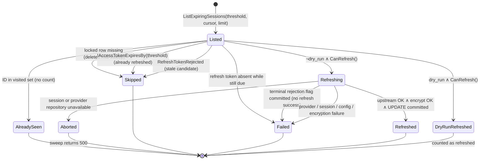
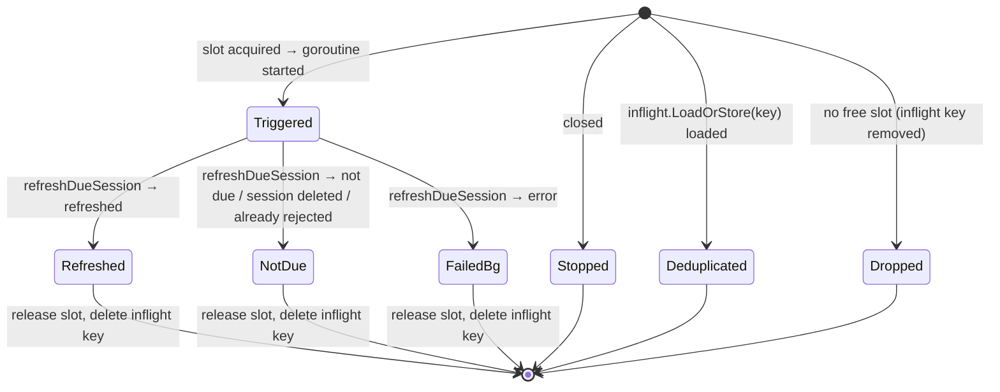

# Data Model: Proactive Token Refresh

**Feature**: `029-proactive-token-refresh` | **Date**: 2026-10-08 | **Research**: [research.md](research.md)

The feature uses the existing `UserSession` aggregate. Its corrected validity model adds observed rejection through online phases 038 prepare, 039 expand, and 040 contract. It also adds:
- One access-expiry index from migration `037`.
- Access-expiry and reauthentication predicates on `UserSession`.
- Request and result value objects for the sweep.
- One trigger enumeration.
- One in-memory, process-scoped component, `backgroundRefresher`.

Interface signatures are in [contracts/ports.md](contracts/ports.md).

## Existing entity: `UserSession` (aggregate root)

**Location**: `internal/domain/storage/user_session.go:15-46` | **Table**: `user_sessions` (`migrations/004_create_user_sessions.up.sql`)

The refresh paths read and write these fields:

| Field | Type | Read by | Written by |
|---|---|---|---|
| `ID` | `id.SessionID` (UUID v4) | expiry/UUID sweep cursor, visited-ID set, logs | — |
| `Principal` | `id.Principal` | lock key, singleflight key, per-session refresh logs | — |
| `ServiceID` | `id.ServiceID` | provider lookup, encryption context, logs | — |
| `EncryptedAccessToken` | `[]byte` | `DecryptAccessToken` | `setSessionTokens` (all triggers) |
| `EncryptedRefreshToken` | `[]byte` | `DecryptRefreshToken`, `CanRefresh` | `setSessionTokens` when the provider rotates it |
| `AccessTokenExpiresAt` | `*time.Time` | `AccessTokenExpiresBy`, sweep query and cursor | `setSessionTokens` |
| `RefreshTokenRejected` | `bool` | `CanRefresh`, `RequiresReauthentication`, acquisition guards, active selectors, sweep filters | Terminal provider rejection sets true. Successful OAuth authorization upsert resets false. |
| `UpdatedAt` | `time.Time` | — | Token refresh or recorded rejection |

### New predicate

```go
// AccessTokenExpiresBy reports whether the access token's recorded expiry is at or before t.
// A missing access expiry is unknown and is not due for expiry-based refresh (FR-013).
func (s *UserSession) AccessTokenExpiresBy(t time.Time) bool
```

| `AccessTokenExpiresAt` | `t` | Result |
|---|---|---|
| `nil` | any | `false` |
| `2026-10-08T12:00Z` | `11:59:59Z` | `false` |
| `2026-10-08T12:00Z` | `12:00:00Z` | `true` (boundary inclusive, matches `HasValidAccessToken` = `now.Before(exp)`) |
| `2026-10-08T12:00Z` | `12:00:01Z` | `true` |

Invariant: `AccessTokenExpiresBy(now) == !HasValidAccessToken()` for every session evaluated at the
same `now`. The unit test asserts this equivalence so the on-demand path's behavior does not change
when the lock callback switches predicates.

### Observed refresh authority and reauthentication

`CanRefresh()` is `!RefreshTokenRejected && len(EncryptedRefreshToken) > 0`. False rejection state means no observed terminal rejection, not proven provider validity. The broker records no refresh-token expiry prediction.

`RequiresReauthentication()` is `RefreshTokenRejected || (!HasValidAccessToken() && !CanRefresh())`. Known rejection takes precedence over an unexpired access token or unknown access expiry. Public summaries expose this as `requires_reauthentication`. `has_refresh_token` reports ciphertext presence even after rejection. `access_token_expired` remains an independent access-token fact.

Only HTTP 4xx `invalid_grant`, excluding 429, records terminal rejection. The service captures the provider error, sets `RefreshTokenRejected=true` and `UpdatedAt`, then returns `(true, nil)` from the locked callback. The repository commits before the service returns that saved error with `refreshed=false`. Ciphertext, scope, token type, initiation time, and access expiry remain unchanged. Callback errors never persist state. A write or commit error returns `persistence_failed`, not a claim of durable rejection.

Recorded rejection stops subsequent issuance and causes no refresh-success event or counter increment. A transient error leaves state unchanged and permits an otherwise valid access token. Successful authorization and callback clear rejection through the existing upsert. Explicit termination deletes the retained row.

This PR ships only migration 038 and prepared broker/API/UI code. Migrations 039 and 040 belong to following PRs and are not present. Migration 038 preserves the original table shape and adds the explicit `user_session_state` view and stable invoker write functions. The preparation view reports false. True rejection writes fail as `persistence_failed`, not durable rejection. Ordinary acquisition, refresh, and authorization work at 38. The memory adapter already supports the complete rejection lifecycle.

PR1 defaults and limits Helm targets to 38. Fresh installs run direct UP-all through 38, while normal upgrades use the guarded wrapper. Before merging or deploying PR2, complete PR1 and drain every unprepared replica and in-flight operation. PR2 adds migration 039 and the real false-default rejection flag. Durable rejection activates without restart. Before merging or deploying PR3, upgrade the embedded SPA and every external session-API consumer. PR3 adds migration 040 and removes only the unused legacy column after schema dependencies end. The legacy column supplies storage compatibility only, never provider evidence. All phases preserve rows and real token metadata. Migration 037 and historical migrations remain unchanged.

Session API compatibility defaults true in preparation and activation. Modern consumers can explicitly select false. Cleanup defaults false after its consumer gate passes. Compatibility adds only `is_expired=requires_reauthentication`, without refresh dates.

Online rollout requires compatible binaries, at least two healthy replicas, no unavailable pods, ready surge capacity, a disruption budget, sufficient draining time, and retained SPA assets. Enable temporary session API compatibility until consumers support API v2. Fail-fast locks leave the schema unchanged on contention while compatible replicas continue to serve. There is no absolute latency guarantee. DOWN 040 restores only a nullable legacy column and retains rejection. DOWN 039 refuses while rejected rows remain. Reauthenticate or explicitly terminate those rows, never clear rejection or delete them automatically. Drain preparation/new replicas before DOWN 038 removes their boundary. Inspect actual schema and dirty metadata before deliberate repair, never automatic `Force`. See the [online rollout runbook](../../docs/operations/session-sweep.md#online-session-validity-rollout-migrations-038040).

### New index

`idx_user_sessions_access_token_expires_at` is a plain B-tree index on
`user_sessions (access_token_expires_at, id)`. Migration `037` builds it concurrently for expiry-then-UUID keyset reads (DB-001, DB-003, SC-006).
ADR 039 retains the migration `037` non-atomic exception after its same-PR amendment removed the guard. Both SQL files retain an informational no-transaction comment. Before renumbering, direct Go runners passed PostgreSQL 15 lifecycle and interrupted-build recovery tests. The separate direct CLI image applied, rolled back, and reapplied the two-key index (as migration `036`, before the `main` merge renumbered it to `037`). See research R4.

### New value object: `SessionExpiryCursor`

**Location**: `internal/domain/storage/user_session.go` | **Port**: `UserSessionExpiryRepository.ListExpiringSessions`

```go
type SessionExpiryCursor struct {
    AccessTokenExpiresAt time.Time
    ID                   id.SessionID
}
```

A zero ID and zero expiry start the scan. An expiry without an ID is a validation error. A cursor with an ID continues strictly after its `(access_token_expires_at, id)` tuple, including a zero expiry. The order compares expiry first and UUID bytes second. Rows without recorded access expiry and known rejected rows never enter the scan. A stored zero access expiry is due.

## New enumeration: `RefreshTrigger`

**Location**: `internal/domain/oauth2session/refresh_trigger.go`

```go
type RefreshTrigger string

const (
    RefreshTriggerOnDemand   RefreshTrigger = "on-demand"   // read path, expired token; also ForceRefreshSession
    RefreshTriggerBackground RefreshTrigger = "background"  // read path, token inside lookahead window
    RefreshTriggerSweep      RefreshTrigger = "sweep"       // admin sweep
)
```

These are the exact `triggered_by` values for logs and metric attributes (NFR-001, NFR-004). The
string values follow the spec text literally.

## New value object: `SweepRequest`

**Location**: `internal/domain/oauth2session/sweep.go`

| Field | Type | Zero value means | Validation (domain) |
|---|---|---|---|
| `Lookahead` | `time.Duration` | use `token_refresh.lookahead_duration` | after defaulting: `> 0` |
| `DryRun` | `bool` | real sweep | — |
| `PageSize` | `int` | use `token_refresh.sweep.default_page_size` | after defaulting: `1 ≤ n ≤ 1000` |

The handler sends `Lookahead = 0` only when the field is absent. An explicit `PT0S` is rejected at
the HTTP boundary, because the parser requires a value `> 0`, so the two cases stay distinct.
A violation returns an error that wraps `ErrInvalidSweepRequest`, and the handler maps it to `400`.

## New value object: `SweepResult`

**Location**: `internal/domain/oauth2session/sweep.go` | **Wire form**: `SessionSweepResult` in [contracts/admin-session-sweep.openapi.yaml](contracts/admin-session-sweep.openapi.yaml)

| Field | Type | Meaning |
|---|---|---|
| `Refreshed` | `int` | Candidates refreshed. In dry-run mode: candidates that would be refreshed (lock-free evaluation shows them due and `CanRefresh`). |
| `Skipped` | `int` | Candidates no longer actionable: deleted, no longer due, or rejected after listing. Dry-run rejected stale snapshots also count as skipped. |
| `Failed` | `int` | Due candidates without refresh credentials, newly observed terminal rejection, other upstream errors, provider misconfiguration, or encryption failure. Rejection fails once, then later listings exclude it. Missing credentials can fail on each sweep. |
| `TotalEvaluated` | `int` | Unique session IDs returned by `ListExpiringSessions` and evaluated during this invocation. |
| `DryRun` | `bool` | Echo of the effective `DryRun`. |
| `EffectiveLookahead` | `time.Duration` | Resolved lookahead after configuration defaults; used only in the operator audit. |
| `EffectivePageSize` | `int` | Resolved page size after configuration defaults; used only in the operator audit. |

Only the first five fields appear in the HTTP `SessionSweepResult` response. The two effective controls remain internal metadata.

**Invariant** (SC-004): `Refreshed + Skipped + Failed == TotalEvaluated`. A per-invocation visited-ID set classifies each candidate once in real and dry runs. A moved row with a visited ID causes no second lock, call, metric, log, or count. The visited set uses O(unique candidates) broker memory. Pages hold at most `page_size` full session snapshots. Healthy sessions, known rejected rows, `NULL` expiries, and rows behind the cursor do not contribute unless evaluated earlier.

## Sweep candidate classification (state transitions)

Each candidate goes through one evaluation. The real sweep evaluates under the row lock
(`WithLockedSession`). The dry run evaluates the listed snapshot without a lock and without upstream
calls.



The full outcome table, with log levels, is in research R11. Most per-session errors leave the row unchanged because the callback returns an error without a write. Terminal rejection instead commits the flag and `UpdatedAt` through `(true, nil)` before the service returns the saved provider error. It counts as failed once. Later sweeps exclude the retained row. This preserves L3/L4 in [contracts/ports.md](contracts/ports.md).

**Sweep threshold**: `threshold = sweepStart + effectiveLookahead`, computed once. It is used for
both the query and the locked re-check, so a candidate's classification never depends on how long
the sweep has run.

**Cursor progression**: The first cursor is `storage.SessionExpiryCursor{}` (zero time and zero ID). Each full page uses the last raw row for the next cursor. The sweep takes the value `*last.AccessTokenExpiresAt` and `last.ID`, including when every row was already seen. The tuple must increase strictly. A nil expiry or non-increasing tuple aborts through the repository-failure path. The sweep stops after a short page, cancellation, or an aborting error (research R3). A refreshed or deleted earlier row does not hide later rows ahead of the cursor. A new row behind the cursor is not visited. If a refreshed row moves forward but stays due, the visited set prevents a second evaluation.

## New process-scoped component: `backgroundRefresher`

**Location**: `internal/domain/oauth2session/background_refresh.go` (unexported, owned by `OAuth2SessionService`)

| State | Type | Purpose |
|---|---|---|
| `slots` | `chan struct{}` (cap = `background_workers`) | Concurrency bound. Non-blocking acquire. |
| `inflight` | `sync.Map[string]struct{}` | Per-process dedup by `principal|serviceID`, checked before slot acquisition. |
| `baseCtx`, `cancel` | `context.Context`, `context.CancelFunc` | Parent of every flight. Cancelled only after the drain deadline. |
| `wg` | `sync.WaitGroup` | Join point for `Close`. |
| `closed` | `atomic.Bool` | Rejects submissions after `Close` begins. |
| `closeOnce` | `sync.Once` | Makes `Close` idempotent. |

**Submission outcomes** (one per `submit` call):



| Outcome | Counter | Log |
|---|---|---|
| `Triggered` | `proactive_refresh_triggered_total{triggered_by=background}` +1 | DEBUG |
| `Dropped` | `proactive_refresh_dropped_total{triggered_by=background}` +1 | WARN (NFR-002): `service_id`, `session_id` |
| `Deduplicated` | — | DEBUG |
| `Stopped` | — | DEBUG |
| `Refreshed` | — | INFO `session.oauth2.token_refreshed` with `triggered_by=background` (NFR-001) |
| `NotDue` | — | DEBUG |
| `FailedBg` | `proactive_refresh_failed_total{triggered_by=background}` +1 | Per research R11 (WARN or ERROR) |

A new terminal rejection counts as `FailedBg`, not `Refreshed`, after its state commits. Future acquisition refuses that row before decrypting a token. Already-rejected background work is an unchanged no-op. A shared rejected result cannot trigger background follow-up or give an on-demand joiner a token.

**Lifecycle**: Constructed in `NewOAuth2SessionService`. It has no long-lived goroutines. Goroutines
exist only while a flight runs. `Close(ctx)`: set `closed` → `wg.Wait()` racing `ctx.Done()` →
`cancel()` → return `nil` or `ctx.Err()` (research R7).

**Plaintext scope** (SR-003): flights return `*storage.UserSession` (ciphertext only). The plaintext
refresh token lives only in `refreshSessionTokens` locals. A background flight never decrypts the
access token.

## Domain event: `SessionTokensRefreshed`

The broker records this domain event as the structured `session.oauth2.token_refreshed` log.
There is no event bus. After a successful token refresh commits, the log contains:

| Attribute | Value |
|---|---|
| `event` | `session.oauth2.token_refreshed` (unchanged) |
| `session_id` | `UserSession.ID` (new) |
| `principal` | `UserSession.Principal` (session owner) |
| `service_id` | unchanged |
| `triggered_by` | `RefreshTrigger` (new) |
| `public_client` | unchanged |

The existing `service_refresh_concurrency_test.go` assertions check the owner and prove that success is logged after commit for all three triggers.

## Configuration entity: `TokenRefreshConfig`

**Location**: `internal/ports/config.go` (new top-level section `token_refresh`).
The complete file, environment, CLI, and Helm contract is in [contracts/configuration.md](contracts/configuration.md).

```go
type TokenRefreshConfig struct {
    LookaheadDuration time.Duration           `mapstructure:"lookahead_duration"`
    BackgroundWorkers int                     `mapstructure:"background_workers"`
    Sweep             TokenRefreshSweepConfig `mapstructure:"sweep"`
}

type TokenRefreshSweepConfig struct {
    DefaultPageSize int `mapstructure:"default_page_size"`
}
```

It flows to `oauth2session.Config` as `RefreshLookahead`, `BackgroundRefreshWorkers`, and
`SweepDefaultPageSize` through `NewConfigFromPorts`. That function gains a `ports.TokenRefreshConfig`
parameter, and every caller must be updated, confirmed with `lsp references` during implementation.

## Glossary additions (ARCHITECTURE.md, Principle V)

| Term | Definition | Relationships |
|---|---|---|
| **Refresh Lookahead Window** | The interval before access-token expiry, `token_refresh.lookahead_duration`, in which a token is still served but is refreshed proactively. | Evaluated on `UserSession.AccessTokenExpiresAt`; drives Proactive Refresh and the default Session Sweep window. |
| **Proactive Refresh** | A non-blocking background refresh of a `UserSession`, triggered when token exchange serves a token inside the Refresh Lookahead Window. It is bounded per replica and dropped on saturation. | Shares per-replica deduplication with on-demand refresh; persists through the locked session update. |
| **Session Sweep** | An admin-triggered, externally scheduled pass over due access-token expiries in keyset pages. Known rejected rows are excluded. | Produces a `SweepResult`. New rejection fails once, stale rejection skips, and missing refresh credentials can fail repeatedly. |
| **SessionExpiryCursor** | The internal `(AccessTokenExpiresAt, ID)` keyset value for Session Sweep, ordered by expiry then UUID bytes. | A zero ID and zero expiry start `ListExpiringSessions`; an expiry without an ID is invalid. A nonzero ID can pair with a zero expiry. |
| **SweepRequest** | The input value object for a Session Sweep: lookahead, dry-run flag, and page size. | Applies the configured defaults and validation before the sweep evaluates a `UserSession`. |
| **SweepResult** | The value object summarizing a Session Sweep: `refreshed`, `skipped`, `failed`, `total_evaluated`, `dry_run`. | `refreshed + skipped + failed = total_evaluated`. |
| **RefreshTrigger** | The origin of a token refresh: `on-demand`, `background`, or `sweep`. Recorded as `triggered_by`. | Attribute of `SessionTokensRefreshed` and the refresh counters. |
| **SessionTokensRefreshed** | The structured event recorded after a token refresh commits. | Records the `UserSession` owner, ID, service ID, and `RefreshTrigger` without token material. |
