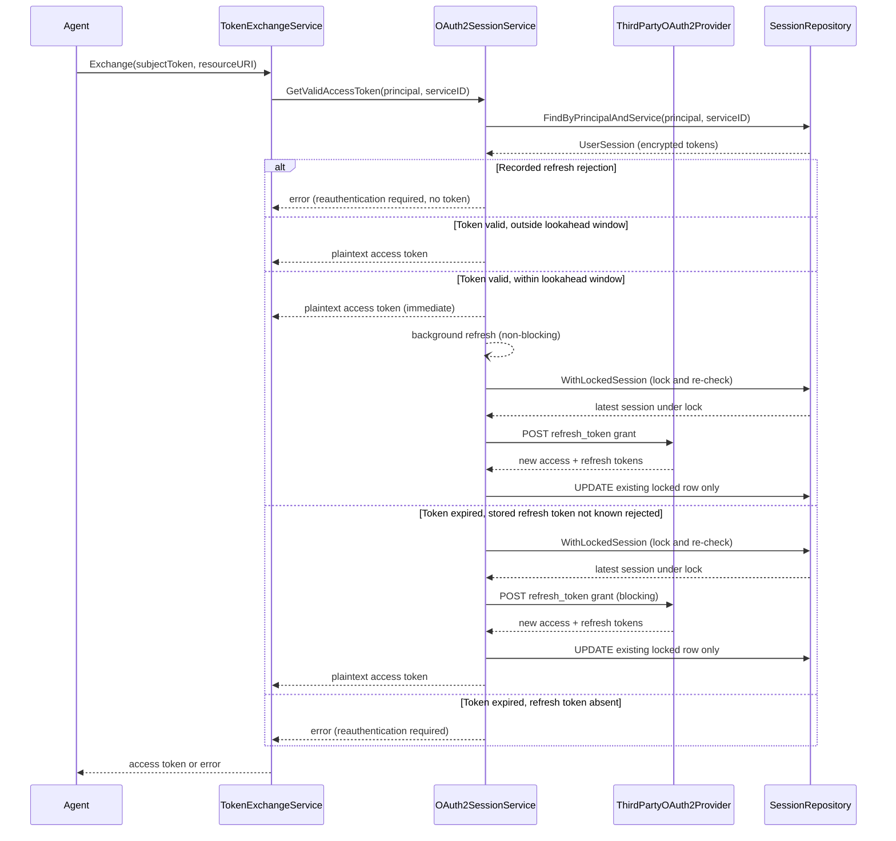

# Feature Specification: Proactive Token Refresh

**Feature Branch**: `029-proactive-token-refresh`  
**Created**: 2026-05-07  
**Status**: Draft  
**Input**: User description: "Refresh and access token from the third-party services per user never refreshed. The refresh of these tokens happens only on the read path when its are loaded / inspected. As a problem it causes extra latency for latency sensitive token exchange operation. It is required to solve the problem for (a) active ongoing sessions in stateless, no-coordination mode; (b) inactive sessions within the admin process (refresh process has to be scoped)"

## Clarifications

### Session 2026-05-07

- Q: What is the deduplication scope for background refresh — per-replica or cross-replica? → A: Per-replica (`singleflight` within each process). Across replicas, a row lock serializes refreshes. Each replica re-checks the latest session before calling the provider. Refreshes update an existing row only.
- Q: Should background refresh goroutines be bounded or unbounded? → A: Bounded worker pool with configurable concurrency limit (default: 10); excess proactive refresh requests are dropped silently — the caller already received a valid token, so a dropped refresh is safe.
- Q: What observability signals are required? → A: Structured log events (INFO on success, WARN on dropped/failed, ERROR on infrastructure failures) plus OpenTelemetry `Int64` counters emitted through the existing telemetry pipeline — no Prometheus registry, no `/metrics` endpoint, and no `/health` counter surface: `proactive_refresh_triggered_total`, `proactive_refresh_dropped_total`, `proactive_refresh_failed_total`, `session_sweep_refreshed_total`, `session_sweep_failed_total`.
- Q: Is `lookahead_duration` required or optional in the sweep request body? → A: Optional — omitting it uses the server-configured `token_refresh.lookahead_duration` default; callers may override it for wider ad-hoc sweeps.
- Q: What HTTP status code should the sweep return when all per-session refreshes fail? → A: `200 OK` always when the sweep itself completed (even if every session failed); `5xx` is reserved for infrastructure failures such as database unavailability or handler panics.

### Session validity cutover (ADR 040)

The broker records access-token expiry and refresh-token ciphertext presence. It does not predict expiry for opaque third-party refresh tokens. A missing access expiry is unknown, not permanent validity.

`refresh_token_rejected=false` means no observed terminal provider rejection, not proven refresh-token validity. Only HTTP 4xx `invalid_grant`, excluding 429, records rejection. Transient errors do not change this flag.

Recorded rejection stops subsequent broker token issuance, even when the access token remains unexpired. The broker retains the session and token metadata. Successful OAuth authorization and callback clear rejection through the existing upsert. Explicit termination deletes the row. This policy does not revoke tokens already issued.

ADR 040 narrowly supersedes ADR 038's availability consequence for terminal rejection. Dropped work and transient background errors still permit an otherwise valid access token.

## User Scenarios & Testing *(mandatory)*

### User Story 1 - Zero-Latency Token Exchange for Active Users (Priority: P1)

An AI agent performs a token exchange during an active user session. The user's third-party access token was recently issued and is well within its validity window, so the exchange completes immediately without any upstream OAuth2 refresh round-trip.

When a valid token approaches expiry, the exchange returns it without waiting for background work. If a refresh slot is available and the provider succeeds, the broker stores new tokens. A later exchange then uses the fresh token. Dropped or failed work does not change the current response.

**Why this priority**: This is the primary latency-sensitive hot path. An AI agent token exchange must complete quickly. Any synchronous upstream OAuth2 call on the critical path causes user-visible delay. Solving this first delivers the core value of the feature.

**Independent Test**: Exchange a valid token inside the lookahead window while the provider response is gated. The exchange returns the current token before the refresh completes. After releasing the gate, a successful refresh stores new tokens without another exchange.

**Acceptance Scenarios**:

1. **Given** one near-expiry session occupies the only background refresh slot, another session is near expiry, and a third is healthy, **When** agents exchange tokens for the latter two sessions, **Then** both receive their current valid tokens without waiting. The due session's refresh is dropped with a WARN event. The healthy session causes no upstream refresh.
2. **Given** a refreshable session whose access token is near expiry but still valid, **When** an agent requests a token exchange, **Then** the exchange returns the current valid token without waiting for the background refresh. If the provider completes the admitted refresh successfully, the stored session receives the new tokens. A failed or dropped refresh does not change the current response.
3. **Given** a background refresh is already in progress for a session, **When** a second token exchange request arrives for the same session, **Then** the second request returns without waiting for that refresh to finish and without triggering a duplicate upstream refresh call.

---

### User Story 2 - Expired Session Refresh Without User Interruption (Priority: P1)

An AI agent requests a token exchange after the access token expires. A stored refresh token without recorded rejection permits a refresh attempt. If the provider accepts it, the broker returns the new access token without user reauthentication.

**Why this priority**: Tied in priority with Story 1 — this is the other half of the on-demand path. Without it, agents silently fail when tokens expire between requests. The feature description explicitly requires this to work on the read path as the baseline.

**Independent Test**: Expire the stored access token without removing its refresh token. A successful provider refresh permits token exchange. A separate rejection journey proves immediate refusal and OAuth callback recovery.

**Acceptance Scenarios**:

1. **Given** expired access and stored refresh credentials without recorded rejection, **When** an agent exchanges a token, **Then** one synchronous refresh succeeds.
   After commit, an INFO `session.oauth2.token_refreshed` event contains `session_id` and `triggered_by=on-demand`.
2. **Given** expired access without refresh credentials, **When** an agent exchanges a token, **Then** the broker requires reauthentication without an upstream call or token.
   One ERROR `session.oauth2.refresh_failed` event contains `session_id` and `triggered_by=on-demand`.
3. **Given** unexpired one-hour access and provider HTTP 400 `invalid_grant`, **When** manual refresh runs, **Then** return HTTP 409 `refresh_rejected`.
   The message is `refresh token rejected by provider; reauthentication required`. The rejection commits without changing ciphertext, access expiry, or other token metadata.
   The retained list entry reports `requires_reauthentication=true`, `access_token_expired=false`, and `has_refresh_token=true`.

   The next exchange returns HTTP 400 `invalid_grant` with a `/sessions` recovery URI and no access token.
   The provider request count remains one.
   An admin sweep with `{"lookahead_duration":"PT2H","page_size":100}` returns HTTP 200 with all four counts zero.
   The unchanged access expiry falls within that window, so zero evaluated candidates proves rejection exclusion.
   The provider request count still remains one.

   A real authorize/provider/callback redirect journey clears rejection through the existing upsert for the same session.
   The list reports `requires_reauthentication=false`, and the next exchange succeeds.
   The provider receives one `authorization_code` grant, not another refresh.
   Rejection emits one ERROR `session.oauth2.refresh_failed` event for the forced on-demand operation, not a refresh-success event.

---

### User Story 3 - Admin-Triggered Sweep of Expiring Sessions (Priority: P2)

An operator (or a Kubernetes CronJob acting on behalf of operations) calls an administrative endpoint to proactively refresh all sessions whose access tokens are expiring within a configurable time window. The sweep operates across all principals and services in the system. The process is scoped: it processes only sessions below the expiry threshold and skips healthy sessions.

The broker does not schedule sweeps or use a distributed lock. An operator schedules the endpoint. A row lock and a re-check of the latest session serialize concurrent refreshes across replicas. Refresh paths update existing rows only.

**Why this priority**: This covers the inactive session population that Story 1 and 2 cannot reach (no agent is actively requesting tokens for those users). It requires an admin API addition, which has higher coordination cost (API-first requirement) and more operational setup.

**Independent Test**: Can be fully tested by seeding the database with sessions at various expiry states, calling the sweep endpoint, and verifying that only sessions within the threshold were refreshed and others were left unchanged.

**Acceptance Scenarios**:

1. **Given** the admin sweep endpoint is called with a lookahead window, **When** there are sessions expiring within the window and sessions not expiring within the window, **Then** only the expiring sessions are candidates for the sweep and sessions outside the window do not contribute to `refreshed`, `skipped`, or `failed` counts.
2. **Given** a due session without refresh credentials and another refreshable session, **When** two sweeps run, **Then** each counts the still-due missing-credential row as `failed`. Neither sweep requests its provider's credentials or tokens. The first sweep refreshes the other session. The failed row's ciphertext and access expiry remain unchanged. A newly observed terminal rejection instead commits the rejection flag and counts as failed once. Later sweeps exclude it without another provider call.
3. **Given** concurrent sweeps across broker replicas, **When** they process the same session, **Then** the row lock and re-check prevent duplicate upstream refreshes and partial updates. A row rejected after listing counts as `skipped` without another provider call. The replica that first records rejection counts one failure and no refresh success.
4. **Given** `dry_run: true`, **When** a sweep evaluates due sessions, **Then** refreshable candidates count as `refreshed` without upstream calls or writes. Known rejected rows never enter the candidate list. A rejected stale snapshot counts as `skipped`, and a due row without refresh credentials counts as `failed`.

---

### Edge Cases

- What happens when the provider is unavailable during background refresh? The broker logs the transient error and leaves session state unchanged. An otherwise valid access token remains usable. A later terminal rejection stops subsequent issuance after its flag commits, but cannot recall a token already returned.
- What happens when a provider rejects refresh authority? The sweep records each new terminal rejection as one per-session failure and continues. Later sweeps exclude that retained row. Missing refresh credentials remain a failure on each sweep while the access token stays due.
- What happens when a session is deleted (user revoked consent) while a background refresh is in progress? The locked, update-only refresh MUST discard the result without re-creating the session.
- What happens if the sweep lookahead window is set to a very large value covering all sessions? The sweep MUST paginate its database queries to avoid loading the entire `user_sessions` table into memory at once.
- What happens when access expiry is absent (`access_token_expires_at IS NULL`)? The broker has no recorded expiry, not proof of permanent validity. Background refresh and sweep exclude the row. Recorded rejection still requires reauthentication and prevents token issuance.

## Requirements *(mandatory)*

### Functional Requirements

- **FR-001**: Without recorded rejection, the broker MUST return an otherwise valid access token without blocking when it lies outside the proactive lookahead window.
- **FR-002**: Without recorded rejection, the broker MUST return an otherwise valid access token immediately inside the lookahead window. A stored refresh token permits non-blocking background submission. Saturation drops the work without changing session state. Dropped work and transient background errors MUST NOT prevent use of that valid access token.
- **FR-003**: Background refresh MUST use per-replica deduplication (`singleflight` within each broker process). If a refresh is already in progress for a session within the same process, subsequent requests for that session MUST NOT trigger another upstream refresh call. Across replicas, the locked refresh MUST re-check the latest session before an upstream call and update only an existing row.
- **FR-004**: After access-token expiry, the broker MUST attempt synchronous refresh only when refresh credentials exist and no rejection is recorded.
- **FR-005**: Recorded provider rejection MUST require reauthentication and stop subsequent issuance, even before access-token expiry. Missing refresh credentials MUST require reauthentication after access-token expiry. Neither condition permits a new provider refresh call. Only HTTP 4xx `invalid_grant`, excluding 429, records rejection. The service MUST commit that flag through `(true, nil)` before returning the captured error. Callback errors MUST NOT persist state. Persistence failure MUST return `persistence_failed`, not durable rejection or refresh success.
- **FR-006**: The admin server MUST expose an endpoint to trigger a sweep of sessions with access tokens expiring within a caller-specified lookahead duration.
- **FR-007**: The sweep endpoint MUST accept a `dry_run` request body parameter. When `dry_run: true`, it MUST report how many sessions would be refreshed without performing any upstream calls.
- **FR-008**: The sweep MUST read sessions in keyset pages, not load the entire session table into memory. It MUST retain visited session IDs for one invocation so a refreshed row that moves forward cannot be evaluated twice. The visited set uses O(unique candidates) broker memory, while each page holds at most `page_size` session snapshots.
- **FR-009**: The sweep MUST be safe to invoke concurrently from multiple broker replicas. A row lock and a re-check of the stored session MUST prevent duplicate upstream refreshes and partial updates. Refresh MUST NOT re-create a deleted session.
- **FR-010**: The sweep MUST report refreshed, skipped, failed, and total evaluated counts. Known rejected rows MUST be excluded from repository candidates. Rejected stale candidates MUST count as skipped. A newly committed rejection MUST count as failed once. Due rows without refresh credentials MUST remain failures on later sweeps.
- **FR-011**: A failed refresh for one session during a sweep MUST NOT abort the sweep — the sweep MUST continue processing remaining sessions.
- **FR-012**: The proactive refresh lookahead window MUST be configurable via the standard configuration port. The default value is `5m`.
- **FR-013**: Sessions with no expiry set (`access_token_expires_at IS NULL`) MUST be excluded from both background proactive refresh and admin sweep processing.
- **FR-014**: The database MUST have the named B-tree index `idx_user_sessions_access_token_expires_at` on `(access_token_expires_at, id)` to support the expiry-then-UUID sweep query.

### Domain Model

**Activity / Flow Diagram — On-Demand Path with Lookahead Refresh**:



Every refresh re-checks rejection under the session lock before due-time and provider decisions. A new terminal rejection writes only the flag and `updated_at` through `(true, nil)`. After commit, the service returns the saved rejection error with `refreshed=false`. It emits no refresh-success event or metric. Other provider errors return from the callback without a write. Token acquisition also rejects a shared refresh result before decrypting it.

**Activity / Flow Diagram — Admin Sweep Path**:

```mermaid
sequenceDiagram
    participant CronJob
    participant AdminAPI
    participant SessionSweepService
    participant SessionRepository
    participant ThirdPartyOAuth2Provider

    CronJob->>AdminAPI: POST /api/sessions/sweep
    AdminAPI->>SessionSweepService: Sweep(lookaheadDuration, dryRun, pageSize)

    loop Pages of expiring sessions without recorded rejection
        SessionSweepService->>SessionRepository: ListExpiringSessions(threshold, cursor, pageSize)
        SessionRepository-->>SessionSweepService: page of UserSessions

        loop Each session in page
            alt rejected stale candidate or no longer due
                SessionSweepService->>SessionSweepService: count skipped, no provider call
            else refresh token absent
                SessionSweepService->>SessionSweepService: count failed, continue
            else dryRun=true
                SessionSweepService->>SessionSweepService: count refreshed, no provider call
            else stored refresh token not known rejected
                SessionSweepService->>SessionRepository: WithLockedSession (lock and re-check)
                SessionRepository-->>SessionSweepService: latest session under lock
                SessionSweepService->>ThirdPartyOAuth2Provider: POST refresh_token grant
                ThirdPartyOAuth2Provider-->>SessionSweepService: new tokens
                SessionSweepService->>SessionRepository: UPDATE existing locked row only
                Note over SessionSweepService,SessionRepository: Terminal rejection commits flag, counts failed once; later sweeps exclude row
            end
        end
    end

    SessionSweepService-->>AdminAPI: SweepResult (refreshed, skipped, failed, total)
    AdminAPI-->>CronJob: 200 OK with sweep summary
```

**Domain Event**:
- **SessionTokensRefreshed**: A successful, committed session refresh. The broker records this event as the structured `session.oauth2.token_refreshed` log. It contains `principal` (the session owner), `session_id`, `service_id`, and `triggered_by` (background, on-demand, sweep). It contains no token material.

### Configuration Requirements

**Configuration Parameters**:
- **`token_refresh.lookahead_duration`**: Duration, the time before access token expiry at which proactive background refresh is triggered. Default: `5m`.
- **`token_refresh.background_workers`**: Integer, maximum number of concurrent background refresh goroutines per broker replica. Excess proactive refresh requests are dropped silently. Default: `10`.
- **`token_refresh.sweep.default_page_size`**: Integer, number of sessions processed per page during an admin sweep. Default: `100`.

**Example YAML Configuration**:
```yaml
token_refresh:
  lookahead_duration: 5m
  background_workers: 10
  sweep:
    default_page_size: 100
```

**Configuration Location**: Will be added to `internal/ports/config.go` and `examples/config/third-party-oauth2.yaml`.

### API Requirements

- **API-001**: The admin sweep endpoint MUST be documented in `/api/admin/openapi.yaml`.
- **API-002**: `POST /api/sessions/sweep` triggers the sweep. All request body parameters are optional: `lookahead_duration` (positive ISO 8601 `P[nD][T[nH][nM][n[.f]S]]`; year, month, and week units are not accepted; default: `token_refresh.lookahead_duration`), `dry_run` (boolean, default `false`), and `page_size` (integer, `1–1000`; default: `token_refresh.sweep.default_page_size`).
- **API-003**: The sweep response body MUST include: `refreshed` (integer), `skipped` (integer), `failed` (integer), `total_evaluated` (integer), and `dry_run` (boolean). When `dry_run=true`, sessions that would be refreshed MUST still be counted in `refreshed`; the broker simply skips upstream calls and persistence. `skipped` counts only evaluated candidates that no longer require action, not healthy sessions excluded by the repository query.
- **API-004**: The endpoint MUST return `200 OK` whenever the sweep process itself completes, regardless of per-session refresh outcomes — including the case where every session fails to refresh. The response body counts (`refreshed`, `failed`, `total_evaluated`) convey outcome to the caller. `500` is reserved for infrastructure failures (database unreachable, handler panic).
- **API-005**: The endpoint MUST be on the admin server (port 14000) and require administrative access enforced at the proxy level.

### Database Requirements

**Release scope**: This PR2 activation release includes migration 038 and adds migration 039 to prepared broker/API/UI code. Migration 040 belongs to the following cleanup PR and is not present. Migration 039 activates durable rejection on already-running PR1 brokers without restart. PostgreSQL at 38 supports ordinary traffic but refuses true writes as `persistence_failed`. Memory supports the complete rejection lifecycle. This release defaults and limits Helm targets to 39. Fresh installs use direct UP-all through 39, while normal upgrades use the guarded wrapper. Explicit upgrade target 0 remains refused. Before merging or deploying this activation PR, complete PR1 across every replica. Drain every unprepared replica and in-flight operation first. Before merging or deploying PR3, upgrade the embedded SPA and every external session-API consumer. End legacy schema dependencies before cleanup. Compatibility defaults true in preparation and activation, supports explicit false, and defaults false in cleanup after its consumer gate passes. It adds only `is_expired=requires_reauthentication`, never refresh dates.

- **DB-001**: Migration `037` MUST add `idx_user_sessions_access_token_expires_at` on `user_sessions (access_token_expires_at, id)` with `CREATE INDEX CONCURRENTLY`. UP and DOWN MUST retain the first-line `-- migrate:no-transaction` comment required by `AGENTS.md`. The `golang-migrate` runners do not enforce that comment. Principle IX normally requires full application or full rollback on failure; this concurrent build cannot provide it.
  **Accepted named exception**: On 2026-10-12, the stakeholder amended ADR 039 in this unmerged feature PR to remove its guard requirement. The non-atomic exception still applies only to feature 029, migration `037`, and this named index. The separate migration image and Go runners execute directly without a shared preflight. A missing DOWN can remain unnoticed until after UP. Recovery MUST inspect `pg_index.indisvalid`, remove only an inspected invalid index, and repair a dirty version before retry. This is not atomic rollback.
  Before renumbering, PostgreSQL 15 lifecycle and interrupted-build recovery tests passed through direct Go runners. The direct v4.17.0 image applied, rolled back, and reapplied migration `036` against a disposable database (as migration `036`, before the `main` merge renumbered it to `037`). Normal-planner first, middle, and late page checks passed for SC-006.
- **DB-002**: All refresh triggers MUST reuse `UserSessionRefreshRepository.WithLockedSession` with row locking and update-only persistence. Callback `(false, nil)` or `(_, err)` MUST write nothing. Callback `(true, nil)` MUST atomically persist token state and `refresh_token_rejected`. The service MUST capture terminal rejection, commit through `(true, nil)`, then return that error. Initial authorization keeps the existing upsert and clears rejection. A deleted session MUST NOT be re-created by refresh. Migration 038 MUST preserve the legacy table shape and add an explicit view plus stable invoker write functions. Preparation brokers MUST roll across every replica before migration 039 adds the real false-default flag and activates durable rejection. All unprepared replicas MUST drain before 39. Migration 040 MUST remove only the unused legacy column. Historical dates MUST NOT imply provider rejection. All phases MUST preserve rows and real metadata. DOWN 040 MUST retain rejection and restore only a nullable legacy column. DOWN 039 MUST refuse while rejected rows remain. Resolve them through reauthentication or explicit termination, never flag clearing or automatic deletion. Drain preparation/new replicas before DOWN 038. Operators MUST inspect actual schema and dirty metadata before manual repair, never automatic `Force`. Migration 037 and historical migrations remain unchanged. See the [online rollout runbook](../../docs/operations/session-sweep.md#online-session-validity-rollout-migrations-038040) for availability prerequisites and fail-fast lock handling.
- **DB-003**: A focused `UserSessionExpiryRepository` port MUST define `ListExpiringSessions(ctx context.Context, threshold time.Time, cursor storage.SessionExpiryCursor, limit int) ([]*storage.UserSession, error)`. Both adapters MUST exclude `refresh_token_rejected=true`. They MUST return non-NULL access expiries at or before the fixed threshold in `(access_token_expires_at, id)` order. `SessionExpiryCursor{AccessTokenExpiresAt time.Time, ID id.SessionID}` starts on the first page only when the ID and expiry are both zero. A cursor with an ID continues strictly after its tuple, including zero expiry. An expiry without an ID is invalid. A stored zero expiry is due like an expired access token. `UserSessionRepository` remains unchanged.

### Non-Functional Requirements

- **NFR-001**: The system MUST emit a structured log line at `INFO` level after each committed session refresh. It MUST include the session owner's `principal`, `session_id`, `service_id`, and `triggered_by` (background, on-demand, sweep). It MUST NOT include token material.
- **NFR-002**: The system MUST emit a structured log line at `WARN` level when a proactive background refresh is dropped because the worker pool is at capacity, including `service_id` and session ID.
- **NFR-003**: The broker MUST log per-session sweep failures at WARN, including missing refresh credentials and newly observed provider rejection. Database failures MUST log at ERROR and abort the sweep. Committed rejection MUST NOT emit refresh-success events or increment refresh-success counters.
- **NFR-004**: The system MUST emit OpenTelemetry `Int64` counters through the existing telemetry pipeline (no Prometheus registry, no `/metrics` endpoint, and no `/health` counter surface): `proactive_refresh_triggered_total`, `proactive_refresh_dropped_total`, `proactive_refresh_failed_total`, `session_sweep_refreshed_total`, `session_sweep_failed_total`. Counters MUST be labeled with `triggered_by` where applicable.

### Security Requirements

- **SR-001**: Background refresh operations MUST encrypt newly issued tokens using the same encryption context (`{"service_id": "..."}`) before persisting. Plaintext tokens MUST never be written to storage.
- **SR-002**: The sweep endpoint MUST NOT expose token plaintext in its response. The response MUST contain only counts and status summaries.
- **SR-003**: Background goroutines performing token refresh MUST respect context cancellation (server shutdown) and MUST NOT hold references to decrypted tokens beyond the scope of a single refresh operation.
- **SR-004**: For static confidential clients, which store an encrypted client secret, upstream refresh calls MUST decrypt that secret only at call time and MUST NOT cache it in memory. Public clients (`token_endpoint_auth_method: none`) send no client credential. CIMD confidential clients (`private_key_jwt`) have no shared secret and sign a fresh client assertion for each refresh request.

### Key Entities

- **UserSession**: Existing aggregate with access-token expiry, encrypted tokens, and the persisted `RefreshTokenRejected` flag. `CanRefresh()` means stored refresh ciphertext without recorded rejection, not proven provider validity. `RequiresReauthentication()` is `RefreshTokenRejected || (!HasValidAccessToken() && !CanRefresh())`. Public summaries expose `requires_reauthentication`, independent `access_token_expired`, and ciphertext-presence `has_refresh_token`, including rejected credentials.
- **SessionExpiryCursor**: Internal keyset value `{AccessTokenExpiresAt time.Time, ID id.SessionID}` for expiry-then-UUID sweep pages. It is not part of the admin API.
- **SweepResult**: Value object representing the outcome of a sweep operation: `{Refreshed int, Skipped int, Failed int, TotalEvaluated int, DryRun bool}`.

## Success Criteria *(mandatory)*

### Measurable Outcomes

- **SC-001**: Exchanges for sessions without recorded rejection and with access tokens outside the lookahead window complete without upstream OAuth2 calls.
- **SC-002**: Token exchange requests for sessions whose access token is near expiry (within the lookahead window) return the current token on the non-blocking fast path — measurable by asserting that the response is returned before the mocked background refresh completes, and that the request path makes zero blocking upstream OAuth2 calls.
- **SC-003**: Concurrent exchanges MUST trigger at most one upstream refresh per session while it is in flight. Across replicas, the locked re-check MUST prevent another refresh after renewal or recorded rejection. Transient errors permit later attempts. Recorded rejection requires OAuth reauthorization or explicit termination instead.
- **SC-004**: The sweep processes each unique session ID at most once and satisfies `refreshed + skipped + failed = total_evaluated`. Known rejected rows never contribute. Stale rejection counts as skipped. A newly observed rejection fails once. Missing refresh credentials can fail on each later sweep.
- **SC-005**: The admin sweep can be invoked concurrently from multiple broker replicas without producing corrupted session state — the final stored tokens are always consistent.
- **SC-006**: With sparse due rows and normal PostgreSQL planner settings, first, middle, and late `ListExpiringSessions(...)` pages use the valid named two-key B-tree index `idx_user_sessions_access_token_expires_at` for `(access_token_expires_at, id)` keyset order. `EXPLAIN (ANALYZE, BUFFERS, FORMAT JSON)` must show that later pages do not rescan the full due set.

## Assumptions

- The upstream OAuth2 provider supports the `refresh_token` grant type (RFC 6749 §6). Sessions for providers that do not issue refresh tokens will not benefit from this feature and will continue to require re-authentication on expiry.
- The Kubernetes CronJob is responsible for scheduling and coordinating the admin sweep. The broker provides the endpoint but does not manage scheduling internally.
- The default lookahead window of 5 minutes is sufficient for typical access token lifetimes (usually 1 hour). Operators can adjust via configuration if upstream providers issue short-lived tokens.
- The `page_size` default of 100 sessions per sweep page is conservative. Operators can increase it via the request body if their session volume warrants it.
