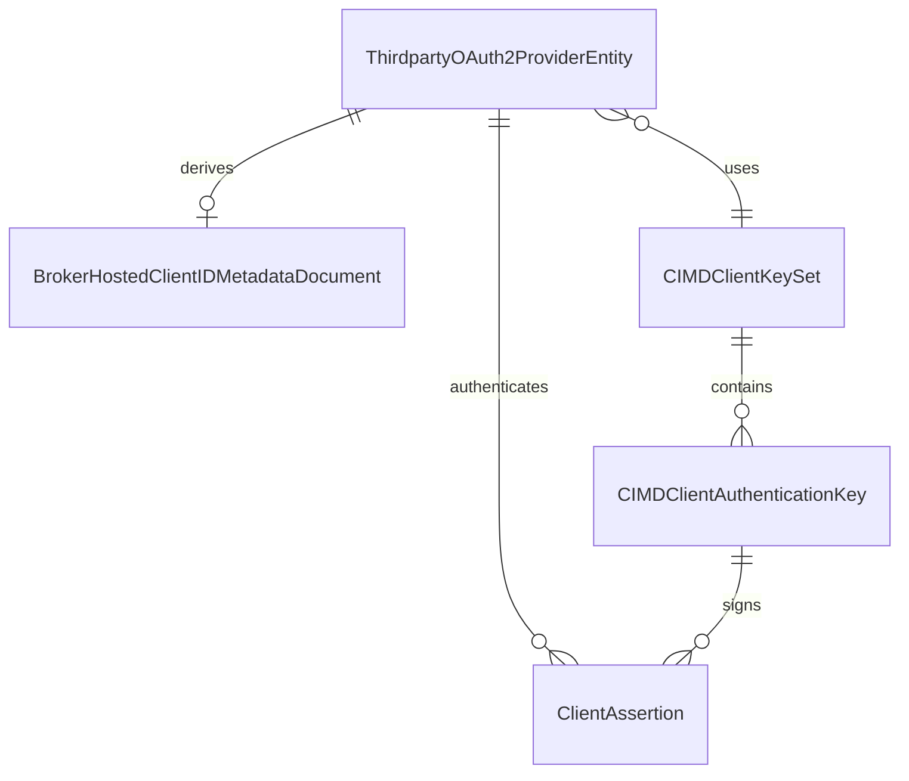

# Data Model: CIMD Upstream Client Authentication

## Glossary additions

Add these terms to `ARCHITECTURE.md` during implementation:

- **CIMD confidential service:** A third-party OAuth2 service that uses `private_key_jwt`. It has a broker-hosted client ID URL and no shared secret.
- **CIMD client-authentication key:** A broker-global ES256 key in the `cimd_client_authentication` key domain. It signs outbound client assertions only.
- **Broker-hosted Client ID Metadata Document:** The public document at a CIMD service's client identifier URL. Increment 2 adds a keyless public variant.
- **Client assertion:** A short-lived ES256 JWT that authenticates the broker to one configured third-party token endpoint.
- **Key domain:** A persisted purpose boundary for asymmetric broker keys. The two values are `token_signing` and `cimd_client_authentication`.

## Persistent entities

### ThirdpartyOAuth2ProviderEntity

This existing entity remains the third-party service aggregate.

| Field | Type | Private-key-JWT rule |
|---|---|---|
| `ID` | `id.ServiceID` | Immutable service UUID. It identifies the hosted document path. |
| `DisplayName` | string | Required existing service name. |
| `ClientID` | `id.ClientID` | The broker writes `<enduser-public-url>/.well-known/oauth-client/<service-id>`. The operator cannot supply or replace it. |
| `TokenEndpointAuthMethod` | optional enum | `private_key_jwt` identifies this mode. |
| `Secret` | `model.Secret` | Must be absent. The broker must not encrypt, persist, decrypt, or return a shared secret. |
| `Flavor` | `model.OAuth2Flavor` | Credential-derived variants, including Google, reject `private_key_jwt`. |
| `Endpoints.TokenEndpoint` | HTTPS URI | The exact assertion audience. |
| `Endpoints.AuthorizeEndpoint` | HTTPS URI | Existing authorization-code endpoint. |
| `Version` | integer | Existing optimistic-concurrency value. |

The existing `client_id` database column stores the generated URL. No separate CIMD identity column is necessary.

### CIMD client-authentication key

CIMD keys reuse the existing asymmetric key record and lifecycle mechanics. They add a required `key_domain` field.

| Field | Type | Rule |
|---|---|---|
| `ID` | `id.SigningKeyID` | Existing key record identity. No new entity ID is needed. |
| `KeyDomain` | enum | `cimd_client_authentication` for CIMD keys. Existing rows become `token_signing`. |
| `KID` | `id.KeyID` | Globally unique across the shared key table and both published key sets. |
| `Algorithm` | string | Exactly `ES256`. |
| `PrivateKeyEncrypted` | bytes | Private PKCS#8 PEM. Never serialized or returned. |
| `IsCurrent` | boolean | At most one active CIMD key is current. |
| `ActivatesAt` | timestamp | Earliest time that the current key can sign an assertion. |
| `CreatedAt` | timestamp | Key creation time. |
| `RemovedAt` | optional timestamp | Explicit removal time. A removed key is not published or selected. |

A CIMD key uses a distinct branch-key subject and encryption context namespace. The context contains exactly one `kid` subject. It contains no service ID, key domain, or second subject.

### Broker-hosted Client ID Metadata Document

This is a derived public value. It has no database row.

| Field | Value |
|---|---|
| `client_id` | Stored broker-hosted client ID URL. |
| `redirect_uris` | One URL: `<enduser-public-url>/api/third-party/<service-id>/oauth2/callback`. |
| `grant_types` | `authorization_code` and `refresh_token`. |
| `response_types` | `code`. |
| `token_endpoint_auth_method` | `private_key_jwt`. |
| `token_endpoint_auth_signing_alg` | `ES256`. |
| `jwks_uri` | `<client-id>/jwks.json`. |

For CIMD confidential services, the document exists only when the service exists and a usable CIMD key is published. Increment 2 adds the keyless public variant below. Other document requests return the same JSON `404` response.

### Client assertion

A client assertion is an ephemeral value. The broker does not persist it.

| Claim or header | Rule |
|---|---|
| Protected `alg` header | `ES256`. |
| Protected `kid` header | A key in the public CIMD JWK Set. |
| `iss` | Exact service client ID URL. |
| `sub` | Exact service client ID URL. |
| `aud` | One element. It equals the configured token endpoint URL. |
| `iat` | Assertion issue time. |
| `exp` | No more than five minutes after `iat`. |
| `jti` | New and unique for every outbound request attempt. |

## Relationships

This relationship diagram models CIMD confidential services. They share one CIMD key set, which never shares keys with the token-signing domain. CIMD public derives a document but has no key-set or assertion relationship.

## Lifecycle transitions

### Service authentication

| From | Request | To | Required result |
|---|---|---|---|
| Static confidential | Valid `private_key_jwt` request | CIMD confidential | Validate all replacement fields first. Then remove the encrypted shared secret and assign the stable URL. |
| Static public | Valid `private_key_jwt` request | CIMD confidential | Keep no secret. Replace the operator client ID with the broker URL. |
| CIMD confidential | Valid static request with a non-empty secret | Static confidential | Store the new encrypted secret in the same completed update. |
| CIMD confidential | `none` without `client_registration` or a caller client ID | Unchanged | The omitted registration resolves to `static`. Without a supplied operator client ID, reject this replacement. |
| CIMD confidential | CIMD confidential request with caller client ID or non-empty secret | Unchanged | Reject before endpoint discovery or another third-party request. |
| Any | Delete service | Deleted | Return 404 from the hosted metadata and JWK Set routes. |

### CIMD key lifecycle

| State | Trigger | Next state | Public JWK Set behavior |
|---|---|---|---|
| No usable key with persisted CIMD services at Builder startup | Bootstrap first key | Current and active | Publish the key immediately. |
| No usable key with no persisted CIMD service | Operator generates the first key through `POST /api/cimd-client-keys` | Current and active | Publish the key immediately. |
| Current key | Generate a new current key | Pending activation | Publish the new key. Continue signing with the previous usable key. |
| Pending activation | `activates_at` passes | Current and active | Continue publication. Sign new assertions with this key. |
| Active key | Promote existing key | Current and active | Sign immediately. Keep the prior key for verification. |
| Non-current active key | Explicit removal | Removed | Remove it from publication. Reject removal of the last, current, or effectively signing key. |

## Invariants

- At most one active current key exists in each key domain.
- CIMD keys use ES256 only.
- A CIMD key never signs broker-issued access tokens.
- A token-signing key never signs a CIMD client assertion.
- The two public JWK Sets have no common `kid`.
- A public metadata or JWK response contains no secret, private key, code, token, assertion, or user data.
- A `private_key_jwt` service has no stored shared secret.
- A CIMD confidential service cannot use its signing mode until its key set publishes a usable verification key. A CIMD public service needs no CIMD key.
- When persisted CIMD confidential services exist at startup, Builder bootstraps the first usable published CIMD key. Otherwise, Builder creates no key. Registration never creates a key.

## Persistence changes

Use two sequential migrations after `033_signing_key_public_jwk`.

### `034_add_cimd_key_domain`

The up migration adds non-null `key_domain` to `signing_keys` and backfills `token_signing` for existing rows. It adds a closed domain check, retains global `kid` uniqueness, and replaces the global current-key partial index with a per-domain active-current index.

The down migration first refuses rollback when a row has `key_domain = cimd_client_authentication`. When no CIMD key exists, it restores the token-only domain check and global current-key index.

### `035_add_cimd_private_key_jwt_authentication`

The up migration replaces `chk_thirdparty_oauth2_services_client_auth`. It permits `private_key_jwt` only when `client_secret_encrypted` is NULL.

The down migration first refuses rollback when a service has `token_endpoint_auth_method = private_key_jwt`. When no CIMD service exists, it restores the migration 031 check without fabricating a secret.

## Audit data

Audit records identify the service ID, key ID when relevant, operation, and outcome. They must not contain private keys, secrets, client assertions, codes, access tokens, refresh tokens, or user data.

## Increment 2 (issue #264): CIMD public clients

### Glossary additions

Add these terms to `ARCHITECTURE.md` during implementation:

- **Client registration:** The independent `client_registration` service setting. `static` uses an operator client ID. `cimd` uses a broker-hosted client identifier URL.
- **CIMD public service:** A `cimd` service with `token_endpoint_auth_method: none`. Its document has no key members, and it sends no client credential.
- **Static public service:** A `static` service with `token_endpoint_auth_method: none`. It retains an operator client ID and has no hosted document.

### Service state and classification

`ThirdpartyOAuth2ProviderEntity` gains `ClientRegistration` of type `model.ClientRegistration`. Its closed values are `static` and `cimd`. The database column is `client_registration TEXT NOT NULL DEFAULT 'static'`. Read and list responses always report the resolved value.

| Request `client_registration` | Method | Mode | Client ID and credential |
|---|---|---|---|
| `static` | Absent or `null` | Static confidential | Operator client ID and non-empty stored secret, or eligible filesystem credentials. |
| `static` | `none` | Static public | Operator client ID and no secret. |
| `cimd` | `private_key_jwt` | CIMD confidential | Broker URL, no secret, and a usable CIMD key. |
| `cimd` | `none` | CIMD public | Broker URL without a secret or CIMD key. |
| `static` | `private_key_jwt` | Rejected | `400` before discovery or provider traffic. |
| `cimd` | Absent or `null` | Rejected | `400` before discovery or provider traffic. |

On create or full-replacement `PUT`, omission resolves to `cimd` for `private_key_jwt` and `static` otherwise. Explicit `null`, an empty string, and unknown values return `400` (D-A, confirmed 2026-10-22). Omission never selects CIMD public. A replacement of a CIMD public service must explicitly send `client_registration: cimd`.

Services stored before this change retain their client IDs, methods, secrets, and sessions. Migration 043 assigns `cimd` to existing `private_key_jwt` rows. Every other row keeps `static`. For discovery requests, a supplied registration is rejected before discovery traffic (D-B, confirmed 2026-10-22). Discovery records `cimd` for hosted CIMD and `static` for DCR. `discovery.client_method` remains the authoritative discovery axis. ADR 040 selection never chooses CIMD public.

Google-flavor and filesystem-credential services reject `cimd`. Explicit `static` remains valid under their existing rules. For either CIMD method, the caller cannot supply a `client_id` or a non-empty `client_secret`. A static public service still requires an operator client ID. Stored validation requires registration to agree with the method, secret, credential source, and discovery client method.

### Document and key relationship

A CIMD public service derives its document from the same client identifier URL as a CIMD confidential service. It contains exactly `client_id`, `redirect_uris`, `grant_types`, `response_types`, and `token_endpoint_auth_method: none`. The callback is `<enduser-public-url>/api/third-party/<service-id>/oauth2/callback`. The grant types are `authorization_code` and `refresh_token`. The response type is `code`. It omits `jwks_uri` and `token_endpoint_auth_signing_alg`. It returns `200`, `application/json`, and `Cache-Control: public, max-age=300` (D-C, confirmed 2026-10-22).

The public document has no dependency on `CIMDClientKeySet` or `ClientAssertion`. The CIMD confidential service alone uses the key set and client assertions. The public service's `<client-id>/jwks.json` returns the uniform JSON `404`. The broker serves its document with an empty CIMD key set. Startup checks every persisted CIMD client ID against `<server.enduser.public_url>/.well-known/oauth-client/<service-id>` and fails closed on a mismatch. Builder bootstraps a CIMD key only if a CIMD confidential service exists.

### Full-replacement transitions

| From | Valid request | Result |
|---|---|---|
| CIMD confidential | Explicit `cimd` + `none` | CIMD public. Keep the broker URL and stop assertion use. |
| CIMD public | Explicit `cimd` + `private_key_jwt` | CIMD confidential. Keep the URL and require a usable CIMD key. |
| Static confidential or static public | Explicit `cimd` with a valid CIMD method | Assign the broker URL. Remove any stored secret only after full validation. |
| CIMD confidential or CIMD public | Explicit `static` with a valid static method | Require an operator `client_id` and a non-empty secret for stored static confidential. The old document returns `404`. |

These switches never fall back to another authentication method at runtime. A provider can cache the previous document for up to 300 seconds. Existing sessions remain subject to the existing identity and provider rules. If a provider rejects an old refresh token after a client-ID switch, the user reconnects. The established-identity check applies only to shared-secret services.

### Persisted invariants and migrations

`chk_thirdparty_oauth2_services_client_registration` is separate from the existing client-authentication check. It permits only `static` and `cimd`. A `static` row cannot use `private_key_jwt` or `discovery.client_method = cimd`. A `cimd` row uses `private_key_jwt` or `none`, has no encrypted secret, uses stored credentials, and cannot use the DCR client method. Its `client_id` must end with `/.well-known/oauth-client/` followed by its service UUID. This suffix is only a database guard. The domain and startup check enforce the exact public URL.

Migration `042_add_thirdparty_client_registration` takes an `ACCESS EXCLUSIVE NOWAIT` lock with a one-second statement timeout. It adds the column and the check as `NOT VALID`, without a table scan under that lock. Its down migration refuses to remove the column while any CIMD public row exists. Convert or delete each such service, run `migrate force 42` to clear the dirty migration state, then retry the down migration.

Migration `043_validate_thirdparty_client_registration` takes a `SHARE UPDATE EXCLUSIVE NOWAIT` lock. It backfills `cimd` for `private_key_jwt` rows and validates the check. A legacy CIMD row with an invalid client ID stops validation. Its down migration changes the validated check to `NOT VALID` without changing row values. During a rolling upgrade, old replicas can fail closed on CIMD creation or identity rewrites after migration 042. Retry those writes after the rollout.

### Audit records

Lifecycle creation, update, and rejection for CIMD public services use the message `CIMD public service`. They record `service_id`, `operation`, and `outcome` without credentials or tokens. The existing mode-neutral `CIMD metadata access` record covers document serving without a duplicate record. Token acquisition uses the existing session record with `public_client: true`. CIMD confidential audit records keep their existing message.
