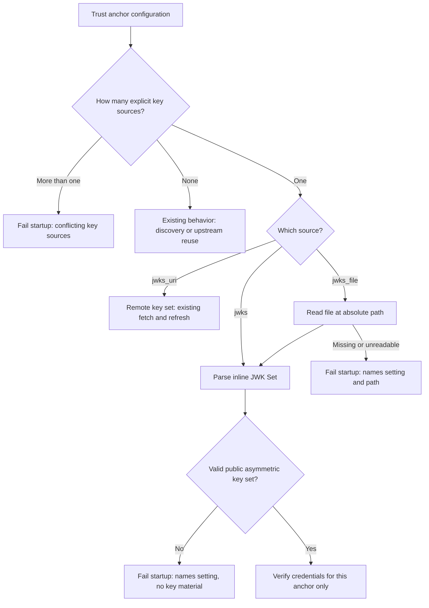
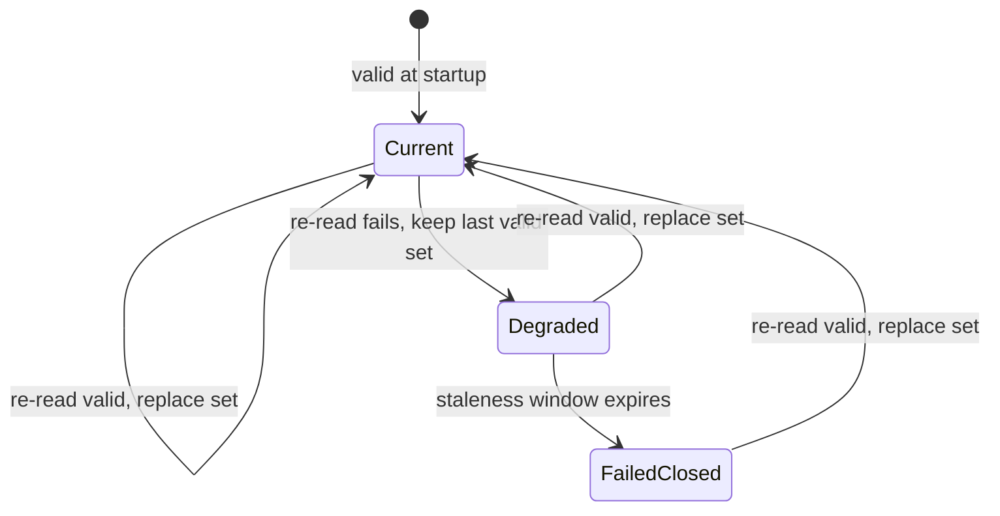

# Feature Specification: Inline and File-Based JWKS for Trust Anchors

**Feature Branch**: `claude/nifty-franklin-u83f3g`

**Created**: 2026-10-12

**Status**: Draft

**Input**: User description: "https://github.com/zalando-incubator/agentic-identity-broker/issues/185" — *Support inline JWKS in token exchange and other places*

## Context

Every operator-configured trust anchor that verifies signed credentials currently gets its public verification keys over the network. The key set comes from an explicit `jwks_uri` or from discovery through the issuer's metadata. This applies to three trust anchors:

- The token-exchange client-assertion trust anchor (ADR 029). Machine-facing approval authentication reuses it.
- Each trusted issuer of an impersonation rule ([OAuth2 User Impersonation](../037-oauth2-user-impersonation/spec.md)).
- End-user JWT pre-authentication ([JWT Pre-Authentication](../016-jwt-preauth/spec.md)).

Issue #185 says this assumption fails when infrastructure holds the signing key locally. An agent gateway, such as agentgateway, can sign privileged client assertions with its own key. Then no web endpoint publishes the matching public key. To satisfy the broker, the operator must run a key-set endpoint that serves only a static document. The issue discussion states the principle: the broker needs a trusted public key, not a website that serves one. The discussion settled on two alternatives as sufficient for now:

1. An inline JWK Set document in the broker configuration.
2. A configured path to a file that contains the JWK Set document.

This feature changes only **where** a trust anchor's public keys come from. It does not change which issuer is trusted. It does not change how credentials are validated. It does not change which credentials are accepted. It extends ADR 029's trust-anchor configuration. It does not supersede it.

## Clarifications

### Session 2026-10-12

- Q: How does the broker handle changes to a key-set file after startup? → A: It re-reads the file within the trust anchor's refresh bounds. When a re-read fails, the broker keeps the last valid key set and reports degraded health. This matches the behaviour of remote key sets, so a key rotation that updates a mounted file takes effect without a restart.

## User Scenarios & Testing *(mandatory)*

### User Story 1 - Trust a locally signing gateway for token exchange with an inline key set (Priority: P1)

An operator runs a gateway that signs RFC 8693 client assertions with a key that it holds locally. The operator configures the token-exchange client-assertion trust anchor with the gateway's issuer identifier and an inline JWK Set that contains the gateway's public key. The broker starts without contacting an issuer metadata or key-set endpoint for that trust anchor. It accepts token-exchange and machine-facing approval requests whose client assertions are signed with that key.

**Why this priority**: The issue asks for this case. Without it, a locally signing gateway needs an extra network service whose only job is to publish a static public key.

**Independent Test**: Start the broker in local mode. Configure an inline client-assertion key set, and make no issuer metadata or key-set endpoint reachable for that issuer. Perform a token exchange with a client assertion that the matching private key signed, and confirm that the exchange succeeds. Repeat with an assertion that a different key signed, and confirm that the broker rejects it.

**Acceptance Scenarios**:

1. **Given** local mode with a client-assertion trust anchor that declares an issuer identifier and an inline JWK Set, and no reachable metadata or key-set endpoint for that issuer, **When** the broker starts, **Then** startup succeeds and the broker sends no outbound request to get that trust anchor's keys.
2. **Given** that configuration, **When** a gateway submits a token exchange with a client assertion that is otherwise valid and signed by a key in the inline set, **Then** the exchange succeeds with the same outcome as when the key comes from a remote key set.
3. **Given** that configuration, **When** a gateway submits a client assertion signed by a key that is not in the inline set, **Then** the broker rejects the request with the same error that an unknown remote key produces, and issues no token.
4. **Given** that configuration, **When** a gateway authenticates to a machine-facing approval endpoint with a client assertion signed by a key in the inline set, **Then** the broker authenticates the gateway as it does for a remotely sourced key.
5. **Given** proxy or hybrid mode with no explicit client-assertion issuer, **When** the operator configures an inline client-assertion key set, **Then** the expected client-assertion issuer stays the upstream issuer, client assertions verify only against the inline keys, and subject tokens still verify against the upstream issuer's keys.

---

### User Story 2 - Provide the key set as a file (Priority: P1)

An operator does not embed the JWK Set in the broker configuration. The operator keeps it in a file that the deployment platform manages, for example a file mounted from a cluster secret or configuration object, and references the file by path.

**Why this priority**: The issue names the file source as the second required alternative. It keeps large key documents out of the main configuration, and the operator manages it with the same platform tools as other mounted material.

**Independent Test**: Configure the client-assertion trust anchor with the path of a readable file that contains a valid JWK Set. Confirm that the broker starts and verifies client assertions with the file's keys. Configure a missing path and confirm that startup fails.

**Acceptance Scenarios**:

1. **Given** a client-assertion trust anchor that references a readable file with a valid JWK Set, **When** the broker starts, **Then** startup succeeds and client assertions signed by a key in the file verify successfully.
2. **Given** a trust anchor that references a file path that does not exist, is not readable, or is not a regular file, **When** the broker starts, **Then** startup fails with an error that names the configuration setting and the path.
3. **Given** a running broker with a file-based key set, **When** an operator replaces the file's contents with a different valid key set, **Then** the broker verifies with the new key set within the trust anchor's refresh bounds without a restart, and rejects credentials signed only by keys that the replacement removed.
4. **Given** a running broker with a file-based key set, **When** the file becomes unreadable or its new contents fail validation, **Then** the broker keeps verifying with the last valid key set under the staleness rules for remote key sets, reports degraded key-set health, and logs the failure without file contents. **When** a valid file returns, **Then** the broker applies it and reports healthy again.
5. **Given** the supported deployment package, **When** an operator references an existing cluster secret or configuration object that contains a JWK Set, **Then** the broker receives the key set as a file at the configured path without a custom image.

---

### User Story 3 - Fail closed on invalid or ambiguous key configuration (Priority: P1)

An operator makes a mistake in a local key set. For example, the operator configures two key sources for one trust anchor, pastes malformed JSON, or pastes a private key instead of a public key. The broker refuses to start and explains which setting is wrong. It never echoes key material.

**Why this priority**: Security-first (Constitution Principle I). A local key source is a trust decision. A malformed or ambiguous key source must never become a permissive or partially configured trust anchor.

**Independent Test**: Start the broker with each invalid configuration in the scenarios that follow. Confirm that each one prevents startup with an error that names the offending setting and contains no key material.

**Acceptance Scenarios**:

1. **Given** a trust anchor that declares more than one of a key-set URI, an inline key set, and a key-set file, **When** the broker starts, **Then** startup fails and identifies the trust anchor and the conflicting settings.
2. **Given** an inline or file key set that is not a valid JWK Set document, contains no keys, or exceeds the size bound, **When** the broker starts, **Then** startup fails and identifies the trust anchor.
3. **Given** an inline or file key set that contains private key material, **When** the broker starts, **Then** startup fails, and the error and logs do not contain any part of the key material.
4. **Given** an inline or file key set that contains a symmetric key, or a key that declares an algorithm outside the broker-approved asymmetric set, **When** the broker starts, **Then** startup fails and identifies the trust anchor.
5. **Given** an inline or file key set that contains two keys with the same key identifier, **When** the broker starts, **Then** startup fails and identifies the duplicate identifier.
6. **Given** an inline key set and explicit refresh bounds on the same trust anchor, **When** the broker starts, **Then** startup fails because an inline key set never refreshes.
7. **Given** local or hybrid mode with a client-assertion issuer that equals the broker's own issuer, **When** the trust anchor uses an inline or file key set, **Then** startup still fails, as it does for remote key sets.
8. **Given** a valid inline or file key set, **When** the broker starts, **Then** it logs each trust anchor's key source kind, key count, and key identifiers, and does not log key material.

---

### User Story 4 - Use local key sets for impersonation trusted issuers (Priority: P2)

An operator who defines OAuth2 user-impersonation rules trusts a gateway that signs client assertions and actor tokens with a locally held key. The operator declares the gateway's public keys inline or by file on the rule's trusted issuer. The operator does not run a key-set endpoint.

**Why this priority**: Impersonation trusted issuers act as client-assertion trust anchors. The issue's "other places" covers them. They are secondary because impersonation is an optional, local-mode-only capability.

**Independent Test**: Configure an impersonation rule whose trusted issuer declares an inline key set. Submit an impersonation request whose client assertion and actor token were signed by the matching private key. Confirm that the broker issues a token. Repeat with a key that the issuer does not declare, and confirm that the broker rejects the request.

**Acceptance Scenarios**:

1. **Given** an impersonation rule whose trusted issuer declares an inline key set, **When** the broker starts, **Then** startup succeeds without issuer metadata discovery, and impersonation requests whose credentials those keys signed are validated as they are today.
2. **Given** an impersonation rule whose trusted issuer declares a key-set file, **When** the broker starts, **Then** credentials signed by the file's keys are validated as they are today.
3. **Given** a trusted issuer with a local key set that permits only `ES256`, **When** a credential signed by one of its keys uses a different algorithm, **Then** the broker rejects the credential.
4. **Given** two trusted issuers with the same issuer identifier in different rules that declare different key sources, **When** each rule evaluates a credential, **Then** each rule verifies only against the keys that its own trusted issuer declares.

---

### User Story 5 - Use local key sets for end-user JWT pre-authentication (Priority: P3)

An operator runs the broker behind infrastructure such as a reverse proxy or service mesh. That infrastructure issues signed identity JWTs with a locally held key. The operator declares the matching public keys inline or by file for JWT pre-authentication.

**Why this priority**: The broker uses this trust anchor for the same purpose, so the change keeps configuration consistent across all trust anchors. The issue does not name this case, so it has a lower priority.

**Independent Test**: Configure JWT pre-authentication with signature verification and an inline key set. Send a request with a JWT signed by the matching private key, and confirm that the broker derives the principal. Send a request with a JWT signed by an unknown key, and confirm that the broker rejects it.

**Acceptance Scenarios**:

1. **Given** JWT pre-authentication with signature verification and an inline or file key set, **When** a request has a JWT signed by a key in that set, **Then** the broker derives the principal as it does today.
2. **Given** JWT pre-authentication with verification disabled, **When** the operator also configures an inline or file key set, **Then** startup fails, just as it does today for a key-set URI.
3. **Given** JWT pre-authentication with signature verification and no key source, **When** the broker starts, **Then** startup fails as it does today.

---

### Edge Cases

- **No new settings**: A trust anchor with no inline or file key set behaves as it does today. This includes discovery from issuer metadata and ADR 029's reuse of the upstream key set in proxy and hybrid modes.
- **Environment-variable configuration**: An operator can supply the inline key set through the broker's existing environment-variable override for that setting. The broker validates it as it validates a value from the configuration file.
- **Keys without key identifiers**: Key selection follows the same rules as for remotely fetched key sets. A local source does not relax or tighten which keys a credential can match.
- **Mixed algorithms in one set**: A set can contain keys for different approved asymmetric algorithms. Existing algorithm restrictions, including each impersonation issuer's permitted-algorithm list, still apply.
- **Symlinked file**: Cluster platforms commonly mount secret and configuration files through symbolic links. The broker resolves a symbolic link to a regular file. A path that resolves to a directory fails startup.
- **One file for several trust anchors**: Two or more trust anchors can reference the same file. Each trust anchor validates the file and uses it on its own terms.
- **File becomes unavailable after startup**: The broker keeps the last valid key set and reports degraded health (FR-011). After the staleness window for remote key sets expires, verification for that trust anchor fails closed until a valid file returns.
- **Partial or in-progress file write**: A re-read that sees incomplete content fails validation. The broker treats it as a failed refresh and never applies a partially valid key set.
- **Removing keys from a file**: Removing a compromised key from a file that still has other keys is a valid change. The broker applies it within the refresh bounds. Emptying the file entirely is invalid (FR-007). It does not disable the trust anchor. To disable the trust anchor, the operator changes the configuration.
- **Inline set that contains a broker public key**: The broker still never accepts broker-minted tokens as client assertions. The issuer check and the startup rejection of the broker's own issuer apply to every key source.
- **Public key-set publication**: Keys from inline or file sources are verification inputs only. The broker never publishes them through its own public key-set endpoint.

## Requirements *(mandatory)*

### Functional Requirements

- **FR-001**: Each in-scope trust anchor MUST accept at most one explicit key source: a remote key-set location (the existing `jwks_uri`), an inline JWK Set document, or the path of a file that contains a JWK Set document.
- **FR-002**: The in-scope trust anchors MUST be these:
  - The token-exchange client-assertion trust anchor, including its use for machine-facing approval authentication.
  - Every trusted issuer of every impersonation rule.
  - End-user JWT pre-authentication.
- **FR-003**: When a trust anchor declares no explicit key source, its current behavior MUST stay unchanged. This includes issuer-metadata discovery, ADR 029's reuse of the upstream key set, and the existing startup error for JWT pre-authentication with signature verification and no key source.
- **FR-004**: When a trust anchor declares an inline or file key set, the broker MUST NOT perform issuer-metadata discovery or any outbound request to get that trust anchor's keys.
- **FR-005**: Credential validation MUST give the same result for every key source. This covers key selection, algorithm restrictions, and issuer, audience, expiry, and claim checks. Only the origin of the public keys can differ.
- **FR-006**: The broker MUST accept an inline key set as JSON text in the standard JWK Set representation (RFC 7517 §5). It MUST accept that text from both the configuration file and the existing environment-variable override mechanism.
- **FR-007**: The broker MUST validate inline and file key sets at startup. Startup MUST fail with an actionable error that names the trust anchor's configuration path in any of these cases:
  - The document is not a parseable JWK Set.
  - The document contains no keys.
  - The document exceeds the size bound for remotely fetched key sets.
  - A key includes private key material.
  - A key is symmetric.
  - A key declares an algorithm outside the broker-approved asymmetric set.
  - Two keys share a key identifier.
- **FR-008**: Errors, logs, audit records, and health output MUST NOT include inline key-set content, file contents, or any part of the key material.
- **FR-009**: When one trust anchor declares more than one explicit key source, startup MUST fail with an error that names the trust anchor and the conflicting settings.
- **FR-010**: A key-set file path MUST be absolute. If the path does not exist, cannot be read, or does not resolve to a regular file after the broker follows symbolic links, startup MUST fail with an error that names the setting and the path.
- **FR-011**: After startup, the broker MUST re-read a key-set file at least once per maximum refresh interval of the trust anchor, and no more often than its minimum refresh interval. The bounds are the trust anchor's configured `jwks_min_refresh`/`jwks_max_refresh` or their existing defaults. JWT pre-authentication uses the default refresh cadence that it applies to its remote key set. Every re-read MUST pass the full validation in FR-007.
  - A valid re-read MUST replace the key set completely.
  - A failed re-read MUST keep the last valid key set. A failed re-read is one where the file is unreadable or its contents are invalid. The broker MUST apply the staleness rules for remotely fetched key sets: after the staleness window expires, verification for that trust anchor fails closed until a valid re-read succeeds.
  - The broker MUST NOT apply a partially valid key set.
- **FR-012**: When a trust anchor declares an inline key set and explicit refresh bounds, startup MUST fail. Refresh bounds remain valid with `jwks_uri`, discovery, and `jwks_file`.
- **FR-013**: For JWT pre-authentication, disabling signature verification MUST be mutually exclusive with every explicit key source: URI, inline, and file.
- **FR-014**: ADR 029's self-trust protection MUST apply for every key source. In local and hybrid modes, a client-assertion trust anchor or impersonation client-assertion issuer equal to the broker's own issuer MUST fail startup. The broker MUST never accept broker-minted tokens as client assertions.
- **FR-015**: In proxy and hybrid modes, a client-assertion trust anchor can declare an inline or file key set and no issuer. In that case, the expected issuer MUST stay the upstream issuer. The trust anchor MUST verify client assertions against its declared keys only. Subject-token validation MUST keep using the upstream issuer's keys.
- **FR-016**: The broker MUST use keys from an inline or file source only for the trust anchor that declares them. It MUST NOT publish those keys through its public key-set endpoint. It MUST NOT use them for other trust anchors or for subject-token validation.
- **FR-017**: When trusted issuers share an issuer identifier but declare different key sources, each trusted issuer MUST verify credentials against only its own declared keys.
- **FR-018**: At startup, the broker MUST log one entry for each trust anchor that uses an inline or file key set. The entry MUST include the key source kind, the file path when there is one, the number of keys, and their key identifiers. When a re-read changes a file-based key set, the broker MUST log the added and removed key identifiers. When a re-read fails, the broker MUST log the failure. These logs MUST NOT include file contents.
- **FR-019**: An inline key set has no external dependency. It MUST NOT make the broker report degraded key-set health. A file-based key set MUST report degraded health after a failed re-read, through the same health reporting that remote key sets use. It MUST return to healthy after the next valid re-read.
- **FR-020**: The supported deployment package MUST let operators provide a key-set file from an existing cluster-managed secret or configuration object without a custom image.
- **FR-021**: The configuration reference and example configurations MUST document the following for each in-scope trust anchor:
  - All three key sources.
  - Their mutual exclusivity.
  - Their interaction with refresh bounds.
  - An example of a locally signing gateway.

### Domain Model

**Activity / Flow Diagram** (key-source resolution for one trust anchor at startup):



**State Diagram** (file-based key set after startup, FR-011 and FR-019):



**Entities** (things with unique identity):

- **Trust Anchor**: An operator-configured authority whose signed credentials the broker verifies. It is identified by its configuration location: the client-assertion trust anchor, an impersonation rule's trusted issuer, or JWT pre-authentication. It owns exactly one resolved key-set source.

**Value Objects** (things without identity):

- **Key Set Source**: The origin of a trust anchor's public verification keys. It is exactly one of:
  - **Remote**: An explicit or discovered key-set URI with refresh bounds.
  - **Inline**: A JWK Set in configuration. It never changes during the process lifetime.
  - **File**: A JWK Set at an absolute path. The broker re-reads it within the trust anchor's refresh bounds (FR-011).

  It is immutable once resolved at startup and is never shared with another trust anchor's verification.
- **Local Key Set**: A validated JWK Set from an inline or file source. Its invariants are that it contains at least one key, it contains public asymmetric keys only, its key identifiers are unique, and it stays within the size bound.

*Add "Key Set Source" to the glossary in `ARCHITECTURE.md` (Constitution Principle V).*

### Configuration Requirements

**Configuration Parameters**:

- **`jwks`** (string, optional, no default): An inline JWK Set as JSON text. It is available on the client-assertion trust anchor (`token_exchange.client_assertion`), on each impersonation trusted issuer (`oauth2_authorization_server.impersonation.rules[].trusted_issuers[]`), and on JWT pre-authentication (`server.enduser.authentication.jwt`). It is mutually exclusive with `jwks_uri` and `jwks_file`. The name matches the established OAuth2 convention that pairs an inline `jwks` value with a `jwks_uri` reference. Example environment-variable override: `IDENTITY_BROKER_TOKEN_EXCHANGE_CLIENT_ASSERTION_JWKS`.
- **`jwks_file`** (string, optional, no default): The absolute path of a file that contains a JWK Set. It is available in the same locations as `jwks`. It is mutually exclusive with `jwks_uri` and `jwks`.
- **`jwks_min_refresh` / `jwks_max_refresh`** (existing): These remain valid with `jwks_uri` and discovery. With `jwks_file`, they bound how often the broker re-reads the file. Their defaults stay the same: 15 minutes and `max(jwks_min_refresh, 1 hour)`. They are rejected with `jwks`. JWT pre-authentication still has no configurable refresh bounds.

**Example YAML Configuration**:

```yaml
token_exchange:
  client_assertion:
    issuer_uri: "https://agentgateway.internal.example.com"
    jwks: |
      {"keys":[{"kty":"EC","crv":"P-256","kid":"agentgateway-2026-10","use":"sig","alg":"ES256",
                "x":"<base64url>","y":"<base64url>"}]}

oauth2_authorization_server:
  impersonation:
    rules:
      - name: agentgateway
        trusted_issuers:
          - issuer_uri: "https://agentgateway.internal.example.com"
            jwks_file: "/etc/agentic-identity-broker/trust/agentgateway-jwks.json"
            allowed_algorithms: ["ES256"]
            signs_roles: ["client_assertion", "actor"]

server:
  enduser:
    authentication:
      jwt:
        verification: jwks
        jwks_file: "/etc/agentic-identity-broker/trust/mesh-jwks.json"
```

**Configuration Location**: Add the example to `examples/config/` and reference it in `examples/config/README.md`. Document it in `docs/configuration.md` and in the Helm chart values.

### Security Requirements

- **SR-001**: Every inline or file key set MUST be fully validated before the broker accepts traffic. A key source that fails validation MUST fail startup. It MUST never cause a fallback to discovery or to another key source.
- **SR-002**: A local key set MUST contain public asymmetric verification keys only. Private key material and symmetric keys MUST be rejected. The broker MUST NOT accept a signing secret through this mechanism.
- **SR-003**: Key parsing and signature verification MUST use the broker's existing vetted JOSE library (Constitution Principle III). Local sources MUST NOT introduce custom key parsing.
- **SR-004**: Configuration diagnostics and audit logs MUST identify the trust anchor and key identifiers without revealing key-set content (FR-008, FR-018).
- **SR-005**: The self-trust boundary from ADR 029 MUST hold for every key source (FR-014).

### Key Entities

- **Trust Anchor**: The client-assertion trust anchor, an impersonation trusted issuer, or JWT pre-authentication. It is the unit that declares one key source.
- **Key Set Source**: The remote, inline, or file origin of a trust anchor's verification keys.
- **Local Key Set**: A startup-validated JWK Set from an inline or file source.

*Add domain concepts to the glossary in `ARCHITECTURE.md` (Constitution Principle V).*

## Success Criteria *(mandatory)*

### Measurable Outcomes

- **SC-001**: An operator can enable token exchange for a locally signing gateway without operating any additional network-reachable service to publish its public key.
- **SC-002**: With inline or file key sets configured for every in-scope trust anchor, the broker completes startup and verifies credentials with zero outbound requests for those trust anchors' keys.
- **SC-003**: Run one credential corpus with valid, wrongly signed, expired, wrong-audience, and wrong-issuer credentials against a remote key set and against the same keys supplied inline and by file. All three key sources must produce the same accept or reject outcome for 100% of the credentials.
- **SC-004**: 100% of the invalid key-source configurations listed in FR-007, FR-009, FR-010, FR-012, and FR-013 must prevent startup with an error that names the offending setting. 0% of those errors and of the startup logs may contain key material.
- **SC-005**: Existing deployments that adopt no new setting must start and behave identically. This means 100% of existing token-exchange, impersonation, and JWT pre-authentication acceptance tests pass unchanged.
- **SC-006**: An operator can move a trust anchor from a remote key-set URI to an inline or file key set by changing one configuration setting.
- **SC-007**: A valid replacement of a key-set file takes effect without a restart within the trust anchor's maximum refresh interval. With default settings, this is within 1 hour for client-assertion and impersonation trust anchors. 100% of failed re-reads leave the previous valid key set in effect and are visible as degraded health.

## Assumptions

- The issue discussion between the issue author and a maintainer confirms that inline and file-based key sets are the only alternatives needed now.
- Issuer identifier rules do not change. A trust anchor still requires an issuer identifier wherever it does today, and the identifier keeps its current format rules. A locally signing gateway is configured to emit an issuer value that satisfies those rules. A local key source removes only the need for the issuer to be reachable.
- The broker accepts the inline key set as JSON text. That text can be written as a YAML block scalar or supplied through an environment variable. A structured YAML mapping is not required.
- The size bound for local key sets is the same as the existing bound for remotely fetched key sets.
- Public keys are not secrets. A key-set file can still come from a secret store, so the broker never logs key-set contents.
- ExtProc does not verify JWT signatures against an operator-configured key set, so this feature does not affect it.

## Dependencies

- **ADR 029** (token-exchange client-assertion trust anchor): extended. Before implementation, a new ADR or an amendment MUST record the key-source decision and its precedence rules (Constitution Principle II).
- **ADR 008** (token-exchange JWKS adapter pattern): local key sources MUST meet the same key-set contract that the domain consumes, so that domain validation stays source-agnostic.
- **Feature 013** (token exchange), **feature 016** (JWT pre-authentication), and **feature 037** (OAuth2 user impersonation) own the trust anchors that this feature extends.
- **Helm chart** (`charts/agentic-identity-broker/`): it needs a way to mount a key-set file from cluster-managed objects (FR-020).

## Out of Scope

- Inline or file key sets for the proxy-mode upstream authorization server. Its keys validate subject tokens, and the broker republishes them. That server is a full authorization server with discovery.
- Combining or merging several key sources for one trust anchor, for example remote and inline keys together.
- Per-agent or per-client verification keys supplied through the administrative API or through client metadata documents.
- Supplying the broker's own signing keys or any private key through configuration.
- Symmetric (shared-secret) signature verification.
- Relaxing issuer identifier format or reachability rules.
- Changes to the standalone ExtProc service.
- Reloading inline key sets without a restart.
