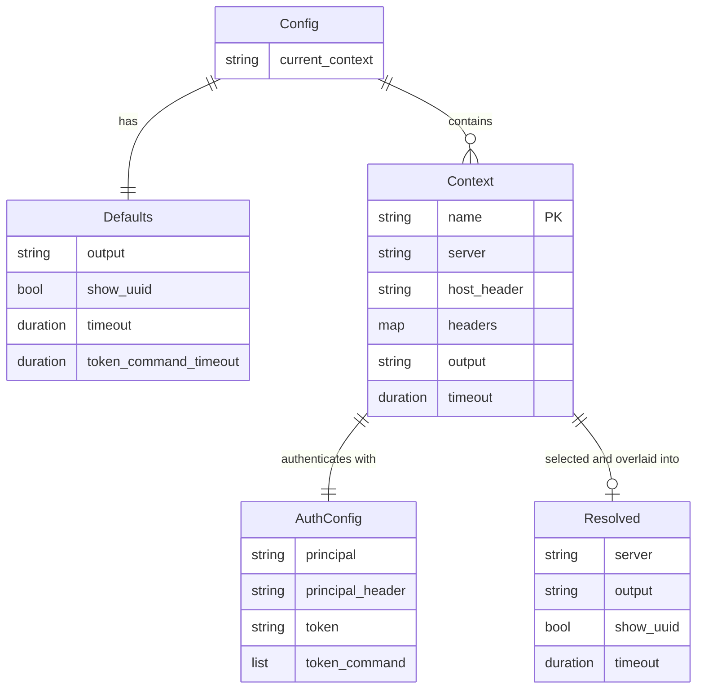
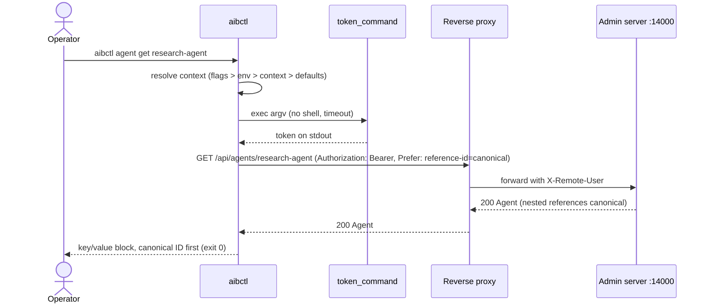

# Feature Specification: Admin CLI (`aibctl`)

**Feature Branch**: `claude/nifty-fermat-uptxnc`

**Created**: 2026-10-09

**Status**: Implemented

**Input**: User description: "I want to create an Admin CLI that uses the Admin API of the broker. Written in Go. Has OS specific config and can use a command to derive the Bearer token used. Has OS specific config to configure the broker. Supports tab completion. Prefers canonical IDs over uuids. Optional TUI support."

## Clarifications

### Session 2026-10-09

- Q: The admin server only reads the principal header (`X-Remote-User`); who validates a Bearer token? → A: A reverse proxy in front of port 14000. The CLI presents a Bearer token to the proxy and can also set the principal header directly for local use. No broker change.
- Q: Is the optional terminal UI in scope? → A: No.
- Q: What is the binary called? → A: `aibctl`, environment prefix `AIBCTL_`, configuration directory `aibctl/`.

## User Scenarios & Testing *(mandatory)*

Every acceptance scenario below has exactly one `It()` in `tests/e2e/aibctl/` whose comment carries the scenario ID (for example `// US2-S3 from specs/048-admin-cli/spec.md`). The suite runs `aibctl` in-process against an admin server started with the production bootstrap.

### User Story 1 - Configure a broker context (Priority: P1)

An operator stores how to reach one broker (admin URL, credentials, output defaults) under a name, switches between brokers by name, and checks that the broker is reachable.

**Why this priority**: Every other command needs a resolved context. Without it the CLI delivers nothing.

**Independent Test**: Run `aibctl context set`, `context use`, `context current`, `context list`, `config view`, and `health` against a local admin server.

**Acceptance Scenarios**:

1. **US1-S1** **Given** no configuration file exists, **When** the operator runs `aibctl context set local --server URL --principal admin@example.com`, **Then** the file is created with owner-only permissions, `local` becomes the current context, `context list` shows the server and `principal` auth, and `config view` shows the context.
2. **US1-S2** **Given** a current context with a principal, **When** the operator runs `aibctl health`, **Then** the admin health endpoint is called with the principal header and the status is printed as a key/value block or as JSON.
3. **US1-S3** **Given** no context is configured, **When** any API command runs, **Then** it exits with code 2, prints an error on stderr that names the fix, and prints nothing on stdout.

---

### User Story 2 - Manage agents (Priority: P1)

An operator registers agents from a document or from flags, lists and inspects them by canonical ID, updates them, and deletes them.

**Why this priority**: Agents are the primary object administrators manage; this story is the first slice that replaces `curl`.

**Independent Test**: Create an agent from YAML and from flags, list, get, update with flags and with a document, delete.

**Acceptance Scenarios**:

1. **US2-S1** **Given** an agent document with a `canonical_id`, **When** the operator runs `aibctl agent create -f agent.yaml`, **Then** `agent list` shows the canonical ID and hides the UUID; with `--show-uuid` a `UUID` column appears.
2. **US2-S2** **Given** a created agent, **When** it is fetched by canonical ID and by UUID, **Then** both return the same agent and nested `permission_set_id` and `service_id` references are rendered canonically.
3. **US2-S3** **Given** an agent with a canonical ID, **When** the operator runs `aibctl agent update ID --clear-canonical-id --display-name Renamed`, **Then** the list falls back to the UUID, the old canonical ID resolves to 404 (exit 4), and untouched fields such as `client_id` are preserved.
4. **US2-S4** **Given** an agent, **When** `aibctl agent get ID -o yaml` is piped into `aibctl agent update ID -f -`, **Then** the update succeeds and every field survives the round trip.
5. **US2-S5** **Given** an agent, **When** `aibctl agent delete ID` runs without `--yes` on a non-interactive stdin, **Then** it exits 2 and the agent still exists; with `--yes` it is deleted, nothing is printed on stdout, and `get` exits 4.
6. **US2-S6** **Given** a reference to a permission set that does not exist, **When** the operator creates an agent, **Then** the server rejection is reported with exit code 6 and nothing on stdout.

---

### User Story 3 - Manage services and protected resources (Priority: P2)

An operator registers third-party OAuth2 services, edits them conditionally, and maintains the protected resource URIs that drive token exchange.

**Why this priority**: Services are prerequisites for permission sets and agents, but can be seeded once and change rarely.

**Independent Test**: Create a service from flags, inspect it, add/rename/remove protected resources, update it with flags and with a document, delete it.

**Acceptance Scenarios**:

1. **US3-S1** **Given** flags describing a confidential service, **When** the operator runs `aibctl service create ...`, **Then** `get` shows the secret as `REDACTED`, the service resolves by canonical ID and by UUID, and the protected resources are listed.
2. **US3-S2** **Given** two services, **When** protected resources are added, renamed, and removed on one of them, **Then** every mutation prints the resulting set, an existing URI reports "already protected", and claiming a URI owned by the other service exits 5.
3. **US3-S3** **Given** a service, **When** the operator updates it from its own `get -o yaml` output, **Then** the redacted placeholder is refused (exit 2); with a real `client_secret` the update succeeds; a flag-based update without `--client-secret` is refused (exit 2); and a stale `--if-match` exits 5 without changing the service.
4. **US3-S4** **Given** a service, **When** it is deleted with `--yes`, **Then** `get` exits 4 and it no longer appears in the list.

---

### User Story 4 - Manage permission sets (Priority: P2)

An operator groups service scopes into named permission sets referenced by agents.

**Why this priority**: Required for agents, but a small surface.

**Independent Test**: Create permission sets with `--service-scope`, filter the list by service, update scopes, attempt a conflicting delete.

**Acceptance Scenarios**:

1. **US4-S1** **Given** services with canonical IDs, **When** permission sets are created with `--service-scope github=read:mandatory`, **Then** `permission-set list --service github` returns only sets referencing that service, service references are canonical, and a set without a canonical ID shows its UUID in the table.
2. **US4-S2** **Given** an agent referencing a permission set, **When** the operator deletes that set, **Then** it exits 5; updating the set's name and scopes with flags succeeds.

---

### User Story 5 - Issue broker client credentials (Priority: P3)

An operator issues, inspects, rotates, and revokes the broker's own client credentials for an agent.

**Why this priority**: Only needed in local and hybrid OAuth2 server modes.

**Independent Test**: Run `agent client-credentials create`, `get`, `rotate`, and `delete` for one agent.

**Acceptance Scenarios**:

1. **US5-S1** **Given** an agent without credentials, **When** the operator runs `agent client-credentials get` and `rotate --yes`, **Then** both exit 4; after `create` the secret is printed once and a second `create` exits 5, `get` shows metadata without the secret, `rotate` without `--yes` on a non-interactive stdin exits 2 and with `--yes` returns a new secret with `previous_invalidated_at`, and after `delete --yes` `get` exits 4 again.

---

### User Story 6 - Manage signing and CIMD client keys (Priority: P3)

An operator rotates the OAuth2 server's token signing keys and the outbound CIMD client-authentication keys.

**Why this priority**: Rare operational task, but currently requires hand-written requests.

**Independent Test**: Create a key, promote it, attempt to delete the current key, delete a non-current key, for both key families.

**Acceptance Scenarios**:

1. **US6-S1** **Given** the server's bootstrapped signing key, **When** two keys are created, one is promoted with `set-current`, and the current key is deleted, **Then** the delete exits 5, a non-current key can be deleted, and completion lists key IDs with `(current)` marked.
2. **US6-S2** **Given** the CIMD client-key endpoints, **When** `create`, `set-current`, and `delete` run, **Then** they behave exactly like the signing-key verbs.

---

### User Story 7 - Shell completion (Priority: P2)

An operator presses Tab and gets commands, flags, and live resource identifiers.

**Why this priority**: Tab completion is a stated requirement and the main ergonomic difference from `curl`.

**Independent Test**: Run Cobra's hidden `__complete` command for positional IDs and flags; generate scripts for bash and zsh.

**Acceptance Scenarios**:

1. **US7-S1** **Given** agents and permission sets, **When** the shell asks for completions of `agent get`, `permission-set list --service`, and `agent update --permission-set`, **Then** identifiers come from the API with canonical IDs first, UUIDs only for resources without one, display names as descriptions, no file completion, and the generated zsh script contains `compdef`.

---

### User Story 8 - Scripting (Priority: P2)

An operator automates administration with `-o json`, documented exit codes, and a clean stdout.

**Why this priority**: Replaces the shell scripts under `scripts/` that wrap `curl`.

**Independent Test**: Covered by the `-o json` assertions and exit-code assertions (2, 4, 5, 6) in the scenarios above.

**Acceptance Scenarios**: see US1-S3, US2-S2, US2-S5, US2-S6, US3-S3, US4-S2, US5-S1.

---

### User Story 9 - Sweep third-party sessions (Priority: P3)

An operator previews and runs a refresh of every stored third-party session whose access token expires soon.

**Why this priority**: The Admin API exposes the sweep for scheduled jobs; without a command operators fall back to `curl`.

**Independent Test**: Run `session sweep --dry-run`, a real `session sweep`, and a sweep with an invalid lookahead against a local admin server.

**Acceptance Scenarios**:

1. **US9-S1** **Given** an admin server, **When** the operator runs `aibctl session sweep --dry-run --lookahead PT10M --page-size 100 -o json`, **Then** the counts are printed with `dry_run: true`; a sweep without `--dry-run` reports `dry_run: false`; and `--lookahead 10m` is rejected by the server with exit code 6 and nothing on stdout.

### Usage Examples

Set up a local context and check connectivity:

```console
$ aibctl context set local --server http://localhost:14000 --principal admin@example.com
Context "local" saved to /home/me/.config/aibctl/config.yaml.
$ aibctl health
Status:     healthy
Uptime:     1h2m0s
Timestamp:  2026-10-09T12:00:00Z
Server:     http://localhost:14000
```

Add a proxied context whose Bearer token comes from a helper command, and switch to it:

```console
$ aibctl context set staging \
    --server https://broker-admin.staging.example.com \
    --token-command "ztoken --audience broker-admin" \
    --output json --use
Context "staging" saved to /home/me/.config/aibctl/config.yaml.
$ aibctl context list
CURRENT  NAME     SERVER                                       AUTH           OUTPUT
         local    http://localhost:14000                       principal
*        staging  https://broker-admin.staging.example.com     token_command  json
$ aibctl config view
current_context: staging
contexts:
  - name: local
    server: http://localhost:14000
    auth:
      principal: admin@example.com
  - name: staging
    server: https://broker-admin.staging.example.com
    auth:
      token_command:
        - ztoken
        - --audience
        - broker-admin
    output: json
```

Enable completion:

```console
$ source <(aibctl completion bash)
$ aibctl agent get res<TAB>
research-agent  (Research Agent)
```

Register a service, a permission set, and an agent in dependency order:

```console
$ aibctl service create --display-name GitHub --canonical-id github \
    --client-id "$GITHUB_CLIENT_ID" --client-secret "$GITHUB_CLIENT_SECRET" \
    --oauth2-flavor github --issuer-uri https://github.com \
    --token-endpoint https://github.com/login/oauth/access_token \
    --authorize-endpoint https://github.com/login/oauth/authorize \
    --scope repo="Repository access" --protected-resource https://api.github.com/
Service "github" created.
ID:                    github
UUID:                  2f6c1c9e-8d6b-4c0d-9f1a-1d2b3c4d5e6f
Display Name:          GitHub
OAuth2 Flavor:         github
Auth Method:           client_secret
Client ID:             gh-client
Client Secret:         REDACTED
...
$ aibctl permission-set create --name "GitHub Read" --description "Read repositories" \
    --canonical-id github-read --service-scope github=repo:mandatory
Permission set "github-read" created.
$ aibctl agent create --display-name "Research Agent" --description "Summarises repositories" \
    --canonical-id research-agent --permission-set github-read:mandatory \
    --service-requirement github=repo:mandatory
Agent "research-agent" created.
$ aibctl agent list
ID              DISPLAY_NAME    CLIENT_ID  PERMISSION_SETS  SERVICES  UPDATED
research-agent  Research Agent  -          1                1         2026-10-09T12:05:00Z
$ aibctl agent list --show-uuid -o wide
ID              DISPLAY_NAME    CLIENT_ID  PERMISSION_SETS  SERVICES  UPDATED               UUID                                  EXTERNAL_ID  REDIRECT_URIS  CLIENT_URIS
research-agent  Research Agent  -          1                1         2026-10-09T12:05:00Z  7a1d0c2e-5b3f-4e8a-9c6d-0f1e2d3c4b5a  -            0              0
```

Edit a resource by round-tripping its document, or change single fields with flags:

```console
$ aibctl agent get research-agent -o yaml > agent.yaml
$ $EDITOR agent.yaml
$ aibctl agent update research-agent -f agent.yaml
Agent "research-agent" updated.
$ aibctl agent update research-agent --redirect-uri https://research.example.com/callback
Agent "research-agent" updated.
$ aibctl agent update research-agent --clear-canonical-id
Agent "7a1d0c2e-5b3f-4e8a-9c6d-0f1e2d3c4b5a" updated.
```

Maintain protected resources and perform a conditional service update:

```console
$ aibctl service protected-resource add github https://uploads.github.com/
Added https://uploads.github.com.
RESOURCE
https://api.github.com
https://uploads.github.com
$ aibctl service protected-resource rename github https://uploads.github.com https://uploads.github.com/v2
Renamed https://uploads.github.com to https://uploads.github.com/v2.
$ aibctl service update github --display-name "GitHub Enterprise" --client-secret "$NEW_SECRET"
Service "github" updated.
$ aibctl service update github --display-name Stale --client-secret x --if-match '"1"'
Error: service changed (precondition failed, HTTP 412)
$ echo $?
5
```

Issue broker credentials and rotate keys:

```console
$ aibctl agent client-credentials create research-agent
Client credentials for "research-agent" created.
The client secret is shown once and cannot be retrieved later.
Client ID:             7a1d0c2e-5b3f-4e8a-9c6d-0f1e2d3c4b5a
Client Secret:         c2VjcmV0LXZhbHVl...
Created:               2026-10-09T12:10:00Z
Previous Invalidated:  -
$ aibctl signing-key create
Signing key "8df4b26f-7eda-4a84-b095-dbbd2528c076" created.
$ aibctl signing-key set-current 8df4b26f-7eda-4a84-b095-dbbd2528c076
Signing key "8df4b26f-7eda-4a84-b095-dbbd2528c076" is now current.
```

Script against the JSON output and exit codes:

```console
$ aibctl agent list -o json | jq -r '.[] | .canonical_id // .id'
research-agent
$ aibctl agent get missing-agent -o json; echo "exit=$?"
Error: agent not found (not_found, HTTP 404)
exit=4
$ AIBCTL_ASSUME_YES=1 aibctl agent delete research-agent
Agent "research-agent" deleted.
```

### Edge Cases

- `HOME` and the OS config directory are unavailable: the path falls back to `$HOME/.config/aibctl`; when even that fails, `--server` plus `--principal`/`--token` still work without a file.
- The token command is missing, exits non-zero, prints nothing, or exceeds `token_command_timeout`: the CLI exits 3 and shows the command's stderr; the token is never printed.
- The broker is reached through a tunnel and rejects the `Host`: the plain-text 403 is reported with a hint to set `host_header` or `--host-header`.
- A protected resource URI contains `/`, `?`, or `#`: it is percent-encoded as a single path segment; the server normalises trailing slashes and the CLI prints the normalised form.
- A document contains read-only fields (`id`, `created_at`, `updated_at`, `service_name`): they are dropped so `get` output round-trips; any other unknown field is rejected as a usage error.
- `--canonical-id` and `--clear-canonical-id` are passed together: usage error, exit 2.
- Completion is requested while the broker is unreachable or the token command fails: no candidates, nothing on stdout, Cobra's error directive.
- A service is updated with a document whose `client_secret` is the literal `REDACTED`: refused with exit 2 because the server would store the placeholder.

## Requirements *(mandatory)*

### Functional Requirements

- **FR-001**: The CLI MUST expose every operation of `api/admin/openapi.yaml`: agents, services, protected resources, permission sets, client credentials, signing keys, CIMD client keys, session sweep, and health.
- **FR-002**: Configuration MUST be read from `os.UserConfigDir()/aibctl/config.yaml` (Linux `~/.config/aibctl`, macOS `~/Library/Application Support/aibctl`, Windows `%AppData%\aibctl`), overridable with `--config` or `AIBCTL_CONFIG`.
- **FR-003**: Settings MUST resolve with the precedence flags > `AIBCTL_*` environment > selected context > `defaults` > built-in defaults, and a missing file MUST NOT be an error.
- **FR-004**: A context MUST support a static Bearer token, a token command (argv list, no shell, bounded by a timeout, trimmed stdout), a principal header value with a configurable header name, extra request headers, and a `Host` override; at least one credential MUST be configured.
- **FR-005**: `${VAR}` references in `auth.token` and header values MUST be expanded from the environment; an unset variable MUST be an error.
- **FR-006**: Every read MUST send `Prefer: reference-id=canonical`; table output MUST show the canonical ID and fall back to the UUID; `--show-uuid` and `-o wide` MUST add a UUID column; positional identifiers MUST accept either form unchanged.
- **FR-007**: Every POST, PUT, and PATCH MUST send `Content-Type: application/json`, including body-less requests.
- **FR-008**: `service update` MUST read the service's ETag first and send `If-Match`, overridable with `--if-match`.
- **FR-009**: `create` and `update` MUST accept either a document (`-f FILE` or `-f -` for stdin, JSON or YAML) or field flags, never both; `update -f` MUST be a full replacement; flag-based `update` MUST fetch the current representation and overlay only the given fields.
- **FR-010**: Nullable identifiers (`canonical_id`, `client_id`) MUST support three states on update: omitted keeps, `--clear-*` or `null` clears, a value sets.
- **FR-011**: Destructive commands MUST require `--yes`, `AIBCTL_ASSUME_YES=1`, or an interactive confirmation; on a non-interactive stdin without either they MUST exit 2.
- **FR-012**: Exit codes MUST be 0 success, 1 generic or transport, 2 usage, 3 authentication (token command failure, HTTP 401/403), 4 not found, 5 conflict or precondition (409/412/428), 6 server-side validation (400/422).
- **FR-013**: Standard output MUST carry data only (`table`, `wide`, `json`, `yaml`); confirmations, prompts, warnings, and errors MUST go to standard error.
- **FR-014**: The CLI MUST generate completion scripts for bash, zsh, fish, and PowerShell and MUST complete resource identifiers from the API, bounded by `AIBCTL_COMPLETION_TIMEOUT` (default 2s), failing silently.
- **FR-015**: `config view` MUST redact `auth.token` and header values whose name contains `authorization`, `token`, `secret`, `cookie`, or `password` unless `--show-secrets` is given.
- **FR-016**: `version` MUST print the version and commit injected at build time.
- **FR-017**: The implementation MUST NOT import broker packages (`internal/domain`, `internal/ports`, `internal/adapters`, `internal/app`, `internal/extproc`); request and response types are declared from the OpenAPI document.

### Domain Model

The CLI introduces no broker entities. Its own model is the configuration file and the resolved invocation.

**Domain Entity Diagram**:



**Activity / Flow Diagram** (one authenticated command):



**Entities** (things with unique identity):
- **Context**: Named connection profile (`name` unique within the file); holds server, optional `Host` override, extra headers, authentication settings, output defaults. Lifecycle: created or replaced by `context set`, selected by `context use`, removed by `context delete`.
- **Admin API resources** (Agent, Service, Protected Resource, Permission Set, Client Credentials, Signing Key, CIMD Client Key): owned by the broker; the CLI addresses them by canonical ID or UUID and never persists them.

**Aggregates** (consistency boundaries):
- **Config file**: root `Config` with `defaults` and the list of contexts; validated as a whole before every save; written atomically with mode 0600.

**Value Objects** (things without identity):
- **AuthConfig**: principal, principal header name, static token, token command; `token` and `token_command` are mutually exclusive.
- **Resolved**: the effective settings of one invocation after overlaying defaults, environment, and flags; immutable for the process.
- **NullableString**: three-state field value (unset, null, value) used for `canonical_id` and `client_id`.

**Domain Events** (state changes of business significance):
- **Context saved / selected / deleted**: the configuration file changed.
- **Token resolved**: the token command ran once for the process; its output is memoised and never logged.

*Glossary entries added to `ARCHITECTURE.md`: Context (aibctl), Token Command, Canonical-first display.*

### Configuration Requirements

The CLI has its own configuration schema and prefix (`AIBCTL_`) as a standalone binary under ADR 038, following the ADR 011 precedent. It never reads `IDENTITY_BROKER_*` settings and adds nothing to the Helm chart.

**Configuration Parameters**:
- **current_context**: string, name of the context used when `--context`/`AIBCTL_CONTEXT` is absent; default empty.
- **defaults.output**: `table` | `wide` | `json` | `yaml`; default `table`.
- **defaults.show_uuid**: bool, add a UUID column next to canonical IDs; default `false`.
- **defaults.timeout**: duration, per-request timeout; default `30s`.
- **defaults.token_command_timeout**: duration; default `10s`.
- **contexts[].name**: `[A-Za-z0-9._-]+`, unique.
- **contexts[].server**: admin base URL, `http` or `https`, no path, query, or fragment.
- **contexts[].host_header**: optional `Host` to send when the URL differs from `server.admin.public_url`.
- **contexts[].headers**: optional map of extra headers; values support `${VAR}`.
- **contexts[].auth.principal** / **principal_header**: principal value and header name (default `X-Remote-User`).
- **contexts[].auth.token** / **token_command**: static Bearer token (supports `${VAR}`) or argv list; mutually exclusive.
- **contexts[].output**, **contexts[].timeout**: per-context overrides.

Global flags and their environment variables: `--config`/`AIBCTL_CONFIG`, `--context`/`AIBCTL_CONTEXT`, `--server`/`AIBCTL_SERVER`, `--host-header`/`AIBCTL_HOST_HEADER`, `--principal`/`AIBCTL_PRINCIPAL`, `--principal-header`/`AIBCTL_PRINCIPAL_HEADER`, `--token`/`AIBCTL_TOKEN`, `--token-command`/`AIBCTL_TOKEN_COMMAND` (split on whitespace), `-o`/`AIBCTL_OUTPUT`, `--show-uuid`/`AIBCTL_SHOW_UUID`, `--timeout`/`AIBCTL_TIMEOUT`, `-v`/`AIBCTL_VERBOSE`. Also `AIBCTL_ASSUME_YES` and `AIBCTL_COMPLETION_TIMEOUT`.

**Example YAML Configuration**:
```yaml
current_context: local
defaults:
  output: table
  show_uuid: false
  timeout: 30s
  token_command_timeout: 10s
contexts:
  - name: local
    server: http://localhost:14000
    auth:
      principal: admin@example.com
      principal_header: X-Remote-User
  - name: staging
    server: https://broker-admin.staging.example.com
    auth:
      token_command: ["ztoken", "--audience", "broker-admin"]
    output: json
    timeout: 15s
  - name: tunnel
    server: http://localhost:14001
    host_header: broker-admin.internal
    headers:
      X-Proxy-Tenant: platform
    auth:
      token: ${AIBCTL_TUNNEL_TOKEN}
      principal: admin@example.com
```

**Configuration Location**: `examples/config/aibctl.yaml`, referenced in `examples/config/README.md`; reference documentation in `docs/configuration.md` ("aibctl configuration").

### API Requirements

- **API-001**: No end-user API change.
- **API-002**: No administrative API change; the CLI is a client of the existing `api/admin/openapi.yaml` contract, including the `Prefer: reference-id=canonical` preference, `If-Match` on service replacement, and the canonical-or-UUID identifier inputs defined by feature 036.
- **API-003**: The CLI's request and response types are declared from the OpenAPI schemas; contract drift is detected by the E2E suite running against the real server.
- **API-004**: Command and output conventions (nouns, verbs, exit codes, stdout/stderr split) are documented in `ARCHITECTURE.md` §3.3 and ADR 038.

### Database Requirements

Not applicable. The CLI has no persistence beyond its configuration file.

### Security Requirements

- **SR-001**: Tokens MUST never be logged or printed; `-v` MUST print header names only, and `config view` MUST redact by default.
- **SR-002**: The token command MUST run without a shell, with the inherited environment, under `token_command_timeout`, and its failure MUST stop the command with exit 3 (fail closed).
- **SR-003**: The configuration file MUST be written atomically with mode `0600` inside a `0700` directory.
- **SR-004**: The redacted `client_secret` placeholder returned by the API MUST never be sent back to the server.
- **SR-005**: The CLI MUST NOT weaken the broker's trust model: it presents credentials to the proxy and the principal header to the broker and introduces no new authentication path in the broker.
- **SR-006**: Destructive operations MUST require explicit confirmation (`--yes`, environment opt-in, or interactive prompt).

### Frontend/Design System Requirements

Not applicable. The feature has no web UI; the terminal UI was explicitly excluded.

### Key Entities

- **Context**: a named broker connection profile in the per-user file.
- **Token Command**: the argv list that produces a Bearer token at invocation time.
- **Agent, Service, Protected Resource, Permission Set, Client Credentials, Signing Key, CIMD Client Key**: Admin API representations the CLI reads and writes; canonical IDs exist for agents, services, and permission sets.

## Success Criteria *(mandatory)*

### Measurable Outcomes

- **SC-001**: Every acceptance scenario (US1-S1 … US7-S1, 19 in total) has exactly one `It()` in `tests/e2e/aibctl/` and passes against the production bootstrap.
- **SC-002**: Every admin operation documented in `docs/guides/manage-agents-and-services.md` and `docs/guides/operate-oauth2-server-modes.md` with `curl` can be performed with a single `aibctl` command.
- **SC-003**: `just check` (format, vet, lint) reports no issues for `internal/aibctl`, `cmd/aibctl`, and `tests/e2e/aibctl`; `just aibctl-test` passes with the race detector.
- **SC-004**: Release archives exist for linux amd64/arm64, darwin amd64/arm64, and windows amd64, and `aibctl version` reports the release tag.
- **SC-005**: An operator can configure a context and list agents with two commands and no manual header handling.

## Assumptions

- A reverse proxy validates Bearer tokens in production and sets the principal header; the broker keeps trusting that header as documented in `docs/guides/configure-authentication.md`.
- Token commands (such as single-sign-on helpers) manage their own caching; the CLI only memoises per process and keeps no on-disk token cache.
- Canonical IDs follow the feature 036 contract (`[A-Za-z0-9._-]{1,128}`, not UUID-shaped, unique per resource type).
- Services seeded without discovery provide explicit token and authorization endpoints.
- `go.yaml.in/yaml/v3`, Cobra, and Viper are already dependencies of the repository; no new modules are introduced.
- Out of scope: terminal UI, keyring or disk token cache, TLS options, generated OpenAPI client, and user-grant or tool-approval commands (End-User API).
