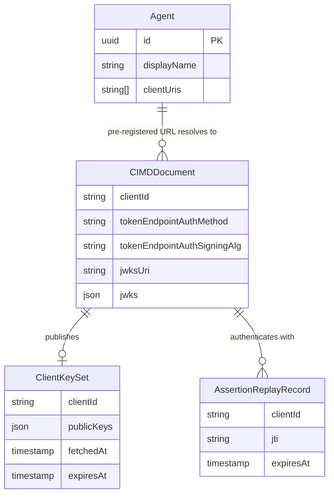

# Feature Specification: `private_key_jwt` Client Authentication for CIMD Clients

**Feature Branch**: `220-private-key-jwt-auth`

**Created**: 2026-10-15

**Status**: Draft

**Input**: User description: "support private_key_jwt as specified in https://github.com/zalando-incubator/agentic-identity-broker/issues/220"

## Overview

ChatGPT cannot connect to the broker today. Its Client ID Metadata Document (CIMD) declares `token_endpoint_auth_method: private_key_jwt`, and the broker rejects every CIMD document whose method is not `none` ([feature 028](../028-cimd-support/spec.md) FR-022). The agent sees only `invalid_client`.

This feature lets a CIMD client authenticate at the broker's token endpoint by signing a short-lived JWT with a private key whose public half it publishes. The broker verifies the signature against the key published in the client's own metadata document. No shared secret is ever created or stored.

**Why the document cannot simply be accepted while expecting `none` at the token endpoint**: [CIMD draft -02 §8.2](https://datatracker.ietf.org/doc/html/draft-ietf-oauth-client-id-metadata-document-02#section-8.2) states that when a client declares `private_key_jwt`, the authorization server MUST require client authentication per [RFC 7523 §2.2](https://www.rfc-editor.org/rfc/rfc7523#section-2.2), using the key discovered from the client's metadata document. Accepting the document but not enforcing authentication would silently downgrade the client's declared security posture.

**Plural field**: The client-document field `token_endpoint_auth_methods_supported` (used by ChatGPT, proposed in MCP SEP-3149) is not defined in RFC 7591 or CIMD -02. The broker does not use it to select a method. ChatGPT's document also carries the singular `private_key_jwt`, so the feature works under both the CIMD -02 reading and the SEP-3149 reading.

### Relationship to existing specs

| Spec | Relationship |
|---|---|
| [028-cimd-support](../028-cimd-support/spec.md) | **Supersedes FR-022 and the public-only edge case** for `private_key_jwt`. SR-009 (reject secret-based methods) still holds. Spec 028 was written against CIMD -01, whose example restriction was "require `none`"; -02 reversed that example. Secret-based methods stay forbidden. Everything else in 028 (pre-registration, SSRF protection, brand pinning, redirect-origin rules) is unchanged. |
| [046-cimd-upstream-client](../046-cimd-upstream-client/spec.md) | **Complementary, opposite direction.** 046 is the broker acting as a `private_key_jwt` client toward third-party services. This feature is the broker acting as the authorization server verifying `private_key_jwt` from agents. The two use separate keys and separate code paths. |
| [030-hybrid-oauth-modes](../030-hybrid-oauth-modes/spec.md) | Applies in the modes where CIMD clients are accepted (`local`, `hybrid`). |

### Out of scope

- Shared-secret methods (`client_secret_basic`, `client_secret_post`, `client_secret_jwt`) for CIMD clients. They remain rejected.
- `private_key_jwt` for non-CIMD (locally registered) agents and for proxy-mode agents.
- The `client_credentials` grant for CIMD clients; this feature covers the authorization-code exchange and refresh-token grants.
- Registering or managing client keys inside the broker. Keys come only from the client's own metadata document.
- Honouring the plural `token_endpoint_auth_methods_supported` client field.
- `tls_client_auth`, DPoP and other client-authentication or sender-constraint mechanisms.

## User Scenarios & Testing *(mandatory)*

### User Story 1 - ChatGPT-style client connects with `private_key_jwt` (Priority: P1)

A user wants to connect ChatGPT to the broker. An administrator has pre-registered ChatGPT's client metadata URL on an Agent. The user is sent through consent, ChatGPT exchanges its authorisation code by presenting a signed assertion, receives tokens, and later refreshes them with a fresh assertion.

**Why this priority**: This is the reason the feature exists. Without it ChatGPT, and every other client that follows CIMD -02 and declares `private_key_jwt`, is locked out.

**Independent Test**: Serve a ChatGPT-shaped metadata document (`private_key_jwt`, RS256, `jwks_uri`, `authorization_code` and `refresh_token` grants) from a test server, pre-register its URL on an Agent, and drive authorize, consent, code exchange and refresh with correctly signed assertions. Delivers a working token pair and a working refresh.

**Acceptance Scenarios**:

1. **Given** a pre-registered CIMD client whose document declares `private_key_jwt` with RS256 and a `jwks_uri`, **When** a user completes consent and the client exchanges the authorisation code with a valid signed assertion and the PKCE verifier, **Then** the broker issues access and refresh tokens.
2. **Given** the same client holding a refresh token, **When** it refreshes with a new valid assertion, **Then** the broker issues new tokens and rotates the refresh token as it does for any other client.
3. **Given** a CIMD document declaring `private_key_jwt`, **When** the broker validates it at authorisation time, **Then** the document is accepted and the `invalid_client` / "CIMD document validation failed" rejection no longer occurs.
4. **Given** a ChatGPT-shaped document that also carries `token_endpoint_auth_methods_supported: ["none", "private_key_jwt"]`, **When** the client authenticates, **Then** the broker applies `private_key_jwt` because the singular method is authoritative.
5. **Given** a CIMD document declaring `none`, or omitting the method, **When** the client exchanges a code or refreshes without any assertion, **Then** behaviour is identical to today.

---

### User Story 2 - No downgrade, no bypass (Priority: P1)

A client that declared `private_key_jwt` must never obtain tokens without proving possession of its key. An attacker who stole an authorisation code or refresh token, or who can reach the token endpoint, gains nothing without a valid assertion.

**Why this priority**: Accepting `private_key_jwt` without enforcing it would be worse than rejecting it: it would advertise a security property that does not hold. This is co-equal with Story 1.

**Independent Test**: For a `private_key_jwt` client, submit code-exchange and refresh requests with each of: no assertion, a wrong assertion type, a bad signature, a wrong issuer or subject, a wrong audience, an expired assertion, and a missing `jti`. Every request fails, and the code and refresh token remain usable afterwards by the legitimate client.

**Acceptance Scenarios**:

1. **Given** a `private_key_jwt` client, **When** it exchanges a code or refreshes without an assertion, **Then** the broker rejects the request with `invalid_client`; it never falls back to unauthenticated handling.
2. **Given** an assertion that fails any validation rule (signature, issuer, subject, audience, expiry, lifetime, `kid`, `jti`), **When** it is presented, **Then** the broker rejects with `invalid_client`.
3. **Given** a request that fails client authentication, **When** the rejection is returned, **Then** the authorisation code is not consumed and the refresh token is not rotated.
4. **Given** a client whose document lists both `none` and `private_key_jwt` in the plural field but selects `private_key_jwt` in the singular field, **When** it sends a request without an assertion, **Then** the broker rejects it.
5. **Given** a grant issued while the client declared `private_key_jwt`, **When** the document is later changed to `none`, **Then** the broker continues to require authentication for that grant's refresh token.
6. **Given** an assertion signed by a key that is not in the client's own metadata (for example one embedded in the assertion header or referenced by a header URL), **When** it is presented, **Then** the broker rejects it.
7. **Given** a client whose document declares `none` or omits the method, **When** it sends a client assertion with a code exchange or refresh, **Then** the broker rejects it with `invalid_client`; an assertion is never silently ignored.
8. **Given** a `private_key_jwt` client, **When** it sends an assertion together with a `client_secret` or an `Authorization` header, **Then** the broker rejects the request as ambiguous with `invalid_request`, and the authorisation code and refresh token are untouched.
9. **Given** two pre-registered `private_key_jwt` clients, A and B, and an authorisation code and a refresh token issued to A, **When** B presents a valid assertion of its own together with A's code or A's refresh token, **Then** the broker rejects the request, issues no tokens, and A's code and refresh token remain usable by A.

---

### User Story 3 - Assertions are single-use across replicas (Priority: P2)

An assertion captured in transit or in a log must not be replayable, even if the original request failed, even across broker replicas, and even after a restart.

**Why this priority**: Replay protection is what makes a bearer-style JWT an acceptable client credential. Single-replica behaviour would be unsafe in the multi-replica production deployment, but the feature already delivers value without it for a first demo, so it ranks below the core flow.

**Independent Test**: Submit the same valid assertion concurrently to two broker instances sharing one database, then again after a restart. Exactly one attempt may pass authentication.

**Acceptance Scenarios**:

1. **Given** a valid assertion, **When** it is presented a second time within its validity window, **Then** the broker rejects the second use with `invalid_client`.
2. **Given** two broker instances sharing storage, **When** the same assertion is presented to both at the same moment, **Then** at most one authentication succeeds.
3. **Given** an assertion that authenticated but whose grant then failed (for example, PKCE mismatch), **When** it is presented again, **Then** it is still rejected.
4. **Given** the same `jti` presented by two different clients, **When** each is otherwise valid, **Then** both are accepted; replay tracking is scoped per client.

Retention and removal of replay records (FR-016, DB-004) is a storage-level property that depends on elapsed time. It is verified by repository-level integration tests rather than by an acceptance scenario.

---

### User Story 4 - Client key rotation and hostile key sources (Priority: P2)

A client operator rotates the signing key by publishing a new key and signing with it. Meanwhile, an attacker may point a metadata document at internal addresses, serve oversized or malformed key sets, or try to supply their own key.

**Why this priority**: Rotation is routine operations, and key retrieval is the feature's main new attack surface; both must be right before production use, but neither blocks the basic flow.

**Independent Test**: Rotate the key published at a test `jwks_uri` and authenticate with the new key; separately, point documents at blocked addresses, redirects, oversized and non-RSA/EC keys and confirm each is rejected.

**Acceptance Scenarios**:

1. **Given** a client that publishes a new key and signs with it, **When** the broker sees an assertion with a `kid` it does not know, **Then** it refreshes the client's key set (subject to rate limiting) and accepts the assertion if the key is now present.
2. **Given** a client that removed an old key, **When** an assertion signed with that key is presented after the broker has refreshed, **Then** it is rejected.
3. **Given** a `jwks_uri` that resolves to a private, loopback, link-local or otherwise blocked address, **When** the broker would fetch it, **Then** the fetch is refused under the same SSRF rules as document fetches.
4. **Given** a `jwks_uri` that redirects, times out, returns an oversized body, or returns malformed JSON, **When** the broker fetches it, **Then** authentication fails closed and the dependency failure is distinguishable from a bad assertion.
5. **Given** a key set containing weak (RSA below 2048 bits), non-signature, or unsupported-type keys, **When** the broker selects a key, **Then** unsuitable keys are never used.
6. **Given** a client that repeatedly presents unknown `kid` values, **When** this happens, **Then** key-set refetches stay within a bounded rate and cannot be used to make the broker hammer the client's host.

---

### User Story 5 - Operators and clients can discover the capability (Priority: P3)

An operator or a client library inspects the broker's authorisation-server metadata to learn which client-authentication methods and signing algorithms are available.

**Why this priority**: Discovery is how well-behaved clients (and ChatGPT's method selection) pick `private_key_jwt`; it does not change enforcement.

**Independent Test**: Fetch the metadata document in each server mode, with CIMD on and off, and compare advertised methods.

**Acceptance Scenarios**:

1. **Given** `local` or `hybrid` mode with CIMD enabled, **When** metadata is requested, **Then** it lists `private_key_jwt` among the supported token-endpoint authentication methods and lists the supported signing algorithms.
2. **Given** CIMD disabled or `proxy` mode, **When** metadata is requested, **Then** it does not advertise `private_key_jwt`.
3. **Given** any configuration, **When** metadata is requested, **Then** it never advertises a method the broker will reject.

---

### Edge Cases

- A document declares `private_key_jwt` but publishes no key source, or both `jwks_uri` and inline `jwks`. (Rejected at document validation; exactly one is required.)
- A document declares `private_key_jwt` with `jwks_uri` over plain `http`, or a `jwks_uri` with embedded credentials or a non-standard port. (Rejected.)
- A document declares an unsupported `token_endpoint_auth_signing_alg` (for example `none`, `HS256`, `PS256`). (Rejected at document validation.)
- A document omits `token_endpoint_auth_signing_alg`. (Treated as RS256.) An assertion signed with any other algorithm is rejected.
- A document declares a shared-secret method (`client_secret_basic`, `client_secret_post`, `client_secret_jwt`). (Still rejected, as in spec 028.)
- A document carries private key material or a `client_secret` in inline `jwks`. (Rejected; documents may contain public keys only.)
- Assertion `aud` is the token endpoint URL, the issuer, or an array containing at least one of those; other entries are ignored. (Accepted.) Any other audience, including one derived from request `Host` or forwarded headers, is rejected.
- Assertion `iss` and `sub` differ from each other or from `client_id`. (Rejected.)
- Assertion lifetime exceeds five minutes, `exp` is absent, or `iat`/`nbf` lies beyond the allowed clock skew in the future. (Rejected.)
- The same request carries both a client assertion and a client secret or a bearer credential. (Rejected as ambiguous; see User Story 2, scenario 8.)
- A client that selects `none` (or omits the method) sends a client assertion. (Rejected with `invalid_client`; see User Story 2, scenario 7.)
- The code-exchange request carries `client_assertion` without `client_assertion_type`, or the reverse. (Rejected as `invalid_request`.)
- The document at token time is unavailable and the cache is cold. (Request fails with a temporary server error, not `invalid_client`; no tokens are issued.)
- Client authentication succeeds but the Agent is no longer registered, or consent was revoked. (Existing behaviour applies; authentication does not bypass grant checks.)
- The authorisation request used a different `client_id` URL than the assertion's `iss`. (Rejected.)
- A valid assertion from one client is presented with an authorisation code or refresh token issued to another client. (Rejected; see User Story 2, scenario 9.)
- Clock skew between broker replicas and the client. (Absorbed by the bounded skew allowance; beyond it, rejected.)
- Concurrent refresh requests with distinct valid assertions for the same refresh token. (Existing refresh-token rotation and reuse-detection rules still apply.)

## Requirements *(mandatory)*

### Functional Requirements

**Document validation and method selection**

- **FR-001**: The broker MUST accept CIMD documents whose `token_endpoint_auth_method` is `none`, omitted (defaulting to `none`), or `private_key_jwt`, and MUST continue to reject every other value. This supersedes spec 028 FR-022 for `private_key_jwt` only.
- **FR-002**: For `private_key_jwt`, the document MUST provide exactly one key source: an HTTPS `jwks_uri` or an inline `jwks` containing public keys only. Documents providing neither or both MUST be rejected.
- **FR-003**: The supported assertion signing algorithms are RS256 and ES256. A document that declares any other `token_endpoint_auth_signing_alg` MUST be rejected; an omitted value selects RS256.
- **FR-004**: The broker MUST treat the singular `token_endpoint_auth_method` as the sole authority for method selection. The plural `token_endpoint_auth_methods_supported` client field MUST be ignored for selection and MUST NOT cause rejection.
- **FR-005**: Documents that contain private key material or any shared secret MUST be rejected.

**Authentication at the token endpoint**

- **FR-006**: For a client that selects `private_key_jwt`, the broker MUST require a valid assertion on every authorisation-code exchange and every refresh-token request, and MUST NOT fall back to unauthenticated or secret-based handling under any circumstance.
- **FR-007**: A valid assertion MUST: use the JWT-bearer assertion type; be signed with an algorithm permitted by the client's document; carry `iss` and `sub` both equal to the client's `client_id`; carry an approved audience; carry `exp`; carry a non-empty `jti`; and identify its key with a `kid` that matches a key in the client's published key set.
- **FR-008**: The only approved audiences are the broker's issuer identifier and its canonical token-endpoint URL, derived from broker configuration. An `aud` claim that is an array is accepted when at least one entry is an approved audience; other entries are ignored. The broker MUST NOT derive an approved audience from request headers.
- **FR-009**: Assertion lifetime MUST NOT exceed five minutes, and clock-skew tolerance MUST be 30 seconds. `iat` and `nbf`, when present, MUST be validated against the same tolerance. Lifetime is measured against the broker's current time: `exp` MUST be no more than five minutes plus the skew after the time of receipt, and, when `iat` is present, `exp - iat` MUST NOT exceed five minutes. `iat` is optional.
- **FR-010**: Signature verification MUST use only keys from the client's own metadata (resolved through the document). Keys or key URLs supplied in the assertion's own header MUST be ignored.
- **FR-011**: A failed authentication MUST NOT consume an authorisation code, rotate a refresh token, or otherwise change grant state.
- **FR-012**: Existing requirements for PKCE (S256), pre-registration, redirect-URI rules, scope and grant ownership MUST continue to apply in full to `private_key_jwt` clients. Client authentication is additive to them, never a substitute.
- **FR-013**: A grant issued to a client while it declared `private_key_jwt` MUST keep requiring authentication for its refresh tokens even if the document later declares a weaker method.

**Replay protection**

- **FR-014**: Each `(client_id, jti)` pair MUST be accepted at most once. Consumption MUST happen as part of authentication, so an assertion used in a request that later fails for another reason is still spent.
- **FR-015**: Replay protection MUST hold across all broker replicas sharing one database and across restarts, using the production database as the authoritative store. In-memory-only protection is acceptable solely for the in-memory (development/test) storage mode.
- **FR-016**: Replay records MUST be retained at least until the assertion's expiry plus the clock-skew allowance, and MUST then become eligible for automatic removal.
- **FR-017**: `jti` uniqueness MUST be scoped per client; the same `jti` from two different clients MUST NOT collide.

**Key retrieval and caching**

- **FR-018**: Retrieval of a client's key set MUST reuse the CIMD SSRF protections (spec 028 FR-024, ADR 015): connection-time address validation against the blocklist, verified TLS, no redirects, a bounded response size and a bounded timeout.
- **FR-019**: Key sets MUST be cached for a bounded time. An assertion naming an unknown `kid` MUST trigger at most one refetch, subject to a minimum interval between refetches per client.
- **FR-020**: Only RSA keys of at least 2048 bits (for RS256) and P-256 keys (for ES256) that are marked or usable for signature verification MAY be selected. All other keys MUST be ignored.
- **FR-021**: Key-set retrieval failure MUST fail closed and MUST be reported as a server-side dependency failure, not as invalid client credentials. The same applies when a client's metadata document cannot be retrieved because of a timeout, connection failure or upstream server error.

**Error handling**

- **FR-022**: The token endpoint MUST return `invalid_client` for authentication failures (missing assertion, bad signature, invalid claims, wrong audience, expiry, replay), `invalid_request` for structurally malformed requests (for example, only one of the two assertion parameters present), and a server error for key-retrieval or storage failures.
- **FR-023**: Rejection responses MUST NOT reveal which specific assertion check failed; the precise reason is recorded only in server-side audit events.

**Discovery**

- **FR-024**: When CIMD is enabled in `local` or `hybrid` mode, the authorisation-server metadata MUST advertise `private_key_jwt` among supported token-endpoint authentication methods and the supported signing algorithms (RS256, ES256). In every other configuration it MUST NOT advertise them.
- **FR-025**: The broker MUST NOT advertise any client-authentication method it will not accept.

### Security Requirements *(mandatory)*

- **SR-001**: Enforcement MUST be on by default and cannot be disabled by configuration; a client declaring `private_key_jwt` is always authenticated.
- **SR-002**: All signature verification and key parsing MUST use vetted libraries (Constitution Principle III). No custom cryptography.
- **SR-003**: The broker MUST fail closed: any ambiguity, error, or missing dependency denies the request.
- **SR-004**: The broker MUST NOT log assertions, authorisation codes, refresh tokens, or key material. Audit events MUST record client, outcome, failure category and `jti` hash or identifier only.
- **SR-005**: Every authentication success and failure MUST emit a credential-free structured audit event.
- **SR-006**: Algorithm confusion MUST be impossible: the verification algorithm comes from the client's document and the selected key, never from the unverified assertion header alone; `none` and symmetric algorithms MUST be rejected.
- **SR-007**: Authentication strength for an existing grant's refresh tokens MUST NOT decrease because a client edits its own document (see FR-013). An authorisation code is single-use, short-lived and bound to PKCE, so it is authenticated according to the client's document at the time of exchange.
- **SR-008**: Mandatory `jti`, `kid` and a short maximum lifetime are AIB profile requirements. RFC 7523 alone does not mandate them.

### Domain Model



```mermaid
sequenceDiagram
    actor User
    participant Client as CIMD Client (ChatGPT)
    participant Broker
    participant ClientHost as Client metadata host

    User->>Broker: authorize (client_id = metadata URL, PKCE S256)
    Broker->>ClientHost: fetch document (SSRF-protected)
    ClientHost-->>Broker: document (private_key_jwt, jwks_uri)
    Broker-->>User: consent, then redirect with code
    Client->>Broker: token (code, verifier, signed assertion)
    Broker->>ClientHost: fetch key set if not cached (SSRF-protected)
    ClientHost-->>Broker: public keys
    Broker->>Broker: verify signature, claims, audience; consume jti
    Broker-->>Client: access and refresh tokens
    Client->>Broker: refresh (refresh token, new signed assertion)
    Broker-->>Client: rotated tokens
```

**Entities**:
- **CIMD Client Assertion**: A short-lived signed JWT presented by a CIMD client at the token endpoint to prove possession of its private key. Distinct from the privileged-client `ClientAssertion` of the token-exchange trust anchor (ARCHITECTURE.md glossary), which is signed by an external identity provider.
- **Client Key Set**: The client's published public verification keys, cached for a bounded time, never persisted as authoritative state.
- **Assertion Replay Record**: A durable `(client_id, jti)` record kept until the assertion can no longer be valid.

**Domain Events**:
- **Client authenticated**: assertion accepted; emitted as an audit event.
- **Client authentication rejected**: assertion refused; emitted with a failure category.
- **Client key set refreshed**: key set fetched or refetched; emitted with outcome.

*New terms (CIMD Client Assertion, Client Key Set, Assertion Replay Record) MUST be added to the `ARCHITECTURE.md` glossary.*

### Configuration Requirements

**Configuration Parameters** (all optional; defaults are secure):
- **Key-set cache time-to-live**: bounded duration, default 1 hour, maximum 24 hours (larger values are rejected at startup).
- **Minimum interval between key-set refetches per client**: default 5 minutes.
- **Maximum key-set response size**: default 64 KiB.
- **Key-set fetch timeout**: default 5 seconds.

The assertion lifetime cap (5 minutes), the clock-skew tolerance (30 seconds) and the algorithm allow-list are fixed by this spec, not configurable. The SSRF blocklist remains extend-only (spec 028 FR-024).

**Configuration Location**: Parameters will sit alongside the existing CIMD settings, be loaded through the central configuration port, and be documented in `docs/configuration.md` and `examples/config/`.

### API Requirements

- **API-001**: The authorisation-server metadata response schema in `api/enduser/openapi.yaml` MUST document `private_key_jwt` and `token_endpoint_auth_signing_alg_values_supported`.
- **API-002**: The token endpoint definition MUST document the `client_assertion` and `client_assertion_type` parameters for CIMD clients, and the error responses of FR-022.
- **API-003**: All API changes MUST be confirmed by the stakeholder before implementation begins (Constitution Principle X).
- **API-004**: Any new design decision of lasting consequence (for example, the fixed lifetime cap and mandatory `jti` profile) MUST be recorded in an ADR; because spec 028 is superseded in part, an Accepted ADR is required (Constitution Principle II).
- **API-005**: The authorisation endpoint definition MUST document that a CIMD `client_id` whose metadata document cannot be retrieved returns `server_error` rather than `invalid_client` (FR-021).

### Database Requirements

- **DB-001**: Durable replay records require a schema change delivered as a numbered migration in `/migrations/` with up and down scripts, tested against PostgreSQL for apply, rollback and repeat.
- **DB-002**: A repository for replay records MUST be defined as a narrow interface in the storage port, with both an in-memory and a PostgreSQL implementation, and integration tests for the PostgreSQL one (Constitution Principle IX).
- **DB-003**: Atomic first-use consumption of a `(client_id, jti)` pair is a storage-level guarantee, not an application-level check-then-write.
- **DB-004**: Expired replay records MUST be removed by the existing periodic cleanup in `local` and `hybrid` modes. Retention and removal boundaries (FR-016) MUST be covered by integration tests against PostgreSQL and by unit tests of the in-memory store.

### Key Entities

- **Agent**: Existing; a pre-registered CIMD URL on it is still required (spec 028 FR-025 to FR-027).
- **CIMD Document**: Existing; extended with the authentication method, signing algorithm, and key source for this feature.
- **Client Key Set**: Cached public keys for one client.
- **Assertion Replay Record**: Single-use marker for one assertion.

## Success Criteria *(mandatory)*

### Measurable Outcomes

- **SC-001**: A ChatGPT-shaped client completes authorise, consent, code exchange and refresh end to end with no manual workaround, where today it fails at the first step.
- **SC-002**: 100% of code-exchange and refresh requests from a `private_key_jwt` client without a valid assertion are rejected, across the full matrix of invalid-assertion cases in User Story 2.
- **SC-003**: Of any number of concurrent presentations of the same assertion, across at least two broker instances, exactly one succeeds.
- **SC-004**: After a client publishes a new key, authentication with the new key succeeds without operator action no later than one minimum refetch interval after the first presentation, and the old key is rejected once the broker has refreshed.
- **SC-005**: Every key-retrieval attempt aimed at a blocked network address, a redirecting URL, or an oversized response is refused, and none is followed.
- **SC-006**: Clients declaring `none` or omitting the method see no change in their successful journeys: the existing end-to-end journeys for them pass with unchanged expectations. The only intended differences for them are the dependency-failure classification of FR-021 (an unavailable document is reported as a server error instead of `invalid_client`) and the added authorisation-server metadata fields (FR-024).
- **SC-007**: No log output or audit event from any authentication attempt contains an assertion, a token, or key material.
- **SC-008**: Authorisation-server metadata advertises `private_key_jwt` in exactly the configurations that accept it and in no others.

## Assumptions

- Target mode is `local` and `hybrid`; spec 028 FR-000 still bars CIMD in `proxy` mode.
- The client is pre-registered: an administrator has added its metadata URL to an Agent. Open dynamic registration of CIMD clients is not introduced.
- ChatGPT's shape (RS256, `jwks_uri`, authorisation-code plus refresh-token grants) is the reference case; ES256 and inline `jwks` are included because CIMD -02 permits them and they cost little, but RS256 with `jwks_uri` is the path that must work first.
- Audience values follow RFC 7523 practice: issuer or token endpoint URL. Other values are rejected rather than configurable.
- Five-minute lifetime, 30-second skew, mandatory `jti` and `kid` are deliberately stricter than RFC 7523 minimums and are fixed.
- The existing CIMD fetcher, SSRF blocklist and document cache can be extended for key-set retrieval rather than replaced.
- Existing PostgreSQL deployments can apply an additive migration.
- Clients that need to authenticate and cannot publish a key (secret-only clients) are not served by this feature and remain on the locally registered path.
