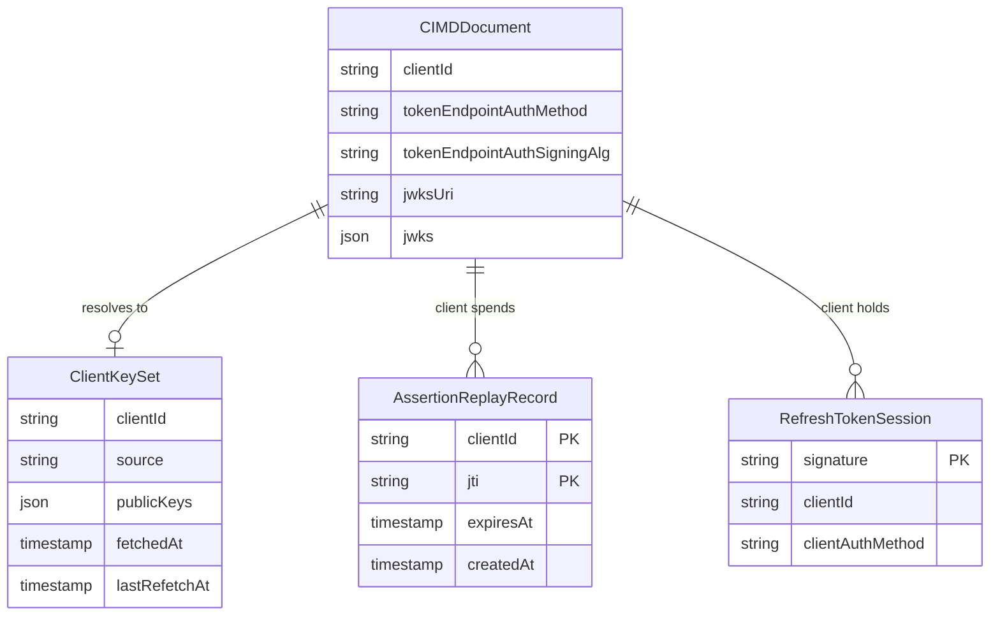

# Data Model: `private_key_jwt` for CIMD Clients

## Overview

One new persisted entity, one new column on an existing entity, and three non-persisted values. The CIMD document itself stays a fetched, immutable value.



## Entities

### ClientIDMetadataDocument (extended, value, not persisted)

Located in `internal/domain/oauth2/cimd/document.go`.

| Field | Type | Rule |
|---|---|---|
| `AuthMethod` (existing) | string | `none` (default when omitted) or `private_key_jwt`. Every other value is rejected. |
| `SigningAlg` (new) | string | Only meaningful for `private_key_jwt`. `RS256` or `ES256`; omitted means `RS256`. Any other value rejects the document. For `none` it is ignored. |
| `JWKSURI` (new) | string | HTTPS, passes the CIMD URL rules (port 443 or absent, no userinfo, no fragment, no dot segments). |
| `JWKS` (new) | `jwk.Set` | Public keys only. Any private parameter (`d`, `p`, `q`, `dp`, `dq`, `qi`, `k`) rejects the document. |

**Validation (`ParseDocument`):**
- `private_key_jwt` requires exactly one of `JWKSURI`, `JWKS`; neither or both reject the document.
- Shared-secret fields (`client_secret`, `client_secret_expires_at`) keep being rejected as today.
- `token_endpoint_auth_methods_supported` (plural) is read by nobody and never rejects.
- An `AuthMethod` of `client_secret_basic`, `client_secret_post` or `client_secret_jwt` is rejected.
- `JWKS` and `JWKSURI` on a `none` client are ignored; they do not make the client require authentication.

The port DTO `CIMDMetadataDTO` (`internal/ports/cimd.go`) and `toCIMDMetadataDTO` carry the new fields; `deepCopyDocument` in `cache.go` deep-copies the key set.

### ClientKeySet (non-persisted, in-process)

Located in `internal/domain/oauth2/cimd/keyset.go`.

| Field | Type | Meaning |
|---|---|---|
| `ClientID` | string | CIMD URL the keys belong to |
| `Source` | string | The `jwks_uri` used, or `inline` |
| `Keys` | `jwk.Set` | Only keys eligible under the key rules |
| `FetchedAt` | time | Cache age |
| `LastRefetchAt` | time | For the minimum refetch interval |

**State:** `empty → fresh (age < TTL) → stale (age ≥ TTL, refetched on next use)`. An unknown `kid` on a fresh set triggers one refetch only if `now − LastRefetchAt ≥ min_refetch_interval`; otherwise the assertion is rejected without a fetch. A failed fetch keeps the previous set untouched, but the failure is reported and the request fails closed.

**Eligibility of a key:** matches `kid`; type RSA with ≥ 2048-bit modulus (RS256) or EC on P-256 (ES256); `use` is absent or `sig`; `key_ops` is absent or contains `verify`; no private parameters.

### Verified Assertion (value, per request)

Result of `ClientAssertionVerifier.Verify`. Not persisted.

| Field | Meaning |
|---|---|
| `ClientID` | The authenticated client |
| `JTI` | The spent identifier (never logged in clear; the audit event uses an identifier or hash) |
| `ExpiresAt` | Assertion `exp` |
| `Method` | Always `private_key_jwt` |

### ClientCredentials (value, per request)

Replaces the bare `clientSecret` argument of the token-minting strategy methods (Phase 0).

| Field | Meaning |
|---|---|
| `Secret` | Existing form `client_secret` |
| `AssertionType` | Form `client_assertion_type` |
| `Assertion` | Form `client_assertion` |

**Validation:** assertion type and assertion are present together or not at all; an assertion excludes `Secret` and an `Authorization` header.

### AssertionReplayRecord (persisted)

Located in `internal/domain/storage/client_assertion_replay.go`.

| Field | Type | Constraint |
|---|---|---|
| `ClientID` | text | part of primary key |
| `JTI` | text | part of primary key |
| `ExpiresAt` | timestamptz | assertion `exp` + 30 s skew |
| `CreatedAt` | timestamptz | default `now()` |

**Invariants:**
- `(client_id, jti)` is unique; the first insert wins (atomic).
- A record is created only after signature and claim validation succeed (research D3).
- It is never deleted early; only `expires_at < now()` records are swept.
- No typed ID: the natural key is the pair, so ADR 013 does not apply.

**Schema (migration `042_create_client_assertion_replays`):**

```sql
CREATE TABLE client_assertion_replays (
    client_id  TEXT        NOT NULL,
    jti        TEXT        NOT NULL,
    expires_at TIMESTAMPTZ NOT NULL,
    created_at TIMESTAMPTZ NOT NULL DEFAULT now(),
    PRIMARY KEY (client_id, jti)
);
CREATE INDEX idx_client_assertion_replays_expires_at
    ON client_assertion_replays (expires_at);
```

The down migration drops the index and the table. The table is new and small, so the index is created in the same transaction; no `CONCURRENTLY` is needed.

**Repository (ISP, `internal/ports/storage.go`):**

| Method | Behaviour |
|---|---|
| `Consume(ctx, clientID, jti, expiresAt) error` | Inserts; returns `StorageError{ErrorKindConflict}` if the pair exists |
| `DeleteExpired(ctx) (int, error)` | Deletes rows with `expires_at < now()` |

Implementations: `memory/client_assertion_replay_store.go` (mutex and map) and `postgres/client_assertion_replay_repo.go` (`INSERT … ON CONFLICT DO NOTHING`, check `RowsAffected`, uses the pool and never the ambient fosite transaction). Both reachable through a factory accessor.

### RefreshTokenSession (extended, persisted)

| Field | Type | Meaning |
|---|---|---|
| `ClientAuthMethod` (new) | `*string`, column `client_auth_method` | `private_key_jwt` if the code exchange or refresh that created the session was authenticated that way; `NULL` otherwise |

**Migration `043_add_refresh_token_client_auth_method`:**

```sql
ALTER TABLE refresh_token_sessions ADD COLUMN client_auth_method TEXT NULL;
ALTER TABLE refresh_token_sessions
    ADD CONSTRAINT chk_refresh_token_sessions_client_auth_method
    CHECK (client_auth_method IS NULL OR client_auth_method = 'private_key_jwt') NOT VALID;
```

Down: drop the constraint and the column. Existing rows stay `NULL`, which is the correct value for grants issued before this feature. The nullable add with no default does not rewrite the table. The `CHECK` is added `NOT VALID` so it does not scan `refresh_token_sessions` while holding its lock; it is never validated, because every existing row is `NULL` by construction, and it is enforced for every new or updated row.

**Propagation:** set when a refresh session is first created from an authenticated exchange; carried to the successor through the session's extra claims on rotation (the route used today by `consent_grant_id` and `refresh_parent_signature`).

## Required-method decision (refresh)

| Stored on session | Current document | Assertion required |
|---|---|---|
| `private_key_jwt` | `private_key_jwt` | yes |
| `private_key_jwt` | `none` | **yes** (FR-013) |
| `NULL` | `private_key_jwt` | **yes** |
| `NULL` | `none` | no (unchanged) |

For the authorisation-code grant there is no stored session, so the current document alone decides.

## Domain events (audit, credential-free)

| Event | When | Fields |
|---|---|---|
| `client_authenticated` | Assertion accepted | client id, grant type, algorithm, `kid`, identifier of the `jti` |
| `client_authentication_rejected` | Assertion refused | client id, grant type, failure category (`missing`, `malformed`, `signature`, `claims`, `audience`, `expired`, `replayed`, `key_unavailable`) |
| `client_key_set_refreshed` | Fetch or refetch finished | client id, source host, outcome, key count |

None contains an assertion, token, authorisation code, key material or a full `jti`.

## Glossary additions (`ARCHITECTURE.md`)

- **CIMD Client Assertion** – short-lived JWT a CIMD client signs to authenticate at the token endpoint; distinct from the privileged-client `ClientAssertion` of the token-exchange trust anchor.
- **Client Key Set** – a CIMD client's published public verification keys, cached in process.
- **Assertion Replay Record** – durable `(client_id, jti)` marker that makes an assertion single-use.
