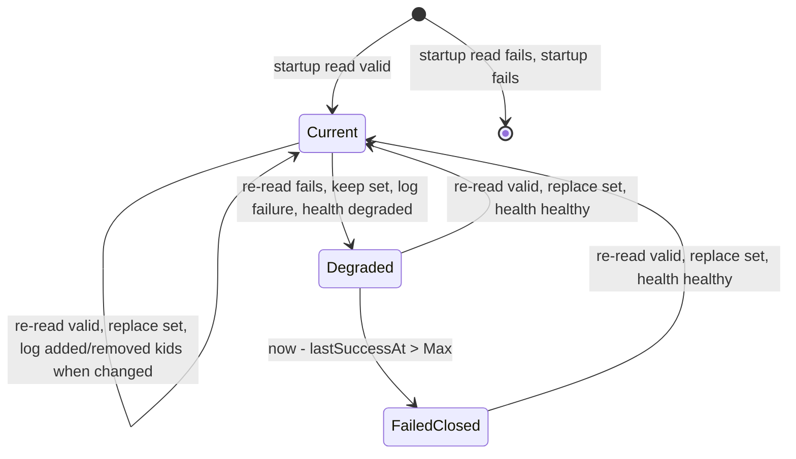

# Data Model: Inline and File-Based JWKS for Trust Anchors

**Feature**: [spec.md](./spec.md) | **Plan**: [plan.md](./plan.md) | **Research**: [research.md](./research.md)

This feature adds no persisted entity, database table, or UUID identifier. Every concept below is
created from configuration at startup and lives in process memory. ADR 013 typed IDs do not apply.

## Bounded context

New package `internal/domain/trustanchor/`. It has no I/O and depends only on the standard library
and jwx (a declared domain library). Its consumers are:

- `internal/config/validator.go` (structural rules at load time);
- `internal/app/builder.go` (startup resolution and loading);
- `internal/adapters/jwks/` (local key-set adapters, which validate every read);
- `internal/domain/impersonation/` (approved algorithm set, R6).

## Entity: Trust Anchor

An operator-configured authority whose signed credentials the broker verifies. It is identified by
its configuration location. It owns exactly one resolved `KeySetSource`.

| Field | Type | Rule |
|---|---|---|
| `Kind` | `AnchorKind`: `client_assertion`, `impersonation_issuer`, `jwt_preauth` | Closed set (FR-002) |
| `ConfigPath` | string | Identity. Examples: `token_exchange.client_assertion`, `oauth2_authorization_server.impersonation.rules[0].trusted_issuers[1]`, `server.enduser.authentication.jwt`, `server.admin.authentication.jwt`. Every error and log names it. |
| `Source` | `KeySetSource` | Exactly one, resolved at startup, never shared with another anchor's verification (FR-016, FR-017). |

The end-user and admin servers' JWT pre-authentication are two separate `jwt_preauth` trust anchors
(research R9). They never share an adapter.

## Value object: Key Set Source

The origin of a trust anchor's public verification keys. It is immutable after resolution.

| Kind | Origin | Refresh | Health contribution |
|---|---|---|---|
| `remote` | Explicit `jwks_uri`, a discovered URI, or ADR 029 upstream reuse | Existing `jwks.Adapter` behaviour | Unchanged |
| `inline` | `jwks` text | Never (FR-012) | Never degraded (FR-019) |
| `file` | `jwks_file` inside the trust directory | Re-read every minimum interval (FR-011) | `trust_anchor_key_files` component |

Fields:

| Field | Type | Present for |
|---|---|---|
| `Kind` | `SourceKind` | All |
| `URI` | string | `remote` with explicit `jwks_uri` |
| `Document` | `[]byte` | `inline` |
| `Path` | string, absolute and cleaned | `file` |
| `Refresh` | `RefreshBounds` | `remote`, `file` |

### Resolution rules

`trustanchor.ResolveKeySetSource(anchor AnchorRef, in SourceInput) (KeySetSource, error)` where
`SourceInput` carries `jwks_uri`, `jwks`, `jwks_file`, whether `jwks_min_refresh` or
`jwks_max_refresh` was set explicitly, and the trust directory.

| # | Condition | Result | Requirement |
|---|---|---|---|
| 1 | More than one of `jwks_uri`, `jwks`, `jwks_file` is non-empty | Error `conflicting_key_sources`, naming the anchor and the set keys | FR-009 |
| 2 | `jwks` is set and an explicit refresh bound is set | Error `refresh_bounds_with_inline` | FR-012 |
| 3 | JWT pre-authentication with `verification: none` and any key source | Error `verification_disabled_with_key_source` | FR-013 |
| 4 | `jwks_file` is not an absolute path | Error `relative_path` | FR-010 |
| 5 | `jwks_file` is set and the trust directory is unset | Error `missing_trust_directory`, naming `security.trust_material_dir` | FR-022 |
| 6 | `jwks_file`, after `filepath.Clean`, is not under the cleaned trust directory | Error `outside_trust_directory`, naming the setting, path, and trust directory; nothing is read | FR-023 |
| 7 | `jwks` is set | `inline` source | FR-006 |
| 8 | `jwks_file` is set | `file` source | FR-010 |
| 9 | `jwks_uri` is set | `remote` source with explicit URI | FR-003 |
| 10 | No explicit source | Existing behaviour: discovery or ADR 029 upstream reuse | FR-003 |

Rules 1–6 are structural. The config validator and the builder both run them.

## Value object: Refresh Bounds

| Field | Type | Default (client assertion, impersonation) | Default (JWT pre-authentication) |
|---|---|---|---|
| `Min` | duration | 15m | 5m, not configurable |
| `Max` | duration | `max(Min, 1h)` | 15m, not configurable |
| `Explicit` | bool | True when either bound was set in configuration | Always false |

Invariant: `0 < Min <= Max`. A `Max` below `Min` is raised to `Min`, as today. Negative values are
rejected, as today.

For a `file` source, `Min` is the re-read interval, and `Max` is the staleness window since the last
successful read (research R3).

## Value object: Local Key Set

A validated JWK Set from an `inline` or `file` source.

| Field | Type | Notes |
|---|---|---|
| `Set` | `jwk.Set` | Parsed by jwx with strict key-set parsing |
| `KeyIDs` | `[]string` | Non-empty `kid` values in document order. Used only for logs. |

Constructor: `trustanchor.ParseLocalKeySet(doc []byte) (LocalKeySet, error)`.

Invariants (FR-007, SR-002, SR-003):

| # | Invariant | Error category |
|---|---|---|
| 1 | `len(doc) <= MaxKeySetBytes` (1 MiB, shared with the remote adapter) | `too_large` |
| 2 | Top-level JSON object with a `keys` array | `not_a_jwk_set` |
| 3 | jwx parses the document | `not_a_jwk_set` |
| 4 | At least one key | `empty_key_set` |
| 5 | No symmetric (`oct`) key | `symmetric_key` |
| 6 | No private key material | `private_key` |
| 7 | A present `alg` is in the approved asymmetric set | `unapproved_algorithm` |
| 8 | Non-empty `kid` values are unique | `duplicate_kid`, naming the identifier |

Errors never include document bytes or jwx error text (FR-008).

`trustanchor.DiffKeyIDs(previous, next LocalKeySet) (added, removed []string)` supports the re-read
log (FR-018).

## Value object: Trust Directory

The one operator-designated directory that holds key-set files.

| Field | Type | Notes |
|---|---|---|
| `Configured` | string | `security.trust_material_dir`, cleaned |
| `Resolved` | string | `filepath.EvalSymlinks(Configured)` at startup |

Invariants (FR-022): absolute, resolves to an existing directory, and `Resolved != "/"`. The
domain validates the configured string. The adapter checks existence and resolution, and holds the
`*os.Root` handle (research R4).

## Value object: Approved Algorithm Set

`trustanchor.IsApprovedAlgorithm(name string) bool` for RS256, RS384, RS512, PS256, PS384, PS512,
ES256, ES384, ES512, and EdDSA. `impersonation.IsApprovedAlgorithm` delegates to it (research R6).

## Adapter state: File key set

`jwks.FileAdapter` holds the current `LocalKeySet`, `lastSuccessAt`, and `lastErr`.

| State | `GetKeySet` | `HealthState` |
|---|---|---|
| Current | Last valid set | `healthy` |
| Degraded | Last valid set | `degraded` |
| FailedClosed | Error, wrapped as the existing "key set unavailable" path for each trust anchor | `degraded` |

A re-read failure is one of `outside_trust_directory`, `not_found`, `unreadable`,
`not_regular_file`, or any Local Key Set invariant. A partially valid document is never applied
(FR-011).

`jwks.StaticAdapter` has one state: it always serves its set and is always `healthy`.

## Health component

| Component | Values | Present when | Degraded when |
|---|---|---|---|
| `trust_anchor_key_files` | `healthy`, `degraded` | At least one trust anchor uses `jwks_file` | Any `FileAdapter` reports `degraded` |

See [contracts/health-endpoint.md](./contracts/health-endpoint.md).

## Configuration model changes (`internal/ports/config.go`)

| Struct | New field | `mapstructure` tag |
|---|---|---|
| `ClientAssertionTrustConfig` | `JWKS string` | `jwks` |
| `ClientAssertionTrustConfig` | `JWKSFile string` | `jwks_file` |
| `TrustedTokenIssuerConfig` | `JWKS string` | `jwks` |
| `TrustedTokenIssuerConfig` | `JWKSFile string` | `jwks_file` |
| `JWTConfig` | `JWKS string` | `jwks` |
| `JWTConfig` | `JWKSFile string` | `jwks_file` |
| `SecurityConfig` | `TrustMaterialDir string` | `trust_material_dir` |

[contracts/configuration.md](./contracts/configuration.md) gives the full operator contract.

## Glossary additions (`ARCHITECTURE.md`)

| Term | Definition to add |
|---|---|
| **Key Set Source** | The origin of one trust anchor's public verification keys: `remote` (explicit or discovered `jwks_uri`, or ADR 029 upstream reuse), `inline` (`jwks`), or `file` (`jwks_file`). Exactly one per trust anchor, immutable after startup, never shared with another trust anchor's verification. It is distinct from the JWKS Aggregation domain's **KeySource**, which describes inputs to the broker's *published* key set. |
| **Local Key Set** | A startup-validated JWK Set from an inline or file Key Set Source. It contains at least one key, public asymmetric keys only, approved algorithms only when `alg` is present, unique key identifiers, and at most 1 MiB. It is never published. |
| **Trust Directory** | The operator-designated directory (`security.trust_material_dir`) that is the only place from which the broker reads key-set files. It is absolute, resolves to an existing directory, and is not the filesystem root. The broker opens files beneath it through `os.Root`. |

Update the existing **ClientAssertion Trust Anchor**, **Trusted Token Issuer**, and **JWTAuthConfig**
entries to name `jwks` and `jwks_file` as alternatives to `jwks_uri`.
