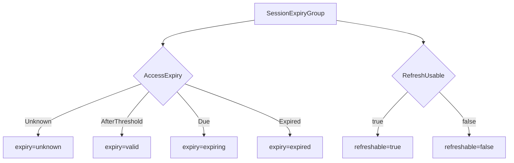
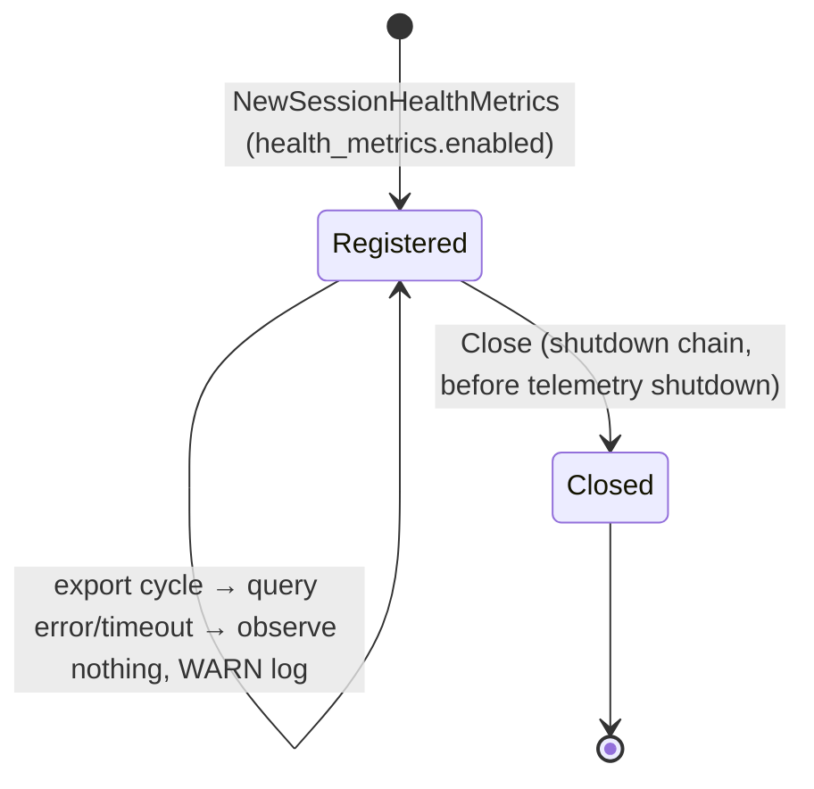

# Data Model: Automatic Third-Party Session Refresh

**Feature**: `053-session-auto-refresh` | **Spec**: [spec.md](spec.md) | **Research**: [research.md](research.md)

No entity, table, column, or migration is added. The feature reads the existing `UserSession` aggregate and adds value objects for health classification.

## Existing aggregate (read only)

`storage.UserSession` (`internal/domain/storage/user_session.go`), stored in `user_sessions`:

| Field | Column | Used for |
|---|---|---|
| `ServiceID id.ServiceID` | `service_id UUID NOT NULL` | Metric attribute `service_id` |
| `AccessTokenExpiresAt *time.Time` | `access_token_expires_at TIMESTAMPTZ NULL` | Access-expiry class |
| `EncryptedRefreshToken []byte` | `encrypted_refresh_token BYTEA NULL` | Presence only (`len > 0` / `octet_length > 0`); never decrypted |
| `RefreshTokenExpiresAt *time.Time` | `refresh_token_expires_at TIMESTAMPTZ NULL` | Refresh usability |

## New value objects

### `storage.AccessExpiryClass` (`internal/domain/storage`)

Enumeration of where a session's access-token expiry falls relative to a threshold.

| Value | Condition |
|---|---|
| `AccessExpiryUnknown` | `AccessTokenExpiresAt == nil` |
| `AccessExpiryAfterThreshold` | expiry is strictly after `threshold` |
| `AccessExpiryDue` | expiry is after `now` and at or before `threshold` (inclusive, same as `AccessTokenExpiresBy`) |
| `AccessExpiryExpired` | expiry is at or before `now` |

### `storage.SessionExpiryGroup` (`internal/domain/storage`)

One row of the health query result.

| Field | Type | Meaning |
|---|---|---|
| `ServiceID` | `id.ServiceID` | Service the sessions belong to |
| `AccessExpiry` | `AccessExpiryClass` | Class of the access-token expiry |
| `RefreshUsable` | `bool` | Refresh token present and its expiry is nil or after `now` (same as `CanRefresh`) |
| `Count` | `int` | Number of sessions in this group, `> 0` |

Each `(ServiceID, AccessExpiry, RefreshUsable)` appears at most once per result. At most eight groups exist per service.

### `oauth2session.SessionHealthKey` (`internal/domain/oauth2session`)

| Field | Values | Metric attribute |
|---|---|---|
| `Expiry` (`SessionHealthExpiry`) | `valid`, `expiring`, `expired`, `unknown` | `expiry` |
| `Refreshable` | `true`, `false` | `refreshable` |

Classification (FR-018) of a group:

`threshold = now + token_refresh.lookahead_duration`; `Due` means after `now` and at or before `threshold`, `Expired` means at or before `now`.

### `oauth2session.SessionHealthSnapshot`

The result of one classification, built per export cycle and not retained.

| Field | Type | Invariant |
|---|---|---|
| `Counts` | `map[id.ServiceID]map[SessionHealthKey]int` | Every service present has all eight `(expiry, refreshable)` combinations, zero-filled (FR-019). Services with no sessions are absent. |

Built from the groups by summing counts per `(service, expiry, refreshable)`. Validation: a group with `Count <= 0` or an unknown `AccessExpiry` is an adapter contract violation and fails the cycle.

## Process-scoped component

### `oauth2session.SessionHealthMetrics`

| Field | Purpose |
|---|---|
| `repo ports.UserSessionHealthRepository` | Health query port |
| `lookahead time.Duration` | Copy of `token_refresh.lookahead_duration` |
| `queryTimeout time.Duration` | `token_refresh.health_metrics.query_timeout` |
| `registration metric.Registration` | Unregistered by `Close` |

Lifecycle:

## Existing domain event, extended

`SessionSweepRun` is the existing `session sweep` audit log record (`session_sweep_handler.go:61-71`). Its fields are unchanged. The same deferred block now also records `session_sweep_duration_seconds{outcome, dry_run}`.

## Chart-side concept

**Session Sweep Schedule**: the CronJob, its ServiceAccount, and the request they encode. It is described by `sessionSweep.*` values. See [contracts/chart-values.md](contracts/chart-values.md) and [contracts/sweep-job.md](contracts/sweep-job.md).

## Glossary additions (`ARCHITECTURE.md`, Third-Party OAuth2 Session Management)

- **Session Health State**: The classification of a stored session by access-token expiry (`valid`, `expiring`, `expired`, or `unknown`) and refresh-token usability (`refreshable`). It is derived from the stored expiries, the current time, and the refresh lookahead, and is never stored.
- **Session Health Snapshot**: Per-service counts of sessions in each Session Health State, computed once per metric export cycle and published as the `oauth2_sessions` gauge.
- **Session Sweep Schedule**: The optional chart-managed CronJob that calls `POST /api/sessions/sweep` on a schedule with operator-supplied request credentials.
