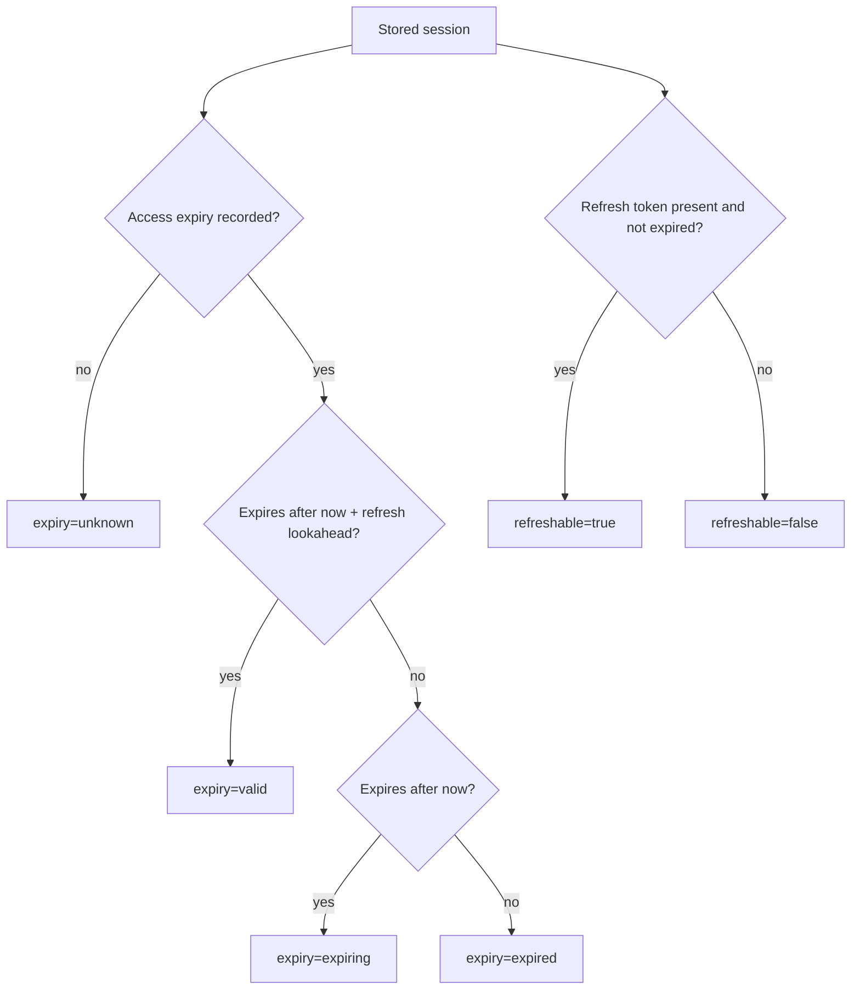
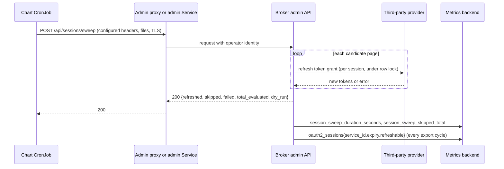

# Feature Specification: Automatic Third-Party Session Refresh

**Feature Branch**: `053-session-auto-refresh`

**Created**: 2026-10-15

**Status**: Draft

**Input**: User description: "Automatically refresh third-party sessions. PR #196 added POST /api/sessions/sweep on the admin API, which refreshes every stored third-party user session whose access token expires within a lookahead window, but nothing schedules it, so sessions of inactive users are never refreshed. Add an opt-in Kubernetes CronJob to the Helm chart that calls the sweep once a day across all services and users, and expose session-health metrics across all services and users through the existing OpenTelemetry pipeline so operators can observe how many sessions per service are valid, expiring and refreshable, expired and unrefreshable, or have no recorded expiry, plus whether and how the daily sweep ran. Acceptance criteria: (1) refresh of all services is triggered daily; (2) metrics of session health across all services and users are exposed for observability. Scope decisions already made: no database migration, no persisted refresh outcome, no port/repository contract changes, no OpenAPI change (the sweep contract is unchanged). Keep broker code changes minimal. Deployment-side pieces (the credential the CronJob presents, ingress authorization for the sweep path, the metrics backend) are described generically as deployment requirements and are not implemented in this repository. The spec must be platform-agnostic and must not name any company-internal systems or earlier drafts."

## Clarifications

### Session 2026-10-16

- Q: Should the sweep run metrics (User Story 3) be part of this feature's deliverable, or is the per-service health gauge alone enough? → A: Keep User Story 3 in scope. (The metric set was narrowed on 2026-10-19; see the following session.)

### Session 2026-10-19

- Q: Should the default schedule stay daily with a 26-hour lookahead? → A: No. A lookahead longer than the access-token lifetime makes every run refresh every session. Access tokens commonly live less than a day. The default is hourly with a two-hour lookahead, which covers one missed run. Hourly runs satisfy the "triggered daily" acceptance criterion. The existing guidance to keep the lookahead shorter than the access-token lifetime stays in place.
- Q: Should the chart define how the scheduled job authenticates? → A: No. The chart only transports the request: target URL, `Host`, body, literal headers, headers read from mounted files, optional TLS client files, and the volumes that provide them. Deployments differ in how they authenticate admin callers, and the chart adds no identity model of its own. Rendering fails when the sweep is enabled without any configured identity. The default target is the release's in-cluster admin Service, and the documented path stays the authenticating proxy that [ADR 038](../../adrs/038-proactive-token-refresh.md) describes. Broker-side authentication of service callers is a separate future feature.
- Q: Is a separate sweep run counter needed next to the duration histogram? → A: No. A duration histogram attributed by `outcome` and `dry_run` counts runs through its count series. Keep the histogram and the skipped counter. Drop the run counter.
- Q: What must the health metrics cover? → A: Session health across all services and users, broken down by service and state, without per-user attributes. The gauge is computed by one grouped count query in each metric export cycle. A failed query reports no data for that cycle. This removes the separate snapshot interval, cache, failure counter, and age gauge.

## User Scenarios & Testing *(mandatory)*

### User Story 1 - Scheduled Session Sweep From the Chart (Priority: P1)

An operator deploying the broker with the Helm chart enables the scheduled session sweep. Every hour the chart-managed CronJob calls the existing administrative sweep. Each run refreshes every stored third-party session whose access token expires before the next run plus a margin, including sessions of users who have not been active. The operator chooses where the request goes and which credentials it carries, and the chart supplies the schedule, request, and hardened pod. An operator who does not run Helm can render the same manifest with `helm template` and apply it.

**Why this priority**: This is the acceptance criterion the feature exists for. Without a schedule, sessions of inactive users expire silently and their next agent call fails until the user reconnects.

**Independent Test**: Render the chart with the sweep enabled, run the job once against a broker with sessions expiring within the lookahead window, and confirm that the broker receives exactly one sweep request with the configured window and headers, and that the refreshable candidates are refreshed.

**Acceptance Scenarios**:

1. **Given** the chart is rendered with the sweep disabled (the default), **When** the manifests are generated, **Then** no sweep resources are produced, and setting other `sessionSweep` values changes no rendered resource.
2. **Given** the sweep is enabled with default scheduling and target values and one configured header, **When** the manifests are generated, **Then** an hourly CronJob is produced that never runs two jobs at once, does not retry a failed job, requests a `PT2H` lookahead, targets the release's admin Service and admin port, and sends the host of `broker.server.admin.publicUrl` as `Host`.
3. **Given** `sessionSweep.url` is set, **When** the job runs, **Then** it sends the request to that URL and overrides `Host` only when `sessionSweep.host` is also set.
4. **Given** literal headers are configured, **When** the job runs, **Then** each header is sent with its configured value.
5. **Given** a header is configured from a file, **When** the job runs, **Then** the job reads the file at run time and sends the header with the configured prefix. The file contents are absent from the manifest, container arguments, environment, and log.
6. **Given** TLS client certificate, key, or CA files are configured, **When** the job runs, **Then** the job presents the client certificate and trusts the configured CA for that request.
7. **Given** the sweep is enabled with no literal header, no file header, and no client certificate, **When** the manifests are generated, **Then** rendering fails with a message that asks for an identity configuration.
8. **Given** the broker returns `200`, including a summary with `failed` greater than zero, **When** the job finishes, **Then** the job succeeds and its log contains the response summary.
9. **Given** the target returns a non-`2xx` status, the request times out, or the target is unreachable, **When** the job finishes, **Then** the job fails, is not retried, and its log contains the status and response body but no request header.
10. **Given** the sweep is enabled, **When** the manifests are generated, **Then** the job's pod does not match the broker Service or PodDisruptionBudget selector, and carries `app.kubernetes.io/component: session-sweep` for network policies to select.
11. **Given** the sweep is enabled with a `timeoutSeconds` not shorter than `activeDeadlineSeconds`, with only one of `tls.certFile` and `tls.keyFile`, or with a `lookaheadDuration` that is zero or not an ISO 8601 duration of days, hours, minutes, and seconds, **When** the manifests are generated, **Then** rendering fails with a message that names the offending value.

---

### User Story 2 - Session Health Visible Per Service (Priority: P1)

An operator wants to know, for every third-party service, how many stored user sessions are healthy, how many are due for refresh, how many have already expired but could still be refreshed by the next sweep, how many have expired and cannot be refreshed without the user reconnecting, and how many have no recorded expiry and therefore are never swept. The broker publishes these counts through its existing OpenTelemetry pipeline. The operator can chart and alert on them in any metrics backend that receives the broker's export.

**Why this priority**: This is the second acceptance criterion. A single sweep response covers only the candidates inside its window. Operators need the whole population to judge whether the schedule keeps sessions usable and how many users must reconnect.

**Independent Test**: Start a broker with telemetry metrics enabled. Store sessions for two services in each health state. Read the exported gauge after one export cycle. Confirm that each `(service_id, expiry, refreshable)` combination reports the expected count, including zero-count series.

**Acceptance Scenarios**:

1. **Given** telemetry metrics are enabled and sessions exist for two services, **When** one export cycle has elapsed, **Then** the session-health gauge reports one value per `(service_id, expiry, refreshable)` combination, and the sum over all series of a service equals the number of stored sessions for that service.
2. **Given** a service has no sessions in a given series, **When** the gauge is read, **Then** that `(service_id, expiry, refreshable)` combination is reported as `0` rather than omitted.
3. **Given** a session whose access token expires later than the configured refresh lookahead, **When** the gauge is read, **Then** the session is counted under `expiry="valid"`.
4. **Given** a session whose access token expires within the lookahead and one whose access token has already expired, both with a refresh token that is present and not expired, **When** the gauge is read, **Then** the first is counted under `expiry="expiring",refreshable="true"` and the second under `expiry="expired",refreshable="true"`, so an operator can see expired sessions the sweep has not yet renewed.
5. **Given** a session whose access token has already expired and whose refresh token is missing or expired, **When** the gauge is read, **Then** the session is counted under `expiry="expired",refreshable="false"`.
6. **Given** a session with no recorded access-token expiry, **When** the gauge is read, **Then** the session is counted under `expiry="unknown"`.
7. **Given** the count query fails or exceeds its timeout, **When** that export cycle runs, **Then** the gauge reports no data points for that cycle, the broker logs the failure, and the next cycle queries again.
8. **Given** telemetry metrics are disabled or the health metrics option is disabled, **When** the broker runs, **Then** the broker issues no session-health query.
9. **Given** the health metrics are exported, **When** their attributes are inspected, **Then** they carry `service_id`, `expiry`, and `refreshable` only and never a user principal or session identifier.

---

### User Story 3 - Sweep Runs Visible in Metrics (Priority: P2)

An operator wants to confirm from the metrics backend that the scheduled sweep runs, how long each run takes, how it ends, and how many candidates it skips. A missed or aborted run must be visible without reading cluster job status or logs.

**Why this priority**: The cluster's job status already shows failed jobs. Run metrics add the broker's view of each sweep. They make "no completed sweep in the last three hours" one alert in the same backend as the health gauge. The priority is P2 because the refresh itself does not depend on it.

**Independent Test**: Trigger one real sweep and one dry run against a broker with metrics enabled. Read the duration histogram and the skipped counter, and confirm that each reflects both runs.

**Acceptance Scenarios**:

1. **Given** a sweep completes, **When** metrics are read, **Then** the sweep duration histogram records one measurement attributed with `outcome=completed` and the request's `dry_run` value.
2. **Given** a sweep is rejected for an invalid request, aborted by an infrastructure failure, or canceled by the caller, **When** metrics are read, **Then** the histogram records the run under the matching `outcome`. It records no `completed` run.
3. **Given** a real sweep evaluates candidates that were already renewed by another refresh or deleted meanwhile, **When** metrics are read, **Then** the skipped counter increases by the number of skipped candidates.

---

### Edge Cases

- A run is missed because the cluster was unavailable: the CronJob starts it late within the late-start window or skips it. The two-hour lookahead lets the next run cover sessions that the missed run would have refreshed.
- A run takes longer than one schedule period: the next run is skipped rather than started concurrently, and the active deadline ends a stuck run.
- The broker restarts mid-sweep: the job gets a transport error and fails. Sessions already refreshed stay refreshed. The next run evaluates the remainder.
- No sessions exist: the sweep completes with all counts at zero, the job succeeds, and the gauge reports no series.
- A third-party service is deleted while its sessions remain: those sessions are counted under that `service_id` until they are removed.
- A provider issues access tokens shorter than the sweep lookahead: every run refreshes all of that provider's sessions. This is safe, but adds one refresh per session per run. The operations guide explains the tradeoff.
- The sweep lookahead is shorter than the schedule period: sessions expiring between runs are refreshed only when an agent uses them. The documentation warns about this pairing, and the shipped defaults avoid it.
- The request reaches the broker without an identity the admin server accepts: the broker returns `500 server_misconfiguration` before it starts a sweep. The job fails, and no `completed` run appears in metrics.
- A configured header file or TLS file is missing at run time: `curl` fails before it sends a request and does not print file contents. An empty header file sends an empty credential, and the target's rejection fails the job.
- An operator puts a secret in a literal header: the chart cannot detect this. The values schema and documentation state that literal headers appear in the manifest and that secrets belong in file headers.
- Multiple broker replicas publish the health gauge: every replica reports the same totals, so consumers aggregate with `max`. The sweep histogram and counters come only from the replica that served the run, so consumers aggregate them with `sum`.
- `dryRun: true` is configured for the schedule: the job succeeds on `200`, nothing is refreshed, and the histogram shows `dry_run=true`, so an alert on real completed runs fires.

## Concrete Example Journeys *(mandatory)*

### Journey 1 — Hourly sweep through the admin proxy refreshes an inactive user's session (User Story 1, Scenarios 3, 5, 8; User Story 3, Scenario 1)

**Cast**: Operator `ops-alice` manages release `broker` in namespace `identity`. The admin API is reached through an authenticating proxy at `https://broker-admin.example.test`, which matches `broker.server.admin.publicUrl`. The proxy accepts Kubernetes ServiceAccount tokens with audience `broker-admin-proxy`, authorizes `system:serviceaccount:identity:broker-agentic-identity-broker-session-sweep` as a sweep operator, and forwards the principal `session-sweep`. User `u-7f3a` connected `svc-calendar` (`service_id: 3f9c…`) at 2026-10-16T10:20Z and has not used an agent since. The provider issues six-hour access tokens.

**Step 1 — Sweep values**

```yaml
sessionSweep:
  enabled: true                  # false (default) renders no sweep resources
  schedule: "0 * * * *"          # hourly
  lookaheadDuration: PT2H        # one period plus one missed run; shorter than the 6h token lifetime
  url: https://broker-admin.example.test   # through the proxy instead of the in-cluster Service
  headersFromFile:
    Authorization:
      path: /var/run/secrets/session-sweep/token
      prefix: "Bearer "
  volumes:
    - name: proxy-token
      projected:
        sources:
          - serviceAccountToken:
              path: token
              audience: broker-admin-proxy
              expirationSeconds: 3600
  volumeMounts:
    - name: proxy-token
      mountPath: /var/run/secrets/session-sweep
      readOnly: true
```

**Step 2 — `helm template broker ./charts/agentic-identity-broker -n identity -f values.yaml` renders the job (excerpt)**

```yaml
apiVersion: batch/v1
kind: CronJob
metadata:
  name: broker-agentic-identity-broker-session-sweep
  labels:
    app.kubernetes.io/component: session-sweep
spec:
  schedule: "0 * * * *"
  concurrencyPolicy: Forbid
  startingDeadlineSeconds: 3600
  jobTemplate:
    spec:
      backoffLimit: 0
      activeDeadlineSeconds: 2100
      template:
        metadata:
          labels:
            app.kubernetes.io/component: session-sweep   # no broker Service selector labels
        spec:
          serviceAccountName: broker-agentic-identity-broker-session-sweep
          automountServiceAccountToken: false
          restartPolicy: Never
          containers:
            - name: session-sweep
              image: curlimages/curl:8.16.0   # requires only sh and curl
              volumeMounts:
                - name: proxy-token
                  mountPath: /var/run/secrets/session-sweep
                  readOnly: true
          volumes:
            - name: proxy-token
              projected:
                sources:
                  - serviceAccountToken:
                      path: token
                      audience: broker-admin-proxy
                      expirationSeconds: 3600
```

The manifest contains the volume source but no token.

**Step 3 — 2026-10-16T16:00:00Z: the job sends the sweep request to the proxy**

```http
POST /api/sessions/sweep HTTP/1.1
Host: broker-admin.example.test
Authorization: Bearer <projected-service-account-token>
Content-Type: application/json

{"lookahead_duration":"PT2H"}
```

The proxy validates the token, authorizes the service account, and forwards the request with the operator principal `session-sweep`.

**Step 4 — 16:00:00Z to 16:01:42Z: the broker evaluates candidates**

User `u-7f3a`'s token expires at 16:20Z, inside the window that ends at 18:00Z. The provider accepts the stored refresh token. The broker encrypts and stores the new tokens. Two candidates were refreshed moments earlier by agent traffic and are skipped. One candidate's refresh token was revoked at the provider and fails.

```http
HTTP/1.1 200 OK
Content-Type: application/json

{"refreshed":41,"skipped":2,"failed":1,"total_evaluated":44,"dry_run":false}
```

**Step 5 — the job log and the broker audit event**

```text
{"refreshed":41,"skipped":2,"failed":1,"total_evaluated":44,"dry_run":false}
```

```json
{"msg":"session sweep","operator_principal":"session-sweep","dry_run":false,"lookahead":"2h0m0s","refreshed":41,"skipped":2,"failed":1,"total_evaluated":44,"duration_ms":102000,"outcome":"completed"}
```

The job exits `0` even though `failed` is `1`. Journey 2 makes the affected user visible.

**Step 6 — the broker's metrics reflect the run**

```text
session_sweep_duration_seconds_count{outcome="completed",dry_run="false"}  +1
session_sweep_duration_seconds_sum{outcome="completed",dry_run="false"}    +102
session_sweep_refreshed_total{triggered_by="sweep"}                         +41
session_sweep_skipped_total{triggered_by="sweep"}                           +2
session_sweep_failed_total{triggered_by="sweep"}                            +1
```

**Observable result**: At 17:00Z user `u-7f3a`'s agent calls `svc-calendar`. The token exchange returns a valid access token with no provider round-trip and no reconnect prompt.

### Journey 2 — Operator reads session health per service (User Story 2, Scenarios 1 to 7)

**Cast**: Same release. Telemetry metrics export every 30 seconds. The broker's refresh lookahead is `5m`. At 2026-10-16T16:05:00Z the broker stores eight sessions: six for `svc-calendar` (`3f9c…`) and two for `svc-tickets` (`a1d2…`).

**Step 1 — Broker configuration**

```yaml
telemetry:
  metrics:
    enabled: true                 # false disables every metric in this feature
    export_interval: 30s          # the health query runs once per export cycle per replica
token_refresh:
  lookahead_duration: 5m          # boundary between expiry="valid" and expiry="expiring"
  health_metrics:
    enabled: true                 # default true; effective only when telemetry metrics are enabled
    query_timeout: 5s             # a slower query reports no data for that cycle
```

**Step 2 — 16:05:00Z: the export cycle runs the count query**

| Session owner | Service | Access token expiry | Refresh token | `expiry` | `refreshable` |
|---|---|---|---|---|---|
| `u-7f3a` | `svc-calendar` | 2026-10-16T22:02:00Z | usable | `valid` | `true` |
| `u-0b19` | `svc-calendar` | 2026-10-16T16:08:00Z | usable | `expiring` | `true` |
| `u-5c44` | `svc-calendar` | 2026-10-16T09:00:00Z | stored expiry passed | `expired` | `false` |
| `u-3c21` | `svc-calendar` | 2026-10-16T14:00:00Z | usable | `expired` | `true` |
| `u-9e01` | `svc-calendar` | none recorded | usable | `unknown` | `true` |
| `u-2d87` | `svc-calendar` | 2026-10-16T22:00:00Z | usable | `valid` | `true` |
| `u-7f3a` | `svc-tickets` | 2026-10-16T20:00:00Z | usable | `valid` | `true` |
| `u-4a60` | `svc-tickets` | 2026-10-16T12:00:00Z | none | `expired` | `false` |

`u-3c21` is an inactive user whose token expired two hours ago; the next sweep run renews it. If that series stays above zero across runs, no sweep is reaching these sessions.

**Step 3 — the gauge is exported, zero-filled per service**

```text
oauth2_sessions{service_id="3f9c…",expiry="valid",refreshable="true"}      2
oauth2_sessions{service_id="3f9c…",expiry="valid",refreshable="false"}     0
oauth2_sessions{service_id="3f9c…",expiry="expiring",refreshable="true"}   1
oauth2_sessions{service_id="3f9c…",expiry="expiring",refreshable="false"}  0
oauth2_sessions{service_id="3f9c…",expiry="expired",refreshable="true"}    1
oauth2_sessions{service_id="3f9c…",expiry="expired",refreshable="false"}   1
oauth2_sessions{service_id="3f9c…",expiry="unknown",refreshable="true"}    1
oauth2_sessions{service_id="3f9c…",expiry="unknown",refreshable="false"}   0
oauth2_sessions{service_id="a1d2…",expiry="valid",refreshable="true"}      1
oauth2_sessions{service_id="a1d2…",expiry="valid",refreshable="false"}     0
oauth2_sessions{service_id="a1d2…",expiry="expiring",refreshable="true"}   0
oauth2_sessions{service_id="a1d2…",expiry="expiring",refreshable="false"}  0
oauth2_sessions{service_id="a1d2…",expiry="expired",refreshable="true"}    0
oauth2_sessions{service_id="a1d2…",expiry="expired",refreshable="false"}   1
oauth2_sessions{service_id="a1d2…",expiry="unknown",refreshable="true"}    0
oauth2_sessions{service_id="a1d2…",expiry="unknown",refreshable="false"}   0
```

No attribute names a user. The sum for `3f9c…` is 6 and for `a1d2…` is 2.

**Step 4 — 16:05:30Z: the session store is briefly unavailable**

The query fails within `query_timeout`. That cycle exports no `oauth2_sessions` points, and the broker logs `session health query failed` at WARN with `error_kind`. The 16:06:00Z cycle succeeds and the series resume.

**Step 5 — the operator's dashboard and alerts (PromQL shown as an example query language)**

```promql
# Sessions per service, expiry class, and refreshability
max by (service_id, expiry, refreshable) (oauth2_sessions)

# Expired sessions the sweep could refresh but has not. Alert when this stays above
# zero for longer than two schedule periods: the sweep is not running or not keeping up.
max by (service_id) (oauth2_sessions{expiry="expired",refreshable="true"}) > 0

# Users who must reconnect, rising over a day
max by (service_id) (oauth2_sessions{expiry="expired",refreshable="false"})
  - max by (service_id) (oauth2_sessions{expiry="expired",refreshable="false"} offset 1d) > 0

# No completed real sweep in three hours (hourly schedule)
sum(increase(session_sweep_duration_seconds_count{outcome="completed",dry_run="false"}[3h])) == 0

# Health gauge missing for fifteen minutes although it reported sessions before
absent_over_time(oauth2_sessions[15m])
  and on() (max(max_over_time(oauth2_sessions[1h] offset 15m)) > 0)

# Sweep failures over a day
sum(increase(session_sweep_failed_total[1d])) > 0
```

**Observable result**: The dashboard shows two users who must reconnect, one per service, and one session that the sweep cannot reach because it has no recorded expiry. None of the alerts needs access to broker logs or the database.

### Journey 3 — The proxy rejects the scheduled caller (User Story 1, Scenario 9; User Story 3)

**Cast**: Same release as Journey 1. The proxy's authorization policy has not yet been updated to admit the sweep service account.

**Step 1 — 2026-10-16T17:00:00Z: the job sends the request**

Same request as Journey 1, Step 3.

**Step 2 — the proxy denies the request before it reaches the broker**

```http
HTTP/1.1 403 Forbidden
Content-Type: application/json

{"error":"forbidden"}
```

**Step 3 — the job fails without retrying**

```text
{"error":"forbidden"}
session sweep failed: HTTP 403
```

The log contains the status and body, not the `Authorization` header.

**Observable result**: The cluster shows one failed job. The broker records no sweep duration, because the request never reached it. The "no completed real sweep in three hours" alert fires at 19:00Z if the operator has not fixed the policy.

### Journey 4 — Rendering fails without an identity (User Story 1, Scenario 7)

**Cast**: Operator `ops-bob` enables the sweep and forgets to configure how it authenticates.

**Step 1 — Values**

```yaml
sessionSweep:
  enabled: true
```

**Step 2 — `helm template` fails**

```text
Error: sessionSweep.enabled requires an identity for the admin API: set sessionSweep.headers, sessionSweep.headersFromFile, or sessionSweep.tls.certFile.
```

**Observable result**: No CronJob is rendered, so no job can send an unauthenticated request.

## Requirements *(mandatory)*

### Functional Requirements

**Scheduled sweep (chart)**

- **FR-001**: The Helm chart MUST offer a scheduled sweep that is disabled by default. With it disabled, the chart MUST render no sweep resources, and `sessionSweep` values MUST NOT affect any other rendered resource.
- **FR-002**: When enabled, the chart MUST render a CronJob that calls `POST /api/sessions/sweep` once per schedule period. The default schedule is hourly.
- **FR-003**: The CronJob MUST use `concurrencyPolicy: Forbid` and `backoffLimit: 0`. Its late-start window and active deadline MUST be configurable.
- **FR-004**: The request MUST send a configurable lookahead. The default is `PT2H`. The values schema MUST accept only the positive ISO 8601 duration form accepted by the sweep endpoint.
- **FR-005**: The request MUST pass optional `dryRun` and `pageSize` values through unchanged.
- **FR-006**: When `sessionSweep.url` is unset, the job MUST target the release's admin Service and admin port, and MUST send the host of `broker.server.admin.publicUrl` as `Host` unless that value is empty. When `sessionSweep.url` is set, the job MUST target it and override `Host` only when `sessionSweep.host` is set.
- **FR-007**: The job MUST send each configured literal header with its configured value.
- **FR-008**: The job MUST read each configured file header from its mounted file at run time and send it with the configured prefix. The chart MUST NOT copy file contents into the manifest, arguments, or environment.
- **FR-009**: The job MUST present a configured TLS client certificate and key, and trust a configured CA bundle, for the request.
- **FR-010**: The chart MUST mount operator-supplied volumes into the job. It MUST NOT generate, decode, or validate credentials, and MUST NOT derive identity from the broker's admin authentication settings.
- **FR-011**: Rendering MUST fail when the sweep is enabled without at least one literal header, file header, or TLS client certificate.
- **FR-012**: The job MUST fail when the response status is not `2xx`, when the request cannot be sent, or when the configured request timeout elapses. Rendering MUST fail when the request timeout is not shorter than the active deadline.
- **FR-013**: The job MUST succeed on any `2xx` response regardless of the `failed` count, and MUST print the response body to its log.
- **FR-014**: The job MUST need only a POSIX shell and `curl` 8.3 or later in its image. The image MUST be configurable, with a pinned public default.
- **FR-015**: The job MUST run under a dedicated service account with `automountServiceAccountToken: false` and the chart's restrictive pod and container security settings.
- **FR-016**: The job's pod MUST NOT match the broker Service or PodDisruptionBudget selector. It MUST carry `app.kubernetes.io/component: session-sweep`. It MUST accept additional pod labels and annotations, and these MUST take precedence over `commonLabels` for keys they share.

**Session health metrics (broker)**

- **FR-017**: The broker MUST publish an `oauth2_sessions` gauge through the existing telemetry pipeline. The gauge counts stored third-party sessions by `service_id`, `expiry`, and `refreshable`, where `expiry` is exactly one of `valid`, `expiring`, `expired`, or `unknown` and `refreshable` is `true` or `false`.
- **FR-018**: Both attributes MUST be derived only from stored fields, the current time, and the configured refresh lookahead:
  - `expiry` is `unknown` when no access-token expiry is recorded; otherwise `valid` when the access token expires after now plus `token_refresh.lookahead_duration`; otherwise `expiring` when it expires after now; otherwise `expired`.
  - `refreshable` is `true` when a refresh token is present and not expired at now.
- **FR-019**: Every `(service_id, expiry, refreshable)` combination MUST be reported for every service that has at least one session. A combination with no sessions reports `0`.
- **FR-020**: The counts MUST be computed by one grouped query per export cycle, bounded by `token_refresh.health_metrics.query_timeout`. A failed or timed-out query MUST report no points for that cycle and MUST be logged without session or principal data.
- **FR-021**: The query MUST run only when telemetry metrics and `token_refresh.health_metrics.enabled` are both enabled.
- **FR-022**: Health and sweep metrics MUST NOT carry a user principal, session identifier, or token material as an attribute or value. `service_id` is the only identifying attribute permitted.

**Sweep run metrics (broker)**

- **FR-023**: Each sweep request that passes operator authentication MUST record its duration in a `session_sweep_duration_seconds` histogram attributed by `outcome` (`completed`, `rejected`, `aborted`, `canceled`) and `dry_run`. These are the outcome values of the existing sweep audit event.
- **FR-024**: Each candidate counted as skipped in a real sweep MUST increase `session_sweep_skipped_total`, attributed by `triggered_by` like the existing refreshed and failed counters.

**Documentation**

- **FR-025**: The session sweep operations guide MUST:
  - Replace the hand-written CronJob example with the chart values and show how to render the CronJob with `helm template` for deployments that apply plain manifests.
  - State both lookahead constraints. The lookahead must cover the schedule period plus one missed run. It should stay shorter than the shortest access-token lifetime, and the guide explains the cost when it does not.
  - Give recipes for the authenticating-proxy path with a projected ServiceAccount token and with a TLS client certificate.
  - State that a call to the in-cluster admin Service is trusted only as far as the admin server's own authentication goes: the admin server authenticates but does not authorize operators, so the proxy normally makes that decision. A deployment that calls the Service directly must restrict who can reach the admin port. Give an example NetworkPolicy that admits the job by `app.kubernetes.io/component: session-sweep`.
  - Explain why a run with `failed > 0` succeeds.
  - Document the new metrics, the `max` aggregation for the gauge and `sum` for sweep counters, and that metric names can change when a backend translates OTLP names.
  - Give the example queries from Journey 2. Give optional job-level signals for clusters that run kube-state-metrics, such as `kube_cronjob_status_last_successful_time`.
- **FR-026**: The chart README MUST document the `sessionSweep` values, including that literal headers appear in the rendered manifest and that secrets belong in file headers. It MUST replace the instruction to route sweep CronJobs through the proxy with the chart-managed schedule and the same trust guidance. `docs/configuration.md` MUST document the `token_refresh.health_metrics` keys and refer to the chart-managed schedule.

### Domain Model *(if applicable - document before API or database design)*

No new entities are stored. The feature adds one derived value object and reuses the existing session entity.





**Entities** (things with unique identity):
- **UserSession** (existing): one per `(principal, service_id)`; carries encrypted tokens and optional access and refresh expiries. Unchanged.
- **ThirdpartyOAuth2Service** (existing): the service a session belongs to; its ID is the only identifying metric attribute.

**Value Objects** (things without identity):
- **Session Health State**: the `expiry` class (`valid`, `expiring`, `expired`, or `unknown`) and `refreshable` flag of a session, derived at query time. Never stored.
- **Session Health Snapshot**: per-service counts of sessions in each `(expiry, refreshable)` series, built once per export cycle and not retained.
- **Session Sweep Schedule**: the chart-managed CronJob that calls the sweep, with its period, lookahead, target, and request credentials.

**Domain Events** (state changes of business significance):
- **SessionSweepRun** (existing audit event): now also timed in a histogram by outcome.

*Add Session Health State, Session Health Snapshot, and Session Sweep Schedule to the `ARCHITECTURE.md` glossary.*

### Configuration Requirements *(if applicable - document before implementation)*

**Broker configuration parameters** (under the existing `token_refresh` section):
- **token_refresh.health_metrics.enabled**: bool, default `true`; effective only when `telemetry.metrics.enabled` is `true`.
- **token_refresh.health_metrics.query_timeout**: duration, default `5s`; must be greater than zero.

**Example YAML Configuration**:
```yaml
token_refresh:
  lookahead_duration: 5m
  background_workers: 10
  sweep:
    default_page_size: 100
  health_metrics:
    enabled: true
    query_timeout: 5s
```

**Configuration Location**: Added to `examples/config/telemetry.yaml` and `examples/config/config.production.yaml`, documented in `docs/configuration.md`, and surfaced in the chart as `broker.tokenRefresh.healthMetrics.enabled` and `broker.tokenRefresh.healthMetrics.queryTimeout`.

**Helm chart values** (new top-level section):

| Value | Default | Purpose |
|---|---|---|
| `sessionSweep.enabled` | `false` | Render the CronJob and its service account |
| `sessionSweep.schedule` | `"0 * * * *"` | Cron expression |
| `sessionSweep.timeZone` | *(unset)* | Optional CronJob time zone |
| `sessionSweep.startingDeadlineSeconds` | `3600` | Late-start window before a run is skipped |
| `sessionSweep.activeDeadlineSeconds` | `2100` | Hard cap on one job |
| `sessionSweep.timeoutSeconds` | `1800` | Request timeout; must be shorter than `activeDeadlineSeconds` |
| `sessionSweep.lookaheadDuration` | `PT2H` | ISO 8601 lookahead sent to the sweep |
| `sessionSweep.dryRun` | `false` | Classify only |
| `sessionSweep.pageSize` | *(unset)* | Override the broker default |
| `sessionSweep.url` | *(unset)* | Target URL; unset targets the release's admin Service |
| `sessionSweep.host` | *(unset)* | `Host` override; unset derives it from `broker.server.admin.publicUrl` only for the default target |
| `sessionSweep.headers` | `{}` | Literal header values; rendered into the manifest, so never secrets |
| `sessionSweep.headersFromFile` | `{}` | Header name to `{path, prefix}`; the file is read at run time |
| `sessionSweep.tls.certFile`, `.keyFile`, `.caFile` | *(unset)* | TLS client certificate, key, and CA bundle paths |
| `sessionSweep.volumes`, `sessionSweep.volumeMounts` | `[]` | Volumes that provide the header and TLS files |
| `sessionSweep.image.repository`, `.tag`, `.pullPolicy` | `curlimages/curl`, a pinned version, `IfNotPresent` | Job image |
| `sessionSweep.resources` | `50m` CPU, `64Mi` memory | Requests and limits |
| `sessionSweep.podLabels`, `sessionSweep.podAnnotations` | `{}` | Extra pod metadata |

The values schema MUST validate these values. The chart README and release notes MUST describe them. The chart contract is updated in the same feature (Principle VII).

### API Requirements *(if applicable - design before database)*

- **API-001**: This feature adds no endpoint and changes no request or response field. `POST /api/sessions/sweep` in `api/admin/openapi.yaml` is used as published.
- **API-002**: The only permitted OpenAPI edits are to descriptive text and examples. The edits reference the chart-managed schedule, and the example lookahead and schedule change to the hourly `PT2H` default. Field semantics, status codes, and error shapes stay as they are.
- **API-003**: Metrics are exported through the configured telemetry exporter only. No `/metrics` endpoint or admin API for health counts is added.

### Database Requirements *(if applicable)*

- **DB-001**: No schema change and no migration.
- **DB-002**: The health gauge reads existing session columns through one additive, read-only repository operation. The operation returns per-service counts by health state. No existing operation can produce these counts: the sweep's expiry listing excludes sessions without a recorded expiry, and the per-service count has no state breakdown. This operation is the only port addition. It MUST be implemented for the in-memory and PostgreSQL backends with parity tests.
- **DB-003**: The query MUST NOT read or decrypt token material.
- **DB-004**: The sweep's candidate selection is unchanged.

### Architecture Decisions

No ADR is added or superseded. The chart-managed job is an external operator schedule as described by [ADR 038](../../adrs/038-proactive-token-refresh.md). The chart adds no authentication model. The documented path keeps the authenticating proxy that ADR 038 names, and how a deployment authenticates the job remains its own decision.

### Security Requirements *(mandatory for security-critical features)*

- **SR-001**: The chart MUST NOT generate, store, or log a credential, and MUST NOT lower or bypass the admin server's authentication. The broker continues to refuse a sweep without an operator principal (`500 server_misconfiguration`).
- **SR-002**: Rendering MUST fail closed when no identity is configured (FR-011).
- **SR-003**: File header and TLS file contents MUST NOT appear in the rendered manifest, container arguments, environment variables, or job log.
- **SR-004**: The job container MUST run as non-root with a read-only root filesystem, no privilege escalation, all capabilities dropped, and the `RuntimeDefault` seccomp profile.
- **SR-005**: The job log MUST contain only the response status, response body, and error text. It MUST NOT echo request headers or enable shell tracing.
- **SR-006**: The documentation MUST recommend a dedicated operator principal for the job, so the existing sweep audit event distinguishes scheduled sweeps from manual ones.
- **SR-007**: Metrics MUST NOT contain principals, session identifiers, or token material (FR-022).

### Key Entities *(include if feature involves data)*

- **Session Health State**: a derived `(expiry, refreshable)` pair for one session at one instant, one of eight combinations.
- **Session Sweep Schedule**: the chart-managed CronJob and its parameters.
- **Session Sweep Run**: one sweep as seen by the broker, with an outcome, a duration, and refreshed, skipped, and failed counts.

## Success Criteria *(mandatory)*

### Measurable Outcomes

- **SC-001**: With the schedule enabled, every stored session whose access token expires within the next two hours and that has a usable refresh token is attempted by the next run. Every candidate that the provider accepts is usable afterwards without a reconnect.
- **SC-002**: For every service with sessions, an operator can read the count of sessions in each of the eight `(expiry, refreshable)` combinations from the metrics backend within one export cycle of the underlying change, without broker logs or database access.
- **SC-003**: Three hours without a completed real sweep are detectable from the metrics backend. A run that fails is visible as a failed job in the cluster.
- **SC-004**: Rendering the chart with the feature disabled produces no additional resources. Rendering it enabled without an identity, or with a request timeout not below the active deadline, fails with a clear message.
- **SC-005**: An operator who applies plain manifests can obtain the CronJob from `helm template` and apply it without editing it.
- **SC-006**: No rendered manifest, container argument, environment variable, or job log line contains the contents of a file header or TLS file.
- **SC-007**: Health and sweep metrics have at most one attribute value per third-party service. They never grow with the number of users or sessions.

## Assumptions

- The deployment decides how the job authenticates and supplies the credential files or headers. Typical choices are a projected ServiceAccount token or a TLS client certificate presented to the authenticating proxy.
- A deployment that targets the in-cluster admin Service restricts network access to the admin port. The chart documents this but does not render a NetworkPolicy, because one that selects the broker pods would also restrict the end-user port, and its peers differ by deployment.
- Broker-side authentication and authorization of service callers on the admin API is out of scope. It would remove the reliance on the proxy or network restriction and is a candidate follow-up feature.
- The deployment's metrics backend receives the broker's existing OTLP export. Dashboards and alerts are built from the example queries in the operations guide, and none are shipped as code. PromQL is used as an example query language because many backends accept it.
- An hourly schedule with a two-hour lookahead is an acceptable default when access tokens live longer than two hours. Deployments with shorter-lived tokens accept one refresh per session per run, or shorten the schedule and lookahead together.
- Sessions whose provider rejected the refresh token stay stored and are retried on each run until the user reconnects or the session is removed. Persisting the refresh outcome is out of scope.
- Health counts are broken down by service only. Per-user health is not exposed as a metric.
- The broker refresh lookahead (`token_refresh.lookahead_duration`) is the boundary between `expiry="valid"` and `expiry="expiring"`, because it is where the broker itself starts refreshing an active session. The boundary between `expiring` and `expired` is the current time. The sweep lookahead is a separate request value.
- "No port or repository contract changes" in the feature input applies to the sweep. One additive read-only repository operation is accepted for the health gauge (DB-002).
- Running one grouped count query per export cycle per replica is cheap compared with token-exchange traffic. Deployments with large session tables can disable the gauge or lengthen the export interval.
- Every replica publishes the same health totals, and consumers aggregate with `max`. Leader election is out of scope.
- Deployments that keep their own sweep manifest are unaffected.
