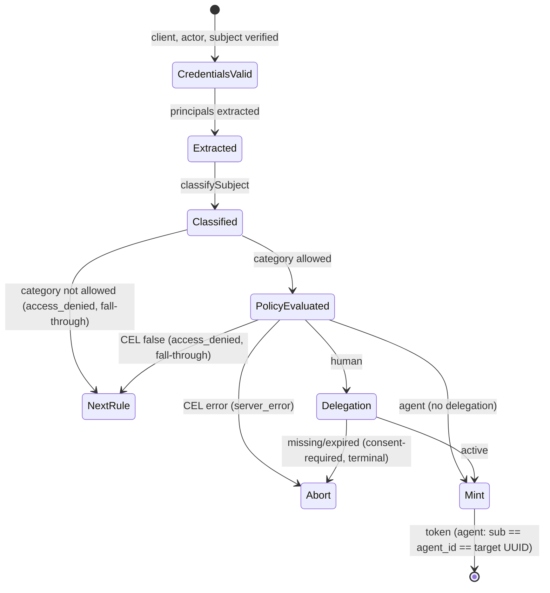

# Data Model: Agent-Subject Impersonation

**Feature**: `specs/054-agent-subject-impersonation` | **Date**: 2026-10-27 | **Plan**: [plan.md](plan.md) | **Research**: [research.md](research.md)

There is no new persisted entity, no new UUID-keyed type, and no migration. The feature adds one impersonation rule attribute, one token-exchange claim-extraction expression, two value objects, and new audit and diagnostic fields to the existing `impersonation` and `tokenexchange` bounded contexts.

## Existing entities reused

| Entity | Location | Role in this feature |
| --- | --- | --- |
| `storage.Agent` | `internal/domain/storage` | The audience-selected target. `ID.String()` is the only value an agent-category `sub` may equal. Its `CanonicalID` remains a routing alias only. |
| `UserGrant` | `internal/domain/storage` | Required for eligible human-category requests only (ADR 032 decisions 1–6). Never read for agent-category requests or for third-party exchange of agent tokens before rejection. |
| `UserSession` | `internal/domain/storage` | Never read for an agent-subject token matched by the default or a compliant `agent_subject_expression` (FR-011, SR-005). A non-matching override removes this guarantee (C4). |

## Configuration: `ImpersonationRuleConfig` (extended)

`internal/ports/config.go`

| Field | Type | mapstructure | Rule |
| --- | --- | --- | --- |
| `AllowedSubjectCategories` | `[]string` | `allowed_subject_categories` | `nil` means omitted, which defaults to `[human]`. A non-nil list must have 1–2 distinct entries from `{human, agent}`, matched case-sensitively. A list containing `agent` is accepted when `roles.subject.verification` is `none`, but has no effect because unsigned subjects are always human (research R8; proposed, plan Approval Items A7). Raw YAML shape checks reject `null`, scalars, mappings, and non-string entries before decoding. |

New constants: `ports.SubjectCategoryHuman = "human"`, `ports.SubjectCategoryAgent = "agent"`.

Validation layers (fail closed, before traffic):

1. `internal/config` YAML shape check (`loadYAML`): rejects explicit `null`, scalar, mapping, and non-string or null entries. These are YAML-only (rule lists are YAML-only).
2. `internal/config/validator.go` `validateImpersonationRule`: rejects an empty, unknown, or duplicate value. It applies no unsigned-subject guard (research R8). Reports the field path `oauth2_authorization_server.impersonation.rules[i].allowed_subject_categories`.
3. `internal/domain/impersonation/rule.go` `validateRuleInvariants`: repeats layer 2 for directly constructed configurations.

The [configuration contract](contracts/impersonation-config.yaml) lists every input and its outcome.

## Value objects (domain)

### `SubjectCategory` — `internal/domain/impersonation`

`type SubjectCategory string`, with values `SubjectCategoryHuman` and `SubjectCategoryAgent`.

**Classification** (`classifySubject`, research R2):

```text
agent  ⇔ subject role signed (verification: jwks)
         ∧ subject credential verified
         ∧ verified claims["sub"] is a string
         ∧ claims["sub"] == target.Agent.ID.String()   (byte-for-byte)
human  otherwise (including every unsigned subject)
```

### `compiledRule` (extended)

| Field | Type | Meaning |
| --- | --- | --- |
| `allowsHuman` | `bool` | `true` when the list is omitted or contains `human`. |
| `allowsAgent` | `bool` | `true` only when the list contains `agent`. |

`(r *compiledRule) allows(SubjectCategory) bool`.

### Resolved Impersonation Subject (per rule evaluation)

This is not a new type. It is held on `ruleResult`:

| Field | Human | Agent |
| --- | --- | --- |
| `category` | `human` | `agent` |
| `subject` (represented identity and minted `sub`) | Extracted subject principal | `target.Agent.ID.String()` |
| email | From `email_expression`, per the existing rules | Not evaluated, not minted |
| delegation | `UserDelegationVerifier` required | Skipped |

All principal extractions must succeed before classification. For agents, the extracted subject principal need not equal the raw verified `sub` or minted target UUID; no new extraction-equality restriction is introduced. This target-derived minting and the delegation exception are covered by the proposed ADR 045's agent-only supersession of ADR 032 decisions 2 and 1 respectively. Eligible humans retain the byte-for-byte extracted-principal-as-minted-sub/delegation-principal invariant. Signed exact equality remains agent-category regardless of eligibility and is rejected on human-only rules even with active human delegation.

## Configuration: `ClaimExtractionConfig` (extended)

`internal/ports/config.go`

| Field | Type | mapstructure | Rule |
| --- | --- | --- | --- |
| `AgentSubjectExpression` | `string` | `agent_subject_expression` | Optional CEL boolean over `subject_token` (research R5). Empty or omitted means `tokenexchange.DefaultAgentSubjectExpression`: `has(subject_token.sub) && has(subject_token.agent_id) && subject_token.sub == subject_token.agent_id`. Compiled at startup with the other token-exchange expressions; a compile error or a static non-boolean output type fails startup. A configured value replaces the default (C4, proposed, plan Approval Items A3 and A6); the operator must keep it matching broker agent-subject tokens. |

## Port DTO: `ports.ImpersonationMintInput` (unchanged)

No field is added. For an agent-category request, the impersonation service passes `Subject = target UUID` and `Email = nil`. No new port interface is added. `ImpersonationTokenIssuer` and `UserDelegationVerifier` are unchanged.

## Token: agent-subject access token

| Claim | Value | Source |
| --- | --- | --- |
| `iss` | Local issuer | Unchanged |
| `sub` | Target agent UUID | R7 (reserved base claim) |
| `agent_id` | Target agent UUID | Unchanged (target-derived, reserved base claim) |
| `act` | `{iss: verified actor issuer, sub: extracted actor}` | Unchanged |
| `scope`, `iat`, `exp`, `jti` | As for normal local issuance | Unchanged |
| `aud` and other custom claims | `token_claims_expression` | Unchanged (policy-owned) |

There is no category claim. An agent-subject token is identified by `sub == agent_id`; both are already in `oauth2server.baseClaims`, so `token_claims_expression` cannot change either. `baseClaims` is unchanged.

## Audit event: `impersonation_decision` (extended)

| Attribute | Change |
| --- | --- |
| `subject_category` | **New**: `human` or `agent`. Present once the subject is classified. |
| `subject_identity` | Represented identity (the minted `sub` on success). |
| `rule`, `target_agent_id`, `privileged_client_identity`, `actor_identity`, `issuer_roles`, `outcome`, `oauth_error_code` | Unchanged |

The event never contains credentials or wholesale claims (SR-004).

## Diagnostic details (extended)

`internal/domain/tokenexchange/diagnostic.go`

| Detail | Stage | Exchange kind | Meaning |
| --- | --- | --- | --- |
| `subject_category_ineligible` | `client_authorization` | impersonation | The rule does not allow the classified category. Fall-through. |
| `subject_category_unsupported` | `identity_resolution` | third_party | The subject token matched `agent_subject_expression` in a third-party exchange. |

## State and decision flow (one rule)



## Third-party exchange step (extended)

```text
validate subject_token → validate client_assertion → extract principal → finalize security context
  → [NEW] agent_subject_expression(subject_token)
        true  → 403 access_denied (subject_category_unsupported), stop
        error → 500 server_error (cel_evaluation_failed / cel_configuration), stop
        false → continue
  → extract agent_id → CEL authorization → resource → grant → session …   (unchanged)
```
