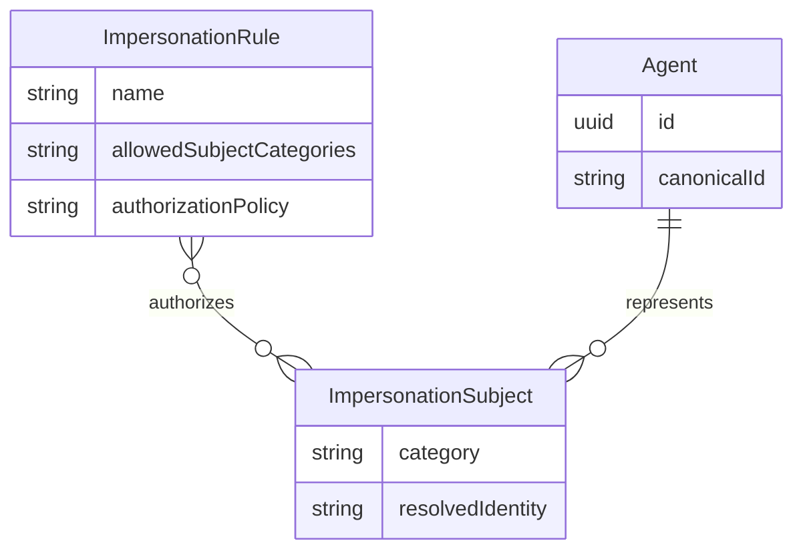
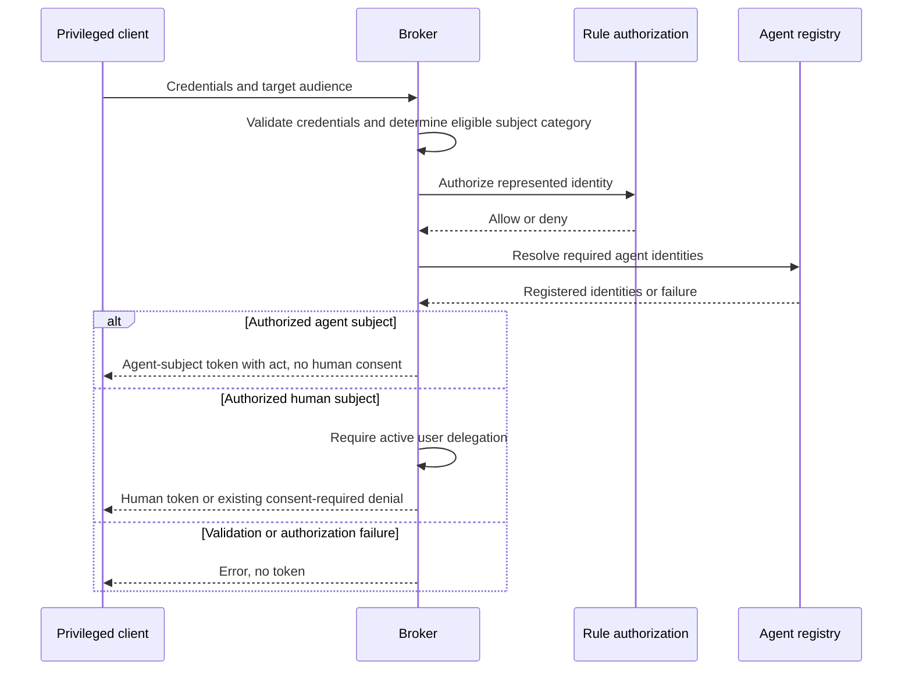

# Feature Specification: Agent-Subject Impersonation

**Feature Branch**: `speckit/issue-222`

**Created**: 2026-10-26

**Status**: Draft — needs clarification; not approved for implementation

**Input**: User description:

> feat: impersonation should support agent as subject
>
> # Description
>
> The impersonation feature allows privileged clients to obtain a token through the broker in exchange for another proof. This is currently targeted at humans and requires consent.
>
> Another class of problems is supporting agent on-behalf-of itself where a privileged client with an external machine identity should get a token that has subject = agent_id .
>
> # Requirements
> * The current ruleset for impersonation should be extended to explicitly allow to obtain an subject = agent-id token
> * On a ruleset configure if humans, agents or both are allowed.
> * The current "act" claim should still be contained in the minted token
> * No consent should be required
> * CEL can validate if the agent-id can be impersonated, deeper authz can be handled by the privileged client or the reverse proxy in front of the broker
>
> # Assumptions
> * We can accept for now that this token cannot be exchanged for a third-party service token. It is future work to determine the service identity in third-parties.

## User Scenarios & Testing *(mandatory)*

Acceptance identifiers below are stable references for subsequent 1:1 E2E coverage. This phase defines scenarios only; it does not implement tests or authorize contract changes. Scenarios that depend on Q1 or Q2 remain provisional until clarification.

### User Story 1 - Obtain a token for an agent acting for itself (Priority: P1)

A privileged client with an external machine identity obtains a broker token representing an agent rather than a human, without sending anyone through consent. The resulting token names the agent as its subject and retains the acting party's identity.

**Why this priority**: Enables unattended agent workloads without manufacturing a human identity or delegation.

**Independent Test**: Configure one agent-permitting rule and a registered agent, then complete an authorized exchange with no user grants or sessions. Inspect the issued identity and actor attribution.

**Acceptance Scenarios**:

1. **US1.1** — **Given** a registered agent, valid signed credentials, an agent-permitting rule, a policy authorizing that subject, and no human grants or sessions, **When** the privileged client requests a token for that agent acting for itself, **Then** issuance succeeds with `sub` equal to the agent's broker UUID, without a consent interaction or creation of a user grant.
2. **US1.2** — **Given** the same authorized request with distinct privileged-client and actor identities, **When** a token is issued, **Then** `act.sub` is the extracted actor identity and `act.iss` is the verified actor issuer, not an inferred human identity or an overwritten privileged-client identity.
3. **US1.3** — **Given** an otherwise eligible agent request with an invalid signature on the client assertion or actor credential, **When** exchange is attempted, **Then** no token is issued and no consent-free fallback weakens credential validation.

---

### User Story 2 - Control subject eligibility without weakening human consent (Priority: P1)

An operator permits humans, agents, or both on each impersonation rule. Existing human-only deployments retain their current behavior unless an operator explicitly enables agent subjects.

**Why this priority**: Consent-free machine issuance must not become a way to relabel a human and evade delegation.

**Independent Test**: Exercise each subject category against human-only, agent-only, and dual-category rules, then repeat an existing human request without changing its configuration.

**Acceptance Scenarios**:

1. **US2.1** — **Given** a human-only rule and an otherwise valid agent-subject request, **When** no other eligible rule authorizes it, **Then** no token is issued; an agent-only rule likewise cannot authorize a human-subject request.
2. **US2.2** — **Given** a rule allowing both categories and an authorized agent request, **When** the request is processed, **Then** it succeeds without human consent; **Given** a separate authorized human request with an active delegation, **When** it is processed under that rule, **Then** the existing human issuance behavior succeeds.
3. **US2.3** — **Given** a human request without an active delegation and a rule allowing both categories, **When** exchange is attempted, **Then** it receives the existing consent-required denial and cannot automatically retry as an agent; the same protection applies if the human subject string happens to look like an agent UUID.
4. **US2.4** — **Given** existing impersonation configuration that omits the new subject-category setting, **When** existing human requests are processed, **Then** human-only behavior, including missing/expired-delegation denials and consent links, is unchanged and agent subjects have not been implicitly enabled.
5. **US2.5** — **Given** a configured category setting with an empty selection or unknown category, **When** configuration is validated, **Then** the broker rejects it before accepting traffic rather than widening eligibility.

---

### User Story 3 - Authorize machine identity and keep third-party exchange out of scope (Priority: P2)

An operator restricts which agent subjects a privileged client may represent through the existing rule policy. The caller or its reverse proxy may apply deeper authorization, but broker-side identity and policy checks remain mandatory. Agent-subject issuance does not imply access to any human's third-party session.

**Why this priority**: Bounds the feature to broker identity issuance and prevents accidental access to third-party credentials.

**Independent Test**: Allow one agent subject and deny another, try an unresolved subject, then attempt a third-party exchange with a successfully issued agent token.

**Acceptance Scenarios**:

1. **US3.1** — **Given** valid credentials for an agent subject outside the rule's CEL authorization, and no other eligible authorizing rule, **When** exchange is attempted, **Then** no token is issued even if an upstream proxy allowed the request.
2. **US3.2** — **Given** a request whose agent subject is empty, invalid, or does not resolve to an existing agent, **When** exchange is attempted, **Then** no token is minted for an arbitrary principal string. Exact resolution rules depend on Q2.
3. **US3.3** — **Given** an agent-subject request whose authorization cannot be evaluated successfully, **When** exchange is attempted, **Then** no token is issued and the failure is not converted into consent bypass or human issuance.
4. **US3.4** — **Given** a valid broker-issued agent-subject token and no human delegation or third-party session for that subject, **When** a privileged client attempts to exchange it for a third-party service token, **Then** the broker returns no third-party token and does not infer or use a human's service identity.

### Edge Cases

- A human principal and a registered agent have identical text identifiers: string shape or equality alone must not select the consent-free path.
- A dual-category rule must distinguish categories before applying their different delegation requirements; category ambiguity must not grant access.
- No eligible rule authorizes the selected category: issue no token, preserving ordered rule evaluation rather than broadening a rule's category set.
- A first-authorized human request fails delegation: preserve the existing terminal denial rather than falling through to an agent-capable rule.
- Agent lookup or policy evaluation fails: fail closed; do not treat an unavailable dependency as an absent consent requirement.
- Agent subject differs from the audience-selected target: Q2 determines whether this is valid; do not silently implement cross-agent representation.
- Actor and subject identities happen to be equal: retain `act` and its validated issuer rather than omitting attribution.
- Unsigned subject credentials remain limited to the existing human profile; this draft does not extend ADR 031 to agent subjects.
- Proxy and hybrid deployments retain their current rejection of impersonation. Enabling agent subjects does not enable other modes.
- Existing scope restrictions, routing audience semantics, token lifetime, and policy-owned output audience remain applicable.

## Concrete Example Journeys *(mandatory)*

All identities, timestamps, credential markers, and key identifiers below are synthetic. These journeys describe intended behavior, not a confirmed API extension. Existing HTTP fields and configuration keys come from `api/enduser/openapi.yaml` and `examples/config/impersonation.yaml`. The new category setting and any category-selection input must be made concrete after Q1; no invented key is presented as supported configuration.

### Journey 1 — A gateway obtains a token for an agent acting for itself (User Story 1, Scenarios US1.1–US1.3)

**Cast**: Broker `https://broker.example.com`; registered agent `research-agent`, UUID `550e8400-e29b-41d4-a716-446655440000`; privileged client `gateway-prod`; actor `research-runner`; external issuer `https://idp.example.com`. Time starts at `2026-10-26T09:00:00Z`. No human grants or sessions exist. The subject and target are the same agent, which is valid under either proposed Q2 answer.

**Step 1 — Operator establishes local issuance and trusted credentials**

This is a configuration excerpt, not a complete bootable configuration. Existing required signing-key and deployment settings are supplied by the deployment. The complete existing rule below still has human-only semantics today; the operator must additionally enable agent subjects using the new setting whose contract awaits Q1. The example is not an instruction to bypass the current delegation check.

```yaml
oauth2_authorization_server:
  mode: local # Impersonation remains local-only.
  local:
    issuer_uri: https://broker.example.com
    token_ttl: 1h # Issued token expires one hour after issuance.
    token_claims_expression: '{"aud": "https://policy.example.com"}' # Output audience is policy-owned.
  impersonation:
    audience_prefix: https://broker.example.com/impersonation # Routes to a registered target, not output aud.
    rules:
      - name: research-machine
        roles:
          client_assertion:
            expected_audience: https://broker.example.com/impersonation
            principal_expression: client_assertion.sub
          actor:
            expected_audience: https://broker.example.com/impersonation
            principal_expression: actor_token.sub
          subject:
            verification: jwks # This draft keeps machine subjects signed.
            expected_audience: https://broker.example.com/impersonation
            principal_expression: subject_token.sub
        trusted_issuers:
          - issuer_uri: https://idp.example.com
            jwks_uri: https://idp.example.com/jwks.json
            allowed_algorithms: [ES256]
            signs_roles: [client_assertion, actor, subject]
        authorization:
          type: cel
          cel:
            expression: >-
              client_assertion.sub == 'gateway-prod' &&
              actor_token.sub == 'research-runner' &&
              subject_token.sub == '550e8400-e29b-41d4-a716-446655440000' &&
              request.agent_id == '550e8400-e29b-41d4-a716-446655440000'
            evaluation_timeout: 100ms
```

Effect after explicit agent enablement: only the named gateway, actor, subject, and routing target combination is authorized by this rule. This predicate is not itself the unresolved subject-category selector.

**Step 2 — 09:00:00: Gateway presents three signed credentials**

The symbolic values `SYNTHETIC_CLIENT_JWS`, `SYNTHETIC_ACTOR_JWS`, and `SYNTHETIC_AGENT_JWS` stand for distinct externally signed ES256 JWTs, not literal valid credentials. Each has issuer `https://idp.example.com`, audience `https://broker.example.com/impersonation`, `iat: 1793005200`, and `exp: 1793005500`. Their respective subjects are `gateway-prod`, `research-runner`, and `550e8400-e29b-41d4-a716-446655440000`. Their signatures and these claims are verified before authorization.

The following uses the existing request shape. It is provisional: Q1 may require an additional explicit category input, which must be documented and confirmed before implementation. Line breaks in the form body are for display only.

```http
POST /oauth2/token HTTP/1.1
Host: broker.example.com
Content-Type: application/x-www-form-urlencoded
Accept: application/json

grant_type=urn:ietf:params:oauth:grant-type:token-exchange
&audience=https%3A%2F%2Fbroker.example.com%2Fimpersonation%2Fresearch-agent
&client_assertion_type=urn:ietf:params:oauth:client-assertion-type:jwt-bearer
&client_assertion=SYNTHETIC_CLIENT_JWS
&actor_token_type=urn:ietf:params:oauth:token-type:jwt
&actor_token=SYNTHETIC_ACTOR_JWS
&subject_token_type=urn:ietf:params:oauth:token-type:jwt
&subject_token=SYNTHETIC_AGENT_JWS

HTTP/1.1 200 OK
Content-Type: application/json
Cache-Control: no-store
Pragma: no-cache

{
  "access_token": "SYNTHETIC_BROKER_AGENT_JWS",
  "issued_token_type": "urn:ietf:params:oauth:token-type:access_token",
  "token_type": "Bearer",
  "expires_in": 3600
}
```

**Step 3 — Gateway observes the minted identity and attribution**

Decoded `SYNTHETIC_BROKER_AGENT_JWS`:

```json
{
  "header": { "alg": "ES256", "kid": "synthetic-broker-key" },
  "payload": {
    "iss": "https://broker.example.com",
    "sub": "550e8400-e29b-41d4-a716-446655440000",
    "agent_id": "550e8400-e29b-41d4-a716-446655440000",
    "aud": "https://policy.example.com",
    "iat": 1793005200,
    "exp": 1793008800,
    "scope": "",
    "act": {
      "iss": "https://idp.example.com",
      "sub": "research-runner"
    }
  }
}
```

The displayed claims are the authorization-relevant excerpt, not a ban on normal local claims such as `jti`. The output expires at `10:00:00Z`; it is not a token for a human. The routing alias resolves to the UUID; it does not become `sub` or `aud`.

**Observable result**: The gateway receives one attributable agent token in one exchange, with zero consent redirects, zero human sessions, and no user grant created. Invalid client or actor signatures instead produce the existing credential-validation error and no token (US1.3).

### Journey 2 — Operator preserves human consent while enabling agents (User Story 2, Scenarios US2.1–US2.5)

**Cast**: Same broker, issuer, gateway, actor, and target as Journey 1; human principal `alice@example.com`. At `09:05:00Z`, Alice has no active delegation. Signed human subject marker `SYNTHETIC_HUMAN_JWS` has issuer `https://idp.example.com`, audience `https://broker.example.com/impersonation`, subject `alice@example.com`, and a valid signature and lifetime.

**Step 1 — Operator considers the eligibility matrix**

| Rule selection | Human request | Agent request |
| --- | --- | --- |
| Setting omitted or humans only | Requires active user delegation | Ineligible |
| Agents only | Ineligible | No human delegation required |
| Both | Requires active user delegation | No human delegation required |

The setting's exact key and values await Q1. No configuration with an empty or unknown selection may start successfully. The rule's existing CEL predicate must separately authorize Alice for this journey; Journey 1's machine-only predicate would deny her earlier.

**Step 2 — 09:05:00: Human request without delegation is denied**

The gateway submits Journey 1's existing form fields and audience with `subject_token=SYNTHETIC_HUMAN_JWS` and fresh valid client and actor credentials. The resolved category is human, even on a dual-category rule. The request is otherwise authorized.

```http
POST /oauth2/token HTTP/1.1
Host: broker.example.com
Content-Type: application/x-www-form-urlencoded
Accept: application/json

grant_type=urn:ietf:params:oauth:grant-type:token-exchange
&audience=https%3A%2F%2Fbroker.example.com%2Fimpersonation%2Fresearch-agent
&client_assertion_type=urn:ietf:params:oauth:client-assertion-type:jwt-bearer
&client_assertion=SYNTHETIC_FRESH_CLIENT_JWS
&actor_token_type=urn:ietf:params:oauth:token-type:jwt
&actor_token=SYNTHETIC_FRESH_ACTOR_JWS
&subject_token_type=urn:ietf:params:oauth:token-type:jwt
&subject_token=SYNTHETIC_HUMAN_JWS

HTTP/1.1 403 Forbidden
Content-Type: application/json

{
  "error": "access_denied",
  "error_description": "user delegation is required before impersonation",
  "error_uri": "https://broker.example.com/agents/550e8400-e29b-41d4-a716-446655440000"
}
```

The response uses the existing contract; error descriptions are illustrative, not new stable identifiers. Expired delegation has the same external outcome. This feature introduces no new consent UI.

**Step 3 — Operator compares outcomes**

An otherwise authorized agent request on the dual-category rule follows Journey 1 with no consent requirement. A human request succeeds only after Alice has an active delegation through the existing process, yielding `sub: alice@example.com`, the target UUID as `agent_id`, and the same verified actor attribution. Existing rules with the setting omitted do not acquire machine access. A human-only or agent-only rule excludes the other category; exclusion is not a relabeling operation.

**Observable result**: An operator can enable agent issuance without removing any human consent boundary. Exact category-selection inputs in both HTTP journeys remain subject to Q1.

### Journey 3 — Deny unauthorized representation and third-party credential access (User Story 3, Scenarios US3.1–US3.4)

**Cast**: Same deployment and identities as Journey 1. A second registered agent, `billing-agent`, has UUID `660e8400-e29b-41d4-a716-446655440001`. No rule authorizes the gateway to represent it. Service resource `https://api.thirdparty.example.com` exists; no human delegation or service session exists for the research agent.

**Step 1 — 09:10:00: Gateway attempts an unauthorized agent identity**

Using Journey 1's form shape, the gateway requests audience `https://broker.example.com/impersonation/billing-agent` with a valid signed subject for the billing UUID and fresh valid client and actor credentials. The machine rule's explicit subject and target constraints evaluate false. With no other eligible authorizing rule, the existing denial envelope is:

```http
HTTP/1.1 403 Forbidden
Content-Type: application/json

{"error":"access_denied","error_description":"impersonation not permitted"}
```

No token or consent link is returned. An unresolved agent identity or a policy evaluation failure also issues no token; exact category/resolution error mapping must be confirmed in the API design, not invented here.

**Step 2 — 09:11:00: Gateway tries a service exchange using the legitimate research-agent token**

The gateway submits the separate, existing third-party exchange request, not the impersonation routing audience. `SYNTHETIC_SERVICE_CLIENT_JWS` is a fresh externally signed assertion valid for that exchange's configured client-assertion trust anchor, and its existing authorization policy permits this gateway. The fixture explicitly extracts the broker token's subject and agent UUID with existing settings:

```yaml
token_exchange:
  claim_extraction:
    principal_expression: subject_token.sub # Resolves to the research-agent UUID, not Alice.
    agent_id_expression: subject_token.agent_id # Resolves the existing target registration.
```

These settings ensure the example reaches the existing grant check rather than failing an unrelated claim mapping.

```http
POST /oauth2/token HTTP/1.1
Host: broker.example.com
Content-Type: application/x-www-form-urlencoded
Accept: application/json

grant_type=urn:ietf:params:oauth:grant-type:token-exchange
&resource=https%3A%2F%2Fapi.thirdparty.example.com
&subject_token_type=urn:ietf:params:oauth:token-type:access_token
&subject_token=SYNTHETIC_BROKER_AGENT_JWS
&client_assertion_type=urn:ietf:params:oauth:client-assertion-type:jwt-bearer
&client_assertion=SYNTHETIC_SERVICE_CLIENT_JWS

HTTP/1.1 403 Forbidden
Content-Type: application/json

{
  "error": "access_denied",
  "error_description": "user has not granted permission for this agent to access the requested service",
  "error_uri": "https://broker.example.com/agents/550e8400-e29b-41d4-a716-446655440000"
}
```

This denial illustrates the existing no-delegation contract for the stated fixture, not a new universal error mapping for all third-party failures. Its existing consent link does not establish an agent's service identity or authorize manufacturing a human delegation. No third-party access token is returned, and the broker does not substitute Alice's identity or use her session.

**Observable result**: Valid external machine authentication does not authorize every agent, and successful broker agent issuance does not provide a third-party service identity.

## Requirements *(mandatory)*

### Functional Requirements

- **FR-001**: The existing impersonation capability MUST allow an explicitly enabled agent subject to obtain a locally issued broker token through a privileged client authenticated with external machine identity.
- **FR-002**: Each rule MUST permit humans only, agents only, or both. Omission MUST preserve human-only behavior; empty or unknown category selections MUST fail startup validation.
- **FR-003**: The broker MUST unambiguously determine the requested subject category, enforce rule eligibility, and prevent a human request from becoming consent-free merely through identifier shape, missing delegation, or rule fallback. [NEEDS CLARIFICATION: Q1 — How is the subject category selected and bound to the authorized identity, especially for a rule permitting both: an explicit request input, a trusted subject claim interpreted by configured policy, or another mechanism? The exact configuration and request contract are not yet agreed.]
- **FR-004**: The issued agent token's `sub` MUST be the resolved subject agent's broker UUID, not its display name, external machine principal, or routing alias. It MUST represent an existing registered agent. [NEEDS CLARIFICATION: Q2 — Is this feature restricted to an agent acting for itself, with subject UUID equal to the audience-selected target's issued agent_id, or may a different registered agent be the subject? Which subject identifiers are accepted and how are they resolved to that UUID?]
- **FR-005**: Authorized agent-subject issuance MUST NOT require a human consent interaction, `UserGrant`, or human `UserSession`, and MUST NOT create synthetic human grants or sessions.
- **FR-006**: Human-subject issuance MUST retain its active-delegation requirement, existing missing/expired-denial response and consent URL, and terminal denial on delegation failure, including on rules that permit both categories.
- **FR-007**: Every issued agent-subject token MUST retain the existing `act` object: its subject is the extracted actor identity and its issuer is the verified actor-token issuer. Equality between actor and subject MUST NOT remove attribution.
- **FR-008**: The rule's CEL policy MUST be able to authorize the agent identity being represented using credential identity and target context. A policy denial, error, timeout, failed extraction, or unresolved identity MUST NOT yield a token. Upstream authorization MUST NOT replace broker-side validation and rule authorization.
- **FR-009**: Existing ordered rule evaluation MUST remain applicable, restricted by category eligibility. Failure of a human delegation check MUST NOT be retried as agent issuance.
- **FR-010**: Existing local issuer, signing, token lifetime, target-derived `agent_id`, scope restrictions, and policy-owned output `aud` semantics MUST remain applicable. Proxy/hybrid support, new grant types, and new credential roles are outside scope.
- **FR-011**: Agent-subject tokens MUST NOT enable third-party service-token exchange in this feature. No human identity, delegation, or service session may be inferred from an agent UUID. Determining agent identities in third parties is deferred.
- **FR-012**: Operator documentation MUST explain category eligibility, safe defaults, signed machine identity, actor attribution, CEL restrictions, unchanged human consent, and the third-party limitation, with concrete examples after clarification.

### Domain Model



The Agent relationship applies only to agent-category subjects; human subjects retain their existing principal/delegation relationship. Cardinality and membership do not authorize cross-agent representation; Q2 remains open.



This diagram expresses business boundaries, not an implementation sequence mandate for lookup ordering.

**Entities / Key Entities**:
- **Agent**: Existing registered machine identity with a broker UUID and optional canonical routing identifier; distinct from privileged client and actor.
- **Impersonation Rule**: Existing ordered authorization unit, extended with allowed subject categories; category permission alone does not authorize a particular identity.
- **UserGrant**: Existing human delegation; remains required only for the human flow once the agent extension has been approved under superseding governance.

**Aggregates**: Reuse existing Agent registration and human delegation consistency boundaries. No new persisted aggregate is required by these requirements.

**Value Objects**:
- **Subject Category**: Human or agent, independent of identifier text and subject-credential verification mode.
- **Resolved Impersonation Subject**: Authorized category and resolved identity; an agent identity is a registered broker UUID.
- **Actor Attribution**: Existing verified issuer and extracted actor identity emitted in `act`.

**Domain Events**: Reuse the existing credential-free impersonation decision event for successful issuance and denial; distinguish subject category and resolved subject from target and actor. No new durable event stream is required.

These proposed terms must be reconciled with the architecture glossary during later approved design; this specify-only change does not edit it.

### Configuration Requirements

- **CFG-001**: Extend `oauth2_authorization_server.impersonation.rules[]` with category eligibility. The exact key and representation await Q1; do not present a provisional key as an existing runtime option.
- **CFG-002**: Preserve existing rule configuration, trusted issuer roles, CEL policy, and validation. Missing category configuration means humans only, not both.
- **CFG-003**: Document the confirmed setting and complete human-only, agent-only, and dual-category examples in `docs/configuration.md` and `examples/config/`, and update the broker Helm deployment contract before implementation is complete.
- **CFG-004**: The existing-key configuration in Journey 1 is the baseline. Its missing new category selection is an explicit draft gap, not a complete enablement example.

### API Requirements

- **API-001**: Extend the existing local impersonation behavior of `POST /oauth2/token`; preserve its established credential roles, routing target, success envelope, and actor attribution. Do not change an approved API contract in this phase.
- **API-002**: Resolve Q1 and Q2, document all proposed category inputs, identity semantics, validation errors, and examples in `api/enduser/openapi.yaml`, and obtain explicit stakeholder confirmation before implementation. The journeys are draft review aids, not that confirmation.
- **API-003**: Preserve established human responses. New agent-category or resolution errors must have a confirmed mapping in the API design rather than relying on prose error descriptions as stable identifiers.
- **API-004**: No new administrative endpoint, consent endpoint, frontend flow, or third-party identity API is requested.

### Security Requirements *(mandatory for security-critical features)*

- **SR-001**: Agent support MUST be explicitly enabled per rule; existing human flows MUST fail closed on delegation failures and MUST NOT be silently reclassified.
- **SR-002**: Client assertions and actor credentials MUST remain signature-verified, with existing issuer, algorithm, audience, expiry, and not-before controls. Machine subject credentials in this draft are signed and retain those controls as well.
- **SR-003**: This feature MUST NOT widen the ADR 031 unsigned-subject exception. Existing human unsigned-subject rules retain all of that ADR's compensating controls, including subject binding and email restrictions.
- **SR-004**: Every decision MUST emit a credential-free structured audit event that allows subject category, represented identity, actor, privileged client, selected rule, target, and outcome to be distinguished. Never log credentials or wholesale claims.
- **SR-005**: Agent-subject requests MUST NOT obtain a human's third-party credentials through identifier collision, fallback, or manufactured delegation.
- **SR-006**: Credential verification and token signing MUST continue to use vetted security libraries; subject-category policy is not a substitute for signature validation.

### Binding Design Dependencies

- Accepted [ADR 032](../../adrs/032-impersonation-requires-user-delegation.md) currently mandates delegation for **all** impersonation subjects, signed and unsigned, with no opt-out. FR-005 describes a requested extension that cannot be implemented under that decision unchanged. An explicitly accepted superseding ADR must narrowly distinguish agent-subject issuance from human delegation before implementation; no acceptance is asserted here.
- Accepted [ADR 031](../../adrs/031-unverified-subject-unsigned-jwt.md) and [ADR 034](../../adrs/034-audience-absent-impersonation-credentials.md) remain unchanged. This draft neither broadens unsigned credentials nor relaxes signed-role audience guards.
- [ADR 009](../../adrs/009-cel-for-authorization-policies.md), [ADR 014](../../adrs/014-oauth2-server-mode.md), and [ARCHITECTURE.md](../../ARCHITECTURE.md#31y-user-impersonation-domain-feature-037) provide existing policy, local issuance, and domain boundaries. Architecture and glossary updates belong to subsequent approved design, not this artifact-only PR.
- Constitutional API confirmation and E2E traceability remain prerequisites: each numbered acceptance scenario must map to one complete E2E test, written and demonstrated failing semantically before implementation. No test or implementation work occurs in this session.

## Success Criteria *(mandatory)*

### Measurable Outcomes

- **SC-001**: In every authorized self-agent acceptance case, a privileged client obtains one attributable agent identity in a single exchange, with zero human logins, consent interactions, grants, or sessions required or created.
- **SC-002**: Every tested issuance identifies the represented agent by its broker UUID and preserves the verified actor issuer and extracted actor identity, including when actor and subject text are equal.
- **SC-003**: All six human/agent eligibility combinations across human-only, agent-only, and dual-category rules behave according to Journey 2's matrix; no tested ineligible category obtains a token.
- **SC-004**: Every existing human consent-required case remains denied without an active delegation after this feature is enabled, including dual-category and UUID-shaped human identity cases.
- **SC-005**: Every tested unauthorized, unresolved, invalid-credential, and policy-failure case issues zero tokens; every tested third-party attempt in the defined agent-only fixture returns zero service tokens and uses zero human sessions.
- **SC-006**: An operator can review documented examples for all three rule selections and predict the correct human-consent and agent-issuance outcome for each, without changing an existing human-only rule. Verification awaits the confirmed configuration examples after Q1.

## Assumptions

- “No consent” applies to agent-category subjects only. Human consent is not removed.
- The primary use case is an agent acting for itself. Broader cross-agent representation and identifier input forms are not silently assumed; Q2 must settle them.
- Machine subject credentials are signed in this draft. Supporting unsigned machine subjects would be a separate security/governance decision, not an inference from existing human support.
- Existing Agent registration, ordered rules, local token issuance, and operator-managed external issuer trust are reused. No new database schema, frontend screens, or third-party identity provisioning is required by the stated scope.
- The caller or reverse proxy may apply deeper authorization, but the broker still validates credentials, category eligibility, registered identity, and its CEL policy.
- The issue title and body are the sole feature-request input. Existing source, contracts, ADRs, and constitution constrain the draft; issue comments and unrecorded stakeholder decisions are not inputs.
