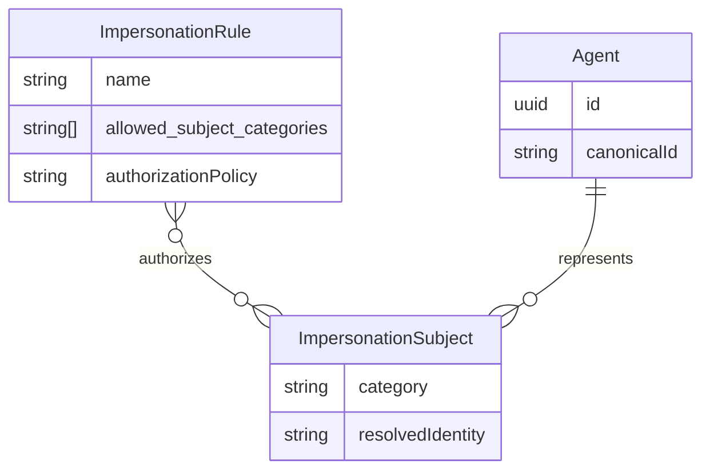
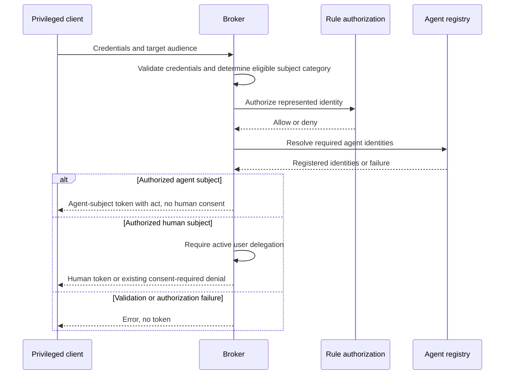

# Feature Specification: Agent-Subject Impersonation

**Feature Branch**: `speckit/issue-222`

**Created**: 2026-10-26

**Status**: Draft — product clarifications complete; design and governance approval required before implementation

**Input**: User description:

> feat: impersonation should support agent as subject
>
> # Description
>
> The impersonation feature allows privileged clients to obtain a token through the broker in exchange for another proof. This is currently targeted at humans and requires consent.
>
> Another class of problems is supporting agent on-behalf-of itself where a privileged client with an external machine identity should get a token that has subject = agent_id .
>
> # Requirements
> * The current ruleset for impersonation should be extended to explicitly allow to obtain an subject = agent-id token
> * On a ruleset configure if humans, agents or both are allowed.
> * The current "act" claim should still be contained in the minted token
> * No consent should be required
> * CEL can validate if the agent-id can be impersonated, deeper authz can be handled by the privileged client or the reverse proxy in front of the broker
>
> # Assumptions
> * We can accept for now that this token cannot be exchanged for a third-party service token. It is future work to determine the service identity in third-parties.

## Clarifications

### Session 2026-10-26

- Q: How should the broker distinguish human subjects from agent subjects, especially when one rule permits both? → A: During token exchange, allow skipping consent if the audience-provided agent ID matches the subject claim `sub` exactly. This applies only with explicit agent eligibility and successful credential validation and rule authorization; no separate category claim or request parameter is required.
- Q: Must the subject identify the same agent as the audience-selected target, and which subject identifiers should be accepted? → A: Self-agent only, with the subject identifying the target's exact broker UUID (Q2 option A). The signed `sub` must equal the UUID of the registered audience-selected target; display names, routing aliases, alternate UUID spellings, and different agents do not qualify for agent issuance.
- Q: Must every agent-subject token be rejected for third-party service exchange even when its UUID text matches a human principal with an active grant and service session? → A: Yes, categorical rejection (Q3 option A). Existing human grants and sessions must not make an agent-subject token exchangeable. The 2026-10-28 clarification below refines this guarantee for the subsequently accepted C4 detector replacement semantics.

The identity and exchange answers above came from authorized comment `6418744033`, recorded by the preceding clarification session. Q1's custom answer replaces the earlier proposal that equality could never select agent issuance. The human-only compatibility decision (Q4) is resolved in the following session: exact signed equality is ineligible even with active human delegation.

### Session 2026-10-27

- Q: Must the new configuration attributes and their shapes be included in this specification so the journeys can be understood in detail? → A: Yes. Authorized maintainer comment `6438216582` requires concrete configuration attributes and shapes in this spec rather than deferring them to design.

- Q: On a human-only rule, including an omitted category setting, should a valid signed `sub` exactly equal to the target agent UUID retain legacy human handling with mandatory active delegation or be rejected even with active human delegation? → A: Reject it as an ineligible agent request even with active human delegation (Q4 option B), as answered in authorized maintainer comment `6439904155`.
- Q: Should the per-rule category setting use the `allowed_subject_categories` string list, `human`/`agent` enum, human-only omission default, and fail-closed validation in CFG-001? → A: Yes (Q5 option A), as answered in authorized maintainer comment `6439904155`; the key, list serialization, default, and validation contract in CFG-001 are confirmed.

These answers settle specification behavior and configuration, not an existing runtime capability, ADR acceptance, or approval of the full OpenAPI contract. Q4 intentionally tightens legacy handling for the exact signed subject/target-UUID collision; nonmatching human subjects retain their existing delegation flow.

### Session 2026-10-28

- Q: How should FR-011 and SR-005 be aligned with the accepted C4 detector replacement semantics? → A: Authorized maintainer command `6480240156` requests alignment with C4, already accepted in comment `6477637352`. With the default `token_exchange.claim_extraction.agent_subject_expression`, every broker-issued agent-subject token is categorically rejected before human-state access. A configured expression replaces the default entirely, with no additional built-in check. Operators are responsible for keeping overrides matching broker agent-subject tokens; a non-matching override such as `false` lets them continue through existing exchange checks and removes that guarantee. Documentation and acceptance coverage must distinguish the default, a compliant override, and a non-matching override. This refines Q3's unconditional wording without approving a new API contract or accepting an ADR in this session.

### Remediation of analysis `40859455167/1`

- Q: How are the intentionally incompatible collision denials versioned? → A: **Approved (A10)**: treat the affected End-User API 1.0.0 as released for compatibility purposes because no evidence establishes that its token-exchange contract is unreleased. Bump the End-User OpenAPI contract to 2.0.0 on the existing `POST /oauth2/token`, independently of the broker release version, before shipping the changed behavior. Publish migration guidance covering signed exact-target collisions and equal-claim third-party tokens; document the strategy in `ARCHITECTURE.md`. This satisfies Constitution IV/X without weakening the requested fail-closed behavior. Main alternative: a new versioned endpoint with parallel old semantics, which adds routing and security-policy complexity. API-005 records the new delivery requirement; the authoritative proposal is `contracts/enduser-api-versioning.md`. Approved through PR #293 comment `6495558326`.
- Q: Does nil agent email prohibit all policy-produced `email` claims? → A: No. Clarify FR-010 without changing the existing custom-claims contract: skip agent `email_expression` extraction and pass `Email=nil`, so no credential-derived email is supplied. Existing token-claims CEL still exposes `principal.email` as `""` and may emit `email` as a policy-owned custom claim. Without a policy emitting it, the minted token has no `email`. Main alternative: suppress every output `email`, which would add an unrequested token-claim contract change. Journey 1's email-free example is the no-email-policy case.

## User Scenarios & Testing *(mandatory)*

Acceptance identifiers below are stable references for subsequent 1:1 E2E coverage. This phase defines scenarios only; it does not implement tests or authorize contract changes. Human-only exact signed equality is ineligible, including with active human delegation. The concrete configuration contract and validation fixtures are confirmed by Q5.

### User Story 1 - Obtain a token for an agent acting for itself (Priority: P1)

A privileged client with an external machine identity obtains a broker token representing an agent rather than a human, without sending anyone through consent. The resulting token names the agent as its subject and retains the acting party's identity.

**Why this priority**: Enables unattended agent workloads without manufacturing a human identity or delegation.

**Independent Test**: Configure one agent-permitting rule and a registered agent, then complete an authorized exchange with no user grants or sessions. Inspect the issued identity and actor attribution.

**Acceptance Scenarios**:

1. **US1.1** — **Given** a registered agent, valid signed credentials whose subject `sub` exactly equals the audience-selected target's broker UUID, an agent-permitting rule, a policy authorizing that subject, and no human grants or sessions, **When** the privileged client requests a token for that agent acting for itself, **Then** issuance succeeds with `sub == agent_id` equal to that UUID, without a consent interaction or creation of a user grant.
2. **US1.2** — **Given** the same authorized request with distinct privileged-client and actor identities, **When** a token is issued, **Then** `act.sub` is the extracted actor identity and `act.iss` is the verified actor issuer, not an inferred human identity or an overwritten privileged-client identity.
3. **US1.3** — **Given** an otherwise eligible agent request with an invalid signature on the client assertion or actor credential, **When** exchange is attempted, **Then** no token is issued and no consent-free fallback weakens credential validation.

---

### User Story 2 - Control subject eligibility without weakening human consent (Priority: P1)

An operator permits humans, agents, or both on each impersonation rule. Existing human-only deployments never gain consent-free issuance implicitly. Nonmatching human subjects retain their current behavior; exact signed equality on human-only rules is ineligible even with active human delegation.

**Why this priority**: Consent-free machine issuance must not become a way to relabel a human and evade delegation.

**Independent Test**: Exercise each subject category against human-only, agent-only, and dual-category rules, then repeat an existing human request without changing its configuration.

**Acceptance Scenarios**:

1. **US2.1** — **Given** an agent-only rule and a signed subject `sub` that does not exactly equal the audience-selected target UUID, **When** no other eligible rule authorizes it, **Then** no token is issued. A valid signed exact-equality request on a human-only rule (explicit or omitted setting) is ineligible even when an identically named human has active delegation; with no other eligible authorizing rule, no token is issued.
2. **US2.2** — **Given** a rule allowing both categories and an authorized agent request, **When** the request is processed, **Then** it succeeds without human consent; **Given** a separate authorized human request with an active delegation, **When** it is processed under that rule, **Then** the existing human issuance behavior succeeds.
3. **US2.3** — **Given** a human request whose `sub` does not exactly equal the target UUID, without an active delegation and with a rule allowing both categories, **When** exchange is attempted, **Then** it receives the existing consent-required denial and cannot automatically retry as an agent; UUID shape alone, including a different agent's UUID or an alternate spelling, does not qualify for consent-free issuance.
4. **US2.4** — **Given** existing impersonation configuration that omits the new subject-category setting, **When** existing human requests whose `sub` does not exactly equal the target UUID are processed, **Then** human-only behavior, including missing/expired-delegation denials and consent links, is unchanged and consent-free agent issuance has not been implicitly enabled. Valid signed exact-equality requests under that configuration are ineligible and, with no other eligible authorizing rule, issue no token both without and with active human delegation.
5. **US2.5** — **Given** `allowed_subject_categories: []` or `allowed_subject_categories: [machine]` on a rule, **When** configuration is validated, **Then** the broker rejects it before accepting traffic rather than widening eligibility. The confirmed contract also rejects explicit null, scalar or mapping values, non-string entries, and duplicates; omission alone defaults to `[human]`.

---

### User Story 3 - Authorize machine identity and keep third-party exchange out of scope (Priority: P2)

An operator restricts which agent subjects a privileged client may represent through the existing rule policy. The caller or its reverse proxy may apply deeper authorization, but broker-side identity and policy checks remain mandatory. Agent-subject issuance does not imply access to any human's third-party session.

**Why this priority**: Bounds the feature to broker identity issuance and prevents accidental access to third-party credentials.

**Independent Test**: Allow one agent subject and deny another, try an unresolved subject, then attempt a third-party exchange with a successfully issued agent token under the default detector, a compliant replacing override, and a non-matching replacing override.

**Acceptance Scenarios**:

1. **US3.1** — **Given** valid credentials for an agent subject outside the rule's CEL authorization, and no other eligible authorizing rule, **When** exchange is attempted, **Then** no token is issued even if an upstream proxy allowed the request.
2. **US3.2** — **Given** an agent-only rule and a signed subject whose `sub` is empty, invalid, a routing alias, an alternate UUID spelling, or a different agent's UUID, or whose audience target does not resolve to an existing agent, **When** exchange is attempted, **Then** no token is minted. Only exact equality with the registered target's broker UUID qualifies; no alias resolution or cross-agent representation is permitted for the subject.
3. **US3.3** — **Given** an agent-subject request whose authorization cannot be evaluated successfully, **When** exchange is attempted, **Then** no token is issued and the failure is not converted into consent bypass or human issuance.
4. **US3.4** — **Given** a valid broker-issued agent-subject token and the default `agent_subject_expression`, **When** a privileged client attempts to exchange it for a third-party service token, **Then** the broker categorically rejects it before any human grant, session, or provider access, both without human state and when a human principal with identical UUID text has an active grant and valid service session. Repeat with a compliant replacing override that still matches broker agent-subject tokens: the same rejection holds. Repeat with a non-matching override such as `false`: the default is not additionally evaluated, the request continues through existing exchange checks, and categorical rejection and isolation from matching human state are no longer guaranteed. This last fixture verifies operator-owned replacement, not supported third-party agent identity or automatic exchange success. Detection errors, timeouts, and non-boolean results instead deny exchange without human-state access.

### Edge Cases

- On an agent-permitting rule, a validated signed subject `sub` exactly equal to the registered audience target UUID selects agent issuance, even if a human principal has identical text. Equality is necessary but not sufficient: explicit eligibility, credential verification, and CEL authorization remain mandatory. A human-only rule, including the omission default, rejects this signed exact-equality request as ineligible even if a human principal with the same UUID text has active delegation. It MUST NOT reclassify the request as human; another rule must independently satisfy category eligibility, credential validation, and authorization to issue a token.
- A dual-category rule treats exact signed `sub`/target-UUID equality as agent and nonmatching subjects as human; missing delegation never triggers reclassification. Unsigned subjects remain human-only under ADR 031.
- No eligible rule authorizes the selected category: issue no token, preserving ordered rule evaluation rather than broadening a rule's category set.
- A first-authorized human request fails delegation: preserve the existing terminal denial rather than falling through to an agent-capable rule.
- Agent lookup or policy evaluation fails: fail closed; do not treat an unavailable dependency as an absent consent requirement.
- A different registered agent's UUID, a display name, a canonical routing alias, or an alternate UUID spelling in `sub` does not qualify for agent issuance. On a dual-category rule, a nonmatching subject can succeed only through the existing human flow with active delegation and policy authorization.
- Actor and subject identities happen to be equal: retain `act` and its validated issuer rather than omitting attribution.
- Unsigned subject credentials remain limited to the existing human profile; this draft does not extend ADR 031 to agent subjects.
- Proxy and hybrid deployments retain their current rejection of impersonation. Enabling agent subjects does not enable other modes.
- Existing scope restrictions, routing audience semantics, token lifetime, and policy-owned output audience remain applicable.
- Third-party detection evaluates validated subject-token claims. With the default detector, equal `sub` and `agent_id` are rejected even for a human token or trusted external issuer token. Detection errors, timeouts, or non-boolean results fail closed without human-state access; they MUST NOT become a `false` result. A configured non-matching boolean expression is different: it replaces the default and allows the existing exchange flow to continue under operator responsibility.

## Concrete Example Journeys *(mandatory)*

All identities, timestamps, credential markers, and key identifiers below are synthetic. These journeys describe clarified intended behavior, not an approved OpenAPI change. Existing HTTP fields and configuration keys come from `api/enduser/openapi.yaml` and `examples/config/impersonation.yaml`. Category selection uses exact signed `sub`/target-UUID equality, not a new request input. The snippets include the confirmed new per-rule `allowed_subject_categories` contract so the intended configuration is reviewable now. That setting is not supported by the current runtime; the remaining keys are existing settings. No snippet authorizes implementation or overrides ADR 032.

### Journey 1 — A gateway obtains a token for an agent acting for itself (User Story 1, Scenarios US1.1–US1.3)

**Cast**: Broker `https://broker.example.com`; registered agent `research-agent`, UUID `550e8400-e29b-41d4-a716-446655440000`; privileged client `gateway-prod`; actor `research-runner`; external issuer `https://idp.example.com`. Time starts at `2026-10-26T09:00:00Z`. No human grants or sessions exist. The signed subject `sub` and resolved audience target UUID match exactly, as required by Q1 and Q2.

**Step 1 — Operator establishes local issuance and trusted credentials**

This is a configuration excerpt, not a complete bootable configuration. Existing required signing-key and deployment settings are supplied by the deployment. The complete rule below specifies explicit agent-only enablement with `allowed_subject_categories: [agent]`. It describes the intended future behavior after approval and implementation, not a configuration that the current broker supports or an instruction to bypass its mandatory delegation check.

```yaml
oauth2_authorization_server:
  mode: local # Impersonation remains local-only.
  local:
    issuer_uri: https://broker.example.com
    token_ttl: 1h # Issued token expires one hour after issuance.
    token_claims_expression: '{"aud": "https://policy.example.com"}' # Output audience is policy-owned.
  impersonation:
    audience_prefix: https://broker.example.com/impersonation # Routes to a registered target, not output aud.
    rules:
      - name: research-machine
        allowed_subject_categories: [agent] # Confirmed new setting; not yet implemented.
        roles:
          client_assertion:
            expected_audience: https://broker.example.com/impersonation
            principal_expression: client_assertion.sub
          actor:
            expected_audience: https://broker.example.com/impersonation
            principal_expression: actor_token.sub
          subject:
            verification: jwks # This draft keeps machine subjects signed.
            expected_audience: https://broker.example.com/impersonation
            principal_expression: subject_token.sub
        trusted_issuers:
          - issuer_uri: https://idp.example.com
            jwks_uri: https://idp.example.com/jwks.json
            allowed_algorithms: [ES256]
            signs_roles: [client_assertion, actor, subject]
        authorization:
          type: cel
          cel:
            expression: >-
              client_assertion.sub == 'gateway-prod' &&
              actor_token.sub == 'research-runner' &&
              subject_token.sub == '550e8400-e29b-41d4-a716-446655440000' &&
              request.agent_id == '550e8400-e29b-41d4-a716-446655440000'
            evaluation_timeout: 100ms
```

Effect with the confirmed `[agent]` setting after design approval and implementation: only the named gateway, actor, subject, and routing target combination is authorized by this rule. The broker separately compares the verified signed `sub` with the registered target UUID exactly; CEL authorization does not replace this binding.

**Step 2 — 09:00:00: Gateway presents three signed credentials**

The symbolic values `SYNTHETIC_CLIENT_JWS`, `SYNTHETIC_ACTOR_JWS`, and `SYNTHETIC_AGENT_JWS` stand for distinct externally signed ES256 JWTs, not literal valid credentials. Each has issuer `https://idp.example.com`, audience `https://broker.example.com/impersonation`, `iat: 1793005200`, and `exp: 1793005500`. Their respective subjects are `gateway-prod`, `research-runner`, and `550e8400-e29b-41d4-a716-446655440000`. Their signatures and these claims are verified before authorization.

The following uses the existing request shape with no additional category input. The audience routing alias resolves to UUID `550e8400-e29b-41d4-a716-446655440000`, which exactly matches the signed subject's `sub`. Line breaks in the form body are for display only; the clarified behavior still requires OpenAPI design and confirmation before implementation.

```http
POST /oauth2/token HTTP/1.1
Host: broker.example.com
Content-Type: application/x-www-form-urlencoded
Accept: application/json

grant_type=urn:ietf:params:oauth:grant-type:token-exchange
&audience=https%3A%2F%2Fbroker.example.com%2Fimpersonation%2Fresearch-agent
&client_assertion_type=urn:ietf:params:oauth:client-assertion-type:jwt-bearer
&client_assertion=SYNTHETIC_CLIENT_JWS
&actor_token_type=urn:ietf:params:oauth:token-type:jwt
&actor_token=SYNTHETIC_ACTOR_JWS
&subject_token_type=urn:ietf:params:oauth:token-type:jwt
&subject_token=SYNTHETIC_AGENT_JWS

HTTP/1.1 200 OK
Content-Type: application/json
Cache-Control: no-store
Pragma: no-cache

{
  "access_token": "SYNTHETIC_BROKER_AGENT_JWS",
  "issued_token_type": "urn:ietf:params:oauth:token-type:access_token",
  "token_type": "Bearer",
  "expires_in": 3600
}
```

**Step 3 — Gateway observes the minted identity and attribution**

Decoded `SYNTHETIC_BROKER_AGENT_JWS`:

```json
{
  "header": { "alg": "ES256", "kid": "synthetic-broker-key" },
  "payload": {
    "iss": "https://broker.example.com",
    "sub": "550e8400-e29b-41d4-a716-446655440000",
    "agent_id": "550e8400-e29b-41d4-a716-446655440000",
    "aud": "https://policy.example.com",
    "iat": 1793005200,
    "exp": 1793008800,
    "scope": "",
    "act": {
      "iss": "https://idp.example.com",
      "sub": "research-runner"
    }
  }
}
```

The displayed claims are the authorization-relevant excerpt, not a ban on normal local claims such as `jti`. The output expires at `10:00:00Z`; it is not a token for a human. The routing alias resolves to the UUID; it does not become `sub` or `aud`.

**Observable result**: The gateway receives one attributable agent token in one exchange, with zero consent redirects, zero human sessions, and no user grant created. Invalid client or actor signatures instead produce the existing credential-validation error and no token (US1.3).

### Journey 2 — Operator preserves human consent while enabling agents (User Story 2, Scenarios US2.1–US2.5)

**Cast**: Same broker, issuer, gateway, actor, and target as Journey 1; human principal `alice@example.com`. At `09:05:00Z`, Alice has no active delegation. Signed human subject marker `SYNTHETIC_HUMAN_JWS` has issuer `https://idp.example.com`, audience `https://broker.example.com/impersonation`, subject `alice@example.com`, and a valid signature and lifetime.

**Step 1 — Operator considers the eligibility matrix**

| Rule selection | Human request | Agent request |
| --- | --- | --- |
| Setting omitted or humans only | Requires active user delegation | Ineligible even with active human delegation |
| Agents only | Ineligible | No human delegation required |
| Both | Requires active user delegation | No human delegation required |

For signed subjects on all rule selections, the agent column means `sub` exactly equals the resolved target UUID; the human column means it does not. A UUID-shaped value or a different registered agent's UUID is not an exact match. Unsigned subjects remain restricted to the existing human profile. No new request parameter or category claim is required. The confirmed concrete selections are `allowed_subject_categories: [human]`, `[agent]`, and `[human, agent]`; omission means `[human]`. No configuration with an empty or unknown selection may start successfully. For this journey, use one of the following complete rule excerpts under `oauth2_authorization_server.impersonation.rules`, retaining Journey 1's local issuer, audience prefix, and deployment settings. Each alternative deliberately authorizes Alice as well as the exact agent UUID at the CEL layer, so category eligibility and human delegation determine the demonstrated outcomes; Journey 1's machine-only predicate would deny Alice earlier.

**Human-only alternative (confirmed explicit setting)**:

```yaml
oauth2_authorization_server:
  impersonation:
    rules:
      - name: research-human
        allowed_subject_categories: [human]
        roles:
          client_assertion:
            expected_audience: https://broker.example.com/impersonation
            principal_expression: client_assertion.sub
          actor:
            expected_audience: https://broker.example.com/impersonation
            principal_expression: actor_token.sub
          subject:
            verification: jwks
            expected_audience: https://broker.example.com/impersonation
            principal_expression: subject_token.sub
        trusted_issuers:
          - issuer_uri: https://idp.example.com
            jwks_uri: https://idp.example.com/jwks.json
            allowed_algorithms: [ES256]
            signs_roles: [client_assertion, actor, subject]
        authorization:
          type: cel
          cel:
            expression: >-
              client_assertion.sub == 'gateway-prod' &&
              actor_token.sub == 'research-runner' &&
              subject_token.sub in ['alice@example.com', '550e8400-e29b-41d4-a716-446655440000'] &&
              request.agent_id == '550e8400-e29b-41d4-a716-446655440000'
            evaluation_timeout: 100ms
```

Remove only the `allowed_subject_categories` line to exercise the omitted-setting case. Both variants require Alice's active delegation, and neither permits consent-free issuance. Repeat Journey 1's signed exact-equality request against each variant, first with no matching human delegation and then with active human delegation for principal `550e8400-e29b-41d4-a716-446655440000`. With no other eligible authorizing rule, both attempts are denied as ineligible and return no token; no human-delegation recovery can make this rule eligible. The final category-denial HTTP mapping remains subject to API design and confirmation.

**Dual-category alternative (confirmed explicit setting)**:

```yaml
oauth2_authorization_server:
  impersonation:
    rules:
      - name: research-human-and-machine
        allowed_subject_categories: [human, agent]
        roles:
          client_assertion:
            expected_audience: https://broker.example.com/impersonation
            principal_expression: client_assertion.sub
          actor:
            expected_audience: https://broker.example.com/impersonation
            principal_expression: actor_token.sub
          subject:
            verification: jwks
            expected_audience: https://broker.example.com/impersonation
            principal_expression: subject_token.sub
        trusted_issuers:
          - issuer_uri: https://idp.example.com
            jwks_uri: https://idp.example.com/jwks.json
            allowed_algorithms: [ES256]
            signs_roles: [client_assertion, actor, subject]
        authorization:
          type: cel
          cel:
            expression: >-
              client_assertion.sub == 'gateway-prod' &&
              actor_token.sub == 'research-runner' &&
              subject_token.sub in ['alice@example.com', '550e8400-e29b-41d4-a716-446655440000'] &&
              request.agent_id == '550e8400-e29b-41d4-a716-446655440000'
            evaluation_timeout: 100ms
```

These are alternatives, not three simultaneously installed rules. With the dual-category alternative, Alice follows the existing delegation path and the exact signed agent UUID follows Journey 1 without human state. With Journey 1's agent-only alternative, Alice is ineligible. Category eligibility never replaces the credential or CEL checks.

**Step 2 — 09:05:00: Human request without delegation is denied**

The gateway submits Journey 1's existing form fields and audience with `subject_token=SYNTHETIC_HUMAN_JWS` and fresh valid client and actor credentials. The resolved category is human, even on a dual-category rule. The request is otherwise authorized.

```http
POST /oauth2/token HTTP/1.1
Host: broker.example.com
Content-Type: application/x-www-form-urlencoded
Accept: application/json

grant_type=urn:ietf:params:oauth:grant-type:token-exchange
&audience=https%3A%2F%2Fbroker.example.com%2Fimpersonation%2Fresearch-agent
&client_assertion_type=urn:ietf:params:oauth:client-assertion-type:jwt-bearer
&client_assertion=SYNTHETIC_FRESH_CLIENT_JWS
&actor_token_type=urn:ietf:params:oauth:token-type:jwt
&actor_token=SYNTHETIC_FRESH_ACTOR_JWS
&subject_token_type=urn:ietf:params:oauth:token-type:jwt
&subject_token=SYNTHETIC_HUMAN_JWS

HTTP/1.1 403 Forbidden
Content-Type: application/json

{
  "error": "access_denied",
  "error_description": "user delegation is required before impersonation",
  "error_uri": "https://broker.example.com/agents/550e8400-e29b-41d4-a716-446655440000"
}
```

The response uses the existing contract; error descriptions are illustrative, not new stable identifiers. Expired delegation has the same external outcome. This feature introduces no new consent UI.

**Step 3 — Operator compares outcomes**

An otherwise authorized agent request on the dual-category rule follows Journey 1 with no consent requirement. A human request succeeds only after Alice has an active delegation through the existing process, yielding `sub: alice@example.com`, the target UUID as `agent_id`, and the same verified actor attribution. Existing rules with the setting omitted do not acquire machine access. An agent-only rule rejects nonmatching subjects. Human-only rules reject signed exact-equality requests as ineligible, including with active human delegation; they do not retry those requests as humans.

**Observable result**: Explicit agent enablement permits consent-free issuance only for the exact signed target UUID. Nonmatching human subjects retain consent requirements. There is no new category-selection input in either HTTP journey.

### Journey 3 — Deny unauthorized representation and third-party credential access (User Story 3, Scenarios US3.1–US3.4)

**Cast**: Same deployment and identities as Journey 1. A second registered agent, `billing-agent`, has UUID `660e8400-e29b-41d4-a716-446655440001`. No rule authorizes the gateway to represent it. Service resource `https://api.thirdparty.example.com` exists. Exercise two fixture states: no human delegation or service session for the research UUID, and an identically named human principal with an active delegation and valid service session. With the default detector or a compliant override, neither state may make the agent token exchangeable. Step 3 separately demonstrates how a non-matching override removes that guarantee.

**Step 1 — 09:10:00: Gateway attempts an unauthorized agent identity**

Using Journey 1's form shape, the gateway requests audience `https://broker.example.com/impersonation/billing-agent` with a valid signed subject for the billing UUID and fresh valid client and actor credentials. The machine rule's explicit subject and target constraints evaluate false. With no other eligible authorizing rule, the existing denial envelope is:

```http
HTTP/1.1 403 Forbidden
Content-Type: application/json

{"error":"access_denied","error_description":"impersonation not permitted"}
```

No token or consent link is returned. An unresolved agent identity or a policy evaluation failure also issues no token; exact category/resolution error mapping must be confirmed in the API design, not invented here.

**Step 2 — 09:11:00: Gateway tries a service exchange using the legitimate research-agent token**

The gateway submits the separate, existing third-party exchange request, not the impersonation routing audience. `SYNTHETIC_SERVICE_CLIENT_JWS` is a fresh externally signed assertion valid for that exchange's configured client-assertion trust anchor, and its existing authorization policy permits this gateway. The fixture explicitly extracts the broker token's subject and agent UUID with existing settings:

```yaml
token_exchange:
  claim_extraction:
    principal_expression: subject_token.sub # Resolves to the research-agent UUID, not Alice.
    agent_id_expression: subject_token.agent_id # Resolves the existing target registration.
    # agent_subject_expression omitted: the default detects equal sub and agent_id.
```

These settings deliberately expose the identifier collision: both extraction results equal the research UUID. With the omitted detector setting, the default `has(subject_token.sub) && has(subject_token.agent_id) && subject_token.sub == subject_token.agent_id` matches. The broker must reject the agent-subject token before human-state access regardless of whether matching human grants and sessions exist; relying on their absence is insufficient.

```http
POST /oauth2/token HTTP/1.1
Host: broker.example.com
Content-Type: application/x-www-form-urlencoded
Accept: application/json

grant_type=urn:ietf:params:oauth:grant-type:token-exchange
&resource=https%3A%2F%2Fapi.thirdparty.example.com
&subject_token_type=urn:ietf:params:oauth:token-type:access_token
&subject_token=SYNTHETIC_BROKER_AGENT_JWS
&client_assertion_type=urn:ietf:params:oauth:client-assertion-type:jwt-bearer
&client_assertion=SYNTHETIC_SERVICE_CLIENT_JWS

HTTP/1.1 403 Forbidden
Content-Type: application/json

{
  "error": "access_denied",
  "error_description": "agent-subject tokens cannot be exchanged for third-party service tokens"
}
```

This is the categorical-denial mapping recorded in the feature's proposed C3 design contract (endorsed in the PR #293 review; `plan.md` Approval Items A4); this clarification does not change `api/enduser/openapi.yaml`. No human-consent recovery is offered when detection matches: even granting consent cannot make that request exchangeable. Repeat the same exchange after adding an active human grant and valid service session under the exact same UUID text; with the default detector it must still return no service token and must not use that session. Detection compares validated claims, not subject identifier text alone, and requires no new category claim.

**Step 3 — Operator reviews replacement behavior (US3.4 variants)**

Retain Step 2's principal/agent extraction and request, but set this compliant override:

```yaml
token_exchange:
  claim_extraction:
    principal_expression: subject_token.sub
    agent_id_expression: subject_token.agent_id
    agent_subject_expression: >-
      (has(subject_token.sub) && has(subject_token.agent_id) &&
       subject_token.sub == subject_token.agent_id) ||
      (has(subject_token.token_use) && subject_token.token_use == 'machine')
```

The override replaces the default, but keeps its comparison as a disjunct and adds an external machine-token form. The same broker token still matches and receives Step 2's `403 access_denied` without human-state access in both fixture states.

Now replace only `agent_subject_expression` with the string `'false'`. This is a valid boolean CEL expression, not a detection error. Repeating Step 2's request no longer triggers agent-subject rejection: no additional default comparison runs. The request instead proceeds through the existing authorization, agent, delegation, session, and provider checks. Without the required human state, existing exchange denials apply; with same-text human state, that state may be consulted and used if all existing checks pass. No successful exchange is promised, and no new third-party identity mapping is introduced. This deliberately non-compliant operator override demonstrates loss of the default protection, not an approved production configuration.

**Observable result**: Valid external machine authentication does not authorize every agent. The default and compliant overrides prevent agent tokens from reaching third-party credentials. Operators who replace the detector own its correctness; a non-matching override removes that protection.

## Requirements *(mandatory)*

### Functional Requirements

- **FR-001**: The existing impersonation capability MUST allow an explicitly enabled agent subject to obtain a locally issued broker token through a privileged client authenticated with external machine identity.
- **FR-002**: Each rule MUST permit humans only, agents only, or both. The confirmed `allowed_subject_categories` list expresses those selections as `[human]`, `[agent]`, and `[human, agent]` respectively. Omission MUST default to human-only eligibility under FR-003; empty or unknown category selections MUST fail startup validation.
- **FR-003**: On an agent-permitting rule, the broker MUST select agent issuance only when the verified signed subject claim `sub` exactly equals the registered audience-selected target's broker UUID. A dual-category rule MUST treat nonmatching subjects as human; an agent-only rule MUST reject them. No separate request category or issuer category claim is required. Identifier shape, normalized or aliased equality, missing delegation, and rule fallback MUST NOT qualify for consent bypass. On a human-only rule, including an omitted category setting, a verified signed `sub` exactly equal to the registered target UUID MUST be rejected as an ineligible agent request even when an identically named human has active delegation. It MUST NOT be retried as human on that rule. Ordered evaluation may consider other rules only under their own eligibility and authorization constraints.
- **FR-004**: Agent issuance MUST be self-agent only: the issued `sub` and target-derived `agent_id` MUST both equal the registered audience-selected target's broker UUID. The signed subject `sub` MUST match that UUID exactly, without subject alias resolution or normalization. Different agents, display names, external machine principals, and routing aliases MUST NOT qualify.
- **FR-005**: Authorized agent-subject issuance MUST NOT require a human consent interaction, `UserGrant`, or human `UserSession`, and MUST NOT create synthetic human grants or sessions.
- **FR-006**: Human-subject issuance MUST retain its active-delegation requirement, existing missing/expired-denial response and consent URL, and terminal denial on delegation failure, including nonmatching subjects on rules that permit both categories. Exact-equality subjects on agent-permitting rules follow FR-003, not the human flow; human-only rules reject signed exact-equality requests as ineligible even with active human delegation.
- **FR-007**: Every issued agent-subject token MUST retain the existing `act` object: its subject is the extracted actor identity and its issuer is the verified actor-token issuer. Equality between actor and subject MUST NOT remove attribution.
- **FR-008**: The rule's CEL policy MUST be able to authorize the agent identity being represented using credential identity and target context. A policy denial, error, timeout, failed extraction, or unresolved identity MUST NOT yield a token. Upstream authorization MUST NOT replace broker-side validation and rule authorization.
- **FR-009**: Existing ordered rule evaluation MUST remain applicable, restricted by category eligibility. Failure of a human delegation check MUST NOT be retried as agent issuance.
- **FR-010**: Existing local issuer, signing, token lifetime, target-derived `agent_id`, scope restrictions, and policy-owned output `aud` and custom-claim semantics MUST remain applicable. Agent `email_expression` extraction MUST be skipped and no credential-derived email supplied (`Email=nil`); existing token-claims CEL exposes `principal.email` as an empty string and MAY emit a policy-owned `email` claim. No `email` is minted when the policy does not emit it. Proxy/hybrid support, new grant types, and new credential roles are outside scope.
- **FR-011**: With the default `token_exchange.claim_extraction.agent_subject_expression`, every broker-issued agent-subject token MUST be categorically rejected for third-party service-token exchange before human grant, session, or provider access, even when a human principal with identical UUID text has an active grant and valid service session. Rejection MUST NOT depend on missing human state. A configured expression replaces the default entirely, with no additional built-in check; operators are responsible for keeping it matching broker agent-subject tokens. A compliant override retains the rejection guarantee; a non-matching override such as `false` lets the token continue through existing exchange checks and removes that guarantee. Determining agent identities in third parties remains deferred.
- **FR-012**: Operator documentation MUST explain category eligibility, safe defaults, signed machine identity, actor attribution, CEL restrictions, retained human consent requirements, the intentional human-only signed exact-equality rejection, and the third-party limitation, with concrete examples. It MUST document the detector default, full replacement semantics, fail-closed detection failures, and the operator's responsibility to keep overrides matching broker agent-subject tokens, for example by keeping the default as a disjunct. It MUST warn that non-matching overrides remove categorical rejection and protection against same-text human credential access.

### Domain Model



The Agent relationship applies only to agent-category subjects; human subjects retain their existing principal/delegation relationship. Only self-agent representation is allowed: an agent-category subject is exactly the registered audience-selected target UUID, without subject alias resolution.



This diagram expresses business boundaries, not an implementation sequence mandate for lookup ordering.

**Entities / Key Entities**:
- **Agent**: Existing registered machine identity with a broker UUID and optional canonical routing identifier; distinct from privileged client and actor.
- **Impersonation Rule**: Existing ordered authorization unit, extended with allowed subject categories; category permission alone does not authorize a particular identity.
- **UserGrant**: Existing human delegation; remains required only for the human flow once the agent extension has been approved under superseding governance.

**Aggregates**: Reuse existing Agent registration and human delegation consistency boundaries. No new persisted aggregate is required by these requirements.

**Value Objects**:
- **Subject Category**: Human or agent. On agent-permitting rules, an agent subject requires a verified signed `sub` exactly equal to the registered audience target UUID; nonmatching subjects are human on dual-category rules. Unsigned subjects remain human-only. Signed exact equality is an agent request on every rule selection and is ineligible on human-only rules, even with active human delegation.
- **Resolved Impersonation Subject**: Authorized category and resolved identity; an agent identity is a registered broker UUID.
- **Actor Attribution**: Existing verified issuer and extracted actor identity emitted in `act`.

**Domain Events**: Reuse the existing credential-free impersonation decision event for successful issuance and denial; distinguish subject category and resolved subject from target and actor. No new durable event stream is required.

These clarified terms must be reconciled with the architecture glossary during later approved design; this clarification-only change does not edit it.

### Configuration Requirements

- **CFG-001**: Extend `oauth2_authorization_server.impersonation.rules[]` with `allowed_subject_categories`, a list of distinct, case-sensitive strings from the enum `human`, `agent`, with one or two entries. `[human]` permits humans only, `[agent]` agents only, and `[human, agent]` both; list order does not change eligibility. Omission defaults to `[human]`. Category selection follows FR-003 without another request input. This configuration contract is confirmed by Q5, but is not an existing runtime option.

  | Configuration input | Startup / eligibility outcome |
  | --- | --- |
  | Key omitted | Valid; human-only default |
  | `[human]` | Valid; human-only |
  | `[agent]` | Valid; agent-only |
  | `[human, agent]` or `[agent, human]` | Valid; both categories |
  | `[]`, `[machine]`, `[Human]` | Invalid; empty or unknown category |
  | `null`, scalar `human`, or a mapping | Invalid; an explicit value must be a list, not omission |
  | `[human, human]`, `[agent, 1]`, or `[null]` | Invalid; entries must be distinct recognized strings |

- **CFG-002**: Preserve existing rule configuration, trusted issuer roles, CEL policy, and validation. Missing category configuration means humans only, not both.
- **CFG-003**: Document the setting and complete human-only, agent-only, and dual-category examples in `docs/configuration.md` and `examples/config/`, and update the broker Helm deployment contract before implementation is complete. Configuration must use the existing broker configuration system and its file, environment, and CLI precedence, not an ad-hoc loader.
- **CFG-004**: Journey 1 includes the complete confirmed agent-only rule; Journey 2 includes complete confirmed human-only and dual-category alternatives and the omitted-setting variation. Examples MUST retain the same key, enum values, validation, and identity semantics as CFG-001.
- **CFG-005**: The optional string `token_exchange.claim_extraction.agent_subject_expression` evaluates validated `subject_token` claims to a boolean. Omission or an empty string MUST use `has(subject_token.sub) && has(subject_token.agent_id) && subject_token.sub == subject_token.agent_id`. A non-empty configured expression MUST replace that default, not supplement it. A `true` result MUST reject third-party exchange before human-state access; `false` MUST continue the existing flow. Invalid syntax, undeclared variables, and statically non-boolean expressions MUST fail startup; evaluation errors, timeouts, and non-boolean runtime results MUST fail closed. Documentation, examples, and the broker Helm deployment contract MUST state the default, replacement semantics, collision behavior, and override responsibility in FR-011/FR-012. This records accepted C4 semantics, not an existing runtime capability.

### API Requirements

- **API-001**: Extend the existing local impersonation behavior of `POST /oauth2/token`; preserve its established credential roles, routing target, success envelope, and actor attribution. Do not change an approved API contract in this phase.
- **API-002**: Document the confirmed human-only signed exact-equality rejection (Q4), the clarified exact signed-`sub`/target-UUID comparison, self-agent-only identity semantics, third-party denial when the configured detector matches (defaulting to categorical rejection of broker agent-subject tokens), validation errors, and examples in `api/enduser/openapi.yaml`, and obtain explicit stakeholder confirmation before implementation. No new category-selection request parameter is required. The clarification answers settle product semantics, not the full OpenAPI contract or final error mapping.
- **API-003**: Preserve established human responses. New agent-category or resolution errors must have a confirmed mapping in the API design rather than relying on prose error descriptions as stable identifiers.
- **API-004**: No new administrative endpoint, consent endpoint, frontend flow, or third-party identity API is requested.
- **API-005**: **Approved (A10)**: deliver the incompatible signed exact-target collision rejection and default equal-claim third-party rejection as End-User API 2.0.0, replacing the 1.0.0 contract on the existing endpoint, not as an unversioned patch. Before behavioral implementation, update `api/enduser/openapi.yaml` `info.version` and `ARCHITECTURE.md`'s versioning strategy under the supplied approval; publish migration guidance and verify version/behavior agreement before release. See `contracts/enduser-api-versioning.md`. No new route, runtime version selector, or change to Admin API versioning is introduced.

### Security Requirements *(mandatory for security-critical features)*

- **SR-001**: Agent support MUST be explicitly enabled per rule; category selection MUST follow FR-003 before delegation handling. Human flows MUST fail closed on delegation failures and MUST NOT then be reclassified to bypass consent.
- **SR-002**: Client assertions and actor credentials MUST remain signature-verified, with existing issuer, algorithm, audience, expiry, and not-before controls. Machine subject credentials in this draft are signed and retain those controls as well.
- **SR-003**: This feature MUST NOT widen the ADR 031 unsigned-subject exception. Existing human unsigned-subject rules retain all of that ADR's compensating controls, including subject binding and email restrictions.
- **SR-004**: Every decision MUST emit a credential-free structured audit event that allows subject category, represented identity, actor, privileged client, selected rule, target, and outcome to be distinguished. Never log credentials or wholesale claims.
- **SR-005**: With the default detector or an override that matches broker agent-subject tokens, those tokens MUST NOT obtain a human's third-party credentials through identifier collision, fallback, or manufactured delegation; rejection MUST precede human grant, session, or provider access. Detection failures MUST fail closed. Under accepted C4 replacement semantics, a non-matching override removes this protection and may allow access to matching human state through the existing exchange flow. Operators MUST keep overrides matching broker agent-subject tokens; documentation MUST state that responsibility and risk. Agent-subject issuance MUST NOT manufacture human delegation.
- **SR-006**: Credential verification and token signing MUST continue to use vetted security libraries; subject-category policy is not a substitute for signature validation.

### Binding Design Dependencies

- Accepted [ADR 032](../../adrs/032-impersonation-requires-user-delegation.md) currently mandates delegation for **all** impersonation subjects, signed and unsigned, with no opt-out. FR-005 describes a requested extension that cannot be implemented under that decision unchanged. An explicitly accepted superseding ADR must cover both the agent-only delegation exception (decision 1) and target-derived minted `sub` rather than necessarily the successfully extracted subject principal (decision 2). All configured extractions must still succeed, without adding an extraction-equality restriction; eligible human requests retain both invariants. Acceptance of that precise supersession is required before implementation; no acceptance is asserted here.
- Accepted [ADR 031](../../adrs/031-unverified-subject-unsigned-jwt.md) and [ADR 034](../../adrs/034-audience-absent-impersonation-credentials.md) remain unchanged. This draft neither broadens unsigned credentials nor relaxes signed-role audience guards.
- [ADR 009](../../adrs/009-cel-for-authorization-policies.md), [ADR 014](../../adrs/014-oauth2-server-mode.md), and [ARCHITECTURE.md](../../ARCHITECTURE.md#31y-user-impersonation-domain-feature-037) provide existing policy, local issuance, and domain boundaries. Architecture and glossary updates belong to subsequent approved design, not this artifact-only PR.
- Constitutional API confirmation and E2E traceability remain prerequisites: each numbered acceptance scenario must map to one complete E2E test, written and demonstrated failing semantically before implementation. No test or implementation work occurs in this session.

## Success Criteria *(mandatory)*

### Measurable Outcomes

- **SC-001**: In every authorized self-agent acceptance case, a privileged client obtains one attributable agent identity in a single exchange, with zero human logins, consent interactions, grants, or sessions required or created.
- **SC-002**: Every tested issuance identifies the represented agent by its broker UUID and preserves the verified actor issuer and extracted actor identity, including when actor and subject text are equal.
- **SC-003**: All six human/agent eligibility combinations across human-only, agent-only, and dual-category rules behave according to Journey 2's matrix; no tested ineligible category obtains a token.
- **SC-004**: Every tested nonmatching human subject remains denied without an active delegation after this feature is enabled, including dual-category and UUID-shaped cases. Exact signed equality selects agent issuance only on explicitly agent-permitting rules; human-only rules reject signed exact-equality requests as ineligible even with active human delegation.
- **SC-005**: Every tested unauthorized, unresolved, invalid-credential, and policy-failure case issues zero tokens. Every tested third-party exchange of a broker agent-subject token with the default detector or a compliant replacing override returns zero service tokens and accesses zero human grants, sessions, or providers, including when matching human state exists. US3.4 also verifies that a non-matching override such as `false` replaces the default and continues through existing exchange checks, without asserting categorical rejection or automatic success. Detection-error cases deny exchange without human-state access.
- **SC-006**: An operator can review documented examples for all three rule selections and predict the correct human-consent and agent-issuance outcome for each. Concrete confirmed configuration examples are included in Journeys 1 and 2; signed exact-equality requests on human-only rules are ineligible even with active human delegation.

## Assumptions

- “No consent” applies to agent-category subjects only. Human consent is not removed.
- The third-party rejection guarantee assumes the default detector or a compliant override. Operators own the correctness of a replacement expression; a non-matching override is not protected by an additional built-in detector and does not establish support for third-party agent identities.
- The scope is an agent acting for itself. Cross-agent representation and subject alias resolution are excluded by the accepted Q2 answer; the routing audience may still use its existing alias resolution.
- Machine subject credentials are signed in this draft. Supporting unsigned machine subjects would be a separate security/governance decision, not an inference from existing human support.
- Existing Agent registration, ordered rules, local token issuance, and operator-managed external issuer trust are reused. No new database schema, frontend screens, or third-party identity provisioning is required by the stated scope.
- The caller or reverse proxy may apply deeper authorization, but the broker still validates credentials, category eligibility, registered identity, and its CEL policy.
- The recorded issue title/body and the authorized answers supplied in `context.answer` are the feature inputs. Existing source, contracts, ADRs, and constitution constrain the draft; arbitrary issue or PR comments and unrecorded stakeholder decisions are not inputs.
