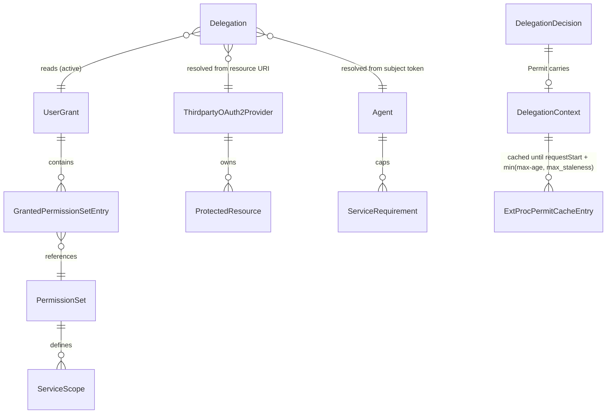

# Data Model: AuthZEN Delegation Policy Information Point

**Feature**: `specs/054-authzen-delegation-pip` | **Date**: 2026-10-27 | **Research**: [research.md](./research.md)

The feature adds **no persisted entity, table, migration, or repository**. It reads existing
aggregates and adds read-only value objects in the broker domain and in the standalone ExtProc
process. No new UUID-keyed entity exists, so ADR 013 requires no new typed ID. Existing
`id.AgentID`, `id.ServiceID`, `id.PermissionSetID`, `id.GrantID`, and `id.Principal` are reused.

## 1. Existing aggregates read (unchanged)

| Aggregate / entity | Package | Fields used |
|---|---|---|
| `storage.Agent` | `internal/domain/storage` | `ID`, `CanonicalID *string`, `PermissionSets[]` (declared), `ServiceRequirements[]` (`ServiceID`, `RequiredScopes`, `RequireAllScopes`) |
| `storage.UserGrant` | `internal/domain/storage` | `ID`, `Principal`, `AgentID`, `GrantedPermissionSets[]` (`PermissionSetID`, `IncludedServiceIDs[]`), `UpdatedAt`, `ValidUntil *time.Time` |
| `storage.PermissionSet` | `internal/domain/storage` | `ID`, `CanonicalID *string`, `ServiceScopes[]` (`ServiceID`, `Scopes[]`) |
| `model.ThirdpartyOAuth2ProviderEntity` | `internal/domain/model` | `ID`, `CanonicalID *string`, protected resources (lookup by normalized URI) |

The `UserGrant` remains the principal-agent consistency boundary. Revocation (hard delete) and
expiry are observed on each resolution. Nothing in this feature writes to any aggregate.

## 2. Broker domain value objects (`internal/domain/tokenexchange`)

### 2.1 `DelegationRequest` (input to the shared resolver)

| Field | Type | Rule |
|---|---|---|
| `SubjectToken` | `string` | Required. Validated by `JWTValidator.ValidateSubjectToken` (signature always required, SR-001). |
| `ClientAssertion` | `string` | Required. Validated by `JWTValidator.ValidateClientAssertion`. |
| `Resource` | `string` | Required. Must be an absolute URI (`NewResourceURI`). Normalized by `Normalize`. |
| `GrantType` | `string` | Always `urn:ietf:params:oauth:grant-type:token-exchange` (R3). Passed to CEL as `request.grant_type`. |
| `Scope` | `string` | Exchange passes the request scope. Evaluation passes `""` (absent-scope semantics). |
| `ExpectedAgentID` | `*id.AgentID` | Optional anchor (FR-005). Compared after agent load and before the grant read. |

### 2.2 `Delegation` (result of the shared resolver)

| Field | Type | Notes |
|---|---|---|
| `Principal` | `string` | Extracted by CEL `principal_expression` |
| `Agent` | `*storage.Agent` | Loaded by UUID from CEL `agent_id_expression` |
| `Service` | `*model.ThirdpartyOAuth2ProviderEntity` | Resolved from the normalized resource |
| `ResourceURI` | `string` | Normalized URI |
| `Grant` | `*storage.UserGrant` | Copy of the active grant |
| `PermissionSets` | `map[id.PermissionSetID]*storage.PermissionSet` | Resolved permission sets (TTL cache) |
| `EffectiveScopes` | `[]string` | `effectiveScopes[Service.ID]`, sorted, after the agent ceiling |

**Invariants**: These hold exactly as in today's exchange steps 2–9a.

- Subject and assertion are verified.
- The caller passes CEL.
- The resource is registered and unambiguous.
- The agent exists.
- The grant exists, is unexpired, and is non-empty.
- Every granted permission set is declared by the agent and exists.
- The requested service is included and defined.
- The requested service is not excluded by service requirements.
- Nonempty granted scopes do not intersect to empty.

Any violation returns the existing `*TokenExchangeError` with its `FailureDetail`.

### 2.3 `DelegationContext` (credential-free projection, FR-007 and FR-008)

```text
DelegationContext
├── subject         { id: Principal }
├── agent           { id: AgentID, canonical_id?: string }
├── resource        { id: ServiceID, canonical_id?: string, resource_uri: string, scopes: []string }
├── grant           { id: GrantID, updated_at: RFC 3339, valid_until?: RFC 3339 }
└── permission_sets [] { id: PermissionSetID, canonical_id?: string,
                         services [] { id: ServiceID, canonical_id?: string, scopes: []string } }
```

**Projection rules** (research R4):

- A member marked `?` is **omitted** when unset. It is never `null`, never synthesized, and never
  replaced by the UUID.
- `resource.scopes` is the effective ceiling. `permission_sets[].services[].scopes` are raw
  permission-set contributions for **grant-included** services only, `[]` when the permission
  set lacks a definition for a non-requested included service.
- Ordering: `permission_sets` follows grant order, `services` follows `IncludedServiceIDs`
  order, and every `scopes` array is sorted lexicographically.
- The projection never contains a subject token, assertion, provider token, secret, raw
  claims, or error text (SR-003).

### 2.4 `DelegationDecision` (outcome of `AccessEvaluationService.Evaluate`)

```text
DelegationDecision = Permit | Deny | RequestFailure

Permit         { Context: DelegationContext, MaxAge: int (0..60) }
Deny           { Detail: FailureDetail (grant_* only), ConsentURL: string }
RequestFailure { Status: 400 | 401 | 403 | 500, Code: string, Detail: FailureDetail }
```

Classification follows research R6. A `Deny` requires an `AccessDenied` error from
`StageGrantAuthorization` with one of these nine details, which cover the ten denial-matrix
rows (US2.1–US2.10):

- `grant_missing`
- `grant_expired`
- `grant_empty`
- `grant_permission_set_undeclared`
- `grant_permission_set_missing`
- `grant_service_omitted`
- `grant_service_definition_missing`
- `grant_service_requirement_excluded`
- `grant_scope_intersection_empty`

US2.1 (no grant) and US2.2 (revoked grant) both produce `grant_missing`. Every other error is a
`RequestFailure`.

**Freshness** (FR-009 and R5): `MaxAge = clamp(floor(valid_until − now), 0, 60)`, or `60`
without `valid_until`.

### 2.5 `AccessEvaluationRequest` (decoded AuthZEN body)

| JSON path | Required | Accepted value |
|---|---|---|
| `subject.type` | yes | Exactly `urn:ietf:params:oauth:token-type:jwt` (FR-003). `identity` and all other types return 400. |
| `subject.id` | yes | Non-empty string (the subject JWT) |
| `action.name` | yes | Exactly `urn:ietf:params:oauth:grant-type:token-exchange` |
| `resource.type` | yes | Exactly `protected_resource` |
| `resource.id` | yes | Absolute URI |
| `context` | no | Object or absent |
| `context.agent` | no | Agent UUID string. Absent means the agent comes from the token. |
| any other member | — | Rejected with 400 (R10, pending contract review) |

The body is limited to 64 KiB. The bearer client assertion comes from `Authorization: Bearer`,
never from the body.

### 2.6 Discovery metadata

| Member | Value |
|---|---|
| `policy_decision_point` | `TrimRight(server.enduser.public_url, "/")` |
| `access_evaluation_endpoint` | `policy_decision_point + "/access/v1/evaluation"` |

## 3. ExtProc value objects (`internal/extproc/delegation`, no broker imports)

The freshness rules below apply the maintainer decisions of 2026-10-28 (HIGH I1/U1/U2 in
[remediation.md](./remediation.md)). §3.5 applies the 2026-10-28 spec clarification of the OPA
input shape (FR-017, FR-018, and research R15).

### 3.1 `DelegationContextConfig` (`internal/extproc/config`)

| Field | Key | Type | Default | Validation (when `enabled`) |
|---|---|---|---|---|
| `Enabled` | `delegation_context.enabled` | bool | `false` | Requires `authorization.enabled` |
| `PolicyDecisionPoint` | `delegation_context.policy_decision_point` | string | `""` → origin of `oauth2.token_endpoint` | Absolute `https` URL (or `http` with `allow_http`), with a host, without userinfo, query, or fragment |
| `RequestTimeout` | `delegation_context.request_timeout` | duration | `5s` | `> 0` |
| `MaxStaleness` | `delegation_context.max_staleness` | duration | `60s` | `> 0` |

### 3.2 `Metadata`

`{PolicyDecisionPoint string, AccessEvaluationEndpoint *url.URL}`. Discovery produces it once at
startup. It is immutable afterwards.

### 3.3 `Result` and errors

| Type | Fields | Meaning |
|---|---|---|
| `Result` (permit) | `Context Context` (typed and validated, §3.3.1), `Deadline time.Time` (`requestStart + min(max-age, max_staleness)`, computed once) | `decision: true`, a context that passes §3.3.1, and exactly one positive integer `max-age` |
| `*DeniedError` | `Code string` (allowlisted `grant_*` value or `delegation_denied`), `ConsentURL string` | `decision: false` |
| other `error` | Category: `timeout`, `unavailable`, `rejected` (non-200), or `invalid_response` (including a missing, zero, malformed, or duplicate `max-age` on a permit, or a permit context that fails §3.3.1) | Fail closed with 503. The response is not used and not cached. |

#### 3.3.1 `Context` (typed permit context, research R15)

The client decodes the permit's `context` into an unexported wire struct. Unknown members at
any level are ignored and never copied. It then validates the struct and exports this value:

```text
Context
├── Principal       string                        ← context.subject.id
├── Agent           { ID, CanonicalID? }
├── Resource        { ID, CanonicalID?, ResourceURI, Scopes []string }
├── Grant           { ID, UpdatedAt string (RFC 3339), ValidUntil? string (RFC 3339) }
└── PermissionSets  [] { ID, CanonicalID?, Services [] { ID, CanonicalID?, Scopes []string } }
```

| Rule | Violation |
|---|---|
| Every `id`, `subject.id`, and `resource_uri` is a non-empty string | `invalid_response` |
| `resource.scopes`, each `services`, and each `services[].scopes` are arrays. Empty arrays are allowed. | `invalid_response` |
| `permission_sets` is a non-empty array | `invalid_response` |
| `updated_at`, and `valid_until` when present, parse as RFC 3339. The received string is kept unchanged. | `invalid_response` |
| An optional `canonical_id` or `valid_until` is absent or a non-empty string. An explicit `null` or `""` contradicts the contract. | `invalid_response` |

The `Result` is immutable after construction. The cache and singleflight followers share it.
Consumers copy its slices (§3.5).

### 3.4 Permit cache

| Element | Definition |
|---|---|
| Key | `cacheKey{subjectToken string; resourceURI string}`. A struct key prevents separator injection. |
| Entry | `{result Result}`. The entry expires at `result.Deadline`. |
| Lifetime | Until `Deadline`. An insertion, a hit, or a singleflight delivery never extends it. An unusable `max-age` never produces a `Result`. |
| Lookup | A hit only while `now < Deadline`. The hit returns the stored deadline. |
| Policy use | `requestState` keeps `Deadline`. Every OPA evaluation that receives delegation input first checks `now < Deadline`. If it fails, ExtProc returns 503, does not evaluate policy, forwards nothing, and does not re-resolve. |
| Never cached | Denials, errors, and non-200 responses |
| Concurrency | `sync.RWMutex` plus `singleflight` keyed by the struct |
| Eviction | Background sweep every `max(max_staleness/2, 1s)`. Stopped by `Shutdown`. |

**Freshness state machine (per key)**:

```text
            Resolve (miss) ──200 permit, max-age>0──▶ CACHED(Deadline)
                 │                                         │
                 ├──deny / error──▶ (nothing stored)       │ now ≥ Deadline
                 ▼                                         ▼
              ABSENT ◀──────────── evict ─────────────── EXPIRED ──Resolve──▶ (same as miss; no stale use)
```

An unusable `max-age` counts as an error.

### 3.5 OPA `ContextInput` (changes)

`authorization.ContextInput` gains five members directly beside the existing ones (FR-017).
There is no `delegation` wrapper, no `subject` member, and no `delegation_available` flag.

| Member | Go type (package `authorization`) | Disabled mode | Enabled mode (body, batch, and header-only) |
|---|---|---|---|
| `granted_permission_sets_available` | `bool` (existing) | Unchanged (`true` only when the exchange returned the field; `false` on header-only) | `true`, permanently retained |
| `granted_permission_sets` | `map[string][]string` (existing) | Unchanged (from exchange) | `{ps.ID: [ps.Services[].ID]}` in permit order, `[]` for no services; never from exchange; permanently retained |
| `agent_session_id` | `string` (existing) | Unchanged | Unchanged |
| `principal` | `string`, `omitempty` | **omitted** | `Context.Principal` |
| `agent` | `*AgentContext{ID; CanonicalID omitempty}`, `omitempty` | **omitted** | `Context.Agent` |
| `resource` | `*ResourceContext{ID; CanonicalID omitempty; ResourceURI; Scopes}`, `omitempty` | **omitted** | `Context.Resource` (`scopes` always an array) |
| `grant` | `*GrantContext{ID; UpdatedAt; ValidUntil omitempty}`, `omitempty` | **omitted** | `Context.Grant` |
| `permission_sets` | `[]PermissionSetContext{ID; CanonicalID omitempty; Services []ServiceContext{ID; CanonicalID omitempty; Scopes}}`, `omitempty` | **omitted** | `Context.PermissionSets` |

**Mapping**: The server's pure function `contextInputFromDelegation(result, agentSessionID)`
builds every enabled-mode input. It deep-copies the slices of the shared `Result`. Disabled mode
never calls it, and its serialized input stays byte-for-byte unchanged.

**Invariant**: In enabled mode, OPA is evaluated only with a validated permit whose `Deadline`
has not passed. So `granted_permission_sets_available: true` implies that all five members are
present. Only the nested optional `canonical_id` and `valid_until` members can be absent. A
denial, a resolution error, or an expired deadline returns 403 or 503 before policy runs, never
`false`.

## 4. Relationships


