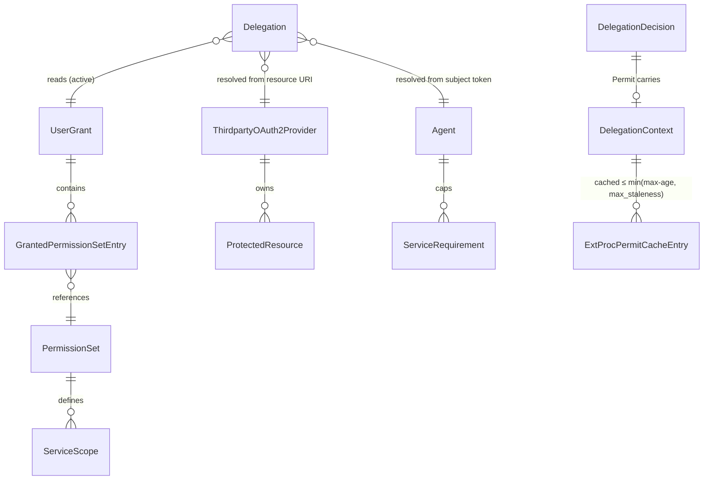

# Data Model: AuthZEN Delegation Policy Information Point

**Feature**: `specs/054-authzen-delegation-pip` | **Date**: 2026-10-27 | **Research**: [research.md](./research.md)

The feature adds **no persisted entity, table, migration, or repository**. It reads existing
aggregates and adds read-only value objects in the broker domain and in the standalone ExtProc
process. No new UUID-keyed entity exists, so ADR 013 requires no new typed ID. Existing
`id.AgentID`, `id.ServiceID`, `id.PermissionSetID`, `id.GrantID`, and `id.Principal` are reused.

## 1. Existing aggregates read (unchanged)

| Aggregate / entity | Package | Fields used |
|---|---|---|
| `storage.Agent` | `internal/domain/storage` | `ID`, `CanonicalID *string`, `PermissionSets[]` (declared), `ServiceRequirements[]` (`ServiceID`, `RequiredScopes`, `RequireAllScopes`) |
| `storage.UserGrant` | `internal/domain/storage` | `ID`, `Principal`, `AgentID`, `GrantedPermissionSets[]` (`PermissionSetID`, `IncludedServiceIDs[]`), `UpdatedAt`, `ValidUntil *time.Time` |
| `storage.PermissionSet` | `internal/domain/storage` | `ID`, `CanonicalID *string`, `ServiceScopes[]` (`ServiceID`, `Scopes[]`) |
| `model.ThirdpartyOAuth2ProviderEntity` | `internal/domain/model` | `ID`, `CanonicalID *string`, protected resources (lookup by normalized URI) |

The `UserGrant` remains the principal-agent consistency boundary. Revocation (hard delete) and
expiry are observed on each resolution. Nothing in this feature writes to any aggregate.

## 2. Broker domain value objects (`internal/domain/tokenexchange`)

### 2.1 `DelegationRequest` (input to the shared resolver)

| Field | Type | Rule |
|---|---|---|
| `SubjectToken` | `string` | Required. Validated by `JWTValidator.ValidateSubjectToken` (signature always required, SR-001). |
| `ClientAssertion` | `string` | Required. Validated by `JWTValidator.ValidateClientAssertion`. |
| `Resource` | `string` | Required. Must be an absolute URI (`NewResourceURI`). Normalized by `Normalize`. |
| `GrantType` | `string` | Always `urn:ietf:params:oauth:grant-type:token-exchange` (R3). Passed to CEL as `request.grant_type`. |
| `Scope` | `string` | Exchange passes the request scope. Evaluation passes `""` (absent-scope semantics). |
| `ExpectedAgentID` | `*id.AgentID` | Optional anchor (FR-005). Compared after agent load and before the grant read. |

### 2.2 `Delegation` (result of the shared resolver)

| Field | Type | Notes |
|---|---|---|
| `Principal` | `string` | Extracted by CEL `principal_expression` |
| `Agent` | `*storage.Agent` | Loaded by UUID from CEL `agent_id_expression` |
| `Service` | `*model.ThirdpartyOAuth2ProviderEntity` | Resolved from the normalized resource |
| `ResourceURI` | `string` | Normalized URI |
| `Grant` | `*storage.UserGrant` | Copy of the active grant |
| `PermissionSets` | `map[id.PermissionSetID]*storage.PermissionSet` | Resolved permission sets (TTL cache) |
| `EffectiveScopes` | `[]string` | `effectiveScopes[Service.ID]`, sorted, after the agent ceiling |

**Invariants**: These hold exactly as in today's exchange steps 2–9a.

- Subject and assertion are verified.
- The caller passes CEL.
- The resource is registered and unambiguous.
- The agent exists.
- The grant exists, is unexpired, and is non-empty.
- Every granted permission set is declared by the agent and exists.
- The requested service is included and defined.
- The requested service is not excluded by service requirements.
- Nonempty granted scopes do not intersect to empty.

Any violation returns the existing `*TokenExchangeError` with its `FailureDetail`.

### 2.3 `DelegationContext` (credential-free projection, FR-007 and FR-008)

```text
DelegationContext
├── subject         { id: Principal }
├── agent           { id: AgentID, canonical_id?: string }
├── resource        { id: ServiceID, canonical_id?: string, resource_uri: string, scopes: []string }
├── grant           { id: GrantID, updated_at: RFC 3339, valid_until?: RFC 3339 }
└── permission_sets [] { id: PermissionSetID, canonical_id?: string,
                         services [] { id: ServiceID, canonical_id?: string, scopes: []string } }
```

**Projection rules** (research R4):

- A member marked `?` is **omitted** when unset. It is never `null`, never synthesized, and never
  replaced by the UUID.
- `resource.scopes` is the effective ceiling. `permission_sets[].services[].scopes` are raw
  permission-set contributions for **grant-included** services only, `[]` when the permission
  set lacks a definition for a non-requested included service.
- Ordering: `permission_sets` follows grant order, `services` follows `IncludedServiceIDs`
  order, and every `scopes` array is sorted lexicographically.
- The projection never contains a subject token, assertion, provider token, secret, raw
  claims, or error text (SR-003).

### 2.4 `DelegationDecision` (outcome of `AccessEvaluationService.Evaluate`)

```text
DelegationDecision = Permit | Deny | RequestFailure

Permit         { Context: DelegationContext, MaxAge: int (0..60) }
Deny           { Detail: FailureDetail (grant_* only), ConsentURL: string }
RequestFailure { Status: 400 | 401 | 403 | 500, Code: string, Detail: FailureDetail }
```

Classification follows research R6. A `Deny` requires an `AccessDenied` error from
`StageGrantAuthorization` with one of these nine details, which cover the ten denial-matrix
rows (US2.1–US2.10):

- `grant_missing`
- `grant_expired`
- `grant_empty`
- `grant_permission_set_undeclared`
- `grant_permission_set_missing`
- `grant_service_omitted`
- `grant_service_definition_missing`
- `grant_service_requirement_excluded`
- `grant_scope_intersection_empty`

US2.1 (no grant) and US2.2 (revoked grant) both produce `grant_missing`. Every other error is a
`RequestFailure`.

**Freshness** (FR-009 and R5): `MaxAge = clamp(floor(valid_until − now), 0, 60)`, or `60`
without `valid_until`.

### 2.5 `AccessEvaluationRequest` (decoded AuthZEN body)

| JSON path | Required | Accepted value |
|---|---|---|
| `subject.type` | yes | Exactly `urn:ietf:params:oauth:token-type:jwt` (FR-003). `identity` and all other types return 400. |
| `subject.id` | yes | Non-empty string (the subject JWT) |
| `action.name` | yes | Exactly `urn:ietf:params:oauth:grant-type:token-exchange` |
| `resource.type` | yes | Exactly `protected_resource` |
| `resource.id` | yes | Absolute URI |
| `context` | no | Object or absent |
| `context.agent` | no | Agent UUID string. Absent means the agent comes from the token. |
| any other member | — | Rejected with 400 (R10, pending contract review) |

The body is limited to 64 KiB. The bearer client assertion comes from `Authorization: Bearer`,
never from the body.

### 2.6 Discovery metadata

| Member | Value |
|---|---|
| `policy_decision_point` | `TrimRight(server.enduser.public_url, "/")` |
| `access_evaluation_endpoint` | `policy_decision_point + "/access/v1/evaluation"` |

## 3. ExtProc value objects (`internal/extproc/delegation`, no broker imports)

### 3.1 `DelegationContextConfig` (`internal/extproc/config`)

| Field | Key | Type | Default | Validation (when `enabled`) |
|---|---|---|---|---|
| `Enabled` | `delegation_context.enabled` | bool | `false` | Requires `authorization.enabled` |
| `PolicyDecisionPoint` | `delegation_context.policy_decision_point` | string | `""` → origin of `oauth2.token_endpoint` | Absolute `https` URL (or `http` with `allow_http`), with a host, without userinfo, query, or fragment |
| `RequestTimeout` | `delegation_context.request_timeout` | duration | `5s` | `> 0` |
| `MaxStaleness` | `delegation_context.max_staleness` | duration | `60s` | `> 0` |

### 3.2 `Metadata`

`{PolicyDecisionPoint string, AccessEvaluationEndpoint *url.URL}`. Discovery produces it once at
startup. It is immutable afterwards.

### 3.3 `Result` and errors

| Type | Fields | Meaning |
|---|---|---|
| `Result` (permit) | `Context map[string]any` (decoded with `UseNumber`, verbatim), `GrantedPermissionSets map[string][]string` (derived projection) | `decision: true` |
| `*DeniedError` | `Code string` (allowlisted `grant_*` value or `delegation_denied`), `ConsentURL string` | `decision: false` |
| other `error` | Category: `timeout`, `unavailable`, `rejected` (non-200), or `invalid_response` | Fail closed with 503 |

### 3.4 Permit cache

| Element | Definition |
|---|---|
| Key | `cacheKey{subjectToken string; resourceURI string}`. A struct key prevents separator injection. |
| Entry | `{result Result; expiresAt time.Time}` |
| Lifetime | `min(max-age, max_staleness)`. No entry when `max-age` is missing, invalid, or `0`. |
| Never cached | Denials, errors, and non-200 responses |
| Concurrency | `sync.RWMutex` plus `singleflight` keyed by the struct |
| Eviction | Background sweep every `max(max_staleness/2, 1s)`. Stopped by `Shutdown`. |

**Freshness state machine (per key)**:

```text
            Resolve (miss) ──200 permit, max-age>0──▶ CACHED(expiresAt)
                 │                                         │
                 ├──deny / error──▶ (nothing stored)       │ now ≥ expiresAt
                 ▼                                         ▼
              ABSENT ◀──────────── evict ─────────────── EXPIRED ──Resolve──▶ (same as miss; no stale use)
```

### 3.5 OPA `ContextInput` (changes)

| Member | Disabled mode | Enabled mode |
|---|---|---|
| `granted_permission_sets_available` | Unchanged (from exchange; `false` on header-only) | `true` |
| `granted_permission_sets` | Unchanged (from exchange) | `{ps.id: [services[].id]}` derived from `delegation` |
| `agent_session_id` | Unchanged | Unchanged |
| `delegation_available` | **omitted** | `true` (a failure never reaches policy) |
| `delegation` | **omitted** | Permit `context`, verbatim |

## 4. Relationships


