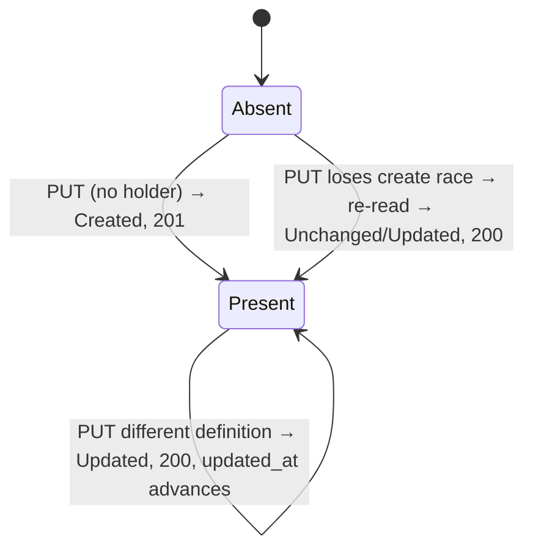

# Data Model: Unique Agent External IDs and Idempotent Create-or-Update

**Feature**: [spec.md](./spec.md) | **Plan**: [plan.md](./plan.md) | **Research**: [research.md](./research.md)

No new entity, aggregate, table, typed ID, or configuration is introduced. The feature changes one
invariant on the existing Agent aggregate, adds a domain operation, and adds one migration.

## Agent (existing aggregate root)

`internal/domain/storage/agent.go` — fields are unchanged.

| Field | Type | Change |
|---|---|---|
| `ID` | `id.AgentID` (UUID) | Unchanged. Stable reference for grants and all relationships. |
| `CanonicalID` | `*string` | Unchanged; still globally unique when set. |
| `ClientID` | `*id.ClientID` | Unchanged; uniqueness still depends on `multi_agent_client.enabled`. |
| `ExternalID` | `*id.ExternalID` | **New invariants**: when non-nil it MUST be non-empty, and no two Agents may hold equal values (exact, case-sensitive byte equality). `nil` remains allowed on any number of Agents. |
| Other definition fields | — | Unchanged. |

### Validation rules

| Rule | Where | Applies to | Failure |
|---|---|---|---|
| `ExternalID != nil` ⇒ `*ExternalID != ""` | `Agent.validateFields()` | create, update, reconcile, CIMD snapshot refresh | `ErrorKindValidation`, `external_id cannot be empty when provided` |
| Selector: 1–255 code points, valid UTF-8, no NUL | `agents` service (shared with `ListByExternalID`) | reconcile, list filter | `ErrInvalidExternalID` |
| Body external ID equals selector when present; not `null`/empty | `agents` service | reconcile | `ErrInvalidExternalID`, `body external_id must equal the selector` / `external_id must not be null` / `external_id must be 1 to 255 characters` |
| No other Agent holds the external ID | storage adapters | create, update, reconcile | `ErrorKindConflict` wrapping `ports.ErrExternalIDConflict`, `external_id is already held by another agent` |

Nonempty external IDs on POST and ID-addressed PUT keep their existing length handling; only the
empty string is newly rejected (spec Assumptions).

## External ID (existing value object)

`id.ExternalID` (`internal/domain/id/string_ids.go`) is unchanged. Its glossary meaning changes from
"several Agents can share one External ID" to "identifies at most one Agent". It is not a Canonical
ID, Client ID, or Stable Identifier, and never selects an agent by those values.

## Reconcile operation (new domain behavior)

`agents.Service.ReconcileByExternalID(ctx, selector id.ExternalID, desired *storage.Agent, input ReconcileInput) (*storage.Agent, ReconcileOutcome, error)`

`ReconcileInput` carries only request-presence facts the handler parses:

| Field | Meaning |
|---|---|
| `CanonicalIDPresent` | `canonical_id` member present (value may be `null`) |
| `ExternalIDPresent` | `external_id` member present |
| `ExternalIDNull` | `external_id` member is `null` |

`client_id: null` never reaches the service; the handler rejects it as request-schema validation.

`ReconcileOutcome`: `Created`, `Updated`, `Unchanged`.

### Field policy (FR-012, Proposed API-OMISSION)

| Field | Creation branch | Update branch: omitted | Update branch: `null` | Update branch: value |
|---|---|---|---|---|
| `client_id` | absent unless supplied | preserve existing | rejected by handler (`400 validation failed`) | replace; client-ID conflict rules |
| `canonical_id` | absent unless supplied | preserve existing | clear | replace; canonical conflict rules |
| `external_id` | selector | selector | `400 invalid external_id` | must equal selector |
| metadata URLs (3) | as supplied | clear | clear | replace |
| `service_requirements`, `redirect_uris`, `allowed_scopes`, `client_uris` | as supplied or empty | empty | empty | replace whole collection |
| `display_name`, `description`, `permission_sets` | required | required | rejected | replace |
| `created_at` | now | preserved | preserved | preserved |
| `updated_at` | now (= `created_at`) | unchanged on no-op; now on change | same | same |

### Effective-definition equality (FR-008)

Compared: canonical, client, and external IDs; display name; description; three metadata URLs;
service requirements in order (`nil` and empty `required_scopes` equal); permission declarations
in order; redirect URIs and allowed scopes in order (`nil` equals empty); client URIs as a set.
Not compared: `ID`, `CreatedAt`, `UpdatedAt`, `ClearCanonicalID`.

### State transitions



A rejected request (400/409) is not a transition and writes nothing.

## Ports

| Port | Change |
|---|---|
| `ports.AgentRepository` | No new method. `ListByExternalID` returns zero or one agent after migration `046`. `Create`/`Update` document the external-ID conflict. |
| `ports.ErrExternalIDConflict` | New sentinel `errors.New("external_id already held by another agent")` in `internal/ports/storage.go`, wrapped by both adapters. |

## Persistence

### Memory adapter

`internal/adapters/storage/memory/agent_repository.go` adds `byExternalID map[id.ExternalID]id.AgentID`.
`Create` and `Update` check it under the write lock before any mutation (external ID first, then
canonical ID and client URIs); `Update` moves the entry when the value changes; `Delete` removes it.

### PostgreSQL schema — migration `046_unique_agent_external_id` (Proposed, DB-046)

Before (migration `001`):

```sql
external_id VARCHAR(255),
CREATE INDEX IF NOT EXISTS idx_agents_external_id ON agents(external_id) WHERE external_id IS NOT NULL;
```

After UP:

| Object | Definition |
|---|---|
| `uq_agents_external_id` | `UNIQUE INDEX ON agents (external_id) WHERE external_id IS NOT NULL` |
| `chk_agents_external_id_not_empty` | `CHECK (external_id <> '')` (NULL passes) |
| `idx_agents_external_id` | dropped; superseded by the unique index |

UP behavior, in one `DO $migration$` statement after `SET LOCAL statement_timeout = '5s'`:

1. `LOCK TABLE agents IN ACCESS EXCLUSIVE MODE NOWAIT`.
2. Inventory with explicit columns:

   ```sql
   SELECT external_id, array_agg(id ORDER BY created_at, id) AS agent_ids
   FROM agents
   WHERE external_id IS NOT NULL AND external_id <> ''
   GROUP BY external_id
   HAVING COUNT(*) > 1;

   SELECT id FROM agents WHERE external_id = '' ORDER BY created_at, id;
   ```

3. If either result is non-empty: `RAISE EXCEPTION 'agent external_id uniqueness migration blocked'
   USING DETAIL = <duplicate groups and empty-value agent IDs, first 100 of each plus remaining
   counts>, HINT = 'See docs/operations/agent-external-id-uniqueness.md; no agents were changed'`.
4. Otherwise create the unique index and check constraint and drop `idx_agents_external_id`.

DOWN, in one `DO` statement: recreate `idx_agents_external_id`, drop
`chk_agents_external_id_not_empty`, drop `uq_agents_external_id`. No row is modified.

Error mapping in `internal/adapters/storage/postgres/agent_repository.go`:

| SQLSTATE / constraint | Operation | StorageError |
|---|---|---|
| `23505` / `uq_agents_external_id` | Create, Update | `Conflict`, wraps `ports.ErrExternalIDConflict`, `external_id is already held by another agent` |
| `23514` / `chk_agents_external_id_not_empty` | Create, Update | `Validation`, `external_id cannot be empty when provided` (defense in depth; domain validation runs first) |

### Relationships preserved

`user_grants.agent_id`, `agent_client_uris.agent_id`, client credentials, and approvals reference
`agents.id`. Neither UP nor DOWN updates or deletes `agents` rows, so these relationships are
untouched (DB-004, SC-005).
