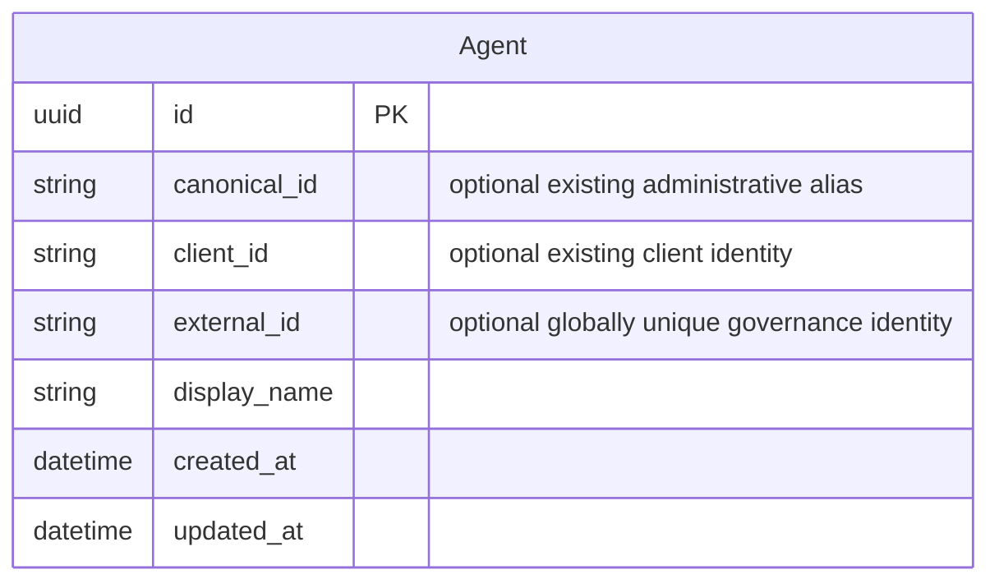
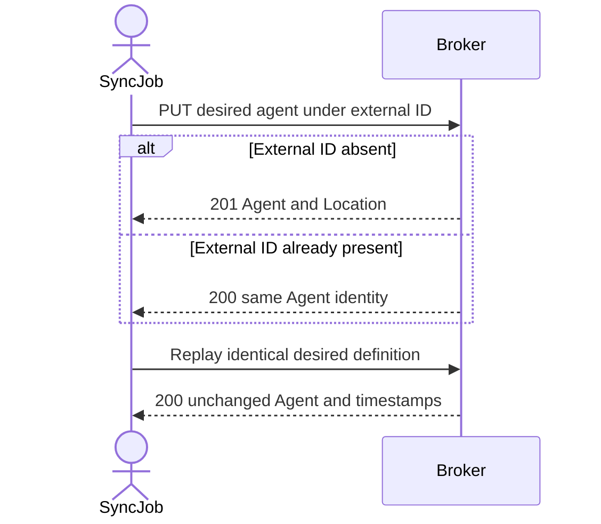

# Feature Specification: Unique Agent External IDs and Idempotent Create-or-Update

**Feature Branch**: `speckit/issue-334`

**Created**: 2026-10-30

**Status**: Draft — clarification complete; proposed API decisions await maintainer sign-off; no implementation approval recorded.

**Input**: Issue #334, “Admin API: unique agent external_id and idempotent create-or-update”. The supplied feature description is reproduced below.

> Admin API: unique agent external_id and idempotent create-or-update
>
> ## Problem
>
> Governance sync jobs identify agents by `external_id`. Today they must look up an agent and then either create or update it. Retries and concurrent runs can create duplicate agents, because `external_id` is not unique (spec 054).
>
> ## Goal
>
> A sync job puts the desired state of an agent under its `external_id` in one idempotent call.
>
> ## Requirements
>
> **Uniqueness**
> - R1: `external_id` MUST be unique across agents when it is set. This supersedes spec 054's clarification and FR-011.
> - R2: Create and update MUST return `409 Conflict` when another agent already holds the `external_id`.
> - R3: The broker MUST reject an empty `external_id` (`400`).
> - R4: The schema change MUST fail safely on existing duplicate or empty values: report them to the operator and do not drop data. It MUST include an operator runbook.
>
> **Create-or-update**
> - R5: `PUT /api/agents?external_id={value}` MUST create the agent if no agent has that value (`201` + `Location`). Otherwise it MUST update that agent (`200`).
> - R6: The selector MUST follow the spec 054 `external_id` validation rules. A missing selector MUST return `400`.
> - R7: The body MUST be `AgentCreateRequest`. A body `external_id` that differs from the selector MUST return `400`.
> - R8: Replaying an identical request MUST return `200` with an unchanged representation, including `updated_at`.
> - R9: Concurrent first calls with the same value MUST produce exactly one agent.
> - R10: Existing `client_id` and `canonical_id` conflicts MUST still return `409`. `Prefer: reference-id=canonical` MUST be honored.
>
> **Unchanged**
> - R11: `GET /api/agents?external_id=` MUST keep its spec 054 behavior and return at most one agent.
>
> ## Out of scope
>
> Delete by `external_id`, bulk sync, and `If-Match` preconditions.

This specification proposes superseding [feature 054](../054-agent-external-id-filter/spec.md)'s non-uniqueness clarification, FR-011, and related descriptions of multiple matches. It retains that feature's exact matching, selector validation, list shape, and presentation contract. The earlier specification is not edited in this phase.

## Clarifications

### Session 2026-10-30

- Q: When collection PUT updates an existing agent, what happens to omitted optional fields and explicit nulls? → A: **Proposed (approval item API-OMISSION)**: Preserve omitted `client_id` and `canonical_id`; replace the other managed definition fields. Omitted or null optional metadata URLs become absent; omitted, null, or empty optional arrays become empty. Explicit `canonical_id: null` removes the canonical ID. Reject `client_id: null` with `400 validation failed`, because the reused `AgentCreateRequest` does not allow it; a supplied nonempty client ID replaces the existing value. Body `external_id` still follows FR-007. This resolves FR-012 and completes US1.5–US1.7. Rationale: preserves established identities under ADR 017 while following the existing update path's replacement of metadata and collections, without broadening the create schema. Main alternative: preserve every omitted optional field (handoff option A), which would introduce new patch-like behavior for metadata and collections; full replacement including client ID (option B) would require superseding ADR 017. Planning must register API-OMISSION with authoritative details at FR-012 and its field-policy table. This recommendation is not maintainer approval.

## User Scenarios & Testing *(mandatory)*

Each numbered acceptance scenario has a stable identifier (`US1.1`, etc.) for a later 1:1 E2E test mapping under Constitution Principle XIII. Migration scenarios also require real PostgreSQL integration coverage. This phase specifies behavior; it does not create or run implementation tests.

### User Story 1 - Reconcile an agent in one retry-safe call (Priority: P1)

A governance sync job submits an agent definition under the registry's external ID, without first reading the broker or choosing between create and update. Retrying after a lost response does not create another agent or change timestamps when nothing changed.

**Why this priority**: This is the requested simplification and eliminates the lookup-then-write race for sync callers.

**Independent Test**: Start without the selected agent, submit its definition, replay it, change the display name, and read it back. Verify one stable agent identity and timestamps that change only for an actual update through this operation.

**Acceptance Scenarios**:

1. **Given** no agent holds `urn:example:ai-registry:agent:7f3a9c`, **When** the job submits a valid `AgentCreateRequest` to `PUT /api/agents?external_id=urn%3Aexample%3Aai-registry%3Aagent%3A7f3a9c`, **Then** the broker returns `201 Created`, an Agent representation with that external ID, and `Location` identifying the created agent.
2. **Given** US1.1 succeeded, **When** the same job replays the identical request without an intervening change, **Then** the broker returns `200 OK` with the same representation, including the same `id`, `created_at`, and `updated_at`, and a lookup returns exactly one agent.
3. **Given** the agent from US1.1 exists, **When** the job submits the same definition with a changed display name, **Then** the broker returns `200 OK` with the new name, unchanged `id` and `created_at`, an advanced `updated_at`, and the next lookup shows the new name.
4. **Given** no agent holds the selected external ID, **When** two first calls submit the same valid definition concurrently, **Then** exactly one call creates the agent and returns `201`, the other returns `200`, both identify the same agent, and the subsequent filtered list contains exactly that one agent.
5. **Given** the selected agent has client and canonical IDs, metadata URLs, and optional collections, **When** the job submits the required definition while omitting all optional body attributes, **Then** the broker preserves both IDs and the selected external ID, removes the metadata URLs, empties the optional collections, replaces the supplied permission declarations, and advances `updated_at` only if the effective definition changes. Replaying that request returns the unchanged representation and timestamps.
6. **Given** the selected agent has a canonical ID and optional metadata and collections, **When** the job explicitly supplies null for those nullable fields, **Then** the canonical ID and metadata become absent, the optional collections become empty, and the client ID, external ID, UUID, creation time, and unrelated grants remain unchanged. A replay is a no-op.
7. **Given** the selected agent has a client ID, **When** the job sends `client_id: null` to collection PUT, **Then** the broker returns `400 validation failed` and changes no data or timestamps. A supplied valid nonempty client ID instead replaces it under the existing conflict rules; explicit clearing remains available through the existing ID-addressed update contract.

---

### User Story 2 - Keep external identities unambiguous across all writes (Priority: P1)

An administrator using the existing create and ID-addressed update operations cannot accidentally assign an external identity already held by a different agent. Invalid sync selectors and conflicting identifiers fail without modifying any agent.

**Why this priority**: Create-or-update cannot be dependable if another write path can introduce duplicate identities.

**Independent Test**: Register two distinct agents, attempt conflicting writes through each operation, and verify the originals remain unchanged. Exercise invalid selectors before and after an agent exists.

**Acceptance Scenarios**:

1. **Given** Research Assistant holds `urn:example:ai-registry:agent:7f3a9c`, **When** an administrator attempts to create a second agent with that external ID using `POST /api/agents`, **Then** the broker returns `409 Conflict`, no new agent exists, and Research Assistant is unchanged.
2. **Given** Research Assistant and Data Analyst exist with different external IDs, **When** an administrator updates Data Analyst by UUID or canonical ID to use Research Assistant's external ID, **Then** the broker returns `409 Conflict` and both agents remain unchanged.
3. **Given** Research Assistant holds the selected external ID, **When** an administrator updates that same agent while retaining its external ID, **Then** the update succeeds; the agent does not conflict with itself.
4. **Given** agents exist, **When** a create-or-update request has a missing, empty, repeated, too-long, invalid UTF-8, NUL-containing, or undecodable selector as defined in FR-006, **Then** it returns `400 Bad Request`, returns no agent data, and changes no agent.
5. **Given** a valid selector, **When** the body supplies a different external ID, an empty external ID, or explicit `null`, **Then** create-or-update returns `400` with no agent mutation.
6. **Given** a valid selector, **When** the body lacks a required `AgentCreateRequest` field or contains an invalid existing agent attribute or reference, **Then** the broker rejects it under the existing validation contract and creates or changes no agent.
7. **Given** another agent owns a requested canonical ID, or owns a requested client ID when client-ID uniqueness is enabled, **When** create-or-update attempts either creation or modification using that conflicting identifier, **Then** it returns `409` and leaves all agents unchanged.
8. **Given** agents with no external ID exist, **When** an administrator creates another agent without an external ID or explicitly with `null` using the existing create operation, **Then** it succeeds; absent IDs do not conflict. Creating or updating with the string `""` instead returns `400` and makes no change.

---

### User Story 3 - Upgrade safely without losing governed agents (Priority: P1)

An operator introducing uniqueness receives an actionable report of legacy duplicates or empty identifiers and can resolve them deliberately, rather than having the broker select a survivor or delete records automatically.

**Why this priority**: Feature 054 explicitly permits duplicates and empty stored strings, so unsafe upgrades could lose agents or their user delegations.

**Independent Test**: Apply the schema change to stores containing duplicates, empty strings, and clean data. Verify failure retains all records and relationships, then follow the runbook to resolve the data and retry successfully.

**Acceptance Scenarios**:

1. **Given** legacy Research Assistant and Research Assistant (EU) share one external ID, **When** the operator applies the schema change, **Then** it fails safely, reports the duplicate value and affected agent IDs, and preserves every agent and relationship.
2. **Given** a legacy agent stores an empty external-ID string, **When** the operator applies the schema change, **Then** it fails safely, identifies the affected agent, and preserves its data. If duplicates and empty values coexist, the operator can discover both categories before retrying.
3. **Given** the operator follows the runbook to assign distinct registry IDs or remove an ID deliberately without deleting agents, **When** the operator retries the schema change, **Then** it succeeds and subsequent conflicting writes are rejected while agents without an external ID remain supported.
4. **Given** a clean upgraded store with identified and unidentified agents, **When** the supported rollback and reapply procedure is exercised, **Then** all agents and their relationships survive unchanged and uniqueness is enforced after reapplication.

---

### User Story 4 - Keep lookup and reference presentation compatible (Priority: P2)

Existing lookup callers continue to receive arrays with exact-match results and existing canonical-reference preferences. Sync callers can use the same presentation preference for their write responses.

**Why this priority**: Governance clients need consistency, not a new response shape or another identity namespace.

**Independent Test**: Read zero and one matches, check an empty selector, list without a selector, and submit create-or-update with canonical nested references.

**Acceptance Scenarios**:

1. **Given** zero or one agent matches a valid external-ID filter, **When** the caller sends `GET /api/agents?external_id=...`, **Then** it receives `200` with respectively `[]` or a one-element Agent array. Matching remains exact and case-sensitive.
2. **Given** registered agents exist, **When** the caller sends the literal `GET /api/agents?external_id=`, **Then** it receives the feature 054 `400 invalid external_id` response, never the full list. Without the parameter it still receives the existing unfiltered list.
3. **Given** `github-read` is a permission-set canonical ID, **When** the job creates or updates an agent with `Prefer: reference-id=canonical`, **Then** the response uses `github-read` for the nested permission-set reference, retains the agent UUID as `id`, and includes `Preference-Applied: reference-id=canonical` and `Vary: Prefer`. A replay with the same preference preserves that representation and timestamps.

### Edge Cases

- External ID equality has no case folding, trimming, Unicode normalization, wildcard matching, or source-system scoping. Whitespace and pattern-like characters are literal; only the empty string is empty. A UUID-shaped external ID is not a selector for the agent UUID.
- Spec 054 counts Unicode code points, not bytes: 255 valid code points are accepted, 256 rejected. Query decoding turns unencoded `+` into a space; callers must encode `+`, `&`, and `;` when literal. Percent-encoded semicolons are valid; unencoded ones in the selector are rejected.
- All write paths participate in uniqueness, including races between existing POST/update operations and the new PUT. Losing conflicting ordinary writes return `409`; no winner is overwritten by another agent merely because a canonical or client ID matches.
- Concurrent requests with different valid desired states still leave exactly one agent for the external ID. Without `If-Match`, there is no promised ordering or merge of different definitions; each successful operation must apply a coherent definition rather than a mixture.
- An omitted body external ID takes its value from the required selector. An explicit `null` in this operation is rejected, since it would remove the identity used to reconcile. Existing operations continue to support absent external IDs.
- Replaying a request means replaying after completion with no intervening state change. An intervening legitimate edit may make the same request a real update. JSON whitespace and object-member order do not constitute agent state changes.
- Unknown query parameters and malformed query parts outside `external_id` retain spec 054 handling. A misspelled `externalId` cannot satisfy PUT's mandatory selector, even though a GET with that misspelling remains an unfiltered list.
- Validation and conflict failures must not partially replace permission sets, service requirements, client URIs, or other agent data.

## Concrete Example Journeys *(mandatory)*

The HTTP exchanges below propose the issue's new contract; the current OpenAPI document does not yet define collection PUT. Planning must reconcile these examples with `api/admin/openapi.yaml` before implementation. Existing request attributes, Agent shape, and error envelope follow that document. Error `message` prose is illustrative, not a new stable error-code decision.

**Shared cast**: Sync job `ai-registry-sync@example.com`, authenticated by an admin proxy at `broker-admin.example.com`; Research Assistant UUID `550e8400-e29b-41d4-a716-446655440000`, canonical ID `research-assistant`, external ID `urn:example:ai-registry:agent:7f3a9c`; Data Analyst UUID `660e8400-e29b-41d4-a716-446655440001`, canonical ID `data-analyst`, external ID `urn:example:ai-registry:agent:1b44e0`. Permission set `github-read` has UUID `a1b2c3d4-e5f6-7890-abcd-ef1234567890`. IDs and principals are synthetic; all times are 2026-10-30 UTC.

### Journey 1 — Sync creates, retries, and changes one agent (US1.1–US1.7; US4.3)

**Step 1 — Initial configuration and state**

Research Assistant does not exist. The deployment's existing settings include the following excerpt; no new setting is introduced:

```yaml
server:
  admin:
    public_url: "https://broker-admin.example.com" # requests must carry this Host
    authentication:
      preauth:
        principal_header_name: "X-Remote-User" # authenticated proxy supplies the principal
oauth2_authorization_server:
  multi_agent_client:
    enabled: false # a client_id owned by another agent remains a conflict
```

**Step 2 — 08:00:00: the job submits the definition without a lookup**

```http
PUT /api/agents?external_id=urn%3Aexample%3Aai-registry%3Aagent%3A7f3a9c HTTP/1.1
Host: broker-admin.example.com
X-Remote-User: ai-registry-sync@example.com
Content-Type: application/json
Prefer: reference-id=canonical

{"canonical_id":"research-assistant","external_id":"urn:example:ai-registry:agent:7f3a9c","display_name":"Research Assistant","description":"Helps with academic research","permission_sets":[{"permission_set_id":"github-read","requirement_type":"mandatory"}],"redirect_uris":[],"allowed_scopes":[]}

HTTP/1.1 201 Created
Location: /api/agents/550e8400-e29b-41d4-a716-446655440000
Content-Type: application/json
Preference-Applied: reference-id=canonical
Vary: Prefer

{"id":"550e8400-e29b-41d4-a716-446655440000","canonical_id":"research-assistant","external_id":"urn:example:ai-registry:agent:7f3a9c","display_name":"Research Assistant","description":"Helps with academic research","permission_sets":[{"permission_set_id":"github-read","requirement_type":"mandatory"}],"redirect_uris":[],"allowed_scopes":[],"created_at":"2026-10-30T08:00:00Z","updated_at":"2026-10-30T08:00:00Z"}
```

**Step 3 — 08:00:05: the response was lost, so the job retries**

```http
PUT /api/agents?external_id=urn%3Aexample%3Aai-registry%3Aagent%3A7f3a9c HTTP/1.1
Host: broker-admin.example.com
X-Remote-User: ai-registry-sync@example.com
Content-Type: application/json
Prefer: reference-id=canonical

{"canonical_id":"research-assistant","external_id":"urn:example:ai-registry:agent:7f3a9c","display_name":"Research Assistant","description":"Helps with academic research","permission_sets":[{"permission_set_id":"github-read","requirement_type":"mandatory"}],"redirect_uris":[],"allowed_scopes":[]}

HTTP/1.1 200 OK
Content-Type: application/json
Preference-Applied: reference-id=canonical
Vary: Prefer

{"id":"550e8400-e29b-41d4-a716-446655440000","canonical_id":"research-assistant","external_id":"urn:example:ai-registry:agent:7f3a9c","display_name":"Research Assistant","description":"Helps with academic research","permission_sets":[{"permission_set_id":"github-read","requirement_type":"mandatory"}],"redirect_uris":[],"allowed_scopes":[],"created_at":"2026-10-30T08:00:00Z","updated_at":"2026-10-30T08:00:00Z"}
```

If these same requests are submitted concurrently to an initially empty broker, one gets the step 2 response and the other the step 3 response; both resolve to this same UUID.

**Step 4 — 09:00:00: the registry changes the display name**

```http
PUT /api/agents?external_id=urn%3Aexample%3Aai-registry%3Aagent%3A7f3a9c HTTP/1.1
Host: broker-admin.example.com
X-Remote-User: ai-registry-sync@example.com
Content-Type: application/json
Prefer: reference-id=canonical

{"canonical_id":"research-assistant","external_id":"urn:example:ai-registry:agent:7f3a9c","display_name":"Research Assistant v2","description":"Helps with academic research","permission_sets":[{"permission_set_id":"github-read","requirement_type":"mandatory"}],"redirect_uris":[],"allowed_scopes":[]}

HTTP/1.1 200 OK
Content-Type: application/json
Preference-Applied: reference-id=canonical
Vary: Prefer

{"id":"550e8400-e29b-41d4-a716-446655440000","canonical_id":"research-assistant","external_id":"urn:example:ai-registry:agent:7f3a9c","display_name":"Research Assistant v2","description":"Helps with academic research","permission_sets":[{"permission_set_id":"github-read","requirement_type":"mandatory"}],"redirect_uris":[],"allowed_scopes":[],"created_at":"2026-10-30T08:00:00Z","updated_at":"2026-10-30T09:00:00Z"}
```

**Observable result**: One registry entry maps to one stable broker agent. Three calls produced one creation, one no-op, and one real update. No client ID was invented.

**Omission/null subflow — separate fixture for US1.5–US1.7**

This independent fixture uses Research Assistant's synthetic UUID and external ID, but does not change the state consumed by Journey 2. Initially at 08:00:00 it has canonical ID `research-assistant`, client ID `research-upstream`, all three metadata URLs set to distinct HTTPS URLs under `https://example.com/research/`, redirect URI `https://agent.example.com/callback`, allowed scope `openid`, client URI `https://agent.example.com/client.json`, a valid service requirement covered by `github-read`, and the mandatory `github-read` permission declaration. Existing grants reference its UUID.

At 09:10:00, the job sends only the required definition, omitting optional body fields:

```http
PUT /api/agents?external_id=urn%3Aexample%3Aai-registry%3Aagent%3A7f3a9c HTTP/1.1
Host: broker-admin.example.com
X-Remote-User: ai-registry-sync@example.com
Content-Type: application/json
Prefer: reference-id=canonical

{"display_name":"Research Assistant","description":"Helps with academic research","permission_sets":[{"permission_set_id":"github-read","requirement_type":"mandatory"}]}

HTTP/1.1 200 OK
Content-Type: application/json
Preference-Applied: reference-id=canonical
Vary: Prefer

{"id":"550e8400-e29b-41d4-a716-446655440000","canonical_id":"research-assistant","client_id":"research-upstream","external_id":"urn:example:ai-registry:agent:7f3a9c","display_name":"Research Assistant","description":"Helps with academic research","permission_sets":[{"permission_set_id":"github-read","requirement_type":"mandatory"}],"redirect_uris":[],"allowed_scopes":[],"created_at":"2026-10-30T08:00:00Z","updated_at":"2026-10-30T09:10:00Z"}
```

Both identities survive, the metadata and optional collections are cleared, and the permission declaration remains. Repeating this exact exchange at 09:10:05 returns `200` with the identical body, including `updated_at: 2026-10-30T09:10:00Z`.

At 09:11:00, the job explicitly clears the canonical alias and supplies null for optional metadata and collections:

```http
PUT /api/agents?external_id=urn%3Aexample%3Aai-registry%3Aagent%3A7f3a9c HTTP/1.1
Host: broker-admin.example.com
X-Remote-User: ai-registry-sync@example.com
Content-Type: application/json
Prefer: reference-id=canonical

{"canonical_id":null,"governance_url":null,"user_documentation_url":null,"agent_interface_url":null,"service_requirements":null,"redirect_uris":null,"allowed_scopes":null,"client_uris":null,"display_name":"Research Assistant","description":"Helps with academic research","permission_sets":[{"permission_set_id":"github-read","requirement_type":"mandatory"}]}

HTTP/1.1 200 OK
Content-Type: application/json
Preference-Applied: reference-id=canonical
Vary: Prefer

{"id":"550e8400-e29b-41d4-a716-446655440000","client_id":"research-upstream","external_id":"urn:example:ai-registry:agent:7f3a9c","display_name":"Research Assistant","description":"Helps with academic research","permission_sets":[{"permission_set_id":"github-read","requirement_type":"mandatory"}],"redirect_uris":[],"allowed_scopes":[],"created_at":"2026-10-30T08:00:00Z","updated_at":"2026-10-30T09:11:00Z"}
```

Repeating at 09:11:05 is a no-op with that same body and timestamp. Empty optional collections use the existing Agent presentation; optional omitted response fields do not imply preservation of their former contents. US1.6 also exercises explicit nulls starting from populated metadata and collections, rather than only from this already-cleared state.

At 09:12:00, the job tries a null client ID, which is not a valid `AgentCreateRequest`:

```http
PUT /api/agents?external_id=urn%3Aexample%3Aai-registry%3Aagent%3A7f3a9c HTTP/1.1
Host: broker-admin.example.com
X-Remote-User: ai-registry-sync@example.com
Content-Type: application/json

{"client_id":null,"display_name":"Research Assistant","description":"Helps with academic research","permission_sets":[{"permission_set_id":"github-read","requirement_type":"mandatory"}]}

HTTP/1.1 400 Bad Request
Content-Type: application/json

{"error":"validation failed","message":"client_id must be a nonempty string when supplied"}
```

**Observable result**: The rejected request leaves the 09:11:00 state and all grants unchanged. A valid nonempty replacement client ID is allowed subject to FR-010; clearing it still uses ID-addressed PUT, not collection PUT. Omitted identities are preserved, whereas optional metadata and collections are replaced, exactly as FR-012 proposes.

### Journey 2 — Lookup confirms synchronization without changing the list contract (US4.1–US4.2)

**Step 1 — 09:00:01: read the synchronized agent**

```http
GET /api/agents?external_id=urn%3Aexample%3Aai-registry%3Aagent%3A7f3a9c HTTP/1.1
Host: broker-admin.example.com
X-Remote-User: ai-registry-sync@example.com
Prefer: reference-id=canonical

HTTP/1.1 200 OK
Content-Type: application/json
Preference-Applied: reference-id=canonical
Vary: Prefer

[{"id":"550e8400-e29b-41d4-a716-446655440000","canonical_id":"research-assistant","external_id":"urn:example:ai-registry:agent:7f3a9c","display_name":"Research Assistant v2","description":"Helps with academic research","permission_sets":[{"permission_set_id":"github-read","requirement_type":"mandatory"}],"redirect_uris":[],"allowed_scopes":[],"created_at":"2026-10-30T08:00:00Z","updated_at":"2026-10-30T09:00:00Z"}]
```

**Step 2 — 09:00:02: look up an unknown registry entry**

```http
GET /api/agents?external_id=urn%3Aexample%3Aai-registry%3Aagent%3A9d0e11 HTTP/1.1
Host: broker-admin.example.com
X-Remote-User: ai-registry-sync@example.com

HTTP/1.1 200 OK
Content-Type: application/json
Vary: Prefer

[]
```

**Step 3 — 09:00:03: a blank registry entry fails as before**

```http
GET /api/agents?external_id= HTTP/1.1
Host: broker-admin.example.com
X-Remote-User: ai-registry-sync@example.com

HTTP/1.1 400 Bad Request
Content-Type: application/json

{"error":"invalid external_id","message":"external_id must be 1 to 255 characters"}
```

**Observable result**: Lookups still return arrays, but never multiple agents for a valid external ID. The literal empty filter remains an error, not a zero-match lookup.

### Journey 3 — Conflicts and bad selectors leave both agents untouched (US2.1–US2.2; US2.4–US2.5; US2.7)

**Step 1 — 10:00:00: Data Analyst exists alongside Research Assistant**

An administrator tries to assign Research Assistant's external ID to Data Analyst through the existing update operation:

```http
PUT /api/agents/data-analyst HTTP/1.1
Host: broker-admin.example.com
X-Remote-User: ai-registry-sync@example.com
Content-Type: application/json

{"external_id":"urn:example:ai-registry:agent:7f3a9c","display_name":"Data Analyst","description":"Analyzes datasets","permission_sets":[{"permission_set_id":"github-read","requirement_type":"mandatory"}]}

HTTP/1.1 409 Conflict
Content-Type: application/json

{"error":"conflict","message":"external_id is already held by another agent"}
```

The administrator then tries the existing create operation; it must not act as an update:

```http
POST /api/agents HTTP/1.1
Host: broker-admin.example.com
X-Remote-User: ai-registry-sync@example.com
Content-Type: application/json

{"canonical_id":"research-assistant-copy","external_id":"urn:example:ai-registry:agent:7f3a9c","display_name":"Research Assistant Copy","description":"Another research deployment","permission_sets":[{"permission_set_id":"github-read","requirement_type":"mandatory"}]}

HTTP/1.1 409 Conflict
Content-Type: application/json

{"error":"conflict","message":"external_id is already held by another agent"}
```

**Step 2 — 10:00:01: the sync selector and definition disagree**

```http
PUT /api/agents?external_id=urn%3Aexample%3Aai-registry%3Aagent%3A7f3a9c HTTP/1.1
Host: broker-admin.example.com
X-Remote-User: ai-registry-sync@example.com
Content-Type: application/json

{"external_id":"urn:example:ai-registry:agent:1b44e0","display_name":"Research Assistant","description":"Helps with academic research","permission_sets":[{"permission_set_id":"github-read","requirement_type":"mandatory"}]}

HTTP/1.1 400 Bad Request
Content-Type: application/json

{"error":"invalid external_id","message":"body external_id must equal the selector"}
```

**Step 3 — 10:00:02: the job loses the selector entirely**

```http
PUT /api/agents HTTP/1.1
Host: broker-admin.example.com
X-Remote-User: ai-registry-sync@example.com
Content-Type: application/json

{"display_name":"Research Assistant","description":"Helps with academic research","permission_sets":[{"permission_set_id":"github-read","requirement_type":"mandatory"}]}

HTTP/1.1 400 Bad Request
Content-Type: application/json

{"error":"invalid external_id","message":"external_id selector is required"}
```

**Step 4 — 10:00:03: the selected agent cannot take another canonical identity**

```http
PUT /api/agents?external_id=urn%3Aexample%3Aai-registry%3Aagent%3A7f3a9c HTTP/1.1
Host: broker-admin.example.com
X-Remote-User: ai-registry-sync@example.com
Content-Type: application/json

{"canonical_id":"data-analyst","display_name":"Research Assistant","description":"Helps with academic research","permission_sets":[{"permission_set_id":"github-read","requirement_type":"mandatory"}]}

HTTP/1.1 409 Conflict
Content-Type: application/json

{"error":"conflict","message":"canonical_id is already held by another agent"}
```

**Observable result**: Research Assistant keeps its 09:00 state and Data Analyst keeps its own external ID. No rejected request changes either timestamp or any relationship.

### Journey 4 — Operator resolves legacy data and retries the upgrade (US3.1–US3.4)

**Step 1 — Pre-upgrade inventory**

In this separate legacy fixture, Research Assistant and Research Assistant (EU), UUID `6a1f4c2e-93b7-4d1a-8c55-0e7d2b9f4a10`, both hold `urn:example:ai-registry:agent:7f3a9c`. Data Analyst stores `external_id: ""`. All three have existing permission declarations and user grants.

**Step 2 — Operator attempts the migration**

The migration stops, leaves the schema change unapplied atomically, and the operator obtains an actionable inventory such as:

```text
Agent external-ID migration blocked.
Duplicate external_id: urn:example:ai-registry:agent:7f3a9c
Affected agent IDs: 550e8400-e29b-41d4-a716-446655440000, 6a1f4c2e-93b7-4d1a-8c55-0e7d2b9f4a10
Empty external_id: agent 660e8400-e29b-41d4-a716-446655440001
No agents or relationships were deleted or reassigned.
```

This is required report content, not prescribed output formatting. The runbook must provide a read-only inventory procedure that finds both categories even if the migration reports only its first failure.

**Step 3 — Operator makes an explicit governance decision**

Following the runbook, the operator assigns the EU agent a distinct registry ID `urn:example:ai-registry:agent:7f3a9c-eu` and removes Data Analyst's empty external ID, leaving it absent. These are illustrative operator choices, not automatic broker repairs. The runbook explains how to prevent concurrent legacy writers from reintroducing bad values while resolving and migrating.

**Step 4 — Operator retries and verifies**

The schema change succeeds. The three agent UUIDs, permission declarations, and user grants are preserved. Each research external ID now resolves to one agent; multiple agents may still have no external ID. A supported rollback removes the new enforcement without deleting data; reapplying requires a clean inventory again.

**Observable result**: The operator can account for every affected agent before and after the upgrade. No silent survivor selection, ID clearing, merge, deletion, or grant reassignment occurs.

## Requirements *(mandatory)*

### Functional Requirements

- **FR-001 (R1)**: A set external ID MUST be globally unique across Agents by exact case-sensitive equality. The invariant MUST hold for every supported storage backend and every agent write path, including concurrent writes. Multiple absent external IDs remain allowed.
- **FR-002 (R2)**: Existing create and ID-addressed update MUST return `409 Conflict` if a different agent holds the resulting external ID. Updating the owning agent with the same external ID MUST NOT conflict with itself.
- **FR-003 (R3)**: Existing create, existing update, and create-or-update MUST reject a supplied empty external-ID string with `400`, without modifying data. An absent external ID remains distinct from an empty string.
- **FR-004 (R4)**: The schema change MUST fail safely on legacy duplicate or empty external IDs, preserve all records and relationships, and report affected values and agent IDs to the operator. Delivery MUST include an operator runbook covering inventory, deliberate remediation, writer coordination, retry, verification, and rollback. No automatic destructive cleanup is allowed.
- **FR-005 (R5)**: `PUT /api/agents?external_id={value}` MUST select only by external ID. With no match it creates one agent and returns `201`, `Location`, and an Agent representation. With a match it updates that same agent and returns `200` and its Agent representation. Matching client or canonical IDs MUST NOT select a different agent.
- **FR-006 (R6)**: PUT MUST require exactly one `external_id` query selector. A valid decoded selector has 1–255 Unicode code points, valid UTF-8, and no NUL. Missing, empty, repeated (even identical), overlong, invalid UTF-8, NUL-containing, malformed-percent-encoded, and unencoded-semicolon selector values MUST return `400 invalid external_id` without writes or agent data. Matching and query decoding otherwise follow feature 054 FR-002 and FR-006–FR-009.
- **FR-007 (R7)**: PUT MUST require `AgentCreateRequest`, including `display_name`, `description`, and a nonempty `permission_sets` array with valid references. Omitted body `external_id` MUST use the selector. A supplied body external ID MUST equal the decoded selector exactly; different values, empty strings, and explicit `null` MUST return `400 invalid external_id` without mutation.
- **FR-008 (R8)**: Replaying an identical successful PUT without an intervening change MUST return `200` with the unchanged Agent representation, including `updated_at`. An actual change MUST preserve `id` and `created_at` and advance `updated_at`. Representation comparison assumes the same `Prefer` header; transport status and headers need not be identical between creation and replay.
- **FR-009 (R9)**: Concurrent valid first PUTs with the same external ID MUST create exactly one agent. For identical definitions, one response MUST be `201` and the rest `200`, all identifying the same stable UUID. The complete desired definition MUST be applied coherently; failures MUST NOT leave partial data.
- **FR-010 (R10)**: Existing canonical-ID conflicts and configuration-dependent client-ID conflicts MUST remain `409` on both PUT branches. Existing validation and uniqueness of other agent attributes and references, including client URIs, remain in force. The operation MUST honor `Prefer: reference-id=canonical` for nested references without changing UUID identity or persisted relationships.
- **FR-011 (R11)**: GET's feature 054 behavior MUST remain unchanged except that valid filters can now match at most one agent. Results remain arrays (`[]` or one Agent). The literal empty query value remains `400`; omitted filter remains the unfiltered list; exact matching, errors, and reference preferences remain unchanged.
- **FR-012 (Proposed; API-OMISSION)**: Collection PUT MUST reconcile the supplied definition using the following field policy on the update branch. It is a replacement of managed metadata and collections, with preservation of omitted client and canonical identities, not a general patch or unconditional full replacement. On creation, omitted identities and metadata are absent and omitted optional collections are empty; the same null validation applies. No client ID is generated. No-op comparison MUST use the resulting effective definition after applying this policy, so preservation and absent/empty optional input forms do not themselves advance `updated_at`.

  | Fields | Omitted on update | Explicit null | Supplied non-null value |
  | --- | --- | --- | --- |
  | `client_id` | Preserve existing value (ADR 017) | Reject with `400 validation failed` under `AgentCreateRequest`; no mutation | Replace with a validated nonempty string; existing conflict rules apply |
  | `canonical_id` | Preserve existing value | Remove canonical ID | Replace with a validated string; existing conflict rules apply |
  | `external_id` | Use decoded selector | Reject with `400 invalid external_id` | Must equal decoded selector (FR-007) |
  | `governance_url`, `user_documentation_url`, `agent_interface_url` | Remove existing value | Remove existing value | Replace with validated URL |
  | `service_requirements`, `redirect_uris`, `allowed_scopes`, `client_uris` | Replace with empty collection | Replace with empty collection | Replace entire collection, including explicit `[]`; existing reference and attribute validation applies |
  | `display_name`, `description`, `permission_sets` | Reject as missing required input | Reject under existing validation contract | Replace; permission declarations remain nonempty and valid |

  The operation MUST NOT remove or reassign grants or other relationships outside the managed definition. Clearing an established client ID remains possible only through the existing ID-addressed update's nullable request contract; this operation does not broaden `AgentCreateRequest`.
- **FR-013**: Failures in validation, identity conflict, or persistence MUST NOT create a partial agent, alter the selected agent, or change another agent. Uniqueness and replay behavior MUST agree between memory and PostgreSQL storage.

### Domain Model





**Entity and aggregate**: Agent remains the root of its managed definition, including permission declarations, service requirements, and client URIs. Its UUID is stable and remains the reference used by grants and other relationships. Uniqueness across Agents is a collection-wide invariant, not a reason to merge aggregates.

**Value object**: External ID is an optional opaque governance identifier, distinct from the Canonical ID and Stable Identifier. Its uniqueness uses the same exact equality as the existing filter.

**Observable lifecycle outcomes**: Created, actually updated, or unchanged. An unchanged replay does not constitute an agent-state transition. This specification adds no event transport or audit API.

Planning must update the existing External ID glossary entry and relevant architecture behavior; it must not treat the old glossary's shared-ID rule as compatible with FR-001.

### API Requirements

- **API-001**: Before implementation, document collection PUT, selector rules, `AgentCreateRequest`, Agent responses, `201` and `Location`, `200` no-op behavior, `400`, `409`, existing admin security, and canonical-reference headers in `api/admin/openapi.yaml`.
- **API-002**: Document external-ID uniqueness and empty-string rejection on existing POST and ID-addressed PUT; update GET's multiple-match descriptions to zero or one without changing its array shape or empty-filter error. Update the agent-management guide accordingly.
- **API-003**: Use the existing admin JSON error object (`error`, optional explanatory `message`) and reference-presentation contract. Define stable error values and the exact Location convention in the reviewed OpenAPI design; examples use a UUID-addressed relative resource URI.
- **API-004**: Treat uniqueness and changed write validation as intentional compatibility changes. Follow the architecture's API major-version policy for released contract changes and document migration/release impact. The later approval comment must explicitly cover these changes, omission semantics, and any proposed ADR; issue text alone is not recorded implementation approval.
- **API-005**: Keep the new operation solely on the existing admin collection. Do not introduce end-user or ExtProc lookup/write paths, a new identity namespace, or a different response envelope.

### Database Requirements

- **DB-001**: Use numbered up/down migrations under `migrations/`. Migration application MUST be atomic and MUST NOT silently remove, merge, clear, or reassign legacy data to obtain uniqueness.
- **DB-002**: Persistence MUST enforce uniqueness for set external IDs and reject empty strings. Null/absent identifiers MUST remain supported on multiple agents. Exact case-sensitive comparison MUST agree with the lookup contract.
- **DB-003**: PostgreSQL integration coverage MUST verify duplicates, empties, coexisting problems, clean data, enforcement under races, and apply/rollback/reapply without data loss. Runbook procedures MUST use explicit result columns and expose enough identifiers for deliberate operator correction.
- **DB-004**: Preserve Agent UUIDs and all existing relationships during upgrade and rollback. Equivalent in-memory behavior is required under ADR 004; do not choose a specific locking or SQL strategy in this specification.

### Security Requirements *(mandatory for security-critical features)*

- **SR-001**: Retain existing admin proxy authentication, principal handling, Host checks, cross-origin mutation protections, and JSON content-type rules. No weaker security boundary is introduced for sync jobs.
- **SR-002**: Treat the selector as opaque data, never query syntax or a search pattern. Invalid selectors fail closed instead of invoking creation without a selector or widening the operation.
- **SR-003**: Preserve existing structured agent-mutation auditing for actual creations and changes. Migration reports identify affected agents and external IDs without exposing credentials, tokens, or unrelated records.

### Key Entities

- **Agent**: Existing managed AI-agent definition, with stable UUID, optional external/canonical/client identifiers, permission declarations, service requirements, and lifecycle timestamps.
- **External ID**: Existing governance identifier whose proposed new invariant is global uniqueness when set.
- **AgentCreateRequest**: Existing desired-definition input contract, reused for both branches of collection PUT. No separate sync entity is introduced.

## Success Criteria *(mandatory)*

### Measurable Outcomes

- **SC-001**: A sync job reconciles one registry entry with one write call and no preliminary lookup, whether the agent is missing or present.
- **SC-002**: Ten identical successful submissions leave one agent with one stable identity and timestamps unchanged after the first submission, in both supported storage modes.
- **SC-003**: Ten concurrent first submissions of one identical definition leave exactly one agent, with one creation result and nine existing-agent results. No duplicate or partial agent is observed.
- **SC-004**: Every tested duplicate-identity or invalid-selector request is rejected and changes zero agent definitions or relationships.
- **SC-005**: For every legacy duplicate/empty fixture, the operator can identify every affected agent, and 100% of agents and relationships survive the blocked attempt, deliberate correction, successful upgrade, and supported rollback/reapply.
- **SC-006**: Every valid filtered lookup returns zero or one matching agent, and existing list shape, empty-filter rejection, and canonical nested-reference behavior remain intact.

## Assumptions

- Callers are existing administrative operators and governance automation behind the admin proxy. No new permissions, credentials, configuration parameters, frontend UI, or JWT outputs are required.
- Spec 054's external-ID equality and selector validation are authoritative. This feature supersedes its shared-ID behavior, not its validation or list response shape.
- R11's displayed trailing equals sign does not mean an empty selector becomes valid: the literal empty filter still returns `400` under spec 054.
- Omission of the body external ID uses the selector; explicit `null` is rejected only for collection PUT. Existing create/update absence handling remains unchanged except for empty-string rejection and uniqueness.
- Existing `client_id` conflicts are configuration-dependent: `oauth2_authorization_server.multi_agent_client.enabled: true` still permits shared client IDs. This feature does not tighten that separate policy.
- Nonempty external-ID write validation beyond the issue's explicit empty-string rule retains existing behavior; the new selector uses the full spec 054 rules. Migration must not silently rewrite other legacy values. Any additional write-validation tightening must be proposed explicitly during planning.
- The required `permission_sets` array remains nonempty. Tests and examples must use existing permission sets, not empty placeholder declarations.
- FR-012 is the proposed omission/null policy resolved in this clarification session, not implementation approval. It preserves ADR 017's omitted-client-ID guarantee; no superseding ADR is needed for that policy. Planning must carry its externally visible semantics into the reviewed contract and Approval Items.
- Replay equivalence is based on unchanged agent state, not JSON whitespace or member order. Broader normalization of collection ordering is not introduced here.

## Out of Scope

- Deleting agents by external ID, bulk synchronization, and `If-Match` preconditions.
- Automatic duplicate cleanup, survivor selection, agent merging, or user-grant reassignment.
- Changing external-ID exact matching, source-system scoping, adding patterns, pagination, or sorting.
- Changing client-ID sharing configuration or canonical-ID syntax.
- New frontend, end-user API, OAuth2, or ExtProc behavior.
- Implementation, plan, tasks, ADR acceptance, and recording approval in this clarification phase.
