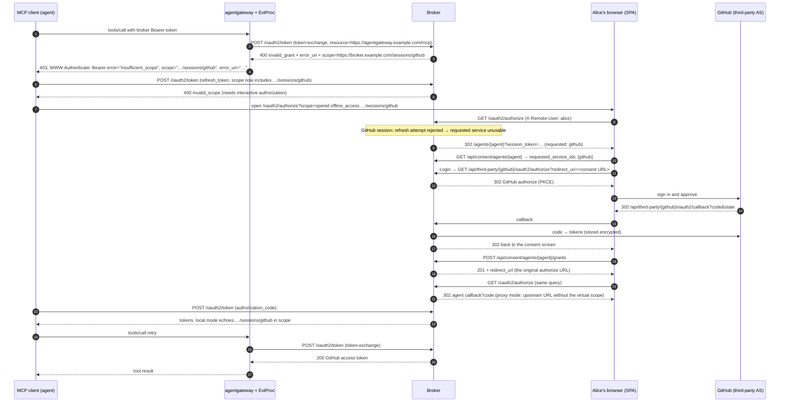
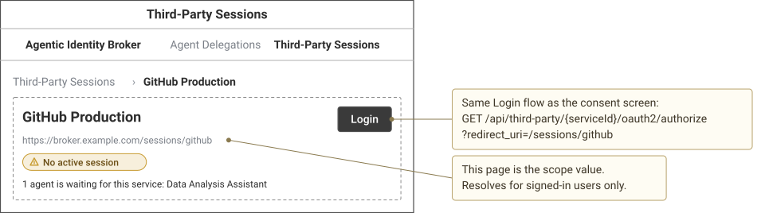
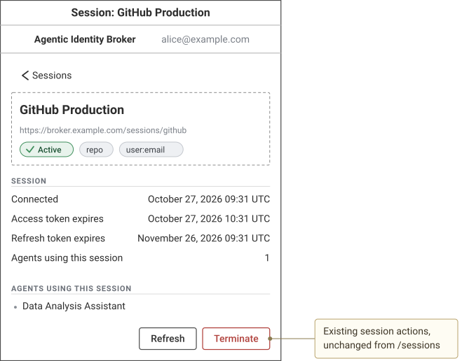
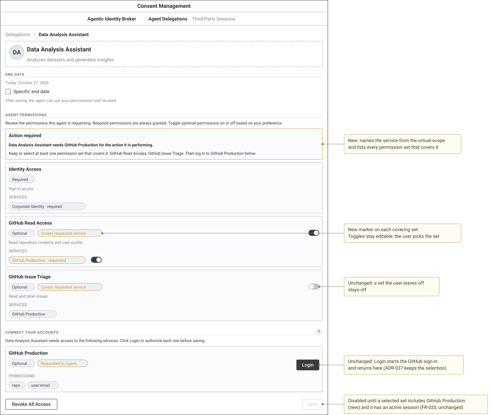
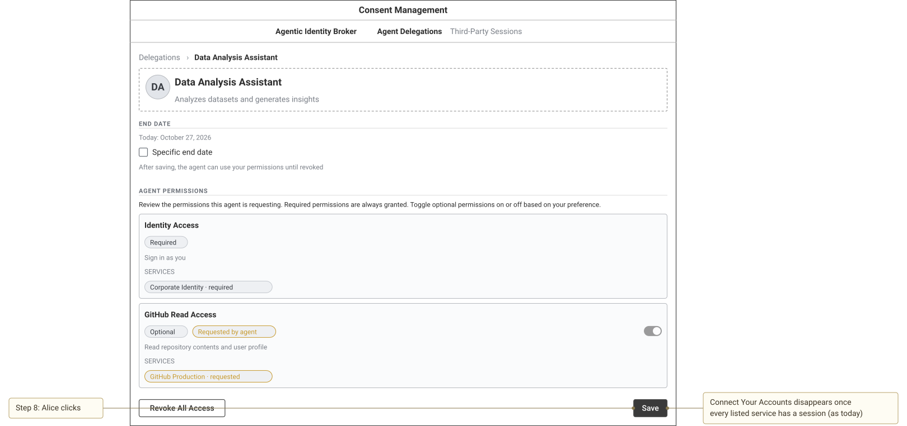

# Wireframes for issue #299 (incremental authorization)

Rendered with `just render-wireframes specs/055-incremental-authorization/wireframes.md`. The sequence diagram source is `wireframes/sequence.mmd`; `wireframes/sequence.svg` was rendered with Mermaid 11.

## Sequence



## State A: session page, no session



<details><summary>Wireloom source</summary>

```wireloom
window "Third-Party Sessions":
  header:
    row:
      text "Agentic Identity Broker" bold
      spacer
      text "Agent Delegations" muted
      text "Third-Party Sessions" bold
  breadcrumb:
    crumb "Third-Party Sessions"
    crumb "GitHub Production"
  panel:
    row:
      col:
        text "GitHub Production" bold size=large
        text "https://broker.example.com/sessions/github" muted size=small id="scope-url"
        status "No active session" kind=warning
        text "1 agent is waiting for this service: Data Analysis Assistant" size=small
      spacer
      button "Login" primary id="login"

annotation "This page is the scope value.\nResolves for signed-in users only." target="scope-url" position=right
annotation "Same Login flow as the consent screen:\nGET /api/third-party/{serviceId}/oauth2/authorize\n?redirect_uri=/sessions/github" target="login" position=right
```

</details>

## State B: session page, active session



<details><summary>Wireloom source</summary>

```wireloom
window "Third-Party Sessions":
  header:
    row:
      text "Agentic Identity Broker" bold
      spacer
      text "Agent Delegations" muted
      text "Third-Party Sessions" bold
  breadcrumb:
    crumb "Third-Party Sessions"
    crumb "GitHub Production"
  panel:
    row:
      col:
        text "GitHub Production" bold size=large
        text "https://broker.example.com/sessions/github" muted size=small
        status "Active" kind=success
        row:
          chip "Encrypted"
          chip "1 agent"
          chip "Established: Oct 27, 2026"
        row:
          text "Refresh token expires Nov 26, 2026" size=small
        text "Scopes" muted size=small
        row:
          chip "repo"
          chip "user:email"
      spacer
      col 150:
        button "Refresh"
        button "Terminate" accent=danger id="terminate"

annotation "Existing SessionCard content and actions,\nunchanged from /sessions" target="terminate" position=right
```

</details>

## State C: consent screen, requested service not connected



<details><summary>Wireloom source</summary>

```wireloom
window "Consent Management":
  header:
    row:
      text "Agentic Identity Broker" bold
      spacer
      text "Agent Delegations" bold
      text "Third-Party Sessions" muted
  breadcrumb:
    crumb "Delegations"
    crumb "Data Analysis Assistant"
  panel:
    row:
      avatar "DA" size=large
      col:
        text "Data Analysis Assistant" bold size=large
        text "Analyzes datasets and generates insights" muted
  section "End Date":
    text "Today: October 27, 2026" muted size=small
    checkbox "Specific end date" label-right
    text "After saving, the agent can use your permissions until revoked" muted size=small
  section "Agent Permissions":
    text "Review the permissions this agent is requesting. Required permissions are always granted. Toggle optional permissions on or off based on your preference." size=small
    slot "Action required" accent=warning id="banner":
      text "Data Analysis Assistant needs GitHub Production for the action it is performing." bold size=small
      text "Keep or select at least one permission set that covers it: GitHub Read Access, GitHub Issue Triage. Then log in to GitHub Production below." size=small
    slot "Identity Access":
      row:
        chip "Required"
      text "Sign in as you" muted size=small
      text "SERVICES" muted size=small
      chip "Corporate Identity · required"
    slot "GitHub Read Access" id="github-read":
      row:
        chip "Optional"
        chip "Covers requested service" accent=warning id="covers-chip"
        spacer
        toggle "" on
      text "Read repository contents and user profile" muted size=small
      text "SERVICES" muted size=small
      row:
        chip "GitHub Production · requested" accent=warning
        toggle "" on
    slot "GitHub Issue Triage":
      row:
        chip "Optional"
        chip "Covers requested service" accent=warning
        spacer
        toggle "" off id="triage-toggle"
      text "Read and label issues" muted size=small
      text "SERVICES" muted size=small
      chip "GitHub Production"
  section "Connect Your Accounts" badge="1":
    text "Data Analysis Assistant needs access to the following services. Click Login to authorize each one before saving." size=small
    slot "GitHub Production":
      row:
        chip "Optional"
        chip "Requested by agent" accent=warning
        spacer
        button "Login" primary id="login"
      text "PERMISSIONS" muted size=small
      row:
        chip "repo"
        chip "user:email"
  row:
    button "Revoke All Access"
    spacer
    button "Save" disabled id="save"

annotation "New: names the service from the virtual scope\nand lists every permission set that covers it" target="banner" position=right
annotation "New marker on each covering set.\nToggles stay editable: the user picks the set" target="covers-chip" position=right
annotation "Unchanged: a set the user leaves off\nstays off" target="triage-toggle" position=right
annotation "Unchanged: Login starts the GitHub sign-in\nand returns here (ADR 037 keeps the selection)" target="login" position=right
annotation "Disabled until a selected set includes GitHub Production\n(new) and it has an active session (FR-020, unchanged)" target="save" position=right
```

</details>

## State D: consent screen after login



<details><summary>Wireloom source</summary>

```wireloom
window "Consent Management":
  header:
    row:
      text "Agentic Identity Broker" bold
      spacer
      text "Agent Delegations" bold
      text "Third-Party Sessions" muted
  breadcrumb:
    crumb "Delegations"
    crumb "Data Analysis Assistant"
  panel:
    row:
      avatar "DA" size=large
      col:
        text "Data Analysis Assistant" bold size=large
        text "Analyzes datasets and generates insights" muted
  section "End Date":
    text "Today: October 27, 2026" muted size=small
    checkbox "Specific end date" label-right
    text "After saving, the agent can use your permissions until revoked" muted size=small
  section "Agent Permissions":
    text "Review the permissions this agent is requesting. Required permissions are always granted. Toggle optional permissions on or off based on your preference." size=small
    slot "Ready to save" accent=success id="banner":
      text "GitHub Production is covered by GitHub Read Access and logged in. Save to continue." size=small
    slot "Identity Access":
      row:
        chip "Required"
      text "Sign in as you" muted size=small
      text "SERVICES" muted size=small
      chip "Corporate Identity · required"
    slot "GitHub Read Access":
      row:
        chip "Optional"
        chip "Covers requested service" accent=warning
        spacer
        toggle "" on
      text "Read repository contents and user profile" muted size=small
      text "SERVICES" muted size=small
      row:
        chip "GitHub Production · requested" accent=warning
        toggle "" on
    slot "GitHub Issue Triage":
      row:
        chip "Optional"
        chip "Covers requested service" accent=warning
        spacer
        toggle "" off
      text "Read and label issues" muted size=small
      text "SERVICES" muted size=small
      chip "GitHub Production"
  row:
    button "Revoke All Access"
    spacer
    button "Save" primary id="save"

annotation "Connect Your Accounts disappears once\nevery listed service has a session (as today)" target="save" position=right
annotation "Step 8: Alice clicks" target="save" position=left
```

</details>
