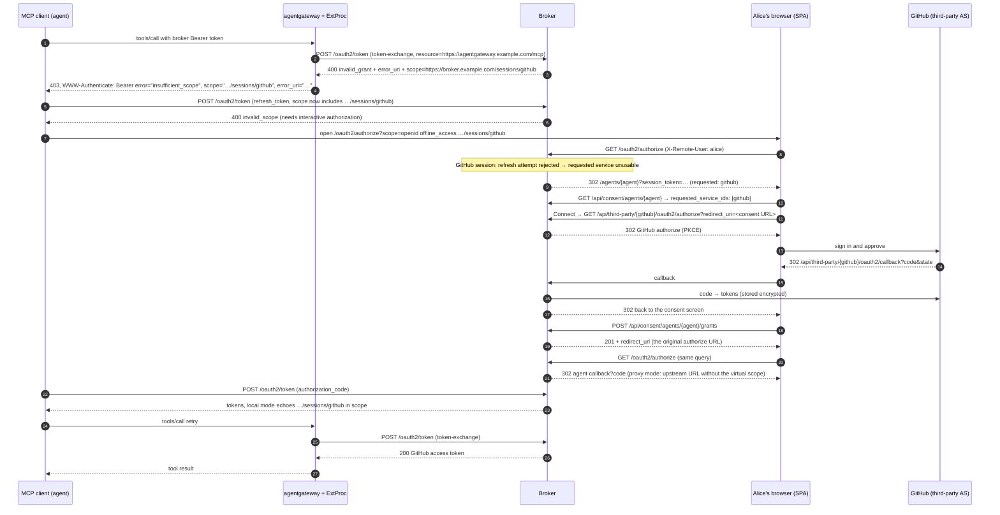

# Wireframes for issue #299 (incremental authorization)

Rendered with `just render-wireframes specs/055-incremental-authorization/wireframes.md`. The sequence diagram source is `wireframes/sequence.mmd`; `wireframes/sequence.svg` was rendered with Mermaid 11.

## Sequence



## State A: session page, no session


<details><summary>Wireloom source</summary>

```wireloom
window "Session: GitHub Production":
  header:
    row:
      text "Agentic Identity Broker" bold
      spacer
      text "alice@example.com" muted
  row:
    backbutton "Sessions"
  panel:
    text "GitHub Production" bold size=large
    text "https://broker.example.com/sessions/github" muted size=small id="scope-url"
    row:
      status "No active session" kind=warning
  section "What this service is used for":
    text "Agents you delegated to can call GitHub on your behalf once you connect." size=small
    row:
      text "Agents waiting for this service:" size=small
      chip "Data Analysis Assistant" accent=warning
  section "Connect":
    text "Connecting opens GitHub Production's sign-in. You return to this page afterwards." size=small
    row align=right:
      button "Connect GitHub Production" primary id="connect"

annotation "This page is the scope value.\nResolves for signed-in users only." target="scope-url" position=right
annotation "GET /api/third-party/{serviceId}/oauth2/authorize\n?redirect_uri=/sessions/github" target="connect" position=right
```

</details>

## State B: session page, active session


<details><summary>Wireloom source</summary>

```wireloom
window "Session: GitHub Production":
  header:
    row:
      text "Agentic Identity Broker" bold
      spacer
      text "alice@example.com" muted
  row:
    backbutton "Sessions"
  panel:
    text "GitHub Production" bold size=large
    text "https://broker.example.com/sessions/github" muted size=small
    row:
      status "Active" kind=success
      chip "repo"
      chip "user:email"
  section "Session":
    kv "Connected" "October 27, 2026 09:31 UTC"
    kv "Access token expires" "October 27, 2026 10:31 UTC"
    kv "Refresh token expires" "November 26, 2026 09:31 UTC"
    kv "Agents using this session" "1"
  section "Agents using this session":
    list:
      item "Data Analysis Assistant"
  row align=right:
    button "Refresh" id="refresh"
    button "Terminate" accent=danger id="terminate"

annotation "Existing session actions,\nunchanged from /sessions" target="terminate" position=right
```

</details>

## State C: consent screen, requested service not connected


<details><summary>Wireloom source</summary>

```wireloom
window "Consent Management":
  header:
    row:
      text "Agentic Identity Broker" bold
      spacer
      text "alice@example.com" muted
  panel:
    text "Data Analysis Assistant" bold size=large
    text "Analyzes datasets and generates insights" muted
    row:
      status "Needs one more service to continue" kind=warning id="banner"
  section "Agent Permissions":
    slot "Identity Access" active:
      text "Sign in as you" muted
      row:
        chip "Required"
        status "Connected" kind=success
    slot "GitHub Read Access" active accent=warning id="github-set":
      text "Read repository contents and user profile" muted
      row:
        chip "Optional"
        chip "Requested now" accent=warning id="requested-chip"
      row:
        text "GitHub Production" size=small
        spacer
        status "Not connected" kind=warning
        button "Connect" primary id="connect-github"
  row align=right:
    button "Approve & Delegate" disabled id="approve"

annotation "Derived from the virtual scope\nin the authorize request" target="requested-chip" position=right
annotation "Locked on like a mandatory set" target="github-set" position=left
annotation "Starts the GitHub sign-in and returns here\n(ADR 037 keeps the selection)" target="connect-github" position=right
annotation "Disabled until every requested\nservice has an active session" target="approve" position=right
```

</details>

## State D: consent screen after connecting


<details><summary>Wireloom source</summary>

```wireloom
window "Consent Management":
  header:
    row:
      text "Agentic Identity Broker" bold
      spacer
      text "alice@example.com" muted
  panel:
    text "Data Analysis Assistant" bold size=large
    text "Analyzes datasets and generates insights" muted
  section "Agent Permissions":
    slot "Identity Access" active:
      text "Sign in as you" muted
      row:
        chip "Required"
        status "Connected" kind=success
    slot "GitHub Read Access" active:
      text "Read repository contents and user profile" muted
      row:
        chip "Optional"
        chip "Requested now" accent=warning
      row:
        text "GitHub Production" size=small
        spacer
        status "Connected" kind=success
  row align=right:
    button "Approve & Delegate" primary id="approve"

annotation "Step 8: Alice clicks" target="approve" position=right
```

</details>
