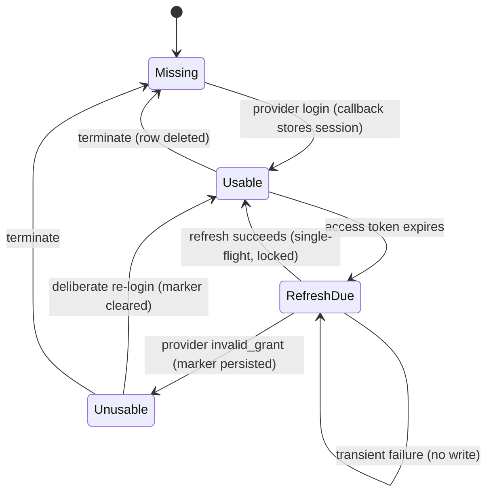

# Data Model: Incremental Service Authorization

**Feature**: [spec.md](./spec.md) | **Research**: [research.md](./research.md) | **Date**: 2026-10-29

This feature adds one bounded context, `internal/domain/servicescope/`. It extends existing
aggregates and adds no aggregate root. It adds no typed entity ID, because no new entity has its
own UUID primary key (ADR 013).

## Value objects (`internal/domain/servicescope/`)

### VirtualServiceScope

| Field | Type | Rule |
|---|---|---|
| `Raw` | `string` | The exact requested string. It is never rewritten when granted (research R2). |
| `Identifier` | `string` | The text after `<public URL>/sessions/` |
| `Form` | `uuid` \| `canonical` | `uuid` only for the lowercase canonical UUID text. `canonical` when `canonical.Validate` accepts the text. |

- `Parse(raw, publicURL) (VirtualServiceScope, Kind)` returns one of three kinds:
  - `KindOrdinary`: the value does not start with the exact `<public URL>/sessions/` prefix;
  - `KindVirtual`;
  - `KindMalformed`: the value has the prefix but an invalid remainder.
- `Format(publicURL, service)` emits `<public URL>/sessions/<canonical_id>` when the service has a
  canonical ID, and `<public URL>/sessions/<uuid>` otherwise.
- `publicURL` is always `server.enduser.public_url` with trailing slashes removed. It is never taken
  from the request Host (FR-002, SR-004).

### ServiceScopeBinding

`map[string]id.ServiceID`, keyed by `VirtualServiceScope.Raw`. It is created when the authorization
endpoint resolves the scope. It is immutable afterwards and inherited by refresh successors. JSON
form: `{"https://broker.example.com/sessions/github":"880e8400-e29b-41d4-a716-446655440010"}`.

### RequestedServiceSet

An ordered list with no duplicates of `{ServiceID, Scopes []VirtualServiceScope}`. Duplicate canonical
and UUID scopes for one service merge into one entry (spec Edge Cases). Resolution rules:

1. Resolve each identifier through the service repository: `Get` for a UUID, `GetByCanonicalID`
   otherwise. A not-found result is an `ErrUnknownService`, which surfaces as `invalid_scope`.
2. Check eligibility against the agent (research R4). Failure is an `ErrServiceNotEligible`, which
   also surfaces as `invalid_scope`.
3. When a binding exists, the resolved UUID must equal the bound UUID. A mismatch is an
   `ErrBindingMismatch`, which surfaces as `invalid_scope` and fails closed.

A repository failure surfaces as `server_error`. It is never treated as unknown.

### ServiceRequirementOutcome (result of `Evaluate`)

| Field | Meaning |
|---|---|
| `ServiceID` | The requested service |
| `CoveringPermissionSetIDs` | The agent's declared sets whose `service_scopes` include the service. These are the candidates, whether or not they are selected. |
| `Selected` | The service is included in at least one selected grant entry. |
| `RequiredScopesCovered` | The union of selected-set scopes, intersected with the ceiling, is a superset of the requirement's `required_scopes`. With `require_all_scopes`, inclusion is enough. |
| `Usability` | One of `usable`, `missing`, `unusable_definitive`, or `unverifiable_transient` (see SessionUsability) |
| `Satisfied` | `Selected && RequiredScopesCovered && Usability == usable` |

### SessionUsability

This value is returned by `OAuth2SessionService.CheckServiceUsability`. It is not persisted.

| Value | Produced when |
|---|---|
| `usable` | The access token is valid, or an eligible refresh succeeded, and the stored scopes cover the required scopes. |
| `missing` | No session row exists. |
| `unusable_definitive` | Any of the following: <br>• the refresh token is absent or expired; <br>• the refresh was rejected with `invalid_grant`, which persists the marker; <br>• the stored scopes are insufficient; <br>• the established client identity does not match. |
| `unverifiable_transient` | Provider 5xx or 429, network error, storage error, or cancellation. No marker is written. |

## Extended aggregates and records

### AuthorizationSessionClaims (JWE, `internal/domain/oauth2/sessiontoken/`)

| New field | JSON | Rule |
|---|---|---|
| `RequestedServiceIDs` | `requested_service_ids` (omitted when empty) | Derived on the server when the token is issued. It is never accepted from the browser. |
| `ServiceScopeBindings` | `service_scope_bindings` (omitted when empty) | Bindings for the virtual scopes in `original_url` |

The TTL (10 min), the principal binding, the agent binding, and `original_url` normalization are
unchanged (ADR 016). When the token is consumed, the scope in `original_url` is resolved again and
must reproduce exactly these IDs and bindings. Otherwise the session token is rejected as invalid.

### AuthorizationCode (`internal/domain/storage/`), table `authorization_codes`

| New field | Column | Type | Null |
|---|---|---|---|
| `ServiceScopeBindings` | `service_scope_bindings` | `JSONB` | Yes. `NULL` when no virtual scope was granted. |

### RefreshTokenSession (`internal/domain/storage/`), table `refresh_token_sessions`

| New field | Column | Type | Null |
|---|---|---|---|
| `ServiceScopeBindings` | `service_scope_bindings` | `JSONB` | Yes. Copied from the code, or from the predecessor in `CreateSuccessor`. |

`Validate()` gains one check: every key in the bindings must also be a member of `Scope`, and every
value must be a non-zero UUID.

### UserSession (unchanged schema)

The **definitive unusability state** is the existing #271 marker (DEC-003): `RefreshTokenExpiresAt`
is set to the rejection time under `WithLockedSession`. Derived states:

| Derived state | Condition |
|---|---|
| Usable now | `HasValidAccessToken()` |
| Refreshable | `CanRefresh()` |
| Definitively unusable | `IsExpired()`. The access token has expired and no usable refresh token remains, which includes a rejection marker in the past. |

A reconnect writes a new row state under the same lock. `setSessionTokens` clears the marker. A
termination deletes the row, and a late refresh finds `current == nil` and returns
`ErrSessionNotFound`. Neither path is changed (FR-018).

## Migration `046_add_service_scope_bindings` (Proposed, DEC-004)

```sql
-- 046_add_service_scope_bindings.up.sql
ALTER TABLE authorization_codes ADD COLUMN service_scope_bindings JSONB NULL;
ALTER TABLE refresh_token_sessions ADD COLUMN service_scope_bindings JSONB NULL;

-- 046_add_service_scope_bindings.down.sql
ALTER TABLE refresh_token_sessions DROP COLUMN service_scope_bindings;
ALTER TABLE authorization_codes DROP COLUMN service_scope_bindings;
```

- Both statements are atomic and run in the default migration transaction. Adding a nullable column
  without a default is a metadata-only change in PostgreSQL. It needs no `CONCURRENTLY` exception
  (compare ADR 039).
- Rollback discards bindings. Rolling back the schema also requires rolling back the code. After a
  rollback, the pre-feature code treats a granted virtual scope as an ordinary scope string. The
  scope then passes the allow-list only when the agent has no `allowed_scopes`. Otherwise, refresh
  returns `invalid_scope`, and the client authorizes again. No broker service check runs in that
  state. The quickstart rollback note documents this.
- Adapters:
  - PostgreSQL adds the column to its explicit column lists (no `SELECT *`) in `Create`,
    `CreateSuccessor`, `FindBySignature`, and `FindByCodeHash`.
  - The in-memory adapter copies the map deeply.
- Tests: apply, rollback, and repeat in `tests/integration`, plus round-trip tests for both
  repositories.

## State transitions

```mermaid
stateDiagram-v2
    [*] --> Requested: authorize with virtual scope(s)
    Requested --> Consent: any requested service unsatisfied
    Consent --> Consent: provider login round trip (selection preserved)
    Consent --> Requested: Save accepted (re-run same authorize request)
    Requested --> CodeIssued: all satisfied (local)
    Requested --> UpstreamRedirect: all satisfied (proxy; virtual scopes stripped)
    CodeIssued --> RefreshGrant: code exchanged (bindings copied)
    RefreshGrant --> RefreshGrant: refresh recheck passes (rotated, bindings inherited)
    RefreshGrant --> RefreshGrant: recheck fails → invalid_scope (not rotated)
```





## Glossary additions (`ARCHITECTURE.md`)

| Term | Definition |
|---|---|
| **Virtual Service Scope** | A scope string `<public URL>/sessions/<canonical-id-or-UUID>`. It asks that the authenticated user hold a usable, grant-covered session for one ThirdpartyOAuth2Service. It is never sent upstream and never advertised in discovery. |
| **Requested Service Set** | The deduplicated services that one authorization or refresh request names through Virtual Service Scopes. These services are required for that request only. |
| **Service-Scope Binding** | The persisted map from a granted Virtual Service Scope string to the service UUID it resolved to. It pins identity across renames and canonical-ID reuse. |
| **Session Usability** | The verified ability of a UserSession to supply the configured service access now: `usable`, `missing`, `unusable_definitive`, or `unverifiable_transient`. |
