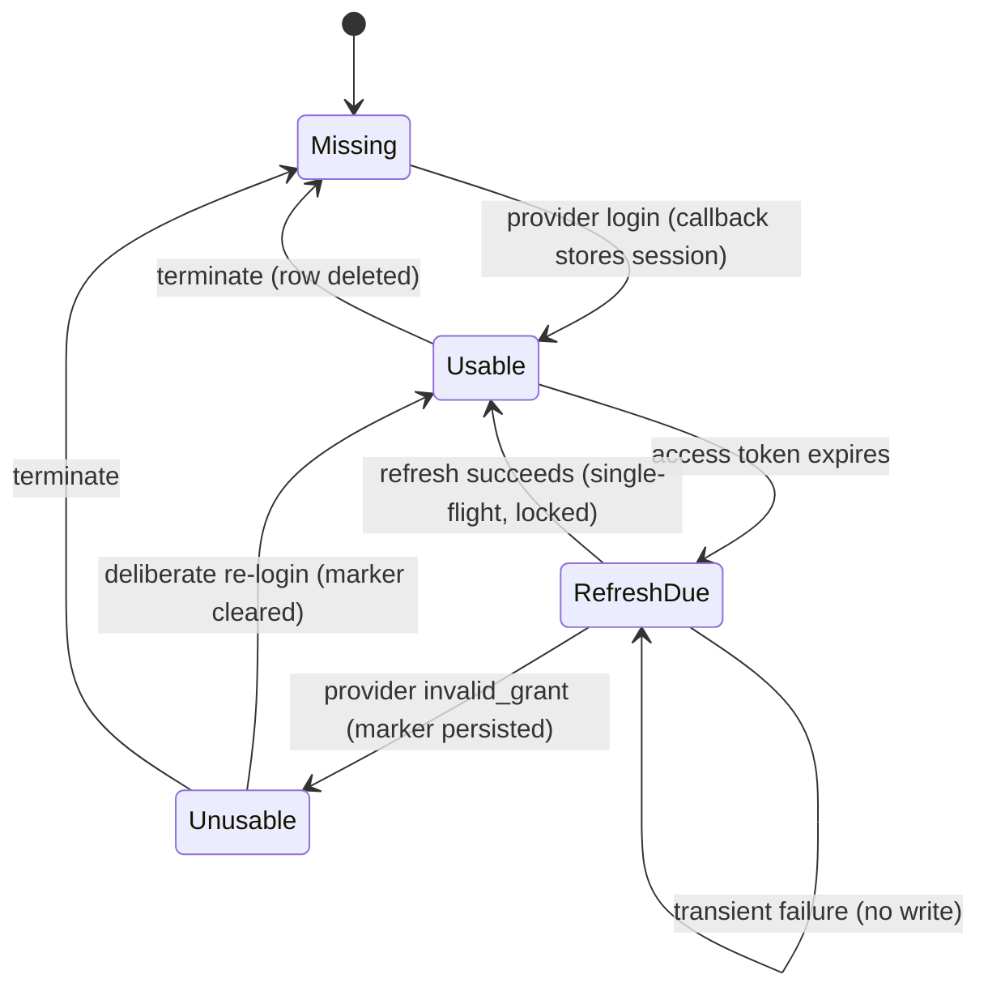

# Data Model: Incremental Service Authorization

**Feature**: [spec.md](./spec.md) | **Research**: [research.md](./research.md) | **Date**: 2026-10-29

This feature adds one bounded context, `internal/domain/servicescope/`. It extends existing
aggregates and adds no aggregate root. It adds no typed entity ID, because no new entity has its
own UUID primary key (ADR 013).

## Value objects (`internal/domain/servicescope/`)

### VirtualServiceScope

| Field | Type | Rule |
|---|---|---|
| `Raw` | `string` | The exact requested string. It is never rewritten when granted (research R2). |
| `Identifier` | `string` | The text after `<public URL>/sessions/` |
| `Form` | `uuid` \| `canonical` | `uuid` only for the lowercase canonical UUID text. `canonical` when `canonical.Validate` accepts the text. |

- `Parse(raw, publicURL) (VirtualServiceScope, Kind)` returns one of three kinds:
  - `KindOrdinary`: the value does not start with the exact `<public URL>/sessions/` prefix;
  - `KindVirtual`;
  - `KindMalformed`: the value has the prefix but an invalid remainder.
- `Format(publicURL, service)` emits `<public URL>/sessions/<canonical_id>` when the service has a
  canonical ID, and `<public URL>/sessions/<uuid>` otherwise.
- `publicURL` is always `server.enduser.public_url` with trailing slashes removed. It is never taken
  from the request Host (FR-002, SR-004).

### ServiceScopeBinding

`map[string]id.ServiceID`, keyed by `VirtualServiceScope.Raw`. It is created when the authorization
endpoint resolves the scope. It is immutable afterwards and inherited in full by refresh successors,
including after scope narrowing. On refresh rows, keys outside current `Scope` are assurance-only:
they require continuing-service checks but never authorize re-granting a removed scope. JSON
form: `{"https://broker.example.com/sessions/github":"880e8400-e29b-41d4-a716-446655440010"}`.

### RequestedServiceSet

An ordered list with no duplicates of `{ServiceID, Scopes []VirtualServiceScope}`. Duplicate canonical
and UUID scopes for one service merge into one entry (spec Edge Cases). Resolution rules:

1. Resolve each identifier through the service repository: `Get` for a UUID, `GetByCanonicalID`
   otherwise. A not-found result is an `ErrUnknownService`, which surfaces as `invalid_scope`.
2. Check eligibility against the agent (research R4). Failure is an `ErrServiceNotEligible`, which
   also surfaces as `invalid_scope`.
3. When a binding exists, the resolved UUID must equal the bound UUID. A mismatch is an
   `ErrBindingMismatch`, which surfaces as `invalid_scope` and fails closed.

A repository failure surfaces as `server_error`. It is never treated as unknown.

### ServiceRequirementOutcome (result of `Evaluate`)

| Field | Meaning |
|---|---|
| `ServiceID` | The requested service |
| `CoveringPermissionSetIDs` | The agent's declared sets whose `service_scopes` include the service. These are the candidates, whether or not they are selected. |
| `Selected` | The service is included in at least one selected grant entry. |
| `RequiredScopesCovered` | The union of selected-set scopes, intersected with the ceiling, is a superset of the requirement's `required_scopes`. With `require_all_scopes` or no explicit requirements, inclusion and definition suffice for coverage, but usability still requires the full effective union. |
| `EffectiveScopes` | Selected permission-set union for this service, intersected with `required_scopes` only for an explicit fixed-scope requirement. All-scopes and agents without requirements use the full union. Preserve exchange's structural/inclusion/definition and empty-intersection denials (research R4). |
| `Usability` | One of `usable`, `missing`, `unusable_definitive`, or `unverifiable_transient`, verified against `EffectiveScopes`, not just configured required scopes (see SessionUsability) |
| `Satisfied` | `Selected && RequiredScopesCovered && Usability == usable` |

### SessionUsability

This value is returned by `OAuth2SessionService.CheckServiceUsability` for an explicit
`effectiveScopes` input. It is not persisted. Identity and scope checks apply whether access is
currently valid or refreshed; the refresh-token state alone cannot disqualify valid access.
Consent evaluates baseline and candidate contributions against one verified session snapshot,
then combines the selected candidates (research R4); submission recomputes the full live union.

| Value | Produced when |
|---|---|
| `usable` | Access is valid (even without a refresh token or with expired refresh), or an eligible expired-access refresh succeeded; stored scopes cover the effective scopes and established client identity matches. |
| `missing` | No session row exists. |
| `unusable_definitive` | Access is expired and refresh is absent, expired, or rejected with `invalid_grant` (only rejection persists the marker); or stored scopes do not cover the effective scopes; or established client identity does not match. |
| `unverifiable_transient` | Provider 5xx or 429, network error, storage error, or cancellation. No marker is written. |

## Extended aggregates and records

### AuthorizationSessionClaims (JWE, `internal/domain/oauth2/sessiontoken/`)

| New field | JSON | Rule |
|---|---|---|
| `RequestedServiceIDs` | `requested_service_ids` (omitted when empty) | Derived on the server when the token is issued. It is never accepted from the browser. |
| `ServiceScopeBindings` | `service_scope_bindings` (omitted when empty) | Bindings for the virtual scopes in `original_url` |

The TTL (10 min), the principal binding, the agent binding, and `original_url` normalization are
unchanged (ADR 016). Validate these properties independently at consent detail/submission and
subsequent authorize re-entry. Successful Save appends the same `session_token` JWE to the sealed
`original_url` in the server-built continuation URL, without renewing expiry. On re-entry remove
only that transport parameter for request comparison, use the sealed original request, and freshly
resolve its scopes against the sealed bindings before code issuance or proxy redirect. Changed
identity fails with `invalid_scope`; invalid/mismatched context fails existing session validation.
No code/upstream redirect is produced on failure, and browser-supplied IDs never replace bindings.

### AuthorizationCode (`internal/domain/storage/`), table `authorization_codes`

| New field | Column | Type | Null |
|---|---|---|---|
| `ServiceScopeBindings` | `service_scope_bindings` | `JSONB` | Yes. `NULL` when no virtual scope was granted. |

### RefreshTokenSession (`internal/domain/storage/`), table `refresh_token_sessions`

| New field | Column | Type | Null |
|---|---|---|---|
| `ServiceScopeBindings` | `service_scope_bindings` | `JSONB` | Yes. Copied from the code, or from the predecessor in `CreateSuccessor`. |

Validation and inheritance:

- Authorization-code binding keys must be members of the code's granted `Scope`.
- Every binding key is a syntactically valid Virtual Service Scope and every value a non-zero UUID.
  Every virtual scope in either record's current `Scope` must have a binding; missing bindings fail
  closed. Legacy nil bindings are valid only when there are no virtual scopes.
- For a refresh row, `Scope` is its current maximum grantable scope set; bindings are the immutable
  original virtual-service assurance set and may include keys outside `Scope` after narrowing.
- Initial refresh issuance copies bindings and `Scope` from the code. `CreateSuccessor` validates
  that successor bindings equal predecessor bindings exactly and successor `Scope` is a subset of
  predecessor `Scope`. It never accepts a caller's fabricated extra assurance binding.
- A successful narrowed refresh returns the narrowed response/JWT scope and persists that same
  narrowed `Scope` with all bindings retained. A subsequent scope-less refresh uses this narrowed
  `Scope`, rechecks all retained bindings and cannot restore removed scopes. Re-requesting a removed
  ordinary or virtual scope is widening. These checks precede consumption/rotation.

Example three-step sequence (synthetic): code exchange grants `openid offline_access
https://broker.example.com/sessions/github` and binds GitHub to its UUID; refresh requesting only
`openid offline_access` returns those two scopes and a successor with that `Scope` plus the original
GitHub binding; scope-less refresh of the successor returns only `openid offline_access`, still
checking GitHub. If GitHub is unusable, that third step instead returns non-consuming
`invalid_scope`. Re-requesting the removed GitHub scope is also non-consuming `invalid_scope`.

### UserSession (unchanged schema)

The **definitive unusability state** is the existing #271 marker (DEC-003): `RefreshTokenExpiresAt`
is set to the rejection time under `WithLockedSession`. Derived states:

| Derived state | Condition |
|---|---|
| Access valid now | `HasValidAccessToken()`; verified usability additionally requires effective scopes and matching client identity. |
| Refreshable | `CanRefresh()` |
| Definitively unusable | `IsExpired()`. The access token has expired and no usable refresh token remains, which includes a rejection marker in the past. |

A reconnect writes a new row state under the same lock. `setSessionTokens` clears the marker. A
termination deletes the row, and a late refresh finds `current == nil` and returns
`ErrSessionNotFound`. Neither path is changed (FR-018).

## Migration `046_add_service_scope_bindings` (Proposed, DEC-004)

```sql
-- 046_add_service_scope_bindings.up.sql
ALTER TABLE authorization_codes ADD COLUMN service_scope_bindings JSONB NULL;
ALTER TABLE refresh_token_sessions ADD COLUMN service_scope_bindings JSONB NULL;

-- 046_add_service_scope_bindings.down.sql
ALTER TABLE refresh_token_sessions DROP COLUMN service_scope_bindings;
ALTER TABLE authorization_codes DROP COLUMN service_scope_bindings;
```

- Both statements are atomic and run in the default migration transaction. Adding a nullable column
  without a default is a metadata-only change in PostgreSQL. It needs no `CONCURRENTLY` exception
  (compare ADR 039).
- Rollback discards bindings. Rolling back the schema also requires rolling back the code. After a
  rollback, the pre-feature code treats a granted virtual scope as an ordinary scope string. The
  scope then passes the allow-list only when the agent has no `allowed_scopes`. Otherwise, refresh
  returns `invalid_scope`, and the client authorizes again. No broker service check runs in that
  state. The quickstart rollback note documents this.
- Adapters:
  - PostgreSQL adds the column to its explicit column lists (no `SELECT *`) in `Create`,
    `CreateSuccessor`, `FindBySignature`, and `FindByCodeHash`.
  - The in-memory adapter copies the map deeply.
- Tests: apply, rollback, and repeat in `tests/integration`, plus round-trip tests for both
  repositories.

## State transitions

```mermaid
stateDiagram-v2
    [*] --> Requested: authorize with virtual scope(s)
    Requested --> Consent: any requested service unsatisfied
    Consent --> Consent: provider login round trip (selection preserved)
    Consent --> Requested: Save accepted (same authorize request plus original JWE)
    Requested --> CodeIssued: all satisfied (local)
    Requested --> UpstreamRedirect: all satisfied (proxy; virtual scopes stripped)
    CodeIssued --> RefreshGrant: code exchanged (bindings copied)
    RefreshGrant --> RefreshGrant: refresh recheck passes (scope may narrow, all bindings inherited)
    RefreshGrant --> RefreshGrant: recheck fails → invalid_scope (not rotated)
```





## Glossary additions (`ARCHITECTURE.md`)

| Term | Definition |
|---|---|
| **Virtual Service Scope** | A scope string `<public URL>/sessions/<canonical-id-or-UUID>`. It asks that the authenticated user hold a usable, grant-covered session for one ThirdpartyOAuth2Service. It is never sent upstream and never advertised in discovery. |
| **Requested Service Set** | The deduplicated services named by authorization Virtual Service Scopes or original refresh assurance bindings, including bindings retained after scope narrowing. These requirements do not alter permanent agent configuration. |
| **Service-Scope Binding** | The protected/persisted map from an originally granted Virtual Service Scope string to its service UUID. It pins identity through consent re-entry, code exchange and refresh. Refresh narrowing retains all bindings as continuing-service assurance without re-granting removed scopes. |
| **Session Usability** | The verified ability of a UserSession to supply the configured service access now: `usable`, `missing`, `unusable_definitive`, or `unverifiable_transient`. |
