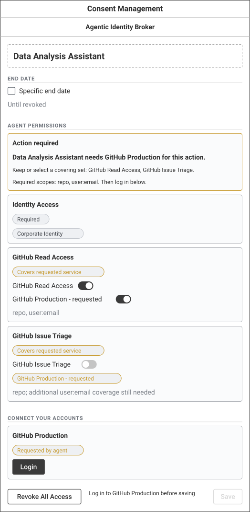
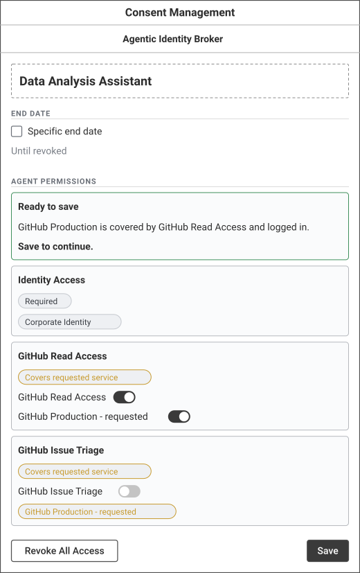
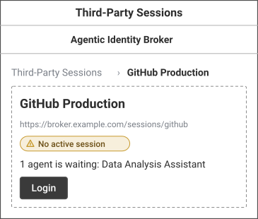
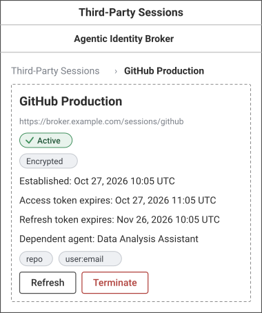
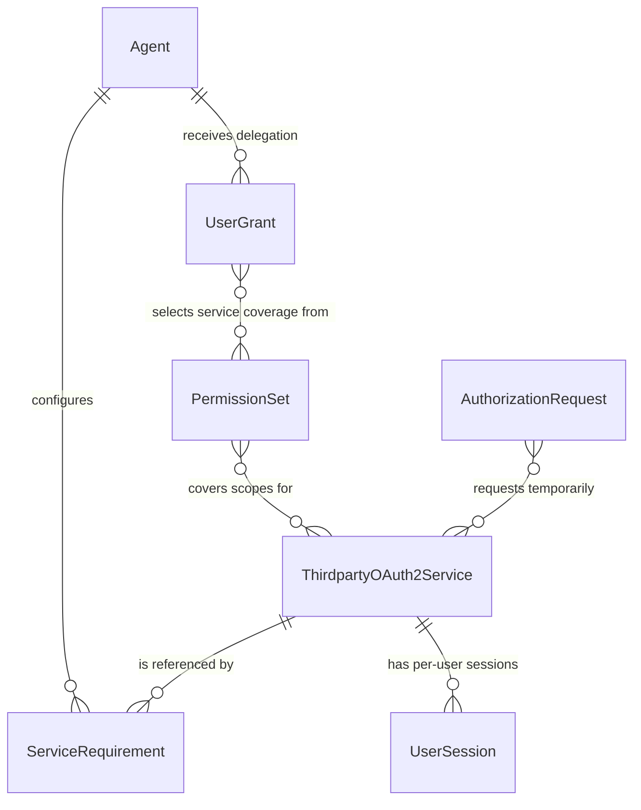
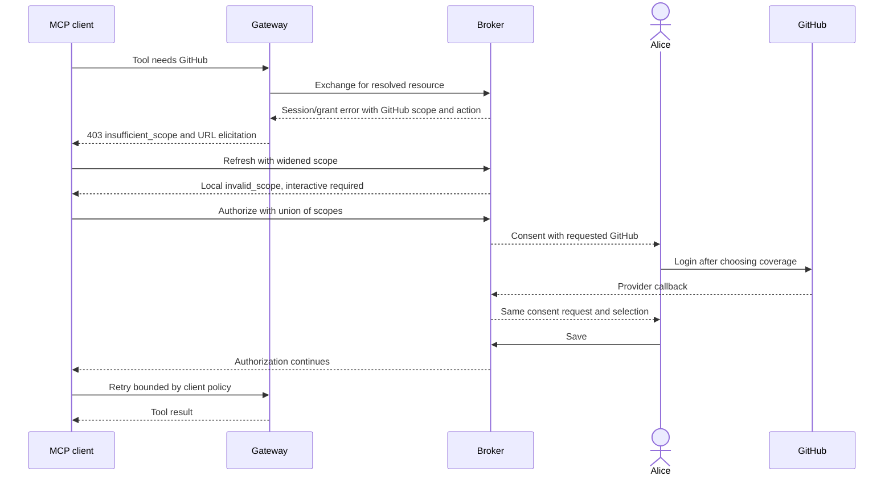

# Feature Specification: Incremental Service Authorization

**Feature Branch**: `speckit/issue-299`

**Created**: 2026-10-29

**Status**: Draft — product clarification required; no implementation approval recorded

**Input**: [Issue #299](https://github.com/zalando-incubator/agentic-identity-broker/issues/299), “Incremental authorization: per-service virtual scopes for MCP step-up (fixes optional-service re-auth loop)”. The feature-description parameter is exactly the supplied issue title, a blank line, and the supplied issue body. Issue comments and referenced branches are not requirements sources for this draft.

## User Scenarios & Testing *(mandatory)*

### User Story 1 - Recover an optional-service tool call through focused consent (Priority: P1)

An MCP client learns which broker-managed service its current operation needs. It requests that service during interactive authorization instead of silently obtaining another unusable token. The user sees the requested service, chooses how to grant it, connects the account, and continues the original operation.

**Why this priority**: This breaks the optional-service reauthorization loop while preserving the user's control over delegated permissions.

**Independent Test**: Starting with an active grant and a rejected GitHub refresh token, complete one challenge → interactive authorization → focused consent → GitHub login → save → authorization → successful tool retry journey.

**Acceptance Scenarios**:

1. **Given** an agent configured to use optional GitHub and an active grant covering it, but a GitHub access token that has expired and whose refresh is definitively rejected, **When** its tool call triggers token exchange, **Then** the broker records that session as unusable, returns a recoverable error naming GitHub's virtual scope and recovery URL, and the gateway returns a 403 insufficient-scope challenge carrying both while retaining URL elicitation.
2. **Given** a valid refresh token originally granted only `openid offline_access`, **When** the client requests the union including GitHub's virtual scope through refresh, **Then** local issuance refuses widening with `invalid_scope`, leaves the refresh token valid, and an interactive request with that union leads to consent rather than another silent success.
3. **Given** a valid grant but no usable session for the requested GitHub service, **When** the client requests its virtual scope interactively, **Then** consent identifies GitHub as requested, names every covering permission set, preserves the existing selections and end date, and disables Save with a reason until both coverage and a usable session exist.
4. **Given** two optional permission sets cover GitHub and neither is selected, **When** the user selects either set and includes GitHub within it, logs in, and saves, **Then** no other optional set is automatically selected or locked, the original authorization resumes unchanged, and the retried tool call succeeds.
5. **Given** consent requests GitHub, **When** a client submits a grant without GitHub covered by a selected permission set, **Then** the broker rejects the submission without replacing the existing grant or completing authorization, even if a usable GitHub session exists.
6. **Given** a request includes multiple permitted service scopes with one service not covered or unusable, **When** authorization runs, **Then** all requested services are treated as required for that request, every unsatisfied service is explained, and authorization proceeds only after all are satisfied; the agent's permanent service requirements do not change.
7. **Given** an access token is expired but its provider refresh succeeds, **When** interactive authorization checks the requested service, **Then** it uses the refreshed session and continues without unnecessary login when the grant already covers the configured scopes.

### User Story 2 - Repair the service by opening its scope link (Priority: P1)

A signed-in user opens the human-readable scope URL and manages that one service, without needing a step-up-capable client.

**Why this priority**: URL elicitation and manually followed recovery links must remain useful for existing clients.

**Independent Test**: Open the scope URL with no usable session, log in, return to that same page, inspect the active session, refresh it, and terminate it.

**Acceptance Scenarios**:

1. **Given** GitHub exists and Alice has no usable session, **When** she opens `/sessions/github` or its UUID equivalent after signing in, **Then** she sees the service identity, absent or unusable session state, her dependent/waiting agents, and Login; completing provider sign-in returns to that service page with the usable session displayed.
2. **Given** Alice has a usable GitHub session, **When** she opens its page, refreshes the session and then terminates it with the existing confirmation behavior, **Then** she sees its status, scopes, expiry and dependent agents, successful refresh updates the display, and termination returns the display to the no-session state without recreating the session.
3. **Given** a service-page link, **When** the visitor is unauthenticated or the service identifier is unknown, **Then** authentication is required before exposing user-specific information and an authenticated unknown-service visit shows the usual not-found page.
4. **Given** the agent's grant already covers GitHub but the session is missing, **When** Alice follows the existing recovery action link and completes GitHub sign-in, **Then** she returns to GitHub's session page and the next tool call succeeds without a new agent authorization.

### User Story 3 - Keep refresh and upstream authorization truthful (Priority: P1)

A user and client should not mistake a broker refresh for proof that an unusable requested service has become usable. Corporate identity providers must never receive broker-only service scopes.

**Why this priority**: Silent refresh is the loop's other entry point, and upstream isolation is essential for deployment compatibility.

**Independent Test**: Exercise local refresh with an already-granted virtual scope, and proxy authorization and refresh with mixed ordinary and virtual scopes.

**Acceptance Scenarios**:

1. **Given** a locally issued refresh token already carries GitHub's virtual scope and its grant remains active, **When** a subsequent refresh finds GitHub still covered and usable, **Then** refresh succeeds; if a later refresh finds GitHub unusable, it returns `invalid_scope` instead of issuing another unusable token.
2. **Given** a proxy-mode authorization request with ordinary scopes plus GitHub's virtual scope, **When** the broker verifies coverage and usability, **Then** it sends only the ordinary scopes upstream, retains the original request for consent continuation, and never modifies the upstream token's signed claims to add a virtual scope.
3. **Given** a proxy-mode refresh carrying GitHub's virtual scope, **When** it is forwarded, **Then** no broker-only scope reaches the upstream provider; whether a post-response usability check is included in this release is Q3 and has no final acceptance expectation yet.
4. **Given** a local authorization code obtained after GitHub step-up, **When** the code is exchanged, **Then** the granted scope representation follows the consistent visibility decision in Q2; existing PKCE, client authentication, code replay protection and grant revocation rules remain enforced.

### User Story 4 - Integrate without leaking or over-granting scopes (Priority: P2)

Operators can explain and deploy the scope challenge without publishing a catalog of broker-managed services. Requests cannot use service scopes to escape an agent's configured services.

**Why this priority**: Safe deployment and predictable failure behavior make incremental authorization interoperable rather than a new source of silent failures.

**Independent Test**: Compare challenges with and without a configured protected-resource metadata URL, then request valid aliases and invalid or unauthorized service scopes.

**Acceptance Scenarios**:

1. **Given** a deployment publishes protected-resource metadata and configures its URL for challenges, **When** an exchange produces a service challenge, **Then** it includes that URL alongside the scope and recovery link; without that optional configuration, scope and link still work and the metadata parameter is omitted.
2. **Given** a service has canonical ID `github` and a UUID, **When** either virtual-scope form is requested, **Then** it resolves to the same service and the broker emits the canonical form; a service without a canonical ID emits its UUID form. Rename behavior remains Q1.
3. **Given** an unknown service, a service the agent is not configured to use, a malformed broker-session scope, or an external-origin lookalike, **When** authorization evaluates scopes, **Then** it does not treat the value as an authorized broker-managed service or grant access to that service; invalid broker-session scope requests fail with a scope error rather than proceeding silently.
4. **Given** an operator follows the incremental-authorization guide, **When** configuring a route's initial challenge for its required service, **Then** the guide shows the scope URL format, optional metadata discovery URL, both recovery paths, client-owned bounded retries, and local/proxy limitations; broker discovery metadata never advertises the virtual scopes.

### Edge Cases

- Duplicate canonical/UUID scopes for one service resolve to one requested service, not duplicate requirements or banners.
- An optional service omitted from the requested scopes remains optional. Existing required-service checks still apply even if none is requested.
- A valid access token does not require waiting for a refresh solely to satisfy this feature. An expired token without usable refresh or configured required provider scopes is not a usable session.
- A timeout, rate limit, or transient provider/server/storage failure must not be recorded as definitive provider revocation or permit authorization without a verified usable session.
- A refresh rejection recorded earlier must be visible to consent, session detail/listing, tool exchange and background maintenance. Successful deliberate re-login clears the unusable condition.
- Concurrent successful reconnect and an older failing refresh must not cause the new session to be marked unusable. Termination must not be undone by late refresh or callback work.
- Permission sets can cover the same service with different scope subsets. Coverage must include the service and the agent's configured required scopes; marking a set as a candidate must not imply that selecting it alone always suffices.
- If no available selection can supply configured required scopes, consent explains the unsatisfied requirement and cannot save its way into a loop; operator configuration repair may be needed.
- Service removal or requirement changes during consent are revalidated before continuation. Forged, expired, wrong-agent or wrong-user authorization context cannot change the request's service requirements.
- A grant denial with an existing session needs consent, not simply another provider login. Opening a service page alone does not grant an agent permission.
- Ordinary external URL-valued scopes are not interpreted as broker service requests merely because their paths contain `/sessions/`; ordinary-scope validation still applies.

## Concrete Example Journeys *(mandatory)*

All identifiers, user identities, tokens, authorization codes and provider hosts below are synthetic. Times are 2026-10-27 UTC. Long query/form lines can wrap for display only. New response fields and routes below are **proposed contract examples**, not claims that the current OpenAPI contract already implements them. Final contract design and approval belong to the subsequent planning and implementation gates.

**Shared cast**: Alice (`alice@example.com`), *Data Analysis Assistant* (`550e8400-e29b-41d4-a716-446655440000`), *GitHub Production* (`880e8400-e29b-41d4-a716-446655440010`, canonical ID `github`), mandatory *Identity Access* (`770e8400-e29b-41d4-a716-446655440002`), optional *GitHub Read Access* (`770e8400-e29b-41d4-a716-446655440001`, `repo user:email`), and optional *GitHub Issue Triage* (`770e8400-e29b-41d4-a716-446655440003`, `repo`). Corporate Identity is connected. Alice's existing grant includes Identity Access and GitHub Read Access. The agent's optional GitHub requirement needs `repo user:email`. Issue Triage is a covering candidate for the service, but alone lacks `user:email` for this agent.

### Journey 1 — Recover a failed GitHub tool (Story 1, Scenarios 1–7; Story 3, Scenarios 1 and 4)

**Step 1 — Initial configuration and session**

```yaml
server:
  enduser:
    public_url: "https://broker.example.com" # trusted origin for service scopes and recovery
oauth2_authorization_server:
  mode: "local" # broker issues the client's tokens
```

The configured optional GitHub requirement is `required_scopes: [repo, "user:email"]`. Alice's GitHub access token is expired; the provider has invalidated its stored refresh token. The agent holds `openid offline_access` and an otherwise valid broker refresh token.

**Step 2 — 09:30:00: exchange discovers unusable GitHub**

```http
POST /oauth2/token HTTP/1.1
Host: broker.example.com
Content-Type: application/x-www-form-urlencoded

grant_type=urn%3Aietf%3Aparams%3Aoauth%3Agrant-type%3Atoken-exchange&subject_token=SYNTHETIC_BROKER_TOKEN&subject_token_type=urn%3Aietf%3Aparams%3Aoauth%3Atoken-type%3Aaccess_token&resource=https%3A%2F%2Fagentgateway.example.com%2Fmcp&client_assertion=SYNTHETIC_VALID_ASSERTION&client_assertion_type=urn%3Aietf%3Aparams%3Aoauth%3Aclient-assertion-type%3Ajwt-bearer

HTTP/1.1 400 Bad Request
Content-Type: application/json
Cache-Control: no-store
Pragma: no-cache

{"error":"invalid_grant","error_description":"User session is unavailable. Please re-authenticate.","error_uri":"https://broker.example.com/api/third-party/880e8400-e29b-41d4-a716-446655440010/oauth2/authorize?redirect_uri=https%3A%2F%2Fbroker.example.com%2Fsessions%2Fgithub","scope":"https://broker.example.com/sessions/github"}
```

The assertion and subject credential must pass existing trust validation. The provider definitively rejects refresh before the broker records this session as unusable. Transient errors do not establish this state. The gateway's observable response to the original tool call is:

```http
HTTP/1.1 403 Forbidden
Content-Type: application/json
WWW-Authenticate: Bearer error="insufficient_scope", error_description="User session is unavailable. Please re-authenticate.", error_uri="https://broker.example.com/api/third-party/880e8400-e29b-41d4-a716-446655440010/oauth2/authorize?redirect_uri=https%3A%2F%2Fbroker.example.com%2Fsessions%2Fgithub", scope="https://broker.example.com/sessions/github", resource_metadata="https://agentgateway.example.com/.well-known/oauth-protected-resource/mcp"

{"jsonrpc":"2.0","id":null,"error":{"code":-32042,"message":"User session is unavailable. Please re-authenticate.","data":{"elicitations":[{"mode":"url","elicitationId":"6e2f0c9a-1b3d-4e5f-8a7b-9c0d1e2f3a4b","url":"https://broker.example.com/api/third-party/880e8400-e29b-41d4-a716-446655440010/oauth2/authorize?redirect_uri=https%3A%2F%2Fbroker.example.com%2Fsessions%2Fgithub","message":"User session is unavailable. Please re-authenticate."}]}}}
```

The elicitation stays compatible; only the challenge gains the service scope and optional metadata URL. A missing grant instead retains a consent recovery action, with the same service scope indicating what must be covered.

**Step 3 — 09:30:01: refresh cannot widen permissions**

```http
POST /oauth2/token HTTP/1.1
Host: broker.example.com
Content-Type: application/x-www-form-urlencoded

grant_type=refresh_token&refresh_token=SYNTHETIC_REFRESH_1&client_id=550e8400-e29b-41d4-a716-446655440000&scope=openid%20offline_access%20https%3A%2F%2Fbroker.example.com%2Fsessions%2Fgithub

HTTP/1.1 400 Bad Request
Content-Type: application/json

{"error":"invalid_scope","error_description":"scope https://broker.example.com/sessions/github requires interactive authorization"}
```

`SYNTHETIC_REFRESH_1` remains valid; there is no successful rotation on this rejected widening attempt.

**Step 4 — 09:30:02: the client requests interactive step-up**

```http
GET /oauth2/authorize?client_id=550e8400-e29b-41d4-a716-446655440000&response_type=code&redirect_uri=https%3A%2F%2Fagent.example.com%2Fcallback&scope=openid%20offline_access%20https%3A%2F%2Fbroker.example.com%2Fsessions%2Fgithub&state=af0ifjsldkj&code_challenge=E9Melhoa2OwvFrEMTJguCHaoeK1t8URWbuGJSstw-cM&code_challenge_method=S256 HTTP/1.1
Host: broker.example.com
X-Remote-User: alice@example.com

HTTP/1.1 302 Found
Location: https://broker.example.com/agents/550e8400-e29b-41d4-a716-446655440000?session_token=SYNTHETIC_JWE
```

The protected authorization context binds Alice, the agent, requested services and the original request. The consent response adds `requested_service_ids: ["880e8400-e29b-41d4-a716-446655440010"]`. Those IDs are server-derived, not trusted browser inputs.

**Step 5 — 09:30:10: consent calls out GitHub (State C)**



<details><summary>Wireloom source — State C</summary>

```wireloom
window "Consent Management":
  header:
    text "Agentic Identity Broker" bold
  panel:
    text "Data Analysis Assistant" bold size=large
  section "End Date":
    checkbox "Specific end date" label-right
    text "Until revoked" muted
  section "Agent Permissions":
    slot "Action required" accent=warning:
      text "Data Analysis Assistant needs GitHub Production for this action." bold
      text "Keep or select a covering set: GitHub Read Access, GitHub Issue Triage." size=small
      text "Required scopes: repo, user:email. Then log in below." size=small
    slot "Identity Access":
      chip "Required"
      chip "Corporate Identity"
    slot "GitHub Read Access":
      chip "Covers requested service" accent=warning
      toggle "GitHub Read Access" on
      toggle "GitHub Production - requested" on
      text "repo, user:email" muted
    slot "GitHub Issue Triage":
      chip "Covers requested service" accent=warning
      toggle "GitHub Issue Triage" off
      chip "GitHub Production - requested" accent=warning
      text "repo; additional user:email coverage still needed" muted
  section "Connect Your Accounts":
    slot "GitHub Production":
      chip "Requested by agent" accent=warning
      button "Login" primary
  row:
    button "Revoke All Access"
    spacer
    text "Log in to GitHub Production before saving" size=small
    button "Save" disabled
```

</details>

Action: Alice retains GitHub Read Access and clicks **Login**. Her selections and original authorization context survive the provider round trip using the existing consent return behavior; no new state transport is prescribed here. An uncovered-service variant leaves Save disabled with “Select permissions covering GitHub Production”; direct submission is also rejected.

**Step 6 — 09:30:15–09:30:44: provider login and return (State D)**

The existing third-party sign-in starts for service UUID `880e8400-e29b-41d4-a716-446655440010`, requests `repo user:email`, uses PKCE and protected state, and returns to the same consent request after successfully storing encrypted credentials. The virtual service scope is never a GitHub provider scope.



<details><summary>Wireloom source — State D</summary>

```wireloom
window "Consent Management":
  header:
    text "Agentic Identity Broker" bold
  panel:
    text "Data Analysis Assistant" bold size=large
  section "End Date":
    checkbox "Specific end date" label-right
    text "Until revoked" muted
  section "Agent Permissions":
    slot "Ready to save" accent=success:
      text "GitHub Production is covered by GitHub Read Access and logged in."
      text "Save to continue." bold
    slot "Identity Access":
      chip "Required"
      chip "Corporate Identity"
    slot "GitHub Read Access":
      chip "Covers requested service" accent=warning
      toggle "GitHub Read Access" on
      toggle "GitHub Production - requested" on
    slot "GitHub Issue Triage":
      chip "Covers requested service" accent=warning
      toggle "GitHub Issue Triage" off
      chip "GitHub Production - requested" accent=warning
  row:
    button "Revoke All Access"
    spacer
    button "Save" primary
```

</details>

Action: Alice clicks **Save**. Connect Your Accounts is absent because every selected service is now connected.

**Step 7 — 09:30:45: save and continue the original request**

```http
POST /api/consent/agents/550e8400-e29b-41d4-a716-446655440000/grants?session_token=SYNTHETIC_JWE HTTP/1.1
Host: broker.example.com
X-Remote-User: alice@example.com
Content-Type: application/json

{"granted_permission_sets":{"770e8400-e29b-41d4-a716-446655440002":["880e8400-e29b-41d4-a716-446655440011"],"770e8400-e29b-41d4-a716-446655440001":["880e8400-e29b-41d4-a716-446655440010"]}}

HTTP/1.1 201 Created
Content-Type: application/json

{"data":{"id":"990e8400-e29b-41d4-a716-446655440020","principal":"alice@example.com","agent_id":"550e8400-e29b-41d4-a716-446655440000","granted_permission_sets":{"770e8400-e29b-41d4-a716-446655440002":["880e8400-e29b-41d4-a716-446655440011"],"770e8400-e29b-41d4-a716-446655440001":["880e8400-e29b-41d4-a716-446655440010"]},"created_at":"2026-10-26T09:00:00Z","updated_at":"2026-10-27T09:30:45Z"},"redirect_url":"/oauth2/authorize?client_id=550e8400-e29b-41d4-a716-446655440000&response_type=code&redirect_uri=https%3A%2F%2Fagent.example.com%2Fcallback&scope=openid%20offline_access%20https%3A%2F%2Fbroker.example.com%2Fsessions%2Fgithub&state=af0ifjsldkj&code_challenge=E9Melhoa2OwvFrEMTJguCHaoeK1t8URWbuGJSstw-cM&code_challenge_method=S256"}
```

The browser repeats that request; the now-satisfied checks produce `302 Location: https://agent.example.com/callback?code=SplxlOBeZQQYbYS6WxSbIA&state=af0ifjsldkj`.

**Step 8 — 09:30:47: code exchange and tool retry**

```http
POST /oauth2/token HTTP/1.1
Host: broker.example.com
Content-Type: application/x-www-form-urlencoded

grant_type=authorization_code&code=SplxlOBeZQQYbYS6WxSbIA&redirect_uri=https%3A%2F%2Fagent.example.com%2Fcallback&client_id=550e8400-e29b-41d4-a716-446655440000&code_verifier=dBjftJeZ4CVP-mB92K27uhbUJU1p1r_wW1gFWFOEjXk

HTTP/1.1 200 OK
Content-Type: application/json
Cache-Control: no-store
Pragma: no-cache

{"access_token":"SYNTHETIC_LOCAL_JWT","token_type":"Bearer","expires_in":3600,"refresh_token":"SYNTHETIC_REFRESH_2","scope":"openid offline_access https://broker.example.com/sessions/github"}
```

The response above illustrates the issue's **proposed visible-scope answer to Q2**, not a settled decision. Corresponding decoded synthetic token:

```json
{
  "header": {"alg":"ES256","kid":"3f1c2b4a-8d7e-4f60-9a1b-2c3d4e5f6a7b"},
  "payload": {
    "iss":"https://broker.example.com",
    "sub":"alice@example.com",
    "iat":1793093447,
    "exp":1793097047,
    "jti":"b2c3d4e5-f6a7-4b8c-9d0e-1f2a3b4c5d6e",
    "agent_id":"550e8400-e29b-41d4-a716-446655440000",
    "scope":"openid offline_access https://broker.example.com/sessions/github"
  }
}
```

Audience is absent in this example because no audience-adding claims policy is configured; this feature does not change existing audience validation. `iat` is 09:30:47 and `exp` is 10:30:47. The next tool call obtains GitHub's fresh access token and succeeds. A later local refresh rechecks GitHub even if the request omits the optional `scope` parameter, using the previously granted scope set. Definitive service failure returns `invalid_scope` rather than silently restarting the loop.

**Observable result**: One service-focused consent interaction restores the tool call without changing optional permission selections behind Alice's back. Variant: when expired GitHub credentials refresh successfully at Step 4, existing coverage permits proceeding without this login screen. With multiple service requests, the same completion rule applies to every requested service.

### Journey 2 — Open the scope URL and manage GitHub (Story 2, Scenarios 1–4)

**Step 1 — 10:05:00: Alice opens `https://broker.example.com/sessions/github`**

Authentication is supplied by the existing end-user authentication boundary. An unauthenticated visitor must sign in before seeing Alice's data. An authenticated unknown-service URL displays not found. The page's proposed detail read can represent an existing service without a session:

```http
GET /api/third-party/sessions/github HTTP/1.1
Host: broker.example.com
X-Remote-User: alice@example.com

HTTP/1.1 200 OK
Content-Type: application/json

{"data":{"service":{"id":"880e8400-e29b-41d4-a716-446655440010","canonical_id":"github","display_name":"GitHub Production","description":"Repository access for delegated agents"},"session":null,"agents":[{"id":"550e8400-e29b-41d4-a716-446655440000","display_name":"Data Analysis Assistant"}]}}
```



<details><summary>Wireloom source — State A</summary>

```wireloom
window "Third-Party Sessions":
  header:
    text "Agentic Identity Broker" bold
  breadcrumb:
    crumb "Third-Party Sessions"
    crumb "GitHub Production"
  panel:
    text "GitHub Production" bold size=large
    text "https://broker.example.com/sessions/github" muted size=small
    status "No active session" kind=warning
    text "1 agent is waiting: Data Analysis Assistant"
    button "Login" primary
```

</details>

**Step 2 — 10:05:08: Alice clicks Login**

```http
GET /api/third-party/880e8400-e29b-41d4-a716-446655440010/oauth2/authorize?redirect_uri=https%3A%2F%2Fbroker.example.com%2Fsessions%2Fgithub HTTP/1.1
Host: broker.example.com
X-Remote-User: alice@example.com

HTTP/1.1 302 Found
Location: https://github.example.com/login/oauth/authorize?client_id=synthetic-github-client&scope=repo%20user%3Aemail&state=SYNTHETIC_PROVIDER_STATE&code_challenge=SYNTHETIC_PKCE_CHALLENGE&code_challenge_method=S256&redirect_uri=https%3A%2F%2Fbroker.example.com%2Fapi%2Fthird-party%2F880e8400-e29b-41d4-a716-446655440010%2Foauth2%2Fcallback
```

The existing protected state and PKCE callback exchange produce a stored encrypted session and return Alice to `/sessions/github`. The recovery action URL in Journey 1 Step 2 enters this same sign-in and return flow directly. Starting here rather than at consent never creates a grant by itself.

**Step 3 — 10:05:31: the returned page shows the session (State B)**



<details><summary>Wireloom source — State B</summary>

```wireloom
window "Third-Party Sessions":
  header:
    text "Agentic Identity Broker" bold
  breadcrumb:
    crumb "Third-Party Sessions"
    crumb "GitHub Production"
  panel:
    text "GitHub Production" bold size=large
    text "https://broker.example.com/sessions/github" muted size=small
    status "Active" kind=success
    chip "Encrypted"
    text "Established: Oct 27, 2026 10:05 UTC"
    text "Access token expires: Oct 27, 2026 11:05 UTC"
    text "Refresh token expires: Nov 26, 2026 10:05 UTC"
    text "Dependent agent: Data Analysis Assistant"
    row:
      chip "repo"
      chip "user:email"
    row:
      button "Refresh"
      button "Terminate" accent=danger
```

</details>

**Step 4 — Manage and optionally disconnect**: Refresh uses the existing session action and updates displayed expiry on success. Terminate uses the existing confirmation and removes the session; the page returns to State A. If a later definitive refresh rejection makes an existing session unusable, its status and Login prompt replace the active status rather than claiming that stored refresh credentials are necessarily usable.

**Observable result**: If Alice stops at State B and her grant already covers the service, the next tool call succeeds without another agent-side OAuth interaction. Canonical and UUID URLs reach the same service page.

### Journey 3 — Corporate SSO never receives broker scopes (Story 3, Scenarios 2–3)

**Step 1 — Proxy configuration**: Use Journey 1's public URL with `oauth2_authorization_server.mode: "proxy"`. Alice's grant and GitHub session are usable. The client sends Journey 1 Step 4's authorization request.

**Step 2 — The broker verifies GitHub, then redirects upstream**

```http
HTTP/1.1 302 Found
Location: https://idp.example.com/oauth2/authorize?client_id=upstream-client-42&response_type=code&redirect_uri=https%3A%2F%2Fagent.example.com%2Fcallback&scope=openid%20offline_access&state=af0ifjsldkj&code_challenge=E9Melhoa2OwvFrEMTJguCHaoeK1t8URWbuGJSstw-cM&code_challenge_method=S256
```

Ordinary scopes and existing state/PKCE/redirect handling remain intact. Missing GitHub would have led to focused consent before this redirect.

**Step 3 — Refresh**: The client later sends a refresh scope set including the GitHub scope. The forwarded scope contains only `openid offline_access`. The upstream response cannot truthfully be rewritten as though its signed token contained broker scopes. Under the issue's proposed first-release option, the broker forwards the upstream refresh outcome and relies on service-specific challenges/recovery for further failure; Q3 asks whether this release instead also rejects the response when a post-refresh service check fails.

**Observable result**: Zero broker virtual scopes reach the corporate identity provider on either authorization or refresh; the proxy refresh assurance level remains explicitly unresolved rather than claiming parity with local issuance.

### Journey 4 — Operator deployment and invalid scope boundaries (Story 4, Scenarios 1–4)

**Step 1**: The operator publishes `https://agentgateway.example.com/.well-known/oauth-protected-resource/mcp` and configures the gateway/ExtProc's challenge metadata URL through its owning configuration contract. No new key name is assumed before design. The deployment guide shows how a route requiring GitHub announces `https://broker.example.com/sessions/github` in its initial challenge.

**Step 2**: A missing GitHub session produces Journey 1 Step 2's challenge. In the variant without metadata publishing/configuration, only `resource_metadata` is absent; the scope and recovery link are unchanged. The broker's own discovery document does not list these virtual scopes.

**Step 3**: The client requests the UUID scope instead; GitHub resolves identically, but emitted challenges use `/sessions/github`. Requesting `/sessions/unknown` fails as an invalid broker service scope. An agent not configured for GitHub cannot gain GitHub by requesting either form. `https://other.example.com/sessions/github` is never treated as this broker's service scope and cannot trigger GitHub permission granting; it remains subject to ordinary scope rules.

**Observable result**: An operator can demonstrate both metadata variants, while malformed or unauthorized service requests never silently become grants. The guide distinguishes client retry limits from broker behavior; implementing an MCP client or gateway metadata hosting service is outside this feature.

## Requirements *(mandatory)*

### Functional Requirements

- **FR-001**: Define a broker-only virtual scope per configured third-party service: the configured public origin plus `/sessions/{identifier}`. Emit the canonical ID when present, otherwise the UUID; accept both current identifier forms.
- **FR-002**: Recognize virtual scopes only under the configured broker public origin and the service-session path. Reject malformed, unknown or agent-unconfigured broker service scopes without creating a grant or forwarding them upstream. Do not derive trusted origins from request Host or user input.
- **FR-003**: A virtual scope means the authenticated user needs a usable session for that service, covered by their selected grant and the agent's configured required provider scopes. It does not independently grant provider scopes or choose permission sets.
- **FR-004**: A missing/unusable service session or insufficient service grant during token exchange MUST include the resolved service's canonical virtual scope alongside the existing appropriate recovery action. Nonrecoverable errors MUST NOT acquire misleading service recovery information.
- **FR-005**: The gateway MUST propagate the broker-provided service scope into its existing 403 `insufficient_scope` challenge, preserve its recovery URL and URL-elicitation body, and include a configured protected-resource metadata URL when available.
- **FR-006**: Recoverable service-session action links MUST return the signed-in user to that service's session page after provider login rather than the generic list. Grant-denial recovery MUST still take the user to consent rather than falsely imply login grants permission.
- **FR-007**: Interactive authorization MUST enforce all requested services in addition to permanent required services, preserving the original request through consent and not permanently changing the agent configuration.
- **FR-008**: Verify usability with the same outcome as a real service call: use a currently valid token or attempt eligible expired-token refresh; require configured provider scopes and existing client-identity checks. Definitive provider rejection MUST persist unusability consistently for all session consumers. Transient failures MUST NOT persist false revocation or allow silent authorization.
- **FR-009**: Consent MUST expose server-derived requested service IDs, show an explanatory banner per requested service naming all covering permission sets, and mark every candidate set and service entry. Existing optional toggles MUST remain editable and no optional set may be auto-selected or locked by step-up.
- **FR-010**: Save/Approve MUST remain disabled with an accessible reason until each requested service is selected within at least one covering permission set, configured required scope coverage is satisfied, and its session is usable. The broker MUST enforce the same rule on submitted grants before changing the grant or continuing authorization.
- **FR-011**: Provider login MUST retain the user's consent selections and original authorization context, then resume the same consent request. Step-up MUST NOT silently alter the existing grant's expiry or unrelated optional selections.
- **FR-012**: Local refresh MUST NOT widen its original scope set; adding a virtual scope requires interactive authorization and returns `invalid_scope` without consuming an otherwise valid refresh token. Local refresh with already-granted virtual scopes MUST recheck all those services, including when `scope` is omitted, and return a scope error if they are no longer covered or usable. Existing revoked-grant errors retain their existing handling.
- **FR-013**: Strip virtual scopes from upstream authorization and refresh requests in proxy flows, retaining ordinary scopes and current protocol protections. Never add broker claims to an upstream signed token. Hybrid flows follow the local or proxy behavior chosen for the agent, not a third policy.
- **FR-014**: Virtual scopes MUST NOT appear in the broker's published discovery scope catalog. Clients learn them from challenges or operator route configuration.
- **FR-015**: Signed-in users MUST be able to open `/sessions/{canonicalId-or-UUID}` for service identity, session status/scopes/expiry, dependent agents, Login when absent/unusable, and existing Refresh and Terminate actions when applicable. Unknown services show not found; no-session is not unknown-service.
- **FR-016**: Session-page Login and direct recovery MUST return to the same service page, use existing provider authentication, and never implicitly grant an agent permission. Agent lists MUST be restricted to the authenticated user's relationships, not other users' activity.
- **FR-017**: Document scope syntax, route initial challenges, optional gateway metadata publishing, bounded client retries, URL recovery compatibility, and local/proxy differences. Hosting gateway metadata and implementing client retry logic are not broker responsibilities in this feature.
- **FR-018**: Preserve existing refresh concurrency, rotation, reconnect precedence, and update-only termination guarantees when persisting unusability. An older refresh failure MUST NOT invalidate credentials established by a newer successful reconnect.

#### Consequential product questions — NEEDS CLARIFICATION

- **Q1 / FR-019**: [NEEDS CLARIFICATION: When a service canonical ID is renamed, must previously issued canonical-ID scopes keep resolving through aliases, or is only the UUID scope durable?] This changes compatibility expectations and whether alias lifecycle is in scope.
- **Q2 / FR-020**: [NEEDS CLARIFICATION: Should broker-issued access tokens and token-response scope values include the granted virtual scopes as proposed, or hide them?] If hidden, clarification must define how clients retain their granted/requested service set and how refresh still rechecks it; this draft does not settle that contract.
- **Q3 / FR-021**: [NEEDS CLARIFICATION: Does this release ship proxy refresh stripping plus recovery only, or also a post-upstream-response service-usability check that can refuse the refresh?] The latter needs an explicit client-visible error and treatment of an upstream rotation before implementation.

### Domain Model *(if applicable - document before API or database design)*





**Entities and aggregates**:
- **Agent**: Owns service requirements; a request cannot add a service beyond this configured set.
- **ThirdpartyOAuth2Service**: Stable UUID with optional canonical ID. Rename compatibility is Q1.
- **UserGrant**: One user's delegation to one agent, including selected permission-set/service pairs and validity. Requested-service coverage is an additional submission invariant, not a new permanent mandatory requirement.
- **UserSession**: Existing principal/service session with encrypted credentials, provider scope and expiry. Definitive rejection changes usability; successful reconnect restores it. Storage representation is a design concern, not a new aggregate mandated by this specification.
- **Authorization request context**: Temporarily binds requested services to the existing principal, agent and original authorization request, including expiry.

**Value objects**: Virtual Service Scope (same-origin service URL), Requested Service Set (deduplicated resolved service identities), and Session Usability (verified ability to supply configured service access).

**Business-significant changes**: service session becomes unusable after definitive rejection; user reestablishes a usable session; user confirms coverage and resumes authorization. These are observable events, not a prescription for a new event system.

New domain terms require glossary additions during approved design; this specify phase does not modify `ARCHITECTURE.md`.

### Configuration Requirements *(if applicable - document before implementation)*

- Use existing `server.enduser.public_url` as the trusted scope/recovery origin and existing `oauth2_authorization_server.mode` for local/proxy selection, as shown in the journeys. No new broker mode or per-service virtual-scope configuration is proposed.
- Add an optional challenge protected-resource metadata URL through the configuration contract of the gateway/standalone process that owns the challenge. Its exact key, validation and deployment artifact must be designed before implementation; it must not be inserted into a broker workload that does not own it.
- Update owning configuration documentation and examples for any added configuration, with defaults and precedence; update Helm only for changed chart-managed workload settings. The gateway metadata publishing requirement is optional in this draft (see Assumptions).

### API Requirements *(if applicable - design before database)*

- **API-001**: Propose the token-exchange error `scope` field, consent `requested_service_ids`, requested-service scope validation on authorization/refresh, and session-detail behavior for both identifiers with no session. The issue's proposed new read is `GET /api/third-party/sessions/{service}`; final contract design must resolve its relation to existing `GET /api/third-party/{serviceId}/session` before implementation.
- **API-002**: Design complete request/response, authentication, validation and error examples in `api/enduser/openapi.yaml` before implementing. Publish matching end-user reference documentation. Apply project API/versioning rules; draft examples here do not constitute API approval or silently change versioning.
- **API-003**: Preserve successful ordinary authorization, current URL elicitation, error URI propagation, existing session actions, PKCE and grant-revocation behavior outside the proposed step-up changes. Do not add a broker-token-endpoint `WWW-Authenticate` response; the gateway owns that challenge.
- **API-004**: Proposed APIs, refresh behavior and ADR deviations require explicit maintainer approval at the pipeline's later approval gate. No admin API expansion is proposed by this draft.

### Database Requirements *(if applicable)*

- Persist definitive rejected-session usability so all broker replicas and background/session consumers agree, while preserving existing session identities, encrypted token storage and concurrency guarantees.
- Whether existing fields can represent this state or a migration is required must be established during design. If schema changes are necessary, use paired sequential migrations with apply/rollback/repeat tests and both storage adapters; do not prescribe a speculative alias table or rejection column before Q1 and design.

### Security Requirements *(mandatory for security-critical features)*

- **SR-001**: A requested service never bypasses configured agent eligibility, grant validity, permission-set/service scope coverage, principal binding, service identity or token validation.
- **SR-002**: Use existing protected authorization context and vetted cryptographic mechanisms. Reject forged, expired, wrong-user and wrong-agent context; do not trust browser-supplied requested-service lists.
- **SR-003**: Fail closed if eligibility, service resolution, coverage or usability cannot be verified. Preserve unrelated user grants/sessions on failed input and distinguish transient inability to verify from definitive invalidation.
- **SR-004**: Construct scope and recovery URLs from configured public origin and resolved service identity; preserve same-origin return-target validation and safe challenge serialization. Neither provider credentials nor arbitrary request values may become challenge headers.
- **SR-005**: Record authorization denials and definitive usability transitions with structured, credential-free audit information. Do not expose tokens, provider secrets, or another user's service/agent relationships in pages, errors or logs.

### Frontend/Design System Requirements *(if applicable - document before implementation)*

- Preserve the consent page structure: agent header, End Date, Agent Permissions, Connect Your Accounts, Revoke and Save/Approve. Add requested-service explanation and markers without changing optional-toggle ownership.
- Reuse the existing session card content, confirmation and actions for the service page. Explain no session, unusable session, not found, loading and retryable failure distinctly.
- Use the repository design system and semantic tokens; retain WCAG 2.1 AA, keyboard operation, screen-reader explanations of disabled submission, and light/dark theme behavior. Mockup accents are explanatory, not permission to change the visual direction.
- Before implementation, review `web/src/design-system/docs/INDEX.md`, `COMMON_MISTAKES.md`, `DECISION_TREES.md` and `COMPONENT_PAIRING_GUIDE.md`. Application-specific banners and detail composition do not require new universal components unless design demonstrates reuse.
- The ordered Wireloom source and generated SVG states above are specification assets. Future frontend acceptance tests must capture the corresponding meaningful UI states under the existing test conventions.

### Key Entities *(include if feature involves data)*

The domain model above defines Agent, ThirdpartyOAuth2Service, UserGrant, UserSession, permission-set coverage and request-local service requirements. Opening a scope link is service management, not a new grant entity or permission-set selection mechanism.

## Success Criteria *(mandatory)*

### Measurable Outcomes

- **SC-001**: In the optional-service recovery acceptance journey, one successful focused consent interaction restores the failed operation on its first post-consent retry, with zero silent reauthorization loops.
- **SC-002**: In all consent coverage journeys, zero optional permission sets are auto-selected or newly locked; every requested service has an explanation and a visible unsatisfied-condition reason before submission can proceed.
- **SC-003**: Both identifier forms let a signed-in user recover a missing service session and reach that same service's active-session page after one successful provider sign-in, without navigating through the generic list.
- **SC-004**: Across local issuance journeys, every refresh involving a previously requested service either verifies continuing coverage/usability or refuses success; no scope-widening attempt silently grants additional service access.
- **SC-005**: Across all proxy authorization and refresh journeys, zero broker-only scopes reach upstream identity providers and zero unauthorized services become granted through crafted service scopes.
- **SC-006**: Both deployment variants (with and without gateway metadata publishing) preserve an actionable service recovery link and service scope; an operator can follow the documented initial-challenge example without publishing broker service scopes in discovery.

## Assumptions

- The scope and step-up behavior described in the issue's MCP 2026-07-28 references is the intended interoperability target. This phase does not implement a client or infer additional requirements from external branch artifacts.
- Gateway metadata publishing is optional, as proposed in the issue's Operators section; when configured its URL is included in challenges. No mandatory publication requirement is added. A new consent Deny/Decline action is out of scope, as the issue explicitly proposes; users can leave the page and client-owned bounded retries terminate further attempts.
- Q1–Q3 are genuine unanswered product questions. Visible local token scopes and the first-step proxy refresh behavior are proposals, not approvals. The separate clarification phase must resolve them before planning is considered complete.
- Scope changes, new APIs, persistent unusability and recovery return-page changes are consequential proposals. In particular, [Accepted ADR 044](../../adrs/044-service-specific-session-recovery-url.md) currently fixes the return to `/sessions` and says provider refresh rejection leaves the stored session unchanged. This feature proposes changing both; later design must introduce an approved superseding ADR for those clauses, not edit the merged accepted ADR in place. No such decision is accepted here.
- Existing [ADR 016 authorization-context integrity](../../adrs/016-authorization-session-anti-spoofing.md), [ADR 014 local issuance](../../adrs/014-oauth2-server-mode.md), [ADR 035 root-mounted SPA](../../adrs/035-root-mounted-spa.md), [ADR 038 refresh concurrency](../../adrs/038-proactive-token-refresh.md) and current consent return behavior remain constraints. ADR 037's consent-selection decision is currently Proposed; this draft does not promote it to Accepted.
- Every numbered acceptance scenario must receive its own complete-journey acceptance test during implementation preparation. The unresolved outcomes in Story 3 Scenarios 3–4 must be finalized after Q2/Q3. No implementation or tests are added in this phase.
