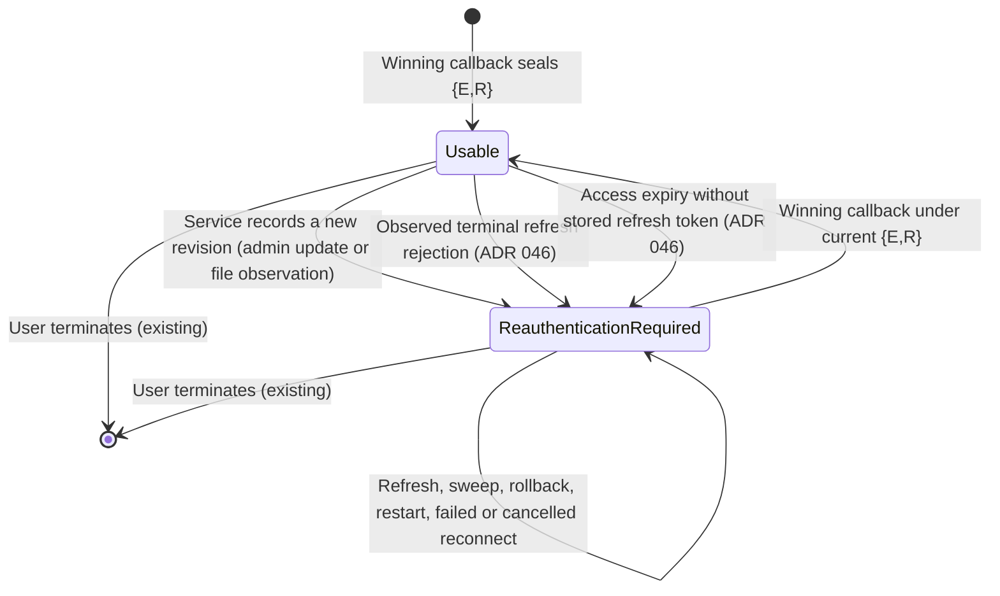

# Data Model: Invalidate Sessions After Service Client-ID Changes

**Feature**: [spec.md](spec.md) | **Research**: [research.md](research.md) | **Decision draft**: [ADR 045](adr-045-client-identity-revisions.md) (Proposed)

No new entity, aggregate, or typed entity ID is introduced. The feature adds internal value objects and attributes to the existing `ThirdpartyOAuth2Service` and `UserSession` aggregates, plus one claim to the existing third-party authorization JWE state.

## Glossary additions and extension (for `ARCHITECTURE.md` §12)

| Term | Definition | Relationships |
|---|---|---|
| **Effective Client Identity** | The non-secret, provider-facing client ID that the broker would use for a service now. It is the stored `client_id` for a stored source and the trimmed client-ID file value for a filesystem source. | Owned by `ThirdpartyOAuth2Service`. Compared with `UserSession` establishment. |
| **Client Identity Revision** | A per-service counter that starts at 0 and increases by exactly 1 each time a different Effective Client Identity is recorded, through an Admin API update or a filesystem observation. It never decreases, including on rollback. | Recorded on `ThirdpartyOAuth2Service`. Copied into authorization state and `UserSession` when established. |
| **Requires Reauthentication** (existing, ADR 046) | The derived condition in which a `UserSession` cannot supply or refresh tokens until its principal completes a fresh authorization. Its existing ADR 046 causes are recorded terminal refresh rejection or access expiry without a stored refresh token; this feature adds unusable client identity or revision. It is not persisted. | Derived from `UserSession` and `ThirdpartyOAuth2Service`. Surfaced as `requires_reauthentication` and `connectionStatus: not_connected`. |

The two identity terms extend the existing **Client-identity association** glossary entry (ADR 041). Extend the existing **Requires Reauthentication** entry (ADR 046), rather than introducing a synonymous term.

## ThirdpartyOAuth2Service (aggregate, existing)

`model.ThirdpartyOAuth2ProviderEntity` gains the following attributes:

| Field (Go) | Column | Type | Rules |
|---|---|---|---|
| `ClientIdentity *id.ClientID` | `client_identity TEXT NULL` | non-secret | Null until first recorded. Non-empty when set. Never an Admin API input or output. Not encryption AAD (ADR 008). |
| `ClientIdentityRevision int64` | `client_identity_revision BIGINT NOT NULL DEFAULT 0` | counter | `>= 0`. Changes only by +1 together with `ClientIdentity`. Never an Admin API input or output. |

### Recording rules

Let `previous` be `client_identity`, or the persisted stored `client_id` while `client_identity` is null and the persisted source is stored.

| Operation | Effect |
|---|---|
| Create, stored | `client_identity = client_id`, revision 0. |
| Create, filesystem | `client_identity = NULL`, revision 0. |
| Accepted Admin API update, resulting source stored | If `previous` is non-null and differs from the new `client_id`, set revision to revision + 1. In every case, set `client_identity = client_id`. Both happen atomically in the same conditional `UPDATE` that applies the version and discovery preconditions. |
| Accepted Admin API update, resulting source filesystem | No change. Files are not read (ADR 041). |
| Rejected, invalid, or version-conflicting update | No change. |
| Filesystem observation of value `v` at read revision `r` | If `client_identity` is null, set it to `v` with no increment, conditional on it still being null. If `client_identity` is not `v`, set `client_identity = v` and revision to `r + 1`, conditional on the revision still being `r`. If the condition fails, re-read and evaluate again. `version`, `updated_at`, and the ETag do not change. |

Each increment emits `session.oauth2.client_identity_changed` (see [contracts/observability.md](contracts/observability.md)).

## UserSession (aggregate, existing)

`storage.UserSession` gains one attribute:

| Field (Go) | Column | Type | Rules |
|---|---|---|---|
| `UpstreamClientRevision int64` (`json:"-"`) | `upstream_client_revision BIGINT NOT NULL DEFAULT 0` | counter | `>= 0`. Set only when a winning callback creates or replaces the session, from the sealed state. Refresh, source transitions, and observations never rewrite it. Pre-existing rows default to 0. |

`UpstreamClientID` (ADR 041) is now set for every service variant on new connections. It is never backfilled.

### Usability for identity

Given the current state `{E, R}` from `resolveClientIdentity` and a session `s`:

```text
identityUsable(s) =
    (s.UpstreamClientID != nil && *s.UpstreamClientID == E && s.UpstreamClientRevision == R)
 || (s.UpstreamClientID == nil && service.source == stored && !service.CredentialSourceTransitioned && R == 0)

requiresReauthentication(s) = s.RequiresReauthentication() || !identityUsable(s)
// s.RequiresReauthentication() retains ADR 046's rejection and refreshability rule.
```

A failure cause maps to an existing credential-source reason:

| Condition | Reason | Exchange outcome |
|---|---|---|
| Identity differs from `E` | `identity_mismatch` (existing) | `400 invalid_grant`, ADR 044 `error_uri` |
| Identity equals `E`, but revision differs from `R` | `identity_superseded` (new) | `400 invalid_grant`, ADR 044 `error_uri` |
| Legacy and not covered by the exception | `identity_missing` (existing) | `400 invalid_grant`, ADR 044 `error_uri` |
| `E` cannot be resolved | Existing source reasons (`not_found`, `read_failed`, and others) | `500 server_error`, no `error_uri` |

### State transitions



The session row is retained while reauthentication is required. Its retention drives the sign-in prompt and lets the reconnect callback replace it through the existing callback-ID compare-and-set.

## OAuth2StateTokenClaims (JWE, existing)

| Claim | Type | Rules |
|---|---|---|
| `upstream_client_id` (existing) | string | Now present for every service variant. |
| `upstream_client_revision` (new) | integer | Present whenever `upstream_client_id` is present. Must be `>= 0`. At callback, both must equal the current `{E, R}` before code exchange. Otherwise the callback is rejected with `identity_mismatch` or `identity_superseded`. |

The state is internal and encrypted, and providers echo it opaquely. Its claims are not an external contract.

## Read models

| Read model | Change |
|---|---|
| `storage.UserSessionSummary` | Extends the existing `RequiresReauthentication` value with identity evaluation. Its deprecated `IsExpired` alias always has the same value. `AccessTokenExpired` remains an independent expiry signal; no rejection timestamp is exposed. |
| `consent.ServiceRequirementStatus.IsConnected` | True only for a session that does not require reauthentication under ADR 046 and is identity-usable; an expired access token with a stored, not-rejected refresh token remains refreshable. |
| Authorization decision `anyDelegatedSessionUnusable` | Adds reason `session_reauthentication_required` when an included service's session is not identity-usable. |

## Persistence

| Migration | Content |
|---|---|
| `046_add_client_identity_revision.up.sql` | Atomic. `SET LOCAL statement_timeout = '1s'`. `LOCK ... IN ACCESS EXCLUSIVE MODE NOWAIT` on both tables. Adds the three columns with defaults and the `NOT VALID` CHECK constraints `client_identity_revision >= 0`, `upstream_client_revision >= 0`, and `client_identity IS NULL OR client_identity <> ''`. No backfill. |
| `046_add_client_identity_revision.down.sql` | Raises an error and changes nothing if `EXISTS (SELECT 1 FROM thirdparty_oauth2_services WHERE client_identity_revision > 0)`. Otherwise it drops the constraints and columns. |
| `047_validate_client_identity_revision.up.sql` | Validates the three constraints under `SHARE UPDATE EXCLUSIVE ... NOWAIT`. |
| `047_validate_client_identity_revision.down.sql` | Restores the unvalidated constraints without changing data. |

The in-memory adapter keeps identical recording, compare-and-set, and copy-on-read semantics. Explicit column lists are extended in every session and service query. No `SELECT *`.

## Ports

See [contracts/ports.md](contracts/ports.md).
