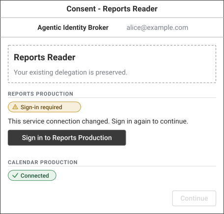
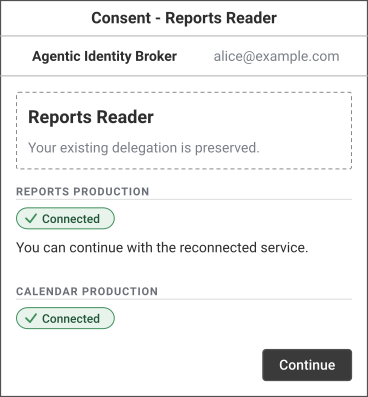
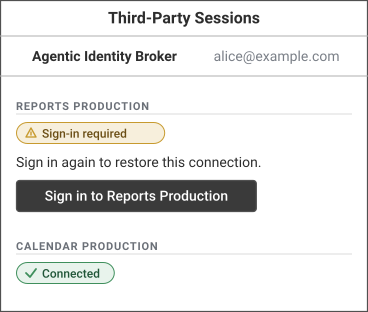
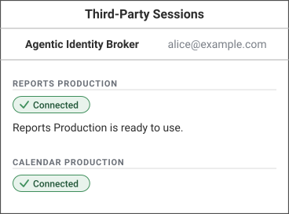
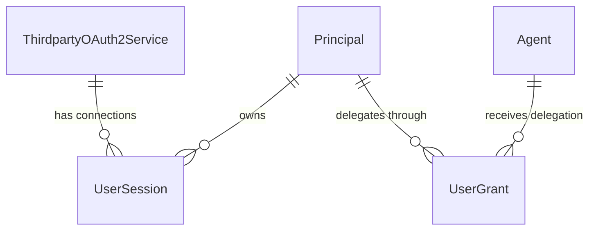
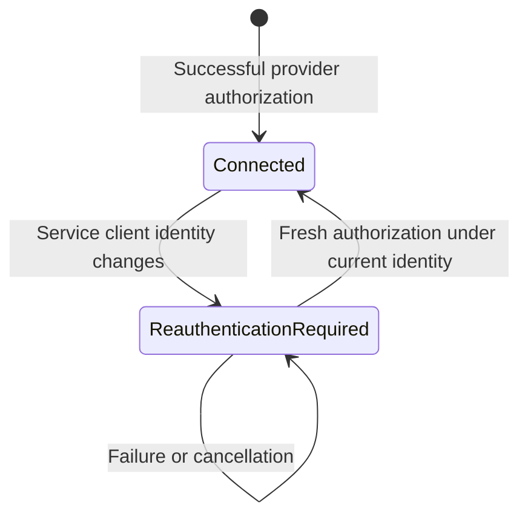

# Feature Specification: Invalidate Sessions After Service Client-ID Changes

**Feature Branch**: `speckit/issue-388`

**Created**: 2026-11-04

**Status**: Draft — planned; consequential proposals require maintainer approval (see `plan.md` Approval Items)

**Input**: User description:

> Invalidate tokens after service client-id change
>
> In case a thirdparty service client-id changes, established related sessions must get invalidated and users prompted for reauth. The consent screen should be shown automatically so that users are guided to re-login with a thirdparty.

## Clarifications

### Session 2026-11-04

- Q: When must legacy sessions without a recorded establishing client identity reconnect? → A: On a service client-ID change after rollout, not solely on rollout (Q1 option B). **Proposed approval item DEC-001 (Decision; FR-013, AS-1.6)**: Preserve ADR 041's existing exception for unchanged, never-transitioned stored services, but end it for sessions predating a subsequent client-ID change. This meets the issue's service-change guarantee without forcing every legacy user to sign in on deployment. The main alternative is requiring all identity-less sessions to reconnect on rollout; retaining the exception after a known change would leave affected sessions outside the guarantee. No historical identity may be inferred or backfilled. Planning must register this item in `plan.md`'s Approval Items and draft a Proposed superseding ADR for the changed legacy exception, including any needed persisted change evidence and guarded rollout. This entry is a proposal, not approval of that ADR or a schema.
- Q: What interaction must automatically show consent after invalidation? → A: The next relevant agent browser authorization (Q2 option A; FR-007 and FR-014). Existing pages must show sign-in when connection state is next loaded, but no unsolicited navigation, notification delivery, or client-driven agent-consent entry is required. This follows the issue's consent requirement using the established authorization entry point and avoids adding a notification feature. The main alternative is automatically navigating an already-open page into consent; that adds navigation and retry-loop scope without an active agent authorization context. Direct RFC 8693 recovery continues to return to `/sessions` under ADR 044. **Proposed approval item API-001 (API)**: Planning must register and specify the changed automatic-consent and session-usability behavior on existing authorization, consent, session-management, and token-acquisition contracts (FR-002, FR-006–FR-009), including applicable compatibility/versioning treatment. Reusing an existing route or response shape does not itself approve changed behavior.

### Session 2026-11-05 (planning)

- Maintainer direction (planning command): cover both client-ID change channels, filesystem credential publication and the Admin API, and treat client-secret rotation as an expected routine operation without session invalidation. → Requirement change: AS-1.1 is now the filesystem-publication scenario and new AS-1.7 is the Admin API scenario; FR-003 names both channels; AS-3.2 is now the filesystem secret-rotation scenario and new AS-3.4 covers Admin API secret rotation, metadata-only updates, and same-identity source transitions; FR-012 and SC-004 cover both channels. Reason: the maintainer required each channel and routine rotation to be explicit, independently testable acceptance scenarios.
- Q: How is a client-ID change detected and remembered? → A: Each service records its last effective client identity and a monotonically increasing Client Identity Revision. An accepted Admin API update that changes the stored client ID increments the revision atomically with the update. A filesystem change is recorded the first time any broker operation reads a client-ID file value that differs from the recorded identity. Sessions and in-flight authorizations carry the revision under which they were established, so rollback cannot revive them. The main alternative, comparing only the session's client ID with the current one, revives sessions after a rollback (FR-005). **Proposed approval items ADR-001 and DEC-002** (`plan.md` Approval Items).
- Q: What happens to a still-valid access token when the client-ID file cannot be read? → A: Token release fails closed with the existing infrastructure outcome (`500 server_error`, no `error_uri`), not a reconnection prompt (SR-001). The main alternative, returning the stored token while the file is unreadable, keeps availability but can release previous-identity tokens. **Proposed approval item DEC-003**.
- Q: What if replicas briefly read different client-ID file contents while a publication propagates? → A: Every differing observation is recorded as a change, so a connection made during an incomplete multi-replica publication can need one more reconnection. Operators publish a new pair coherently and let it reach every replica before users reconnect. The main alternative, ignoring a reverted value, cannot distinguish a stale replica from an operator rollback (AS-1.5). **Proposed approval item DEC-004**.
- Q: How do the browser surfaces represent an invalidated session? → A: Session responses use the existing `requires_reauthentication` boolean; agent consent reports `connectionStatus: not_connected` for the service. As reconciled below with ADR 046, `is_expired` remains its equal deprecated alias, not an independent expiry flag. The main alternative, a new `connectionStatus` enum value, changes a closed response enum. **Proposed approval item API-001**.

### Session 2026-11-05

- Q: Does client-identity invalidation replace the existing reauthentication rule? → A: No. Extend ADR 046's existing rule: a session requires reauthentication after observed terminal refresh rejection, after access expiry without a stored refresh token, or when its client identity is unusable. An expired token with a stored, not-rejected refresh token still permits refresh when identity is usable. Preserve the existing `requires_reauthentication` field, its deprecated `is_expired` alias, `409 refresh_rejected`, and rejection exclusion from background refresh and sweep. Requirement change: FR-015, AS-3.1, and SC-004 explicitly preserve these behaviors because the earlier design assumed an expiry-only baseline. The main alternative, replacing the rule with expiry and identity checks, could release a still-valid token after known provider rejection and violates binding ADR 046. This is reconciliation with an accepted decision, not a new exception or approval.
- Q: Which API baseline and compatibility treatment apply to the identity behavior changes? → A: **Proposed API-001** uses the existing End-User API 1.2.0 schema and proposes a major 2.0.0 cutover on the existing routes for the new invalidation and manual-refresh behavior, not a duplicate response-field addition. Keep `is_expired` as an equal deprecated alias and `access_token_expired` as the distinct expiry signal. Requirement change: the API Requirements below now name that baseline and proposal. Reason: ADR 046 and the current OpenAPI already define the fields; Principles IV and X require a major version or new endpoint for changed released behavior. The main alternative is new versioned endpoints; retaining 1.2.0 or treating this as a new additive field would obscure the changed behavior. Planning must retain this proposal in API-001; it is not maintainer approval.

## User Scenarios & Testing *(mandatory)*

Each named acceptance scenario must map 1:1 to an end-to-end acceptance test before implementation. Variants within a scenario form its test matrix. Browser behavior additionally requires frontend acceptance coverage and screenshots; this specification phase does not implement those tests.

### User Story 1 - Stop using connections established under the previous client ID (Priority: P1)

As an operator replacing a third-party service's client ID, I need the broker to stop treating existing connections for that service as usable, even if their tokens have not expired. Users must reconnect under the new client ID before agents can obtain tokens from those connections again.

**Why this priority**: Returning an unexpired token from the previous client identity defeats the requested invalidation and can hide the need to reconnect for hours.

**Independent Test**: Establish connections for two users under `reports-client-v1`, change that same service to `reports-client-v2`, and request tokens before the old access tokens expire. Both requests must require reconnection and return no token.

**Acceptance Scenarios**:

1. **AS-1.1** — **Given** Alice has a session established under `reports-client-v1` for a filesystem-credential service with an access token that expires at 11:00, **When** the operator publishes a new credential-file pair whose client-ID file contains `reports-client-v2` at 10:00 and an agent requests a token at 10:01, **Then** the broker returns no token from that session and identifies reconnection as the recovery action, without waiting for token expiry or a scheduled maintenance pass.
2. **AS-1.2** — **Given** Alice and Bob each have sessions for the changed service, including one with no recorded access-token expiry, **When** each next attempts to use that service after the change, **Then** both sessions are unusable until each user reconnects; one user's reconnection does not reconnect the other user.
3. **AS-1.3** — **Given** an old session has a refresh token, **When** an on-demand refresh, background refresh, or operator-triggered session sweep evaluates it after the client-ID change, **Then** the broker does not authenticate to the provider with that old session's refresh token and does not restore its usability.
4. **AS-1.4** — **Given** a third-party authorization or refresh began under `reports-client-v1`, **When** the client ID changes before its resulting credentials would become usable, **Then** credentials associated with the previous client identity cannot become the usable connection under `reports-client-v2`; the user can start a fresh connection under the current identity.
5. **AS-1.5** — **Given** a session has already been invalidated by a client-ID change, **When** an operator later restores `reports-client-v1` without the user reconnecting, **Then** the invalidated session does not automatically regain usability.
6. **AS-1.6** — **Given** Alice and Bob have identity-less legacy sessions for a never-transitioned stored service that ADR 041 permits to remain usable, **When** the feature rolls out with that service's client ID unchanged, **Then** rollout alone does not require reconnection; **When** the operator subsequently changes that service's client ID, **Then** neither legacy session can supply a token or be refreshed until its owner reconnects, including after a broker restart or client-ID rollback. Alice's successful reconnection does not reconnect Bob. No historical session identity is inferred; legacy sessions already rejected by ADR 041 remain rejected. This scenario expresses proposed DEC-001.
7. **AS-1.7** — **Given** Alice and Bob have sessions established under `reports-client-v1` for a stored-credential service, **When** an operator's accepted Admin API full-replacement `PUT /api/services/{service-id}` changes `client_id` to `reports-client-v2` at 10:00 and an agent requests a token for Alice at 10:01, **Then** the broker returns no token from her unexpired session and identifies reconnection as the recovery action; Bob's session is equally unusable. A rejected or version-conflicting update changes nothing.

---

### User Story 2 - Be guided through consent and reconnect the affected service (Priority: P1)

As a user whose agent needs a changed service, I need the broker to show the consent experience rather than silently continuing with an apparently connected service. The affected service must clearly require sign-in, and completing sign-in must let me continue without deleting my session manually or asking an operator to repair it.

**Why this priority**: Invalidation alone would strand users. Showing the correct recovery action is part of the requested feature, not an optional error-message improvement.

**Independent Test**: With an existing agent delegation and an invalidated service connection, start the agent's browser authorization flow, reconnect the service from consent, and finish the original authorization without removing and recreating the delegation.

**Acceptance Scenarios**:

1. **AS-2.1** — **Given** Alice already delegated Reports Reader access to Reports Production, but its session is now invalidated, **When** Alice next enters the agent's browser authorization flow, **Then** the broker automatically shows the agent consent screen instead of bypassing it because a delegation and unexpired token exist; Reports Production is shown as requiring sign-in.
2. **AS-2.2** — **Given** the consent screen shows Reports Production as requiring sign-in, **When** Alice chooses its sign-in action and completes provider authorization under `reports-client-v2`, **Then** the broker establishes a usable connection for Alice under the current client identity, returns her to the consent flow, preserves her still-valid selections, and permits completion of the original authorization once its requirements are met.
3. **AS-2.3** — **Given** Alice opens recovery from an agent token request rather than an agent consent page, **When** she follows the broker-provided service recovery action and completes provider authorization, **Then** she connects the resolved service under its current identity, returns to session management, and the next eligible token request can succeed. This does not substitute an agent-grant error for a service-session error.
4. **AS-2.4** — **Given** Alice is reconnecting an invalidated session, **When** she declines provider authorization or the provider fails, **Then** the old session remains unusable, she receives an understandable failure outcome and a way to retry, and no new permissions are granted silently.
5. **AS-2.5** — **Given** Alice's invalidated session exists, **When** she views session management or agent consent, **Then** the changed service is not represented as a usable connected service merely because its old token has not expired; the page provides a sign-in action for that service.

AS-2.1 defines the automatic browser entry: the next relevant agent authorization. An already-open page reflects invalidation when it next loads connection state (AS-2.5), without automatically navigating into agent consent or requiring proactive notification.

---

### User Story 3 - Keep unaffected access working (Priority: P2)

As a user or operator, I need this change to affect only connections for a service whose client identity changed. Existing delegations and other services must not be reset unnecessarily.

**Why this priority**: Shared service configuration can affect many users and agents. Recovery must not become a global logout or a new consent grant.

**Independent Test**: Give Alice sessions for Reports Production and Calendar Production. Change only the Reports client ID and verify Calendar still works with the original delegation.

**Acceptance Scenarios**:

1. **AS-3.1** — **Given** Alice has usable sessions for Reports Production and Calendar Production, **When** only Reports Production changes client ID, **Then** Calendar remains usable, Alice's broker authentication remains intact, and her existing agent delegation remains recorded without a broadened scope or extended validity. Control variants start Calendar with either a recorded refresh rejection and unexpired access token, or an expired access token with a stored, not-rejected refresh token. The Reports change leaves those Calendar outcomes unchanged: the rejected connection still blocks issuance and remains excluded from background refresh and sweep; the refreshable connection still permits refresh. Session responses keep `is_expired == requires_reauthentication` in each case (ADR 046).
2. **AS-3.2** — **Given** Alice has a usable session for a filesystem-credential service, **When** the operator routinely rotates the secret by publishing a new credential-file pair whose client-ID file still contains `reports-client-v1`, **Then** Alice's session stays usable: token requests continue, and refresh authenticates with the new secret. A provider rejection of the new secret remains a provider credential failure, not a reconnection prompt.
3. **AS-3.3** — **Given** an optional service is not included in Alice's delegation, **When** that service changes client ID, **Then** it does not force the agent's otherwise eligible authorization into a reconnection flow. If it is included, its invalidated session is handled like any other included service.
4. **AS-3.4** — **Given** Alice has a usable session for a stored-credential service, **When** an operator's accepted Admin API update keeps `client_id` unchanged and supplies a new `client_secret` (routine rotation), changes only metadata such as `display_name` or scopes, or transitions the credential source while the effective client ID stays the same, **Then** that update alone does not invalidate Alice's session. Existing validation and source-transition rules still apply.

### Edge Cases

- A rejected or conflicting administrative update must not invalidate sessions as though the proposed client ID had become effective.
- Identity changes apply to the service, not just to the user who happens to make the first request after the change.
- Two distinct services remain distinct even if their provider-issued client-ID strings happen to match.
- Requests, callbacks, refreshes, and reconnections may overlap a change. Work under a previous identity must not overwrite a connection established under the current identity.
- Two client-ID changes before a user returns still require a connection under the current identity; a rollback alone is not reauthorization (AS-1.5).
- Unavailable or unreadable identity information must not be treated as either a confirmed identity change or proof that an old session remains usable. Fail closed without disguising an infrastructure problem as a guaranteed fixable sign-in problem.
- Identity-less legacy sessions retain only ADR 041's unchanged-service exception until a post-rollout client-ID change invalidates them (proposed DEC-001). Current credentials must not be used to invent their historical identity; pre-rollout changes cannot be reconstructed from current values.
- An already-open browser is not proactively notified or navigated into consent. Its next connection-state load must represent invalidation, and its sign-in action remains available.
- Reconnection must not bypass mandatory service requirements, revive an expired delegation, or silently opt the user into an optional service they did not include.

## Concrete Example Journeys *(mandatory)*

All identifiers, identities, paths, codes, and token markers below are synthetic. The examples describe observable requirements, not an approved implementation design.

**Shared cast and initial state**: Alice (`alice@example.com`) and Bob (`bob@example.com`) authenticate through the broker's trusted pre-authentication proxy. Agent Reports Reader has ID `550e8400-e29b-41d4-a716-446655440000` and callback `https://agent.example.com/callback`. Reports Production has ID `880e8400-e29b-41d4-a716-446655440010`, canonical ID `reports-prod`, standard confidential authentication, and filesystem-selected credentials. Its provider authorization endpoint is `https://reports.example.com/oauth/authorize`. Alice and Bob have established sessions under `reports-client-v1`. Alice has already delegated Reports Reader the permission set covering Reports Production. Alice also has a usable Calendar Production session. Times are 2026-11-04 UTC.

### Journey 1 — The operator changes identity and old connections stop working (User Story 1, AS-1.1–AS-1.7; User Story 3, AS-3.1, AS-3.2, and AS-3.4)

**Step 1 — 09:00: Existing service configuration selects the credential files**

The Reports Production service already explicitly selects `credential_source: filesystem` through the administrative service contract. These existing broker configuration keys bind that service to operator-managed files; the mapping alone neither registers a service nor selects its source.

```yaml
server:
  enduser:
    public_url: "https://broker.example.com"
third_party_oauth2:
  credential_files:
    reports-prod:
      client_id_file: "/etc/broker/credentials/reports/client-id"
      client_secret_file: "/etc/broker/credentials/reports/client-secret"
```

The synthetic ID in the selected client-ID file is initially `reports-client-v1`. The secret file contains corresponding operator-provided authentication material, never shown here. Alice's access token expires at 11:00; Bob's has no reported expiry. Both connections work before the change. The same invalidation outcome is required when a stored service's client ID changes through an accepted administrative update; no new runtime switch is proposed.

**Step 2 — 10:00: The operator publishes the new credential pair**

The operator follows the existing coherent file-publication requirements and makes `reports-client-v2` and its matching secret effective. This is a client-identity change, not a same-ID secret rotation. The broker must not wait until 11:00, a failed provider call, or the next session sweep before withholding tokens from old connections on subsequent requests.

**Step 3 — 10:01: Alice's agent requests Reports access**

The token request is an otherwise-valid RFC 8693 exchange for the protected resource registered to Reports Production. Its synthetic signed subject and client-assertion credentials are unchanged by this feature; they must still pass existing authentication and grant checks. No new request fields are required.

The existing recoverable-session response contract is illustrated by the following response; the descriptive text is illustrative rather than a new stable error identifier:

```http
POST /oauth2/token HTTP/1.1
Host: broker.example.com
Content-Type: application/x-www-form-urlencoded

grant_type=urn%3Aietf%3Aparams%3Aoauth%3Agrant-type%3Atoken-exchange&resource=https%3A%2F%2Freports.example.com%2Fapi&subject_token=SYNTHETIC_SIGNED_SUBJECT_JWT&subject_token_type=urn%3Aietf%3Aparams%3Aoauth%3Atoken-type%3Ajwt&client_assertion_type=urn%3Aietf%3Aparams%3Aoauth%3Aclient-assertion-type%3Ajwt-bearer&client_assertion=SYNTHETIC_SIGNED_CLIENT_ASSERTION_JWT

HTTP/1.1 400 Bad Request
Content-Type: application/json

{
  "error": "invalid_grant",
  "error_description": "The service connection requires reauthorization.",
  "error_uri": "https://broker.example.com/api/third-party/880e8400-e29b-41d4-a716-446655440010/oauth2/authorize?redirect_uri=https%3A%2F%2Fbroker.example.com%2Fsessions"
}
```

The request token markers stand for valid test-fixture JWTs under the deployment's existing trust policy, not literal wire credentials. No output JWT is issued in this exchange. The response has no access token, refresh token, or `WWW-Authenticate` header. The recovery origin is configured, and the service comes from resource resolution, not caller-selected navigation. The same denial applies to Bob, including his token with unknown expiry.

**Step 4 — Maintenance and rollback do not reconnect users**

Refreshing or sweeping Alice's old session does not submit its refresh token to the provider under the changed identity. An older in-flight callback cannot produce a usable connection for the new identity. Restoring `reports-client-v1` without a fresh user connection does not revive a session already invalidated by this change. Calendar remains usable throughout; a same-ID secret rotation alone would not have caused this invalidation. In AS-3.1's control variants, if Calendar instead already has a recorded refresh rejection, its unexpired token remains blocked and its session remains excluded from background refresh and sweep. If Calendar's access token has expired but a stored, not-rejected refresh token remains, it can still refresh. Neither outcome changes because Reports changed identity (FR-015).

**Admin API variant (AS-1.7)**: Instead, Reports Production uses `credential_source: stored` with stored `client_id` `reports-client-v1`. At 10:00 the operator replaces the service through the existing administrative contract. The synthetic secret marker stands for the new client's operator-provided secret:

```http
PUT /api/services/880e8400-e29b-41d4-a716-446655440010 HTTP/1.1
Host: broker-admin.example.com
X-Remote-User: operator@example.com
If-Match: "7"
Content-Type: application/json

{
  "display_name": "Reports Production",
  "credential_source": "stored",
  "client_id": "reports-client-v2",
  "client_secret": "SYNTHETIC_NEW_CLIENT_SECRET",
  "issuer_uri": "https://reports.example.com",
  "discovery": { "enable_discovery": false },
  "endpoints": {
    "authorize_endpoint": "https://reports.example.com/oauth/authorize",
    "token_endpoint": "https://reports.example.com/oauth/token"
  },
  "scopes": [{ "scope_value": "reports:read", "description": "Read reports" }]
}

HTTP/1.1 200 OK
ETag: "8"
Content-Type: application/json

{
  "id": "880e8400-e29b-41d4-a716-446655440010",
  "display_name": "Reports Production",
  "credential_source": "stored",
  "client_registration": "static",
  "client_id": "reports-client-v2",
  "client_secret": "REDACTED"
}
```

The response is abbreviated to the fields relevant here; its shape is unchanged and exposes no session or revision data. From the commit of this update, Alice's and Bob's token requests receive the Step 3 outcome. A `409` or `412` response, or a validation `400`, changes neither the service nor any session.

**Routine rotation variants (AS-3.2, AS-3.4)**: If the operator instead publishes a new secret file while the client-ID file still contains `reports-client-v1`, or sends the same `PUT` with `"client_id": "reports-client-v1"` and only a new `client_secret`, no session is invalidated. Alice's 10:01 token request returns her current token, and her next refresh authenticates with the new secret. The same holds for a `display_name` or scope change and for a stored-to-filesystem transition whose client-ID file contains the stored client ID.

**Legacy rollout variant (AS-1.6; proposed DEC-001)**: Instead, take a stored Reports service that never changed credential source, with Alice's and Bob's sessions lacking recorded client identity. At 09:00 the feature rolls out while its configured ID remains `reports-client-v1`; these sessions retain ADR 041's exception, without assigning that ID to their history. At 10:00 an accepted administrative update changes the service to `reports-client-v2`. At 10:01 both users receive the same no-token recovery outcome illustrated above, even with unexpired tokens. Restarting the broker or restoring `reports-client-v1` does not revive these invalidated sessions. Alice follows Journey 2 or 3 to connect under the current identity; Bob must independently do so. Legacy sessions already denied by ADR 041 receive no new exception.

**Observable result**: Both Reports connections require sign-in, no previous-client token is newly released by the broker after the effective change, and unrelated Calendar access and delegations are preserved. Previously delivered tokens are outside this broker-side guarantee.

### Journey 2 — Alice sees consent automatically and reconnects Reports (User Story 2, AS-2.1–AS-2.2 and AS-2.4–AS-2.5)

This journey defines the selected next-authorization behavior. There is no additional proactive notification or automatic live-page navigation into consent.

**Step 1 — 10:02: Reports Reader starts browser authorization**

Alice is still authenticated to the broker. Her delegation exists, but Reports Production is no longer usable. The browser request retains ordinary authorization safeguards:

```http
GET /oauth2/authorize?client_id=550e8400-e29b-41d4-a716-446655440000&response_type=code&redirect_uri=https%3A%2F%2Fagent.example.com%2Fcallback&scope=openid%20profile&state=reports-agent-state&code_challenge=E9Melhoa2OwvFrEMTJguCHaoeK1t8URWbuGJSstw-cM&code_challenge_method=S256 HTTP/1.1
Host: broker.example.com
X-Remote-User: alice@example.com

HTTP/1.1 302 Found
Location: https://broker.example.com/agents/550e8400-e29b-41d4-a716-446655440000?session_token=SYNTHETIC_SEALED_AUTHORIZATION_CONTEXT
```

The trusted proxy supplies the principal header. `SYNTHETIC_SEALED_AUTHORIZATION_CONTEXT` denotes the existing short-lived, principal-bound authorization context, not a literal token or an exemption from its validation. The redirect shows consent even though Alice granted this agent earlier.

**Step 2 — Consent explains the required reconnect**

State A — automatically displayed consent after the client-ID change:



<details><summary>Wireloom source</summary>

```wireloom
window "Consent - Reports Reader":
  header:
    row:
      text "Agentic Identity Broker" bold
      spacer
      text "alice@example.com" muted
  panel:
    text "Reports Reader" bold size=large
    text "Your existing delegation is preserved." muted
  section "Reports Production":
    status "Sign-in required" kind=warning
    text "This service connection changed. Sign in again to continue."
    button "Sign in to Reports Production" primary
  section "Calendar Production":
    status "Connected" kind=success
  row align=right:
    button "Continue" disabled
```

</details>

Action connecting State A to State B: Alice chooses **Sign in to Reports Production**, completes the provider's normal login and consent steps, and returns to the broker. The provider controls its own screens; the broker does not force a provider-specific consent parameter or bypass user choice.

**Step 3 — The existing tab-preserving service sign-in flow starts**

```http
POST /api/third-party/880e8400-e29b-41d4-a716-446655440010/oauth2/authorize HTTP/1.1
Host: broker.example.com
X-Remote-User: alice@example.com
Content-Type: application/x-www-form-urlencoded

redirect_uri=https%3A%2F%2Fbroker.example.com%2Fagents%2F550e8400-e29b-41d4-a716-446655440000&consent_state_id=990e8400-e29b-41d4-a716-446655440020

HTTP/1.1 302 Found
Location: https://reports.example.com/oauth/authorize?response_type=code&client_id=reports-client-v2&redirect_uri=https%3A%2F%2Fbroker.example.com%2Fapi%2Fthird-party%2F880e8400-e29b-41d4-a716-446655440010%2Foauth2%2Fcallback&scope=reports%3Aread&state=SYNTHETIC_SEALED_PROVIDER_STATE&code_challenge=E9Melhoa2OwvFrEMTJguCHaoeK1t8URWbuGJSstw-cM&code_challenge_method=S256
```

The example provider challenge represents the broker-generated S256 challenge for this separate provider flow. The provider state marker represents validated sealed state binding Alice, the service, initiating client identity, return URI, PKCE verifier, and tab-local return-state ID. The original consent URL and selections stay in the originating tab through the existing return-state mechanism.

**Step 4 — 10:03: Provider authorization succeeds**

```http
GET /api/third-party/880e8400-e29b-41d4-a716-446655440010/oauth2/callback?code=SYNTHETIC_ONE_USE_REPORTS_CODE&state=SYNTHETIC_SEALED_PROVIDER_STATE HTTP/1.1
Host: broker.example.com
X-Remote-User: alice@example.com

HTTP/1.1 302 Found
Location: https://broker.example.com/agents/550e8400-e29b-41d4-a716-446655440000?success=true&service_id=880e8400-e29b-41d4-a716-446655440010&consent_state_id=990e8400-e29b-41d4-a716-446655440020
```

The broker validates the callback and establishes Alice's connection under `reports-client-v2`. The originating tab restores the original consent URL and still-valid selections and removes the return-state ID, as in the existing contract. Bob's session remains unusable.

State B — returned consent shows a recovered connection:



<details><summary>Wireloom source</summary>

```wireloom
window "Consent - Reports Reader":
  header:
    row:
      text "Agentic Identity Broker" bold
      spacer
      text "alice@example.com" muted
  panel:
    text "Reports Reader" bold size=large
    text "Your existing delegation is preserved." muted
  section "Reports Production":
    status "Connected" kind=success
    text "You can continue with the reconnected service."
  section "Calendar Production":
    status "Connected" kind=success
  row align=right:
    button "Continue" primary
```

</details>

**Step 5 — Alice continues the original authorization**

Once the original authorization's existing consent and service requirements are satisfied, Alice continues; the broker returns control to Reports Reader through its validated callback. An eligible token exchange can now return credentials from the new connection. No output JWT is introduced by this feature or illustrated here.

Failure variant (AS-2.4): if Alice denies the provider request or sign-in fails, the existing callback error outcome returns to session management. Reports remains unusable with a retry action; the broker never falls back to her previous token.

**Observable result**: Alice reaches consent without manually locating session management, reconnects only Reports, retains her selections, and can complete the original authorization. The wireframes are behavioral sketches, not new design tokens or prescribed copy.

### Journey 3 — Recover directly from a token-request failure (User Story 2, AS-2.3 and AS-2.5; User Story 3, AS-3.1 and AS-3.3)

**Step 1 — The agent presents the recovery action from Journey 1**

A token request cannot itself navigate a user's browser. A client presents or opens the provided action using its established interaction model. Before following that action, Alice views session management; it must reflect the invalidation rather than display her old Reports connection as usable (AS-2.5).

State C — session management before recovery:



<details><summary>Wireloom source</summary>

```wireloom
window "Third-Party Sessions":
  header:
    row:
      text "Agentic Identity Broker" bold
      spacer
      text "alice@example.com" muted
  section "Reports Production":
    status "Sign-in required" kind=warning
    text "Sign in again to restore this connection."
    button "Sign in to Reports Production" primary
  section "Calendar Production":
    status "Connected" kind=success
```

</details>

Alice now opens the broker-selected service recovery link, also offered by the service's sign-in action:

```http
GET /api/third-party/880e8400-e29b-41d4-a716-446655440010/oauth2/authorize?redirect_uri=https%3A%2F%2Fbroker.example.com%2Fsessions HTTP/1.1
Host: broker.example.com
X-Remote-User: alice@example.com

HTTP/1.1 302 Found
Location: https://reports.example.com/oauth/authorize?response_type=code&client_id=reports-client-v2&redirect_uri=https%3A%2F%2Fbroker.example.com%2Fapi%2Fthird-party%2F880e8400-e29b-41d4-a716-446655440010%2Foauth2%2Fcallback&scope=reports%3Aread&state=SYNTHETIC_SEALED_DIRECT_RECOVERY_STATE&code_challenge=E9Melhoa2OwvFrEMTJguCHaoeK1t8URWbuGJSstw-cM&code_challenge_method=S256
```

This direct recovery retains ADR 044's service-specific destination; it is not silently redirected to agent consent. Automatic consent applies to the agent browser authorization flow, not this direct recovery link.

**Step 2 — Alice authorizes the current service identity**

A successful callback, with the same principal and validated direct-recovery state, redirects to:

```http
GET /api/third-party/880e8400-e29b-41d4-a716-446655440010/oauth2/callback?code=SYNTHETIC_ONE_USE_RECOVERY_CODE&state=SYNTHETIC_SEALED_DIRECT_RECOVERY_STATE HTTP/1.1
Host: broker.example.com
X-Remote-User: alice@example.com

HTTP/1.1 302 Found
Location: https://broker.example.com/sessions?success=true&service_id=880e8400-e29b-41d4-a716-446655440010
```

Action connecting State C to State D: Alice completes provider sign-in using the recovery link. Session management now shows the recovered connection; before completion it must not claim the old session was usable.



<details><summary>Wireloom source</summary>

```wireloom
window "Third-Party Sessions":
  header:
    row:
      text "Agentic Identity Broker" bold
      spacer
      text "alice@example.com" muted
  section "Reports Production":
    status "Connected" kind=success
    text "Reports Production is ready to use."
  section "Calendar Production":
    status "Connected" kind=success
```

</details>

**Step 3 — The agent retries its operation**

The next eligible token request uses Alice's new Reports connection. Calendar and her delegation are unchanged. An unselected optional service does not become a new requirement because of an unrelated identity change.

**Observable result**: Direct recovery connects the correct service and returns to `/sessions`, without requiring manual deletion, changing grant permissions, or changing the established distinction between session recovery and agent consent.

## Requirements *(mandatory)*

### Functional Requirements

- **FR-001**: A change to a third-party service's effective client ID MUST invalidate sessions established under the previous client identity for every affected principal. This concerns upstream service identity, not an Agent's broker client ID.
- **FR-002**: The broker MUST withhold previous-identity credentials on subsequent token acquisition, including still-valid access tokens and tokens with unknown expiry. Invalidation MUST NOT depend on access-token expiry, provider rejection, a user-initiated refresh, or a scheduled sweep.
- **FR-003**: The rule MUST cover both supported change channels: an accepted Admin API update that changes a stored service's client ID (AS-1.7) and filesystem credential publication that changes the client-ID file value (AS-1.1). It MUST NOT be limited to a particular OAuth2 client authentication method merely because an older identity check only covers some methods. Each service variant's identity semantics are defined in [data-model.md](data-model.md); an immutable registration gains no invented mutable identity.
- **FR-004**: Refresh paths and delayed authorization results MUST NOT restore usability of a previous-identity connection after a change. A successful current-identity reconnection MUST NOT be overwritten by older in-flight work.
- **FR-005**: An invalidated session MUST remain unusable until a successful fresh connection under the current client identity. Restoring an old client-ID value alone MUST NOT reactivate it.
- **FR-006**: Token requests blocked by this invalidation MUST provide the existing service-specific reauthorization action for recoverable session failures, with no token release. Grant failures and infrastructure failures MUST retain their distinct existing outcomes.
- **FR-007**: On the next browser authorization needing an included, invalidated service, the broker MUST show agent consent automatically and identify the affected service as requiring sign-in, despite an existing delegation or apparently unexpired token.
- **FR-008**: Consent and session management MUST NOT display an invalidated session as a usable connection. They MUST offer the affected service's sign-in action; recovery MUST NOT require manual session deletion.
- **FR-009**: Successful reconnection MUST use the current effective client identity and restore access for that principal only. Consent-initiated reconnection MUST preserve the existing valid authorization context and selections; direct service recovery MUST retain its established session-management return destination.
- **FR-010**: Cancellation or failed reconnection MUST leave the previous session unusable and expose a retry path without granting extra permissions.
- **FR-011**: Sessions for unrelated services, broker authentication, existing delegation records, selected scopes, and delegation expiry MUST NOT change solely because one service's client ID changes. A service not included in a delegation MUST NOT force that delegation into consent.
- **FR-012**: Client-secret rotation is an expected routine operation. Same-ID secret rotation through filesystem publication (AS-3.2) or the Admin API (AS-3.4), metadata-only updates, and same-identity credential-source transitions MUST NOT themselves trigger client-ID-change invalidation. Existing validation and source-transition constraints continue to apply.
- **FR-013 (Proposed DEC-001)**: Rollout alone MUST NOT invalidate identity-less legacy sessions that ADR 041 permits for never-transitioned stored services. A subsequent effective service client-ID change MUST invalidate those pre-change sessions for every principal, even without a recorded establishing identity. Invalidation MUST survive restart and client-ID rollback. Legacy sessions already requiring identity under ADR 041 MUST remain unusable. No historical client identity may be inferred or backfilled from current credentials; successful fresh authorization records the actual initiating identity. The change evidence is the service's Client Identity Revision ([data-model.md](data-model.md)); no fictitious historical identity is assigned. The superseding decision is draft [ADR 047](adr-047-client-identity-revisions.md).
- **FR-014**: Automatic agent-consent entry is required on the next relevant browser authorization only (FR-007). Already-open consent and session-management pages MUST reflect unusability on their next connection-state load and offer sign-in (FR-008), but MUST NOT initiate unsolicited navigation into agent consent solely because the client ID changed. Proactive notifications and new client recovery entry points are out of scope. Direct RFC 8693 recovery MUST retain ADR 044's service-specific authorization action and `/sessions` return destination.
- **FR-015**: Client-identity invalidation MUST extend, not replace, ADR 046's reauthentication rule and refresh-rejection handling. Recorded rejection MUST still block issuance with an unexpired token and exclude background and sweep refresh; access expiry alone MUST NOT require sign-in when a stored, not-rejected refresh token and usable identity permit refresh. Preserve `409 refresh_rejected`, the equal deprecated `is_expired` alias, and the separate `access_token_expired` signal. Successful current-identity reconnection clears the existing rejection through the established callback behavior.

### Domain Model *(if applicable - document before API or database design)*





**Entities and aggregates**:

- **ThirdpartyOAuth2Service**: Registered provider service; its effective client identity determines which connection credentials are usable. The same service ID persists across an allowed client-ID change.
- **UserSession**: Existing principal/service connection aggregate with tokens, expiry, and an established client identity where recorded. Expiry alone is not evidence that the identity is current. No storage layout or new entity is prescribed here.
- **UserGrant**: Existing principal/agent delegation; invalidating a service session does not revoke or expand the grant.

**Value objects**: Client identity is the non-secret provider-facing client ID, compared as an exact identifier. Reauthentication required is the observable unusable-connection condition, not a proposed persisted status field.

**Business events**: A service client identity changes; a connection becomes unusable; a user successfully reconnects. These names describe business facts, not a new event-distribution mechanism. Any new domain vocabulary must be reconciled with the architecture glossary during planning.

### Configuration Requirements *(if applicable - document before implementation)*

No new runtime setting or opt-out is requested. The journey uses the existing `server.enduser.public_url` and `third_party_oauth2.credential_files` configuration contract. Existing stored and filesystem source selection remains explicit; paths and secrets must not appear in public service metadata.

### API Requirements *(if applicable - design before database)*

Use the existing agent authorization/consent, third-party authorization/callback, session-management, and token-exchange surfaces. The RFC-style examples illustrate the current [End-User contract](../../api/enduser/openapi.yaml), not a newly approved schema or endpoint. Stored-client changes use the existing [Admin service contract](../../api/admin/openapi.yaml), including validation and concurrency preconditions.

Planning MUST identify behavior changes to those contracts, document them in OpenAPI before implementation, and submit API changes and consequential decisions for explicit maintainer approval, starting with proposed API-001 in Clarifications. The planned deltas are in [contracts/enduser-api.md](contracts/enduser-api.md) and [contracts/admin-api.md](contracts/admin-api.md); they are proposals, not approved contracts. The baseline is End-User API 1.2.0 and accepted ADR 046: `requires_reauthentication` already exists, `is_expired` is its equal deprecated alias, and `access_token_expired` reports access expiry. Proposed API-001 is a major 2.0.0 cutover on the existing routes for changed behavior; no duplicate property or new expiry semantics are proposed. Error-contract changes remain subject to maintainer review.

### Database Requirements *(if applicable)*

Invalidation and recovery MUST have equivalent semantics across supported persistent and in-memory deployments and must not regain previous-identity usability after a restart. Invalidated sessions are retained, not deleted; the planned schema and revision evidence are in [data-model.md](data-model.md) (proposed DEC-002). Any required schema changes must follow the repository's migration and both-store consistency requirements, including guarded rollout treatment and durable service-change evidence for proposed FR-013. Current service values must not be backfilled as legacy sessions' establishing identities.

### Security Requirements *(mandatory for security-critical features)*

- **SR-001**: Fail closed when session identity cannot be verified where required. Do not return old credentials as an availability fallback or infer the establishing identity from current configuration.
- **SR-002**: Preserve existing authentication, delegated authorization, state integrity, principal binding, PKCE, callback precedence, encryption, and same-origin return-URI protections. Reconnection is not permission to bypass consent or provider approval.
- **SR-003**: Recovery links MUST identify the broker-resolved service and use its configured public origin. Do not accept caller-controlled origins as recovery destinations.
- **SR-004**: Invalidation and recovery MUST be auditable through credential-free structured events. Secrets, tokens, file contents, and sensitive filesystem paths MUST NOT appear in public errors or telemetry.
- **SR-005**: The guarantee concerns future broker use and release of stored credentials. Revoking tokens already delivered to clients, changing a provider's acceptance of those tokens, global broker logout, and invalidating independently minted broker tokens are outside this feature's scope.

### Frontend/Design System Requirements *(if applicable - document before implementation)*

The existing consent and session-management experiences must distinguish a usable connection from one requiring sign-in. Use the repository's design system, semantic tokens, keyboard-accessible actions, and WCAG 2.1 AA contrast. No new visual language or universal component is prescribed. Preserve the existing tab-local return-state behavior, and avoid navigation loops after a failed reconnection. Browser acceptance tests must cover automatic consent, restored selections, failure/retry, and meaningful connection states with screenshots.

### Key Entities *(include if feature involves data)*

- **Principal**: Authenticated user who must independently reconnect their own third-party session.
- **Agent**: Delegation recipient whose original authorization should resume after required reconnection.
- **ThirdpartyOAuth2Service / UserSession / UserGrant**: Existing entities described above; service identity validity and delegation validity remain distinct.

## Success Criteria *(mandatory)*

### Measurable Outcomes

- **SC-001**: In the acceptance matrix, 100% of requests evaluated after an effective client-ID change release no previous-identity token, including unexpired and unknown-expiry access-token cases.
- **SC-002**: In every affected next-browser-authorization test, consent appears without the user manually visiting session management, and the changed service offers sign-in rather than appearing usable.
- **SC-003**: A successful reconnection completes the original eligible authorization on its first retry without manual deletion or operator repair; a declined or failed attempt releases no previous credentials and permits a fresh attempt.
- **SC-004**: Across isolation tests, zero unrelated service sessions, broker logins, or delegation records are invalidated or expanded; same-ID secret rotation through either the filesystem or the Admin API, metadata-only updates, and same-identity source transitions cause zero client-ID-change reconnections. The unchanged-service matrix also preserves every ADR 046 rejection and refreshability outcome and equality of the deprecated alias.
- **SC-005**: In every overlapping-change and maintenance acceptance test, previous-identity work cannot restore a usable old connection or overwrite a successful current-identity connection.

## Assumptions

- “Client ID” means the third-party service's provider-facing identity, not the Agent's client ID. A different identity requires a fresh user connection even if the provider continues accepting old tokens.
- Invalidation is a broker-side usability guarantee, not a promise of immediate provider-side token revocation or a particular data-deletion strategy.
- Previously issued tokens and externally cached credentials cannot be recalled by this feature. No new cross-process cache-eviction protocol is assumed.
- Identity changes become effective through the service's existing supported configuration boundary. Subsequent operations must enforce the current identity; planning must make race and multi-replica boundaries explicit rather than assume periodic cleanup is sufficient.
- The operator has registered the new client and corresponding callback/credentials correctly. Recovery remains subject to ordinary provider availability and approval.
- Existing delegations remain intact. Users do not need to regrant unrelated permissions solely to reconnect a service.
- The automatic consent trigger is the next relevant browser authorization. Existing pages reflect invalidation on their next state load; proactive notification and unsolicited navigation into consent are not part of this feature.
- Proposed DEC-001 defines acceptance expectations for identity-less legacy sessions after rollout. It requires maintainer sign-off and an approved superseding ADR before overriding ADR 041's legacy exception after a service client-ID change.
- Existing accepted constraints include [ADR 046](../../adrs/046-observed-refresh-token-rejection.md) for observed rejection and the existing reauthentication contract, [ADR 041](../../adrs/041-oauth2-client-secret-file-overrides.md) for identity association and credential sources, [ADR 044](../../adrs/044-service-specific-session-recovery-url.md) for direct recovery, [ADR 038](../../adrs/038-proactive-token-refresh.md) for refresh behavior, and [ADR 035](../../adrs/035-root-mounted-spa.md) for canonical browser routes. Planning must identify any required superseding decisions, including broader identity enforcement than ADR 041 currently provides and interaction with ADR 038's immediate valid-token return. The proposed superseding decision is the feature-local draft [ADR 047](adr-047-client-identity-revisions.md); no ADR is amended or accepted before maintainer approval.