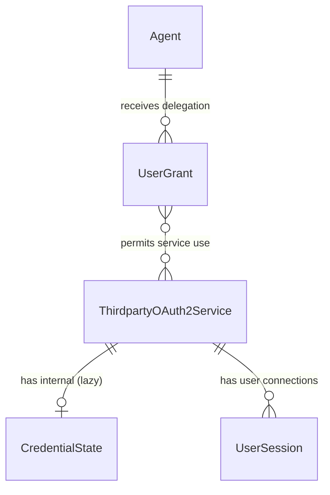
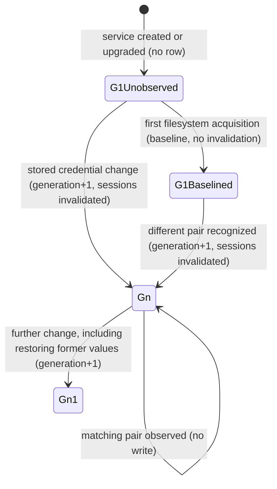
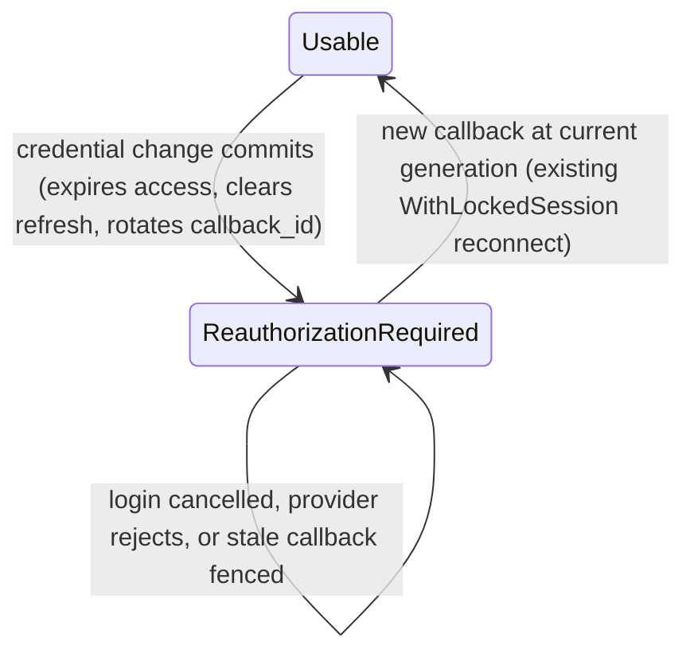

# Data Model: Invalidate Sessions After Third-Party Credential Changes

**Feature**: 055-invalidate-credential-sessions | **Date**: 2026-11-03 | **Plan**: [plan.md](plan.md) | **Research**: [research.md](research.md)

This design adds no new aggregate root or entity UUID. It adds one internal per-service record, value objects, and transient fields on existing types. All of it is Proposed (approval items D-SCHEMA, D-FINGERPRINT, D-INVALIDATE).

## Aggregates and Relationships



- **ThirdpartyOAuth2Service** (existing aggregate root). It owns the effective outbound client credentials and the credential source (ADR 041). This feature adds no columns. Its `version`, `updated_at`, and administrative representation never change because of a filesystem recognition.
- **CredentialState** (new, internal, 1:1 with a service, created lazily). It records the service's credential generation and the fingerprint of the last recognized filesystem pair. Its key is the service's existing `id.ServiceID`. It needs no typed ID (ADR 013). It is never exposed by any API.
- **UserSession** (existing aggregate). This feature adds no columns. Invalidation rewrites existing columns (see the state machine).
- **UserGrant** (existing). It is never modified by this feature.

## CredentialState

| Field | Go type | Column (`thirdparty_credential_states`) | Rules |
|---|---|---|---|
| `ServiceID` | `id.ServiceID` | `service_id UUID PRIMARY KEY REFERENCES thirdparty_oauth2_services(id) ON DELETE CASCADE` | Required |
| `Generation` | `int64` | `credential_generation BIGINT NOT NULL CHECK (credential_generation > 0)` | Starts at 1 and only increases. Every covered change increments it exactly once. |
| `Fingerprint` | `string` (empty means none) | `credential_fingerprint TEXT NULL CHECK (credential_fingerprint IS NULL OR credential_fingerprint LIKE '$argon2id$%')` | Set only for filesystem-sourced services. It is an Argon2id PHC string over `len(client_id) ‖ client_id ‖ secret`. Never logged or returned. |
| `RecognizedAt` | `*time.Time` | `recognized_at TIMESTAMPTZ NULL` | The instant of the last change. NULL until the first change. |
| `UpdatedAt` | `time.Time` | `updated_at TIMESTAMPTZ NOT NULL DEFAULT NOW()` | Changes on a baseline or a change |

A missing row is equivalent to `{Generation: 1, Fingerprint: ""}`. `domain/storage.CredentialState` carries these fields, with `Validate()` enforcing the rules above.

### Generation state machine



Compare-and-set on `credential_generation` serializes concurrent recognitions across replicas. A loser rereads the row and compares again. It never increments the generation twice for one pair.

## Value objects

| Type | Package | Purpose |
|---|---|---|
| `CredentialChange` | `domain/storage` | A transient instruction attached to a service update or a recognition. Fields: `Trigger` (`stored_update`, `filesystem_recognized`, or `source_transition`), `ExpectedGeneration int64`, `Fingerprint string` (empty clears it), `Invalidate bool`, `At time.Time`. Repositories apply it atomically with the service update or recognition. `Validate()` requires `ExpectedGeneration > 0` and a closed `Trigger`. |
| `CredentialChangeResult` | `domain/storage` | Returned by the repositories. Fields: `Generation int64`, `InvalidatedSessions int`. Used for audit counts. |
| `credentialDigest` | `domain/oauth2session` (unexported) | An in-memory HMAC-SHA256 digest of a pair under the per-process key. Never persisted or logged. |
| `currentCredentials` | `domain/oauth2session` (unexported) | The output of `establishCurrency`: the validated pair (`ClientID`, `Secret`) and `Generation`. It is passed to exactly one exchange or refresh operation and is never stored. |

## Transient fields on existing types (never persisted in new columns)

| Type | Field | Use |
|---|---|---|
| `model.ThirdpartyOAuth2ProviderEntity` | `CredentialChange *storage.CredentialChange` (not mapped) | The domain update path sets it when a covered change or a stored-to-filesystem baseline applies. `Update` in both stores applies it in the same transaction or lock scope. |
| `storage.UserSession` | `ExpectedCredentialGeneration int64` (`db:"-"`) | The first-connection insert succeeds only when the service's current generation equals this value (missing row = 1). Otherwise it returns the existing Conflict. |
| `oauth2session.OAuth2StateTokenClaims` | `CredentialGeneration int64` (`json:"credential_generation,omitempty"`) | Sealed in the existing JWE at initiation. Zero, which an older replica issues during a rolling upgrade, matches only generation 1. |

## UserSession state transitions



The invalidation rewrites these columns:

| Column | Value |
|---|---|
| `access_token_expires_at` | Change instant (`CredentialChange.At`) |
| `encrypted_refresh_token` | `NULL` |
| `refresh_token_expires_at` | `NULL` |
| `callback_id` | New random UUID per row (`gen_random_uuid()` in PostgreSQL; `uuid.NewString()` in memory) |
| `updated_at` | Change instant |

The following stay unchanged: `id`, `principal`, `service_id`, `encrypted_access_token` (opaque and never decrypted after expiry), `upstream_client_id`, `scope`, `token_type`, `encryption_context`, `initiated_at`, and `created_at`.

## Validation rules (from requirements)

| Rule | Source |
|---|---|
| Unchanged effective pair, metadata-only edits, rejected updates, and version conflicts never increment the generation or touch sessions | FR-004, Scenarios 1.2–1.3 |
| A source transition with an unchanged effective pair does not increment the generation | FR-002 |
| An undecryptable persisted secret or a missing fingerprint on a write that leaves the filesystem source counts as a change | SR-001 (fail closed) |
| A missing fingerprint on a filesystem observation records a baseline, not a change | Scenario 1.7, research R3 |
| Source errors never write credential state | FR-012, Scenario 1.7 |
| Generation never decreases, and restoring former values increments it | FR-005, Scenario 1.5 |

## Migration (number provisional: next free, currently `046`)

`046_create_thirdparty_credential_states.up.sql`:

```sql
SET LOCAL statement_timeout = '1s';
LOCK TABLE thirdparty_oauth2_services IN SHARE ROW EXCLUSIVE MODE NOWAIT;
CREATE TABLE thirdparty_credential_states (
    service_id UUID PRIMARY KEY REFERENCES thirdparty_oauth2_services(id) ON DELETE CASCADE,
    credential_generation BIGINT NOT NULL CHECK (credential_generation > 0),
    credential_fingerprint TEXT NULL CHECK (credential_fingerprint IS NULL OR credential_fingerprint LIKE '$argon2id$%'),
    recognized_at TIMESTAMPTZ NULL,
    updated_at TIMESTAMPTZ NOT NULL DEFAULT NOW()
);
```

`046_create_thirdparty_credential_states.down.sql`: `DROP TABLE thirdparty_credential_states;`

- The migration is atomic and runs in a transaction. It requires no backfill and no `CONCURRENTLY` exception.
- Adding the foreign key needs a brief `SHARE ROW EXCLUSIVE` lock on `thirdparty_oauth2_services`. The migration takes it explicitly with `NOWAIT` under a one-second `statement_timeout`, as migration `040` does. Lock contention aborts the deployment instead of queuing behind live traffic.
- DOWN discards generations and fingerprints. A later UP restarts every service at generation 1 with no fingerprint. Sessions that were invalidated earlier stay expired, because their rows carry the invalidation. Callbacks in flight across a downgrade and re-upgrade can seal a stale generation that matches 1 again. The rollback runbook therefore requires draining authorization flows for 10 minutes (the JWE TTL) before DOWN.
- Integration tests cover apply, rollback, and reapply, along with the foreign-key cascade and the CHECK constraints.
