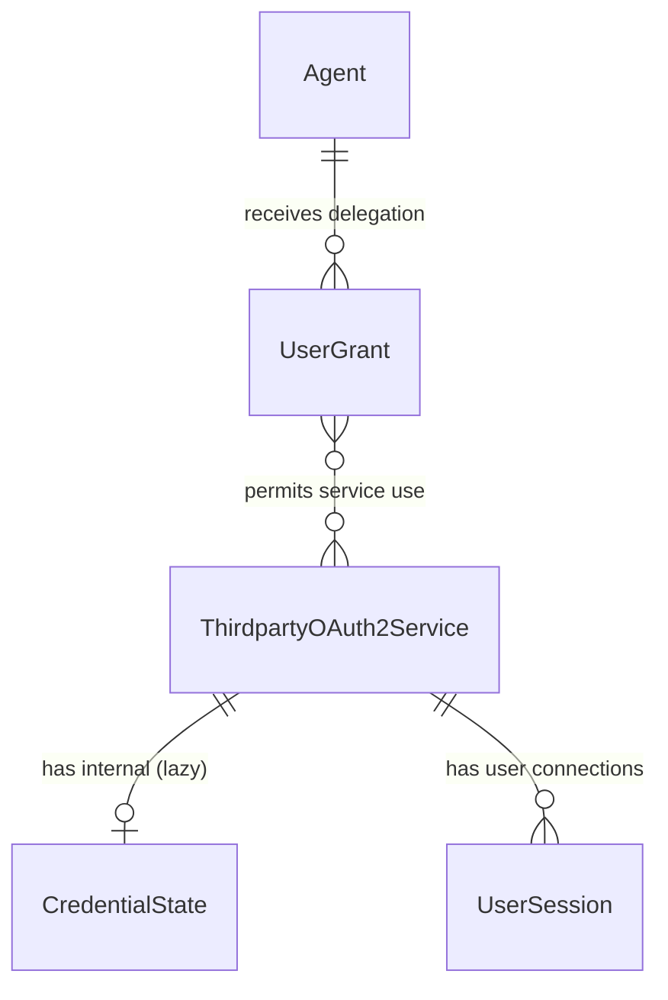
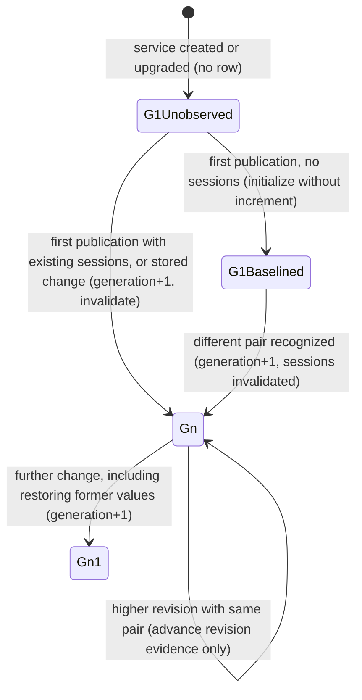
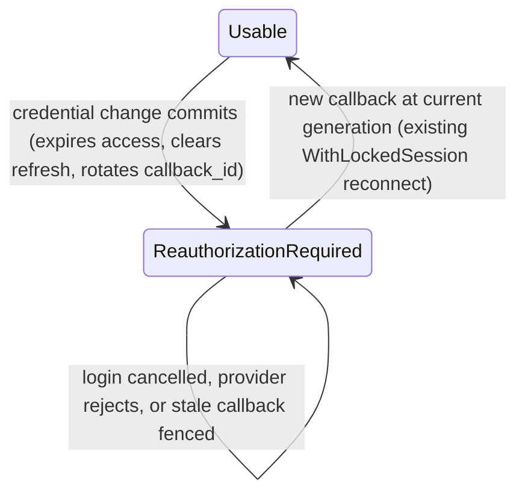

# Data Model: Invalidate Sessions After Third-Party Credential Changes

**Feature**: 055-invalidate-credential-sessions | **Date**: 2026-11-03 | **Plan**: [plan.md](plan.md) | **Research**: [research.md](research.md)

This design adds no new aggregate root or entity UUID. It adds one internal per-service record, value objects, and transient fields on existing types. All of it is Proposed (approval items D-SCHEMA, D-FINGERPRINT, D-INVALIDATE).

## Aggregates and Relationships



- **ThirdpartyOAuth2Service** (existing aggregate root). It owns the effective outbound client credentials and the credential source (ADR 041). This feature adds no columns. Its `version`, `updated_at`, and administrative representation never change because of a filesystem recognition.
- **CredentialState** (new, internal, 1:1 with a service, created lazily). It records the service's credential generation and the fingerprint of the last recognized filesystem pair. Its key is the service's existing `id.ServiceID`. It needs no typed ID (ADR 013). It is never exposed by any API.
- **UserSession** (existing aggregate). This feature adds no columns. Invalidation rewrites existing columns (see the state machine).
- **UserGrant** (existing). It is never modified by this feature.

## CredentialState

| Field | Go type | Column (`thirdparty_credential_states`) | Rules |
|---|---|---|---|
| `ServiceID` | `id.ServiceID` | `service_id UUID PRIMARY KEY REFERENCES thirdparty_oauth2_services(id) ON DELETE CASCADE` | Required |
| `Generation` | `int64` | `credential_generation BIGINT NOT NULL CHECK (credential_generation > 0)` | Starts at 1 and only increases. Every covered change increments it exactly once. |
| `Fingerprint` | `string` (empty means none) | `credential_fingerprint TEXT NULL CHECK (credential_fingerprint IS NULL OR credential_fingerprint LIKE '$argon2id$%')` | Set only for filesystem-sourced services. It is an Argon2id PHC string over `len(client_id) ‖ client_id ‖ secret`. Never logged or returned. |
| `PublicationRevision` | `*int64` | `publication_revision BIGINT NULL CHECK (publication_revision IS NULL OR publication_revision > 0)` | Operator publication high-water mark. NULL until first filesystem publication; retained across source transitions; never decreases. Fingerprint may exist before the first revision for a stored→filesystem transition. |
| `RecognizedAt` | `*time.Time` | `recognized_at TIMESTAMPTZ NULL` | The instant of the last change. NULL until the first change. |
| `UpdatedAt` | `time.Time` | `updated_at TIMESTAMPTZ NOT NULL DEFAULT NOW()` | Changes on initialization, revision evidence advance or a change |

A missing row is equivalent to `{Generation: 1, Fingerprint: "", PublicationRevision: nil}`. `domain/storage.CredentialState` carries these fields, with `Validate()` enforcing the rules above.

### Generation state machine



CAS compares expected generation and publication revision. A loser discards the acquisition and fails closed after one attempt; a fresh request may retry. Lower revision or equal revision/different pair cannot mutate state. Higher revision/same pair advances evidence without generation change. Restoration requires a higher revision than the durable high-water mark (ADR section 3).

## Value objects

| Type | Package | Purpose |
|---|---|---|
| `CredentialChange` | `domain/storage` | A transient instruction attached to a service update or a recognition. Fields: `Trigger` (`stored_update`, `filesystem_recognized`, or `source_transition`), `ExpectedGeneration int64`, `ExpectedPublicationRevision *int64`, `PublicationRevision *int64`, `Fingerprint string` (empty clears it), `Invalidate bool`, `At time.Time`. Repositories apply it atomically with the service update or recognition. `Validate()` requires `ExpectedGeneration > 0` and a closed `Trigger`. |
| `CredentialObservation` | `domain/storage` | Transient guard input: Generation, Source, optional PublicationRevision, from a consistent GetWithService/acquisition result. Guard checks all three before admission/release; never includes credential plaintext. |
| `CredentialChangeResult` | `domain/storage` | Returned by the repositories. Fields: `Generation int64`, `State CredentialState` (the committed state, including revision), `InvalidatedSessions int`. Used for audit counts and issuing the operation's observation after its successful mutation. |
| `credentialDigest` | `domain/oauth2session` (unexported) | An in-memory HMAC-SHA256 digest of a pair under the per-process key. Never persisted or logged. |
| `currentCredentials` | `domain/oauth2session` (unexported) | The output of `establishCurrency`: the validated pair (`ClientID`, `Secret`), `Source`, selected provider snapshot, `Generation`, and optional `PublicationRevision`. Acquisition must observe an unchanged state before and after reading files. It is passed to one logical exchange/refresh/token-supply operation and is never stored. Its non-secret CredentialObservation authorizes guard entry only when generation, source and acquired revision still match. |

## Transient fields on existing types (never persisted in new columns)

| Type | Field | Use |
|---|---|---|
| `model.ThirdpartyOAuth2ProviderEntity` | `CredentialChange *storage.CredentialChange` (not mapped) | The domain update path sets it when a covered change or a stored-to-filesystem baseline applies. `Update` in both stores applies it in the same transaction or lock scope. |
| `storage.UserSession` | `ExpectedCredentialGeneration int64` (`db:"-"`) | The first-connection insert succeeds only when the service's current generation equals this value (missing row = 1). Otherwise it returns the existing Conflict. |
| `oauth2session.OAuth2StateTokenClaims` | `CredentialGeneration int64` (`json:"credential_generation,omitempty"`) | Sealed in the existing JWE at initiation. Zero matches only generation 1. Old application replicas must not serve filesystem traffic during cutover; initialization with existing sessions advances past 1. |

## UserSession state transitions



The invalidation rewrites these columns:

| Column | Value |
|---|---|
| `access_token_expires_at` | Change instant (`CredentialChange.At`) |
| `encrypted_refresh_token` | `NULL` |
| `refresh_token_expires_at` | `NULL` |
| `callback_id` | New random UUID per row (`gen_random_uuid()` in PostgreSQL; `uuid.NewString()` in memory) |
| `updated_at` | Change instant |

The following stay unchanged: `id`, `principal`, `service_id`, `encrypted_access_token` (opaque and never decrypted after expiry), `upstream_client_id`, `scope`, `token_type`, `encryption_context`, `initiated_at`, and `created_at`.

## Validation rules (from requirements)

| Rule | Source |
|---|---|
| Unchanged evidenced pair, metadata-only edits, rejected updates, and version conflicts never increment the generation or touch sessions; unknown legacy initialization is the explicit exception | FR-004, Scenarios 1.2–1.3 |
| A source transition with an unchanged effective pair does not increment the generation | FR-002 |
| An undecryptable persisted secret or a missing fingerprint on a write that leaves the filesystem source counts as a change | SR-001 (fail closed) |
| A missing filesystem fingerprint initializes evidence and invalidates existing sessions atomically, advancing generation; with no sessions it only initializes | D-INITIALIZE, research R4, Scenario 1.6 |
| Stale/lower revision and equal revision/different pair fail without writes; CAS loss never relabels acquired material | D-PUBLICATION, FR-005, FR-012 |
| Source transitions retain revision high-water mark; re-entry into filesystem requires a higher revision | ADR section 3, FR-002 |
| Source errors never write credential state | FR-012, Scenario 1.7 |
| Generation never decreases, and restoring former values increments it | FR-005, Scenario 1.5 |

## Migration (number provisional: next free, currently `046`)

`046_create_thirdparty_credential_states.up.sql`:

```sql
SET LOCAL statement_timeout = '1s';
LOCK TABLE thirdparty_oauth2_services IN SHARE ROW EXCLUSIVE MODE NOWAIT;
CREATE TABLE thirdparty_credential_states (
    service_id UUID PRIMARY KEY REFERENCES thirdparty_oauth2_services(id) ON DELETE CASCADE,
    credential_generation BIGINT NOT NULL CHECK (credential_generation > 0),
    credential_fingerprint TEXT NULL CHECK (credential_fingerprint IS NULL OR credential_fingerprint LIKE '$argon2id$%'),
    publication_revision BIGINT NULL CHECK (publication_revision IS NULL OR publication_revision > 0),
    recognized_at TIMESTAMPTZ NULL,
    updated_at TIMESTAMPTZ NOT NULL DEFAULT NOW()
);
```

`046_create_thirdparty_credential_states.down.sql`: `DROP TABLE thirdparty_credential_states;`

- The migration is atomic and runs in a transaction. It requires no backfill and no `CONCURRENTLY` exception.
- Adding the foreign key needs a brief `SHARE ROW EXCLUSIVE` lock on `thirdparty_oauth2_services`. The migration takes it explicitly with `NOWAIT` under a one-second `statement_timeout`, as migration `040` does. Lock contention aborts the deployment instead of queuing behind live traffic.
- DOWN discards generations and fingerprints. A later UP restarts every service at generation 1 with no fingerprint. Sessions that were invalidated earlier stay expired, because their rows carry the invalidation. Callbacks in flight across a downgrade and re-upgrade can seal a stale generation that matches 1 again. The rollback runbook therefore requires draining authorization flows for 10 minutes (the JWE TTL) before DOWN. Convert filesystem services to stored under ADR 041's existing rollback prerequisites and remove filesystem traffic before dropping revision evidence; never run this reader against missing schema. Re-UP is an initialization boundary: remaining unknown filesystem sessions expire on first acquisition. Never use DOWN/UP to reset a live filesystem publication high-water mark.
- Integration tests cover apply, rollback, and reapply, along with the foreign-key cascade and the CHECK constraints.
