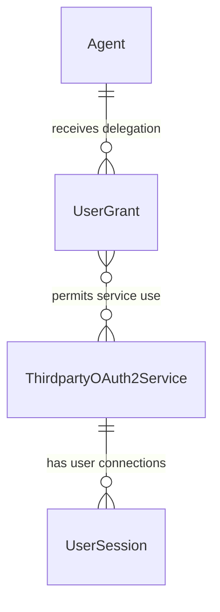
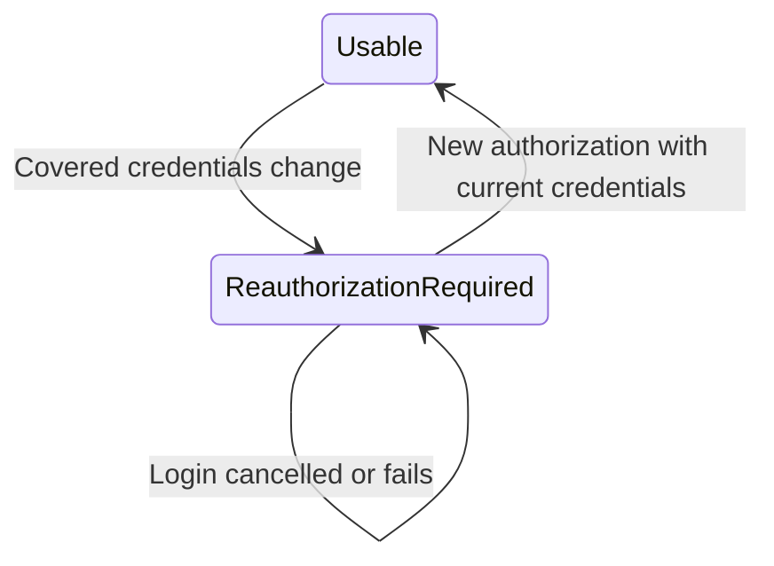

# Feature Specification: Invalidate Sessions After Third-Party Credential Changes

**Feature Branch**: `speckit/issue-388`

**Created**: 2026-11-03

**Status**: Draft — scope and automatic consent entry need clarification

**Input**: User description:

```text
Invalidate tokens after cllient credential change

In case thirdparty service client credentials change, established sessions must get invalidated and suers prompted for reauth. Consent scree should be shown automatically so that users are guided to re-login with a thirdparty.
```

## User Scenarios & Testing *(mandatory)*

A credential change must not leave the broker treating an old third-party connection as usable. Users must be guided through reconnecting rather than discovering stale credentials through repeated failures. An **in-scope credential change** below means an actual change covered by Q1; its final scope is not yet approved.

Each numbered acceptance scenario requires a corresponding end-to-end test before implementation, with a 1:1 scenario-to-test mapping. Browser journeys additionally require frontend acceptance coverage and screenshots. This specification does not implement those tests.

### User Story 1 - Stop using sessions established with old credentials (Priority: P1)

As an operator replacing a third-party service's client credentials, I want established sessions for that service invalidated so the broker cannot keep returning or refreshing their old tokens.

**Why this priority**: Continuing to use credentials from a replaced service connection defeats the requested invalidation even if the old access token has not expired.

**Independent Test**: Establish sessions for two users on one service and a control session on another service, make an in-scope credential change, and verify that neither affected user can obtain or refresh the old service tokens while the control service still works.

**Acceptance Scenarios**:

1. **Given** Alice and Bob have usable sessions for GitHub Production and Alice also has a usable Calendar session, **When** an in-scope credential change takes effect for GitHub Production, **Then** subsequent broker requests cannot obtain or refresh either old GitHub session's tokens, and Alice's Calendar session remains usable.
2. **Given** Alice has a usable GitHub Production session, **When** an operator saves unchanged effective credentials or changes only the service's display name, **Then** the session remains usable and no credential-change reauthentication is requested.
3. **Given** Alice has a usable GitHub Production session, **When** a credential update is rejected before taking effect, **Then** the existing session remains usable and the update is not reported as successfully applied.
4. **Given** a refresh or authorization callback began before an in-scope credential change, **When** it finishes after that change takes effect, **Then** it cannot restore usable tokens tied to the replaced credentials, and Alice must start a new connection using the current credentials.
5. **Given** an in-scope change has invalidated Alice's GitHub Production session, **When** the operator restores the former credential values, **Then** Alice's invalidated session does not become usable again without a new successful authorization.

---

### User Story 2 - Be guided to reconnect without manual troubleshooting (Priority: P1)

As a user whose third-party connection was invalidated, I want the consent experience to identify the affected service automatically and guide me to log in again, so I can resume the agent's work without finding session-management settings myself.

**Why this priority**: Invalidation alone would strand users behind errors; automatic guidance and successful reconnection are part of the issue's requested outcome.

**Independent Test**: Begin the supported browser entry flow selected in Q2 after invalidation, verify that the consent experience appears without manually navigating to it, reconnect the named third party, and confirm the agent can resume within the existing delegation's permissions.

**Acceptance Scenarios**:

1. **Given** Alice has an existing delegation to Report Assistant but its required GitHub Production session was invalidated, **When** she reaches the affected browser entry selected in Q2, **Then** the consent experience appears automatically, identifies GitHub Production as requiring login, and does not present its old connection as usable.
2. **Given** Alice sees the reconnect guidance, **When** she chooses Login and successfully completes GitHub Production authorization using the current credentials, **Then** the broker establishes a usable replacement session and she can resume the interrupted activity without manually searching for the consent screen; her delegation is not broadened or extended.
3. **Given** Alice sees the reconnect guidance, **When** she declines login or the third party rejects authorization, **Then** the old session remains unusable, no new delegation is silently approved, and she sees a failure or cancellation outcome with an explicit way to retry.
4. **Given** Report Assistant requests tokens without an interactive browser after invalidation, **When** the broker evaluates the affected session, **Then** it returns a recoverable session failure with guidance for interactive recovery, not an old token or a browser page in place of the protocol response. Its final recovery target depends on Q2.

### Edge Cases

- Access tokens with a future expiry, access tokens without a recorded expiry, and sessions with usable refresh tokens are all subject to invalidation; expiry alone cannot keep an invalidated session usable.
- An affected session is shared by the same principal's agents using that service: the change cannot leave one agent able to use the old connection while another requires reconnection.
- Repeated changes while a user is reconnecting must not allow an authorization begun against an earlier credential state to establish a usable connection afterward.
- A broker restart or another serving replica must not make an invalidated connection usable again.
- A missing or unreadable mounted credential file is not proof of an actual credential change. Existing fail-closed source-error behavior must not be replaced by an unsafe fallback or an endless login loop.
- If invalidation cannot be guaranteed, the operation must not report a fully successful credential change while serving old tokens. Concrete failure and concurrency boundaries belong in the plan.
- Already distributed tokens may still be accepted directly by a third party; see the scope boundary in Assumptions.

## Concrete Example Journeys *(mandatory)*

**Shared cast and initial state**: Alice (`alice@example.com`) and Bob (`bob@example.com`) use Report Assistant (agent `550e8400-e29b-41d4-a716-446655440000`). GitHub Production is service `880e8400-e29b-41d4-a716-446655440010`, with canonical ID `github-production`; Calendar is service `880e8400-e29b-41d4-a716-446655440020`. Alice has already delegated the required GitHub read permissions to Report Assistant. Both users have established GitHub sessions. Alice also has a Calendar session. All dates are 2026-11-03 UTC. All identities, hosts, codes, and credentials are synthetic.

### Journey 1 — An operator changes credentials without disrupting unrelated services (User Story 1, Scenarios 1.1–1.5)

**Step 1 — 09:00: Alice and Bob have working connections**

GitHub Production uses stored client ID `report-client-v1`. Alice's GitHub access token would otherwise remain valid until 10:00; Bob's has already expired but his session has a usable refresh token. Both sessions count as usable before the change. Alice's Calendar session is independent.

**Step 2 — 09:05: the operator changes the GitHub client identity**

The operator successfully replaces GitHub Production's client ID with `report-client-v2` and supplies the corresponding synthetic replacement secret through the existing administrative service-management flow. This is the representative credential-change case; Q1 settles whether secret-only and external-file changes have the same outcome. No new management endpoint or request shape is prescribed here.

**Step 3 — 09:05 onward: attempts to use old connections require recovery**

Alice's next broker-mediated use cannot return her old GitHub token despite its future expiry. Bob's next use cannot refresh his old connection. Alice can still use Calendar. Report Assistant receives an interactive-recovery action for GitHub rather than silently continuing with either old session. The exact automatic consent entry is the unresolved Q2 choice.

**Step 4 — boundary variants: rejected updates and concurrent work**

A rejected update or a save of unchanged effective values leaves the original connections usable (Scenarios 1.2–1.3). A refresh or callback started before 09:05 cannot later restore a usable old-credential connection (Scenario 1.4). Restoring `report-client-v1` at 09:10 does not reactivate the invalidated sessions (Scenario 1.5).

**Observable result**: Both GitHub users need a new connection; Calendar does not. No obsolete GitHub token is newly supplied by the broker after the change takes effect.

### Journey 2 — Alice reconnects from automatic consent guidance (User Story 2, Scenarios 2.1–2.4)

The following is the proposed user-visible sequence. State A must appear automatically at the entry selected in Q2; it does not assert an approved change to an existing protocol recovery URI.

**Step 1 — 09:06: the affected browser flow shows consent guidance**

Alice is still authenticated to the broker. Her delegation still exists, but the GitHub connection is no longer usable. The browser shows State A without Alice manually finding the consent page.


<details><summary>Wireloom source</summary>

```wireloom
window "Report Assistant - Consent":
  header:
    text "Agentic Identity Broker" bold
    text "alice@example.com" muted
  panel:
    text "Report Assistant" bold size=large
    text "Reconnect a required account to continue." muted
  section "Required services":
    slot "GitHub Production":
      status "Login required" kind=warning
      text "The service connection changed. Please log in again."
      button "Login" primary
    slot "Calendar":
      status "Connected" kind=success
  footer:
    button "Continue" disabled
```

</details>

**Step 2 — 09:06:05: Alice chooses Login**

The browser starts third-party authorization for GitHub Production, never Calendar. This illustrative exchange uses the existing GET contract and same-origin agent-detail return path. The current consent-page POST alternative preserves tab-local selections; selection of that existing alternative remains a design matter, not a new contract in this specification.

```http
GET /api/third-party/880e8400-e29b-41d4-a716-446655440010/oauth2/authorize?redirect_uri=https%3A%2F%2Fbroker.example.com%2Fagents%2F550e8400-e29b-41d4-a716-446655440000 HTTP/1.1
Host: broker.example.com
X-Remote-User: alice@example.com

HTTP/1.1 302 Found
Location: https://github.example.com/authorize?response_type=code&client_id=report-client-v2&redirect_uri=https%3A%2F%2Fbroker.example.com%2Fapi%2Fthird-party%2F880e8400-e29b-41d4-a716-446655440010%2Foauth2%2Fcallback&scope=repo&state=SYNTHETIC_SEALED_STATE_V2&code_challenge=E9Melhoa2OwvFrEMTJguCHaoeK1t8URWbuGJSstw-cM&code_challenge_method=S256
```

The authenticated proxy supplies `X-Remote-User`; it is not trusted from an arbitrary public caller. `SYNTHETIC_SEALED_STATE_V2` represents an opaque, integrity-protected authorization context bound to Alice, GitHub Production, the current client identity, the same-origin return URI, and the PKCE verifier. It is not a real token or an executable fixture. The example uses a standard OAuth2 provider with the shown authorization endpoint and `repo` scope.

**Step 3 — 09:06:20: Alice authorizes at the third party**

```http
GET /api/third-party/880e8400-e29b-41d4-a716-446655440010/oauth2/callback?code=SYNTHETIC_CODE_V2&state=SYNTHETIC_SEALED_STATE_V2 HTTP/1.1
Host: broker.example.com
X-Remote-User: alice@example.com

HTTP/1.1 302 Found
Location: https://broker.example.com/agents/550e8400-e29b-41d4-a716-446655440000?success=true&service_id=880e8400-e29b-41d4-a716-446655440010
```

The broker validates the callback and completes the provider exchange using the current credentials before showing success. No access or refresh token is exposed in the browser return URL. Tokens remain opaque in this journey; no output JWT is introduced.

**Step 4 — 09:06:21: the consent experience shows a usable replacement**

Action connecting States A and B: Alice chooses **Login**, successfully completes provider authorization, and returns to the broker.


<details><summary>Wireloom source</summary>

```wireloom
window "Report Assistant - Consent":
  header:
    text "Agentic Identity Broker" bold
    text "alice@example.com" muted
  panel:
    text "Report Assistant" bold size=large
    status "Connection restored" kind=success
    text "Your existing delegation has not changed." muted
  section "Required services":
    slot "GitHub Production":
      status "Connected" kind=success
    slot "Calendar":
      status "Connected" kind=success
  footer:
    button "Continue" primary
```

</details>

Alice continues the interrupted activity. Report Assistant can obtain GitHub access through her new session, subject to the existing grant and provider permissions. Bob still needs his own new authorization.

**Step 5 — cancellation variant: Alice declines instead**

If Alice cancels at GitHub rather than authorizing, the existing callback contract returns her to `/sessions` with an error. The reconnect guidance must communicate failure and offer a deliberate retry; Q2 settles how the automatic consent experience relates to that existing return behavior.


<details><summary>Wireloom source</summary>

```wireloom
window "GitHub Production - Reconnect":
  header:
    text "Agentic Identity Broker" bold
    text "alice@example.com" muted
  panel:
    status "Connection not restored" kind=warning
    text "Login was cancelled. GitHub Production still requires login."
    button "Try login again" primary
    button "Not now"
```

</details>

Action from State C: **Try login again** starts a fresh authorization; **Not now** leaves the session unusable. There is no automatic retry loop.

**Observable result**: Successful login restores only Alice's GitHub connection. Cancellation restores nothing. Neither outcome silently changes agent delegation. A non-browser request remains a protocol failure with recovery guidance, never an unsolicited HTML consent response.

## Requirements *(mandatory)*

### Functional Requirements

- **FR-001**: An actual in-scope credential change MUST invalidate every established user session for the affected third-party service, not just the operator's or the next user's session.
- **FR-002**: The scope of credential changes MUST be settled before planning: [NEEDS CLARIFICATION: Does invalidation cover client-ID and secret-only changes made through service administration only, those changes plus externally rotated filesystem credentials, or only client-identity changes? Secret-only continuity is currently supported by ADR 041.]
- **FR-003**: After a covered change takes effect, the broker MUST NOT supply or refresh tokens from affected old sessions, regardless of token expiry or refreshability. All broker-mediated access paths MUST agree that those sessions are unusable.
- **FR-004**: A save with unchanged effective credentials, unrelated service metadata changes, or an update rejected before taking effect MUST NOT trigger credential-change invalidation.
- **FR-005**: Invalidation MUST survive broker restarts and apply across serving replicas. Returning to former credential values MUST NOT reactivate an invalidated session.
- **FR-006**: Concurrent refreshes and callbacks tied to replaced credentials MUST NOT restore session usability after the change takes effect. Recovery MUST require a new authorization against the current credential state.
- **FR-007**: On the affected browser entry, the consent experience MUST appear automatically and identify which service requires login, even when an agent delegation already exists. [NEEDS CLARIFICATION: Should automatic consent apply when the user next enters the agent authorization flow, when a client follows a token-exchange recovery action, or both? The existing ADR 044 recovery action starts provider login directly and returns to /sessions rather than showing broker consent.]
- **FR-008**: The consent experience MUST guide the authenticated user to authorize the affected third party. It MUST NOT display the invalidated connection as usable, silently approve delegation, or require manually finding the consent screen.
- **FR-009**: Successful authorization with the current credentials MUST establish a usable replacement session and allow continuation within existing permissions. A failed or cancelled attempt MUST leave old sessions unusable and expose a deliberate retry action without a redirect loop.
- **FR-010**: Sessions for unrelated services and other users' newly established connections MUST remain unaffected. Existing user grants MUST retain their permissions, status, and expiry unless the user explicitly changes them through the existing consent controls.
- **FR-011**: Non-interactive clients MUST receive a recoverable session failure and an interactive-recovery action rather than an old token, an unsolicited browser redirect, or HTML substituted for their protocol response. Q2 determines the recovery target.
- **FR-012**: An operation MUST NOT claim successful completion of the credential change while leaving obsolete sessions usable. The plan MUST define the observable change-effective boundary and failure behavior for each selected source, including concurrent operations.

### Domain Model *(if applicable - document before API or database design)*





**Entities and consistency boundaries**:

- **ThirdpartyOAuth2Service**: Registered third-party provider whose effective client credentials can change. One service's change affects all established user connections to that service, not unrelated services.
- **UserSession**: A principal's third-party connection and its token pair. Invalidating usability is distinct from merely waiting for access-token expiry. This specification does not choose deletion versus retained invalidation evidence.
- **UserGrant**: Delegation from a principal to an agent, separate from a provider connection. Invalidation does not revoke or renew the grant.

**Value objects and domain events**: A credential change taking effect and a replacement connection being established are business-significant transitions. Concrete representations, persistence consistency, and any new glossary terms are design work for the later plan; this draft introduces no new credential-management framework.

### Configuration Requirements *(if applicable - document before implementation)*

No new runtime setting is requested. Existing source selection remains relevant to Q1. For the filesystem option, the existing configuration contract is:

```yaml
third_party_oauth2:
  credential_files:
    github-production:
      client_id_file: /meta/github/client-id
      client_secret_file: /meta/github/client-secret
```

This binding supplies credentials only when GitHub Production explicitly selects `credential_source: filesystem`. It does not select that source itself. Paths are synthetic. Whether replacing these files triggers the new invalidation behavior is unresolved in Q1; this example does not authorize file polling or any particular detection mechanism.

### API Requirements *(if applicable - design before database)*

Existing administration, consent, session, and token-exchange contracts are the starting point, not permission to change them. The plan must identify and document any behavior changes in the relevant OpenAPI contracts before implementation and include them in the maintainer approval proposal. The HTTP examples above illustrate existing third-party login contracts, not an approved replacement for ADR 044's recovery action. No new endpoint, error code, or version change is selected in this draft.

### Database Requirements *(if applicable)*

Session invalidation must retain its safety after restart and across replicas. The specification does not choose storage fields, a schema migration, or a transaction strategy. Any required persistence changes must follow the existing both-store and migration rules and be designed in the subsequent phase.

### Security Requirements *(mandatory for security-critical features)*

- **SR-001**: Invalidation enforcement MUST be automatic for the selected scope and fail closed. Credential-change recovery MUST NOT bypass user authentication, existing delegation checks, callback validation, or provider authorization.
- **SR-002**: Neither credential values nor access tokens, refresh tokens, authorization codes, or sealed authorization context may appear in user-facing diagnostics or audit records. Recovery guidance may identify the affected service, not disclose its credentials.
- **SR-003**: Invalidation and successful replacement MUST have credential-free audit outcomes. Existing structured logging and telemetry privacy rules remain binding.
- **SR-004**: Recovery targets MUST retain the existing trusted-origin and resolved-service protections. Untrusted callers MUST NOT control the recovery origin or another user's connection.
- **SR-005**: Missing credential sources or failed security validation MUST NOT lead to fallback to replaced credentials or an invalidated session.

### Frontend/Design System Requirements *(if applicable - document before implementation)*

The application-specific consent and reconnect states must use the existing design system and semantic tokens, remain keyboard accessible, and satisfy WCAG 2.1 AA. Login-required, restored, and cancelled states must communicate meaning without relying on color. Focus and primary actions must be discoverable. No visual-system redesign is requested. Final page placement and automatic entry depend on Q2; wireframes show behavior, not a new route contract.

### Key Entities *(include if feature involves data)*

The existing ThirdpartyOAuth2Service, UserSession, UserGrant, Agent, and authenticated Principal are sufficient for describing the requested behavior. No separate end-user credential record or token-revocation service is mandated by this specification.

## Success Criteria *(mandatory)*

### Measurable Outcomes

- **SC-001**: In the acceptance matrix for every selected credential-change type, 100% of subsequent broker-mediated attempts to obtain or refresh affected old tokens require recovery, including old access tokens that have not expired.
- **SC-002**: In the two-user, two-service journey, both affected users require reauthorization and the unrelated service remains usable in 100% of runs.
- **SC-003**: In every supported browser entry selected in Q2, the first affected interaction displays consent guidance without manual navigation to the consent screen.
- **SC-004**: A user with valid provider access can restore the affected connection with one successful third-party authorization and continue without an administrative reset or unintended delegation change.
- **SC-005**: Rejected updates, unchanged-credential saves, cancellation, concurrent old callbacks, and restarts produce zero accidental reactivations of an invalidated session in the acceptance cases.

## Assumptions

- “Client credentials” refers to the third-party service's OAuth2 client credentials, not broker-issued agent credentials or the user's corporate login. Q1 settles the source and secret-only boundaries.
- Invalidation governs sessions and tokens the broker can still use or supply. Revoking tokens already delivered to agents or accepted independently by an external provider, forcing the provider's password screen despite its own SSO, and introducing provider-specific revocation integrations are out of scope unless the maintainer expands the specification.
- “Automatically” does not assume email, push notifications, forcibly opening a browser from a background request, or navigating an idle tab. Q2 settles the supported next-interaction entry points.
- The user remains authenticated to the broker; the third-party provider is available and the replacement credentials are valid for successful recovery. Source or provider failures must still fail closed.
- Existing consent and session flows are reused. The plan must reconcile accepted decisions rather than silently override them: [ADR 041](../../adrs/041-oauth2-client-secret-file-overrides.md) permits same-identity secret rotation continuity and keeps metadata operations independent of files; [ADR 044](../../adrs/044-service-specific-session-recovery-url.md) defines direct service-specific recovery; [ADR 035](../../adrs/035-root-mounted-spa.md) defines browser routes.
- These are requirements proposals only. No API change, architectural deviation, or consequential decision is approved by creating this specification.

## Clarification Handoff

### Q1 — Which credential changes invalidate sessions?

**Context**: FR-002; ADR 041 currently supports same-identity secret rotation without forcing reconnection.

| Option | Answer | Implications |
| --- | --- | --- |
| A | Client-ID and secret changes through stored-service administration | Forces reconnection after stored secret rotation; external file rotations retain their existing policy. |
| B | Client-ID and secret changes for both stored and filesystem sources | Includes external rotations; requires defining when they take effect and proposing changes to ADR 041's continuity and acquisition boundaries. |
| C | Only client-identity changes for supported sources | Preserves same-identity secret rotation continuity; narrows “credentials change” to identity changes. |
| Custom | State the included credential types and sources | The plan can then define a bounded, testable change-effective boundary. |

**Your choice**: Pending the separate clarification session.

### Q2 — Where must consent appear automatically?

**Context**: FR-007; ADR 044 currently starts provider login directly when a client opens a recoverable token-exchange action.

| Option | Answer | Implications |
| --- | --- | --- |
| A | On the next affected agent browser authorization flow | Existing delegations no longer hide missing required connections; token-exchange recovery retains the ADR 044 target. |
| B | When a client opens the affected token-exchange recovery action | Requires a proposed change to the direct-provider-login decision so the broker consent experience appears first. |
| C | Both entry points | Covers agent authorization and protocol-driven interactive recovery; requires specifying both contracts and proposing the ADR 044 change. |
| Custom | Name the entry point and expected return destination | Scope the automatic consent behavior and interrupted-flow continuation explicitly. |

**Your choice**: Pending the separate clarification session. No answers or approvals have been inferred from issue comments.
