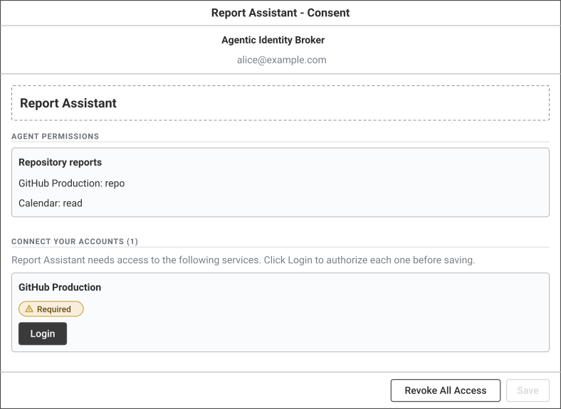
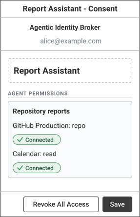
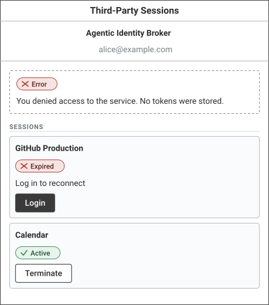
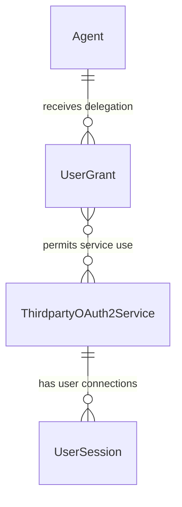
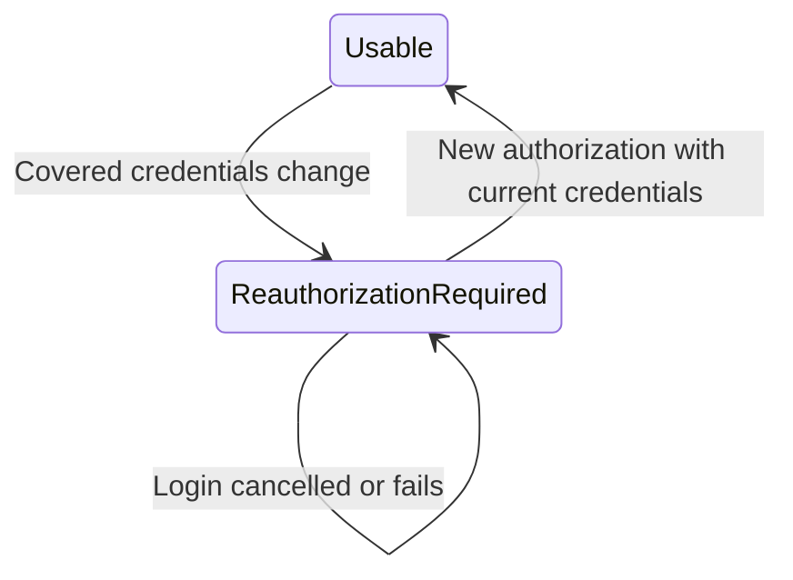

# Feature Specification: Invalidate Sessions After Third-Party Credential Changes

**Feature Branch**: `speckit/issue-388`

**Created**: 2026-11-03

**Status**: Planned draft. Consequential proposals need maintainer sign-off before implementation (see `## Approval Items` in [plan.md](plan.md))

**Input**: User description:

```text
Invalidate tokens after cllient credential change

In case thirdparty service client credentials change, established sessions must get invalidated and suers prompted for reauth. Consent scree should be shown automatically so that users are guided to re-login with a thirdparty.
```

## Clarifications

### Session 2026-11-03

- Q: Which credential changes invalidate established sessions? → A: Client-ID and shared-secret changes in both stored and filesystem sources (Q1 option B). **Proposed approval item C1 (Decision and superseding ADR 041)**: include secret-only rotation and eligible mounted-file rotation, rather than preserve same-identity secret continuity. This follows the issue's credential-change requirement consistently across sources; the main alternative is stored-administration-only invalidation, which leaves external rotation with different recovery behavior. Operator-managed credential changes are covered; automatic CIMD metadata/key refresh and discovery/DCR registration lifecycles are not added to scope. A source change with unchanged effective credentials is not itself a new invalidation trigger; ADR 041's stricter existing legacy-identity rules still apply. Planning must register C1 and draft the narrow supersession without changing the existing Accepted ADR.
- Q: Where must consent appear automatically after invalidation? → A: On the next affected agent browser authorization flow (Q2 option A), even with an active delegation; protocol-driven recovery retains ADR 044's direct service login and fixed `/sessions` return. **Proposed approval item C2 (API and Decision)**: change the browser authorization consent gate for invalidated required connections, preserving existing authentication, request validation, and continuation context in every supported broker mode. This meets automatic guidance without changing the established token-exchange recovery contract. The main alternative is consent-first recovery at both entries, which requires superseding ADR 044 and changing the recovery action. Optional services keep existing optionality. Planning must register the consent-gate behavior and its contract/versioning treatment; no new endpoint or protocol shape is chosen here.
- Q: When does a credential change take effect, particularly for externally replaced files? → A: A stored update takes effect at its successful durable commit; a filesystem change takes effect when the broker first successfully validates and durably recognizes the changed effective pair, before admitting authorization or token use against it. **Proposed approval item C3 (Decision and superseding ADR 041)**: check filesystem currency before authorization initiation and every broker decision to supply or refresh session tokens, not only on refresh or callback. Metadata-only listings remain independent of files and reflect the last durably recognized state. This closes the unexpired-token gap without promising instantaneous observation of external writes. The main alternative is periodic/background detection, which allows an old-token window. A file change and restoration entirely between broker observations is not detectable and is outside this guarantee; once a change is recognized, restoring former values never revives old sessions. Planning must register this observation boundary, its availability cost, durable replica/race protection, and ADR 041's narrowly superseded acquisition/in-flight rules. No polling, persistence layout, or comparison algorithm is selected.

### Session 2026-11-03 (planning reconciliation)

- Q: How is an invalidated session represented, given that the specification left deletion versus retained evidence open? → A: The session row is retained and expired. In the commit that makes the change effective, the broker sets the access-token expiry to the change instant, discards the refresh token, and rotates the private callback generation. **Proposed approval item D-INVALIDATE** ([research R1](research.md#r1-invalidation-mechanism-expire-retained-session-rows)). With this choice, every existing token, refresh, consent, sweep, metric, and listing path already treats the connection as unusable. The sessions page also keeps its existing **Login** retry action. The main alternative is deleting sessions, which would remove the sessions-page retry that State C needs.
- Q: Does C2 need a new consent-gate behavior or API shape? → A: No. Broker `/oauth2/authorize` already redirects a user with an active grant to consent when an included or mandatory connection is unusable, in every broker mode. The plan adds only the filesystem currency check before that decision. The approval item stays registered as **D-CONSENT**, together with the documented End-User API behavior **API-ENDUSER**. The main alternative is a dedicated reconnect banner, which needs a new retained invalidation reason in the API. It was rejected as unrequested API surface.
- Q: Which UI do Journey 2 States A–C show? → A: The existing consent page and sessions page, without a new reconnect banner. State A lists GitHub Production under "Connect Your Accounts" with **Login**, with **Save** disabled. State B shows it connected, with **Save** enabled to resume. State C is the sessions page with the existing access-denied alert and the expired GitHub Production card with **Login**. The previous wireframes showed proposed new texts and a **Continue**/**Try login again**/**Not now** control set. The existing UI meets FR-007–FR-009 without frontend code changes, so this change keeps the feature within the issue's scope. This is a reconciliation, not a requirement change. FR-008's guidance requirement is unchanged.
- Q: How is a filesystem secret-only change detected durably without persisting credentials? → A: Through an internal per-service credential generation and a salted Argon2id fingerprint of the last recognized pair, stored outside the service record so administrative ETags do not change. A per-process HMAC cache avoids repeated Argon2id computations. **Proposed approval items D-SCHEMA and D-FINGERPRINT** ([research R2–R3](research.md#r2-credential-generation-in-a-separate-internal-table)). This refines the earlier assumption "No ... last-known plaintext credential may be persisted": only a non-recoverable fingerprint persists. The main alternative is persisting the encrypted pair, which was rejected because it is recoverable.
- Q: Which ADR 041 rules does C1/C3 supersede, and which Feature 051 acceptance scenarios change? → A: The proposed superseding [ADR draft](adr-draft-credential-change-session-invalidation.md) replaces five ADR 041 rules: secret-rotation continuity, client-ID-only initiation, token supply without acquisition, the in-flight allowance, and the persistence of non-recoverable evidence. Feature 051 scenarios US2-S1, US2-S5, and US5-S3 are amended under it ([research R9](research.md#r9-feature-051-acceptance-scenarios-affected)). **Proposed approval item ADR-045.**

### Session 2026-11-03 (task-generation reconciliation)

- Q: What API versions cover the proposed lifecycle behavior changes? → A: **Proposed approval items API-ADMIN and API-ENDUSER** now propose Admin API `3.0.0` and End-User API `2.0.0` on the existing routes. Release `v0.1.133` contains `2.1.0` and `1.1.0`; Constitution Principles IV and X require a major version bump or a new endpoint when released behavior changes. This changes the API-version requirement from the plan's minor increments, not the requested flows. The main alternative is new versioned endpoints, rejected to avoid duplicating the same service and recovery workflows. Research R7 and both feature contracts are reconciled accordingly; neither contract is approved.
- Q: Where do the new persistence contract and test scaffolding belong? → A: Declare `ThirdpartyCredentialStateRepository` in `internal/ports/storage.go` as Principle IX requires. The state is internal to the existing service aggregate, so no new CRUD entity/endpoint or separately arranged boilerplate PR is needed. Write acceptance tests in Phase 2f and add only minimal compiling scaffolding to obtain semantic-red evidence before business implementation. This is task-order and architecture consistency, not a scope or requirement change. Pending acceptance tests and screenshots are explicitly unchecked in the plan rather than represented as completed evidence.

## User Scenarios & Testing *(mandatory)*

A credential change must not leave the broker treating an old third-party connection as usable. Users must be guided through reconnecting rather than discovering stale credentials through repeated failures. An **in-scope credential change** means an actual change of the operator-managed effective OAuth2 client ID, shared secret, or both, through stored-service administration or eligible filesystem credentials. Same-identity secret rotation is included. This is the C1 proposal, not an implementation approval.

Each numbered acceptance scenario requires a corresponding end-to-end test before implementation, with a 1:1 scenario-to-test mapping. Browser journeys additionally require frontend acceptance coverage and screenshots. This specification does not implement those tests.

### User Story 1 - Stop using sessions established with old credentials (Priority: P1)

As an operator replacing a third-party service's client credentials, I want established sessions for that service invalidated so the broker cannot keep returning or refreshing their old tokens.

**Why this priority**: Continuing to use credentials from a replaced service connection defeats the requested invalidation even if the old access token has not expired.

**Independent Test**: Establish sessions for two users on one service and a control session on another service, make an in-scope credential change, and verify that neither affected user can obtain or refresh the old service tokens while the control service still works.

**Acceptance Scenarios**:

1. **Given** Alice and Bob have usable sessions for GitHub Production and Alice also has a usable Calendar session, **When** an in-scope credential change takes effect for GitHub Production, **Then** subsequent broker requests cannot obtain or refresh either old GitHub session's tokens, and Alice's Calendar session remains usable.
2. **Given** Alice has a usable GitHub Production session, **When** an operator saves unchanged effective credentials or changes only the service's display name, **Then** the session remains usable and no credential-change reauthentication is requested.
3. **Given** Alice has a usable GitHub Production session, **When** a credential update is rejected before taking effect, **Then** the existing session remains usable and the update is not reported as successfully applied.
4. **Given** a refresh or authorization callback began before an in-scope credential change, **When** it finishes after that change takes effect, **Then** it cannot restore usable tokens tied to the replaced credentials, and Alice must start a new connection using the current credentials.
5. **Given** an in-scope change has durably invalidated Alice's GitHub Production session, **When** the broker restarts, another serving replica handles her request, or the operator restores the former credential values, **Then** Alice's invalidated session does not become usable again without a new successful authorization.
6. **Given** GitHub Production uses eligible filesystem credentials and Alice has an unexpired session, **When** a new coherent client-ID or secret-only pair is published and her next broker token request is made without a preceding refresh, **Then** that request detects and durably recognizes the change before supplying a token, requires recovery instead of returning the old token, and subsequent requests for Bob's old session on another replica also require recovery.
7. **Given** GitHub Production uses filesystem credentials, **When** the required pair is missing, unreadable, or incoherent during an authorization or token-use decision, **Then** the broker fails closed with the existing source-availability failure, supplies no old token or fallback credentials, and does not infer a credential change or send the user into a login loop; a later successful read of unchanged effective values does not itself invalidate a previously usable connection.

---

### User Story 2 - Be guided to reconnect without manual troubleshooting (Priority: P1)

As a user whose third-party connection was invalidated, I want the consent experience to identify the affected service automatically and guide me to log in again, so I can resume the agent's work without finding session-management settings myself.

**Why this priority**: Invalidation alone would strand users behind errors; automatic guidance and successful reconnection are part of the issue's requested outcome.

**Independent Test**: Begin the agent's browser authorization flow after invalidation in each supported broker mode, verify automatic consent guidance despite an active delegation, reconnect the required service, and resume the original validated authorization request within existing permissions. Separately follow a token-exchange recovery action and verify direct service login with a `/sessions` return.

**Acceptance Scenarios**:

1. **Given** Alice has an existing delegation to Report Assistant but its required GitHub Production session was invalidated, **When** she next enters Report Assistant's browser authorization flow, **Then** the consent experience appears automatically before authorization continues, identifies GitHub Production as requiring login, and does not present its old connection as usable.
2. **Given** Alice sees the reconnect guidance, **When** she chooses Login and successfully completes GitHub Production authorization using the current credentials, **Then** the broker establishes a usable replacement session and she can resume the interrupted activity without manually searching for the consent screen; her delegation is not broadened or extended.
3. **Given** Alice sees the reconnect guidance, **When** she declines login or the third party rejects authorization, **Then** the old session remains unusable, no new delegation is silently approved, and she sees a failure or cancellation outcome with an explicit way to retry.
4. **Given** Report Assistant requests tokens without an interactive browser after invalidation, **When** the broker evaluates the affected session, **Then** it returns a recoverable session failure with guidance for interactive recovery, not an old token or a browser page in place of the protocol response. The existing RFC 8693 response is `400 invalid_grant` with the resolved service's third-party authorization `error_uri` and a fixed same-origin `/sessions` return. Following that action starts provider login directly, not the broker consent page.

### Edge Cases

- Access tokens with a future expiry, access tokens without a recorded expiry, and sessions with usable refresh tokens are all subject to invalidation; expiry alone cannot keep an invalidated session usable.
- An affected session is shared by the same principal's agents using that service: the change cannot leave one agent able to use the old connection while another requires reconnection.
- Repeated changes while a user is reconnecting must not allow an authorization begun against an earlier credential state to establish a usable connection afterward.
- A broker restart or another serving replica must not make an invalidated connection usable again.
- A missing or unreadable mounted credential file is not proof of an actual credential change. Existing fail-closed source-error behavior must not be replaced by an unsafe fallback or an endless login loop.
- If recognition or invalidation cannot be durably guaranteed, affected authorization and token-use decisions fail closed and do not claim a successfully applied change. A rejected stored update leaves the prior durable state unchanged. A missing filesystem pair is an availability failure, not proof of rotation.
- Filesystem rotation is observed on demand, not at an arbitrary external write instant. A publish-and-restore sequence entirely between successful observations is outside the detection guarantee; a previously recognized change cannot be undone by restoring old values. Operations must not wait for token expiry to observe a changed pair.
- All serving replicas must use the configured publication of the same service credentials. A replica using stale material must not undo recognized invalidation or complete an old callback/refresh as a usable session. If currency cannot be established, it fails closed. Metadata-only listings do not read credential files; their status reflects durable recognized invalidation rather than independently detecting a file replacement.
- An already delivered token cannot be recalled. In-flight work may not newly authorize token release or commit a usable replacement from the old state after the change-effective boundary; network delivery of a response already authorized before that boundary is not a revocation guarantee.
- Already distributed tokens may still be accepted directly by a third party; see the scope boundary in Assumptions.

## Concrete Example Journeys *(mandatory)*

**Shared cast and initial state**: Alice (`alice@example.com`) and Bob (`bob@example.com`) use Report Assistant (agent `550e8400-e29b-41d4-a716-446655440000`). GitHub Production is service `880e8400-e29b-41d4-a716-446655440010`, with canonical ID `github-production`; Calendar is service `880e8400-e29b-41d4-a716-446655440020`. Alice has already delegated the required GitHub read permissions to Report Assistant. Both users have established GitHub sessions. Alice also has a Calendar session. All dates are 2026-11-03 UTC. All identities, hosts, codes, and credentials are synthetic.

### Journey 1 — An operator changes credentials without disrupting unrelated services (User Story 1, Scenarios 1.1–1.7)

**Step 1 — 09:00: Alice and Bob have working connections**

GitHub Production uses stored client ID `report-client-v1`. Alice's GitHub access token would otherwise remain valid until 10:00; Bob's has already expired but his session has a usable refresh token. Both sessions count as usable before the change. Alice's Calendar session is independent.

**Step 2 — 09:05: the operator changes the GitHub client identity**

The operator successfully replaces GitHub Production's client ID with `report-client-v2` and supplies the corresponding synthetic replacement secret through the existing administrative service-management flow. The same invalidation outcome applies to a stored secret-only change, an eligible filesystem client-ID change, and an eligible filesystem secret-only change. These four variants form the required credential-change acceptance matrix. No new management endpoint or request shape is prescribed here.

For stored credentials, 09:05 is the successful durable commit of the credential update and invalidation boundary. In the filesystem variants, the operator publishes a coherent replacement pair at 09:05; Alice's first subsequent broker token request must successfully acquire and durably recognize that pair before deciding whether it may supply tokens. That recognition is the filesystem boundary, even though no refresh is due. Merely changing the files does not claim that an idle broker has already observed them (Scenario 1.6).

**Step 3 — 09:05 onward: attempts to use old connections require recovery**

Alice's next broker-mediated use cannot return her old GitHub token despite its future expiry. Bob's next use cannot refresh his old connection. Alice can still use Calendar. Report Assistant receives an interactive-recovery action for GitHub rather than silently continuing with either old session. On Alice's next agent browser authorization, broker consent appears automatically. Following the protocol recovery action instead starts direct GitHub login and returns to `/sessions`, as ADR 044 requires.

**Step 4 — boundary variants: rejected updates and concurrent work**

A rejected update or a save of unchanged effective values leaves the original connections usable (Scenarios 1.2–1.3). A refresh or callback started before 09:05 cannot later restore a usable old-credential connection (Scenario 1.4). Restoring `report-client-v1` at 09:10, restarting the broker, or using another replica does not reactivate the invalidated sessions (Scenario 1.5). In the filesystem variant, an unreadable or incoherent pair instead produces the existing infrastructure failure, no token, and no login loop; restoring access to unchanged effective values is not proof of rotation (Scenario 1.7).

**Observable result**: Both GitHub users need a new connection; Calendar does not. No obsolete GitHub token is newly supplied by the broker after the change takes effect.

### Journey 2 — Alice reconnects from automatic consent guidance (User Story 2, Scenarios 2.1–2.4)

The following is the next affected agent browser authorization, using the existing consent gate and consent page (D-CONSENT). Token-exchange recovery remains a distinct, direct-provider-login flow under ADR 044; it does not enter State A.

**Step 1 — 09:06: the affected browser flow shows consent guidance**

Alice is still authenticated to the broker. Her delegation still exists, but the required GitHub connection is no longer usable. She starts Report Assistant's normal authorization flow. After the existing agent, redirect URI, scope, and PKCE checks, the browser goes automatically to `/agents/550e8400-e29b-41d4-a716-446655440000?session_token=SYNTHETIC_AUTHORIZATION_CONTEXT` and shows State A. The opaque marker represents the existing sealed authorization context for that validated request, not a new token claim. The active grant does not skip this reconnect guidance, because the existing gate checks every connection that the grant includes and every mandatory connection. An unconnected required GitHub login blocks **Save**; a disconnected optional service that the grant does not include does not.



<details><summary>Wireloom source</summary>

```wireloom
window "Report Assistant - Consent":
  header:
    text "Agentic Identity Broker" bold
    text "alice@example.com" muted
  panel:
    text "Report Assistant" bold size=large
  section "Agent Permissions":
    slot "Repository reports":
      text "GitHub Production: repo"
      text "Calendar: read"
  section "Connect Your Accounts (1)":
    text "Report Assistant needs access to the following services. Click Login to authorize each one before saving." muted
    slot "GitHub Production":
      status "Required" kind=warning
      button "Login" primary
  footer:
    button "Revoke All Access"
    button "Save" disabled
```

</details>

**Step 2 — 09:06:05: Alice chooses Login**

The browser starts third-party authorization for GitHub Production, never Calendar. The existing tab-local return-state flow preserves Alice's original `session_token` and selections in her tab and submits a clean same-origin return path with an opaque UUID. If that browser state cannot be saved, login does not start and a retryable error is shown; the original request is not silently discarded.

```http
POST /api/third-party/880e8400-e29b-41d4-a716-446655440010/oauth2/authorize HTTP/1.1
Host: broker.example.com
X-Remote-User: alice@example.com
Content-Type: application/x-www-form-urlencoded

redirect_uri=https%3A%2F%2Fbroker.example.com%2Fagents%2F550e8400-e29b-41d4-a716-446655440000&consent_state_id=9dc09bc0-94fd-42c6-a2ed-dcbe5537889b

HTTP/1.1 302 Found
Location: https://github.example.com/authorize?response_type=code&client_id=report-client-v2&redirect_uri=https%3A%2F%2Fbroker.example.com%2Fapi%2Fthird-party%2F880e8400-e29b-41d4-a716-446655440010%2Foauth2%2Fcallback&scope=repo&state=SYNTHETIC_SEALED_STATE_V2&code_challenge=E9Melhoa2OwvFrEMTJguCHaoeK1t8URWbuGJSstw-cM&code_challenge_method=S256
```

The authenticated proxy supplies `X-Remote-User`; it is not trusted from an arbitrary public caller. `SYNTHETIC_SEALED_STATE_V2` represents an opaque, integrity-protected authorization context bound to Alice, GitHub Production, the current client identity, the same-origin return URI, and the PKCE verifier. It is not a real token or an executable fixture. The example uses a standard OAuth2 provider with the shown authorization endpoint and `repo` scope.

**Step 3 — 09:06:20: Alice authorizes at the third party**

```http
GET /api/third-party/880e8400-e29b-41d4-a716-446655440010/oauth2/callback?code=SYNTHETIC_CODE_V2&state=SYNTHETIC_SEALED_STATE_V2 HTTP/1.1
Host: broker.example.com
X-Remote-User: alice@example.com

HTTP/1.1 302 Found
Location: https://broker.example.com/agents/550e8400-e29b-41d4-a716-446655440000?success=true&service_id=880e8400-e29b-41d4-a716-446655440010&consent_state_id=9dc09bc0-94fd-42c6-a2ed-dcbe5537889b
```

The broker validates the callback and completes the provider exchange using the current credentials before showing success. No access or refresh token is exposed in the browser return URL. Tokens remain opaque in this journey; no output JWT is introduced.

**Step 4 — 09:06:21: the consent experience shows a usable replacement**

Action connecting States A and B: Alice chooses **Login**, successfully completes provider authorization, and returns to the broker.



<details><summary>Wireloom source</summary>

```wireloom
window "Report Assistant - Consent":
  header:
    text "Agentic Identity Broker" bold
    text "alice@example.com" muted
  panel:
    text "Report Assistant" bold size=large
  section "Agent Permissions":
    slot "Repository reports":
      text "GitHub Production: repo"
      status "Connected" kind=success
      text "Calendar: read"
      status "Connected" kind=success
  footer:
    button "Revoke All Access"
    button "Save" primary
```

</details>

On the validated successful return, Alice's tab restores its saved authorization context and selections using the matching `consent_state_id` and removes that reference from the visible URL. Alice deliberately chooses **Save** to resume the original validated request. Her unchanged selection matches the existing grant, so the grant is returned unchanged; reconnection alone does not create, renew, or broaden delegation. Report Assistant can obtain GitHub access through her new session, subject to the existing grant and provider permissions. Bob still needs his own new authorization.

**Step 5 — cancellation variant: Alice declines instead**

If Alice cancels at GitHub rather than authorizing, the existing callback contract returns her to `/sessions?error=access_denied`. State C is that existing sessions view, not a new callback destination. Her invalidated GitHub Production connection remains listed as expired, with the existing **Login** action. The interrupted agent authorization has not completed; successful direct retry can restore the service connection, after which Alice can restart the agent authorization if needed. No automatic replay of a failed or expired authorization context is promised.



<details><summary>Wireloom source</summary>

```wireloom
window "Third-Party Sessions":
  header:
    text "Agentic Identity Broker" bold
    text "alice@example.com" muted
  panel:
    status "Error" kind=error
    text "You denied access to the service. No tokens were stored."
  section "Sessions":
    slot "GitHub Production":
      status "Expired" kind=error
      text "Log in to reconnect"
      button "Login" primary
    slot "Calendar":
      status "Active" kind=success
      button "Terminate"
```

</details>

Action from State C: **Login** on the GitHub Production card deliberately starts a fresh authorization that returns to `/sessions`. Dismissing the alert or leaving the page keeps the session unusable. There is no automatic retry loop.

**Observable result**: Successful login restores only Alice's GitHub connection. Cancellation restores nothing. Neither outcome silently changes agent delegation. A non-browser request remains a protocol failure with recovery guidance, never an unsolicited HTML consent response.

## Requirements *(mandatory)*

### Functional Requirements

- **FR-001**: An actual in-scope credential change MUST invalidate every established user session for the affected third-party service, not just the operator's or the next user's session.
- **FR-002**: Changes to the operator-managed effective client ID, shared secret, or both MUST invalidate sessions for stored and eligible filesystem credential sources, including same-client-ID secret rotation. Existing filesystem eligibility restrictions remain. Automatic CIMD metadata/key refresh and discovery/DCR registration lifecycles are outside this change. Changing source without changing effective credentials MUST NOT add an invalidation trigger, without relaxing ADR 041's existing legacy-identity restrictions. This is Proposed approval item C1 and requires a narrow superseding ADR 041 before implementation.
- **FR-003**: After a covered change takes effect, the broker MUST NOT newly authorize release or refresh of tokens from affected old sessions, regardless of token expiry or refreshability. All broker-mediated token access paths MUST agree that those sessions are unusable. For filesystem sources, authorization initiation and every decision to supply or refresh tokens MUST establish credential currency first, including unexpired access-token use. This broader acquisition boundary is proposal C3.
- **FR-004**: A save with unchanged effective credentials, unrelated service metadata changes, or an update rejected before taking effect MUST NOT trigger credential-change invalidation.
- **FR-005**: Invalidation MUST survive broker restarts and apply across serving replicas. Returning to former credential values MUST NOT reactivate an invalidated session.
- **FR-006**: Concurrent refreshes and callbacks tied to replaced credentials MUST NOT restore session usability after the change takes effect. Recovery MUST require a new authorization against the current credential state.
- **FR-007**: On the next agent browser authorization flow with an invalidated required service connection, the broker MUST automatically show consent guidance at the existing `/agents/{agent-id}` view, even with an active delegation, before continuing authorization. This applies in each supported broker mode after existing request validation. Existing sealed authorization context and tab-local return-state handling MUST preserve the interrupted request on successful reconnection. Optional connections MUST retain existing optionality. This is Proposed approval item C2.
- **FR-008**: The consent experience MUST guide the authenticated user to authorize the affected third party. It MUST NOT display the invalidated connection as usable, silently approve delegation, or require manually finding the consent screen.
- **FR-009**: Successful authorization with the current credentials MUST establish a usable replacement session and allow continuation within existing permissions. A failed or cancelled attempt MUST leave old sessions unusable and expose a deliberate retry action without a redirect loop.
- **FR-010**: Sessions for unrelated services and other users' newly established connections MUST remain unaffected. Existing user grants MUST retain their permissions, status, and expiry unless the user explicitly changes them through the existing consent controls.
- **FR-011**: Non-interactive clients MUST receive the existing recoverable session failure rather than an old token, unsolicited browser redirect, or HTML. RFC 8693 uses `400 invalid_grant` and the existing resolved-service authorization `error_uri` with the configured same-origin `/sessions` return (ADR 044). Following it starts provider login directly. Source availability failures retain their existing non-recoverable infrastructure response without a recovery URI. Existing ExtProc forwarding behavior is unchanged.
- **FR-012**: A stored credential update MUST become effective with its successful durable commit, without reporting success while obsolete sessions remain usable. A filesystem change MUST become effective at the first successful validated acquisition and durable recognition of a changed effective pair, before that operation admits authorization or supplies or refreshes tokens. If durable recognition fails, the operation MUST fail closed. No polling or instantaneous external-write detection is promised. Metadata-only listings MUST remain independent of file reads and reflect durably recognized state. The plan MUST design atomicity, race fencing, replica consistency, and failure handling that satisfy these boundaries; this is proposal C3.

### Domain Model *(if applicable - document before API or database design)*





**Entities and consistency boundaries**:

- **ThirdpartyOAuth2Service**: Registered third-party provider whose effective client credentials can change. One service's change affects all established user connections to that service, not unrelated services.
- **UserSession**: A principal's third-party connection and its token pair. Invalidating usability is distinct from merely waiting for access-token expiry. The plan retains the row and expires it at the change instant (proposal D-INVALIDATE; see [data-model.md](data-model.md#usersession-state-transitions)).
- **UserGrant**: Delegation from a principal to an agent, separate from a provider connection. Invalidation does not revoke or renew the grant.

**Value objects and domain events**: A credential change taking effect and a replacement connection being established are business-significant transitions. The plan models them as an internal per-service **Credential State** (credential generation and filesystem fingerprint) and a transient **Credential Change** ([data-model.md](data-model.md)). No new credential-management framework is introduced.

### Configuration Requirements *(if applicable - document before implementation)*

No new runtime setting is requested. The existing source selection determines where effective credentials come from. For filesystem credentials, the existing configuration contract is:

```yaml
third_party_oauth2:
  credential_files:
    github-production:
      client_id_file: /meta/github/client-id
      client_secret_file: /meta/github/client-secret
```

This binding supplies credentials only when GitHub Production explicitly selects `credential_source: filesystem`. It does not select that source itself. Paths are synthetic. Publishing a different effective client ID or secret through these files is an in-scope change, including secret-only rotation. Replacing a file with the same effective value after the existing whitespace normalization is not a credential change. No polling mechanism or new configuration key is selected.

### API Requirements *(if applicable - design before database)*

Existing administration, consent, session, and token-exchange contracts are the starting point, not permission to change them. The plan must identify and document any behavior changes in the relevant OpenAPI contracts before implementation and include them in the maintainer approval proposal. The HTTP examples above illustrate existing third-party login contracts, not an approved replacement for ADR 044's recovery action. The plan selects no new endpoint or error code. It proposes documented released-behavior changes with major version increments: Admin API `3.0.0` ([contracts/admin-api.md](contracts/admin-api.md), API-ADMIN) and End-User API `2.0.0` ([contracts/enduser-api.md](contracts/enduser-api.md), API-ENDUSER).

### Database Requirements *(if applicable)*

Session invalidation must retain its safety after restart and across replicas. The plan adds one internal table, `thirdparty_credential_states`, through an atomic migration (number provisional, currently `046`). Invalidation commits in the same transaction as the change ([data-model.md](data-model.md#migration-number-provisional-next-free-currently-046), D-SCHEMA). Both stores implement it under ADR 004.

### Security Requirements *(mandatory for security-critical features)*

- **SR-001**: Invalidation enforcement MUST be automatic for the selected scope and fail closed. Credential-change recovery MUST NOT bypass user authentication, existing delegation checks, callback validation, or provider authorization.
- **SR-002**: Neither credential values nor access tokens, refresh tokens, authorization codes, or sealed authorization context may appear in user-facing diagnostics or audit records. Recovery guidance may identify the affected service, not disclose its credentials.
- **SR-003**: Invalidation and successful replacement MUST have credential-free audit outcomes. Existing structured logging and telemetry privacy rules remain binding.
- **SR-004**: Recovery targets MUST retain the existing trusted-origin and resolved-service protections. Untrusted callers MUST NOT control the recovery origin or another user's connection.
- **SR-005**: Missing credential sources or failed security validation MUST NOT lead to fallback to replaced credentials or an invalidated session.

### Frontend/Design System Requirements *(if applicable - document before implementation)*

The consent and reconnect states reuse the existing consent and sessions pages (no React change is planned). They must use the existing design system and semantic tokens, remain keyboard accessible, and satisfy WCAG 2.1 AA. Login-required, restored, and cancelled states must communicate meaning without relying on color. Focus and primary actions must be discoverable. No visual-system redesign is requested. State A and State B belong to the existing agent consent view; State C belongs to the existing `/sessions` error return. Wireframes show guidance and deliberate actions, not new routes.

### Key Entities *(include if feature involves data)*

The existing ThirdpartyOAuth2Service, UserSession, UserGrant, Agent, and authenticated Principal are sufficient for describing the requested behavior. No separate end-user credential record or token-revocation service is mandated by this specification.

## Success Criteria *(mandatory)*

### Measurable Outcomes

- **SC-001**: In the acceptance matrix for every selected credential-change type, 100% of subsequent broker-mediated attempts to obtain or refresh affected old tokens require recovery, including old access tokens that have not expired.
- **SC-002**: In the two-user, two-service journey, both affected users require reauthorization and the unrelated service remains usable in 100% of runs.
- **SC-003**: In every supported broker mode, 100% of next agent browser authorization attempts with an invalidated required connection show consent guidance despite an active grant and without manual navigation. In protocol-recovery cases, 100% of followed action links start direct service login and return to `/sessions`, without introducing a consent-first detour.
- **SC-004**: A user with valid provider access can restore the affected connection with one successful third-party authorization and continue without an administrative reset or unintended delegation change.
- **SC-005**: Rejected updates, unchanged-credential saves, cancellation, concurrent old callbacks, former-value restoration, restarts, and other serving replicas produce zero accidental reactivations of an invalidated session in the acceptance cases.
- **SC-006**: In all filesystem client-ID and secret-only rotation cases, the first subsequent broker token-use request recognizes the changed pair and supplies zero old tokens, including when no refresh is due. Failed or incoherent acquisition supplies zero tokens, uses zero fallback credentials, and produces no automatic login loop.

## Assumptions

- “Client credentials” refers to the third-party service's operator-managed OAuth2 client ID and shared secret, not broker-issued agent credentials or the user's corporate login. Stored and eligible filesystem sources, including secret-only changes, are covered by proposal C1.
- Invalidation governs sessions and tokens the broker can still use or supply. Revoking tokens already delivered to agents or accepted independently by an external provider, forcing the provider's password screen despite its own SSO, and introducing provider-specific revocation integrations are out of scope unless the maintainer expands the specification.
- “Automatically” means guidance on the next affected agent browser authorization, not email, push notifications, opening a browser from a background request, or navigating an idle tab. Token-exchange recovery retains the distinct ADR 044 flow.
- The user remains authenticated to the broker; the third-party provider is available and the replacement credentials are valid for successful recovery. Source or provider failures must still fail closed.
- Existing consent and session flows are reused. The plan must reconcile accepted decisions rather than silently override them: [ADR 041](../../adrs/041-oauth2-client-secret-file-overrides.md) permits same-identity secret continuity and narrowly scoped acquisition; C1/C3 require a Proposed narrow supersession of those rules and their in-flight allowance while preserving metadata independence and safe coherent acquisition. [ADR 044](../../adrs/044-service-specific-session-recovery-url.md) retains direct service-specific recovery; [ADR 035](../../adrs/035-root-mounted-spa.md) retains browser routes. No file secret, path, descriptor, or last-known plaintext or encrypted credential may be persisted to implement change detection. The plan's explicit proposal persists only a salted Argon2id fingerprint and a generation counter (D-FINGERPRINT, D-SCHEMA).
- These are requirements proposals only. No API change, architectural deviation, or consequential decision is approved by creating this specification.