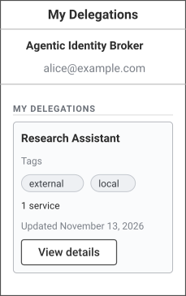
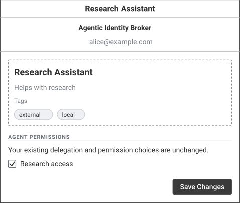
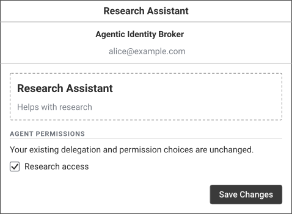
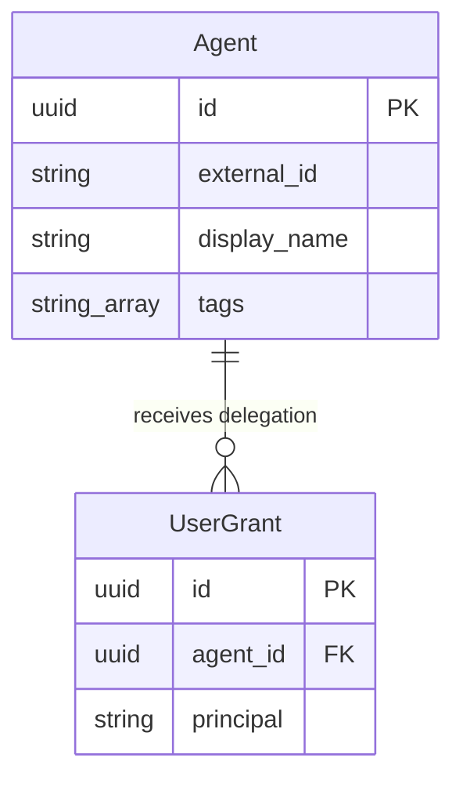

# Feature Specification: Agent Tags

**Feature Branch**: `repo-assist/fix-issue-427-agent-tags-design`
**Created**: 2026-11-14
**Status**: Draft design; no runtime implementation or API approval claimed
**Input**: [Issue #427](https://github.com/zalando-incubator/agentic-identity-broker/issues/427) and [maintainer clarification](https://github.com/zalando-incubator/agentic-identity-broker/issues/427#issuecomment-6878251111): “1. A set of literal strings 2. Only display on end user views, filtering can be a later admin UI addition”.

🤖 Prepared by Repo Assist, an automated AI assistant.

## Scope and Approval Boundary

Confirmed scope: administrators set a literal string set through the existing Agent API; end users see it in the delegation overview and Agent detail/consent view. Filtering, an admin catalogue, and tag editing in the SPA are excluded. There is no any/all filtering decision to resolve in this feature.

The limits, write semantics, response presence, and ordering below are **proposals**, not decisions attributed to the maintainer. The [contract proposal](contracts/agent-tags.md) must be reviewed and copied into the authoritative OpenAPI files before implementation (Constitution IV/X). This draft does not change those files, existing accepted ADRs, or current behavior. It does not complete #427.

## User Scenarios & Testing

### User Story 1 — Categorize an Agent through the API (Priority: P1)

As an administrator, I can maintain categories such as `local` and `external` on an Agent without changing its identity or delegations.

**Why this priority**: Both end-user views depend on persisted, administrator-controlled metadata.
**Independent Test**: Create, read, replace, reconcile/replay, and clear tags through real administrative HTTP requests, checking stable UUIDs and unchanged grants.

**Acceptance Scenarios**:

1. **AT-1.1 — Create and read**: **Given** a valid permission set and an authenticated administrator, **When** the administrator creates an Agent with `["local", "external"]` and reads it by ID and in the collection, **Then** every response presents `["external", "local"]`, and a fresh repository read returns the same members.
2. **AT-1.2 — Replace and clear**: **Given** a tagged Agent and an existing delegation, **When** an ID-addressed PUT replaces its tags with `["partner"]`, then another valid PUT sends `[]`, **Then** the reads show first `partner`, then no tags, while the Agent UUID and delegation are preserved.
3. **AT-1.3 — Omitted field**: **Given** legacy clients that do not send `tags`, **When** they create an Agent, update a tagged Agent by ID, or reconcile a tagged Agent by External ID, **Then** omission means the empty set on all three writes; other existing field policies remain unchanged.
4. **AT-1.4 — Reconcile and replay**: **Given** no Agent for External ID `registry:research`, **When** a valid collection PUT creates a tagged Agent, another changes its tags, and ten equivalent replays reverse tag order, **Then** creation returns 201, the change returns 200, replays return 200 with the changed representation, UUID and stored timestamps stay fixed on replay, and replay causes no repository write or mutation audit.
5. **AT-1.5 — Reject invalid sets atomically**: **Given** an existing tagged Agent, **When** any write path receives null, a non-array, non-string/null elements, duplicate members, an empty member, a NUL-containing member, or a proposed bound violation, **Then** it returns 400, leaves all stored Agents/delegations unchanged, and emits no success mutation audit. Cover both create and update branches of collection PUT; an invalid create leaves no new Agent.
6. **AT-1.6 — Literal equality**: **Given** valid tags `Local`, `local`, ` local`, `é`, `é`, `*`, and `<b>local</b>`, **When** an administrator writes and reads this set, **Then** all seven distinct strings survive without trimming, case folding, Unicode normalization, wildcard expansion, or markup interpretation.

### User Story 2 — Understand categories while reviewing a delegation (Priority: P1)

As an end user, I can see the same Agent categories in my delegation overview and its detail/consent view, without mistaking them for granted permissions or verified trust labels.

**Why this priority**: This is the requested user-visible outcome, not a future administrator UI.
**Independent Test**: Seed a tagged Agent and an existing user delegation, open the overview, navigate to detail, update only tags administratively, reload data, and verify both views without changing grant selections.

**Acceptance Scenarios**:

1. **AT-2.1 — Overview to detail**: **Given** Alice has a delegation to the tagged Research Assistant, **When** Alice opens the overview and selects the Agent card, **Then** both views show `external` and `local` as noninteractive metadata, retain existing navigation/consent controls, and offer no tag editor or tag filter.
2. **AT-2.2 — Legacy/empty display**: **Given** an Agent with no tags or an older response omitting the field, **When** Alice opens its overview card and detail/consent view, **Then** neither shows a tags heading, empty badges, placeholder category, or new required input; existing consent actions remain usable.
3. **AT-2.3 — Metadata-only refresh**: **Given** the overview is already rendered, **When** an administrator changes only the Agent's tags and Alice triggers an existing data reload after cache expiry, **Then** the new tags replace the old ones without changing the grant's last-modified/expiration values or requiring a grant mutation.
4. **AT-2.4 — Safe, accessible display**: **Given** markup-looking, long, Unicode, and maximum-count tags, **When** Alice navigates overview → detail at a narrow viewport in light and dark themes, **Then** tags render as text, remain readable without horizontal page overflow, do not add keyboard stops, and preserve WCAG 2.1 AA contrast and existing keyboard navigation.

### Edge Cases

- Tags are optional descriptive metadata, never a registration/client-mode selector, identity, permission, scope, trust assertion, or authorization policy.
- Case, leading/trailing whitespace, and Unicode normalization forms are significant. A nonempty whitespace-only member is literal text, not silently trimmed. Empty strings are rejected.
- Duplicate JSON members of the tag array are rejected rather than silently removed. Array order does not affect set equality.
- Responses omit `tags` for the empty set; clients must treat omission as empty. A tag-only refresh must not rely on a grant timestamp changing.
- Existing consent cache lifetimes remain unchanged. No live push or immediate cross-tab update is promised.
- Invalid tag input must be rejected before persistence, including on an otherwise unchanged reconcile request.

## Concrete Example Journeys

All identifiers and times below are synthetic. New `tags` fields and their outcomes are proposed extensions, not examples of currently deployed support. Existing route, status, envelope, and permission-set shapes are retained. The API proposal identifies the exact schema additions. No feature configuration or JWT output is needed.

### Journey 1 — Administrator manages categories (US1, AT-1.1–AT-1.6)

**Cast**: administrator `operator@example.com`; Agent Research Assistant (`550e8400-e29b-41d4-a716-446655440000`); External ID `registry:research`; existing valid permission set `770e8400-e29b-41d4-a716-446655440001`. All times are 2026-11-14 UTC. Requests go through the existing authenticated admin proxy, which supplies the configured principal header; this illustrative deployment uses `X-Remote-User`. The proxy preserves `Host: admin.broker.example.com`.

**Step 1 — 14:00:00: create by External ID**

```http
PUT /api/agents?external_id=registry%3Aresearch HTTP/1.1
Host: admin.broker.example.com
X-Remote-User: operator@example.com
Content-Type: application/json

{
  "display_name": "Research Assistant",
  "description": "Helps with research",
  "permission_sets": [
    {"permission_set_id": "770e8400-e29b-41d4-a716-446655440001", "requirement_type": "optional"}
  ],
  "tags": ["local", "external"]
}

HTTP/1.1 201 Created
Content-Type: application/json
Location: /api/agents/550e8400-e29b-41d4-a716-446655440000
Vary: Prefer

{
  "id": "550e8400-e29b-41d4-a716-446655440000",
  "canonical_id": null,
  "external_id": "registry:research",
  "display_name": "Research Assistant",
  "description": "Helps with research",
  "permission_sets": [
    {"permission_set_id": "770e8400-e29b-41d4-a716-446655440001", "requirement_type": "optional"}
  ],
  "tags": ["external", "local"],
  "created_at": "2026-11-14T14:00:00Z",
  "updated_at": "2026-11-14T14:00:00Z"
}
```

**Step 2 — 14:01:00: replace the complete definition**

Send the same collection PUT with `"tags": ["partner", "external"]`. It returns 200 and the same Agent UUID/created_at, `"tags": ["external", "partner"]`, and `"updated_at": "2026-11-14T14:01:00Z"`. Ten requests with `"tags": ["external", "partner"]` return that same representation with no write or mutation audit. This does not introduce an ETag or strict timestamp-increase guarantee; ADR 047 still governs times and races.

**Step 3 — 14:02:00: reject a duplicate without changing the Agent**

```http
PUT /api/agents?external_id=registry%3Aresearch HTTP/1.1
Host: admin.broker.example.com
X-Remote-User: operator@example.com
Content-Type: application/json

{
  "display_name": "Research Assistant",
  "description": "Helps with research",
  "permission_sets": [
    {"permission_set_id": "770e8400-e29b-41d4-a716-446655440001", "requirement_type": "optional"}
  ],
  "tags": ["external", "external"]
}

HTTP/1.1 400 Bad Request
Content-Type: application/json

{"error": "validation failed", "message": "tags must contain unique strings"}
```

A subsequent GET by ID still shows `["external", "partner"]` and the step-2 timestamps. The same rule applies to ordinary POST and ID-addressed PUT. Wrong JSON types use the existing `invalid request body` error category; semantic tag errors use `validation failed`.

**Step 4 — 14:03:00: clear**

Send the step-1 body with `"tags": []`. The same UUID returns with 200 and no `tags` property. Omitting `tags` from that valid definition also clears the set; null instead returns 400. No grant is removed or changed. Reads by ID, collection, and exact External ID use the same presentation.

**Observable result**: the API manages a literal set without replacing Agent identity, and replay remains a real no-op.

### Journey 2 — Alice recognizes categories (US2, AT-2.1–AT-2.4)

**Cast**: Alice (`alice@example.com`), the same Research Assistant, and an existing indefinite delegation last changed at `2026-11-13T10:00:00Z`. This journey starts independently with Agent tags `["external", "local"]`. The end-user proxy supplies Alice's authenticated principal; Alice cannot mutate Agent metadata through an end-user endpoint.

**Step 1 — 14:10:00: open the delegation overview**

```http
GET /api/consent/agents HTTP/1.1
Host: broker.example.com
X-Remote-User: alice@example.com

HTTP/1.1 200 OK
Content-Type: application/json

{
  "data": [{
    "agentId": "550e8400-e29b-41d4-a716-446655440000",
    "displayName": "Research Assistant",
    "activeGrantCount": 1,
    "lastModifiedAt": "2026-11-13T10:00:00Z",
    "tags": ["external", "local"]
  }]
}
```

State A — categories on the existing delegation card:



<details><summary>Wireloom source</summary>

```wireloom
window "My Delegations":
  header:
    text "Agentic Identity Broker" bold
    text "alice@example.com" muted
  section "My Delegations":
    slot "Research Assistant":
      text "Tags" muted size=small
      row:
        chip "external"
        chip "local"
      text "1 service" size=small
      text "Updated November 13, 2026" muted size=small
      button "View details"
```

</details>

**Step 2 — Alice selects the card and reviews detail/consent**

The existing `GET /api/consent/agents/550e8400-e29b-41d4-a716-446655440000` response gains `data.agent.tags: ["external", "local"]`. All existing services, permission sets, session context, authentication, and grant-editing behavior remain unchanged. In the actual unified response `data.agent` uses `display_name`; the list above retains `displayName`. This feature does not rename either field.

State B — tags remain metadata, separate from permissions:



<details><summary>Wireloom source</summary>

```wireloom
window "Research Assistant":
  header:
    text "Agentic Identity Broker" bold
    text "alice@example.com" muted
  panel:
    text "Research Assistant" bold size=large
    text "Helps with research" muted
    text "Tags" muted size=small
    row:
      chip "external"
      chip "local"
  section "Agent Permissions":
    text "Your existing delegation and permission choices are unchanged."
    checkbox "Research access" checked label-right
  row align=right:
    button "Save Changes" primary
```

</details>

The wireframes focus on tag placement, not a redesign of existing controls. The chips denote noninteractive badges, not filters or verified-status indicators.

**Step 3 — the administrator clears tags; Alice reloads after cache expiry**

The API now omits `tags` on the overview item and `data.agent`. The grant's `lastModifiedAt` is still `2026-11-13T10:00:00Z`. Both views remove the tag list without showing a placeholder or changing selected permissions.

State C — existing layout without a tag section:



<details><summary>Wireloom source</summary>

```wireloom
window "Research Assistant":
  header:
    text "Agentic Identity Broker" bold
    text "alice@example.com" muted
  panel:
    text "Research Assistant" bold size=large
    text "Helps with research" muted
  section "Agent Permissions":
    text "Your existing delegation and permission choices are unchanged."
    checkbox "Research access" checked label-right
  row align=right:
    button "Save Changes" primary
```

</details>

**Observable result**: Alice can identify categories during review. Empty or absent metadata needs no user action; no filter or editor is introduced.

## Requirements

### Functional Requirements

- **FR-001**: An Agent MAY have a set of literal string tags. The set belongs to the Agent, not a UserGrant or session. It has no separate identity, registry, vocabulary, ownership model, or lifecycle.
- **FR-002**: Existing POST, ID-addressed PUT, and External-ID collection PUT MUST accept tags and apply the same validation. Proposed omission/empty semantics are replacement with the empty set; null is invalid.
- **FR-003**: Reconciliation MUST compare tag membership independently of input order, validate before deciding no-op, preserve exact stored timestamps on no-op, and emit no mutation audit/write for replay (ADR 047).
- **FR-004**: Every Admin Agent representation and both consent read projections MUST expose nonempty tags in ascending Go string byte order on a copy, omitting the field for the empty set. Do not reorder or mutate other collections.
- **FR-005**: Both storage backends MUST preserve members through create/update/read/batch/lookup paths and deep-copy tag slices. A caller cannot mutate persisted tags by changing an input or output slice.
- **FR-006**: End-user overview cards and Agent detail/consent headers MUST display the same noninteractive textual categories. No tagging UI, admin catalogue, filtering API/UI, search changes, or any/all logic is included.
- **FR-007**: A data reload MUST update displayed tags even when grant timestamps/counts are unchanged. Existing cache expiration and principal scoping remain intact; no new freshness promise is made.

### Domain Model



**Aggregate**: Agent remains the consistency boundary for metadata and declarations.
**Value object**: Agent Tags is an unordered set of exact strings. Proposed bounds are at most 32 members, each 1–255 Unicode code points, valid UTF-8 and no NUL. Exact duplicates are invalid. No trimming, case folding, Unicode normalization, or pattern interpretation occurs.
**Domain events**: Reuse existing Agent create/update mutations; no new tag event is proposed. Grant/session state does not change.
**Glossary addition planned**: “Agent Tag: an administrator-supplied literal string category on an Agent, displayed to end users without granting permissions or asserting verified trust.” It is not yet a statement about deployed functionality in `ARCHITECTURE.md`.

### Configuration Requirements

No new runtime configuration, environment variables, CLI flags, Helm values, or infrastructure resources. Existing admin/end-user authentication, Host validation, cross-origin protections, and cache lifetimes apply.

### API Requirements

The exact proposed schema, write-policy matrix, error categories, and versioning are in [contracts/agent-tags.md](contracts/agent-tags.md). Before code changes, obtain written approval and update `api/admin/openapi.yaml` and `api/enduser/openapi.yaml`; render the end-user examples in `docs/api/`. Do not replace existing wire names or envelopes.

### Database Requirements

- **DB-001**: Add a non-null empty-default `text[]` column to `agents` through the next available sequential atomic UP/DOWN migration, retaining production migration-runner ownership. Do not reserve a migration number before implementation.
- **DB-002**: Existing Agents start with the empty set without changing UUIDs, timestamps, grants, or client-URI rows. No tag index or join table is needed without filtering.
- **DB-003**: Test UP, DOWN, and reapply against real PostgreSQL and production migrations. DOWN intentionally removes tag metadata; document its loss while proving all pre-feature data/relationships survive. Never describe rollback as preserving removed tags.
- **DB-004**: PostgreSQL and memory storage MUST have equivalent validation, complete read-path coverage, deep-copy isolation, and atomic failure behavior.

### Security Requirements

- **SR-001**: Tags MUST NOT change authentication, eligibility, scopes, permissions, consent requirements, or authorization decisions, nor be added to JWT/CIMD documents, ExtProc inputs, logs, traces, or metric attributes by this feature.
- **SR-002**: Mutation remains exclusively administrative. End-user responses retain existing principal filtering and session-token checks; tags MUST NOT enumerate Agents outside the existing delegation results.
- **SR-003**: Render strings as escaped React text, never HTML or links. Reject invalid input without partial writes or success mutation audits, and retain existing security middleware.

### Frontend/Design System Requirements

Reuse design-system Badge, Stack, and existing Card primitives through an application-specific Agent tag list. Use neutral semantic variants, not success/verified styling or raw palette colors. Tags are a labelled semantic list of text, have no click handlers or tab stops, wrap at narrow widths, and permit long-word wrapping. Omit the entire list when empty. Preserve keyboard navigation and WCAG 2.1 AA in both themes. Add Playwright journeys and screenshots for nonempty overview/detail and empty states, plus maximum/markup-looking strings. No new universal primitive or visual-direction change is proposed.

### Key Entities

Only the existing Agent gains metadata. UserGrant, UserSession, permission sets, and all entity IDs remain unchanged.

## Success Criteria

- **SC-001**: All ten acceptance scenarios map to one Ginkgo `It` each and pass through production bootstrap; both storage implementations pass the applicable persistence cases.
- **SC-002**: Ten reversed-order replays after a real update preserve identity, timestamps, and response representation with zero repository writes or mutation audits.
- **SC-003**: Invalid-write cases return 400 with unchanged persisted definitions/relationships on every write path, and both end-user views handle omitted/empty metadata without additional input.
- **SC-004**: Browser evidence shows escaped, readable tags, working navigation/consent controls, and no new horizontal page overflow in both themes at a narrow viewport.
- **SC-005**: Tag display adds no per-Agent repository requests to delegation aggregation; the existing batched Agent read remains sufficient. Tag operations are bounded by 32 members and require no new dependency.

## Assumptions

- Proposed cardinality/length limits (32/255), omission-as-empty, duplicate/null rejection, sorted presentation, and empty-field omission require review; they are not covered by the two product clarifications alone.
- Tags are non-secret metadata intended for users who already have access to the relevant end-user Agent view.
- Editing any complete Agent definition without `tags` will clear existing tags under the proposal, including older administrative clients; the management guide must call this out.
- Display scope is the existing delegation overview and Agent detail/consent view, not every unrelated reference to an Agent elsewhere in the SPA.
