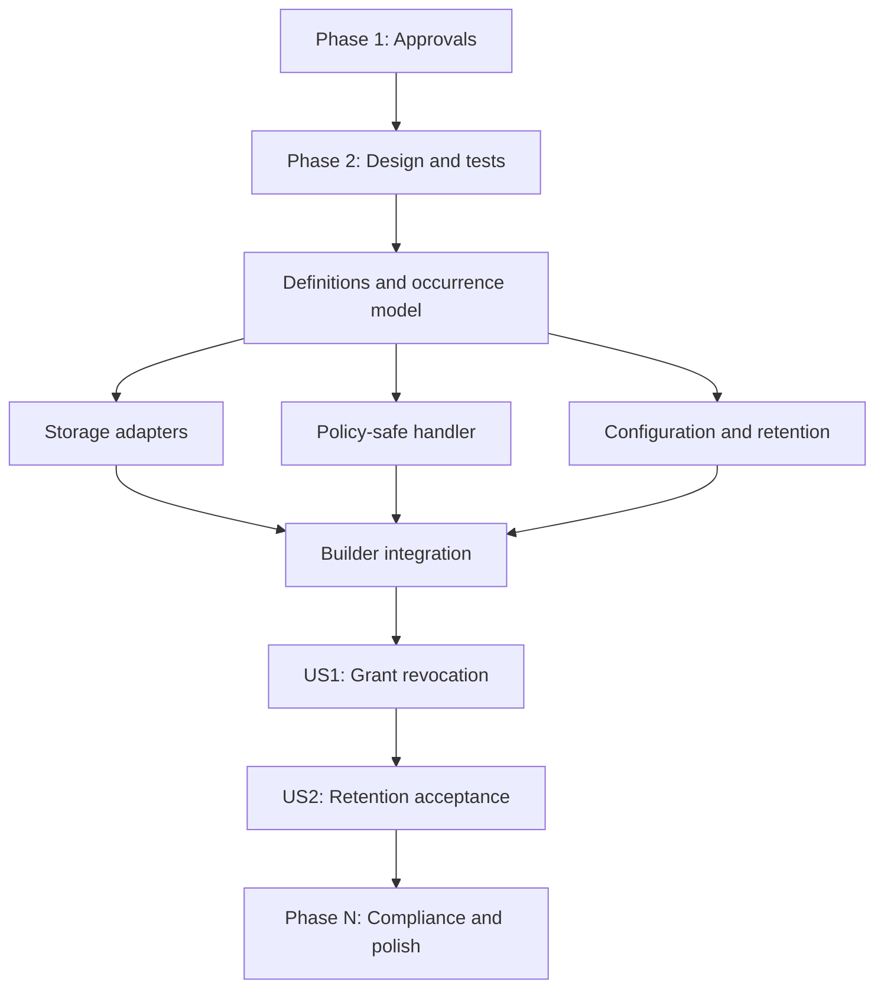

# Tasks: Business Event Ledger

**Input**: Design documents from `specs/20261118-125900-business-event-ledger/`.
**Prerequisites**: `spec.md`, `plan.md`, `research.md`, `data-model.md`, `contracts/`, `quickstart.md`.
**Status**: The ledger implementation and prior ledger-specific validation are complete. Phase 7 records the latest acceptance-test and verification-guidance corrections. Required PR-description sections and the complete passing SC-004 environment/result record are published. T083, T090, T094, and T095 remain unchecked under the user's ledger-only scope decision. The known sample-agent advisory and security-script shell incompatibility require separate remediation authorization. This is not a PR-readiness certification. The four accepted requirements-quality deviations remain unchanged in the read-only checklist.
**Delivery**: One branch, `048-business-event-ledger`, and one pull request. The phases below are the order of work and of commits in that pull request.
**Tests**: Required by `plan.md` Testing Strategy, `spec.md` SR-001, and Principles VIII/XIII. Mandatory red-green-refactor under Principles VIII and XIII. A red test compiles and fails semantically. Recorded red-run output and separate red commits are not required.
**Format**: `- [ ] T001 [P?] [USn?] Description with file path`. Existing task IDs remain unchanged for approval and design traceability. Existing completed tasks retain `[X]`. Paths are repository-relative.
**Organization**: Phase 2 and Phase N retain the required template sections. Shared retention remains foundational because SR-003 forbids enabled storage without retention.
**Skipped phases**: Phase 0 needs no preparatory refactoring. Phase 2.7 needs no HTTP scaffold or separate PR.
**Parallel rule**: `[P]` applies only after the task’s stated prerequisites. Parallel work must use separate files and must not mutate global telemetry providers concurrently.

## 🔒 Feature Scope [MANDATORY]

Every task cites a requirement, an acceptance scenario, a success criterion, or a binding
principle. The feature ends with the first stored business event, `consent.grant.revoked`.
Out of scope, by `spec.md`: any further business event, erasure on request, any API or UI that reads the
ledger, SSF, events from ExtProc and agentgateway, and a transactional guarantee.

Findings outside this scope that appear during the work are reported to the user under
"Feature Scope & Deferred Findings" and are not fixed here. Known at planning time: several
services still log an `action` key and not `event` (LOGGING.md section 2.2). This feature corrects
only the grant revocation call site.

**Validation ownership**: Do not run container-backed recipes (`just test-integration-infra`,
`just test-e2e-docker`, `just test-e2e-performance`) in a sandbox without Docker. Container-backed
tests may first run in CI, including after implementation. Until they run, report them as
unvalidated. Do not require saved red-run output, logs, or CI links as proof of test-first work.

---

## Phase 1: Setup

**Purpose**: The decision and the standard are reviewable before code exists.

- [X] T001 Write `adrs/20261118-125900-business-events-as-typed-log-records.md` with Context, Decision, Consequences, Alternatives, status Proposed (Principle II)
- [X] T002 [P] During `/speckit-implement`, add `20261118-125900-business-events-as-typed-log-records` to the ADR index in `ARCHITECTURE.md` alongside the implementation. The `AGENTS.md` index entry already exists (Principle II).
- [X] T003 [P] Amend `coding-standards/LOGGING.md` section 8 and its binding sources (STD-LOGGING-8; Principle XV)
- [X] T004 Preserve the original maintainer approvals in `specs/20261118-125900-business-event-ledger/plan.md` and record approval of REVIEW-048 and revised DB-048 separately before implementation. The user explicitly approved both outstanding items on 2026-11-18 and subsequently requested principal and agent indexes; record that request as superseding the retention-only index scope (Principle II).

**Checkpoint**: Original approvals remain recorded. REVIEW-048 and revised DB-048 were explicitly approved on 2026-11-18; the user's subsequent principal/agent index request supersedes retention-only index scope. The standard amendments remain bounded by their Approval Items; no principal-policy exception is proposed.

---

## 🔒 Phase 2: Design Preconditions (Blocking Prerequisites) [MANDATORY]

**Purpose**: Complete domain, configuration, API, database, concrete spec-journey, E2E, and
observability design before implementation.

**⚠️ CRITICAL**: Foundation implementation starts only after this phase is complete.
This phase includes design documents, chart changes, migration SQL, and tests written before the behavior they exercise.
Its only production Go additions are T017's minimal scaffold, which lets the E2E tests compile under Principle VIII.

### Phase 2a: Domain Model & Glossary [MANDATORY]

**Constitution Reference**: Principles II, V

- [X] T005 Identify and document the value object, the entity, the typed ID, and the repository in `specs/20261118-125900-business-event-ledger/data-model.md`
- [X] T006 Document the definition, occurrence, immutability, and principal-policy invariants in `specs/20261118-125900-business-event-ledger/data-model.md` (Principles V, IX; FR-010)
- [X] T007 During `/speckit-implement`, add a short reference in `ARCHITECTURE.md` to the ledger's non-functional requirements alongside the implementation. Link to the spec's success criteria, configuration, storage/retention, and observability contracts, and `20261118-125900-business-events-as-typed-log-records`. Do not duplicate contract details or document the planned feature in `ARCHITECTURE.md` before implementation (Principle II).

**Checkpoint**: Domain model complete and documented.

### Phase 2b: Configuration Design [MANDATORY]

**Constitution Reference**: Principle VII

- [X] T008 Document all five keys, defaults, ranges, file/environment/CLI precedence, and YAML in `specs/20261118-125900-business-event-ledger/contracts/configuration.md` (Principle VII)
- [X] T009 [P] Create `examples/config/business-events.yaml` and its entry in `examples/config/README.md` (Principle VII; FR-007, FR-009)
- [X] T010 List the five runtime keys in `docs/configuration.md` (Principle VII). Keep enablement, retention changes, and SC-005 recovery details in [the configuration contract](./contracts/configuration.md). Link to [the ADR](../../adrs/20261118-125900-business-events-as-typed-log-records.md) for the accepted loss window and the absence of principal erasure. Cover unknown write outcomes after timeouts and that disabling stops retention without removing existing rows (SR-003).
- [X] T011 Add all five `broker.businessEvents.*` values to `charts/agentic-identity-broker/values.yaml`, `templates/configmap.yaml`, `values.schema.json`, and `README.md`. Extend the existing chart tests before templates change. Match defaults, types, bounds, and documentation in `specs/20261118-125900-business-event-ledger/contracts/configuration.md`. Retention runs in the broker Deployment, with no new workload (Principles VII, VIII).

**Checkpoint**: Configuration designed, with a committed example and the Helm deployment contract.

### Phase 2c: API Design [MANDATORY]

**Constitution Reference**: Principles IV, X

- [X] T012 Confirm that `api/enduser/openapi.yaml` and `api/admin/openapi.yaml` do not change. This feature adds no endpoint (SR-004)

**Checkpoint**: No API change.

### Phase 2d: Database Design [MANDATORY]

**Constitution Reference**: Principle IX

- [X] T013 Document `business_events`, the retention index, the principal and agent history indexes, no foreign keys, and the migration name in `specs/20261118-125900-business-event-ledger/data-model.md` (Database Requirements; Principle IX; explicit user index request).
- [X] T031 Write migration-specific PostgreSQL tests in `tests/integration/migrations/business_events_test.go` before T014. Assert the ledger columns, defaults, nullable principals, and CHECK constraints. Assert B-tree index definitions: `idx_business_events_recorded` on `(recorded_at, id)`, `idx_business_events_principal` on `(principal, occurred_at DESC, id DESC)`, and `idx_business_events_agent` on `((attributes->>'agent_id'), occurred_at DESC, id DESC)`. Inspect catalog definitions, including expression and sort direction, without forcing a planner choice on small fixtures. Exercise principal and agent equality filters with tied occurrence timestamps and deterministic newest-first ID ordering; include absent-principal and absent-agent rows. Verify apply, rollback, and reapply against production migrations. Verify rollback removes the table and its indexes while preserving unrelated tables and representative data. Tests must compile before the migration exists. Verify semantic failures where Docker is available; otherwise the first run may occur in CI (Database Requirements; Principles VIII, IX).
- [X] T014 After T031 and T004, create atomic `migrations/049_create_business_events.up.sql` and `migrations/049_create_business_events.down.sql` from `specs/20261118-125900-business-event-ledger/data-model.md`. Preserve `id UUID PRIMARY KEY`, `event TEXT NOT NULL`, `occurred_at TIMESTAMPTZ NOT NULL`, and `recorded_at TIMESTAMPTZ NOT NULL DEFAULT now()`. Preserve nullable `principal TEXT`, `actor TEXT`, and `trace_id TEXT`, plus `attributes JSONB NOT NULL DEFAULT '{}'::jsonb`. Quote constraints exactly in SQL: `CHECK (event <> '')` and `CHECK (jsonb_typeof(attributes) = 'object')`. Add `idx_business_events_recorded` on `(recorded_at, id)`, `idx_business_events_principal` on `(principal, occurred_at DESC, id DESC)`, and `idx_business_events_agent` on `((attributes->>'agent_id'), occurred_at DESC, id DESC)`. Add no agent column, UUID cast, foreign key, or reader API. The down migration removes only this table and its indexes. Migration `048` is occupied, so the ledger uses `049`; recheck availability before implementation. Keep the existing ADR filename unchanged (Database Requirements; Principle IX).

**Checkpoint**: Schema designed and migration files present.

### Phase 2e: Frontend/Design System Review [MANDATORY IF FRONTEND]

Not applicable. The feature changes no UI.

### Phase 2f: E2E Acceptance Test Design [MANDATORY]

**Constitution Reference**: Principles VIII, XIII, XIV

- [X] T015 Map all five acceptance scenarios from `specs/20261118-125900-business-event-ledger/spec.md` to one `It()` each in `specs/20261118-125900-business-event-ledger/plan.md` Testing Strategy (Principle XIII)
- [X] T016 Review Journeys 1 and 2 in `specs/20261118-125900-business-event-ledger/spec.md` against their scenarios, `api/enduser/openapi.yaml`, and `specs/20261118-125900-business-event-ledger/contracts/configuration.md` (Principle XIV)
- [X] T017 After T004, add only the compiling types and port surface needed by acceptance tests. Generate `BusinessEventID` through `internal/domain/id/gen_ids.go` into `internal/domain/id/uuid_ids_gen.go`. Document the ID in `internal/domain/id/AGENTS.md` and the ports in `internal/ports/AGENTS.md`. Define `model.BusinessEvent` in `internal/domain/model/business_event.go` with all eight fields from `specs/20261118-125900-business-event-ledger/data-model.md`. Preserve principal “nil when absent”, actor “nil outside a request”, trace ID “empty outside a request”, occurrence time “time of the log record, UTC”, and storage time “set by storage”. Add only `BusinessEventAppender.Append` and `BusinessEventRetention.DeleteRecordedBefore` in `internal/ports/storage.go`. Add compiling methods in `internal/adapters/storage/memory/business_event.go` and `internal/adapters/storage/postgres/business_event.go`, with the two accessors in `internal/adapters/storage/factory.go`. Add both configuration structs in `internal/ports/config.go`. Do not add defaults, environment bindings, a reader, handler, retention service, or wiring here. Replace every temporary method in T040–T041 before delivery. Run `just build` (Principles VIII, IX; FR-010, FR-011).
- [X] T018 Write `tests/e2e/business_event_ledger_test.go` with `Label("docker")`, PostgreSQL production bootstrap, one `Context` per precondition, and one `It()` each for US1.1, US1.2, and US1.3 with scenario references. Read committed rows through explicit-column SQL in test helpers, not a production reader port. Supply all five business-event configuration values explicitly; do not depend on loader defaults. Add `HaveBusinessEvent` in `tests/e2e/matchers/` (Principle XIII; SC-003).
- [X] T019 Add the `It()` for US1.4 to `tests/e2e/business_event_ledger_test.go` with `Label("docker")`: PostgreSQL storage. The E2E database user is a superuser, so the test does not revoke a privilege: it creates a `BEFORE INSERT` trigger on `business_events` whose function raises an exception, and drops the trigger and the function in `AfterEach`. Assert `204` and a failure-counter increase of exactly one. Assert exactly one original `consent.grant.revoked` audit record and exactly one `business_event.ledger.write_failed` record. Assert that both records carry the revocation request's trace ID (FR-006; US1.4).
- [X] T020 Add the `It()` for US2.1 to `tests/e2e/business_event_ledger_test.go` with `Label("docker")`: PostgreSQL storage, `retention.period: 24h`, `retention.interval: 1s`, and two revocations. Assert that both committed events exist before ageing either row. Set the first row's `recorded_at` to two days ago with SQL and assert that exactly one row changes. Assert that only the second row remains and that deletion produces no log or counter. The initial semantic failure is missing events; T029 and T033 isolate deletion behavior before event onboarding (FR-009; SC-005).
- [X] T021 Run the five scenarios in `tests/e2e/business_event_ledger_test.go` with `just test-e2e-docker` where Docker is available. Verify semantic failures, not compilation failures: the stored row, audit `event`, failure signal, or retention deletion is absent. Without Docker, the first run may occur in CI after implementation. Add test line numbers to the scenario mapping. Do not require saved red-run output. No `XIt`, `PIt`, `Skip()`, placeholder assertion, or red-phase comment is permitted (Principles VIII, XIII).
- [X] T084 Before Phase 2.5, write `tests/e2e/business_event_ledger_performance_test.go` with `Label("performance")` by the SC-004 protocol in `plan.md`, using T017's compile scaffold and supplying all five configuration values explicitly. Before and after every warm-up and measured block, inspect committed rows with explicit-column SQL. Require successful grant creation and a `204` revocation response in every cycle. Assert exactly 100 new rows per enabled block, zero per disabled block, and no write-failed diagnostics in either block. Keep SQL inspections and diagnostic assertions outside latency samples. Run `just test-e2e-performance` where Docker is available and verify semantic failure because the enabled ledger stores no rows, not a compilation failure. Without Docker, the first run may occur in CI after implementation. No saved red-run output is required. T053 owns the final measurement with unchanged assertions (SC-004; Principle VIII).

**Checkpoint**: The journeys are reviewed, the five E2E acceptance tests and the SC-004 performance test are written, and all compile. Verify semantic failures where Docker is available. Otherwise, their first run may occur in CI after implementation. Saved red-run output is not required.

### Phase 2g: Observability Design [MANDATORY IF TELEMETRY]

**Constitution Reference**: Principle XV

- [X] T022 Read `coding-standards/LOGGING.md` and `coding-standards/OPENTELEMETRY.md`; list every new log record, span, and metric instrument in `specs/20261118-125900-business-event-ledger/contracts/observability.md` (Principle XV).
- [X] T023 [P] Confirm that the feature adds no span attribute namespace, so `coding-standards/OPENTELEMETRY.md` section 4.1 does not change. The new meter scope `business_events` needs the section 2 amendment of T025 (STD-OTEL-2).
- [X] T024 Identify the credential-handling path and the principals that need a safety test (`specs/20261118-125900-business-event-ledger/contracts/observability.md`, Safety tests; SR-001, SR-002; Principle XV)
- [X] T025 Amend `coding-standards/LOGGING.md`: name the ledger handler and its failure-record path in the section 1 handler-chain rule (STD-LOGGING-1). Add the typed-definition rule to section 2.2, the guard test to section 9, and one line to the section 10 checklist (STD-LOGGING-2.2). Include the section 2.2 clarification that the PR description records event renames under `Breaking changes`, and generated release notes link to it without copying its contents. Remove the sentence "until they merge, no record is persisted" from section 8. Add the scope `business_events`, owned by the ledger handler, to the scope table in `coding-standards/OPENTELEMETRY.md` section 2 (STD-OTEL-2). State each change and its rationale in the pull request description (Principle XV)

**Checkpoint**: The observability design is listed against both standards, and the standard is amended.

---

## Phase 2.5: Foundational Infrastructure

**Purpose**: The definition type, both storage adapters, the ledger handler, and retention work
and are wired, with the ledger off. No definition exists in production code yet.

### Tests first [MANDATORY - Principle VIII]

- [X] T026 [P] Write `internal/domain/bizevent/definition_test.go` before T038. Enforce the identifier constraint verbatim: “The identifier matches `^[a-z][a-z0-9_]*(\.[a-z][a-z0-9_]*){2}$`”. Enforce “An identifier is declared at most one time in the process.” and “The zero `Definition` is not a business event. The handler ignores it.” Assert duplicate and malformed identifiers panic. Assert that `String` and `LogValue` return the identifier and `Definitions()` is sorted. Assert visibility defaults false and explicit `bizevent.OwnerVisible()` returns true, including registry entries. Visibility remains authoritative on definitions, not stored rows. Use distinct test identifiers without an exported registry-reset helper (FR-002; Principle VIII; data-model invariants).
- [X] T027 [P] Write `internal/domain/model/business_event_test.go` before T039. Enforce the invariant verbatim: “`ID` is not zero. `Event` is not empty. `OccurredAt` is not zero.” Assert `Validate` rejects each invalid field independently. Assert `Copy` deeply isolates nested maps, slices, and nullable principal/actor pointers. Preserve “`Attributes` does not contain the keys `event`, `principal`, `actor`, or `trace_id`.” in handler tests T032, not repository content validation. Stored fields are immutable, and no port updates them (FR-003, FR-010; Principle VIII).
- [X] T028 [P] Write same-package `internal/adapters/storage/memory/business_event_test.go`: `Append` sets `RecordedAt`, stores a deep copy, and returns `Conflict` for duplicate ID; `DeleteRecordedBefore` respects cutoff and limit and deletes oldest first. Inspect private adapter state without a production read API (FR-003, FR-009, FR-011).
  Timestamp cases use fixed `OccurredAt` values with sub-microsecond digits. Assert the stored copy preserves every nanosecond with `time.Time.Equal`, and `Append` leaves the caller's `OccurredAt` unchanged (FR-003; research R16).
- [X] T029 [P] Write `tests/integration/storage/infra/business_event_test.go`: T028 cases against PostgreSQL, observed with explicit-column SQL; JSONB nested-attribute round trip; `Append` with a committed transaction in context; nullable policy-rendered principal; concurrent retention deletes preserve newer rows (FR-005, FR-009, FR-011; research R4). Start with 2,500 expired rows, newer rows, and a batch size of 1,000. In a test transaction, lock the first batch with `SELECT id FROM business_events WHERE recorded_at < $1 ORDER BY recorded_at, id LIMIT 1000 FOR UPDATE`. Start `DeleteRecordedBefore` in a goroutine. Poll `pg_stat_activity` with `pg_blocking_pids` until that delete waits on the test transaction, with a bounded timeout. Delete the selected IDs inside the test transaction and assert that it deletes 1,000 rows. Commit the test transaction, then assert that `DeleteRecordedBefore` returns zero without error. Assert that 1,500 expired rows and all newer rows remain (SC-005; research R10). Use bounded waits and cleanup that rolls back the transaction and joins the goroutine. Assert empty event validation, nil attributes stored as `{}`, both SQL CHECK constraints, and `Timeout` errors for expired contexts on `Append` and `DeleteRecordedBefore` (Principle IX).
  Unlike memory's full-precision expectation in T028, PostgreSQL truncates occurrence time to microseconds. Add table-driven round trips with fixed fractional seconds `.123456789` and `.999999999`, including a non-UTC offset. Read `occurred_at` and `recorded_at` through explicit-column SQL; assert `occurred_at` is equal by instant to `input.OccurredAt.UTC().Truncate(time.Microsecond)`, not `Round` or a tolerance. Do not pre-truncate the inputs. Assert the caller's `OccurredAt` is unchanged and its returned `RecordedAt` equals the stored `recorded_at` (FR-003; research R16).
- [X] T030 [P] Write `internal/adapters/storage/postgres/business_event_test.go`: the two methods create `storage.append.business_event` and `storage.delete_recorded_before.business_event` spans, with status and attributes asserted as `span_test.go` does (OPENTELEMETRY.md section 3.1). T029 covers FR-005 against PostgreSQL.
- [X] T032 Write `internal/adapters/telemetry/ledger_handler_test.go` with a capturing appender. Recognition: typed top-level events survive principal policy and store once; string, absent, zero, and grouped events are ignored. Occurrence metadata: construct a record with `slog.NewRecord` and a fixed historical timestamp, including fractional seconds. Assert captured `OccurredAt` equals `slog.Record.Time` and the occurrence ID has UUID version 7 (FR-003; research R6). Encoding: promoted keys leave the document; scalar, time, duration, group, LogValuer, and typed-ID values follow research R7; include `WithAttrs` and `WithGroup`. Compare captured attributes with decoded `slog.JSONHandler` output for `errors.New("denied")` (JSON string `"denied"`), an error that also implements `json.Marshaler` (its JSON wins), and encoding failures from an unsupported value, a failing `MarshalJSON`, and a non-finite float (matching `!ERROR:` strings, not the original value's printed representation). Cover these cases in groups and through `WithAttrs`. Level/cancellation: Info stores with operational Error level; cancelled requests still store. Metrics: use the global SDK meter provider with manual reader, restore it in cleanup, and do not parallelize these cases; assert stored/failed histogram outcomes, failure counter error kinds, bounded timeout, and nil Handle result. Rendering: identifiers agree in JSON and otelslog. Policy: a non-identity policy yields identical rendered `Principal`, `Actor`, and `operator_principal` in the row and sinks, including grouped and WithAttrs values, with no raw identity retained; typed events attached with WithAttrs still store (SR-002). Failure: exactly one fallback write-failed record, context-supplied actor/trace, no principal, failed-event attributes, or error cause; no appender recursion (FR-006; research R8). Safety: a model.Secret attribute stores only its redacted form (SR-001) (Principles VIII, XV).
  Compare a non-UTC time-valued attribute with decoded operational JSON, preserving its offset. Keep `OccurredAt` normalization separate. Assert that reserved keys inside groups remain nested attributes and do not replace promoted columns (research R7).
  The fixed record-time case includes a non-UTC offset and `.123456789` fractional seconds. Assert the captured UTC instant retains all nanoseconds; microsecond truncation belongs only to PostgreSQL storage, not the handler (research R16).
  Duplicate keys follow `contracts/ports.md`: inherited attributes precede record attributes, and the last value in each object wins.
  Assert that a final string or zero `event` suppresses an inherited definition, while a final valid definition produces one row.
  Assert that a grouped `event` does not replace a top-level event. Compare duplicate principals and ordinary attributes with decoded operational JSON.
  Inject instrument-construction errors through the test meter provider. Assert one warning per failed constructor with the documented event and instrument.
  Assert no raw error cause, principal, recursion, or startup failure. Verify that the handler continues with the returned instrument (Principle XV).
- [X] T033 [P] Write `internal/domain/bizevent/retention/service_test.go` with a fake repository: a run repeats until a batch is short; it stops when the context ends; it does not log retention-driven deletion; it logs `business_event.ledger.retention_failed` with `error_kind` on an error and runs again at the next interval; no record has a principal (FR-009; contracts/ports.md section 4). Use controlled time, not wall-clock sleeps, to verify SC-005: immediate startup cleanup, expiry just after a run's cutoff, deletion by the next successful scheduled run, and multi-batch catch-up after a failed run. Restart the service with overdue rows to verify recovery after re-enable. Without concurrent retention deletes, assert that recovery clears all rows older than its start-time cutoff and preserves newer rows. Simulate a short concurrent delete while expired rows remain and the competing run fails. Assert that this service resumes cleanup at its next scheduled run and clears the backlog without deleting newer rows.
- [X] T034 [P] Write `internal/adapters/telemetry/business_event_logging_guard_test.go`: it fails when a `bizevent.Definition` is logged under a key other than `event` (contracts/ports.md section 1) (Principles VIII, XV).
- [X] T035 [P] Write `internal/config/business_events_test.go` and `cmd/agentic-identity-broker/business_events_config_test.go` before T042. Cover defaults `false`, `1s`, `2160h`, `1h`, and `1000` in contract key order. Quote and enforce ranges: write timeout “`100ms` to `10s`”, retention period “`24h` to `8760h`”, interval “`1s` to `24h`”, and batch size “1 to 10000”. Cover both inclusive boundaries and rejection outside each range, including while disabled. Cover all five environment variables and dotted CLI flags from `specs/20261118-125900-business-event-ledger/contracts/configuration.md`. Assert CLI over environment over file over defaults, explicit CLI `false` over file `true`, and omitted flags preserving environment/file values. Use the existing command-binding pattern (FR-007, FR-009, SR-003; Principles VII, VIII).
- [X] T036 [P] Write `internal/app/business_events_test.go`: with the flag off the chain is the chain of `main`; with the flag on a typed event logged through `app.Logger` is stored; with the flag on and no appender the builder fails at start; the retention service runs with the flag on and stops on shutdown, and is not created with the flag off, as `session_cleanup_test.go` asserts for the session cleanup (FR-009)
- [X] T037 Add only compilation structure for T026–T030 and T032–T036 in `internal/domain/bizevent/definition.go`, `internal/domain/model/business_event.go`, `internal/domain/bizevent/retention/service.go`, and `internal/adapters/telemetry/ledger_handler.go`. After the test-writing wave settles, run `just test` and `just test-integration`. Assertions must detect missing behavior, not compilation errors. Saved red output and separate red commits are not required. Replace every temporary implementation in T038–T045 before delivery. T031 already covers migration-specific failures. Without a local runtime, container-backed suites may first run in CI (Principle VIII).

### Implementation

- [X] T038 [P] After T026 and T037, implement the declaration API in `internal/domain/bizevent/definition.go`. Enforce identifier, uniqueness, zero-value, authoritative visibility, sorted registry, and sink-rendering constraints from T026. Import only the standard library (FR-002; research R12–R13; Principle VIII).
- [X] T039 [P] After T027 and T037, implement `Validate` and deep `Copy` in `internal/domain/model/business_event.go`. Preserve the field and immutability constraints from T017 and T027. Do not add repository content inspection or a reader (FR-003, FR-010; Principle VIII).
- [X] T040 [P] After T039, implement `internal/adapters/storage/memory/business_event.go` under the adapter lock. Assign storage time, retain deep copies, normalize nil attributes to `{}`, and return Conflict for duplicate IDs. Delete rows strictly before the cutoff, ordered by `(RecordedAt, ID)`, up to the limit. Add compile-time port assertions and update `internal/adapters/AGENTS.md` (FR-003, FR-009, FR-011; Principle IX).
- [X] T041 [P] After T039, implement `internal/adapters/storage/postgres/business_event.go` with `sqlx` and explicit-column SQL. Use `a.db` for both methods, never `storageExecutor(ctx)`. Let PostgreSQL assign `recorded_at` and return it to the caller. Preserve nullable columns and `{}` for nil attributes. Classify duplicates as Conflict and deadline expiry as Timeout within `StorageError`. Delete oldest rows strictly before cutoff through the contracted limited subquery. Respect configured storage timeouts. Use `startStorageSpan` for both contracted spans, without principal attributes (FR-003, FR-005, FR-009, FR-011; Principle IX).
- [X] T042 [P] After T035 and T037, install defaults and all five environment bindings in `internal/config/loader.go`. Register dotted flags in `cmd/agentic-identity-broker/root.go` through existing command binding. Add inclusive bounds in `internal/config/validator.go`: write timeout `100ms`–`10s`, retention period `24h`–`8760h`, interval `1s`–`24h`, and batch size 1–10000. Reject invalid settings at startup with the key name, even while disabled. Preserve CLI over environment over file over defaults, including explicit `false` (FR-007, FR-009, SR-003; Principle VII).
- [X] T043 Implement `internal/adapters/telemetry/ledger_handler.go` and the instruments in `specs/20261118-125900-business-event-ledger/contracts/observability.md` (FR-001–FR-008; Principle XV).
  Obtain `otel.Meter("business_events")` internally. Resolve duplicate keys before event recognition and field promotion as `contracts/ports.md` specifies.
  For each instrument-construction error, emit the documented warning once through the operational fallback and continue with the returned instrument.
  Use `context.Background()` for this constructor-only diagnostic because `NewLedgerHandler` receives no construction context.
  Preserve a `bizevent.Definition` under `event` in `principal_handler.go` without resolving it. Render principals before fan-out.
  Pass the request context to the fallback for runtime failures. Add no context attributes in the ledger handler (depends on T038; Principle XV).
- [X] T044 [P] After T033 and T037, implement `internal/domain/bizevent/retention/service.go` against `BusinessEventRetention`. Run immediately, then on the configured ticker, without overlapping runs. Fix each cutoff at run-start time minus retention period. Delete batches until a short batch, cancellation, or error. Log only `business_event.ledger.retention_failed` with `error_kind` on failure. Retry at the next interval, including after concurrent deletion leaves backlog. Return only after the current delete finishes. Add no deletion/success log or deletion counter (FR-009, SR-003, SC-005; `specs/20261118-125900-business-event-ledger/contracts/ports.md` section 4).
- [X] T045 Wire the handler in `internal/app/builder.go` as `contracts/ports.md` section 3 shows, behind context and principal policy. Start retention only when the ledger is enabled, for every storage adapter, after fallible construction; cancel and await it on shutdown before storage and telemetry close, following the existing SessionCleanup lifecycle. No generalized scheduler, distributed lock, or change to the session-sweep schedule is introduced (research R10; depends on T042, T043, T044).
- [X] T046 After T045, run `just check`, `just test`, `just test-integration`, and `just test-e2e-backend` from `justfile`. Foundation unit and integration tests must pass. The five PostgreSQL scenarios in `tests/e2e/business_event_ledger_test.go` still need the consent declaration from T049–T050. T055 owns US1’s acceptance gate and T056 owns US2’s gate (Principles VIII, XIII).

**Checkpoint**: The ledger is wired and off, and retention runs. Nothing is stored even when the ledger is on. Retention unit and repository tests pass. User Story 2 awaits the E2E green gate at T056.

---

## Phase 3: User Story 1 - A logged business event is stored (Priority: P1) 🎯 MVP

**Goal**: A grant revocation stores one `consent.grant.revoked` event.

**Independent Test**: Enable the ledger, revoke a grant, read the ledger.

### Tests for User Story 1 [MANDATORY - Principle VIII] ⚠️

- [X] T047 [US1] Write external-package `consent_test` tests in `internal/domain/consent/service_business_event_test.go` before T049–T050. Use the production constructor and policy-safe handler chain with a test-local capturing appender. Assert one revocation row with principal, agent ID, and grant ID, and none on `ErrGrantNotFound`. Assert one row with `refresh_cleanup=failed` plus the returned cleanup error after committed deletion. Preserve continuing-consent tests. Do not add a production reader. This path handles no credential (US1.1–US1.2; FR-012; Principle VIII).
- [X] T048 [US1] Run T047’s tests in `internal/domain/consent/service_business_event_test.go` before T049–T050. Verify semantic failure because no event is stored, not a compilation failure. Saved red output is not required (Principle VIII).

### Implementation for User Story 1

- [X] T049 [US1] Create `internal/domain/consent/events.go` with `GrantRevoked = bizevent.MustDefine("consent.grant.revoked", bizevent.OwnerVisible())` (FR-001, FR-012; US1.1).
- [X] T050 [US1] In `RevokeConsentForPrincipal` of `internal/domain/consent/service.go`, use `event=GrantRevoked` on both committed-delete paths. Include `principal`, `agent_id`, `grant_id`, `valid_until`, `updated_at`, `granted_permission_sets`, and `revoked_at` on both paths. Keep `refresh_cleanup=failed` and the returned error on cleanup failure. Record both discriminator renames under `Breaking changes` in the pull request description: `grant_revoked` and `grant_deleted` both become `consent.grant.revoked` (FR-001, FR-012; LOGGING.md section 2.2; Principle XV).
- [X] T051 [P] [US1] After T049–T050, update affected assertions in `internal/domain/consent/service_test.go`, `tests/integration/grant_lifecycle_audit_test.go`, and `tests/e2e/grant_diagnostics_test.go`. Replace the old discriminator with `event` for both revocation branches. Update the audit descriptions in `ARCHITECTURE.md` and `docs/reference/token-exchange.md`. Preserve cleanup-error and HTTP behavior (SC-002; Principle XV). Do not assert message wording.
- [X] T052 [P] [US1] Alongside the implementation, align the Grant and Definition Lifecycle Audit entry in `ARCHITECTURE.md` with `coding-standards/LOGGING.md` section 8. Define all four Business Event terms and their relationship to `GrantRevoked` and existing domain events. Until then, keep the design in the feature documents and ADR only (Principles II, V).
- [X] T053 [US1] After T049–T050 and completion of code edits, run `tests/e2e/business_event_ledger_performance_test.go`, authored in T084, with unchanged assertions. Use `just test-e2e-performance` with Docker, locally or in CI. Follow the environment-recording protocol in `specs/20261118-125900-business-event-ledger/plan.md` for each acceptance run. Record the environment, both p99 values, their difference, and both medians in the PR description, including failed runs (SC-004).
- [X] T054 [P] [US1] After T049–T050, review FR-012 and SC-001 and record the result in the PR description. Verify the single package-local definition, explicit owner visibility, top-level event, post-commit emission, canonical resource attributes, and distinct refresh-cleanup outcome against LOGGING.md sections 2, 8, and 10. Verify service tests cover committed deletion, rejected or unchanged operations, and cleanup failure; apply SR-001's credential-absence requirement where applicable. Verify at most three consent production files onboard the single event, without migration, API, or builder changes. Apply these scope limits to event onboarding, not to the shared ledger foundation. Record both identifier renames and standard-amendment rationales under `Breaking changes` (FR-004, FR-012; SR-001; SC-001; Principle XV).
  Verify the full FR-012 snapshot on both committed-delete paths, not only the discriminator and cleanup outcome. Include the US1.5 PostgreSQL acceptance case for cleanup failure.
- [X] T055 [US1] After T047–T054, run `just check`, `just test`, `just test-integration`, and `just test-e2e-backend` from `justfile`. Verify all four US1 scenarios in `tests/e2e/business_event_ledger_test.go` pass unchanged through `just test-e2e-docker`, locally or in CI (US1.1–US1.4; SC-003; Principles VIII, XIII).

**Checkpoint**: User Story 1 works end to end.

---

## Phase 4: User Story 2 - An operator limits how long events are kept (Priority: P2)

**Goal**: Rows older than the retention period are deleted.

**Independent Test**: Store two events, age one, wait for a retention run, read the ledger.

Retention does not depend on an event type, so its tests and implementation are in Phase 2.5
(T033, T044, and the retention parts of T028 to T030, T035, T036, T040 to T042, T045). Its E2E
test is T020.

- [X] T056 [US2] After T049–T050, run US2.1 in `tests/e2e/business_event_ledger_test.go` with `just test-e2e-docker`, locally or in CI. Preserve T020’s assertions. Verify SC-005 through `internal/domain/bizevent/retention/service_test.go`, `tests/integration/storage/infra/business_event_test.go`, and `internal/app/builder_test.go`. Run section 6 of `specs/20261118-125900-business-event-ledger/quickstart.md` only against test-only PostgreSQL. Verify expired rows disappear, newer rows remain, and deletion emits no log or counter (FR-009; SC-005; Principles VIII, XIII).

**Checkpoint**: Both user stories work. Complete Phase N before declaring the feature done.

---

## 🔒 Phase N: Constitution Compliance Verification [MANDATORY COMPLIANCE SECTION]

**Purpose**: Verify constitution requirements and feature-scope compliance before the pull request is ready for review.

### Design Phase Verification [MANDATORY]

- [X] T057 Verify scope traceability in `specs/20261118-125900-business-event-ledger/tasks.md` against `specs/20261118-125900-business-event-ledger/spec.md` (Principles I–XV; Feature Scope & Deferred Findings).
- [X] T058 Verify that implementation adds the four domain terms and the short non-functional requirements reference to `ARCHITECTURE.md`. Verify its links to the spec, contracts, and `20261118-125900-business-events-as-typed-log-records`, without duplicated requirements (Principles II, V).
- [X] T059 Verify that `examples/config/business-events.yaml` and its README entry exist (Principle VII)
- [X] T060 Verify `api/enduser/openapi.yaml` and `api/admin/openapi.yaml` are unchanged. No API-design approval or new API documentation is required (Principles IV, X; SR-004).
- [X] T061 Verify `specs/20261118-125900-business-event-ledger/data-model.md` matches both directions of `migrations/049_create_business_events.up.sql` and `.down.sql` (Principle IX).
- [X] T062 Verify all four journeys in `specs/20261118-125900-business-event-ledger/spec.md` match HTTP, configuration, stored rows, logs, and metrics. UI/Wireloom, JWT claims, Playwright, and frontend design-system checks are not applicable (Principles XI, XIII, XIV).
- [X] T063 Verify that all five acceptance scenarios have an `It()` in `tests/e2e/` written before implementation. Recorded red-run output is not required (Principle XIII).
- [X] T064 Verify every changed log event, span, and instrument is in `specs/20261118-125900-business-event-ledger/contracts/observability.md` (Principle XV).

### Implementation Phase Verification [MANDATORY]

**Feature Scope**:
- [X] T065 Verify only revocation discriminators change from `action` to `event` in `internal/domain/consent/service.go`. Verify `internal/domain/consent/events.go` declares the only production business event. Exclude unrelated remediation (Principles II, XV; Feature Scope & Deferred Findings).

**API & Documentation** (Principles IV, X):
- [X] T066 [P] Verify `api/enduser/openapi.yaml` and `api/admin/openapi.yaml` expose no ledger-reading endpoint (Principles IV, X; SR-004).

**Architecture & Documentation** (Principle II):
- [X] T067 [P] Verify `adrs/20261118-125900-business-events-as-typed-log-records.md` matches implementation. Verify revised decisions have explicit approval in `specs/20261118-125900-business-event-ledger/plan.md` (Principle II).
- [X] T068 [P] Verify that [the configuration contract](./contracts/configuration.md) states the retention period, how to change it, and that rows stay when the ledger is disabled. Verify that it states the healthy-operation age bound, startup and retry behavior, and the absence of a fixed deletion deadline during failures (SR-003, SC-005).

**Configuration** (Principle VII):
- [X] T069 [P] Verify all five keys use `internal/ports/config.go`, `internal/config/loader.go`, `internal/config/validator.go`, and `cmd/agentic-identity-broker/root.go`. Verify file/environment/CLI precedence, explicit false, disabled validation, and no direct environment reads (Principle VII).
- [X] T070 [P] Verify `charts/agentic-identity-broker/values.yaml`, `templates/configmap.yaml`, `values.schema.json`, and `README.md` contain all five keys with matching defaults and ranges (Principle VII).

**Database & Persistence** (Principle IX):
- [X] T071 [P] Verify migration numbering and atomicity in `migrations/049_create_business_events.up.sql` and `migrations/049_create_business_events.down.sql`. Verify schema-specific apply, rollback, reapply, constraints, all three secondary index definitions (`idx_business_events_recorded`, `idx_business_events_principal`, and `idx_business_events_agent`, including the agent expression and history sort directions), filter/order behavior, and unrelated-data preservation in `tests/integration/migrations/business_events_test.go` (Database Requirements; Principle IX).
- [X] T072 [P] Verify both adapters have method coverage in `internal/adapters/storage/memory/business_event_test.go`, `internal/adapters/storage/postgres/business_event_test.go`, and `tests/integration/storage/infra/business_event_test.go`. Verify `internal/ports/storage.go` has no ledger reader or update operation (Principle IX; FR-010, FR-011).

**Security** (Principles I, III):
- [X] T073 [P] Verify `internal/domain/bizevent/` and `internal/adapters/telemetry/ledger_handler.go` add no custom cryptography (Principles I, III).
- [X] T074 [P] Verify credential absence, principal-policy equality, and safe failure records in `internal/adapters/telemetry/ledger_handler_test.go`. Verify enabled storage always runs retention. Default-disabled storage must minimize personal data, not bypass security controls (Principles I, III, XV; SR-001–SR-003).

**Coding Standards** (Principle XV):
- [X] T075 Verify changed calls in `internal/domain/consent/service.go`, `internal/domain/bizevent/retention/service.go`, and `internal/adapters/telemetry/ledger_handler.go` satisfy `coding-standards/LOGGING.md` section 10. The ledger handler supplies no `trace_id`, `actor`, or `calling_peer` (Principle XV).
- [X] T076 Verify `internal/adapters/storage/postgres/business_event.go` creates both contracted spans. Verify `internal/adapters/telemetry/ledger_handler.go` obtains its global meter, warns safely on constructor errors, and continues with returned instruments. Verify instrument units, bounded attributes, registry entries, and required safety tests under `coding-standards/OPENTELEMETRY.md` (Principle XV).
- [X] T077 Verify `TestLoggedPrincipalsAreTyped` in `internal/adapters/telemetry/` and `forbidigo` in `.golangci.yml` remain unchanged. Verify no suppression replaces a required standard amendment (Principle XV).

**Architecture Patterns** (Principles VI, XII):
- [X] T078 [P] Verify permitted imports in `internal/domain/bizevent/`, with retention isolated in its subpackage. Verify `internal/extproc/` imports no broker business-event package under `027-extproc-telemetry-shared-dependency` (Principles VI, XV).
- [X] T079 [P] Verify `internal/app/builder.go` owns dependency wiring and lifecycle, without `slog.Default()` or construction in routing. Retention must stop before storage and telemetry close (Principles VI, XII).

**Testing** (Principle VIII):
- [X] T080 Verify tests precede T014, T038–T045, and T049–T050 in `specs/20261118-125900-business-event-ledger/tasks.md`. Include T084’s performance assertions before Phase 2.5 and T053’s final measurement. Verify minimal assertion changes and no Bash correctness tests. Saved red output, CI links, and separate red commits are not required (Principle VIII).
- [X] T081 Verify existing tests pass with `business_events.enabled: false` through `just test`, `just test-integration`, and `just test-e2e-backend` from repository `justfile` (`specs/20261118-125900-business-event-ledger/spec.md`, SC-002). Only T051’s affected audit assertions change (Principle VIII; SC-002).

**E2E Acceptance Testing** (Principle XIII):
- [X] T082 Verify five isolated scenarios in `tests/e2e/business_event_ledger_test.go` use Ginkgo/Gomega, fixtures, production bootstrap, nested Describe/Context/It, and scenario comments. Verify one-to-one mapping and no placeholders, pending/skip markers, or red-phase annotations (Principle XIII).

### Polish & Cross-Cutting Concerns

**Constitution Reference**: Principles VIII, IX, XIII, XV
- [ ] T083 After implementation edits settle, run the mandatory PR-readiness gates from `CONTRIBUTING.md` and `justfile`: `just check` and `just verify`. The full gate includes security scanning and the unit, integration, and E2E suites; run it with Docker, locally or in CI. Run `just test-e2e-performance` separately for SC-004 because normal verification excludes performance-labelled tests. Verify `specs/20261118-125900-business-event-ledger/quickstart.md` matches behavior. State unrun checks explicitly; partial checks do not establish PR readiness (Principles VIII, IX, XIII; SC-002–SC-005).
  See [Current verification status](#current-verification-status) for the prerequisites and the result that closes this gate.

---

## Dependencies & Execution Order



### Phase Dependencies

- T004 blocks migration changes, production scaffolding, and foundation behavior until revised approvals exist.
- T031 precedes T014: schema-specific tests come before SQL.
- T017 precedes T018–T021 and T084: acceptance/performance tests use the compiling scaffold and explicit configuration.
- T021 and T084 precede Phase 2.5. Performance persistence assertions cannot be introduced after implementation.
- T026–T030 and T032–T036 precede T037’s test-compilation structure. All behavior tests precede their implementation.
- T038–T039 stabilize definitions and the occurrence model. T040–T044 then use the shared types and ports.
- T040–T041 depend on T039. T043 depends on T038. T042 depends on T035 and T037. T044 depends on T033 and T037.
- T045 waits for both adapters, configuration, the handler, and retention. Start background work only after fallible construction succeeds.
- T046 validates foundation behavior. The five production-event acceptance scenarios still need T049–T050.
- T047–T048 precede T049–T050. T051 and T054 can proceed independently after those production changes.
- T053 measures the test authored in T084, after edits settle. T055 validates US1 and T056 validates US2.
- Phase N follows both story gates. Run its final recipes after implementation edits settle.

### User Story Dependencies

**US1 (P1)** requires the complete shared foundation, including retention under SR-003.
It needs no activity API, UI, SSF consumer, or production reader.

**US2 (P2)** has event-independent retention behavior in the foundation.
Its required HTTP scenario depends on US1 only to produce real revocation rows.
Isolated retention service and repository tests need no consent definition.

### Parallel Opportunities

- **Design**: T009, T010, T011, and T031→T014 use separate files after the approval gate.
- **Foundation tests**: T026–T036 use separate test files. Keep global-meter mutations serial inside T032.
- **Foundation implementation**: After stable types, T040, T041, T042, T043, and T044 use separate implementation files.
- **Integration ownership**: T043 owns principal-policy changes. T045 owns builder wiring and lifecycle.
- **Story integration**: T051 and T054 can proceed after T049–T050. Run integration and performance gates after concurrent edits stop.

### Parallel Example: User Story 1

After T049–T050, assign these independent tasks:

```text
T051: Update the affected log-contract assertions and audit documentation.
T054: Review FR-012 and SC-001 and record the result in the PR description.
```

T051 owns test and documentation edits. T054 changes only the PR description.
T053 and T055 run after these edits settle.

### Parallel Example: User Story 2

After T017 stabilizes the port/model surface, assign these independent foundation tests:

```text
T029: Write PostgreSQL retention/concurrency cases in tests/integration/storage/infra/business_event_test.go.
T033: Write controlled-time recovery cases in internal/domain/bizevent/retention/service_test.go.
```

After these tests, T037, and stable shared types, T041 and T044 can implement separate files.
The HTTP acceptance gate T056 remains serial because it needs US1’s real events.

## Requirement Coverage

| Requirement | Delivery tasks |
|---|---|
| FR-001 | T018–T019, T032, T038, T043, T049–T050 |
| FR-002 | T026, T032, T038 |
| FR-003 | T017–T018, T027–T032, T039–T041, T043 |
| FR-004 | T014, T049, T054 |
| FR-005 | T029, T041, T043 |
| FR-006 | T019, T032, T043 |
| FR-007 | T009–T011, T018, T035–T036, T042, T045 |
| FR-008 | T032, T043, T045 |
| FR-009 | T020, T028–T030, T033, T035–T036, T040–T042, T044–T045, T056 |
| FR-010 | T014, T017, T027, T039–T041, T072 |
| FR-011 | T017, T028–T030, T040–T041 |
| FR-012 | T047–T051, T054 |
| SR-001 | T032, T043, T074 |
| SR-002 | T007, T017, T032, T043, T045 |
| SR-003 | T007, T009–T011, T033, T035–T036, T042, T044–T045, T056 |
| SR-004 | T012, T060, T066 |
| SC-001 | T049–T050, T054 |
| SC-002 | T051, T055, T081, T083 |
| SC-003 | T018–T019, T055 |
| SC-004 | T084, T053, T080 |
| SC-005 | T007, T010, T020, T029, T033, T036, T044–T045, T056, T068 |
| Database Requirements: principal and agent indexes | T013, T031 before T014, T061, T071; explicit user request on 2026-11-18 |

## Implementation Strategy

### MVP First (User Story 1)

1. Complete the approval gate and outstanding Phase 2 prerequisites.
2. Write acceptance and performance tests before foundation behavior.
3. Deliver the shared foundation, including retention, with the ledger disabled by default.
4. Onboard only `consent.grant.revoked` through both committed-delete branches.
5. Validate US1’s four scenarios and the persistence-backed SC-004 latency measurement.

The MVP demonstration is US1 plus its mandatory retention foundation.
US1 does not permit release without US2’s retention acceptance and Phase N.

### Incremental Delivery

1. Preserve completed design work and original approvals.
2. Commit logical groups on the current branch, in one pull request.
3. Write behavior tests before implementation. Separate red commits and saved failure logs are not required.
4. Complete US1, then US2’s HTTP scenario and Phase N.
5. Follow `specs/20261118-125900-business-event-ledger/quickstart.md` against test data only.

No further event, reader API, UI, SSF delivery, principal erasure, scheduler abstraction, or coordination service belongs to this feature.

## Notes

- `[X]` preserves completed work. It does not record maintainer approval.
- Original IDs are stable. T031 remains before T014, and T084 remains in Phase 2f. Dependencies, not numeric order, govern execution.
- Migration `048` was occupied, so the ledger migration and its references use `049`. Keep `adrs/20261118-125900-business-events-as-typed-log-records.md` unchanged.
- Container-backed tests remain unvalidated until they run locally or in CI. Saved red-run output, logs, and CI links are not required.

## Phase 5: Convergence

- [X] T085 CRITICAL — Publish the existing `plan.md` PR-description draft: both grant-revocation discriminator renames under `Breaking changes`, each binding-standard amendment and its rationale, and the FR-012/SC-001 onboarding review. Preserve the existing approval boundaries and do not treat the local draft as publication. Complete the outstanding publication portions of T025, T050, and T054 per Constitution XV; FR-012; SC-001; plan: Phase 3 delivery (partial).
- [X] T086 CRITICAL — Move the shared business-event configuration variant from `tests/e2e/business_event_ledger_test.go` into `tests/e2e/fixtures/`, and move its common committed-row, metric-reading, and grant-creation utilities into `tests/e2e/helpers/`. Migrate the acceptance and performance consumers together, preserving explicit configuration, SQL columns, production bootstrap, isolation, and assertions; add no production test API per Constitution XIII; plan: Test Data Strategy and Helper Utilities; T082 (contradicts).
- [X] T087 Run `tests/e2e/business_event_ledger_performance_test.go` with `just test-e2e-performance` in a Docker-capable environment after code edits settle. Preserve the persistence assertions and measurement protocol; publish the complete environment record, both p99 values, their difference, and both medians for every acceptance run, including failures, in the PR description per SC-004; plan: SC-004 Measurement Protocol; T053 (partial).
- [X] T088 Complete the four US1 scenarios and US2 retention scenario in `tests/e2e/business_event_ledger_test.go` through `just test-e2e-docker` in a Docker-capable environment, preserving the acceptance assertions. Verify controlled-time and concurrent-recovery coverage, and execute quickstart section 6 only against test-only PostgreSQL; confirm expired rows disappear, newer rows remain, and deletion produces no log or counter per US1/AC1–AC4; US2/AC1; FR-009; SC-003; SC-005; T055–T056 (partial).
- [X] T089 Execute the PostgreSQL migration and repository infrastructure tests in `tests/integration/migrations/business_events_test.go` and `tests/integration/storage/infra/business_event_test.go` through the maintained infrastructure-integration recipe in a Docker-capable environment. Verify atomic apply/rollback/reapply, unrelated-data preservation, all three index definitions and history ordering, constraints, sub-microsecond timestamp truncation, pool use with a committed transaction in context, timeout classification, and overlapping retention deletes per plan: Phase 2.5b persistence verification; Database Requirements; FR-003; FR-005; FR-011; T071 (partial).
- [ ] T090 Complete the open PR-readiness gate in T083. See [Current verification status](#current-verification-status).
- [X] T091 Correct `businessEventStorageError` in `internal/adapters/storage/postgres/business_event.go` so unexpected non-connection PostgreSQL errors such as SQLSTATE `P0001` produce `storage.ErrorKindUnknown`, while preserving genuine connection, timeout, and duplicate-ID classifications. Add regression coverage in `internal/adapters/storage/postgres/business_event_test.go` and strengthen US1.4 in `tests/e2e/business_event_ledger_test.go` to assert `error_kind=unknown` on the failure diagnostic and counter series, plus the failed duration outcome, without changing the successful revocation response or audit record per spec: Journey 4 Steps 3–4; FR-006; contracts/observability.md; T019 (contradicts).
- [X] T092 Update the test-command guidance in `tests/e2e/AGENTS.md` and the corresponding `justfile` recipe comments to include the five ledger acceptance scenarios selected by `just test-e2e-docker` and the SC-004 ledger measurement selected by `just test-e2e-performance`, alongside the existing scenarios; keep the recipe behavior unchanged per plan: Testing Strategy and SC-004 Measurement Protocol; T083 (partial).

## Phase 6: Convergence

- [X] T093 Correct effective top-level event recognition in `internal/adapters/telemetry/ledger_handler.go` after logger groups are materialized. An inherited typed `event` followed by a nonempty `WithGroup("event")` must not append a row when the final effective top-level value is a group rather than a definition. Cover both record attributes and grouped `WithAttrs` in `internal/adapters/telemetry/ledger_handler_test.go`, comparing with decoded operational JSON; preserve empty-group behavior, ordinary grouped-event isolation, and valid typed-event persistence per FR-001; plan: Phase 2.5c effective-attribute recognition; contracts/ports.md duplicate-key precedence (partial).
- [ ] T094 Complete the open PR-readiness gate in T083. See [Current verification status](#current-verification-status).

## Phase 7: Convergence

- [ ] T095 Complete the open PR-readiness gate in T083. See [Current verification status](#current-verification-status).
- [X] T096 Complete the Journey 5 assertions in the US1.5 scenario of `tests/e2e/business_event_ledger_test.go`: create the grant with a non-null `valid_until` through the consent API and verify its UTC RFC3339Nano value in the committed PostgreSQL ledger snapshot; after the repeated DELETE returns `404`, query again to verify the same refresh-session row remains uncleaned, while the grant remains absent and the ledger still has exactly the original occurrence. Preserve the existing `500`, identity, snapshot, and retry assertions, keep common utilities in `tests/e2e/helpers/`, and run the focused PostgreSQL-backed scenario per US1/AC5; spec: Journey 5 initial state and observable result; FR-012 (partial).
- [X] T097 Align current verification guidance with the implemented six-scenario acceptance mapping and corrected test boundaries: update the stale scenario and journey counts in the current summaries and Testing Strategy prose of `specs/20261118-125900-business-event-ledger/plan.md`, and the automated-verification comment in `specs/20261118-125900-business-event-ledger/quickstart.md`. Correct the plan's Unit Tests and onboarding-review descriptions, plus the published PR onboarding review, to distinguish internal-package consent tests using local doubles from `TestGrantLifecycleAudit_RevocationBusinessEventPipeline` in `tests/integration/grant_lifecycle_audit_test.go`, which proves deletion precedes append through the production handler chain. Retain the existing US1.5 mapping and validation record, and leave every prior task and historical execution note unchanged per plan: Testing Strategy and onboarding review; T054/T083/T092 (partial).

## Current verification status

- **Ledger review checks passed:** `just check`, targeted race-enabled tests, PostgreSQL ledger repository tests, and all six PostgreSQL ledger acceptance scenarios.
- **Prior verification:** [PR #467](https://github.com/zalando-incubator/agentic-identity-broker/pull/467#issue-body) records migration and infrastructure checks, the retention quickstart proof, and the SC-004 measurement. The review changes did not rerun SC-004 or the manual quickstart.
- **Scope:** [The plan records design approvals](./plan.md#approval-items). [PR #467 records the ledger-only decision](https://github.com/zalando-incubator/agentic-identity-broker/pull/467#issue-body). It does not authorize unrelated dependency or shell fixes, and it does not waive the mandatory gate.
- **Full gate open (T083/T090/T094/T095):** Obtain separate authorization to remediate the sample-agent advisory `GO-2026-6911` and run the security script with a Bash that supports `mapfile` or fix its compatibility. The known failures and `just verify` were not rerun in this review. Hold merge until a passing `just check` and full `just verify` result for the final PR revision is recorded in [PR #467](https://github.com/zalando-incubator/agentic-identity-broker/pull/467), from a Docker-capable local run or CI.
