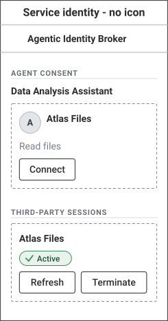
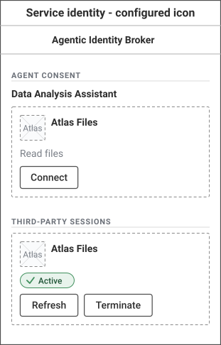

# Feature Specification: Configurable Third-Party Service Icons

**Feature Branch**: `221-configure-service-icons`

**Created**: 2026-11-18

**Status**: Approved

**Input**: [Issue #497 — Configurable Icons for Third-Party Services](https://github.com/zalando-incubator/agentic-identity-broker/issues/497)

Operators can assign an optional SVG document to each third-party service through the Admin API.
Users see that icon beside the service name in consent and session views.
Missing or broken icons retain the existing fallback and never prevent consent or session actions.

## User Scenarios & Testing *(mandatory)*

Each numbered acceptance scenario requires one corresponding E2E scenario under `tests/e2e/`.
Browser scenarios also require Playwright coverage and screenshots of meaningful states, as required by Constitution XIII.

### User Story 1 - Configure a Service Icon from an SVG Document (Priority: P1)

An operator supplies an SVG document for a service. Users recognize that service in consent and session views.
The operator can replace or clear the icon without changing the service identity or its permissions.

**Why this priority**: This provides the requested operator control and visible service identity without a separate asset deployment process.

**Independent Test**: Create a service with an SVG document. Read its configuration and open its consent and session views.

**Acceptance Scenarios**:

1. **US1.1 — Create and retain**: **Given** a permitted SVG document and an authorized operator, **When** the operator creates a service with that document, **Then** Admin reads and listings report the SVG. After a broker restart against the same PostgreSQL database, fresh authenticated consent and session responses retain the exact source.
2. **US1.2 — Replace**: **Given** a service with an icon, **When** the operator supplies a different permitted SVG document, **Then** fresh service views show the replacement. The service ID, grants, session state, and OAuth2 settings remain unchanged.
3. **US1.3 — Preserve and clear**: **Given** an existing icon, **When** an otherwise valid service update omits the SVG field, **Then** the icon remains unchanged. A subsequent update with an explicit null clears it, and fresh views return to their existing fallback.
4. **US1.4 — Reject invalid input**: **Given** an existing service, **When** an operator submits a URL or an empty value instead of an SVG document, **Then** the request fails validation. The previous service configuration remains unchanged, and no icon-related network request occurs.

### User Story 2 - Supply a Safe SVG Icon (Priority: P1)

An operator supplies SVG content without deploying a separate image file. Users see the artwork, not executable page content.

**Why this priority**: Operator-supplied SVG documents must preserve the browser trust boundary.

**Independent Test**: Create a service with an original, self-contained SVG that uses visual effects. Open its service views and verify image-mode rendering without page-DOM insertion, executable content, or external requests. Verify that unauthenticated callers cannot obtain icon content through the feature's delivery mechanism.

**Acceptance Scenarios**:

1. **US2.1 — Create and render visual SVG features**: **Given** an authorized operator and self-contained SVG examples covering visual features under FR-016, **When** the operator creates a service with each document, **Then** Admin reads return the exact source. Authenticated users see decoded images in consent and session views through ``. No manual simplification, SVG insertion into the page DOM, executable content or icon-related external requests occur. Examples use original test artwork, not a required third-party logo. US1.1 and storage integration tests cover persistence; this browser scenario does not restart the broker.
2. **US2.2 — Replace SVG**: **Given** a configured service, **When** the operator replaces its SVG document, **Then** the accepted update replaces the previous document. Fresh service data makes views display the current icon rather than a cached predecessor, regardless of the delivery mechanism.
3. **US2.3 — Reject explicit active constructs**: **Given** a service with a valid icon, **When** an operator submits malformed or oversized SVG, or an explicitly prohibited construct under SR-005, **Then** the write fails without changing any service properties. Separately, an otherwise accepted image containing external references cannot load those resources or execute content in browser image mode. This scenario does not require exhaustive static detection of every CSS, reference or animation behavior.
4. **US2.4 — Protect icon access**: **Given** a configured SVG icon and no authenticated principal, **When** a caller requests consent or session JSON that carries icon content, **Then** existing end-user authentication rejects the request. The response contains no SVG content. No separate icon endpoint exists.

### User Story 3 - Keep Service Views Usable Without an Image (Priority: P1)

A user can identify a service and use its controls even when its image is absent or broken.
After an operator replaces a broken icon, the same open view can display the new source when it receives fresh service data.

**Why this priority**: Icons are optional decoration. Their absence must not disrupt consent, connection, refresh, or termination actions.

**Independent Test**: Open service views with unset and broken images. Refresh their data with a valid replacement while the views remain open.

**Acceptance Scenarios**:

1. **US3.1 — Existing services**: **Given** services created without icon metadata, including services from before this feature, **When** a user opens consent or sessions, **Then** each view retains its existing initials, placeholder, or name-only fallback. Service names and controls remain available.
2. **US3.2 — Broken image**: **Given** a stored SVG that fails to render in the browser, **When** a user opens the service views, **Then** they show their existing fallback rather than a broken-image marker. The image failure does not block service actions or show a page-level error.
3. **US3.3 — Broken to valid**: **Given** an open service view that shows the fallback after an image error, **When** an operator replaces the SVG document and the view receives fresh service data, **Then** it attempts to render the new content and shows it on success. Recovery does not require a full page reload.
4. **US3.4 — Accessible service identity**: **Given** configured, unset, and broken icon states, **When** a user reviews consent and sessions at narrow and wide viewport sizes, **Then** the service name remains readable. The icon adds no keyboard stop or duplicate service announcement, and all existing controls remain operable.

### Edge Cases

- Existing clients omit the SVG field on creation and update. Creation has no icon, and update preserves the current icon.
- A permitted SVG document replaces the previous document.
- An explicit null clears the icon.
- Empty or whitespace-only SVG values are invalid, not aliases for removal.
- A URL or image path supplied instead of an SVG document is invalid, whether same-origin or remote.
- The browser fails to render the configured SVG. The view retains its fallback without requesting an external image.
- An SVG is exactly 65,536 UTF-8 bytes or exceeds that limit. The boundary is measured after JSON string decoding.
- A malformed or prohibited icon accompanies other service changes. The entire write fails without partial changes.
- A view retains an earlier SVG in memory or cache after replacement or removal. Fresh service data must display the current document or the no-icon fallback, independent of how the document is delivered.
- Several services use identical SVG documents. Replacing or clearing one service's icon must not alter another service.
- Visual features such as gradients, masks, filters, patterns, markers, clipping, text, styling, local reuse and declarative visual animation are not rejection reasons by themselves.
- Definitions appear inside `defs` or directly beneath the root, references precede their definitions, and exports use harmless namespace aliases, comments or metadata. These forms must work without preprocessing.
- External references can remain in accepted source, including styles and animated values, but image-mode rendering must not load them. The broker must never fetch them during validation.
- Missing references, duplicate IDs, unusual geometry and browser-ignored values are rendering concerns, not automatic upload errors.
- SVG is operator-provided. Browser rendering budgets, filter-cost limits, animation lifetime limits and rendering stress tests are out of scope. The source byte limit is an input contract, not a rendering quota.

## Concrete Example Journeys *(mandatory)*

**Shared cast**: Operator Olivia (`olivia@example.com`) administers service **Atlas Files** (`880e8400-e29b-41d4-a716-446655440010`).
User Alice (`alice@example.com`) reviews agent **Data Analysis Assistant** (`550e8400-e29b-41d4-a716-446655440000`).
By 10:04, Alice has a session for Atlas Files and permission to review that agent.
The end-user origin is `https://broker.example.com`. No separately deployed image assets are required.
The Admin API uses `https://admin.broker.example.com`. The trusted proxies authenticate both actors and set `X-Remote-User`.
All values are synthetic. Times are UTC on 2026-11-18.

The Admin and end-user SVG fields describe the contract selected in this PR, not an existing capability.
The [stakeholder approval record](contracts/service-icons.md) covers the API drafts and the full current design, including security and CSP decisions. Publication in both canonical OpenAPI documents remains a prerequisite for implementation, not a request for further approval.
Response excerpts omit unrelated fields, but include icon source or show its absence. No new runtime configuration or token claims are involved.

### Journey 1 — Configure and Replace an SVG Document (US1.1–US1.2, US3.1, US3.4)

**Step 1 — 10:00:00: Olivia creates Atlas Files with its SVG icon**

```http
POST /api/services HTTP/1.1
Host: admin.broker.example.com
X-Remote-User: olivia@example.com
Content-Type: application/json

{
  "display_name": "Atlas Files",
  "client_id": "atlas-broker-public",
  "token_endpoint_auth_method": "none",
  "issuer_uri": "https://atlas.example.com",
  "discovery": {"enable_discovery": false},
  "endpoints": {
    "authorize_endpoint": "https://atlas.example.com/authorize",
    "token_endpoint": "https://atlas.example.com/token"
  },
  "scopes": [{"scope_value": "files.read", "description": "Read files"}],
  "icon_svg": "<svg xmlns=\"http://www.w3.org/2000/svg\" viewBox=\"0 0 24 24\"><path fill=\"currentColor\" d=\"M4 4h16v16H4z\"/></svg>"
}

HTTP/1.1 201 Created
Content-Type: application/json

{
  "id": "880e8400-e29b-41d4-a716-446655440010",
  "display_name": "Atlas Files",
  "icon_svg": "<svg xmlns=\"http://www.w3.org/2000/svg\" viewBox=\"0 0 24 24\"><path fill=\"currentColor\" d=\"M4 4h16v16H4z\"/></svg>"
}
```

At 10:01, Olivia assigns Atlas Files to the agent through the existing permission-set workflow.
At 10:03, Alice connects to Atlas Files through the existing OAuth2 flow. Those unchanged exchanges are outside this example.

**Step 2 — 10:05:00: Alice opens the agent's consent view after the broker restarts**

```http
GET /api/consent/agents/550e8400-e29b-41d4-a716-446655440000 HTTP/1.1
Host: broker.example.com
X-Remote-User: alice@example.com

HTTP/1.1 200 OK
Content-Type: application/json

{
  "data": {
    "services": [{
      "serviceId": "880e8400-e29b-41d4-a716-446655440010",
      "serviceName": "Atlas Files",
      "iconSvg": "<svg xmlns=\"http://www.w3.org/2000/svg\" viewBox=\"0 0 24 24\"><path fill=\"currentColor\" d=\"M4 4h16v16H4z\"/></svg>",
      "requirementType": "mandatory",
      "requiredScopes": [{"name": "files.read", "description": "Read files"}],
      "connectionStatus": "connected"
    }]
  }
}
```

State A — the existing fallback for a service without an icon:



<details><summary>Wireloom source</summary>

```wireloom
window "Service identity - no icon":
  header:
    text "Agentic Identity Broker" bold
  section "Agent consent":
    text "Data Analysis Assistant" bold
    panel:
      row:
        avatar "A" size=medium
        text "Atlas Files" bold
      text "Read files" muted
      button "Connect"
  section "Third-party sessions":
    panel:
      text "Atlas Files" bold
      status "Active" kind=success
      row:
        button "Refresh"
        button "Terminate"
```

</details>

Action: Olivia assigns the icon in step 1. Alice opens fresh consent and session views.
For this comparison, State A uses the same service without icon metadata. The connected session belongs to Alice, independently of the agent's delegation.

State B — both views show the configured image:



<details><summary>Wireloom source</summary>

```wireloom
window "Service identity - configured icon":
  header:
    text "Agentic Identity Broker" bold
  section "Agent consent":
    text "Data Analysis Assistant" bold
    panel:
      row:
        image label="Atlas" width=36 height=36
        text "Atlas Files" bold
      text "Read files" muted
      button "Connect"
  section "Third-party sessions":
    panel:
      row:
        image label="Atlas" width=36 height=36
        text "Atlas Files" bold
      status "Active" kind=success
      row:
        button "Refresh"
        button "Terminate"
```

</details>

The image boxes represent the configured icon, not new text labels.
The service name remains visible in every state. Equivalent service identity rows in consent use the same metadata.

**Step 3 — 10:10:00: Olivia replaces the image**

Olivia sends a full `PUT /api/services/880e8400-e29b-41d4-a716-446655440010` replacement.
Its body repeats the creation fields, except `icon_svg` is `<svg xmlns="http://www.w3.org/2000/svg" viewBox="0 0 24 24"><circle fill="currentColor" cx="12" cy="12" r="8"/></svg>`.
The response is `200 OK` with the replacement document. Existing concurrency requirements remain applicable.
After Alice receives fresh service JSON, her view URI-encodes the replacement SVG into an `` data image.

**Observable result**: Atlas Files shows the replacement icon in consent and sessions. Its ID, permissions, session status, and controls do not change.

### Journey 2 — Validate and Render SVG Content Safely (US2.1–US2.4)

**Step 1 — 10:15:00: Olivia supplies an SVG**

```http
PUT /api/services/880e8400-e29b-41d4-a716-446655440010 HTTP/1.1
Host: admin.broker.example.com
X-Remote-User: olivia@example.com
Content-Type: application/json

{
  "display_name": "Atlas Files",
  "client_id": "atlas-broker-public",
  "token_endpoint_auth_method": "none",
  "issuer_uri": "https://atlas.example.com",
  "discovery": {"enable_discovery": false},
  "endpoints": {
    "authorize_endpoint": "https://atlas.example.com/authorize",
    "token_endpoint": "https://atlas.example.com/token"
  },
  "scopes": [{"scope_value": "files.read", "description": "Read files"}],
  "icon_svg": "<svg xmlns=\"http://www.w3.org/2000/svg\" viewBox=\"0 0 24 24\"><path fill=\"currentColor\" d=\"M4 4h16v16H4z\"/></svg>"
}

HTTP/1.1 200 OK
Content-Type: application/json

{
  "id": "880e8400-e29b-41d4-a716-446655440010",
  "display_name": "Atlas Files",
  "icon_svg": "<svg xmlns=\"http://www.w3.org/2000/svg\" viewBox=\"0 0 24 24\"><path fill=\"currentColor\" d=\"M4 4h16v16H4z\"/></svg>"
}
```

The SVG replaces the previous document. Existing authenticated service responses carry the source, and end-user views render URI-encoded data images.

**Step 2 — 10:16:00: Alice opens sessions and sees the SVG icon**

```http
GET /api/third-party/sessions HTTP/1.1
Host: broker.example.com
X-Remote-User: alice@example.com

HTTP/1.1 200 OK
Content-Type: application/json

{
  "data": {
    "sessions": [{
      "id": "990e8400-e29b-41d4-a716-446655440020",
      "service_id": "880e8400-e29b-41d4-a716-446655440010",
      "service_display_name": "Atlas Files",
      "service_icon_svg": "<svg xmlns=\"http://www.w3.org/2000/svg\" viewBox=\"0 0 24 24\"><path fill=\"currentColor\" d=\"M4 4h16v16H4z\"/></svg>",
      "token_type": "Bearer",
      "scope": ["files.read"],
      "initiated_at": "2026-11-18T10:03:00Z",
      "requires_reauthentication": false,
      "is_expired": false,
      "access_token_expired": false,
      "has_refresh_token": true,
      "dependent_agent_count": 1,
      "is_encrypted": true
    }]
  }
}
```

The browser receives the principal header from the trusted proxy, not from application JavaScript.
Consent and sessions URI-encode the JSON source into `` data images. They never insert SVG elements into the page DOM.
The layout remains State B from Journey 1. Icon display causes no script execution or requests to third-party origins.

**Step 3 — 10:20:00: Olivia attempts an unsafe replacement**

Olivia repeats the step 1 request with `icon_svg` containing `<svg xmlns="http://www.w3.org/2000/svg" onload="alert(1)"/>`.

```http
HTTP/1.1 400 Bad Request
Content-Type: application/json

{"error":"validation failed","message":"icon_svg contains prohibited content"}
```

At 10:21, a caller without an authenticated principal requests consent and session JSON. Existing end-user authentication rejects each request and returns no SVG content. No separate icon route exists.

**Observable result**: The safe SVG remains available after restart. The rejected document never replaces it or executes in Alice's browser.

**Compatibility example — visual features without a third-party fixture (US2.1, US2.3)**:

At 10:22, Olivia repeats Journey 2's complete update for Atlas Files with `icon_svg` set to this original illustration:

```xml
<!DOCTYPE svg PUBLIC "-//W3C//DTD SVG 1.1//EN" "http://www.w3.org/Graphics/SVG/1.1/DTD/svg11.dtd">
<svg xmlns="http://www.w3.org/2000/svg" viewBox="0 0 64 64"><defs><linearGradient id="paint"><stop stop-color="#1670c5"/><stop offset="1" stop-color="#36b878"/></linearGradient><mask id="cutout"><rect width="64" height="64" fill="white"/><circle cx="32" cy="24" r="8" fill="black"/></mask><filter id="soft"><feGaussianBlur stdDeviation="0.4"/></filter></defs><style>.tile { fill: url(#paint); }</style><rect class="tile" x="4" y="4" width="56" height="40" mask="url(#cutout)" filter="url(#soft)"><animate attributeName="opacity" values="0.8;1;0.8" dur="2s" repeatCount="indefinite"/></rect><text x="4" y="60" font-family="sans-serif" font-size="10">Atlas</text></svg>
```

The update returns `200 OK`. Admin, consent and session reads return the unchanged source, including the DOCTYPE without an internal subset.
In Chromium, Alice's consent and session views render that source through `` with `complete` true and `naturalWidth > 0`.
The decoded data URI matches the returned source. Network observation shows no icon-related external requests, including a request for the DTD.
Meaningful-state screenshots remain required. Pixel comparisons and synchronized animation comparisons are not required.

Additional original examples cover other visual features rather than treating this document as an exhaustive vocabulary. No commercial logo, local download or fixed file hash is required for acceptance or for the repository.

At 10:23, Olivia adds an `onload` event attribute. The request returns `400` without changing the stored illustration. She then supplies an otherwise valid document with an external paint reference. It can remain in accepted source, but browser image mode prevents the external load; the browser applies its normal missing-resource behavior. Network observation proves no request occurs. The server never resolves the reference.

**Observable result**: Visual artwork needs no prescribed drawing vocabulary. Explicit active constructs fail atomically; browser image mode blocks unsafe rendering capabilities even when their references remain in source.

### Journey 3 — Recover from a Broken Image and Remove It (US1.3–US1.4, US3.2–US3.3)

**Step 1 — 10:25:00: Alice's browser fails to load the current SVG icon**

The service still holds a permitted SVG document, but Alice's browser reports an image-rendering failure. This example does not assume a separate image request or a particular response status.

After the image fails, Alice's views show State A from Journey 1. Image failure and absence intentionally have the same visible fallback.

**Step 2 — 10:26:00: Olivia replaces the SVG while Alice keeps the view open**

Olivia repeats the replacement from Journey 1 with a different permitted `icon_svg` document. When Alice receives fresh service data, the view recognizes the changed icon and attempts to render the replacement content.
Action: Alice refreshes the service data without reloading the page. The view transitions from State A to State B from Journey 1.
The previous image error does not suppress the new image attempt.

**Step 3 — 10:27:00: Olivia preserves, then clears the icon**

Olivia submits an otherwise valid full replacement without `icon_svg`. A subsequent Admin read still reports the current SVG document.
She then repeats the request with `"icon_svg": null`. The response is `200 OK` without the SVG field.
Fresh consent and session data indicate that the icon is absent, and Alice's views return to State A.
The following fresh response excerpts show removal in both views. The server omits the icon properties rather than returning the previous source.

```http
GET /api/consent/agents/550e8400-e29b-41d4-a716-446655440000 HTTP/1.1
Host: broker.example.com
X-Remote-User: alice@example.com

HTTP/1.1 200 OK
Content-Type: application/json

{"data":{"services":[{"serviceId":"880e8400-e29b-41d4-a716-446655440010","serviceName":"Atlas Files","requirementType":"mandatory","requiredScopes":[{"name":"files.read","description":"Read files"}],"connectionStatus":"connected"}]}}
```

```http
GET /api/third-party/sessions HTTP/1.1
Host: broker.example.com
X-Remote-User: alice@example.com

HTTP/1.1 200 OK
Content-Type: application/json

{"data":{"sessions":[{"id":"990e8400-e29b-41d4-a716-446655440020","service_id":"880e8400-e29b-41d4-a716-446655440010","service_display_name":"Atlas Files"}]}}
```

The consent consumer replaces its previous `iconSvg` with absence. The session consumer does the same for `service_icon_svg`.
Both restore their original fallbacks. Consumers also tolerate explicit null values as absence.

An attempted replacement with `"icon_svg": "https://images.example.net/atlas.svg"` or `"icon_svg": "/service-icons/atlas.svg"` returns `400 Bad Request` without a network request.

**Observable result**: Alice can use service controls throughout the failure, recovery, and removal sequence. Unrelated service data does not change.

## Requirements *(mandatory)*

### Functional Requirements

- **FR-001**: Authorized operators MUST be able to create and update a service with an optional SVG document as its icon. Operator-supplied image URLs and paths are not supported.
- **FR-002**: Admin create, update, detail, and list responses MUST report the configured SVG document when present.
- **FR-003**: Icon metadata MUST survive production restarts and behave consistently in development and production storage.
- **FR-004**: Writes MUST apply the omission, null, replacement, and validation behavior in the source semantics table.
- **FR-005**: Icon input MUST be an SVG document, not a URL or image path. The broker and browser MUST NOT import or request third-party images.
- **FR-006**: SVG sources MUST satisfy the security requirements. Existing authenticated JSON responses carry the exact source. Views MUST render URI-encoded data images through ``, never insert SVG markup into the page DOM.
- **FR-007**: Consent JSON MUST carry the current configured source through existing `data.services` entries (`ServiceRequirementForUser`). Permission-set rows MUST reuse those entries; no additional service catalog is required. Fields follow API-003.
- **FR-008**: Consent service cards, permission-set service rows, and service requirement rows MUST show the icon beside their service identity label.
- **FR-009**: Session list and detail JSON MUST carry the service's current source. Their service identity headers MUST show that icon through ``. The field follows API-003.
- **FR-010**: Unset and failed images MUST retain each view's existing fallback. They MUST NOT block service controls or cause a page-level error.
- **FR-011**: When a view learns that the configured SVG document has changed, it MUST attempt to render the new content even after an earlier rendering failure.
- **FR-012**: After replacement or removal, fresh service data MUST make views render the current SVG or the no-icon fallback. This MUST NOT require a broker restart or new user session and MUST NOT depend on a particular URL or revision format.
- **FR-013**: Invalid icon input MUST reject the entire service write. It MUST NOT change existing metadata, credentials, grants, or sessions.
- **FR-014**: Icons MUST remain non-interactive decoration. The service name MUST remain visible and accessible independently of the image.
- **FR-015**: Icon-only edits MUST preserve the service ID and unrelated configuration. Existing authorization and concurrency requirements MUST remain in effect.
- **FR-016**: All SVG visual features supported by the target browser's image mode MUST be allowed when they satisfy the security requirements. This includes gradients, masks, filters, patterns, markers, clipping, text/font styling, embedded styles, local reuse, self-contained inert media and declarative visual animation; the examples are not an allowlist. Operators MUST NOT need to flatten artwork or remove harmless visual properties, namespaces, comments, metadata or a permitted DOCTYPE without an internal subset. Support MUST NOT depend on a specific logo, filename, hash or committed third-party asset. Standalone raster uploads remain outside this SVG-input feature.

**Source semantics**: `icon_svg` is an optional, nullable string in writes. A supplied non-null value must be a nonempty, permitted SVG document. There is no operator-supplied URL field.

| Input | Create result | Update result |
| --- | --- | --- |
| Field absent | No icon | Preserve existing icon |
| Permitted SVG document | Set that document | Replace existing document |
| Explicit null | No icon | Clear existing icon |
| Empty, whitespace-only, malformed, prohibited, or oversized document; URL or image path | Reject | Reject without changes |

### Domain Model *(if applicable - document before API or database design)*

**Aggregate**: The existing third-party service owns its icon metadata. An icon has no independent identity or user-specific lifecycle.

**Value object**: A service icon is absent or a permitted SVG document. Only one state can apply at a time.
Image availability is a presentation state, not a change to the stored source or the service's connection status.

The service icon term and its relationship to the service must enter the `ARCHITECTURE.md` glossary before implementation.

### API Requirements *(if applicable - design before database)*

- **API-001**: Extend the existing Admin service create and replacement contracts with `icon_svg` only. Preserve unrelated field and precondition semantics.
- **API-002**: Admin responses MUST omit `icon_svg` for no icon. Accepted SVG content remains readable administratively.
- **API-003**: Existing authenticated consent and session JSON MUST carry the current SVG source. `ServiceRequirementForUser` uses `iconSvg` in `data.services`, including metadata reused by permission-set rows. Session summaries/details use `service_icon_svg`. These fields have explicit stakeholder approval under the [approval record](contracts/service-icons.md). No separate image resource or `available_services` response is added; the unused `ThirdpartyService` schema remains unchanged.
- **API-004**: The server MUST omit absent icon source. Consumers MUST treat omission or null as absence and retain the fallback.
- **API-005**: The delivery design MUST document response size, request count, caching, authentication and image-mode isolation for source up to 64 KiB. Views MUST URI-encode the JSON source into `` data images. Icon rendering adds no image HTTP requests and preserves existing JSON cache lifetimes. Security review MUST cover payload cost and CSP effects before implementation, independently of the API field decision.
- **API-006**: Fresh JSON MUST replace previous icon metadata, not merge a cleared field back from stale state. Changed source triggers a new image attempt. Omitted or null source restores the fallback, as required by FR-011 and FR-012. No URL revision or obsolete-resource status is required.
- **API-007**: Invalid icon input MUST return `400` using the existing Admin error format. Missing authentication MUST retain the applicable server's existing behavior.
- **API-008**: Document all additions, examples, authentication, errors, size limits, and omission semantics in both applicable OpenAPI files before implementation.
- **API-009**: Render the changed end-user contract in `docs/api/`. Use the recorded stakeholder API approval and follow existing API versioning and Zalando API guidelines.

Icon delivery must not expose service credentials, tokens, or the service's other administrative configuration.
An SVG rendering failure uses the display fallback. No operator-supplied image URL is fetched or validated for availability.

### Database Requirements *(if applicable)*

- **DB-001**: Both in-memory and PostgreSQL adapters MUST retain the icon source and return equivalent service and session metadata.
- **DB-002**: Existing services MUST acquire an absent icon without changes to their IDs, credentials, grants, sessions, or timestamps.
- **DB-003**: Required schema changes MUST use atomic migrations with apply, rollback, and reapply coverage against production migrations.
- **DB-004**: Rollback MUST preserve unrelated service data. No independent asset lifecycle or remote image store is required.

### Security Requirements *(mandatory for security-critical features)*

**Security rationale**: Operator-supplied SVG is untrusted content. Rendering through `` uses the browser's SVG image mode, which disables scripts and interactivity and isolates the SVG from the surrounding page DOM. Directly inserting SVG markup into the page does not provide that boundary. Image-mode isolation is defense in depth, not a replacement for the validation and external-resource restrictions below.

The isolation comes from the image context. An SVG data URL in `` uses image mode, but directly opening SVG does not. Authenticated JSON controls access to source bytes, not reuse of bytes an authorized client copies. Security analysis MUST address this distinction and the CSP effects in SR-003 before implementation. The stakeholder approved these design decisions; no further sign-off is required. The feature adds no navigable SVG resource.

- **SR-001**: Only existing authorized Admin callers can change icon sources. End-user callers cannot modify them.
- **SR-002**: Icon input MUST reject URLs and image paths, including same-origin paths. Only permitted SVG documents can become service icons.
- **SR-003**: Service icon display MUST cause zero requests to third-party origins and preserve existing frontend security controls. The approved SPA policy is `frame-ancestors 'none'; object-src 'none'`. Document its security analysis and record the approved design in an Accepted ADR before implementation. Do not add an `img-src` or `default-src` restriction: existing remote user avatars and agent images must keep working. Parent CSP does not replace browser image-mode isolation.
- **SR-004**: SVG content MUST be a well-formed UTF-8 SVG document of at most 65,536 decoded bytes. Empty documents and non-SVG roots are invalid.
- **SR-005**: Upload validation MUST reject script elements, event-handler attributes, hyperlink elements, `foreignObject`, explicitly script-capable attribute URLs, internal DTD subsets, entity declarations, other XML directives and processing instructions other than an initial XML declaration. Permit one SVG DOCTYPE before the root, with an optional external identifier and no internal subset. Never fetch or resolve its DTD. Checks MUST use parsed XML names and decoded attribute values, not XML regular expressions. Visual styles, filters, text, local reuse, media and declarative animation remain allowed. This is a named-construct rejection policy, not a complete SVG/CSS static capability analysis.
- **SR-006**: The broker MUST NOT fetch SVG dependencies. Accepted content MUST be rendered only in browser SVG image mode, which disables scripts, interaction and external resource loads while permitting declarative animation. External references in CSS, attributes, media or animated values need not all fail upload; the rendering context must prevent their loads. Same-document and data references follow browser image-mode semantics. Source is not certified safe for inline SVG or active document embedding.
- **SR-007**: Render accepted SVG exclusively through ``. Never insert its markup into the page DOM or load it through `<object>`, `<embed>` or `<iframe>`. Deliver the source as authenticated JSON, not a navigable SVG resource. Image mode is the primary rendering security boundary, supplemented by the named upload rejections and existing frontend security controls.
- **SR-008**: Rejected sources MUST remain unavailable to users. Rejection MUST NOT attempt to fetch referenced resources or silently accept a modified unsafe document.
- **SR-009**: SVG content and image delivery MUST NOT introduce credentials or personal data into logs, traces, or metrics.
- **SR-010**: XML validation MUST account for namespace identity and decoded attribute values for the named active-construct checks. It MUST NOT become a CSS, geometry, reference-graph or animation conformance checker. Unknown visual features, aliases, forward references and ignored visual values do not fail solely because they are not enumerated. No claim of complete static detection is made.
- **SR-011**: Rendering-resource budgets and rendering stress tests are out of scope for operator-provided SVG. Retain the 65,536-byte input limit and basic XML validation. Do not claim these controls bound browser CPU/GPU work, memory, filter cost or animation lifetime.

### Frontend/Design System Requirements *(if applicable - document before implementation)*

- **FE-001**: Reuse the existing design-system image, avatar, and fallback patterns. Keep the current light theme and semantic tokens.
- **FE-002**: Preserve existing icon sizing where present. New icon slots MUST fit the existing service heading without displacing controls or stretching the image.
- **FE-003**: The adjacent service name supplies the accessible identity. Decorative images MUST NOT duplicate that name for screen readers or add focus stops.
- **FE-004**: Configured and fallback states MUST meet WCAG 2.1 AA and remain usable at narrow and wide viewport sizes.
- **FE-005**: Shared image-error recovery MUST apply consistently to every affected service identity view. This feature does not redesign unrelated avatars or agent logos.

### Key Entities *(include if feature involves data)*

- **Third-party service**: The existing provider definition whose display identity includes optional icon metadata.
- **Service icon**: The service-owned visual value described in the domain model, separate from OAuth2 provider credentials and connection status.
- **User session**: An existing connection whose displayed service identity reflects current service metadata, not a copied icon from session creation.

## Success Criteria *(mandatory)*

### Measurable Outcomes

- **SC-001**: In every acceptance fixture, users see the assigned icon beside the correct service identity across consent and session views.
- **SC-002**: All create, replace, preserve, and clear journeys produce the specified state after a fresh read. Configured icons survive a production restart.
- **SC-003**: All missing and failed image fixtures retain a readable service identity and usable controls, with zero page-level errors caused by icons.
- **SC-004**: Every broken-to-valid replacement fixture recovers on the first delivery of fresh service data, without a full page reload.
- **SC-005**: All prohibited-source fixtures fail without changing stored service data. Icon display causes zero third-party network requests or executable content.
- **SC-006**: Keyboard and screen-reader review finds zero new focus stops or duplicate service announcements attributable to icons.
- **SC-007**: Every original visual-feature example covering FR-016 passes its compatibility journey without manual preprocessing. Admin, consent and session responses preserve the exact source. Chromium images complete with `naturalWidth > 0`, the decoded data URI matches that source, and icon display causes zero external requests. Test examples and verification do not require a third-party logo, workstation-local file or image-diff tooling.

## Assumptions

- Operator-supplied SVG documents are the only icon input. Same-origin image paths, remote image URLs, remote import, and arbitrary URL proxying are excluded.
- The selected design carries SVG source in authenticated consent/session JSON and renders URI-encoded data images through ``. It adds no icon endpoint. All stakeholder approvals for the current design are complete. Security analysis, ADR authoring and implementation verification remain work, not further approval gates.
- The 64 KiB SVG limit is a conservative default for small service icons. The limit applies uniformly to create and update requests.
- Service identity cards, rows, and headers in consent and sessions are in scope. Service names inside explanatory prose and confirmation text do not gain decoration.
- An Admin icon editor, raster uploads, icon discovery from providers, and changes to agent or user logos are out of scope.
- Existing end-user authentication, Admin authorization, and service concurrency controls remain authoritative.
- Existing data refresh and cache lifetimes remain in effect. This feature requires correct fresh data and source-change recovery, not live push updates.
- Canonical OpenAPI publication remains a prerequisite for implementation. This specification does not modify the canonical OpenAPI documents.
- Visual compatibility follows browser SVG image-mode support, not a finite drawing vocabulary. Original synthetic artwork supplies tests; no third-party brand asset is required. The approved image-mode boundary replaces comprehensive static capability detection. Rendering-resource budgets are explicitly out of scope for operator-provided artwork.

**Acceptance traceability**:

| Requirements | Acceptance scenarios |
| --- | --- |
| FR-001–FR-003, FR-007–FR-009 | US1.1, US2.1 |
| FR-004 | US1.3, US1.4, US2.2 |
| FR-005–FR-006, FR-016, SR-001–SR-011, SC-007 | US1.4, US2.1, US2.3, US2.4 |
| FR-010 | US3.1, US3.2 |
| FR-011–FR-012 | US2.2, US3.3 |
| FR-013, FR-015 | US1.2, US1.4, US2.3 |
| FR-014, FE-001–FE-005 | US3.1–US3.4 |
| API-003–API-006 | US2.1, US2.2, US2.4, US3.1, US3.3 |
