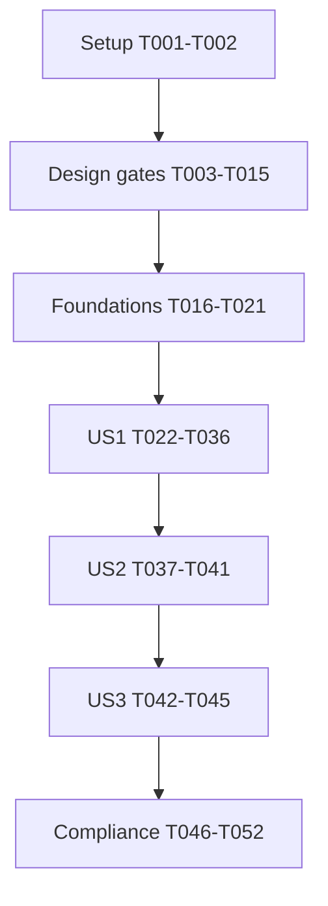

# Tasks: Configurable Third-Party Service Icons

**Input**: `specs/20261118-224349-configure-service-icons/` — spec.md, plan.md, research.md, data-model.md, contracts/ and quickstart.md.
**Status**: All stakeholder approvals for the current design are complete, including API drafts, security design and CSP. T006 is complete. Production implementation has not started. Security analysis, ADR authoring, canonical API publication and test-first cases remain work, not further sign-off requirements.
**Tests**: Required by the spec and Constitution VIII/XIII. Write meaningful tests before behavior; tests must compile and fail semantically, not through missing imports or undefined symbols. Use only minimal production signatures/types where needed to make test-first work compile; no final stubs, test-only production APIs or skipped/pending cases. Container-backed local red runs may first occur in CI under the constitution; archived red-run evidence is not required.

## Feature Scope

Allow browser image-mode visual features without a finite drawing vocabulary. Upload validation uses standard XML/UTF-8 parsing and the exact named rejections in contracts/service-icons.md. Browser image mode, not exhaustive CSS/reference/animation analysis, is the primary rendering boundary. External references can remain in accepted source but must stay inert. No required third-party logo, rendering budgets/stress suite, sanitizer dependency, remote-fetch path, SVG endpoint, runtime config, asset repository, unrelated avatar work or preparatory refactoring. The existing service owns its source; no new entity/ID scaffolding is needed. Every task cites feature requirements or binding principles.

## Phase 1: Setup

- [ ] T001 Resolve `.specify/feature.json` to this feature, read the nearest scoped backend/frontend/test instructions, and check tools against `go.mod`, `web/package.json`, `justfile` and `CONTRIBUTING.md`; record unavailable browser/container prerequisites in `specs/20261118-224349-configure-service-icons/quickstart.md` without claiming unrun checks passed (Constitution VIII/XIII).
- [ ] T002 Inspect `migrations/` and record the next unused `NNN_service_icon_svg.up.sql`/`.down.sql` pair in `specs/20261118-224349-configure-service-icons/data-model.md`; never reserve or overwrite a guessed occupied slot (Constitution IX).

## Phase 2: Design Preconditions (Blocking)

All subphases must finish before production behavior changes. Test-owned harness work and acceptance authoring are prerequisites, not permission to ship a partially secured feature.

### Phase 2a: Domain Model & Glossary

- [ ] T003 Add Service Icon and its service-aggregate relationship to `ARCHITECTURE.md` and its glossary, reconciled with `specs/20261118-224349-configure-service-icons/data-model.md`; retain existing service IDs, no icon repository and no session snapshot (FR-003/007/009; Constitution II/V/VI).
- [ ] T004 Create a UTC timestamp-named ADR under `adrs/` with status Accepted, using the stakeholder approval recorded in `contracts/service-icons.md`. Cover named upload rejections, browser image-mode isolation, exact-source JSON delivery, source-reuse limitations, payload cost, CSP and the rendering-resource scope. Complete security analysis before implementation, including authenticated JSON, copied-source limitations, Chromium isolation and remote-avatar compatibility. Record the analysis, actual checks and resolution of blocking findings in `specs/20261118-224349-configure-service-icons/plan.md`. Record the ADR's full file stem in `ARCHITECTURE.md` and `plan.md`. No further approval is required; do not mark this authoring/analysis task complete until its work is done (SR-001–SR-011; Constitution I/II/III).

### Phase 2b: Configuration Design

- [ ] T005 Confirm the no-new-configuration conclusion in `specs/20261118-224349-configure-service-icons/plan.md`: operator input is existing Admin JSON, not YAML. Preserve `examples/config/` and `charts/agentic-identity-broker/` unchanged; do not invent config, feature flags or deployment machinery (FR-001; Constitution VII).

### Phase 2c: API Design

- [x] T006 Record stakeholder approval for Admin `icon_svg`, existing consent `ServiceRequirementForUser.iconSvg`, session `service_icon_svg` and omit/null/value semantics in `specs/20261118-224349-configure-service-icons/contracts/service-icons.md` and `plan.md`. Approval source: the explicit stakeholder messages approving all API drafts and all remaining design decisions in this conversation. Leave the unused ThirdpartyService schema and logoUrl unchanged, and emit no available_services catalog. T004 records the already-approved security/architecture design; it requires no further sign-off (FR-001–FR-016; Constitution IV/X).
- [ ] T007 Publish confirmed fields, error/authentication/concurrency semantics and examples in `api/admin/openapi.yaml` and `api/enduser/openapi.yaml`, then regenerate rendered `docs/api/`. Leave the unused ThirdpartyService schema and logoUrl unchanged; do not add an SVG alias or remote fallback. Icon-only PUT must not acquire a mandatory If-Match requirement (FR-002/004/007/009/015; Constitution IV/X).

### Phase 2d: Database Design

- [ ] T008 Finalize `specs/20261118-224349-configure-service-icons/data-model.md` for `thirdparty_oauth2_services`: quote and enforce “NULL means absent; decoded UTF-8 source is 1–65,536 bytes”. Use nullable text with octet_length shape checks, atomic migrations, no backfill/default/timestamp rewrite and rollback that loses only icon metadata (FR-003; Constitution IX).

### Phase 2e: Frontend/Design System Review

- [ ] T009 Review `web/src/design-system/docs/INDEX.md`, `COMMON_MISTAKES.md`, `DECISION_TREES.md` and `DESIGN_PRINCIPLES.md`; record primitive/token and original fallback choices in `specs/20261118-224349-configure-service-icons/plan.md`. Keep service-specific composition, decorative semantics, visible names and source-keyed image state separate from action controls; no universal-avatar redesign (FR-008–FR-014; Constitution XI).

### Phase 2f: E2E Acceptance Design and Test-First Cases

- [ ] T010 Reconcile `specs/20261118-224349-configure-service-icons/spec.md` HTTP examples, original inline Atlas illustration and existing Wireloom source/renderings with approved contracts/ADR; render changed wireframes into its `wireframes/` directory using the existing recipe. No JWT or runtime YAML additions apply (Constitution XIV).
- [ ] T011 Write canonical backend Ginkgo cases for US1.1, US1.2 and US2.4 in new `tests/e2e/service_icons_test.go`, one complete-journey It per scenario using existing authenticated production bootstrap and fixtures. US1.1 uses the existing Docker/PostgreSQL restart pattern from `thirdparty_protected_resource_status_test.go`, without reseeding, then reads exact source through fresh authenticated consent/session responses. Prove replacement preserves ID/grants/session/OAuth data and actual delivery responses reject unauthenticated access without SVG bytes (Constitution VIII/XIII).
- [ ] T012 Write canonical Playwright/Ginkgo cases for US1.3, US1.4 and US2.1–US2.3 in new `tests/e2e/frontend/service_icons_test.go`, one scenario-referenced It each, using the existing Chromium harness. Cover retain/clear after fresh responses, URL/empty rejection, original visual artwork, replacement, named-construct rejection and image-mode isolation of accepted references in attributes/CSS/animation. Verify exact API/data-URI source and completed images with naturalWidth > 0. No browser-suite restart support, browser-matrix change, image-diff tooling or third-party artwork is required (Constitution VIII/XIII).
- [ ] T013 Extend `tests/e2e/frontend/service_icons_test.go` with canonical US3.1–US3.4 cases, one It each, for original fallbacks, deterministic image error, open-page fresh-source recovery, usable controls, decorative semantics and narrow/wide views; configure descriptive meaningful-state screenshots under `tests/e2e/screenshots/` using existing page objects (Constitution VIII/XI/XIII).
- [ ] T014 Make T011–T013 compile with realistic semantic assertions, verify missing behavior fails where runnable, and replace the design targets in `specs/20261118-224349-configure-service-icons/plan.md` with the twelve exact canonical test names. No duplicate mappings, pending/skipped cases, bare not-throw checks or required red-run log archive (Constitution VIII/XIII).

### Phase 2g: Observability Applicability

- [ ] T015 Read `coding-standards/LOGGING.md` and `OPENTELEMETRY.md`; record in `specs/20261118-224349-configure-service-icons/plan.md` that no new telemetry is planned and identify existing write/error paths requiring source/credential non-disclosure protection. If changing telemetry becomes necessary, design its required tests/contracts/registry entries before touching it; do not add speculative instruments (SR-009; Constitution XV).

**Checkpoint:** All stakeholder approvals are recorded. Security analysis has no unresolved blocking findings. The Accepted ADR, canonical API publication, model/migration design, UI review, examples and all twelve meaningful compiling acceptance cases are complete. No production implementation before this checkpoint; unfinished work does not reopen approval.

## Phase 2.5: Shared Foundations

Security, isolation and baseline fallback are present before any icon is accepted or displayed. These tasks are shared, not lower-priority story controls.

- [ ] T016 Write table-driven tests in new `internal/domain/model/service_icon_test.go` for the upload rules in `contracts/service-icons.md`: UTF-8/decoded byte bounds, one SVG root, malformed XML/duplicate attributes, initial declaration, one pre-root SVG DOCTYPE without an internal subset, forbidden internal subsets/entities/other directives/PIs, script/a/foreignObject local names across namespaces/case, on-prefixed attributes and decoded/ASCII-normalized javascript/vbscript prefixes. Assert exact source and “Absent or permitted source, never an empty string”. Include bare/PUBLIC/SYSTEM DOCTYPE positives, misplaced/duplicate DOCTYPE negatives, unknown entity rejection, harmless aliases/comments/metadata, Unicode and broad visuals. Never resolve a DTD; accept inert external references (FR-005/006/016; SR-004/005/010).
- [ ] T017 Implement the tested named-check XML/UTF-8 validation in new `internal/domain/model/service_icon.go` using standard libraries only. Apply byte bounds before parsing, consume the whole document, never resolve resources/custom entities, and retain exact accepted source. Implement precisely T016/contract checks, not a CSS/geometry/reference-graph analyzer, sanitizer, media decoder or rendering quota (FR-005/006/016; SR-004–SR-011).
- [ ] T018 [P] Write tests in new `web/src/components/services/ServiceIcon.test.tsx` for URI encoding of Unicode/XML/fragment characters, image-only output, empty alt, unchanged-source stability, absent/loading/error states, changed-source retry/removal and preservation of surrounding controls. Use original source, not a third-party asset (FR-006/010–FR-014).
- [ ] T019 Implement new `web/src/components/services/ServiceIcon.tsx` to satisfy T018: encode exact source only into img data delivery, source-key only image state, preserve caller-provided original fallback and never insert markup or use logoUrl as a remote fallback (FR-006/010–FR-014; SR-007).
- [ ] T020 Write regression tests in new `internal/adapters/http/handlers/spa_service_icons_test.go` for `frame-ancestors 'none'; object-src 'none'` and preserved existing security headers. Ensure the policy adds no img-src/default-src restriction that blocks remote avatars or agent images. Actual remote-avatar rendering and SVG isolation remain browser checks under T038, not header assertions (SR-003/007).
- [ ] T021 Apply the approved policy in `internal/adapters/http/handlers/spa.go`, preserving DENY/nosniff and existing script/style controls. No SVG document endpoint or new dependency/wiring is introduced (SR-003/007; Constitution I/XII).

**Checkpoint:** T016→T017, T018→T019 and T020→T021 are green; no renderer-resource task or full static capability promise is added.

## Phase 3: User Story 1 — Configure a Service Icon (P1)

**Goal:** Authorized operators create/read/replace/preserve/clear exact source with durable current metadata across every affected UI.
**Independent test:** US1.1–US1.4 prove Admin lifecycle, real PostgreSQL restart and visible icons/fallbacks, with stable IDs, credentials, grants, sessions and existing concurrency behavior.

### Tests before caller behavior

- [ ] T022 [US1] Write contract tests in new `internal/adapters/http/handlers/admin/service_icons_test.go` for create/update/detail/list, invalid types/values and “Three distinct states: absent, null, value”; omission preserves, null clears, strings replace. Assert existing authentication/error envelope/row-version behavior and no newly mandatory icon-only If-Match (FR-001/002/004/013/015).
- [ ] T023 [P] [US1] Write domain tests in new `internal/domain/thirdparty/service_icons_test.go` for validation before discovery/credential/persistence effects and actual prepareUpdate/Update merge semantics; reject without mutating memory-returned pointers. Assert “Absent or permitted source, never an empty string”, exact source and retained unrelated state (FR-004/013/015).
- [ ] T024 [P] [US1] Write parity/durability tests in new `internal/adapters/storage/memory/service_icons_test.go` and `tests/integration/storage/service_icons_test.go`, plus production-chain migration tests in new `tests/integration/migrations/service_icons_migration_test.go`. Assert “Copy/round-trip with existing service metadata”, independent services sharing source, null/replace/clear, exact bytes, reconnect/restart, unchanged old rows/timestamps and atomic up/down/up (FR-003; Constitution IX).
- [ ] T025 [US1] Write projection tests in new `internal/domain/consent/service_icons_test.go` and `internal/domain/oauth2session/service_icons_test.go`, plus serialization tests in new `internal/adapters/http/handlers/consent/service_icons_test.go`. Cover current source on existing ServiceRequirementForUser entries, list/detail/summary-returning refresh, replacement and clearing. Preserve consent service filtering and do not emit a catalog or session snapshots (FR-007/009/012).
- [ ] T026 [US1] Write caller/mapping tests in `web/src/components/consent/ServiceCard.test.tsx`, `PermissionSetCard.test.tsx` and `web/src/services/api/consent.test.ts` for icon propagation from data.services to requirement cards and permission-set rows, unchanged filtering/fallbacks, omitted/null metadata replacing stale values and controls surviving image changes; these precede T034/T035 (FR-007/008/010–FR-014; Constitution VIII).
- [ ] T027 [P] [US1] Write session caller/mapping tests in `web/src/components/sessions/SessionCard.test.tsx`, new `TerminationDialog.test.tsx` and `web/src/services/api/sessions.test.ts` for current/cleared source, original name-only fallback, decorative images, stable refresh/termination actions and unchanged explanatory prose; these precede T034/T035 (FR-009/010/014; Constitution VIII).

### Models, services, persistence and UI

- [ ] T028 [US1] Extend `internal/domain/model/thirdparty_oauth2_provider.go` with optional source and transient request-presence state satisfying “Absent or permitted source, never an empty string” and “Three distinct states: absent, null, value”; integrate T017 into `internal/domain/thirdparty/service.go` before side effects and merge preserve/clear/replace in actual prepareUpdate/Update, not merely ValidateUpdate's copy (FR-001/004/013/015).
- [ ] T029 [US1] Create the T002-resolved atomic `migrations/NNN_service_icon_svg.up.sql` and `.down.sql` pair for nullable text with octet_length checks satisfying “NULL means absent; decoded UTF-8 source is 1–65,536 bytes”. No backfill/default/timestamp changes; rollback removes only icon check/column (FR-003; Constitution IX).
- [ ] T030 [US1] Carry source through `internal/adapters/storage/memory/thirdparty_provider.go` and `thirdparty_provider_record.go`, and PostgreSQL equivalents under `internal/adapters/storage/postgres/`; clear transient flags and update every explicit INSERT/UPDATE/SELECT/RETURNING column list. Preserve locking/versions and “Copy/round-trip with existing service metadata” (FR-003/015; T024).
- [ ] T031 [US1] Extend ServiceRequest.UnmarshalJSON/request mapping and Admin response mappings in `internal/adapters/http/handlers/admin/services_handler.go` for “Three distinct states: absent, null, value”, exact create/update/detail/list source and omitted absent responses; satisfy T022/T023 against actual persistence, not request echoes (FR-001/002/004/013/015).
- [ ] T032 [US1] Populate current source on existing ServiceRequirementForUser entries through `internal/domain/consent/service.go` and `internal/adapters/http/handlers/consent/agent_detail_handler.go`, satisfying “Current source on existing `ServiceRequirementForUser` entries, reused by permission-set rows”. Preserve the existing response scope; do not emit available_services or source per permission-set scope (FR-007/008; T025).
- [ ] T033 [US1] Populate `service_icon_svg` on shared summaries in `internal/domain/storage/user_session.go` and `internal/domain/oauth2session/service.go` for list/detail/summary-returning refresh, satisfying “Current referenced service source, not a session snapshot”; reuse provider lookups/batches rather than an icon-only query per row (FR-009/012; T025).
- [ ] T034 [US1] After T026/T027, carry confirmed optional fields through `web/src/types/consent.ts`, `web/src/services/api/consent.ts`, `web/src/services/api/sessions.ts` and `web/src/pages/AgentGrantDetailPage.tsx`. Pass iconSvg from existing data.services into the permission-set service mapping. Replace cleared metadata rather than merge stale source, and preserve five-/two-minute cache lifetimes (FR-007/009/012).
- [ ] T035 [US1] After T034, integrate the shared image composition into `web/src/components/consent/ServiceCard.tsx`, `PermissionSetsList.tsx`, `PermissionSetCard.tsx`, `web/src/components/sessions/SessionCard.tsx`, `TerminationDialog.tsx` and `web/src/pages/ThirdPartySessionsPage.tsx`; include the live mandatory/optional requirement path, preserve caller fallbacks/names/controls and leave confirmation prose text-only. Do not modify unused requirement components or generic avatars (FR-008–FR-014).
- [ ] T036 [US1] Run just check then focused US1 unit/integration/backend Docker/browser cases from T011/T012 via `justfile`. Verify exact source after the backend restart, and browser omission/clear transitions after fresh responses, without joining the two harnesses. Record outcomes/limits in `specs/20261118-224349-configure-service-icons/quickstart.md` (US1.1–US1.4; Constitution VIII/IX/XIII).

**Checkpoint:** US1 is a usable increment with all security/fallback foundations present. It is not permission to declare the feature complete without US2/US3.

## Phase 4: User Story 2 — Supply Safe, Visually Complete SVG (P1)

**Goal:** Prove broad visual support, precise named rejection and actual image-mode isolation without claiming original-source certification.
**Independent test:** US2.1–US2.4 use original visuals, real PostgreSQL restart, built-SPA browser observation, fresh replacement and unauthenticated denial. Already-approved external references may remain in accepted source.

- [ ] T037 [US2] Address validator defects discovered during US2 browser/integration checks. Before each correction in `internal/domain/model/service_icon.go`, add a failing regression in `internal/domain/model/service_icon_test.go`. T016 owns the complete named-rule matrix. Do not duplicate that matrix or add CSS/reference-graph analysis or rendering limits. If no additional validator defects arise, record that outcome in `specs/20261118-224349-configure-service-icons/quickstart.md` (FR-016; SR-004/005/010/011).
- [ ] T038 [US2] Drive US2.1/US2.3 in `tests/e2e/frontend/service_icons_test.go` through the built SPA and existing Chromium suite. Original effects/text/style/media/local-reuse/animation, including a DOCTYPE without an internal subset, round-trip exactly through API/data-URI source and decode with complete true and naturalWidth > 0. Explicit constructs reject atomically; accepted external references in attributes/CSS/animated values never fetch or execute. Observe network/execution and no inserted SVG DOM. Verify remote user-avatar rendering still works under the revised CSP. Persistence/restart remains in T011/T024; add no browser restart harness, pixel comparisons or browser matrix (FR-006/016; SR-003/005–SR-007).
- [ ] T039 [US2] Exercise US2.2 in `tests/e2e/frontend/service_icons_test.go` across existing consent services, permission-set rows, requirements and session identities. Replace one of two identical-source services, observe fresh responses, assert exact replacement data-URI source and image decoding, and leave the other service unchanged. Fix only feature mapping/image defects, with regressions preceding fixes in existing test files (FR-011/012/015/016).
- [ ] T040 [US2] Complete US2.4 and write-atomicity checks in `tests/e2e/service_icons_test.go`, `internal/adapters/http/handlers/admin/service_icons_test.go` and `tests/integration/storage/service_icons_test.go`: all actual delivery paths enforce existing principal/ownership boundaries; invalid writes alongside credentials/metadata change nothing. Add no public/navigable SVG route (SR-001/007–SR-009; FR-013/015).
- [ ] T041 [US2] Run focused validator, atomicity, PostgreSQL and US2 Chromium/backend checks through `justfile`; record actual results and isolation/header evidence in `specs/20261118-224349-configure-service-icons/quickstart.md`. Do not claim a finite smoke render proves arbitrary future safety/resource use or copied-source safety outside img (US2.1–US2.4; Constitution VIII/XIII).

**Checkpoint:** All four US2 scenarios pass with no visual-feature allowlist or unsupported static-detection promise.

## Phase 5: User Story 3 — Keep Views Usable Without an Image (P1)

**Goal:** Prove existing fallbacks, stable controls, changed-source recovery and accessible service identity everywhere.
**Independent test:** US3.1–US3.4 cover unset/loading/failed/recovered/removed images on open consent/session views, narrow/wide layouts and working actions without reload.

- [ ] T042 [US3] Exercise US3.2/US3.3 in `tests/e2e/frontend/service_icons_test.go` with deterministic image failure against valid stored source, then replacement/clear after a real fresh response. Add a failing unit regression before any necessary shared-state correction in `web/src/components/services/ServiceIcon.test.tsx` and `ServiceIcon.tsx`; never remount controls or reload the page to recover (FR-010–FR-012).
- [ ] T043 [US3] Complete US3.1 and per-surface fallback/action checks in `tests/e2e/frontend/service_icons_test.go` for pre-feature/no-icon services, cleared source, service cards, permission-set rows, live requirement rows, session cards and termination detail headers. Correct only affected callers/API mappings with test-first regressions; retain initials versus name-only behavior, connection/consent/refresh/termination controls and no page-level image error (FR-008–FR-010).
- [ ] T044 [US3] Complete US3.4 keyboard/WCAG 2.1 AA checks in `tests/e2e/frontend/service_icons_test.go` with existing page objects, narrow/wide viewports, empty alt, no extra focus stops or duplicate service announcements; capture exercised configured/unset/failed/recovered states under `tests/e2e/screenshots/` with descriptive filenames (FR-014; FE-001–FE-005).
- [ ] T045 [US3] Run focused frontend caller/image unit tests and US3 browser scenarios via `justfile`; record actual results, cache-freshness observation and screenshot paths in `specs/20261118-224349-configure-service-icons/quickstart.md`. Do not add rendering stress tests or change generic avatars (US3.1–US3.4; SR-011).

**Checkpoint:** All four US3 scenarios pass on the actual UI; foundational fallback was implemented before US1, not deferred here.

## Phase 6: Polish & Constitution Compliance

### Design Phase Verification

- [ ] T046 Verify approval/ADR evidence, Service Icon glossary/model, no-config/Helm conclusion, migration design, design-system review and linked concrete journeys in `ARCHITECTURE.md` and `specs/20261118-224349-configure-service-icons/plan.md`; every task/change must trace to the approved feature, with no unrelated remediation (Constitution II/V/VII/IX/X/XI/XIV).
- [ ] T047 Verify API implementation/example parity with `api/admin/openapi.yaml`, `api/enduser/openapi.yaml`, rendered `docs/api/` and feature contracts: field casing, omit/null/value transitions, existing data.services scope and permission-set mapping, unchanged unused ThirdpartyService/logoUrl, current summaries, authentication, row versions and image-only source warning. Add no catalog or mandatory icon-only If-Match (Constitution IV/X; FR-002/004/007/009/015).

### Implementation Phase Verification

- [ ] T048 Verify both adapters and next-number atomic `migrations/NNN_service_icon_svg.up.sql`/`.down.sql` against `tests/integration/migrations/service_icons_migration_test.go` and `tests/integration/storage/service_icons_test.go`: up/down/up, independent sources, exact bytes, unchanged old rows/credentials/timestamps, no session snapshot/N+1 and real reconnect/restart evidence (Constitution IX; FR-003/009/015).
- [ ] T049 Review feature code against `coding-standards/LOGGING.md`, `OPENTELEMETRY.md` and applicable standards; complete required safety tests/contracts/registry entries if signals changed. Verify no SVG/credentials/personal data in signals, no custom crypto, disabled checks, unsafe bypass, port/cross-adapter violation, visual-feature blacklist or renderer quota. Record findings in `specs/20261118-224349-configure-service-icons/plan.md` (SR-009–SR-011; Constitution I/III/VI/XII/XV).
- [ ] T050 Verify exactly twelve canonical scenario-referenced Ginkgo It cases across `tests/e2e/service_icons_test.go` and `tests/e2e/frontend/service_icons_test.go`, complete journeys/test-first discipline, no pending/skip/placeholders or weakened assertions, and meaningful screenshots under `tests/e2e/screenshots/`. Supplemental unit/integration tests are not additional acceptance mappings (Constitution VIII/XI/XIII).
- [ ] T051 Run just check, smallest affected backend/frontend checks, production PostgreSQL migration/repository suites, backend Docker restart acceptance and existing Chromium acceptance through `justfile`; run just verify before PR per `CONTRIBUTING.md`. Record actual commands/outcomes and unavailable infrastructure in `specs/20261118-224349-configure-service-icons/quickstart.md`, without claiming unrun gates passed (Constitution VIII/IX/XIII).
- [ ] T052 Finalize operator/API usage, architecture/source-reuse warnings and verification evidence in `docs/api/`, `ARCHITECTURE.md` and `specs/20261118-224349-configure-service-icons/quickstart.md`; update an existing maintained changelog only if present, ensure final ADR agrees, remove feature-created throwaways and run scoped quality-delta before completion. Do not create unrelated docs or commit/push without a separate request (Constitution II/IV; SC-001–SC-007).

## Dependencies & Execution Order

- T001 precedes scoped work. T002 fixes migration filenames before T008/T029. All of Phase 2 blocks behavior until its work is complete. All stakeholder approvals are recorded. T004 completes security analysis, resolves blocking findings and writes the already-approved ADR with status Accepted; no further sign-off is required. T006 is complete. T007 follows T006, T010 follows confirmed contracts, T011–T013 follow T010, T014 follows their authoring and T015 closes applicability before implementation.
- T011 and T012 own different suite files and may be authored concurrently once contracts settle. T013 follows T012 because both edit the same browser file. Minimal type/signature setup for compilation is not permission to implement behavior before the test-first gate.
- Foundations have three chains: T016→T017, T018→T019 and T020→T021. Test-authoring streams can overlap after design gates; implementations follow their own tests. These foundations cannot be omitted from the US1 increment.
- US1: T022/T023/T024 are disjoint test slices. T028 follows T022/T023; T029 follows T008/T024; T030 follows T028/T029; T031 follows T030. T025 precedes T032/T033. T026/T027 precede T034/T035, even though T033 is a backend task. T034 follows T032/T033, T035 follows T019/T034; T036 follows all US1 work. Serialize changes to shared model/read-model files.
- All stories are P1 and overlap on one end-to-end path. US1 supplies the usable lifecycle; US2 proves image-mode capabilities and US3 proves fallback/accessibility without deferring those baseline controls. Each has standalone scenario checks on the shared implementation, not an independently deployable substitute.
- US2 browser/integration checks can expose additional validator defects. T037 adds a failing regression before each resulting validator correction. T038/T039 and T042–T044 share the canonical browser file and must be integrated sequentially. Focused unit checks can run independently of isolated browser suites; no shared fixture/database state.
- Phase 6 requires all three stories. Run the broad release gate once after integration, not between every mechanical edit. Any newly revealed defect gets a regression before a root-cause fix; do not hide failures by narrowing coverage.

## Parallel Execution Examples

### User Story 1

After design/foundations, T022 Admin tests, T023 domain tests and T024 persistence/migration tests can run concurrently in disjoint files. T026 consent caller/mapping tests and T027 session caller/mapping tests can run concurrently; both precede frontend mapping/integration. After T025 and shared-type edits are settled, consent T032 and session T033 can be separate owned slices. Do not parallelize shared aggregate/type changes or uncertain API contracts.

### User Story 2

After US1, T038 browser isolation checks and T040 backend authentication/atomicity checks can run concurrently with isolated test state. T037 handles validator defects these checks discover, with regressions before corrections. T038/T039 browser cases share a file and remain serial. T041 verifies the integrated result with isolated suites. No renderer stress work is added.

### User Story 3

T042 shared-image regressions and the existing caller unit suites can run separately from T044 accessibility/screenshot browser work with distinct file ownership. T042–T044 edits to the canonical browser file are serial; one owner integrates shared ServiceIcon changes. Shared fixes always precede the final T045 checks.

`[P]` denotes a disjoint task that can overlap its neighboring test stream after that stream's prerequisites; it does not waive phase gates, its own test-first requirement or shared-file ownership.

## Implementation Strategy

1. Complete setup, remaining design documentation, security analysis and canonical publication under the recorded stakeholder approvals, then all twelve compiling acceptance journeys. Preserve approved image-mode semantics and the explicit rendering-resource scope.
2. Complete named-validation/image/CSP foundations before accepting or displaying any source. Do not add a permissive interim mode or claim complete source certification.
3. Use US1 plus foundations as the first usable demonstration: create/persist/current metadata and every required identity surface, with existing safe fallback and controls. This is the suggested MVP scope, not final acceptance of the complete feature.
4. Complete US2's Chromium isolation/source/decoding checks and US3's fallback/accessibility proof. Keep accepted external references inert rather than reintroduce comprehensive static detection.
5. Complete compliance, documentation and required release checks. Report only observed results. Commit/push is a separate requested action.
