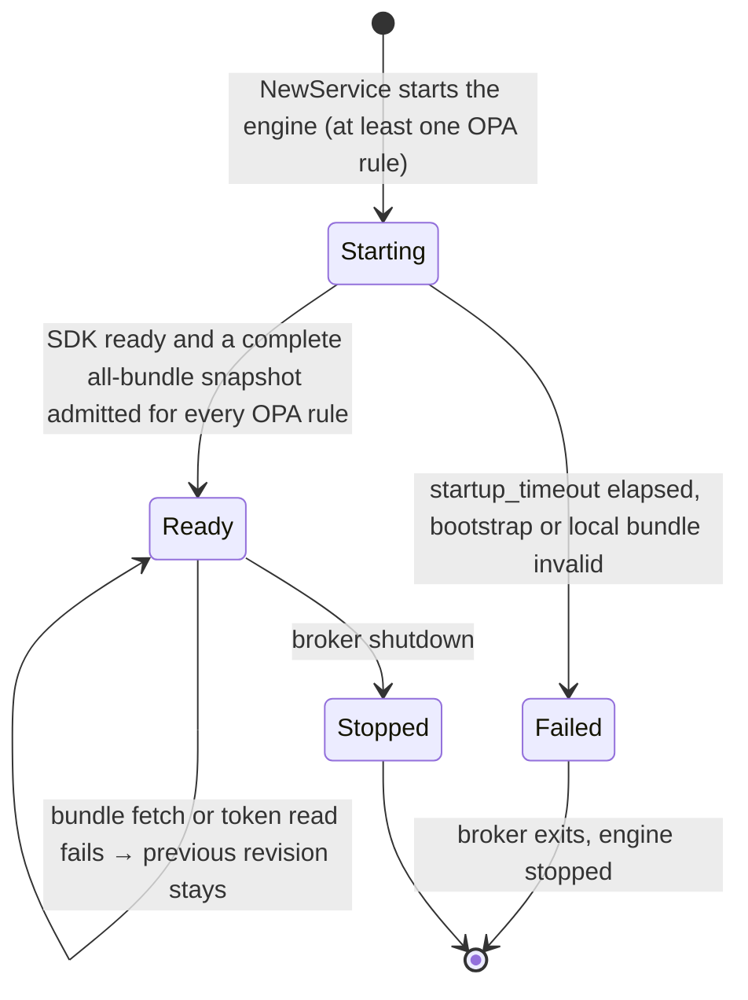

# Data model: OPA policies for impersonation authorization

**Feature**: `specs/20261120-153502-opa-impersonation-authorization` | **Research**: [research.md](research.md)

No persisted entity, aggregate, repository, migration, or typed entity ID is added. Agent and
UserGrant are unchanged. All new concepts are configuration or request-local value objects.

## Value objects

### Impersonation Rule (extended)

| Field | Type | Rules |
| --- | --- | --- |
| `authorization.type` | `cel` \| `opa` | Exactly one engine; unknown fails startup |
| `authorization.cel` | CEL block | Required for `cel`; empty for `opa` |
| `authorization.opa` | OPA rule decision | Optional for `opa` (defaults apply); empty for `cel` |
| Binding requirements | derived set of policy roles | CEL rules only, unchanged: `subject_token` if `roles.subject.verification: none`; each role with `audience_requirement: absent`. OPA rules have none (R5 withdrawn) |

Ordering, first-match semantics, roles, trusted issuers, and `allowed_subject_categories` are
unchanged. Contract: [contracts/impersonation-opa-config.yaml](contracts/impersonation-opa-config.yaml).

### OPA Engine (configuration, `impersonation.opa`)

One per deployment, shared by every OPA rule (R11). Required when a rule selects `opa`; when none
does, an absent block or `{}` is accepted and any populated key fails startup.

| Field | Type | Default | Validation |
| --- | --- | --- | --- |
| `policy.config_file` | path | — | Managed mode. Exactly one of `config_file` and `path`. Absolute; regular file opened through an `os.Root` over its own directory, at most 1 MiB; bootstrap subset (R3, R16) |
| `policy.path` | path | — | Local mode (R15). Absolute bundle directory, read once through an `os.Root` over itself; at most 16 MiB and 1,000 files |
| `startup_timeout` | duration | `30s` | `1s`–`5m` |

### OPA Rule Decision (configuration, `rules[].authorization.opa`)

| Field | Type | Default | Validation |
| --- | --- | --- | --- |
| `package` | Rego package path | `aib.broker.impersonation` | Identifier segments |
| `decision` | Rego identifier | `result` | Identifier |
| `evaluation_timeout` | duration | `100ms` | `10ms`–`5s` |

Any other key fails startup, including the former reserved `policy_url` and `policy_path`.

### Impersonation Policy Input

Request-local document described in [contracts/policy-input-decision.md § 1](contracts/policy-input-decision.md#1-input-document).
Built from validated claim maps, `subject_unverified`, the CEL `request` map, the configured public
URL, filtered transport metadata, Envoy's `version`, `parsed_query`, and `parsed_body` (the parsed form
body without the credential-bearing OAuth parameters `client_assertion`, `actor_token`, `subject_token`, `client_secret`, `refresh_token`, `code`, and `code_verifier`), the constant `type: "impersonation"`, and the resolved broker
Agent as `context.agent {id, canonical_id?, external_id?}` (unset IDs omitted). The `agent` shape and
the reserved members follow ExtProc's Grant Context (contract § 1.1). Raw credentials are excluded, but identity claims remain sensitive. `LogValue`, `String`,
and `GoString` return only `[REDACTED]`; full data is used only for evaluation. Never persisted,
logged, or exported. Shared broker/ExtProc vectors verify the common Envoy envelope semantics.

### Impersonation Policy Decision

| Value | Effect |
| --- | --- |
| `allow` | Rule predicate satisfied |
| `deny` | Rule non-match, later rules evaluated |
| invalid (undefined, malformed, other action) | Terminal `500`, `opa_decision_invalid` |
| failure (error, timeout, cancellation) | Internal terminal `500`, `opa_evaluation_failed`; disconnected callers cannot observe the HTTP response |

### Policy/Data Revision

An immutable snapshot owned by the shared OPA engine. It holds one prepared query per OPA rule, all
built from the same modules and data.

| Field | Meaning |
| --- | --- |
| Prepared queries | One per OPA rule, compiled from the activation's modules with restricted capabilities |
| Data snapshot | Copy of the data document at that activation |
| Label | `policy_revision`: sorted `<bundle>=<manifest revision>` list; operator label, not snapshot identity |
| Admission ID | `policy_admission_id`: process-instance UUID and the engine's successful-admission sequence; log/audit only |
| Bundle completeness | Managed mode: configured and activated bundle-name sets read with modules/data from the same transaction; every configured bundle required before any admission. Local mode: the one directory |
| Admitted at | Time of admission, for the age gauge |

A CEL rule has one static revision built from its compiled predicate. It keeps the existing
`References` and `Binds` startup checks.

## State transitions (shared OPA engine)

A candidate is admitted only if every OPA rule's decision rule exists; a rejection applies to all
rules.



Candidate rejection reasons: `compile_failed`, `prohibited_builtin`, `decision_absent`,
`snapshot_failed`, `bundles_incomplete`. `decision_absent` means no rule matches the decision ref by
exact rule lookup in the candidate's compiler; a decision that exists but is undefined for a request
is the runtime `invalid` outcome above. No partial initial snapshot is admitted even if it evaluates successfully;
completeness of an earlier candidate cannot be combined with historical activation of other bundles.

## Per-request use

```mermaid
sequenceDiagram
    participant H as Token handler
    participant S as impersonation.Service
    participant R as Engine revision (one read per request)
    H->>S: Impersonate(request + HTTP attributes, target)
    S->>R: current()
    loop each rule in order
        S->>S: validate credentials, extract identities
        S->>S: classify subject (CEL: sub binding; OPA: exact target UUID)
        S->>S: check category eligibility and cross-agent rule
        S->>S: extract email if signed, CEL-bound, or on an OPA rule
        S->>R: evaluate(rule, input) (OPA rules; CEL rules use their predicate)
        alt allow
            S->>S: human delegation (human only), mint token
        else deny
            S->>S: next rule
        else invalid or failure
            S-->>H: 500 server_error (abort)
        end
    end
```

## Glossary additions (`ARCHITECTURE.md`)

| Term | Definition |
| --- | --- |
| **Impersonation Policy Engine** | The engine one impersonation rule selects for its authorization decision: `cel` or `opa`. |
| **Policy/Data Revision** | An immutable, all-configured-bundle admitted snapshot of the shared OPA engine's compiled policy and data, with a broker admission identifier distinct from operator labels. Admitted only if every OPA rule's decision rule exists. Each request uses one revision for all its OPA rules. |
| **Impersonation OPA Engine** | The one OPA runtime (`impersonation.opa`) shared by every OPA rule, loading either managed bundles through a Policy Bootstrap or a local bundle directory read at startup. |
| **Policy Bootstrap** | The contained OPA-native configuration file of the Impersonation OPA Engine, limited to `services`, `bundles`, `keys`, `labels`, and the broker's `aib_bearer_token_file` credential plugin, with no OPA-native local-file references. |

Existing glossary entries must also be restated (T008): Impersonation Rule selects exactly one CEL
or OPA authorization; Subject Category classifies an unverified exact-target subject as agent on an
OPA rule, and on a CEL rule only with the predicate's `subject_token.sub` binding. Agent-Subject
Token keeps its CEL third-party detector, but distinguishes that detector from issuance binding
controls, which apply to CEL rules only. Update the same terminology in the root `AGENTS.md` Domain Glossary.
