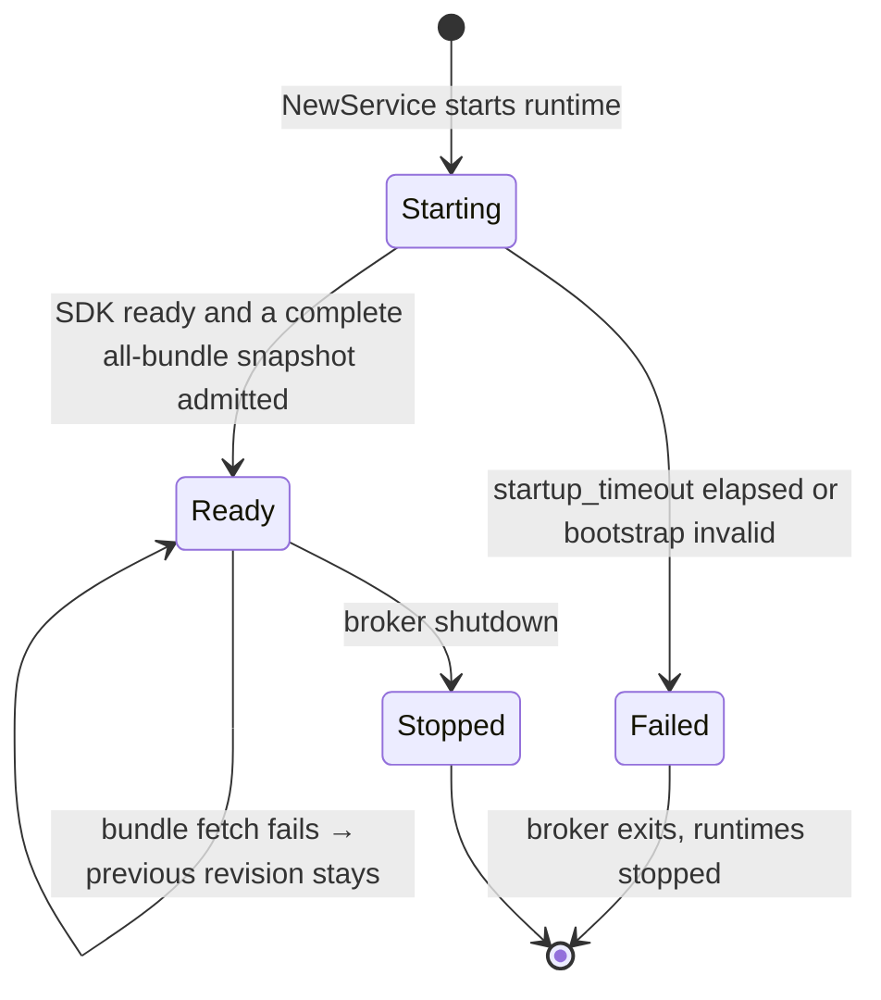
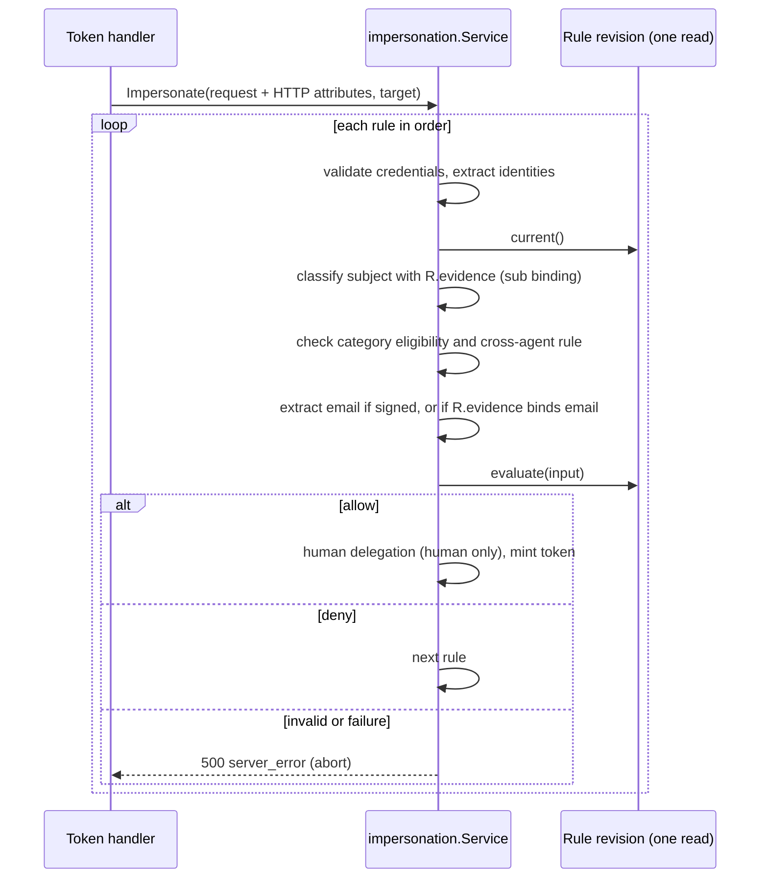

# Data model: OPA policies for impersonation authorization

**Feature**: `specs/20261120-153502-opa-impersonation-authorization` | **Research**: [research.md](research.md)

No persisted entity, aggregate, repository, migration, or typed entity ID is added. Agent and
UserGrant are unchanged. All new concepts are configuration or request-local value objects.

## Value objects

### Impersonation Rule (extended)

| Field | Type | Rules |
| --- | --- | --- |
| `authorization.type` | `cel` \| `opa` | Exactly one engine; unknown fails startup |
| `authorization.cel` | CEL block | Required for `cel`; empty for `opa` |
| `authorization.opa` | OPA authorization | Required for `opa`; empty for `cel` |
| Binding requirements | derived set of policy roles | `subject_token` if `roles.subject.verification: none`; each role with `audience_requirement: absent` |

Ordering, first-match semantics, roles, trusted issuers, and `allowed_subject_categories` are
unchanged. Contract: [contracts/impersonation-opa-config.yaml](contracts/impersonation-opa-config.yaml).

### OPA Authorization (configuration)

| Field | Type | Default | Validation |
| --- | --- | --- | --- |
| `policy.config_file` | path | — | Absolute under `security.trust_material_dir`, regular file opened through `os.Root`, at most 1 MiB; bootstrap subset with no SDK-local-file references (R3) |
| `policy.package` | Rego package path | — | Required, identifier segments |
| `policy.decision` | Rego identifier | `result` | Identifier |
| `evaluation_timeout` | duration | `100ms` | `10ms`–`5s` |
| `startup_timeout` | duration | `30s` | `1s`–`5m` |

### Impersonation Policy Input

Request-local document described in [contracts/policy-input-decision.md § 1](contracts/policy-input-decision.md#1-input-document).
Built from validated claim maps, `subject_unverified`, the CEL `request` map, the configured public
URL, filtered transport metadata, the constant `type: "impersonation"`, and the resolved broker
Agent as `context.agent {id, canonical_id?, external_id?}` (unset IDs omitted). The `agent` shape and
the reserved members follow ExtProc's Grant Context (contract § 1.1). Raw credentials are excluded, but identity claims remain sensitive. `LogValue`, `String`,
and `GoString` return only `[REDACTED]`; full data is used only for evaluation. Never persisted,
logged, or exported. Shared broker/ExtProc vectors verify the common Envoy envelope semantics.

### Impersonation Policy Decision

| Value | Effect |
| --- | --- |
| `allow` | Rule predicate satisfied |
| `deny` | Rule non-match, later rules evaluated |
| invalid (undefined, malformed, other action) | Terminal `500`, `opa_decision_invalid` |
| failure (error, timeout, cancellation) | Internal terminal `500`, `opa_evaluation_failed`; disconnected callers cannot observe the HTTP response |

### Policy/Data Revision

An immutable snapshot owned by one OPA rule's policy source.

| Field | Meaning |
| --- | --- |
| Prepared query | Compiled from the activation's modules with restricted capabilities |
| Data snapshot | Copy of the data document at that activation |
| Evidence | Role references and `sub`/`email` field bindings from the reachable decision graph |
| Label | `policy_revision`: sorted `<bundle>=<manifest revision>` list; operator label, not snapshot identity |
| Admission ID | `policy_admission_id`: process-instance UUID and per-rule successful-admission sequence; log/audit only |
| Bundle completeness | Configured and activated bundle-name sets read with modules/data from the same transaction; every configured bundle required before any admission |
| Admitted at | Time of admission, for the age gauge |

A CEL rule has one static revision built from its compiled predicate. Its evidence uses the existing
`References` and `Binds` results.

### Binding Evidence

| Field | Meaning |
| --- | --- |
| References | Set of `client_assertion`, `actor_token`, `subject_token` referenced by the decision |
| Field bindings | Subset of `subject_token.sub`, `subject_token.email` (other fields are not recorded) |

## State transitions (one OPA rule)

Candidate rejection reasons: `compile_failed`, `prohibited_builtin`, `decision_undefined`,
`binding_missing`, `evidence_voided` (only when a requirement exists), `snapshot_failed`,
`bundles_incomplete`. No partial initial snapshot is admitted even if it evaluates successfully;
completeness of an earlier candidate cannot be combined with historical activation of other bundles.

## Per-request use

## Glossary additions (`ARCHITECTURE.md`)

| Term | Definition |
| --- | --- |
| **Impersonation Policy Engine** | The engine one impersonation rule selects for its authorization decision: `cel` or `opa`. |
| **Policy/Data Revision** | An immutable, all-configured-bundle admitted snapshot of an OPA rule's compiled policy, data, and binding evidence, with a broker admission identifier distinct from operator labels. Each rule evaluation uses one revision. |
| **Binding Evidence** | The token-map references and `sub`/`email` field bindings of a rule's authorization, computed from the compiled CEL predicate or the reachable Rego decision graph. Mandatory references gate startup and every OPA activation. |
| **Policy Bootstrap** | The contained OPA-native configuration file of an OPA rule, limited to `services`, `bundles`, `keys`, and `labels` with no SDK-local-file references. |

Existing glossary entries must also be restated (T007): Impersonation Rule selects exactly one CEL
or OPA authorization with Binding Evidence; Subject Category uses the captured revision's
`subject_token.sub` evidence for unverified exact-target classification. Agent-Subject Token keeps
its CEL third-party detector, but distinguishes that detector from engine-neutral issuance binding
controls. Update the same terminology in the root `AGENTS.md` Domain Glossary.
