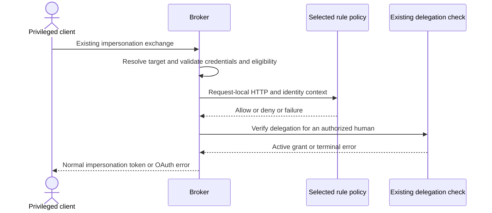

# Feature Specification: OPA policies for impersonation authorization

**Feature Branch**: `speckit/issue-518`

**Created**: 2026-11-20

**Status**: Draft

**Input**: User description:

> Add Open Policy Agent as policy engine in impersonation authorization
>
> # Description
>
> We so far support CEL in the authorization rule of token exchange. If you want to use dynamic external data or re-use company Rego policies, this falls short. Examples for rules are to check that an agent is registered in another governance system, is attributed to a specific application in a CMDB or similar.
>
> The configuration [already supports ](https://agenticidentitybroker.dev/docs/configuration#agent-subject-detection-for-third-party-exchange) the impersonations.rules[_].authorization.cel path, this should introduce impersonations.rules[_].authorization.opa with a bootstrap config for open policy agent similar to the one done for ExtProc. The input object should be Envoy OPA plugin compatible but also provide the same context semantically that we provide via CEL.
>
> Related to #458

## User Scenarios & Testing *(mandatory)*

### User Story 1 - Enforce organizational governance before issuing a token (Priority: P1)

A broker operator selects Open Policy Agent (OPA) for an impersonation rule so the organization's Rego policy can check agent registration and application ownership against governance data. A privileged client obtains a token only when that policy and all existing impersonation controls permit it.

**Why this priority**: External governance checks are the feature's primary value; the broker must not issue tokens merely because credentials are valid.

**Independent Test**: Configure one OPA-backed rule and submit otherwise-valid impersonation requests for an approved agent and an unregistered agent. Only the approved request receives a token.

**Acceptance Scenarios**:

1. **Scenario 1.1 — Approved agent**: **Given** a signed human-subject request with active delegation, a registered target agent, and governance data associating that agent with application `inventory-api`, **When** the configured policy allows the request, **Then** the broker issues its normal impersonation token with the existing subject, target agent, actor attribution, and requested permitted scope.
2. **Scenario 1.2 — Governance denial**: **Given** valid credentials and active delegation but governance data marking the target agent unregistered, with no later rule permitting the request, **When** the client requests impersonation, **Then** the broker returns `403 access_denied` and issues no token.
3. **Scenario 1.3 — Existing controls remain authoritative**: **Given** a policy that would allow the request but an otherwise-valid human request without active delegation, **When** the client requests impersonation, **Then** the broker returns the existing delegation denial and consent recovery URL, with no token.
4. **Scenario 1.4 — Signed self-agent**: **Given** an OPA rule explicitly allowing agent subjects, a verified signed subject whose raw `sub` exactly equals the audience-selected target UUID, and no human delegation, **When** governance policy permits that agent, **Then** the broker issues its existing agent-subject token with target-derived `sub == agent_id`, preserves actor attribution, and creates no human grant or session.

### User Story 2 - Reuse policy input conventions without losing identity context (Priority: P1)

A policy author reuses Envoy-compatible request predicates alongside checks on the client assertion, actor, subject, and resolved target. The author can distinguish verified credentials from explicitly unverified subject data rather than confusing transport information with identity evidence.

**Why this priority**: Reusing policies is valuable only if the broker supplies complete, correctly trusted context.

**Independent Test**: Submit a request to a policy that checks both the HTTP method/path through Envoy-compatible fields and every impersonation context value through the broker extension.

**Acceptance Scenarios**:

1. **Scenario 2.1 — Context parity**: **Given** signed credentials with distinct client, actor, and subject claims and a resolved target agent, **When** a policy checks the Envoy-compatible HTTP fields and broker context described below, **Then** it observes the same claim values, JSON value types, verification indicator, and exchange parameters as equivalent CEL authorization and permits the request only when they all match.
2. **Scenario 2.2 — Untrusted transport cannot replace identity**: **Given** a valid request with a caller-provided identity-looking HTTP header and a policy requiring a different verified client identity, **When** the client submits the request, **Then** the header cannot overwrite verified context, authorization is denied, and no token is issued.

### User Story 3 - Apply managed policy and data changes safely (Priority: P2)

An operator uses an OPA bootstrap configuration, comparable to ExtProc's existing OPA configuration, to load organizational policies and data. Changes delivered through that configured policy management path affect subsequent decisions without rebuilding the broker.

**Why this priority**: Dynamic governance data distinguishes this feature from static claim predicates, but must never introduce an allow-on-error path.

**Independent Test**: Start with a managed policy/data revision that allows an agent, activate a second revision that revokes it, and repeat the same valid exchange. Also exercise unavailable and invalid decisions.

**Acceptance Scenarios**:

1. **Scenario 3.1 — Governance update**: **Given** an active revision allowing the target agent, **When** an updated revision marking it unregistered becomes active through the configured OPA bootstrap, **Then** the next otherwise-identical exchange is denied without a broker restart or rebuild.
2. **Scenario 3.2 — Runtime failure**: **Given** a selected OPA rule followed by an otherwise-permissive rule, **When** its evaluation errors, times out, is cancelled, or returns an undefined or malformed decision, **Then** the broker returns `500 server_error`, issues no token, and does not fall through to the permissive rule.
3. **Scenario 3.3 — Unusable startup configuration**: **Given** a selected OPA rule whose bootstrap file is missing or invalid, or whose initial policy cannot become ready within the configured startup bound, **When** the operator starts the broker, **Then** startup fails with a credential-free diagnostic identifying the rule and configuration field; token requests are not served using an implicit allow policy.

### User Story 4 - Adopt OPA one rule at a time (Priority: P2)

An operator retains existing CEL rules while opting individual impersonation rules into OPA. Policy selection does not alter claim extraction, token claims, or unrelated third-party token exchange.

**Why this priority**: Operators need an additive migration rather than a broker-wide policy-engine replacement.

**Independent Test**: Use an ordered list containing both engines and compare CEL-only requests with their pre-feature outcomes.

**Acceptance Scenarios**:

1. **Scenario 4.1 — Ordered mixed rules**: **Given** a first rule whose OPA policy returns an explicit deny and a later CEL rule authorizing the same validated request, **When** the client requests impersonation, **Then** the later rule may authorize under its own validation and eligibility checks, preserving existing first-match semantics.
2. **Scenario 4.2 — Existing CEL behavior**: **Given** an unchanged valid CEL-only deployment, **When** the client exercises allowed and denied impersonation requests and ordinary third-party exchange, **Then** the existing observable outcomes remain unchanged and no OPA bootstrap is required.
3. **Scenario 4.3 — Ambiguous selection rejected**: **Given** an impersonation rule with an unknown engine, both engine configurations populated, or missing configuration for its selected engine, **When** the broker starts, **Then** it fails startup with a rule-specific configuration error rather than choosing an engine implicitly.

### Edge Cases

- A policy's explicit deny is a non-match; an evaluation failure is terminal. They must not be conflated.
- An OPA allow cannot authorize invalid signatures, disallowed algorithms, wrong issuers/audiences, expired credentials, forbidden scopes, category-ineligible subjects, cross-agent representation, or a missing human delegation.
- Optional claims remain absent rather than being invented or coerced. Claim arrays, booleans, numbers, and nested objects retain their meaning.
- Impersonation rejects `resource`; policy context still includes its existing empty-string value rather than repurposing it as the routing audience.
- No valid initial policy/data revision means no readiness. A failed later update must not partially activate a policy/data revision. Continued use of the last successfully activated revision must be documented distinctly from an evaluation failure; a new request must never reuse a previous request's allow decision.
- A slow external dependency must not evade the evaluation deadline. External data acquisition and freshness guarantees remain subject to Q1 below.
- Unsigned subjects, caller-controlled email, audience-absent credentials, and unverified agent classification depend on startup-enforced predicate binding today. OPA must not silently bypass those checks; their support boundary remains Q2 below.
- ExtProc's `approval_required` action, response-header mutation, and MCP tool parsing do not authorize issuance of an impersonation token.

## Concrete Example Journeys *(mandatory)*

### Journey 1 — Permit only a governed agent (User Story 1, Scenarios 1.1–1.4; User Story 2, Scenarios 2.1–2.2)

**Cast and initial state**: Broker `https://broker.example.com` runs in local mode. Registered agent `550e8400-e29b-41d4-a716-446655440000` belongs to application `inventory-api` in the organization's governance data and permits scope `read`. Human `alice@example.com` has an active UserGrant for that agent. Privileged client `gateway-1` and actor `automation-worker` use issuer `https://identity.example.com`. All times and credentials below are synthetic; the clock is 2026-11-20 09:00:00 UTC.

**Step 1 — Operator selects OPA for this rule.** Other normal broker settings are omitted. The OPA subsection is the proposed feature contract, not a claim that the currently reserved broker OPA fields already work. The canonical existing prefix is singular `oauth2_authorization_server.impersonation`, despite the issue's informal `impersonations` spelling.

```yaml
oauth2_authorization_server:
  mode: local
  local:
    token_ttl: 1h
    token_claims_expression: '{"aud": ["https://inventory.example.com"]}'
  impersonation:
    audience_prefix: https://broker.example.com/impersonate
    rules:
      - name: governed-inventory
        allowed_subject_categories: [human]
        roles:
          client_assertion:
            expected_audience: https://broker.example.com/oauth2/token
            principal_expression: client_assertion.sub
          actor:
            expected_audience: broker-impersonation
            principal_expression: actor_token.sub
          subject:
            expected_audience: broker-impersonation
            principal_expression: subject_token.sub
        trusted_issuers:
          - issuer_uri: https://identity.example.com
            jwks_uri: https://identity.example.com/jwks.json
            allowed_algorithms: [RS256]
            signs_roles: [client_assertion, actor, subject]
        authorization:
          type: opa
          opa:
            policy:
              config_file: /etc/broker/opa/bootstrap.yaml
              package: company.impersonation
              decision: result
            evaluation_timeout: 100ms
```

The bootstrap uses the same OPA-native configuration vocabulary as ExtProc's managed-policy mode; a minimal illustrative bootstrap is:

```yaml
services:
  governance:
    url: https://policies.example.com
bundles:
  impersonation:
    service: governance
    resource: bundles/impersonation.tar.gz
```

The bundle supplies `company.impersonation.result` and governance data. Its business rule requires method `POST`, path `/oauth2/token`, verified client `gateway-1`, actor `automation-worker`, and an approved registration for `request.agent_id` assigned to `inventory-api`. The decision is `{"action":"allow"}` only when all checks pass; otherwise it is `{"action":"deny"}`. Bundle authentication, update cadence, and data freshness are operator-owned bootstrap settings, not credentials embedded in this example. Runtime external lookups are not implied by this bundle example (Q1).

**Step 2 — Client submits the exchange.** `SYNTHETIC_CLIENT_JWT`, `SYNTHETIC_ACTOR_JWT`, and `SYNTHETIC_SUBJECT_JWT` denote test-issued signed JWTs, not literal wire-valid tokens. All use decoded header `{"alg":"RS256","kid":"identity-test-key","typ":"JWT"}` and have these decoded claims:

```json
{
  "SYNTHETIC_CLIENT_JWT": {
    "iss": "https://identity.example.com", "sub": "gateway-1",
    "aud": "https://broker.example.com/oauth2/token",
    "iat": 1795165140, "exp": 1795168800
  },
  "SYNTHETIC_ACTOR_JWT": {
    "iss": "https://identity.example.com", "sub": "automation-worker",
    "aud": "broker-impersonation", "iat": 1795165140, "exp": 1795168800
  },
  "SYNTHETIC_SUBJECT_JWT": {
    "iss": "https://identity.example.com", "sub": "alice@example.com",
    "aud": "broker-impersonation", "iat": 1795165140, "exp": 1795168800
  }
}
```

```http
POST /oauth2/token HTTP/1.1
Host: broker.example.com
Content-Type: application/x-www-form-urlencoded

grant_type=urn%3Aietf%3Aparams%3Aoauth%3Agrant-type%3Atoken-exchange&audience=https%3A%2F%2Fbroker.example.com%2Fimpersonate%2F550e8400-e29b-41d4-a716-446655440000&scope=read&client_assertion_type=urn%3Aietf%3Aparams%3Aoauth%3Aclient-assertion-type%3Ajwt-bearer&client_assertion=SYNTHETIC_CLIENT_JWT&actor_token_type=urn%3Aietf%3Aparams%3Aoauth%3Atoken-type%3Ajwt&actor_token=SYNTHETIC_ACTOR_JWT&subject_token_type=urn%3Aietf%3Aparams%3Aoauth%3Atoken-type%3Ajwt&subject_token=SYNTHETIC_SUBJECT_JWT

```

**Step 3 — Policy evaluates the validated context.** The broker's input has an Envoy-compatible request envelope plus a namespaced extension. This is a relevant-field excerpt: each credential map contains the complete decoded claims shown in Step 2, not just its subject.

```json
{
  "attributes": {
    "request": {
      "http": {
        "method": "POST",
        "path": "/oauth2/token",
        "scheme": "https",
        "host": "broker.example.com",
        "headers": {"content-type": "application/x-www-form-urlencoded"}
      }
    }
  },
  "context": {
    "client_assertion": {"sub": "gateway-1"},
    "actor_token": {"sub": "automation-worker"},
    "subject_token": {"sub": "alice@example.com"},
    "subject_unverified": false,
    "request": {
      "resource": "",
      "grant_type": "urn:ietf:params:oauth:grant-type:token-exchange",
      "scope": "read",
      "agent_id": "550e8400-e29b-41d4-a716-446655440000"
    }
  }
}
```

Envoy compatibility concerns field shapes and meanings, not forwarding credentials. The credential-bearing form body, raw token strings, cookies, and authorization headers are not policy input. The verified claim maps are sensitive policy inputs, not material for decision logs. Caller headers cannot populate or overwrite `context`.

**Step 4 — Client receives the response and normal claims.** The response to Step 2 is:

```http
HTTP/1.1 200 OK
Content-Type: application/json
Cache-Control: no-store
Pragma: no-cache

{"access_token":"SYNTHETIC_BROKER_JWT","issued_token_type":"urn:ietf:params:oauth:token-type:access_token","token_type":"Bearer","expires_in":3600,"scope":"read"}
```

`SYNTHETIC_BROKER_JWT` has a normal broker signing header, illustrated by `{"alg":"RS256","kid":"broker-test-key","typ":"JWT"}`, and these relevant decoded claims:

```json
{
  "iss": "https://broker.example.com",
  "sub": "alice@example.com",
  "aud": ["https://inventory.example.com"],
  "iat": 1795165200,
  "exp": 1795168800,
  "agent_id": "550e8400-e29b-41d4-a716-446655440000",
  "act": {"iss": "https://identity.example.com", "sub": "automation-worker"},
  "scope": "read"
}
```

The local token-claims policy, not OPA and not the routing audience, supplies `aud`.

**Step 5 — Denied variants use the same request.** For Scenario 1.2, mark the governance registration unapproved and activate that data. For Scenario 2.2, require client `gateway-2` in policy but add `X-Client-Identity: gateway-2` to the request while keeping the signed client subject `gateway-1`. With no later authorizing rule, either request returns:

```http
HTTP/1.1 403 Forbidden
Content-Type: application/json

{"error":"access_denied","error_description":"impersonation not permitted"}
```

For Scenario 1.3, restore the allowing policy/data but remove Alice's delegation. The same request returns the existing recovery response rather than letting an OPA allow bypass consent:

```http
HTTP/1.1 403 Forbidden
Content-Type: application/json

{"error":"access_denied","error_description":"user delegation is required before impersonation","error_uri":"https://broker.example.com/agents/550e8400-e29b-41d4-a716-446655440000"}
```

Descriptions illustrate credential-free summaries, not new stable diagnostic identifiers.

**Step 6 — Signed self-agent variant (Scenario 1.4).** The operator sets `allowed_subject_categories: [agent]` on this rule. The client uses a signed subject JWT with the same header, issuer, audience, and times as Step 2, but `sub` is `550e8400-e29b-41d4-a716-446655440000`. It sends the same form request with that replacement `subject_token`. Governance still approves the target for `inventory-api`; there is no corresponding human grant. The response is the same `200` envelope as Step 4 with marker `SYNTHETIC_AGENT_BROKER_JWT`. Its header is the same broker header and its relevant decoded claims are:

```json
{
  "iss": "https://broker.example.com",
  "sub": "550e8400-e29b-41d4-a716-446655440000",
  "aud": ["https://inventory.example.com"],
  "iat": 1795165200,
  "exp": 1795168800,
  "agent_id": "550e8400-e29b-41d4-a716-446655440000",
  "act": {"iss": "https://identity.example.com", "sub": "automation-worker"},
  "scope": "read"
}
```

No category claim, human grant, or human session is created. This signed, expected-audience flow does not depend on Q2's exceptional-credential decision.

**Observable result**: Alice's approved delegated request and the explicitly eligible signed self-agent request obtain correctly attributed tokens; a governance denial or spoofed transport identity cannot obtain one, and missing human delegation retains its established recovery flow.

### Journey 2 — Change governance without a broker release (User Story 3, Scenarios 3.1–3.3)

1. The operator starts Journey 1's configuration with bootstrap revision `r1`, which approves the target for `inventory-api`. The Step 2 request succeeds with the displayed `200` response and decoded claims.
2. The governance team publishes revision `r2`, marking the same agent unregistered. Once `r2` is activated, the identical Step 2 request receives the displayed `403 access_denied` response. No restart, token-claims change, or client change is needed. This changes future issuance, not the validity of already-issued tokens.
3. As a separate failure variant, the decision is undefined, malformed, or exceeds `100ms`. Even if a later rule could allow it, the same request receives the following response and no access token:

   ```http
   HTTP/1.1 500 Internal Server Error
   Content-Type: application/json

   {"error":"server_error","error_description":"authorization evaluation failed"}
   ```

4. As a startup variant, the operator changes `authorization.opa.policy.config_file` to a nonexistent file, supplies invalid bootstrap content, or provides no usable initial policy within the startup bound. The process exits unsuccessfully with the rule and field identified; there is no token response because this broker does not become ready.

**Observable result**: Activated governance updates change issuance decisions, while unavailable authorization never becomes permission.

### Journey 3 — Migrate a rule while keeping CEL behavior (User Story 4, Scenarios 4.1–4.3)

1. The operator retains Journey 1's credentials, issuer settings, and delegation. They add a later rule named `legacy-approved-client` with the same roles and trust anchors, but with this authorization block:

   ```yaml
   authorization:
     type: cel
     cel:
       expression: 'client_assertion.sub == "gateway-1"'
       evaluation_timeout: 100ms
   ```

2. The first, OPA-backed rule explicitly denies Journey 1's request. The later CEL rule independently validates and authorizes it. The client receives Journey 1's normal `200` response and token claims. This is intentional ordered-rule behavior: an operator seeking a universal governance restriction must apply it to every rule that could permit the request.
3. In a separate CEL-only deployment, the operator removes the OPA rule and bootstrap entirely. The existing allowed/denied requests and ordinary third-party exchanges keep their established outcomes; no OPA management connection is made.
4. As an invalid-configuration variant, the operator populates both `authorization.cel` and `authorization.opa` on one rule or chooses an unknown type. Startup fails naming that rule and field; the operator must select exactly one engine.

**Observable result**: Migration is per rule, existing selection semantics remain explicit, and invalid combinations cannot silently change authorization.

## Requirements *(mandatory)*

### Functional Requirements

- **FR-001**: Operators MUST be able to select OPA through `oauth2_authorization_server.impersonation.rules[].authorization.type: opa` and configure it under that rule's `authorization.opa`. Existing valid CEL rules MUST continue to work without OPA configuration.
- **FR-002**: Exactly one selected authorization engine MUST decide each evaluated rule. Unknown types, conflicting populated engine blocks, and missing selected-engine configuration MUST fail startup with an indexed rule/field diagnostic.
- **FR-003**: OPA configuration MUST accept an OPA-native bootstrap configuration file comparable to ExtProc's managed-policy configuration, including managed policy/data bundles and a selected decision document. Invalid configuration or no usable initial policy within a bounded startup interval MUST prevent readiness.
- **FR-004**: A successfully activated managed policy/data update MUST affect subsequent evaluations without rebuilding or restarting the broker. Updates MUST activate consistently; the broker MUST NOT reuse a previous request's allow decision.
- **FR-005**: The input MUST provide the Envoy OPA plugin-compatible `attributes.request.http` envelope for the token endpoint request and the namespaced `context` fields in Journey 1. For each existing CEL variable `v` among `client_assertion`, `actor_token`, `subject_token`, `subject_unverified`, and `request`, `input.context.v` MUST preserve the same semantics and value types. This does not promise identical policy syntax between CEL and Rego.
- **FR-006**: Policy context MUST be derived from the same validated per-rule credentials and resolved target used by CEL, not raw request-supplied identity headers. The `request` extension MUST preserve `resource`, `grant_type`, `scope`, and target UUID `agent_id`; it MUST NOT confuse the routing audience with the minted token audience.
- **FR-007**: A well-formed `{"action":"allow"}` decision MUST satisfy only the selected rule's authorization predicate. `{"action":"deny"}` MUST act as an explicit policy non-match. Other action values, missing/undefined decisions, malformed output, evaluation errors, cancellation, and timeouts MUST issue no token and terminate the request with `500 server_error`, without fallback to another rule or engine. ExtProc approval actions and response mutations are outside this decision contract.
- **FR-008**: Ordered first-match rules, per-rule credential validation and extraction, category eligibility, human delegation, target/scope validation, and local token issuance MUST retain their established behavior. OPA MUST NOT select the minted subject, alter reserved token claims, or bypass a terminal delegation failure.
- **FR-009**: CEL MUST remain the engine for role principal/email extraction, local token-claims expressions, and existing third-party agent-subject detection. This feature MUST NOT enable OPA for ordinary third-party exchange or proxy/hybrid impersonation.
- **FR-010**: OPA evaluations MUST have a bounded, cancellation-aware timeout (proposed default `100ms`, valid range `10ms`–`5s`, matching the existing impersonation evaluation range). Failure MUST NOT fall back to allow.
- **FR-011**: Operators MUST receive documentation for configuration, the full input/decision contract, credential exclusions, bundle readiness/update behavior, and equivalent CEL/Rego governance examples. Broker examples and the broker Helm configuration contract MUST expose the approved parameters through the normal broker configuration system.
- **FR-012**: Dynamic external-data acquisition MUST satisfy the approved answer to Q1; the specification does not silently authorize arbitrary runtime network access from policies.
- **FR-013**: OPA rules using unsigned subjects or audience-absent credentials MUST satisfy the approved answer to Q2. Existing CEL exception behavior MUST remain unchanged; unsupported OPA combinations MUST fail startup rather than lose binding controls.

### Domain Model

No new persisted entity or aggregate is required.

**Entities and existing consistency boundaries**:
- **Agent**: Existing registered target selected by the routing audience. Its UUID drives policy context and minted `agent_id`.
- **UserGrant**: Existing human delegation to the target Agent; an OPA allow cannot replace it.

**Value Objects**:
- **Impersonation Rule**: Existing ordered, self-contained authorization configuration; extended with a choice of policy engine, not a new token-exchange flow.
- **Impersonation Policy Input**: Request-local, namespaced view of HTTP metadata and the existing credential/exchange context, with verified versus unverified provenance preserved.
- **Impersonation Policy Decision**: Explicit allow or deny for one rule; a failure is distinct from deny.
- **Policy/Data Revision**: A consistently activated managed policy and data snapshot; not a new broker database record.

No new persisted domain events are required. Existing credential-free impersonation decision auditing remains mandatory.



The diagram shows the authorized human path; explicit policy denial considers later rules, evaluation failure terminates, and eligible agent subjects retain the accepted no-human-delegation path.

### Configuration Requirements

The proposed keys below extend the broker's existing singular `oauth2_authorization_server.impersonation.rules[]` hierarchy. They do not configure the standalone ExtProc workload.

| Relative key under one rule | Type | Requirement and proposed default |
| --- | --- | --- |
| `authorization.type` | enum | Existing explicit `cel` selection extended with `opa`; no implicit allow or engine selection |
| `authorization.opa.policy.config_file` | string | Required bootstrap configuration file when OPA is selected; no default path |
| `authorization.opa.policy.package` | string | Required policy package, e.g. `company.impersonation`; no implicit allow package |
| `authorization.opa.policy.decision` | string | Decision document name; proposed default `result` |
| `authorization.opa.evaluation_timeout` | duration | Proposed default `100ms`, range `10ms`–`5s`; failure is terminal |

Journey 1 shows the minimal relevant rule and bootstrap configuration. Readiness must be bounded; the exact startup-bound setting and input compatibility details will be designed in planning, not inferred from the currently reserved `policy_url`/`policy_path` fields. Those fields do not establish an implemented remote-server mode. A remote decision-service integration and an additional static policy-file mode are not required by this feature.

Approved configuration must be documented in `docs/configuration.md`, illustrated under `examples/config/` and its index, and passed through the broker Helm values/templates/documentation as required by Constitution Principle VII.

### API Requirements

- Retain `POST /oauth2/token`, the existing impersonation request parameters, successful RFC 8693 response, and existing OAuth error envelope. No new public endpoint, grant type, or header-based identity source is proposed.
- Document the selected-engine authorization behavior and failure semantics in `api/enduser/openapi.yaml` and the end-user API guide before implementation. Any observable contract change requires explicit maintainer approval; existing descriptions of CEL-only authorization must not be treated as already authorizing OPA.
- The policy input and decision contract must be reviewable before implementation, including the precise supported Envoy-compatible fields and omission of credential-bearing transport fields. Compatibility means reuse of supported field predicates, not an assurance that every Envoy policy can run unchanged.

### Security Requirements *(mandatory for security-critical features)*

- **SR-001**: Existing cryptographic verification, role trust, audience, issuer, algorithm, lifetime, extraction, category, scope, and delegation controls MUST remain active. OPA is a policy alternative within a rule, never an authentication replacement or an optional allow-on-error layer.
- **SR-002**: No startup, policy-loading, evaluation, malformed-decision, timeout, or cancellation failure may mint a token. All cryptographic and policy security primitives MUST use established libraries.
- **SR-003**: Raw JWT strings, the credential-bearing token form body, cookies, authorization headers, secrets, and unrelated broker state MUST NOT be included in policy input or authorization diagnostics. Validated claim maps supplied for policy use MUST NOT be copied into logs, spans, metrics, or OPA decision-log exports. Policy/data fetch credentials MUST NOT appear in error responses or diagnostics.
- **SR-004**: Security decisions MUST retain structured, credential-free auditing consistent with the logging and telemetry coding standards. Policy-produced reasons and external service error bodies MUST NOT be reflected as arbitrary token-endpoint error text.
- **SR-005**: Existing startup-enforced binding for unverified subjects, unverified emails, absent-audience roles, and unverified agent classification MUST NOT be replaced by an operator assertion that a policy is safe. Q2 must resolve equivalent enforceable controls or explicitly exclude those OPA combinations.
- **SR-006**: Policy/data bundles and bootstrap settings are trusted operator-managed configuration. Request callers MUST NOT choose policy sources, decision paths, or external lookup destinations. The approved external-data model must bound dependency failures and document freshness behavior.

### Key Entities

Agent, UserGrant, Impersonation Rule, Impersonation Policy Input, Impersonation Policy Decision, and Policy/Data Revision are defined above. Planning must update the `ARCHITECTURE.md` glossary and authorization-boundary description for approved changes. No database migration or frontend change is expected; no UI wireframes are applicable.

## Success Criteria *(mandatory)*

### Measurable Outcomes

- **SC-001**: In a representative acceptance set, 100% of approved and delegated requests succeed and 100% of governance-disallowed requests without another permitting rule are denied, with correct subject and actor attribution.
- **SC-002**: A policy author can express both registration and application-ownership checks using the supplied request/identity context and organizational governance data, without changing broker code.
- **SC-003**: After a revoking policy/data revision is activated, the first subsequent equivalent request is denied without a broker restart or rebuild.
- **SC-004**: Across startup, evaluation, malformed-result, timeout, and cancellation acceptance cases, zero tokens are issued because of an authorization failure, and every failure produces a credential-free operator diagnostic or protocol error as appropriate.
- **SC-005**: All existing valid CEL-only acceptance cases retain their observable outcomes without configuration changes or an OPA service dependency.
- **SC-006**: Authorization work stops within the configured evaluation bound, subject only to test-runner scheduling tolerance; a slow governance dependency cannot leave the client waiting indefinitely.

## Assumptions

- The feature description supplied to this phase is exactly the issue title, a blank line, and issue body reproduced above. Issue comments and the linked issue #458 are not requirement inputs.
- Target users are broker operators and organizational policy authors, not end users authoring arbitrary request-time policies. This is a local-mode impersonation feature, not a replacement of every CEL expression in the broker.
- Managed policy/data bundles through an OPA bootstrap are required. The exact acquisition model for dynamic external data is consequential and remains Q1, rather than silently adding unrestricted request-time network access.
- The structured allow/deny decision follows the existing ExtProc convention but excludes approval and response mutation. Exact contract design and any compatibility change require approval before implementation.
- A failed managed update retains the last complete active revision rather than partially replacing it; this does not imply a newly guaranteed maximum governance-data age. Operators' configured polling and failure/freshness policies must be documented.
- This feature does not revoke tokens already issued before governance changes. Token revocation, new admin APIs, new persistence, UI changes, MCP parsing, and remote OPA decision servers are outside scope.
- Dependencies include the existing per-rule credential validators, target resolution, local issuer, human-delegation enforcement, operator-managed policy distribution, and normal broker configuration/deployment contracts.
- Accepted `009-cel-for-authorization-policies` governs broker authorization and currently reserves OPA. Accepted `028-opa-extproc-authorization` applies to the distinct ExtProc boundary and explicitly does not replace broker CEL. Planning must propose an appropriate superseding ADR for the broker-side extension; neither this document nor issue creation accepts it.
- Accepted `031-unverified-subject-unsigned-jwt`, `034-audience-absent-impersonation-credentials`, and `045-agent-subject-impersonation` impose predicate-binding requirements. Accepted `032-impersonation-requires-user-delegation` continues to govern human delegation. Any deviation requires an approved superseding decision, not an ad-hoc OPA exception.

### Questions for clarification

#### Q1 — Dynamic external-data access

**Context**: The issue requests dynamic external data, such as a governance registry or CMDB, and an OPA bootstrap comparable to ExtProc.

[NEEDS CLARIFICATION: Must the first release support policy-time HTTP lookups against governance/CMDB services, managed policy/data bundles only, or both? If lookups are required, which destination restrictions, timeout/failure behavior, and freshness guarantees must be approved?]

| Option | Answer | Implications |
| --- | --- | --- |
| A | Managed policy/data bundles only | Governance snapshots update through the configured bootstrap; no request-time external lookup is promised. |
| B | Bundles plus policy-time lookups | Define and approve permitted external destinations, credentials, deadlines, failure handling, and freshness behavior before implementation. |
| C | Policy-time lookups are essential; bundles are optional | Direct dependency availability and egress controls become part of the primary issuance path. |
| Custom | Provide the required data acquisition and freshness model | State which sources must be consulted and when a request must deny rather than use older data. |

#### Q2 — Exceptional credential modes and predicate binding

**Context**: Existing unsigned-subject and absent-audience modes depend on compiled authorization-predicate reference checks; unverified email and agent issuance also depend on field binding. Managed Rego updates cannot silently remove these guarantees.

[NEEDS CLARIFICATION: Must OPA support unsigned subjects and audience-absent roles in this release, or may OPA reject those combinations at startup while they remain available through CEL? If support is required, approve a design that enforces the existing binding guarantees across every activated policy revision before implementation.]

| Option | Answer | Implications |
| --- | --- | --- |
| A | OPA initially supports signed, expected-audience roles only | Unsupported exceptional OPA combinations fail startup; existing CEL exception paths remain unchanged. |
| B | Include all existing exceptional credential modes | Planning must define enforceable role/field-binding checks across policy updates and obtain approval for any superseding ADR. |
| C | Include a specified subset | Name the required modes; each needs its corresponding startup and update-time security controls. |
| Custom | Provide the required support boundary and binding constraints | Preserve all existing trust controls; operator-declared safety alone is insufficient. |

These questions are an expected clarification handoff. No answer or architectural approval is inferred here.
