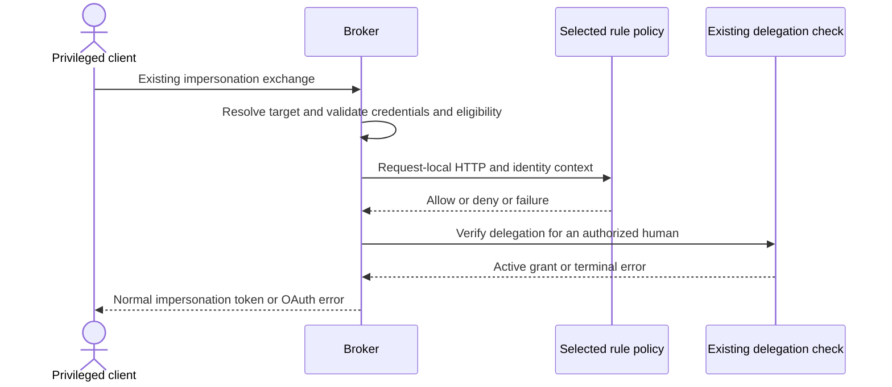

# Feature Specification: OPA policies for impersonation authorization

**Feature Branch**: `speckit/issue-518`

**Created**: 2026-11-20

**Status**: Draft

**Input**: User description:

> Add Open Policy Agent as policy engine in impersonation authorization
>
> # Description
>
> We so far support CEL in the authorization rule of token exchange. If you want to use dynamic external data or re-use company Rego policies, this falls short. Examples for rules are to check that an agent is registered in another governance system, is attributed to a specific application in a CMDB or similar.
>
> The configuration [already supports ](https://agenticidentitybroker.dev/docs/configuration#agent-subject-detection-for-third-party-exchange) the impersonations.rules[_].authorization.cel path, this should introduce impersonations.rules[_].authorization.opa with a bootstrap config for open policy agent similar to the one done for ExtProc. The input object should be Envoy OPA plugin compatible but also provide the same context semantically that we provide via CEL.
>
> Related to #458

## Clarifications

### Session 2026-11-20

- Q1: Must the first release support policy-time HTTP lookups, managed policy/data bundles only, or both? → A: (Accepted by mjungsbluth on 2026-11-21: https://github.com/zalando-incubator/agentic-identity-broker/pull/546#issuecomment-7046411159) Managed policy/data bundles only; policy-time network access is prohibited. Failed updates retain the last complete active revision, with no broker-enforced maximum revision age.
  - Rationale: Dynamic governance snapshots satisfy the requested external-data use case through the requested bootstrap mechanism without exposing credential claims to request-time network destinations or adding a new synchronous availability dependency. This resolves FR-012 and SR-006; operators own bundle polling, distribution security, and acceptable data freshness.
  - Alternative B: Support bundles plus policy-time lookups, with destination restrictions, credential protection, deadlines, and freshness controls designed and approved before implementation.
  - Alternative C: Require direct policy-time lookups and make bundles optional; governance-service availability then becomes an issuance dependency.
- Q2: Must OPA support unsigned subjects and audience-absent roles in this release? → A: Support all existing local-mode impersonation credential modes, including unsigned subjects, bound unverified email, audience-absent signed roles, and unverified agent subjects, with equivalent enforceable binding controls on every activated policy revision.
  - Maintainer direction: mjungsbluth, 2026-11-20: “on Q2, support all modes including unsigned subjects”. This replaces the earlier proposed signed-only restriction; it does not extend impersonation to proxy/hybrid mode or permit unsigned client assertions or actors.
  - Rationale: OPA must be a usable policy-engine alternative for existing impersonation deployments, not remove their supported credential modes. FR-013 and SR-005 preserve the existing compensating controls while requiring startup and managed-update enforcement; planning must propose the necessary superseding ADR before implementation. This records the scope direction, not approval of a future mechanism or ADR.

### Session 2026-11-21 (planning)

Planning resolved the items this specification left to design. Each is pending the maintainer's sign-off as the named approval item in [plan.md](plan.md#approval-items); none is an approval.

- Startup bound: the configuration table adds `authorization.opa.startup_timeout` (default `30s`, range `1s`–`5m`). Reason: FR-003 requires a bounded startup interval and this specification deferred its setting to planning (approval item API-CFG; research R7).
- Bootstrap scope: FR-003's OPA-native bootstrap accepts only the `services`, `bundles`, `keys`, and `labels` keys. Reason: decision logs, status, and discovery could export claim-bearing input or reconfigure OPA at runtime, contrary to SR-003 and SR-006 (approval item API-BOOT; research R3).
- Input envelope: FR-005's Envoy-compatible fields are fixed in [contracts/policy-input-decision.md](contracts/policy-input-decision.md), including `parsed_path` and `parsed_query`, `host` and `scheme` taken from the configured end-user public URL, and removal of credential headers. Reason: SR-003 and Scenario 2.2 require a credential-free input that callers cannot shape into identity (approval item API-INPUT; research R8).
- SR-005 mechanism: binding evidence is computed from the reachable decision graph of each candidate revision, and the proposed ADR [adr-20261121-061324-opa-impersonation-authorization.md](adr-20261121-061324-opa-impersonation-authorization.md) partly supersedes the CEL-specific controls. Network prohibition (FR-012) removes every nondeterministic OPA built-in except `time.now_ns`. Reason: SR-005 and FR-012 require a reviewable mechanism before implementation (approval items ADR-OPA, DEC-BIND, DEC-BUILTINS; research R4–R6, R13).

## User Scenarios & Testing *(mandatory)*

### User Story 1 - Enforce organizational governance before issuing a token (Priority: P1)

A broker operator selects Open Policy Agent (OPA) for an impersonation rule so the organization's Rego policy can check agent registration and application ownership against governance data. A privileged client obtains a token only when that policy and all existing impersonation controls permit it.

**Why this priority**: External governance checks are the feature's primary value; the broker must not issue tokens merely because credentials are valid.

**Independent Test**: Configure one OPA-backed rule and submit otherwise-valid impersonation requests for an approved agent and an unregistered agent. Only the approved request receives a token.

**Acceptance Scenarios**:

1. **Scenario 1.1 — Approved agent**: **Given** a signed human-subject request with active delegation, a registered target agent, and governance data associating that agent with application `inventory-api`, **When** the configured policy allows the request, **Then** the broker issues its normal impersonation token with the existing subject, target agent, actor attribution, and requested permitted scope.
2. **Scenario 1.2 — Governance denial**: **Given** valid credentials and active delegation but governance data marking the target agent unregistered, with no later rule permitting the request, **When** the client requests impersonation, **Then** the broker returns `403 access_denied` and issues no token.
3. **Scenario 1.3 — Existing controls remain authoritative**: **Given** a policy that would allow the request but an otherwise-valid human request without active delegation, **When** the client requests impersonation, **Then** the broker returns the existing delegation denial and consent recovery URL, with no token.
4. **Scenario 1.4 — Signed self-agent**: **Given** an OPA rule explicitly allowing agent subjects, a verified signed subject whose raw `sub` exactly equals the audience-selected target UUID, and no human delegation, **When** governance policy permits that agent, **Then** the broker issues its existing agent-subject token with target-derived `sub == agent_id`, preserves actor attribution, and creates no human grant or session.

### User Story 2 - Reuse policy input conventions without losing identity context (Priority: P1)

A policy author reuses Envoy-compatible request predicates alongside checks on the client assertion, actor, subject, and resolved target. The author can distinguish verified credentials from explicitly unverified subject data rather than confusing transport information with identity evidence.

**Why this priority**: Reusing policies is valuable only if the broker supplies complete, correctly trusted context.

**Independent Test**: Submit a request to a policy that checks both the HTTP method/path through Envoy-compatible fields and every impersonation context value through the broker extension.

**Acceptance Scenarios**:

1. **Scenario 2.1 — Context parity**: **Given** signed credentials with distinct client, actor, and subject claims and a resolved target agent, **When** a policy checks the Envoy-compatible HTTP fields and broker context described below, **Then** it observes the same claim values, JSON value types, verification indicator, and exchange parameters as equivalent CEL authorization and permits the request only when they all match.
2. **Scenario 2.2 — Untrusted transport cannot replace identity**: **Given** a valid request with a caller-provided identity-looking HTTP header and a policy requiring a different verified client identity, **When** the client submits the request, **Then** the header cannot overwrite verified context, authorization is denied, and no token is issued.
3. **Scenario 2.3 — Unsigned human and bound email**: **Given** an explicitly unverified subject rule, signed verified client and actor, an unsigned `alg:none` human subject, active delegation, and an OPA decision binding the subject and its email, **When** the policy permits the request, **Then** `context.subject_unverified` is `true`, the subject claims remain caller-asserted data, and the normal human token is issued with the bound email. A revision without the email binding must not enable minting that email.
4. **Scenario 2.4 — Unsigned self-agent**: **Given** an OPA rule allowing agent subjects whose decision binds `context.subject_token.sub` to the approved target UUID, and an unsigned subject with that exact raw `sub`, **When** signed client and actor validation and governance checks pass, **Then** the normal target-derived agent token is issued without a human grant or session. A different registered agent's raw `sub` or extracted principal remains ineligible without human fallback or a consent link; without the `sub` binding an unsigned exact-target subject remains human and needs human eligibility and delegation.
5. **Scenario 2.5 — Audience-absent signed roles**: **Given** an OPA rule opting each of the client assertion, actor, and signed subject roles into `audience_requirement: absent`, independently and in valid combinations, with policy references binding each opted-in role, **When** otherwise-valid signed credentials omit `aud`, **Then** the request may succeed under the normal category and delegation controls. An `aud` claim on any such role, invalid signature, or expired credential never obtains a token, even if OPA would allow.

### User Story 3 - Apply managed policy and data changes safely (Priority: P2)

An operator uses an OPA bootstrap configuration, comparable to ExtProc's existing OPA configuration, to load organizational policies and data. Changes delivered through that configured policy management path affect subsequent decisions without rebuilding the broker.

**Why this priority**: Dynamic governance data distinguishes this feature from static claim predicates, but must never introduce an allow-on-error path.

**Independent Test**: Start with a managed policy/data revision that allows an agent, activate a second revision that revokes it, and repeat the same valid exchange. Also exercise unavailable and invalid decisions.

**Acceptance Scenarios**:

1. **Scenario 3.1 — Governance update**: **Given** an active revision allowing the target agent, **When** an updated revision marking it unregistered becomes active through the configured OPA bootstrap, **Then** the next otherwise-identical exchange is denied without a broker restart or rebuild.
2. **Scenario 3.2 — Runtime failure**: **Given** a selected OPA rule followed by an otherwise-permissive rule, **When** its evaluation errors, times out, is cancelled, or returns an undefined or malformed decision, **Then** the broker returns `500 server_error`, issues no token, and does not fall through to the permissive rule.
3. **Scenario 3.3 — Unusable startup configuration**: **Given** a selected OPA rule whose bootstrap file is missing or invalid, or whose initial policy cannot become ready within the configured startup bound, **When** the operator starts the broker, **Then** startup fails with a credential-free diagnostic identifying the rule and configuration field; token requests are not served using an implicit allow policy.
4. **Scenario 3.4 — Failed managed update**: **Given** active revision `r1` permitting Journey 1's approved agent, **When** a later bundle fetch fails or a replacement revision is invalid, **Then** `r1` remains active, the same validated request still succeeds under `r1`, and a fresh request with a different, unapproved agent is denied under `r1`; neither a partial revision nor a cached request decision is used. There is no broker-enforced maximum revision age.
5. **Scenario 3.5 — Policy-time networking rejected**: **Given** an OPA policy revision that uses `http.send` or another network-capable policy built-in, **When** it is offered as the initial revision or as a managed update, **Then** it cannot activate, no policy-time outbound request occurs, initial readiness fails within the startup bound if no usable revision exists, and a later update leaves the last complete revision active as in Scenario 3.4.
6. **Scenario 3.6 — Binding-safe managed revisions**: **Given** an active OPA revision authorizing an unsigned-subject or audience-absent rule under its required bindings, **When** an update removes a mandatory subject or absent-audience-role reference, or its required references cannot be verified, **Then** the replacement cannot activate and fresh requests retain the last complete revision's allow and deny outcomes. Email minting and unverified-agent classification must use the binding evidence of the same active revision as its decision; an update cannot reuse a former revision's field-binding evidence.

### User Story 4 - Adopt OPA one rule at a time (Priority: P2)

An operator retains existing CEL rules while opting individual impersonation rules into OPA. Policy selection does not alter claim extraction, token claims, or unrelated third-party token exchange.

**Why this priority**: Operators need an additive migration rather than a broker-wide policy-engine replacement.

**Independent Test**: Use an ordered list containing both engines and compare CEL-only requests with their pre-feature outcomes.

**Acceptance Scenarios**:

1. **Scenario 4.1 — Ordered mixed rules**: **Given** a first rule whose OPA policy returns an explicit deny and a later CEL rule authorizing the same validated request, **When** the client requests impersonation, **Then** the later rule may authorize under its own validation and eligibility checks, preserving existing first-match semantics.
2. **Scenario 4.2 — Existing CEL behavior**: **Given** an unchanged valid CEL-only deployment, **When** the client exercises allowed and denied impersonation requests and ordinary third-party exchange, **Then** the existing observable outcomes remain unchanged and no OPA bootstrap is required.
3. **Scenario 4.3 — Ambiguous selection rejected**: **Given** an impersonation rule with an unknown engine, both engine configurations populated, or missing configuration for its selected engine, **When** the broker starts, **Then** it fails startup with a rule-specific configuration error rather than choosing an engine implicitly.
4. **Scenario 4.4 — Missing mandatory OPA bindings rejected**: **Given** an OPA rule declaring subject `verification: none` or signed-role `audience_requirement: absent` whose initial decision lacks the corresponding mandatory token reference or whose reference cannot be verified, **When** the broker starts, **Then** startup fails within the startup bound with a rule-specific credential-free diagnostic, even when a later CEL rule could authorize. A valid initial decision with the required bindings becomes ready; selecting OPA alone is not an incompatible credential configuration.

### Edge Cases

- A policy's explicit deny is a non-match; an evaluation failure is terminal. They must not be conflated.
- An OPA allow cannot authorize invalid signatures on signed roles, signed subjects submitted to unverified rules, unsigned subjects submitted to signed rules, disallowed algorithms, wrong issuers/audiences, an `aud` claim on an audience-absent role, expired signed credentials, forbidden scopes, category-ineligible subjects, cross-agent representation, or a missing human delegation.
- Optional claims remain absent rather than being invented or coerced. Claim arrays, booleans, numbers, and nested objects retain their meaning.
- Impersonation rejects `resource`; policy context still includes its existing empty-string value rather than repurposing it as the routing audience.
- No valid initial policy/data revision means no readiness. A failed later update must not partially activate a policy/data revision. Continued use of the last successfully activated revision must be documented distinctly from an evaluation failure; a new request must never reuse a previous request's allow decision.
- A slow bundle source must not enter the request evaluation path or evade the evaluation deadline. Request-time policy networking is prohibited; bundle acquisition is separate from evaluation. Failed fetches or rejected revisions retain the last complete active revision without a broker-enforced maximum age (Q1).
- OPA supports all existing credential modes (Q2), including valid combinations of unsigned subjects and audience-absent signed client/actor roles. Mandatory subject and absent-audience-role references are verified before initial readiness and every managed activation. Unverified email minting requires its field binding; unverified agent classification requires its `sub` binding, with the existing human-category fallback when that binding is absent. Binding evidence must match the evaluated revision, including during concurrent updates.
- ExtProc's `approval_required` action, response-header mutation, and MCP tool parsing do not authorize issuance of an impersonation token.

## Concrete Example Journeys *(mandatory)*

### Journey 1 — Permit only a governed agent (User Story 1, Scenarios 1.1–1.4; User Story 2, Scenarios 2.1–2.2)

**Cast and initial state**: Broker `https://broker.example.com` runs in local mode. Registered agent `550e8400-e29b-41d4-a716-446655440000` belongs to application `inventory-api` in the organization's governance data and permits scope `read`. Human `alice@example.com` has an active UserGrant for that agent. Privileged client `gateway-1` and actor `automation-worker` use issuer `https://identity.example.com`. All times and credentials below are synthetic; the clock is 2026-11-20 09:00:00 UTC.

**Step 1 — Operator selects OPA for this rule.** Other normal broker settings are omitted. The OPA subsection is the proposed feature contract, not a claim that the currently reserved broker OPA fields already work. The canonical existing prefix is singular `oauth2_authorization_server.impersonation`, despite the issue's informal `impersonations` spelling.

```yaml
oauth2_authorization_server:
  mode: local
  local:
    token_ttl: 1h
    token_claims_expression: '{"aud": ["https://inventory.example.com"]}'
  impersonation:
    audience_prefix: https://broker.example.com/impersonate
    rules:
      - name: governed-inventory
        allowed_subject_categories: [human]
        roles:
          client_assertion:
            expected_audience: https://broker.example.com/oauth2/token
            principal_expression: client_assertion.sub
          actor:
            expected_audience: broker-impersonation
            principal_expression: actor_token.sub
          subject:
            expected_audience: broker-impersonation
            principal_expression: subject_token.sub
        trusted_issuers:
          - issuer_uri: https://identity.example.com
            jwks_uri: https://identity.example.com/jwks.json
            allowed_algorithms: [RS256]
            signs_roles: [client_assertion, actor, subject]
        authorization:
          type: opa
          opa:
            policy:
              config_file: /etc/broker/opa/bootstrap.yaml
              package: company.impersonation
              decision: result
            evaluation_timeout: 100ms
```

The bootstrap uses the same OPA-native configuration vocabulary as ExtProc's managed-policy mode; a minimal illustrative bootstrap is:

```yaml
services:
  governance:
    url: https://policies.example.com
bundles:
  impersonation:
    service: governance
    resource: bundles/impersonation.tar.gz
```

The bundle supplies `company.impersonation.result` and governance data. Its business rule requires method `POST`, path `/oauth2/token`, verified client `gateway-1`, actor `automation-worker`, and an approved registration for `request.agent_id` assigned to `inventory-api`. The decision is `{"action":"allow"}` only when all checks pass; otherwise it is `{"action":"deny"}`. Bundle authentication, update cadence, and data freshness are operator-owned bootstrap settings, not credentials embedded in this example. Policy-time network access, including `http.send`, is prohibited (Q1). An initial or updated revision using network-capable policy built-ins cannot activate; configured bundle retrieval is not a policy-time lookup.

**Step 2 — Client submits the exchange.** `SYNTHETIC_CLIENT_JWT`, `SYNTHETIC_ACTOR_JWT`, and `SYNTHETIC_SUBJECT_JWT` denote test-issued signed JWTs, not literal wire-valid tokens. All use decoded header `{"alg":"RS256","kid":"identity-test-key","typ":"JWT"}` and have these decoded claims:

```json
{
  "SYNTHETIC_CLIENT_JWT": {
    "iss": "https://identity.example.com", "sub": "gateway-1",
    "aud": "https://broker.example.com/oauth2/token",
    "iat": 1795165140, "exp": 1795168800
  },
  "SYNTHETIC_ACTOR_JWT": {
    "iss": "https://identity.example.com", "sub": "automation-worker",
    "aud": "broker-impersonation", "iat": 1795165140, "exp": 1795168800
  },
  "SYNTHETIC_SUBJECT_JWT": {
    "iss": "https://identity.example.com", "sub": "alice@example.com",
    "aud": "broker-impersonation", "iat": 1795165140, "exp": 1795168800
  }
}
```

```http
POST /oauth2/token HTTP/1.1
Host: broker.example.com
Content-Type: application/x-www-form-urlencoded

grant_type=urn%3Aietf%3Aparams%3Aoauth%3Agrant-type%3Atoken-exchange&audience=https%3A%2F%2Fbroker.example.com%2Fimpersonate%2F550e8400-e29b-41d4-a716-446655440000&scope=read&client_assertion_type=urn%3Aietf%3Aparams%3Aoauth%3Aclient-assertion-type%3Ajwt-bearer&client_assertion=SYNTHETIC_CLIENT_JWT&actor_token_type=urn%3Aietf%3Aparams%3Aoauth%3Atoken-type%3Ajwt&actor_token=SYNTHETIC_ACTOR_JWT&subject_token_type=urn%3Aietf%3Aparams%3Aoauth%3Atoken-type%3Ajwt&subject_token=SYNTHETIC_SUBJECT_JWT

```

**Step 3 — Policy evaluates the validated context.** The broker's input has an Envoy-compatible request envelope plus a namespaced extension. This is a relevant-field excerpt: each credential map contains the complete decoded claims shown in Step 2, not just its subject.

```json
{
  "attributes": {
    "request": {
      "http": {
        "method": "POST",
        "path": "/oauth2/token",
        "scheme": "https",
        "host": "broker.example.com",
        "headers": {"content-type": "application/x-www-form-urlencoded"}
      }
    }
  },
  "context": {
    "client_assertion": {"sub": "gateway-1"},
    "actor_token": {"sub": "automation-worker"},
    "subject_token": {"sub": "alice@example.com"},
    "subject_unverified": false,
    "request": {
      "resource": "",
      "grant_type": "urn:ietf:params:oauth:grant-type:token-exchange",
      "scope": "read",
      "agent_id": "550e8400-e29b-41d4-a716-446655440000"
    }
  }
}
```

Envoy compatibility concerns field shapes and meanings, not forwarding credentials. The credential-bearing form body, raw token strings, cookies, and authorization headers are not policy input. The verified claim maps are sensitive policy inputs, not material for decision logs. Caller headers cannot populate or overwrite `context`.

**Step 4 — Client receives the response and normal claims.** The response to Step 2 is:

```http
HTTP/1.1 200 OK
Content-Type: application/json
Cache-Control: no-store
Pragma: no-cache

{"access_token":"SYNTHETIC_BROKER_JWT","issued_token_type":"urn:ietf:params:oauth:token-type:access_token","token_type":"Bearer","expires_in":3600,"scope":"read"}
```

`SYNTHETIC_BROKER_JWT` has a normal broker signing header, illustrated by `{"alg":"RS256","kid":"broker-test-key","typ":"JWT"}`, and these relevant decoded claims:

```json
{
  "iss": "https://broker.example.com",
  "sub": "alice@example.com",
  "aud": ["https://inventory.example.com"],
  "iat": 1795165200,
  "exp": 1795168800,
  "agent_id": "550e8400-e29b-41d4-a716-446655440000",
  "act": {"iss": "https://identity.example.com", "sub": "automation-worker"},
  "scope": "read"
}
```

The local token-claims policy, not OPA and not the routing audience, supplies `aud`.

**Step 5 — Denied variants use the same request.** For Scenario 1.2, mark the governance registration unapproved and activate that data. For Scenario 2.2, require client `gateway-2` in policy but add `X-Client-Identity: gateway-2` to the request while keeping the signed client subject `gateway-1`. With no later authorizing rule, either request returns:

```http
HTTP/1.1 403 Forbidden
Content-Type: application/json

{"error":"access_denied","error_description":"impersonation not permitted"}
```

For Scenario 1.3, restore the allowing policy/data but remove Alice's delegation. The same request returns the existing recovery response rather than letting an OPA allow bypass consent:

```http
HTTP/1.1 403 Forbidden
Content-Type: application/json

{"error":"access_denied","error_description":"user delegation is required before impersonation","error_uri":"https://broker.example.com/agents/550e8400-e29b-41d4-a716-446655440000"}
```

Descriptions illustrate credential-free summaries, not new stable diagnostic identifiers.

**Step 6 — Signed self-agent variant (Scenario 1.4).** The operator sets `allowed_subject_categories: [agent]` on this rule. The client uses a signed subject JWT with the same header, issuer, audience, and times as Step 2, but `sub` is `550e8400-e29b-41d4-a716-446655440000`. It sends the same form request with that replacement `subject_token`. Governance still approves the target for `inventory-api`; there is no corresponding human grant. The response is the same `200` envelope as Step 4 with marker `SYNTHETIC_AGENT_BROKER_JWT`. Its header is the same broker header and its relevant decoded claims are:

```json
{
  "iss": "https://broker.example.com",
  "sub": "550e8400-e29b-41d4-a716-446655440000",
  "aud": ["https://inventory.example.com"],
  "iat": 1795165200,
  "exp": 1795168800,
  "agent_id": "550e8400-e29b-41d4-a716-446655440000",
  "act": {"iss": "https://identity.example.com", "sub": "automation-worker"},
  "scope": "read"
}
```

No category claim, human grant, or human session is created. Q2 also supports the corresponding unsigned self-agent flow under the explicit opt-in and binding controls in Journey 4.

**Observable result**: Alice's approved delegated request and the explicitly eligible signed self-agent request obtain correctly attributed tokens; a governance denial or spoofed transport identity cannot obtain one, and missing human delegation retains its established recovery flow.

### Journey 2 — Change governance without a broker release (User Story 3, Scenarios 3.1–3.6)

1. The operator starts Journey 1's configuration with bootstrap revision `r1`, which approves the target for `inventory-api`. The Step 2 request succeeds with the displayed `200` response and decoded claims.
2. The governance team publishes revision `r2`, marking the same agent unregistered. Once `r2` is activated, the identical Step 2 request receives the displayed `403 access_denied` response. No restart, token-claims change, or client change is needed. This changes future issuance, not the validity of already-issued tokens.
3. As a separate failure variant, the decision is undefined, malformed, or exceeds `100ms`. Even if a later rule could allow it, the same request receives the following response and no access token:

   ```http
   HTTP/1.1 500 Internal Server Error
   Content-Type: application/json

   {"error":"server_error","error_description":"authorization evaluation failed"}
   ```

4. As a startup variant, the operator changes `authorization.opa.policy.config_file` to a nonexistent file, supplies invalid bootstrap content, or provides no usable initial policy within the startup bound. The process exits unsuccessfully with the rule and field identified; there is no token response because this broker does not become ready.

5. For Scenario 3.4, start separately from active `r1` and make the bundle source unavailable or offer an invalid replacement. The Step 2 request still receives Journey 1's `200` response and decoded claims because `r1` remains active. A fresh request for another registered agent, `660e8400-e29b-41d4-a716-446655440001`, not approved in `r1`, receives Journey 1's `403 access_denied` response. For that request change the audience suffix to the second UUID and give Alice active delegation and the agent scope `read`, so governance alone explains the denial. The broker supplies no maximum-age cutoff; operators own the acceptable staleness of distributed governance data.
6. For Scenario 3.5, offer a revision that attempts `http.send` to `https://cmdb.example.com/agents/550e8400-e29b-41d4-a716-446655440000`. That policy is rejected before activation, without contacting the CMDB. As the initial revision, it prevents readiness within the startup bound; as an update to `r1`, it leaves the preceding Step 5 outcomes unchanged. Bundle polling of `https://policies.example.com` remains allowed through the operator-managed bootstrap.

7. For Scenario 3.6, use Journey 4's valid unsigned or audience-absent rule and offer a revision removing the mandatory subject or opted-in role reference. The update is rejected before activation, leaving the last complete revision's outcomes in place. Separately update a valid unsigned rule to remove only `subject_token.email` or `subject_token.sub` field binding while retaining its mandatory subject reference: the new revision must not mint an unbound email or retain unverified-agent classification using the old revision's evidence. Repeat across a concurrent update to verify that each decision and its binding evidence use one revision.

**Observable result**: Activated governance updates change issuance decisions. Evaluation failures never become permission; bundle-update failures instead retain the last complete revision and its documented staleness risk. Policies cannot initiate network lookups or discard mandatory credential bindings through an update.

### Journey 3 — Migrate a rule while keeping CEL behavior (User Story 4, Scenarios 4.1–4.4)

1. The operator retains Journey 1's credentials, issuer settings, and delegation. They add a later rule named `legacy-approved-client` with the same roles and trust anchors, but with this authorization block:

   ```yaml
   authorization:
     type: cel
     cel:
       expression: 'client_assertion.sub == "gateway-1"'
       evaluation_timeout: 100ms
   ```

2. The first, OPA-backed rule explicitly denies Journey 1's request. The later CEL rule independently validates and authorizes it. The client receives Journey 1's normal `200` response and token claims. This is intentional ordered-rule behavior: an operator seeking a universal governance restriction must apply it to every rule that could permit the request.
3. In a separate CEL-only deployment, the operator removes the OPA rule and bootstrap entirely. The existing allowed/denied requests and ordinary third-party exchanges keep their established outcomes; no OPA management connection is made.
4. As an invalid-configuration variant, the operator populates both `authorization.cel` and `authorization.opa` on one rule or chooses an unknown type. Startup fails naming that rule and field; the operator must select exactly one engine.

5. For Scenario 4.4, use Journey 4's unsigned-subject rule but offer an initial policy whose authorization decision references only the client and actor, not `context.subject_token`. Startup fails within the startup bound because the required subject binding is missing. In a separate variant, select audience-absent actor validation but omit `context.actor_token` from the decision's verified references: startup likewise fails. Restore the required references and each configuration becomes ready. Repeat against equivalent existing CEL-only rules to preserve their established binding checks and outcomes.

**Observable result**: Migration is per rule, existing selection semantics remain explicit, and invalid combinations cannot silently change authorization. OPA is available for both ordinary and exceptional credential modes without relaxing their controls.

### Journey 4 — Use existing exceptional credential modes with OPA (User Story 2, Scenarios 2.3–2.5; User Story 3, Scenario 3.6; User Story 4, Scenario 4.4)

**Cast and initial state**: Use Journey 1's broker, target UUID, signed client and actor, governance data, scope, and clock. Alice has active delegation. All credential markers below are synthetic. These are local-mode flows; no client or actor signature is optional.

**Step 1 — Explicitly select an unsigned subject.** Replace Journey 1's subject-role block and issuer role list with the following fragments, retaining the client and actor roles and OPA authorization block. The local token-claims expression retains Journey 1's audience and includes an email only when the existing principal-email context is nonempty:

```yaml
oauth2_authorization_server:
  local:
    token_claims_expression: 'principal.email == "" ? {"aud": ["https://inventory.example.com"]} : {"aud": ["https://inventory.example.com"], "email": principal.email}'
  impersonation:
    rules:
      - name: governed-inventory
        allowed_subject_categories: [human]
        roles:
          subject:
            verification: none
            principal_expression: subject_token.sub
            email_expression: 'has(subject_token.email) ? subject_token.email : ""'
        trusted_issuers:
          - issuer_uri: https://identity.example.com
            jwks_uri: https://identity.example.com/jwks.json
            allowed_algorithms: [RS256]
            signs_roles: [client_assertion, actor]
```

This is a replacement-fragment example, not a second complete deployment configuration. The active OPA decision checks `context.client_assertion.sub == "gateway-1"`, `context.actor_token.sub == "automation-worker"`, `context.subject_unverified == true`, `context.subject_token.sub == "alice@example.com"`, `context.subject_token.email == "alice@example.com"`, and Journey 1's approved target/application association. It returns `{"action":"allow"}` only when those checks pass, otherwise `{"action":"deny"}`. Required references are verified before readiness; a client-only policy cannot enable this rule.

**Step 2 — Assert the human subject and receive a bound token (Scenario 2.3).** `SYNTHETIC_UNSIGNED_HUMAN_JWT` has header `{"alg":"none","typ":"JWT"}`, an empty signature, and decoded payload `{"sub":"alice@example.com","email":"alice@example.com"}`. No issuer, audience, or signature is asserted as trusted for that subject. The client sends:

```http
POST /oauth2/token HTTP/1.1
Host: broker.example.com
Content-Type: application/x-www-form-urlencoded

grant_type=urn%3Aietf%3Aparams%3Aoauth%3Agrant-type%3Atoken-exchange&audience=https%3A%2F%2Fbroker.example.com%2Fimpersonate%2F550e8400-e29b-41d4-a716-446655440000&scope=read&client_assertion_type=urn%3Aietf%3Aparams%3Aoauth%3Aclient-assertion-type%3Ajwt-bearer&client_assertion=SYNTHETIC_CLIENT_JWT&actor_token_type=urn%3Aietf%3Aparams%3Aoauth%3Atoken-type%3Ajwt&actor_token=SYNTHETIC_ACTOR_JWT&subject_token_type=urn%3Aietf%3Aparams%3Aoauth%3Atoken-type%3Ajwt&subject_token=SYNTHETIC_UNSIGNED_HUMAN_JWT

```

The OPA context preserves the two verified claim maps from Journey 1, but now has `"subject_token":{"sub":"alice@example.com","email":"alice@example.com"}` and `"subject_unverified":true`. The broker enforces Alice's existing delegation and responds:

```http
HTTP/1.1 200 OK
Content-Type: application/json
Cache-Control: no-store
Pragma: no-cache

{"access_token":"SYNTHETIC_UNSIGNED_SUBJECT_BROKER_JWT","issued_token_type":"urn:ietf:params:oauth:token-type:access_token","token_type":"Bearer","expires_in":3600,"scope":"read"}
```

The output is signed by the broker with Journey 1's broker header, not `alg:none`. Its relevant decoded claims are:

```json
{
  "iss": "https://broker.example.com", "sub": "alice@example.com",
  "aud": ["https://inventory.example.com"], "iat": 1795165200, "exp": 1795168800,
  "agent_id": "550e8400-e29b-41d4-a716-446655440000",
  "act": {"iss": "https://identity.example.com", "sub": "automation-worker"},
  "scope": "read", "email": "alice@example.com"
}
```

If a later valid revision still authorizes the subject but does not bind its email, the existing unverified-email control must prevent minting that email; a local expression cannot recover it from the caller-asserted map. Removing delegation gives Journey 1's terminal delegation error, never a consent bypass. Supplying a signed subject to this unsigned rule, or this unsigned subject to a signed rule, fails the existing credential guard rather than reaching issuance.

**Step 3 — Assert only the approved agent (Scenario 2.4).** On a separate variant, set `allowed_subject_categories: [agent]`, remove the optional subject `email_expression`, and use Journey 1's audience-only local token-claims expression. The OPA decision binds `context.subject_token.sub` to the literal approved UUID `550e8400-e29b-41d4-a716-446655440000` in addition to the signed client/actor and governance checks. Merely comparing it to `context.request.agent_id` would not restrict which registered agent that client could represent. `SYNTHETIC_UNSIGNED_AGENT_JWT` has the same unsigned header and empty signature, with decoded payload `{"sub":"550e8400-e29b-41d4-a716-446655440000"}`. Send Step 2's complete request with only `subject_token` replaced by that marker. With no human grant, the response is Journey 1 Step 6's `200` response and decoded agent claims. It creates no grant or session. Changing the unsigned `sub` or extracted subject principal to registered agent `660e8400-e29b-41d4-a716-446655440001` remains a rejected cross-agent request with no human fallback or consent link. Removing only the policy's `sub` field binding makes an exact-target unsigned subject human, not an implicitly permitted agent; on this agent-only rule it cannot obtain a token.

**Step 4 — Accept absent audiences only when opted in (Scenario 2.5).** Independently return to Journey 1's signed-subject rule, with Alice's delegation and the original signed claim sets. For each signed role in turn, replace its `expected_audience` with `audience_requirement: absent` and remove `aud` from only that role's signed JWT payload. Retain the `RS256` header, issuer, subject, `iat`, and `exp` from Journey 1; the selected OPA decision explicitly references each opted-in role's token map and checks its expected subject. Send Journey 1 Step 2's complete request using the newly signed marker in that role. The response and decoded output claims are Journey 1 Step 4's normal `200` result, and `subject_unverified` stays `false`. Repeat with all three signed roles opted in together, and with an unsigned subject plus audience-absent signed client/actor roles: each valid combination remains supported with the corresponding references. Restoring any opted-in role's `aud` claim, invalidating its signature, or expiring it prevents issuance regardless of the allowing policy. Unsigned subjects have no audience setting; `audience_requirement: absent` does not permit unsigned client assertions or actors.

**Step 5 — Keep binding enforcement live (Scenarios 3.6 and 4.4).** Offer a replacement revision that removes the unsigned rule's mandatory subject reference or an absent-audience role's token reference, including through a changed helper policy. It cannot activate. Fresh requests keep the last complete revision's allow and deny outcomes, as in Journey 2. Offering that invalid revision as the only initial revision prevents readiness within the startup bound. Field-binding changes cannot carry forward an old revision's email or agent eligibility evidence.

**Observable result**: OPA can replace CEL authorization for every existing credential mode while preserving explicit opt-ins, trust provenance, mandatory bindings, human consent, and target-derived agent identity across initial loading and live updates.

## Requirements *(mandatory)*

### Functional Requirements

- **FR-001**: Operators MUST be able to select OPA through `oauth2_authorization_server.impersonation.rules[].authorization.type: opa` and configure it under that rule's `authorization.opa`. Existing valid CEL rules MUST continue to work without OPA configuration.
- **FR-002**: Exactly one selected authorization engine MUST decide each evaluated rule. Unknown types, conflicting populated engine blocks, and missing selected-engine configuration MUST fail startup with an indexed rule/field diagnostic.
- **FR-003**: OPA configuration MUST accept an OPA-native bootstrap configuration file comparable to ExtProc's managed-policy configuration, including managed policy/data bundles and a selected decision document. Invalid configuration or no usable initial policy within a bounded startup interval MUST prevent readiness.
- **FR-004**: A successfully activated managed policy/data update MUST affect subsequent evaluations without rebuilding or restarting the broker. Updates MUST activate consistently; the broker MUST NOT reuse a previous request's allow decision.
- **FR-005**: For all existing local-mode impersonation credential modes (FR-013), the input MUST provide the Envoy OPA plugin-compatible `attributes.request.http` envelope for the token endpoint request and the namespaced `context` fields in Journeys 1 and 4. For each existing CEL variable `v` among `client_assertion`, `actor_token`, `subject_token`, `subject_unverified`, and `request`, `input.context.v` MUST preserve the same semantics and value types. `subject_unverified` MUST be `true` only for an explicitly unverified subject and `false` for a verified signed subject; unsigned subject claims MUST NOT be presented as verified. This does not promise identical policy syntax between CEL and Rego.
- **FR-006**: Policy context MUST be derived from the same validated per-rule credentials and resolved target used by CEL, not raw request-supplied identity headers. The `request` extension MUST preserve `resource`, `grant_type`, `scope`, and target UUID `agent_id`; it MUST NOT confuse the routing audience with the minted token audience.
- **FR-007**: A well-formed `{"action":"allow"}` decision MUST satisfy only the selected rule's authorization predicate. `{"action":"deny"}` MUST act as an explicit policy non-match. Other action values, missing/undefined decisions, malformed output, evaluation errors, cancellation, and timeouts MUST issue no token and terminate the request with `500 server_error`, without fallback to another rule or engine. ExtProc approval actions and response mutations are outside this decision contract.
- **FR-008**: Ordered first-match rules, per-rule credential validation and extraction, category eligibility, human delegation, target/scope validation, and local token issuance MUST retain their established behavior. OPA MUST NOT select the minted subject, alter reserved token claims, or bypass a terminal delegation failure.
- **FR-009**: CEL MUST remain the engine for role principal/email extraction, local token-claims expressions, and existing third-party agent-subject detection. This feature MUST NOT enable OPA for ordinary third-party exchange or proxy/hybrid impersonation.
- **FR-010**: OPA evaluations MUST have a bounded, cancellation-aware timeout (proposed default `100ms`, valid range `10ms`–`5s`, matching the existing impersonation evaluation range). Failure MUST NOT fall back to allow.
- **FR-011**: Operators MUST receive documentation for configuration, the full input/decision contract, credential exclusions, bundle readiness/update behavior, and equivalent CEL/Rego governance examples. Broker examples and the broker Helm configuration contract MUST expose the approved parameters through the normal broker configuration system.
- **FR-012**: Dynamic external governance data MUST be acquired through operator-configured managed policy/data bundles, not policy-time network lookups (Q1, accepted). Network-capable policy built-ins, including `http.send`, MUST be unavailable; an initial or updated revision that uses them MUST NOT activate or perform outbound lookups. A failed fetch or invalid update MUST retain the last complete active revision; there is no broker-enforced maximum revision age. Initial readiness without any usable revision MUST fail within the startup bound. Bundle retrieval remains allowed through the bootstrap and MUST NOT become a synchronous per-request dependency.
- **FR-013**: OPA rules MUST support all existing local-mode impersonation credential modes and valid combinations (Q2, maintainer direction): signed expected-audience roles, explicit unsigned `alg:none` subjects, bound unverified email, audience-absent signed roles, and signed or unverified self-agent subjects. OPA MUST enforce equivalent mandatory subject/role references and email/`sub` field-binding controls before initial readiness and on every managed revision, as specified by SR-005. Existing role opt-ins, mutually exclusive settings, signature/algorithm guards, audience-absence checks, category classification, cross-agent rejection, and human delegation MUST remain authoritative. Existing CEL behavior MUST remain unchanged.

### Domain Model

No new persisted entity or aggregate is required.

**Entities and existing consistency boundaries**:
- **Agent**: Existing registered target selected by the routing audience. Its UUID drives policy context and minted `agent_id`.
- **UserGrant**: Existing human delegation to the target Agent; an OPA allow cannot replace it.

**Value Objects**:
- **Impersonation Rule**: Existing ordered, self-contained authorization configuration; extended with a choice of policy engine, not a new token-exchange flow.
- **Impersonation Policy Input**: Request-local, namespaced view of HTTP metadata and the existing credential/exchange context, with verified versus unverified provenance preserved.
- **Impersonation Policy Decision**: Explicit allow or deny for one rule; a failure is distinct from deny.
- **Policy/Data Revision**: A consistently activated managed policy and data snapshot; not a new broker database record.

No new persisted domain events are required. Existing credential-free impersonation decision auditing remains mandatory.



The diagram shows the authorized human path; explicit policy denial considers later rules, evaluation failure terminates, and eligible agent subjects retain the accepted no-human-delegation path.

### Configuration Requirements

The proposed keys below extend the broker's existing singular `oauth2_authorization_server.impersonation.rules[]` hierarchy. They do not configure the standalone ExtProc workload.

| Relative key under one rule | Type | Requirement and proposed default |
| --- | --- | --- |
| `authorization.type` | enum | Existing explicit `cel` selection extended with `opa`; no implicit allow or engine selection |
| `authorization.opa.policy.config_file` | string | Required bootstrap configuration file when OPA is selected; no default path |
| `authorization.opa.policy.package` | string | Required policy package, e.g. `company.impersonation`; no implicit allow package |
| `authorization.opa.policy.decision` | string | Decision document name; proposed default `result` |
| `authorization.opa.evaluation_timeout` | duration | Proposed default `100ms`, range `10ms`–`5s`; failure is terminal |
| `authorization.opa.startup_timeout` | duration | Proposed default `30s`, range `1s`–`5m`; no admitted revision within the bound fails startup (planning, 2026-11-21) |

Journey 1 shows the minimal relevant rule and bootstrap configuration. Readiness is bounded by `authorization.opa.startup_timeout`; the input and bootstrap details are fixed in [contracts/policy-input-decision.md](contracts/policy-input-decision.md) and [contracts/impersonation-opa-config.yaml](contracts/impersonation-opa-config.yaml), not inferred from the currently reserved `policy_url`/`policy_path` fields, which stay unchanged on `token_exchange.authorization`. Those fields do not establish an implemented remote-server mode. A remote decision-service integration and an additional static policy-file mode are not required by this feature.

Approved configuration must be documented in `docs/configuration.md`, illustrated under `examples/config/` and its index, and passed through the broker Helm values/templates/documentation as required by Constitution Principle VII.

### API Requirements

- Retain `POST /oauth2/token`, the existing impersonation request parameters, successful RFC 8693 response, and existing OAuth error envelope. No new public endpoint, grant type, or header-based identity source is proposed.
- Document the selected-engine authorization behavior and failure semantics in `api/enduser/openapi.yaml` and the end-user API guide before implementation. Any observable contract change requires explicit maintainer approval; existing descriptions of CEL-only authorization must not be treated as already authorizing OPA.
- The policy input and decision contract must be reviewable before implementation, including the precise supported Envoy-compatible fields and omission of credential-bearing transport fields. Compatibility means reuse of supported field predicates, not an assurance that every Envoy policy can run unchanged.

### Security Requirements *(mandatory for security-critical features)*

- **SR-001**: Existing cryptographic verification, role trust, audience, issuer, algorithm, lifetime, extraction, category, scope, and delegation controls MUST remain active. OPA is a policy alternative within a rule, never an authentication replacement or an optional allow-on-error layer.
- **SR-002**: No startup or initial policy-loading failure may permit readiness. Evaluation failures, malformed decisions, timeouts, and cancellations MUST issue no token. A background policy/data update failure MUST NOT activate the failed revision; fresh requests may still be authorized by the last complete active revision under FR-012. All cryptographic and policy security primitives MUST use established libraries.
- **SR-003**: Raw JWT strings, the credential-bearing token form body, cookies, authorization headers, secrets, and unrelated broker state MUST NOT be included in policy input or authorization diagnostics. Verified and explicitly unverified claim maps supplied for policy use MUST NOT be copied into logs, spans, metrics, or OPA decision-log exports. Policy/data fetch credentials MUST NOT appear in error responses or diagnostics.
- **SR-004**: Security decisions MUST retain structured, credential-free auditing consistent with the logging and telemetry coding standards. Policy-produced reasons and external service error bodies MUST NOT be reflected as arbitrary token-endpoint error text.
- **SR-005**: Binding controls MUST NOT be replaced by an operator assertion that a policy is safe. For OPA, the selected authorization decision MUST have verifiable references equivalent to the existing CEL controls: `context.subject_token` for unsigned-subject rules; the corresponding token map for each audience-absent signed role; `context.subject_token.email` before minting an unverified email; and `context.subject_token.sub` before classifying an unsigned exact-target subject as agent. Missing or unverifiable mandatory subject/role references MUST prevent initial readiness or replacement activation. Missing email or `sub` field binding MUST retain the existing CEL outcome (no unbound email minting; human classification without the unverified-agent binding), not silently waive the control. Verification MUST cover the selected decision and its helper-policy dependencies at startup and every managed activation, and its evidence MUST stay coupled to the same revision used for evaluation, email handling, and category classification. A reference is a necessary guard, not proof that the policy is sufficiently restrictive; operators remain responsible for policy quality. All existing CEL binding controls remain unchanged. Planning MUST specify a reviewable enforcement mechanism (specified in [research.md](research.md) R5–R6 and [contracts/policy-input-decision.md](contracts/policy-input-decision.md) § 4) and propose supersession of the CEL-specific requirements in `031-unverified-subject-unsigned-jwt`, `034-audience-absent-impersonation-credentials`, and `045-agent-subject-impersonation` before implementation; it MUST NOT expand the constitution's unsigned-subject exception to other roles or modes.
- **SR-006**: Policy/data bundles and bootstrap settings are trusted operator-managed configuration. Request callers MUST NOT choose policy sources or decision paths. Policy-time network access MUST be prohibited across every activated revision (FR-012), including network built-ins invoked from helper policies. Bundle management may contact its configured sources independently of token requests. Documentation MUST state that failed updates retain the last complete revision without a broker-enforced maximum age, so operators can assess governance-data staleness.

### Key Entities

Agent, UserGrant, Impersonation Rule, Impersonation Policy Input, Impersonation Policy Decision, and Policy/Data Revision are defined above. Planning must update the `ARCHITECTURE.md` glossary and authorization-boundary description for approved changes. No database migration or frontend change is expected; no UI wireframes are applicable.

## Success Criteria *(mandatory)*

### Measurable Outcomes

- **SC-001**: In a representative acceptance set, 100% of approved and delegated requests succeed and 100% of governance-disallowed requests without another permitting rule are denied, with correct subject and actor attribution.
- **SC-002**: A policy author can express both registration and application-ownership checks using the supplied request/identity context and organizational governance data, without changing broker code.
- **SC-003**: After a revoking policy/data revision is activated, the first subsequent equivalent request is denied without a broker restart or rebuild.
- **SC-004**: Across startup, evaluation, malformed-result, timeout, and cancellation acceptance cases, zero tokens are issued because of an authorization failure, and every failure produces a credential-free operator diagnostic or protocol error as appropriate.
- **SC-005**: All existing valid CEL-only acceptance cases retain their observable outcomes without configuration changes or an OPA service dependency.
- **SC-006**: Authorization work stops within the configured evaluation bound, subject only to test-runner scheduling tolerance; a slow bundle source cannot leave the client waiting indefinitely or enter the request evaluation path.
- **SC-007**: Across initial and updated policy revisions attempting network-capable built-ins, zero policy-time outbound requests occur and zero such revisions activate. Failed update cases preserve the last complete revision's allow and deny outcomes for fresh requests.
- **SC-008**: Every tested valid OPA credential mode and valid combination has the same authentication, email-binding, subject-category, delegation, and token-claim outcomes as its equivalent CEL rule. Initial or updated revisions missing mandatory bindings never activate; zero unbound emails or agent-category tokens are minted using stale field-binding evidence. Existing CEL configurations retain their established outcomes.

## Assumptions

- The feature description supplied to this phase is exactly the issue title, a blank line, and issue body reproduced above. Issue comments and the linked issue #458 are not requirement inputs.
- Target users are broker operators and organizational policy authors, not end users authoring arbitrary request-time policies. This is a local-mode impersonation feature, not a replacement of every CEL expression in the broker.
- Managed policy/data bundles through an OPA bootstrap are the required dynamic external-data model. Accepted Q1 excludes policy-time network lookups and retains the last complete revision after update failures, with no broker-enforced maximum revision age.
- The structured allow/deny decision follows the existing ExtProc convention but excludes approval and response mutation. Exact contract design and any compatibility change require approval before implementation.
- A failed managed update retains the last complete active revision rather than partially replacing it; this does not imply a newly guaranteed maximum governance-data age. Operators' configured polling and failure/freshness policies must be documented.
- This feature does not revoke tokens already issued before governance changes. Token revocation, new admin APIs, new persistence, UI changes, MCP parsing, and remote OPA decision servers are outside scope.
- Dependencies include the existing per-rule credential validators, target resolution, local issuer, human-delegation enforcement, operator-managed policy distribution, and normal broker configuration/deployment contracts.
- Accepted `009-cel-for-authorization-policies` governs broker authorization and currently reserves OPA. Accepted `028-opa-extproc-authorization` applies to the distinct ExtProc boundary and explicitly does not replace broker CEL. Planning must propose an appropriate superseding ADR for the broker-side extension; neither this document nor issue creation accepts it.
- Accepted `031-unverified-subject-unsigned-jwt`, `034-audience-absent-impersonation-credentials`, and `045-agent-subject-impersonation` impose predicate-binding requirements. Q2 requires all existing credential modes, not removal of those controls. Planning must propose an appropriate superseding ADR for equivalent OPA binding enforcement across managed revisions, while preserving the bounded unsigned-subject exception. Accepted `032-impersonation-requires-user-delegation` continues to govern human delegation. No implementation or ADR acceptance is authorized by this clarification alone.
