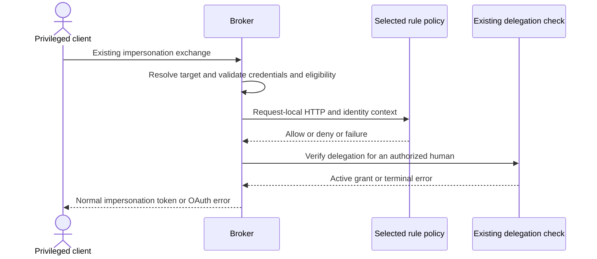
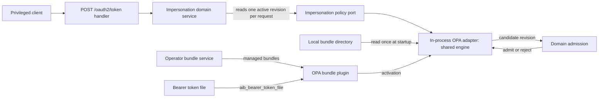
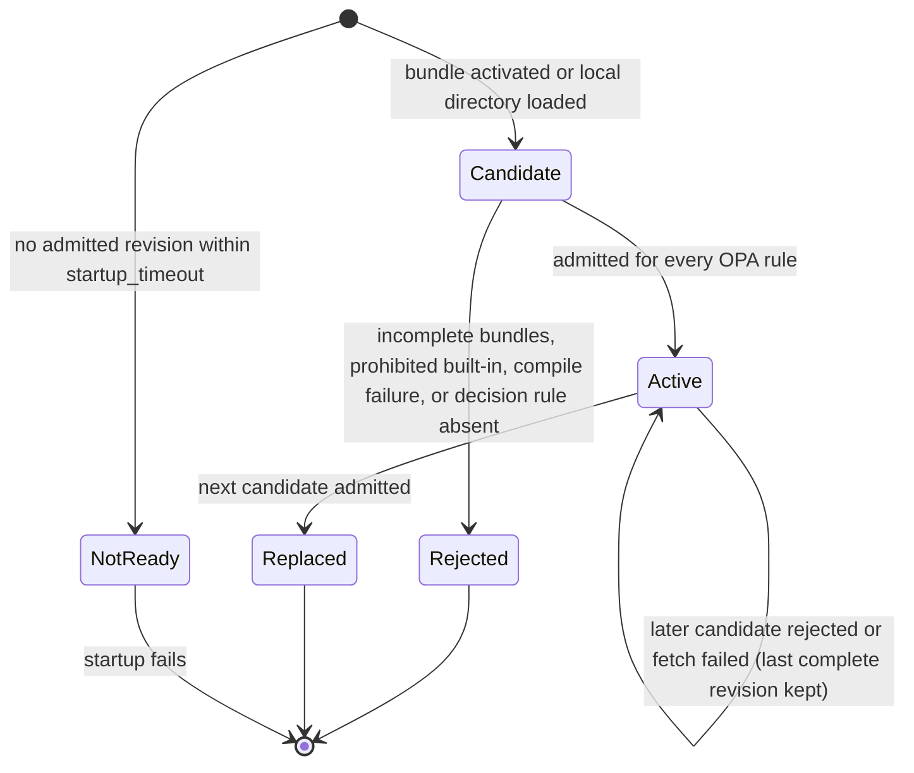

# Feature Specification: OPA policies for impersonation authorization

**Feature Branch**: `speckit/issue-518`

**Created**: 2026-11-20

**Status**: Draft

**Input**: User description:

> Add Open Policy Agent as policy engine in impersonation authorization
>
> # Description
>
> We so far support CEL in the authorization rule of token exchange. If you want to use dynamic external data or re-use company Rego policies, this falls short. Examples for rules are to check that an agent is registered in another governance system, is attributed to a specific application in a CMDB or similar.
>
> The configuration [already supports ](https://agenticidentitybroker.dev/docs/configuration#agent-subject-detection-for-third-party-exchange) the impersonations.rules[_].authorization.cel path, this should introduce impersonations.rules[_].authorization.opa with a bootstrap config for open policy agent similar to the one done for ExtProc. The input object should be Envoy OPA plugin compatible but also provide the same context semantically that we provide via CEL.
>
> Related to #458

## Clarifications

### Session 2026-11-20

- Q1: Must the first release support policy-time HTTP lookups, managed policy/data bundles only, or both? → A: (Accepted by mjungsbluth on 2026-11-21: https://github.com/zalando-incubator/agentic-identity-broker/pull/546#issuecomment-7046411159) Managed policy/data bundles only; policy-time network access is prohibited. Failed updates retain the last complete active revision, with no broker-enforced maximum revision age.
  - Rationale: Dynamic governance snapshots satisfy the requested external-data use case through the requested bootstrap mechanism without exposing credential claims to request-time network destinations or adding a new per-request availability dependency. The bundle service is still a startup dependency (see [Risks & Mitigations](#risks--mitigations)). This resolves FR-012 and SR-006; operators own bundle polling, distribution security, and acceptable data freshness.
  - Alternative B: Support bundles plus policy-time lookups, with destination restrictions, credential protection, deadlines, and freshness controls designed and approved before implementation. Not chosen: it still sends claim-bearing requests to request-time destinations and needs a separate control design.
  - Alternative C: Require direct policy-time lookups and make bundles optional; governance-service availability then becomes an issuance dependency. Not chosen for that reason.
- Q2: Must OPA support unsigned subjects and audience-absent roles in this release? → A: Support all existing local-mode impersonation credential modes, including unsigned subjects, unverified email, audience-absent signed roles, and unverified agent subjects. The original answer also required equivalent enforceable binding controls on every activated policy revision; the 2026-11-25 session below removes that clause for OPA rules.
  - Maintainer direction: mjungsbluth, 2026-11-20: “on Q2, support all modes including unsigned subjects”. This replaces the earlier proposed signed-only restriction; it does not extend impersonation to proxy/hybrid mode or permit unsigned client assertions or actors.
  - Rationale: OPA must be a usable policy-engine alternative for existing impersonation deployments, not remove their supported credential modes. FR-013 and SR-005 preserve the existing compensating controls while requiring startup and managed-update enforcement; planning must propose the necessary superseding ADR before implementation. This records the scope direction, not approval of a future mechanism or ADR.

### Session 2026-11-21 (planning)

Planning resolved the items this specification left to design. Each is pending the maintainer's sign-off as the named approval item in [plan.md](plan.md#approval-items); none is an approval.

- Startup bound: the configuration table adds `impersonation.opa.startup_timeout` (default `30s`, range `1s`–`5m`; originally per rule, moved to the shared engine on 2026-11-24). Reason: FR-003 requires a bounded startup interval and this specification deferred its setting to planning (approval item API-CFG; research [R7](research.md#r7--startup-readiness-bound-sign-off-api-cfg)).
- Bootstrap scope: FR-003's OPA-native bootstrap accepts only the `services`, `bundles`, `keys`, and `labels` keys, plus the broker's `aib_bearer_token_file` credential plugin (added 2026-11-24). Reason: decision logs, status, and discovery could export claim-bearing input or reconfigure OPA at runtime, contrary to SR-003 and SR-006 (approval item API-BOOT; research [R3](research.md#r3--bootstrap-configuration-subset-sign-off-api-boot)).
- Input envelope: FR-005's Envoy-compatible fields are fixed in [contracts/policy-input-decision.md](contracts/policy-input-decision.md), including `parsed_path` and `parsed_query`, `host` and `scheme` taken from the configured end-user public URL, and removal of credential headers. Reason: SR-003 and Scenario 2.2 require a raw-credential-excluded but sensitive input that callers cannot shape into identity (approval item API-INPUT; research [R8](research.md#r8--policy-input-construction-sign-off-api-input)).
- SR-005 mechanism (withdrawn 2026-11-25, see below): binding evidence was to be computed from the reachable decision graph of each candidate revision. The proposed ADR [adr-20261121-061324-opa-impersonation-authorization.md](adr-20261121-061324-opa-impersonation-authorization.md) partly supersedes the CEL-specific controls for OPA rules. Network prohibition (FR-012) removes every nondeterministic OPA built-in except `time.now_ns`. Reason: FR-012 requires a reviewable mechanism before implementation (approval items ADR-OPA, DEC-BUILTINS; research [R4](research.md#r4--prohibiting-policy-time-networking-sign-off-dec-builtins), [R13](research.md#r13--superseding-adr-sign-off-adr-opa)).

### Remediation decisions (Proposed)

IDs such as F1 and I1 name findings of this feature's cross-artifact analysis (`/speckit-analyze`).
These requirement clarifications remain pending the named plan approval items; they do not grant
approval or change the accepted Q1/Q2 scope direction.

- Governance identity (F1): FR-006 adds `context.agent.external_id`, literally from the resolved
  broker Agent and omitted when absent; Journey 1 indexes governance by External ID without UUID
  fallback. `context.agent` reuses ExtProc's Grant Context agent object (`id`, optional
  `canonical_id`) from ADR `048-authzen-delegation-pip`, and the input carries
  `type: "impersonation"`. ExtProc grant-context members stay absent because OPA runs before
  delegation (research R8). Reason: the broker is authoritative for the UUID/governance mapping (API-INPUT).
  Main alternative: UUID-only input with operators synchronizing UUID-to-governance maps, rejected
  because operators would have to mirror a mapping the broker already owns.
- Initial readiness (I1): FR-003/SR-002 require the first admitted serving snapshot itself to
  include every configured bundle. Reason: a usable subset cannot satisfy readiness when the
  later complete candidate is rejected (ADR-OPA). Main alternative: historical per-bundle readiness
  plus any admission, rejected because it can serve a partial snapshot.
- Cancellation observability (A1): FR-007 retains internal terminal `server_error` mapping but
  promises no HTTP response to a disconnected caller. Scenario 3.2 uses correlated canceled
  telemetry, no issuance, and no fallthrough. Reason: canceling a client prevents reading its
  response (API-DECISION/API-DIAG). Main alternative: assert an unobservable HTTP 500,
  rejected because a canceled client cannot receive it.
- Binding replacements (A2/I3): withdrawn on 2026-11-25 together with the static binding analysis
  (DEC-BIND); there is no `with`-modifier analysis.
- Bootstrap files (F4): FR-003/SR-006 require contained `os.Root` bootstrap reading over the file's
  own directory (revised 2026-11-24; previously under `security.trust_material_dir`), at most 1 MiB, and reject SDK-local-file references; credentials
  and signing keys use supported inline bootstrap forms (API-BOOT/API-CFG).
  Reason: native file reopening must not bypass containment. Main alternative: an approved
  unrestricted-read exception preserving file-based credential rotation, rejected because a
  replaced or linked file could then read unrelated runtime credentials (research R3).
- Ordinary exchange (F5): FR-009 now explicitly rejects `token_exchange.authorization.type: opa`
  at startup; valid CEL behavior is unchanged (API-CFG).
  Reason: accepting and ignoring the engine is misleading. Main alternative: remove the reserved
  OPA block entirely rather than keeping its declarations, rejected as an unnecessary schema
  removal (research R10).
- Revision identity (F6): SR-004 adds a broker admission identifier distinct from manifest labels
  to the deciding audit and admission log (API-DIAG).
  Reason: reused or empty labels cannot identify a deciding snapshot. Main alternative: reject
  unchanged/empty manifest revision labels, rejected because it would make manifest labeling
  mandatory for every operator.

### Session 2026-11-24

- Q: May production deployments load policy from a local bundle directory (`impersonation.opa.policy.path`), or should that mode be limited to development and tests? → A: Allowed in any deployment; startup logs once that policy and data change only on restart, and the documentation states that live governance updates need managed mode.
- Q: How must the broker protect policy bundles it downloads from tampering on the way to it? → A: No broker requirement, as in ExtProc's OPA handling: bundle service transport and bundle signing are the operator's choice, and the documentation recommends HTTPS and signed bundles.
  - Rationale (recorded 2026-11-26): bundles and the bootstrap are operator-trusted configuration. Principle I requires broker security controls to be on by default; transport and signing for operator-managed bundle distribution are deployment choices, which the documentation MUST recommend. Rejected: requiring `https` by default; requiring `https` and bundle signing by default.

### Session 2026-11-24 (configuration revision)

The maintainer chose one shared OPA engine and asked for the configuration review's issues to be
fixed. These are Proposed under approval items API-CFG and API-BOOT; none is an approval.

- Shared engine ([R11](research.md#r11--one-shared-opa-engine-revised-2026-11-24-maintainer-choice-option-b)): engine settings move to `oauth2_authorization_server.impersonation.opa`
  (`policy.config_file` or `policy.path`, `startup_timeout`). Each OPA rule names only `package`,
  `decision`, and `evaluation_timeout`. A revision is admitted only if every OPA rule passes, and a
  request uses one revision for all its OPA rules. Reason: first-match fallthrough must not mix
  policy versions; shared governance data is downloaded and held once.
- Reserved fields: every rule `opa` key other than the three above fails startup, including
  `policy_url` and `policy_path`, so a rule has one way to name a policy.
- Local bundle directory ([R15](research.md#r15--local-bundle-directory-revised-2026-11-24-issue-3)): `policy.path` loads a bundle directory once at startup through
  `os.Root`, for development, tests, and release-shipped policy.
- Token file ([R16](research.md#r16--contained-bundle-token-file-revised-2026-11-24-issue-4)): the broker's `aib_bearer_token_file` credential plugin re-reads a contained
  bearer token before every bundle request, so rotation needs no restart.
- File containment ([R3](research.md#r3--bootstrap-configuration-subset-sign-off-api-boot)): OPA files are configured by absolute path and read through an `os.Root`
  over their own directory, not under `security.trust_material_dir`. Reason: one admin sets the
  directory and the paths, so a shared directory is no boundary; per-file roots still stop content
  written by others from linking elsewhere, and ADR `040-trust-anchor-local-key-sets` keeps its
  key-set scope.
- `package` defaults to `aib.broker.impersonation`, mirroring ExtProc's default. An ExtProc bootstrap
  is reusable only within the accepted subset.

### Session 2026-11-25 (input revision)

The maintainer directed that the Envoy envelope follow the Envoy input specification. Proposed under
approval item API-INPUT; not an approval.

- `parsed_body` is Envoy's parsed form body (object of string arrays) instead of `null`, always
  without the credential-bearing OAuth parameters `client_assertion`, `actor_token`,
  `subject_token`, `client_secret`, `refresh_token`, `code`, and `code_verifier` (maintainer choice:
  omit the credential fields; extended to every credential parameter the token endpoint defines by
  the 2026-11-25 review). The validated, resolved values stay in `context`.
- `version` (`{"ext_authz": "v3", "encoding": "protojson"}`) is added, as the Envoy plugin sets it.
- `parsed_query` is documented as unvalidated caller data the token endpoint ignores.
- Bundles shared with ExtProc separate impersonation decisions by package (each rule's
  `authorization.opa.package`), not by `input.type`, which stays in the input.

### Session 2026-11-25 (binding analysis removed)

The maintainer removed the static binding analysis for OPA rules. Proposed under approval item
ADR-OPA; constitution amendment CONST-AMEND is applied (v4.8.0).

- OPA rules keep every credential mode (Q2), without static predicate-reference or field-binding
  checks: no mandatory `context.subject_token` or audience-absent role reference, no `with`-modifier
  analysis, and no email or `sub` binding evidence (DEC-BIND withdrawn). Rationale: OPA is already a
  capable policy language, and the check was shallow: it proved only that a policy mentions a value,
  which shows intent, not that the policy constrains it. It is not a security control; review of the
  operator's Rego policy is. Main alternative: keep the dependency-graph analysis, rejected for its
  complexity without a matching security benefit.
- This supersedes the planning session's SR-005 mechanism bullet and the remediation decision A2/I3,
  and narrows Q2's "equivalent enforceable binding controls" clause to CEL rules. SR-005, FR-013, and
  Scenarios 2.3–2.5 are rewritten; Scenarios 3.6 and 4.4 are removed.
- Constitution Principle I requires a startup-verified `subject_token` reference and an email binding
  for unsigned subjects. Amendment CONST-AMEND (constitution v4.8.0, 2026-11-25) limits those two
  controls to CEL-authorized rules; it takes effect for OPA rules once ADR-OPA is Accepted.

### Session 2026-11-26 (review round 2)

The user decided these points in the second review round. They are Proposed under the named
approval items; none is an approval.

- Built-ins (DEC-BUILTINS): `io.jwt.decode_verify` stays available with `time.now_ns`, because it only
  reads the clock. Every other built-in OPA v1.21.4 marks nondeterministic is removed, including
  `json.verify_schema` and `json.match_schema`, which can resolve remote `$ref`s.
- Unsigned exact-target subjects on OPA rules stay agent-category without a broker check. A
  decision opt-in (`subject_category`) and a decision that echoes the approved `sub` or email were
  rejected: either reintroduces a broker-side binding protocol that only proves the policy returned
  a value (ADR-OPA).
- An undefined decision at evaluation stays a terminal `500`; documentation and examples require a
  `default` decision. Admission checks only that the decision rule exists (API-DECISION).
- Bundle transport and signing stay operator choices; the rationale is recorded under the
  2026-11-24 session.
- Bundle size: documented risk only; no broker cap beyond OPA's `size_limit_bytes`.
- The bootstrap accepts a closed member allowlist, including cloud credentials that read no file
  (API-BOOT).
- Bundle downloads are observable through an OPA bundle status listener (API-DIAG).

## Problem Statement & Goals

**Problem**: Impersonation rules authorize only with CEL predicates over the presented credentials.
Organizations that keep agent governance in other systems (registration, application ownership in
a CMDB) or in existing Rego policies cannot use that data or those policies when the broker decides
whether to issue an impersonation token.

**Goals**:

- Let an operator select OPA per impersonation rule, using Rego and governance data distributed as
  managed bundles or a local bundle directory.
- Give policies Envoy-compatible request fields and the same validated context as CEL, plus the
  broker-resolved Agent identity.
- Apply policy and data updates without a broker restart, and never turn a failure into an allow.
- Keep every existing credential mode, credential control, delegation rule, and CEL behavior.

**Non-goals**:

- Proxy/hybrid-mode impersonation and ordinary third-party token exchange through OPA.
- Remote OPA decision servers and policy-time network lookups.
- Revocation of already-issued tokens, new admin APIs, new persistence, UI changes, and MCP parsing.

## User Scenarios & Testing *(mandatory)*

Each scenario maps to exactly one E2E `It`. Composite scenarios (2.5, 3.2, 4.3) list variants of one
behavior; their `It` is table-driven and asserts every listed variant.

### User Story 1 - Enforce organizational governance before issuing a token (Priority: P1)

A broker operator selects Open Policy Agent (OPA) for an impersonation rule so the organization's Rego policy can check agent registration and application ownership against governance data. A privileged client obtains a token only when that policy and all existing impersonation controls permit it.

**Why this priority**: External governance checks are the feature's primary value; the broker must not issue tokens merely because credentials are valid.

**Independent Test**: Configure one OPA-backed rule and submit otherwise-valid impersonation requests for an approved agent and an unregistered agent. Only the approved request receives a token.

**Acceptance Scenarios**:

1. **Scenario 1.1 — Approved agent**: **Given** a signed human-subject request with active delegation, a registered target agent, and governance data associating that agent with application `inventory-api`, **When** the configured policy allows the request, **Then** the broker issues its normal impersonation token with the existing subject, target agent, actor attribution, and requested permitted scope. The same outcome holds when the shared engine loads Journey 1's bundle from a local directory (`impersonation.opa.policy.path`) instead of a bundle server.
2. **Scenario 1.2 — Governance denial**: **Given** valid credentials and active delegation but governance data marking the target agent unregistered, with no later rule permitting the request, **When** the client requests impersonation, **Then** the broker returns `403 access_denied` and issues no token.
3. **Scenario 1.3 — Existing controls remain authoritative**: **Given** a policy that would allow the request but an otherwise-valid human request without active delegation, **When** the client requests impersonation, **Then** the broker returns the existing delegation denial and consent recovery URL, with no token.
4. **Scenario 1.4 — Signed self-agent**: **Given** an OPA rule explicitly allowing agent subjects, a verified signed subject whose raw `sub` exactly equals the audience-selected target UUID, and no human delegation, **When** governance policy permits that agent, **Then** the broker issues its existing agent-subject token with target-derived `sub == agent_id`, preserves actor attribution, and creates no human grant or session.

---

### User Story 2 - Reuse policy input conventions without losing identity context (Priority: P1)

A policy author reuses Envoy-compatible request predicates alongside checks on the client assertion, actor, subject, and resolved target. The author can distinguish verified credentials from explicitly unverified subject data rather than confusing transport information with identity evidence.

**Why this priority**: Reusing policies is valuable only if the broker supplies complete, correctly trusted context.

**Independent Test**: Submit a request to a policy that checks both the HTTP method/path through Envoy-compatible fields and every impersonation context value through the broker extension.

**Acceptance Scenarios**:

1. **Scenario 2.1 — Context parity**: **Given** signed credentials with distinct client, actor, and subject claims and a resolved target agent, **When** a policy checks the Envoy-compatible HTTP fields and broker context described below, **Then** it observes the same claim values, JSON value types, verification indicator, and exchange parameters as equivalent CEL authorization, plus the broker-resolved Agent's UUID, Canonical ID, and literal External ID in ExtProc's `agent` shape (optional IDs omitted when unset), and permits the request only when they all match; headers and token claims cannot override that mapping.
2. **Scenario 2.2 — Untrusted transport cannot replace identity**: **Given** a valid request with a caller-provided identity-looking HTTP header and a policy requiring a different verified client identity, **When** the client submits the request, **Then** the header cannot overwrite verified context, authorization is denied, and no token is issued.
3. **Scenario 2.3 — Unsigned human and email**: **Given** an explicitly unverified subject rule, signed verified client and actor, an unsigned `alg:none` human subject with an `email` claim, active delegation, and an OPA decision that checks the subject and its email, **When** the policy permits the request, **Then** `context.subject_unverified` is `true`, the subject claims remain caller-asserted data, and the normal human token is issued with the email from the rule's `email_expression`.
4. **Scenario 2.4 — Unsigned self-agent**: **Given** an OPA rule allowing agent subjects whose decision checks `context.subject_token.sub` against the approved target UUID, and an unsigned subject with that exact raw `sub`, **When** signed client and actor validation and governance checks pass, **Then** the normal target-derived agent token is issued without a human grant or session. A different registered agent's raw `sub` or extracted principal remains ineligible without human fallback or a consent link.
5. **Scenario 2.5 — Audience-absent signed roles**: **Given** an OPA rule opting each of the client assertion, actor, and signed subject roles into `audience_requirement: absent`, independently and in valid combinations, **When** otherwise-valid signed credentials omit `aud`, **Then** the request may succeed under the normal category and delegation controls. An `aud` claim on any such role, invalid signature, or expired credential never obtains a token, even if OPA would allow.

---

### User Story 3 - Apply managed policy and data changes safely (Priority: P2)

An operator uses an OPA bootstrap configuration, comparable to ExtProc's existing OPA configuration, to load organizational policies and data. Changes delivered through that configured policy management path affect subsequent decisions without rebuilding the broker.

**Why this priority**: Dynamic governance data distinguishes this feature from static claim predicates, but must never introduce an allow-on-error path.

**Independent Test**: Start with a managed policy/data revision that allows an agent, activate a second revision that revokes it, and repeat the same valid exchange. Also exercise unavailable and invalid decisions.

**Acceptance Scenarios**:

1. **Scenario 3.1 — Governance update**: **Given** an active revision allowing the target agent, **When** an updated revision marking it unregistered becomes active through the configured OPA bootstrap, **Then** the next otherwise-identical exchange is denied without a broker restart or rebuild. When the bundle service requires a bearer token read through `aib_bearer_token_file`, replacing the token file's contents between polls lets the next poll succeed without a restart; an emptied token file keeps the active revision.
2. **Scenario 3.2 — Runtime failure**: **Given** a selected OPA rule followed by an otherwise-permissive rule, **When** its evaluation errors, times out, is cancelled, or returns an undefined or malformed decision, **Then** the broker maps the failure internally to terminal `server_error`, issues no token, and does not fall through. Connected error, timeout, undefined, and malformed-decision variants receive HTTP `500 server_error`. The client-disconnect cancellation variant observes client cancellation and a request-correlated canceled evaluation span, with no issuance or later-rule authorization; it does not assert receipt of an HTTP response.
3. **Scenario 3.3 — Unusable startup configuration**: **Given** an OPA rule and a shared engine whose bootstrap file or local bundle is missing or invalid, or whose initial policy cannot become ready within the configured startup bound, **When** the operator starts the broker, **Then** startup fails with a credential-free diagnostic identifying the configuration field and, when a rule's admission failed, that rule; token requests are not served using an implicit allow policy.
4. **Scenario 3.4 — Failed managed update**: **Given** active revision `r1` permitting Journey 1's approved agent, **When** a later bundle fetch fails or a replacement revision is invalid, **Then** `r1` remains active, the same validated request still succeeds under `r1`, and a fresh request with a different, unapproved agent is denied under `r1`; neither a partial revision nor a cached request decision is used. There is no broker-enforced maximum revision age.
5. **Scenario 3.5 — Policy-time networking rejected**: **Given** an OPA policy revision that uses `http.send` or another network-capable policy built-in, **When** it is offered as the initial revision or as a managed update, **Then** it cannot activate, no policy-time outbound request occurs, initial readiness fails within the startup bound if no usable revision exists, and a later update leaves the last complete revision active as in Scenario 3.4.

---

### User Story 4 - Adopt OPA one rule at a time (Priority: P2)

An operator retains existing CEL rules while opting individual impersonation rules into OPA. Policy selection does not alter claim extraction, token claims, or unrelated third-party token exchange.

**Why this priority**: Operators need an additive migration rather than a broker-wide policy-engine replacement.

**Independent Test**: Use an ordered list containing both engines and compare CEL-only requests with their pre-feature outcomes.

**Acceptance Scenarios**:

1. **Scenario 4.1 — Ordered mixed rules**: **Given** a first rule whose OPA policy returns an explicit deny and a later CEL rule authorizing the same validated request, **When** the client requests impersonation, **Then** the later rule may authorize under its own validation and eligibility checks, preserving existing first-match semantics.
2. **Scenario 4.2 — Existing CEL behavior**: **Given** an unchanged valid CEL-only deployment, **When** the client exercises allowed and denied impersonation requests and ordinary third-party exchange, **Then** the existing observable outcomes remain unchanged and no OPA bootstrap is required.
3. **Scenario 4.3 — Ambiguous selection rejected**: **Given** an impersonation rule with an unknown engine, both engine blocks populated, an unsupported key in its `authorization.opa` block, an OPA rule without the shared `impersonation.opa` engine block, or a populated `impersonation.opa` block with no OPA rule, **When** the broker starts, **Then** it fails startup with a rule-specific or engine-field configuration error rather than choosing an engine implicitly.

### Edge Cases

- A policy's explicit deny is a non-match; an evaluation failure is terminal. They must not be conflated.
- An OPA allow cannot authorize invalid signatures on signed roles, signed subjects submitted to unverified rules, unsigned subjects submitted to signed rules, disallowed algorithms, wrong issuers/audiences, an `aud` claim on an audience-absent role, expired signed credentials, forbidden scopes, category-ineligible subjects, cross-agent representation, or a missing human delegation.
- Optional claims remain absent rather than being invented or coerced. Claim arrays, booleans, numbers, and nested objects retain their meaning.
- Impersonation rejects `resource`; policy context still includes its existing empty-string value rather than repurposing it as the routing audience.
- No valid initial policy/data revision means no readiness. A failed later update must not partially activate a policy/data revision. Continued use of the last successfully activated revision must be documented distinctly from an evaluation failure; a new request must never reuse a previous request's allow decision.
- A slow bundle source must not enter the request evaluation path or evade the evaluation deadline. Request-time policy networking is prohibited; bundle acquisition is separate from evaluation. Failed fetches or rejected revisions retain the last complete active revision without a broker-enforced maximum age (Q1).
- OPA supports all existing credential modes (Q2), including valid combinations of unsigned subjects and audience-absent signed client/actor roles. OPA rules have no static predicate-reference or field-binding checks (SR-005): an unverified email is minted when the rule's `email_expression` yields one and the decision allows, and an unsigned exact-target subject is agent-category. The policy is then the only control on which subjects, emails, and agents a client may assert.
- ExtProc's `approval_required` action, response-header mutation, and MCP tool parsing do not authorize issuance of an impersonation token.

## Concrete Example Journeys *(mandatory)*

### Journey 1 — Permit only a governed agent (User Story 1, Scenarios 1.1–1.4; User Story 2, Scenarios 2.1–2.2)

**Cast and initial state**: Broker `https://broker.example.com` runs in local mode. Registered agent `550e8400-e29b-41d4-a716-446655440000` has broker Canonical ID `inventory-assistant` and External ID `inventory-agent` and belongs to application `inventory-api` in the organization's governance data and permits scope `read`. Human `alice@example.com` has an active UserGrant for that agent. Privileged client `gateway-1` and actor `automation-worker` use issuer `https://identity.example.com`. All times and credentials below are synthetic; the clock is 2026-11-20 09:00:00 UTC.

**Step 1 — Operator selects OPA for this rule.** Other normal broker settings are omitted. The OPA subsection is the proposed feature contract, not a claim that the currently reserved broker OPA fields already work. The canonical existing prefix is singular `oauth2_authorization_server.impersonation`, despite the issue's informal `impersonations` spelling.

```yaml
oauth2_authorization_server:
  mode: local
  local:
    token_ttl: 1h
    token_claims_expression: '{"aud": ["https://inventory.example.com"]}'
  impersonation:
    audience_prefix: https://broker.example.com/impersonate
    rules:
      - name: governed-inventory
        allowed_subject_categories: [human]   # human subjects only; delegation required
        roles:
          client_assertion:
            expected_audience: https://broker.example.com/oauth2/token
            principal_expression: client_assertion.sub
          actor:
            expected_audience: broker-impersonation
            principal_expression: actor_token.sub
          subject:
            expected_audience: broker-impersonation
            principal_expression: subject_token.sub   # minted sub is alice@example.com
        trusted_issuers:
          - issuer_uri: https://identity.example.com
            jwks_uri: https://identity.example.com/jwks.json
            allowed_algorithms: [RS256]
            signs_roles: [client_assertion, actor, subject]   # all three roles must be signed
        authorization:
          type: opa                          # this rule uses OPA instead of CEL
          opa:
            package: company.impersonation   # with decision, evaluates data.company.impersonation.result
            decision: result
            evaluation_timeout: 100ms        # exceeding it is terminal server_error, no fallthrough
    opa:                                     # shared engine used by every OPA rule
      policy:
        config_file: /etc/broker/opa/bootstrap.yaml   # managed mode: bundles may update live
```

The rule names only its decision. The engine block `impersonation.opa` is shared by every OPA rule;
a second OPA rule would add only its own `authorization` block. The bootstrap uses the same
OPA-native configuration vocabulary as ExtProc's managed-policy mode; a minimal illustrative
bootstrap, whose bundle-service token is a mounted Secret re-read before every download, is:

```yaml
services:
  governance:
    url: https://policies.example.com   # HTTPS recommended; bundle signing is the operator's choice
    credentials:
      plugin: aib_bearer_token_file     # bearer token re-read before every bundle download
plugins:
  aib_bearer_token_file:
    path: /var/run/secrets/opa-bundle/token   # absolute path, read through os.Root over its directory
bundles:
  impersonation:                        # readiness requires every configured bundle
    service: governance
    resource: bundles/impersonation.tar.gz
```

The bundle supplies `company.impersonation.result` and governance data. Its business rule requires method `POST`, path `/oauth2/token`, verified client `gateway-1`, actor `automation-worker`, and an approved registration keyed by `context.agent.external_id` (`inventory-agent`) assigned to
`inventory-api`. The resolved broker Agent supplies this literal External ID; a missing ID is omitted, so the
lookup is undefined and the example policy denies, without UUID fallback. UUID remains the target and minted identity. The decision is `{"action":"allow"}` only when all checks pass; otherwise it is `{"action":"deny"}`. Bundle authentication, update cadence, and data freshness are operator-owned bootstrap settings, not credentials embedded in this example. Policy-time network access, including `http.send`, is prohibited (Q1). An initial or updated revision using network-capable policy built-ins cannot activate; configured bundle retrieval is not a policy-time lookup.

**Step 2 — Client submits the exchange.** `SYNTHETIC_CLIENT_JWT`, `SYNTHETIC_ACTOR_JWT`, and `SYNTHETIC_SUBJECT_JWT` denote test-issued signed JWTs, not literal wire-valid tokens. All use decoded header `{"alg":"RS256","kid":"identity-test-key","typ":"JWT"}` and have these decoded claims:

```json
{
  "SYNTHETIC_CLIENT_JWT": {
    "iss": "https://identity.example.com", "sub": "gateway-1",
    "aud": "https://broker.example.com/oauth2/token",
    "iat": 1795165140, "exp": 1795168800
  },
  "SYNTHETIC_ACTOR_JWT": {
    "iss": "https://identity.example.com", "sub": "automation-worker",
    "aud": "broker-impersonation", "iat": 1795165140, "exp": 1795168800
  },
  "SYNTHETIC_SUBJECT_JWT": {
    "iss": "https://identity.example.com", "sub": "alice@example.com",
    "aud": "broker-impersonation", "iat": 1795165140, "exp": 1795168800
  }
}
```

```http
POST /oauth2/token HTTP/1.1
Host: broker.example.com
Content-Type: application/x-www-form-urlencoded

grant_type=urn%3Aietf%3Aparams%3Aoauth%3Agrant-type%3Atoken-exchange&audience=https%3A%2F%2Fbroker.example.com%2Fimpersonate%2F550e8400-e29b-41d4-a716-446655440000&scope=read&client_assertion_type=urn%3Aietf%3Aparams%3Aoauth%3Aclient-assertion-type%3Ajwt-bearer&client_assertion=SYNTHETIC_CLIENT_JWT&actor_token_type=urn%3Aietf%3Aparams%3Aoauth%3Atoken-type%3Ajwt&actor_token=SYNTHETIC_ACTOR_JWT&subject_token_type=urn%3Aietf%3Aparams%3Aoauth%3Atoken-type%3Ajwt&subject_token=SYNTHETIC_SUBJECT_JWT

```

**Step 3 — Policy evaluates the validated context.** The broker's input has an Envoy-compatible request envelope plus a namespaced extension. This is a relevant-field excerpt: each credential map contains the complete decoded claims shown in Step 2, not just its subject.

```json
{
  "type": "impersonation",
  "version": {"ext_authz": "v3", "encoding": "protojson"},
  "attributes": {
    "request": {
      "http": {
        "method": "POST",
        "path": "/oauth2/token",
        "scheme": "https",
        "host": "broker.example.com",
        "protocol": "HTTP/1.1",
        "headers": {"content-type": "application/x-www-form-urlencoded"}
      }
    }
  },
  "parsed_path": ["oauth2", "token"],
  "parsed_query": {},
  "parsed_body": {
    "grant_type": ["urn:ietf:params:oauth:grant-type:token-exchange"],
    "audience": ["https://broker.example.com/impersonate/550e8400-e29b-41d4-a716-446655440000"],
    "scope": ["read"],
    "client_assertion_type": ["urn:ietf:params:oauth:client-assertion-type:jwt-bearer"],
    "actor_token_type": ["urn:ietf:params:oauth:token-type:jwt"],
    "subject_token_type": ["urn:ietf:params:oauth:token-type:jwt"]
  },
  "truncated_body": false,
  "context": {
    "client_assertion": {"sub": "gateway-1"},
    "actor_token": {"sub": "automation-worker"},
    "subject_token": {"sub": "alice@example.com"},
    "subject_unverified": false,
    "agent": {
      "id": "550e8400-e29b-41d4-a716-446655440000",
      "canonical_id": "inventory-assistant",
      "external_id": "inventory-agent"
    },
    "request": {
      "resource": "",
      "grant_type": "urn:ietf:params:oauth:grant-type:token-exchange",
      "scope": "read",
      "agent_id": "550e8400-e29b-41d4-a716-446655440000"
    }
  }
}
```

The input has no ExtProc grant-context members (`principal`, `resource`, `grant`, `permission_sets`): OPA runs before Alice's delegation is checked. `parsed_body` follows Envoy's parsing of the form body but always omits the credential-bearing OAuth parameters (`client_assertion`, `actor_token`, `subject_token`, `client_secret`, `refresh_token`, `code`, and `code_verifier`); it holds unvalidated caller values, while `context` holds the validated and resolved ones. Raw token strings, cookies, and authorization headers are not policy input. The verified claim maps are sensitive policy inputs, not material for decision logs. Caller headers cannot populate or overwrite `context`.

**Step 4 — Client receives the response and normal claims.** The response to Step 2 is:

```http
HTTP/1.1 200 OK
Content-Type: application/json
Cache-Control: no-store
Pragma: no-cache

{"access_token":"SYNTHETIC_BROKER_JWT","issued_token_type":"urn:ietf:params:oauth:token-type:access_token","token_type":"Bearer","expires_in":3600,"scope":"read"}
```

`SYNTHETIC_BROKER_JWT` has a normal broker signing header, illustrated by `{"alg":"RS256","kid":"broker-test-key","typ":"JWT"}`, and these relevant decoded claims:

```json
{
  "iss": "https://broker.example.com",
  "sub": "alice@example.com",
  "aud": ["https://inventory.example.com"],
  "iat": 1795165200,
  "exp": 1795168800,
  "agent_id": "550e8400-e29b-41d4-a716-446655440000",
  "act": {"iss": "https://identity.example.com", "sub": "automation-worker"},
  "scope": "read"
}
```

The local token-claims policy, not OPA and not the routing audience, supplies `aud`.

**Local variant (Scenario 1.1).** With `impersonation.opa.policy: {path: /opt/broker/policy/impersonation-bundle}` holding the same modules and `data.json` instead of `config_file`, the Step 2 request produces Step 4's identical `200` response and decoded claims, and startup logs `oauth2_server.impersonation_policy.local_mode` once. Governance changes in this mode take effect only after a restart.

**Step 5 — Denied variants use the same request.** For Scenario 1.2, mark the governance registration unapproved and activate that data. For Scenario 2.2, require client `gateway-2` in policy but add `X-Client-Identity: gateway-2` to the request while keeping the signed client subject `gateway-1`. The header appears only as `attributes.request.http.headers["x-client-identity"]`; `context.client_assertion.sub` stays `gateway-1`. With no later authorizing rule, either request returns:

```http
HTTP/1.1 403 Forbidden
Content-Type: application/json

{"error":"access_denied","error_description":"impersonation not permitted"}
```

For Scenario 1.3, restore the allowing policy/data but remove Alice's delegation. The same request returns the existing recovery response rather than letting an OPA allow bypass consent:

```http
HTTP/1.1 403 Forbidden
Content-Type: application/json

{"error":"access_denied","error_description":"user delegation is required before impersonation","error_uri":"https://broker.example.com/agents/550e8400-e29b-41d4-a716-446655440000"}
```

Descriptions illustrate credential-free summaries, not new stable diagnostic identifiers.

**Step 6 — Signed self-agent variant (Scenario 1.4).** The operator sets `allowed_subject_categories: [agent]` on this rule. The client uses a signed subject JWT with the same header, issuer, audience, and times as Step 2, but `sub` is `550e8400-e29b-41d4-a716-446655440000`. It sends the same form request with that replacement `subject_token`. Governance still approves the target for `inventory-api`; there is no corresponding human grant. The response is the same `200` envelope as Step 4 with marker `SYNTHETIC_AGENT_BROKER_JWT`. Its header is the same broker header and its relevant decoded claims are:

```json
{
  "iss": "https://broker.example.com",
  "sub": "550e8400-e29b-41d4-a716-446655440000",
  "aud": ["https://inventory.example.com"],
  "iat": 1795165200,
  "exp": 1795168800,
  "agent_id": "550e8400-e29b-41d4-a716-446655440000",
  "act": {"iss": "https://identity.example.com", "sub": "automation-worker"},
  "scope": "read"
}
```

No category claim, human grant, or human session is created. Q2 also supports the corresponding unsigned self-agent flow under the explicit opt-in in Journey 4.

**Observable result**: Alice's approved delegated request and the explicitly eligible signed self-agent request obtain correctly attributed tokens; a governance denial or spoofed transport identity cannot obtain one, and missing human delegation retains its established recovery flow.

### Journey 2 — Change governance without a broker release (User Story 3, Scenarios 3.1–3.5)

**Cast and initial state**: Journey 1's broker, configuration, credentials, delegation, and clock. Governance revisions: `r1` approves agent `550e8400-e29b-41d4-a716-446655440000` (External ID `inventory-agent`) for `inventory-api`; `r2` marks it unregistered. A second registered agent `660e8400-e29b-41d4-a716-446655440001` with External ID `other-agent` is absent from governance approval; Alice has active delegation to it, and it permits scope `read`. The bundle server accepts bearer token `T1`, later `T2`, read from `/var/run/secrets/opa-bundle/token`.

**Step 1 — Initial revision.** The operator starts Journey 1's configuration with bootstrap revision `r1`, which approves the target for `inventory-api`. Journey 1's Step 2 request succeeds with the displayed `200` response and decoded claims.

**Step 2 — Revoking update (Scenario 3.1).** The governance team publishes revision `r2`, marking the same agent unregistered. Once `r2` is activated, the identical Journey 1 Step 2 request receives the displayed `403 access_denied` response. No restart, token-claims change, or client change is needed. This changes future issuance, not the validity of already-issued tokens.

**Step 3 — Runtime failure (Scenario 3.2).** As a separate failure variant, the decision is undefined, malformed, or exceeds `100ms`. Even if a later rule could allow it, the same request receives the following response and no access token:

```http
HTTP/1.1 500 Internal Server Error
Content-Type: application/json

{"error":"server_error","error_description":"authorization evaluation failed"}
```

For the canceled-client variant, start the same exchange with a synthetic trace context, wait
until evaluation begins, then cancel the HTTP client. The client observes cancellation, not an
HTTP 500. The ended evaluation span carries the same trace ID and `canceled` outcome; after
request completion there is no issuance audit or later permissive-rule authorization. Domain
tests separately assert the terminal internal `server_error` mapping.

**Step 4 — Unusable startup (Scenario 3.3).** As a startup variant, the operator changes `impersonation.opa.policy.config_file` to a nonexistent file, supplies invalid bootstrap content, or provides no usable initial policy within the startup bound. The process exits unsuccessfully with the engine field identified, and the rule as well when a rule's admission failed; there is no token response because this broker does not become ready. For the nonexistent file the credential-free startup record is illustrated by:

```json
{"level":"ERROR","msg":"impersonation policy not ready","event":"oauth2_server.impersonation_policy.startup_failed","reason":"bootstrap_invalid","duration_ms":3}
```

The exit error is `oauth2_authorization_server.impersonation.opa: policy.config_file: unreadable`, never the file's contents. Include a two-bundle case: the first subset would allow, but
is not admitted; the complete candidate is rejected. Historical activation of both bundles never
makes the subset a serving revision or permits readiness.

**Step 5 — Failed update keeps the revision (Scenario 3.4).** For Scenario 3.4, start separately from active `r1` and make the bundle source unavailable or offer an invalid replacement. Journey 1's Step 2 request still receives the `200` response and decoded claims because `r1` remains active. A fresh request for the second agent, with the audience suffix changed to its UUID, receives Journey 1's `403 access_denied` response; its delegation and scope are in place, so governance alone explains the denial. The broker supplies no maximum-age cutoff; operators own the acceptable staleness of distributed governance data.

**Step 6 — Policy-time networking rejected (Scenario 3.5).** For Scenario 3.5, offer a revision that attempts `http.send` to `https://cmdb.example.com/agents/550e8400-e29b-41d4-a716-446655440000`. That policy is rejected before activation, without contacting the CMDB. As the initial revision, it prevents readiness within the startup bound; as an update to `r1`, it leaves the Journey 2 Step 5 outcomes unchanged. Bundle polling of `https://policies.example.com` remains allowed through the operator-managed bootstrap.

**Step 7 — Token rotation (Scenario 3.1).** For the token-rotation variant of Scenario 3.1, the bundle server requires bearer token `T1`, read from `/var/run/secrets/opa-bundle/token`. The operator replaces the file's contents with `T2` and the server stops accepting `T1`; the next poll downloads `r2` without a restart, and Journey 1's Step 2 request receives the `403 access_denied` response. Emptying the file logs `oauth2_server.impersonation_policy.token_unavailable` and keeps `r2` active.

**Observable result**: Activated governance updates change issuance decisions. Evaluation failures never become permission; bundle-update failures instead retain the last complete revision and its documented staleness risk. Policies cannot initiate network lookups through an update.

### Journey 3 — Migrate a rule while keeping CEL behavior (User Story 4, Scenarios 4.1–4.3)

**Cast and initial state**: Journey 1's broker, credentials, delegation, governance data, and clock. Two ordered rules: the OPA rule `governed-inventory` from Journey 1, whose policy in this journey denies the request, and a later CEL rule `legacy-approved-client` added in Step 1.

**Step 1 — Operator adds a CEL rule.** The operator retains Journey 1's credentials, issuer settings, and delegation. They add a later rule named `legacy-approved-client` with the same roles and trust anchors, but with this authorization block:

```yaml
authorization:
  type: cel                                            # this later rule keeps CEL
  cel:
    expression: 'client_assertion.sub == "gateway-1"'  # no governance check: authorizes after the OPA deny
    evaluation_timeout: 100ms
```

**Step 2 — Ordered fallthrough (Scenario 4.1).** The first, OPA-backed rule explicitly denies Journey 1's request. The later CEL rule independently validates and authorizes it. The client receives Journey 1's normal `200` response and token claims. This is intentional ordered-rule behavior: an operator seeking a universal governance restriction must apply it to every rule that could permit the request.

**Step 3 — CEL-only deployment (Scenario 4.2).** In a separate CEL-only deployment, the operator removes the OPA rule and bootstrap entirely. The existing allowed/denied requests and ordinary third-party exchanges keep their established outcomes; no OPA management connection is made.

**Step 4 — Invalid configuration (Scenario 4.3).** As an invalid-configuration variant, the operator populates both `authorization.cel` and `authorization.opa` on one rule, chooses an unknown type, or puts an engine setting such as `startup_timeout` or the reserved `policy_url` on the rule's `opa` block, for example:

```yaml
authorization:
  type: opa
  opa:
    package: company.impersonation
    policy_url: http://opa:8181   # reserved key: startup fails, naming this rule and key
```

Startup fails naming that rule and field; the operator must select exactly one engine and keep engine settings under `impersonation.opa`. Keeping an OPA rule while removing the `impersonation.opa` block fails startup naming that rule. Removing the last OPA rule while leaving `impersonation.opa` configured also fails startup, naming that block. The exit error is credential-free and follows the configuration contract's diagnostic format, for example `oauth2_authorization_server.impersonation.rules[0] (governed-inventory): authorization.opa.policy_url: unsupported key; engine settings belong under impersonation.opa`.

**Observable result**: Migration is per rule, existing selection semantics remain explicit, and invalid combinations cannot silently change authorization. OPA is available for both ordinary and exceptional credential modes without relaxing their controls.

### Journey 4 — Use existing exceptional credential modes with OPA (User Story 2, Scenarios 2.3–2.5)

**Cast and initial state**: Use Journey 1's broker, target UUID, signed client and actor, governance data, scope, and clock. Alice has active delegation. All credential markers below are synthetic. These are local-mode flows; no client or actor signature is optional.

**Step 1 — Explicitly select an unsigned subject.** Replace Journey 1's subject-role block and issuer role list with the following fragments, retaining the client and actor roles and OPA authorization block. The local token-claims expression retains Journey 1's audience and includes an email only when the existing principal-email context is nonempty:

```yaml
oauth2_authorization_server:
  local:
    # email claim only when principal.email is nonempty, i.e. when email_expression yields an email
    token_claims_expression: 'principal.email == "" ? {"aud": ["https://inventory.example.com"]} : {"aud": ["https://inventory.example.com"], "email": principal.email}'
  impersonation:
    rules:
      - name: governed-inventory
        allowed_subject_categories: [human]
        roles:
          subject:
            verification: none   # unsigned alg:none subject (explicit opt-in); the policy must constrain context.subject_token
            principal_expression: subject_token.sub
            email_expression: 'has(subject_token.email) ? subject_token.email : ""'   # caller-asserted; the policy must check it
        trusted_issuers:
          - issuer_uri: https://identity.example.com
            jwks_uri: https://identity.example.com/jwks.json
            allowed_algorithms: [RS256]
            signs_roles: [client_assertion, actor]   # subject deliberately not signed; client and actor still are
```

This is a replacement-fragment example, not a second complete deployment configuration. The active OPA decision checks `context.client_assertion.sub == "gateway-1"`, `context.actor_token.sub == "automation-worker"`, `context.subject_unverified == true`, `context.subject_token.sub == "alice@example.com"`, `context.subject_token.email == "alice@example.com"`, and Journey 1's approved target/application association. It returns `{"action":"allow"}` only when those checks pass, otherwise `{"action":"deny"}`. The broker does not verify that the decision references the subject or its email; these checks are the operator's responsibility (SR-005).

**Step 2 — Assert the human subject and receive a token with its email (Scenario 2.3).** `SYNTHETIC_UNSIGNED_HUMAN_JWT` has header `{"alg":"none","typ":"JWT"}`, an empty signature, and decoded payload `{"sub":"alice@example.com","email":"alice@example.com"}`. No issuer, audience, or signature is asserted as trusted for that subject. The client sends:

```http
POST /oauth2/token HTTP/1.1
Host: broker.example.com
Content-Type: application/x-www-form-urlencoded

grant_type=urn%3Aietf%3Aparams%3Aoauth%3Agrant-type%3Atoken-exchange&audience=https%3A%2F%2Fbroker.example.com%2Fimpersonate%2F550e8400-e29b-41d4-a716-446655440000&scope=read&client_assertion_type=urn%3Aietf%3Aparams%3Aoauth%3Aclient-assertion-type%3Ajwt-bearer&client_assertion=SYNTHETIC_CLIENT_JWT&actor_token_type=urn%3Aietf%3Aparams%3Aoauth%3Atoken-type%3Ajwt&actor_token=SYNTHETIC_ACTOR_JWT&subject_token_type=urn%3Aietf%3Aparams%3Aoauth%3Atoken-type%3Ajwt&subject_token=SYNTHETIC_UNSIGNED_HUMAN_JWT

```

The OPA context preserves the two verified claim maps from Journey 1, but now has `"subject_token":{"sub":"alice@example.com","email":"alice@example.com"}` and `"subject_unverified":true`. The broker enforces Alice's existing delegation and responds:

```http
HTTP/1.1 200 OK
Content-Type: application/json
Cache-Control: no-store
Pragma: no-cache

{"access_token":"SYNTHETIC_UNSIGNED_SUBJECT_BROKER_JWT","issued_token_type":"urn:ietf:params:oauth:token-type:access_token","token_type":"Bearer","expires_in":3600,"scope":"read"}
```

The output is signed by the broker with Journey 1's broker header, not `alg:none`. Its relevant decoded claims are:

```json
{
  "iss": "https://broker.example.com", "sub": "alice@example.com",
  "aud": ["https://inventory.example.com"], "iat": 1795165200, "exp": 1795168800,
  "agent_id": "550e8400-e29b-41d4-a716-446655440000",
  "act": {"iss": "https://identity.example.com", "sub": "automation-worker"},
  "scope": "read", "email": "alice@example.com"
}
```

A policy that allows the subject without checking `context.subject_token.email` would let the caller choose the minted email; documentation therefore shows the email check. Removing delegation gives Journey 1's terminal delegation error, never a consent bypass. Supplying a signed subject to this unsigned rule, or this unsigned subject to a signed rule, fails the existing credential guard rather than reaching issuance.

**Step 3 — Assert only the approved agent (Scenario 2.4).** On a separate variant, set `allowed_subject_categories: [agent]`, remove the optional subject `email_expression`, and use Journey 1's audience-only local token-claims expression. The OPA decision checks `context.subject_token.sub` against the literal approved UUID `550e8400-e29b-41d4-a716-446655440000` in addition to the signed client/actor and governance checks. Merely comparing it to `context.request.agent_id` or `context.agent.id` would not restrict which registered agent that client could represent: the policy is the only control on which agents a client may represent. `SYNTHETIC_UNSIGNED_AGENT_JWT` has the same unsigned header and empty signature, with decoded payload `{"sub":"550e8400-e29b-41d4-a716-446655440000"}`. Send Step 2's complete request with only `subject_token` replaced by that marker. With no human grant, the response is Journey 1 Step 6's `200` response and decoded agent claims. It creates no grant or session. Changing the unsigned `sub` or extracted subject principal to registered agent `660e8400-e29b-41d4-a716-446655440001` remains a rejected cross-agent request with no human fallback or consent link.

**Step 4 — Accept absent audiences only when opted in (Scenario 2.5).** Independently return to Journey 1's signed-subject rule, with Alice's delegation and the original signed claim sets. For each signed role in turn, replace its `expected_audience` with `audience_requirement: absent` and remove `aud` from only that role's signed JWT payload. Retain the `RS256` header, issuer, subject, `iat`, and `exp` from Journey 1; the selected OPA decision checks each opted-in role's expected subject, which the broker does not verify. Send Journey 1 Step 2's complete request using the newly signed marker in that role. The response and decoded output claims are Journey 1 Step 4's normal `200` result, and `subject_unverified` stays `false`. Repeat with all three signed roles opted in together, and with an unsigned subject plus audience-absent signed client/actor roles: each valid combination remains supported. Restoring any opted-in role's `aud` claim, invalidating its signature, or expiring it prevents issuance regardless of the allowing policy. Unsigned subjects have no audience setting; `audience_requirement: absent` does not permit unsigned client assertions or actors.

For the actor role, the replacement fragment of Journey 1's rule is:

```yaml
roles:
  actor:
    audience_requirement: absent        # replaces expected_audience; an aud claim now fails
    principal_expression: actor_token.sub
```

`SYNTHETIC_AUDLESS_ACTOR_JWT` replaces `SYNTHETIC_ACTOR_JWT` in Journey 1's Step 2 request. It has
Journey 1's header `{"alg":"RS256","kid":"identity-test-key","typ":"JWT"}` and these decoded claims,
with no `aud`:

```json
{"iss": "https://identity.example.com", "sub": "automation-worker", "iat": 1795165140, "exp": 1795168800}
```

The OPA decision checks `context.actor_token.sub == "automation-worker"` and `context.actor_token.iss`;
the response is Journey 1 Step 4's `200` result with `act.sub` `automation-worker`.

**Observable result**: OPA can replace CEL authorization for every existing credential mode while preserving explicit opt-ins, trust provenance, human consent, and target-derived agent identity. For the exceptional modes, the policy alone constrains the caller-asserted subject, email, and audience-absent roles.

## Alternatives Considered

Research and the proposed ADR record each alternative in full; see the ADR's [Alternatives Considered](adr-20261121-061324-opa-impersonation-authorization.md#alternatives-considered).

| Alternative | Rejected because |
| --- | --- |
| Remote OPA server or sidecar decision service | Adds a synchronous per-request network dependency (Q1), and the broker could not reject a revision or keep one revision per request (research [R1](research.md#r1--policy-engine-placement-and-hexagonal-boundary), [R2](research.md#r2--embedding-mode-sdk-with-broker-owned-revision-snapshots)). |
| OPA in ExtProc in front of the token endpoint | ExtProc sees the request before credential validation, so it has no verified claims, resolved target, or provenance; ADR `028-opa-extproc-authorization` scopes OPA to ExtProc and keeps broker CEL (research R1). |
| CEL with external data | Cannot reuse organizational Rego policies, which the issue requests. |
| One OPA runtime per rule | First-match fallthrough could mix policy versions, and shared governance data would be loaded once per rule (research [R11](research.md#r11--one-shared-opa-engine-revised-2026-11-24-maintainer-choice-option-b)). |
| Policy-time lookups (Q1 alternatives B and C) | Sends claim-bearing requests to request-time destinations and makes governance-service availability an issuance dependency (Q1). |
| UUID-only governance input | Operators would mirror a UUID-to-governance mapping that the broker already owns (F1). |
| Static binding analysis of the decision graph | Shallow: it proves only that a policy mentions a value, which shows intent, not that the policy constrains it. It is not a security control, and its dependency-graph, `with`-modifier, and revision-coupling rules added complexity (2026-11-25 session). |
| Unsigned exact-target subject stays human unless the decision opts in (`subject_category`), or the decision echoes the approved `sub`/email for the broker to compare | Rejected by the user (2026-11-26 session): either reintroduces a broker-side binding protocol, and it proves only that the policy returned a value, not that it constrained the subject; policy review is the control. |
| Undefined decision as deny, or admission requiring a `default` rule | Rejected by the user (2026-11-26 session): an undefined decision may hide a policy defect, and admission cannot prove a rule is total; the terminal error plus documentation stays. |
| Require `https` bundle services, or `https` and bundle signing, by default | Bundles and the bootstrap are operator-trusted configuration, as in ExtProc; transport and signing are deployment choices that documentation recommends (2026-11-24 session). |
| Denying only network built-ins | Fails open when an OPA upgrade adds a network-capable built-in, and leaves `opa.runtime` exposing configuration (research [R4](research.md#r4--prohibiting-policy-time-networking-sign-off-dec-builtins)). |

## Risks & Mitigations

The proposed ADR's [Consequences](adr-20261121-061324-opa-impersonation-authorization.md#consequences) list further trade-offs.

| Risk | Impact | Mitigation |
| --- | --- | --- |
| Bundle service unavailable when a pod starts | That pod never becomes ready; the whole broker on it is unavailable, not only OPA rules | Accepted: serving without a complete admitted revision would violate SR-002 and I1. Run a highly available bundle service, use rollout surge settings that keep ready pods, or use local bundle directory mode where availability matters more than live updates. |
| One OPA rule's failure blocks a whole revision | A revoking revision never activates while the previous allow keeps working, for example when one rule's decision rule is absent (rules are coupled at admission, no maximum age). A rejected bundle also stays in OPA's store and is not downloaded again while its ETag is unchanged, so later updates to other bundles are rejected too until it is republished | The rejected-revision metric (SR-004) supports alerting; the rejection log names the rule; republish the rejected bundle. |
| Stale governance data | Decisions use an old snapshot during long bundle outages (Q1); a failed download builds no candidate, so the revision metrics alone cannot tell an outage from "nothing published" | Per-bundle download counter and download-age gauge from OPA's bundle status listener, plus the revision-age gauge and rejected-revision metric (SR-004); documented staleness (SR-006). |
| Replicas on different revisions | Identical requests can get different outcomes while replicas converge; a replica whose admission fails stays on its old revision | Per-instance activation is stated (FR-004); `policy_admission_id` in deciding audits (SR-004) and the rejected-revision metric expose divergence. |
| Large governance datasets | Data is held about twice in memory plus a transient copy, and each candidate is rebuilt in full | Documented sizing; bound managed bundles with OPA's `bundles.<name>.size_limit_bytes` (SR-006). |
| Fleet-wide out-of-memory after a large publication | Every replica polls the bundle within one interval and can run out of memory; on restart, readiness needs the same bundle, so replicas crash-loop | Accepted (2026-11-26 session): documented sizing and `size_limit_bytes`; withdraw or shrink the bundle to recover. |
| Reused Rego without a `default` decision | The decision is undefined for every non-matching request, which is a terminal `500` that also blocks later rules; admission cannot detect it | Documentation and examples require a `default` decision (FR-007). |
| Request latency across several OPA rules | A request that falls through N OPA rules can wait up to the sum of their `evaluation_timeout` values (each at most `5s`) | Per-rule bounds (FR-010); documentation states the aggregate. |
| Exceptional modes rely solely on policy | For unsigned subjects, unverified emails, unsigned agent subjects, and audience-absent roles, an OPA policy that does not constrain the caller-asserted value lets the client choose it | No static check (SR-005, CONST-AMEND); policy review by the operator, plus documentation and examples that constrain each value. |
| Ordered-rule bypass | A later rule without the governance check authorizes a request an earlier OPA rule denied (Journey 3) | Documentation: apply a universal restriction to every rule that could permit the request. |
| OPA bundle status disagrees with the broker | OPA can report a revision the broker rejected | Broker revision telemetry is authoritative (contracts/observability.md). |

## Requirements *(mandatory)*

### Functional Requirements

- **FR-001**: Operators MUST be able to select OPA through `oauth2_authorization_server.impersonation.rules[].authorization.type: opa`, name the rule's decision under that rule's `authorization.opa`, and configure one engine shared by all OPA rules under `oauth2_authorization_server.impersonation.opa`. All OPA rules evaluated for one request MUST use the same admitted revision. Existing valid CEL rules MUST continue to work without OPA configuration.
- **FR-002**: Exactly one selected authorization engine MUST decide each evaluated rule. Unknown types, conflicting populated engine blocks, unsupported rule `authorization.opa` keys, an OPA rule without `impersonation.opa`, and a populated `impersonation.opa` block without an OPA rule MUST fail startup (an absent block or `{}` is accepted when no rule selects OPA) with an indexed rule/field or engine-field diagnostic.
- **FR-003**: OPA configuration MUST accept an OPA-native bootstrap configuration file comparable to ExtProc's managed-policy configuration, including managed policy/data bundles, or a local bundle directory read once at startup. Local mode is permitted in every deployment; at startup the broker MUST log once, credential-free, that policy and data in that mode change only on restart, and documentation MUST state that live governance updates (FR-004, Scenario 3.1) require managed mode. Each MUST be configured by absolute path and read through an `os.Root` over its own directory, so a symlink cannot lead outside it (bootstrap at most 1 MiB); OPA-native local-file references are unsupported, and a bundle-service bearer token MAY be a file, contained the same way, re-read before every download. Invalid configuration or no admitted snapshot containing every configured bundle within a bounded startup interval MUST prevent readiness; historical activations cannot make an earlier subset usable.
- **FR-004**: A successfully activated managed policy/data update MUST affect subsequent evaluations without rebuilding or restarting the broker. Updates MUST activate consistently; the broker MUST NOT reuse a previous request's allow decision. Activation is per broker instance: replicas converge independently, each within its configured polling interval plus admission time.
- **FR-005**: For all existing local-mode impersonation credential modes (FR-013), the input MUST provide the Envoy OPA plugin-compatible `attributes.request.http` envelope for the token endpoint request and the namespaced `context` fields in Journeys 1 and 4. For each existing CEL variable `v` among `client_assertion`, `actor_token`, `subject_token`, `subject_unverified`, and `request`, `input.context.v` MUST preserve the same semantics and value types. The input MUST also carry Envoy's `version`, `parsed_query`, and `parsed_body` with the Envoy plugin's semantics, with the credential-bearing form fields listed in SR-003 omitted from `parsed_body`. `subject_unverified` MUST be `true` only for an explicitly unverified subject and `false` for a verified signed subject; unsigned subject claims MUST NOT be presented as verified. This does not promise identical policy syntax between CEL and Rego.
- **FR-006**: Policy context MUST be derived from the same validated per-rule credentials and resolved target used by CEL, not raw request-supplied identity headers. The `request` extension MUST preserve `resource`, `grant_type`, `scope`, and target UUID `agent_id`; it MUST NOT confuse the routing audience with the minted token audience. `context.agent` MUST use ExtProc's Grant Context agent shape: `id` is the target UUID, and `canonical_id` and `external_id` are the resolved broker Agent's literal values, each omitted when unset (never `null` or `""`). Callers and bundles cannot override the mapping. Governance examples MUST use `external_id` without falling back to UUID. The input MUST carry `type: "impersonation"` and MUST NOT carry ExtProc grant-context members (`principal`, `resource`, `grant`, `permission_sets`, `granted_permission_sets`, `granted_permission_sets_available`, `agent_session_id`, `mcp`).
- **FR-007**: A well-formed `{"action":"allow"}` decision MUST satisfy only the selected rule's authorization predicate. `{"action":"deny"}` MUST act as an explicit policy non-match. Other action values, a decision rule that exists but is undefined for the request, malformed output, evaluation errors, cancellation, and timeouts MUST issue no token and terminate internally with `server_error`, without fallback to another rule or engine. Connected callers receive HTTP 500; disconnected callers have no response guarantee and cancellation acceptance uses request-correlated telemetry and no issuance/fallthrough. ExtProc approval actions and response mutations are outside this decision contract. A decision rule absent from a candidate revision is an admission failure, not a runtime outcome: the candidate is rejected. Documentation and examples MUST define a `default` decision, because reused policies without one return 500 for every non-matching request.
- **FR-008**: Ordered first-match rules, per-rule credential validation and extraction, category eligibility, human delegation, target/scope validation, and local token issuance MUST retain their established behavior. OPA MUST NOT select the minted subject, alter reserved token claims, or bypass a terminal delegation failure.
- **FR-009**: CEL MUST remain the engine for role principal/email extraction, local token-claims expressions, and existing third-party agent-subject detection. This feature MUST NOT enable OPA for ordinary third-party exchange or proxy/hybrid impersonation. Explicit `token_exchange.authorization.type: opa` MUST fail startup rather than being accepted and ignored; valid CEL settings/defaults remain unchanged. A deployment that sets this value today, where it is accepted and ignored, must remove it or set `cel` before upgrading; documentation MUST call this out.
- **FR-010**: OPA evaluations MUST have a bounded, cancellation-aware timeout (proposed default `100ms`, valid range `10ms`–`5s`, matching the existing impersonation evaluation range). Failure MUST NOT fall back to allow.
- **FR-011**: Operators MUST receive documentation for configuration, the full input/decision contract, credential exclusions, bundle readiness/update behavior, and equivalent CEL/Rego governance examples. Broker examples and the broker Helm configuration contract MUST expose the approved parameters through the normal broker configuration system.
- **FR-012**: Dynamic external governance data MUST be acquired through operator-configured managed policy/data bundles, not policy-time network lookups (Q1, accepted). Network-capable policy built-ins, including `http.send`, MUST be unavailable; an initial or updated revision that uses them MUST NOT activate or perform outbound lookups. A failed fetch or invalid update MUST retain the last complete active revision; there is no broker-enforced maximum revision age. Initial readiness without any usable revision MUST fail within the startup bound. Bundle retrieval remains allowed through the bootstrap and MUST NOT become a synchronous per-request dependency.
- **FR-013**: OPA rules MUST support all existing local-mode impersonation credential modes and valid combinations (Q2, maintainer direction): signed expected-audience roles, explicit unsigned `alg:none` subjects, unverified email, audience-absent signed roles, and signed or unverified self-agent subjects. OPA rules have no static predicate-reference or field-binding checks (SR-005; constitution amendment CONST-AMEND). Existing role opt-ins, mutually exclusive settings, signature/algorithm guards, audience-absence checks, category classification, cross-agent rejection, and human delegation MUST remain authoritative. Existing CEL behavior MUST remain unchanged.

### Domain Model

No new persisted entity or aggregate is required.

**Entities and existing consistency boundaries**:
- **Agent**: Existing registered target selected by the routing audience. Its UUID drives routing and minted `agent_id`; its literal External ID drives the example governance lookup, with the broker authoritative for that mapping.
- **UserGrant**: Existing human delegation to the target Agent; an OPA allow cannot replace it.

**Value Objects**:
- **Impersonation Rule**: Existing ordered, self-contained authorization configuration; extended with a choice of policy engine, not a new token-exchange flow.
- **Impersonation Policy Input**: Request-local, namespaced view of HTTP metadata and the existing credential/exchange context, with verified versus unverified provenance preserved.
- **Impersonation Policy Decision**: Explicit allow or deny for one rule; a failure is distinct from deny.
- **Impersonation Policy Engine**: The authorization engine one impersonation rule selects, `cel` or `opa`; distinct from the shared Impersonation OPA Engine runtime.
- **Impersonation OPA Engine**: The one OPA runtime shared by every OPA rule, loading managed bundles or a local bundle directory.
- **Policy Bootstrap**: The contained OPA-native configuration file of the Impersonation OPA Engine in managed mode, limited to the closed bootstrap allowlist.
- **Policy/Data Revision**: A consistently activated policy and data snapshot from managed bundles or a local bundle directory; not a new broker database record.

No new persisted domain events are required. Existing credential-free impersonation decision auditing remains mandatory.



The diagram shows the authorized human path; explicit policy denial considers later rules, evaluation failure terminates, and eligible agent subjects retain the accepted no-human-delegation path.

OPA runs as a library inside the broker process, not as a sidecar or remote service. One shared engine serves every OPA rule; bundle retrieval and revision admission run in the background, off the request path:



Each candidate revision follows this lifecycle; a request uses the revision that is active when it starts:



### Configuration Requirements

The proposed keys below extend the broker's existing singular `oauth2_authorization_server.impersonation` block: its new `opa` engine block and its `rules[]`. They do not configure the standalone ExtProc workload.

| Key | Type | Requirement and proposed default |
| --- | --- | --- |
| `impersonation.opa` (block) | object | Required when a rule selects `opa`; when none does, absent or `{}` is accepted and any populated key fails startup |
| `impersonation.opa.policy.config_file` | string | Managed mode: bootstrap configuration file; exactly one of `config_file` and `path`; no default |
| `impersonation.opa.policy.path` | string | Local mode: bundle directory read once at startup; exactly one of `config_file` and `path`; no default |
| `impersonation.opa.startup_timeout` | duration | Proposed default `30s`, range `1s`–`5m`; no admitted revision within the bound fails startup |
| `rules[].authorization.type` | enum | Existing explicit `cel` selection extended with `opa`; no implicit allow or engine selection |
| `rules[].authorization.opa.package` | string | Policy package, e.g. `company.impersonation`; proposed default `aib.broker.impersonation`; a decision rule absent from a revision fails admission; a decision undefined at evaluation is a terminal `500`; neither allows |
| `rules[].authorization.opa.decision` | string | Decision document name; proposed default `result` |
| `rules[].authorization.opa.evaluation_timeout` | duration | Proposed default `100ms`, range `10ms`–`5s`; failure is terminal |
| any other `rules[].authorization.opa` key | — | Fails startup, including reserved `policy_url`/`policy_path` and engine settings |

Journey 1 shows the minimal relevant rule, engine, and bootstrap configuration. Readiness is bounded by `impersonation.opa.startup_timeout`; the input and bootstrap details are fixed in [contracts/policy-input-decision.md](contracts/policy-input-decision.md) and [contracts/impersonation-opa-config.yaml](contracts/impersonation-opa-config.yaml), not inferred from the currently reserved `policy_url`/`policy_path` fields, whose declarations stay on `token_exchange.authorization` but never implement ordinary-exchange OPA; explicit ordinary-exchange `type: opa` now fails startup. Those fields do not establish an implemented remote-server mode. A remote decision-service integration is not required by this feature; the local bundle directory is the only non-managed mode.

Approved configuration must be documented in `docs/configuration.md`, illustrated under `examples/config/` and its index, and passed through the broker Helm values/templates/documentation as required by Constitution Principle VII.

### API Requirements

- Retain `POST /oauth2/token`, the existing impersonation request parameters, successful RFC 8693 response, and existing OAuth error envelope. No new public endpoint, grant type, or header-based identity source is proposed.
- Document the selected-engine authorization behavior and failure semantics in `api/enduser/openapi.yaml` and the end-user API guide before implementation. Any observable contract change requires explicit maintainer approval; existing descriptions of CEL-only authorization must not be treated as already authorizing OPA.
- The policy input and decision contract must be reviewable before implementation, including the precise supported Envoy-compatible fields and omission of credential-bearing transport fields. Compatibility means reuse of supported field predicates, not an assurance that every Envoy policy can run unchanged.

### Security Requirements *(mandatory for security-critical features)*

- **SR-001**: Existing cryptographic verification, role trust, audience, issuer, algorithm, lifetime, extraction, category, scope, and delegation controls MUST remain active. OPA is a policy alternative within a rule, never an authentication replacement or an optional allow-on-error layer.
- **SR-002**: No startup or initial policy-loading failure may permit readiness (FR-003). Evaluation failures, malformed decisions, timeouts, and cancellations MUST issue no token. A background policy/data update failure MUST NOT activate the failed revision; fresh requests may still be authorized by the last complete active revision under FR-012. All cryptographic and policy security primitives MUST use established libraries.
- **SR-003**: The credential-bearing OAuth form parameters the token endpoint defines (`client_assertion`, `actor_token`, `subject_token`, `client_secret`, `refresh_token`, `code`, and `code_verifier`, which `parsed_body` always omits), the raw request body, the `cookie`, `authorization`, and `proxy-authorization` headers, broker secrets, and unrelated broker state MUST NOT be included in policy input or authorization diagnostics. Other caller-supplied headers and form fields are unvalidated caller data passed to policy; documentation MUST warn that callers can place arbitrary values there. Verified and explicitly unverified claim maps supplied for policy use MUST NOT be copied into logs, spans, metrics, or OPA decision-log exports. Policy/data fetch credentials MUST NOT appear in error responses or diagnostics.
- **SR-004**: Security decisions MUST retain structured, credential-free auditing consistent with the logging and telemetry coding standards. Each admitted OPA snapshot MUST have a broker-generated admission identifier, copied to its admission log and deciding audits; manifest labels alone are not identity. Every rejected candidate revision MUST also be observable without logs, through the rejected outcome of the revision metric ([contracts/observability.md](contracts/observability.md)), and documentation MUST recommend alerting on it, so operators can tell that governance updates have stopped activating. In managed mode every bundle download attempt MUST also be observable per bundle (outcome counter and seconds since the last successful download) from OPA's bundle status listener, without URLs, error bodies, or credentials, so a failing bundle service is visible even when no candidate is built. Policy-produced reasons and external service error bodies MUST NOT be reflected as arbitrary token-endpoint error text.
- **SR-005**: OPA rules have no static predicate-reference or field-binding checks. For an OPA rule, the broker does not verify that the decision references `context.subject_token` for an unsigned subject or the token map of an audience-absent role. An unverified email is minted when the rule's `email_expression` yields a nonempty email and the decision allows, and an unsigned subject whose raw `sub` exactly equals the audience-selected target UUID is agent-category. Operators own policy correctness for these exceptional modes: the policy is the only control on which subjects, emails, and agents a client may assert. Documentation and examples MUST show policies that constrain `context.subject_token`, its `email` and `sub`, and each audience-absent role's token map. Every other control stays: explicit per-rule opt-in, signature-verified client assertion and actor, audience-absence checks, category eligibility, cross-agent rejection, human delegation, fail-closed evaluation and extraction, and credential-free audit. All existing CEL binding controls remain unchanged. The proposed ADR supersedes the CEL-specific requirements of `031-unverified-subject-unsigned-jwt`, `034-audience-absent-impersonation-credentials`, and `045-agent-subject-impersonation` for OPA rules only, and Principle I is amended accordingly by CONST-AMEND (constitution v4.8.0; [plan.md](plan.md#approval-items)). The unsigned-subject exception is not expanded to other roles or modes.
- **SR-006**: Policy/data bundles and bootstrap settings are trusted operator-managed configuration. The broker imposes no transport or signing requirement on bundle services beyond OPA's own behavior; operators choose HTTPS and bundle signing, and documentation MUST recommend both because bundles decide token issuance (rationale and rejected alternatives in the 2026-11-24 session). The bootstrap accepts only the closed member allowlist of the configuration contract, including cloud credentials that read no file. Request callers MUST NOT choose policy sources or decision paths. Policy-time network access is prohibited as FR-012 requires, including network built-ins invoked from helper policies. Bundle management may contact its configured sources independently of token requests. Documentation MUST state that failed updates retain the last complete revision without a broker-enforced maximum age, and that a local bundle directory changes only on restart, so operators can assess governance-data staleness. Documentation MUST also state that the broker holds governance data about twice in memory and rebuilds each candidate revision in full, and recommend bounding managed bundles with OPA's `bundles.<name>.size_limit_bytes` (OPA default 1 GiB), and that an oversized publication can exhaust memory on every replica until it is withdrawn.

### Key Entities

Agent, UserGrant, Impersonation Rule, Impersonation Policy Input, Impersonation Policy Decision, Impersonation Policy Engine, Impersonation OPA Engine, Policy Bootstrap, and Policy/Data Revision are defined above. Planning must update the `ARCHITECTURE.md` glossary and authorization-boundary description for approved changes. No database migration or frontend change is expected; no UI wireframes are applicable.

## Success Criteria *(mandatory)*

### Measurable Outcomes

- **SC-001**: In a representative acceptance set, 100% of approved and delegated requests succeed and 100% of governance-disallowed requests without another permitting rule are denied, with correct subject and actor attribution.
- **SC-002**: A policy author can express both registration and application-ownership checks using the supplied request/identity context and organizational governance data, without changing broker code.
- **SC-003**: After a revoking policy/data revision is activated, the first subsequent equivalent request on the instance that activated it is denied without a broker restart or rebuild.
- **SC-004**: Across startup, evaluation, malformed-result, timeout, and cancellation acceptance cases, zero tokens are issued because of an authorization failure, and every failure produces a credential-free operator diagnostic or protocol error as appropriate.
- **SC-005**: All existing valid CEL-only acceptance cases retain their observable outcomes without configuration changes or an OPA service dependency.
- **SC-006**: Authorization work stops within the configured evaluation bound, subject only to test-runner scheduling tolerance; a slow bundle source cannot leave the client waiting indefinitely or enter the request evaluation path.
- **SC-007**: Across initial and updated policy revisions attempting network-capable built-ins, zero policy-time outbound requests occur and zero such revisions activate. Failed update cases preserve the last complete revision's allow and deny outcomes for fresh requests.
- **SC-008**: Every tested valid OPA credential mode and valid combination has the same authentication, subject-category, delegation, and token-claim outcomes as its equivalent CEL rule whose predicate makes the same checks. Existing CEL configurations retain their established outcomes.

## Assumptions

- The feature description supplied to this phase is exactly the issue title, a blank line, and issue body reproduced above. Issue comments and the linked issue #458 are not requirement inputs.
- Target users are broker operators and organizational policy authors, not end users authoring arbitrary request-time policies. This is a local-mode impersonation feature, not a replacement of every CEL expression in the broker.
- Managed policy/data bundles through an OPA bootstrap are the required dynamic external-data model. Accepted Q1 excludes policy-time network lookups and retains the last complete revision after update failures, with no broker-enforced maximum revision age.
- The structured allow/deny decision follows the existing ExtProc convention but excludes approval and response mutation. Exact contract design and any compatibility change require approval before implementation.
- A failed managed update retains the last complete active revision rather than partially replacing it; this does not imply a newly guaranteed maximum governance-data age. Operators' configured polling and failure/freshness policies must be documented.
- Governance changes affect future issuance only; tokens issued before a change stay valid until they expire (see Non-goals).
- Dependencies include the existing per-rule credential validators, target resolution, local issuer, human-delegation enforcement, operator-managed policy distribution, and normal broker configuration/deployment contracts.
- Accepted `009-cel-for-authorization-policies` governs broker authorization and currently reserves OPA. Accepted `028-opa-extproc-authorization` applies to the distinct ExtProc boundary and explicitly does not replace broker CEL. Planning must propose an appropriate superseding ADR for the broker-side extension; neither this document nor issue creation accepts it.
- Accepted `031-unverified-subject-unsigned-jwt`, `034-audience-absent-impersonation-credentials`, and `045-agent-subject-impersonation` impose predicate-binding requirements on CEL rules. Q2 requires all existing credential modes for OPA, and the 2026-11-25 decision removes the static binding checks for OPA rules. The proposed ADR supersedes those requirements for OPA rules only, preserving the bounded unsigned-subject exception, and constitution amendment CONST-AMEND (v4.8.0) covers Principle I. Accepted `032-impersonation-requires-user-delegation` continues to govern human delegation. The CONST-AMEND text is applied to the constitution (v4.8.0) and takes effect for OPA rules once ADR-OPA is Accepted; this document authorizes no implementation and no ADR acceptance.
