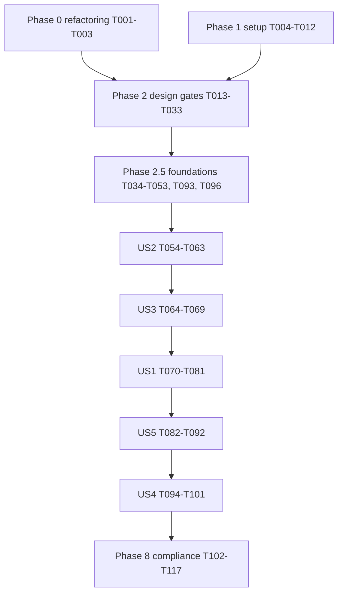

# Tasks: Policy-Driven Tool Approvals with Decision Models

**Input**: `specs/20261123-194542-decision-model-tool-approvals/` — `spec.md`, `plan.md`, `research.md`, `data-model.md`, `contracts/`, and `quickstart.md`. `decision-model-research.md` gives the guidance about decision models.

**Status**: No production code exists. The verification of D-02, D-03, D-07, D-14, and D-15 is complete (`research.md`, "Verification record"). Two gates stay open: the stakeholder approval of the four contracts (T020) and the Accepted ADR (T014).

**Tests**: The spec and Constitution Principles VIII and XIII require tests. Write each test before its behavior. A test must compile and must fail on a realistic assertion. Do not use pending or skipped cases.

**Format**: `- [ ] [ID] [P?] [Story?] Description`. `[P]` shows a task that can run in parallel with its neighbors. Paths are relative to the repository root. A document name without a path is a file in the feature directory. An identifier with a letter, for example `T056a`, shows a task that the analysis of 2026-11-25 added. A task keeps its identifier if it moves to a different phase: T093 and T096 are in Phase 2.5.

## Feature Scope

A decision model answers fixed typed questions about one tool call. The policy alone decides.
The call proceeds under a named rule, waits for a person with a factual summary, or is denied.

Each task refers to a requirement, a scenario, or a binding constraint. A larger scope needs
stakeholder approval and a change of `spec.md` first.

Do not add these items, because the plan excludes them:

- A registry of servers or tools in the broker
- A cache of positive results
- A reload of files while the service operates
- A second gRPC protocol
- A new dependency.

**Future Work** (not part of this feature): The existing log record "opa authorization decision"
contains a tool name that configuration does not bound (`research.md`, D-12). Ask the stakeholder
before you open an issue for it.

---

## Phase 0: Refactoring Before the Feature

**Purpose**: Divide the approval gate into two steps without a behavior change (D-01). Commit this phase apart from the feature commits.

- [ ] T001 Divide `Gate.Evaluate` in `internal/extproc/approval/gate.go` into two steps: find an existing decision, and create a pending approval. Keep `Evaluate` as a function that calls the two steps (D-01).
- [ ] T002 Keep the caller in `internal/extproc/server/server.go` on `Evaluate`. Do not change a test in `internal/extproc/approval/gate_test.go`.
- [ ] T003 Run `just check` and `just test-e2e-extproc`. Make sure that `tests/e2e/extproc/approval_sync_test.go` passes without a change.

**Checkpoint**: The gate has two steps, and all existing tests pass without a change.

---

## Phase 1: Setup

**Purpose**: Prepare the environment, the gateway release, and the test doubles.

- [ ] T004 Create `.specify/feature.json` with this feature directory. Read `internal/extproc/AGENTS.md`, `internal/AGENTS.md`, `web/AGENTS.md`, `tests/e2e/AGENTS.md`, and `tests/e2e/frontend/AGENTS.md`.
- [ ] T005 Change the pinned agentgateway release to `v1.7.0` in `docker-compose.yml` (with the index digest of D-14), `tests/e2e/extproc/agentgateway_e2e_test.go`, `tests/e2e/agentgateway_token_exchange_e2e_test.go`, and `tests/e2e/extproc/agentgateway_image_test.go` (D-14).
- [ ] T006 [P] Change the `docker pull` steps to agentgateway `v1.7.0` in `.github/workflows/ci.yml`, `.github/workflows/container-tests.yml`, and `.github/workflows/scheduled-coverage.yml` (D-14).
- [ ] T007 Run `just test-e2e-docker` and `just test-e2e-extproc`. Make sure that the existing agentgateway suites pass. Make sure that `tests/e2e/extproc/assessment_gateway_verification_test.go` and `tests/e2e/extproc/assessment_decision_endpoint_verification_test.go` pass.
- [ ] T008 Find the next free migration number in `migrations/` on `main`. Write it into `data-model.md` in place of `NNN` (D-09, Principle IX).
- [ ] T009 Change the test context in `tests/e2e/frontend/frontend_suite_test.go` to `fixtures.OAuth2ConfigWithTokenExchange`. Run `just test-e2e-frontend`. If a case fails, add an option for each case as `plan.md` ("Browser cases") describes.
- [ ] T010 [P] Write a test double for the decision endpoint in `tests/e2e/extproc/bootstrap/decision_endpoint.go`. It records each request. It can return set answers, a delay, a refusal, an HTTP error, and a closed connection (`contracts/decision-request.md`).
- [ ] T011 [P] Add a helper to `tests/e2e/extproc/helpers/grpc_helpers.go` that sends a `tools/list` exchange with response-phase messages. Use the observed form: `text/event-stream`, one `data:` line, and one empty end-of-stream chunk (D-02).
- [ ] T012 [P] Add synthetic fixtures under `tests/e2e/extproc/fixtures/assessment/`: one catalog, one evaluation record, one case file, and one tool listing. Add the policy of `spec.md` Journey 1 as `tests/e2e/extproc/fixtures/policies/tool_assessment.rego`.

---

## Phase 2: Design Preconditions (Blocking)

**Purpose**: Complete the design gates of the constitution. No production behavior changes before this phase is complete. The sub-phases can run in parallel.

### Phase 2a: Domain Model and Glossary (Principles II, V)

- [ ] T013 Add the glossary terms of `spec.md` ("Domain Model") to the glossary in `ARCHITECTURE.md`. Add the invariants of FR-037 and FR-041. Correct the `OPADecision` entry, because this feature changes that type (D-05).
- [ ] T014 Write `adrs/20261124-212043-decision-model-assessment.md` with the status Proposed. Record D-01, D-02, D-03, D-05, D-07, D-14, and D-15, and copy the verification record of `research.md`. State that the ADR supersedes in part the request flow and the policy contract of `adrs/028-opa-extproc-authorization.md` and the gate of `adrs/036-extproc-approval-cache-and-gate.md`, and name each superseded decision. Do not change those two files. Set the status to Accepted after T020. Add the ADR to the ADR index in `ARCHITECTURE.md` and in `AGENTS.md`, and show the relation in the index rows of the two older ADRs (Principle II).
- [ ] T015 Add the new trust boundary to `ARCHITECTURE.md` after T013 and T014, because the three tasks change one file: the decision endpoint, and the tool definition as input that the server controls (SR-011, D-02).

### Phase 2b: Configuration Design (Principle VII)

- [ ] T016 Write `examples/config/extproc-tool-assessment.yaml` with each key of `contracts/assessment-files.md` section 1 and its default. Add it to `examples/config/README.md`.
- [ ] T017 [P] Write the first version of the starter question set in `examples/config/assessment-catalog.yaml` from `spec.md` Journey 1, step 2. No question asks for an approval decision (FR-005, FR-027).
- [ ] T018 [P] Add the assessment keys to `configs/config.extproc.docker.yaml`. Add a decision model to the `llm` section of `mocks/agentgateway/config.yaml`. Make sure that the ExtProc policy does not apply to that route (`contracts/decision-request.md`, "Gateway requirements").
- [ ] T019 [P] Add the new keys to the section "ExtProc approval configuration" in `docs/configuration.md`. State the minimum agentgateway release `v1.7.0`, the timeout guidance of D-15, and the log level rule of D-13. The Helm chart does not deploy ExtProc and does not change (`adrs/011-extproc-standalone-binary.md`).

### Phase 2c: API Design (Principles IV, X)

- [ ] T020 After T024, get the stakeholder approval for `contracts/policy-assessment.md`, `contracts/decision-request.md`, `contracts/assessment-files.md`, and `contracts/approval-assessment.md` with `contracts/schemas.yaml`. Write the approval into the "Approval status" line of each contract (API-006).
- [ ] T021 Add the schemas of `contracts/schemas.yaml` to `api/enduser/openapi.yaml` with examples (API-001 to API-004). Do not change `api/admin/openapi.yaml` (API-005).
- [ ] T022 [P] Add the assessment summary and its examples to `docs/api/approval-endpoints.md` (Principle IV).

### Phase 2d: Database Design (Principle IX)

- [ ] T023 Write the atomic migration pair `migrations/NNN_add_tool_approval_assessment.up.sql` and `.down.sql` with the number of T008. Obey `data-model.md` `Storage.assessment` (DB-001, DB-002).

### Phase 2e: Design System Review (Principle XI)

- [ ] T024 Read `web/src/design-system/docs/INDEX.md`, `DECISION_TREES.md`, `COMPONENT_PAIRING_GUIDE.md`, and `COMMON_MISTAKES.md`. Select the primitives and the semantic tokens for the assessment section. Record them in `contracts/approval-assessment.md` section 2 before T020, because T020 approves that contract. The feature adds no universal component (FE-001 to FE-005).

### Phase 2f: Acceptance Test Design (Principles XIII, XIV)

- [ ] T025 Write one Ginkgo `It` for each of US1.4, US2.1 to US2.9, and US3.2 to US3.5 in `tests/e2e/extproc/tool_assessment_test.go`. Use the observable results of the mapping table in `plan.md`. Put the scenario identifier in a comment on each case.
- [ ] T026 Write one Ginkgo `It` for each of US4.1 to US4.7 in `tests/e2e/extproc/tool_assessment_test.go`, after T025.
- [ ] T027 [P] Write one Ginkgo `It` for each of US5.1 to US5.3 in `tests/e2e/extproc/assessment_evaluate_test.go`.
- [ ] T028 [P] Write one Ginkgo `It` for each of US1.1, US1.2, US1.3, and US3.1 in `tests/e2e/frontend/approval_assessment_ui_test.go`. Extend the page object `tests/e2e/pages/approval_page.go`. Capture screenshots of the attention state, the routine state, and the "no assessment" state to `tests/e2e/screenshots/`.
- [ ] T029 Run `just test-e2e-extproc` and `just test-e2e-frontend`. Make sure that the 28 cases of T025 to T028 compile and fail on their assertions. Make sure that no case in `tests/e2e/extproc/tool_assessment_test.go`, `tests/e2e/extproc/assessment_evaluate_test.go`, or `tests/e2e/frontend/approval_assessment_ui_test.go` uses `XIt`, `PIt`, or `Skip`. Without a local container runtime, the container-backed cases can run for the first time in CI (Principle XIII).
- [ ] T030 Compare the four journeys of `spec.md` with the approved contracts and with `api/enduser/openapi.yaml`. Correct each difference. Make sure that each HTTP example agrees with the schemas and that `...` marks each shortened fingerprint. Render the three wireframes again with `just render-wireframes` (Principle XIV).

### Phase 2g: Observability Design (Principle XV)

- [ ] T031 Read `coding-standards/LOGGING.md` and `coding-standards/OPENTELEMETRY.md`. Make sure that `contracts/observability.md` lists each event, span, attribute, and instrument of the feature. Get the confirmation of the reviewer that the audit write before the forward of the call (D-13) agrees with section 8 of `coding-standards/LOGGING.md`. If it does not agree, amend the standard in this pull request with a scoped rule and state the change in the description (Principle XV).
- [ ] T032 [P] Add the namespace `assessment` to the table in section 4.1 of `coding-standards/OPENTELEMETRY.md`. State this change in the description of the pull request (Principle XV).
- [ ] T033 [P] List the signals that need a safety test in `contracts/observability.md`: the bearer credential of the model request in log records and spans, the principal in the audit record as the output of the principal policy, the tool name under D-12, and the attribute set of each instrument (`LOGGING.md` section 9, `OPENTELEMETRY.md` section 7). T056a and T056b write these tests.

**Checkpoint**: The contracts have approval, the ADR is Accepted, and 28 acceptance cases fail on realistic assertions.

**Phase 2.7 (entity boilerplate)**: Not applicable. The feature adds no entity, no handler, and no repository (`plan.md`).

---

## Phase 2.5: Foundations in `internal/extproc/assessment/`

**Purpose**: Build the parts that each user story needs. Write the test task of each pair first. The automatic approval conditions are in this phase, because the evaluation run of US5 and the request path of US4 use them.

- [ ] T034 Write tests in `internal/extproc/config/validate_assessment_test.go` and `internal/extproc/config/loader_assessment_test.go` for each key, default, and validation rule of `contracts/assessment-files.md` section 1. Include `auto_approve` with `log.level: warn` (D-13).
- [ ] T035 Add the assessment keys to `internal/extproc/config/config.go`, `loader.go`, and `validate.go` until T034 passes (Principle VII).
- [ ] T036 [P] Write tests in `internal/extproc/assessment/catalog_test.go` for strict decoding and each rejection of `contracts/assessment-files.md` section 2. Cover each rule of `data-model.md`: `Assessment Catalog.organization.name`, `.organization.description`, `.organization.internal_domains`, `.questions`, `.disclosure.arguments`, `.disclosure.withhold`, and `.servers`.
- [ ] T037 Extend `internal/extproc/assessment/catalog_test.go` after T036. Cover each rule of `data-model.md` `Assessment Question.name`, `.type`, `.instructions`, `.yes_when`, `.no_when`, `.levels`, and `.statement`. Include the placeholder rule and the length limits of the criteria and the level texts. Cover each rule of `Server Exception.assess`, `.arguments`, `.withhold`, `.description`, and `.tools.<tool name>.description`.
- [ ] T038 Write the catalog loader in `internal/extproc/assessment/catalog.go` until T036 and T037 pass. It applies the rules of `data-model.md` `Assessment Catalog.organization.name`, `.organization.description`, `.organization.internal_domains`, `.questions`, `.disclosure.arguments`, `.disclosure.withhold`, and `.servers`. It applies the rules of `Assessment Question.name`, `.type`, `.instructions`, `.yes_when`, `.no_when`, `.levels`, and `.statement`, and of `Server Exception.assess`, `.arguments`, `.withhold`, `.description`, and `.tools.<tool name>.description`. The error names the question or the key (FR-028, D-11).
- [ ] T039 [P] Write tests in `internal/extproc/assessment/fingerprint_test.go`. Each field of the two canonical documents changes its value, and the key sequence does not. A change of a `statement` does not change the question set fingerprint (`contracts/decision-request.md` section 5).
- [ ] T040 Write `internal/extproc/assessment/fingerprint.go` until T039 passes. It supplies `data-model.md` `Tool Definition.tool_context` and `Assessment and Answer.question_set` (FR-023, FR-029, D-06).
- [ ] T041 [P] Write tests and a fuzz test in `internal/extproc/assessment/listing_test.go` for the subjects that `plan.md` lists for the listing parser. Include a tool without an input schema and a schema without described properties. Cover `data-model.md` `Tool Definition.name`, `.description`, `.input_schema`, and `.annotations`.
- [ ] T042 Write the listing parser in `internal/extproc/assessment/listing.go` until T041 passes. It applies the rules of `data-model.md` `Tool Definition.name`, `.description`, `.input_schema`, and `.annotations` (FR-013, D-02).
- [ ] T043 [P] Write tests in `internal/extproc/assessment/store_test.go`. The latest definition applies, and the limit is 10,000. A changed definition gives a change report. A listing that ExtProc cannot read removes the definitions of its server. An oversized definition gives a marker. Cover `data-model.md` `Tool Definition.target_server_name` and `.written_by`.
- [ ] T044 Write the tool definition store in `internal/extproc/assessment/store.go` until T043 passes. It sets `data-model.md` `Tool Definition.target_server_name` and `.written_by` (FR-013, FR-014, FR-063).
- [ ] T045 [P] Write tests in `internal/extproc/assessment/context_test.go` for the subjects that `plan.md` lists for the context builder. Include a call without arguments and a tool without described arguments. Cover `data-model.md` `Assessment Context.organization`, `.server`, `.tool`, and `.call` with their rules.
- [ ] T046 Write the context builder in `internal/extproc/assessment/context.go` until T045 passes. It builds `data-model.md` `Assessment Context.organization`, `.server`, `.tool`, and `.call` with their rules (FR-010 to FR-022, SR-004 to SR-006).
- [ ] T047 [P] Write tests in `internal/extproc/assessment/answers_test.go` for each status of D-04 and each invalid answer. Cover `data-model.md` `Assessment and Answer.status`, `.model`, `.answers.<name>.status`, `.answers.<name>.probability`, and `.answers.<name>.probabilities`, `score`, `confidence`.
- [ ] T048 Write the answer validation in `internal/extproc/assessment/answers.go` until T047 passes. It sets `data-model.md` `Assessment and Answer.status`, `.model`, `.answers.<name>.status`, `.answers.<name>.probability`, and `.answers.<name>.probabilities`, `score`, `confidence` (FR-030 to FR-032).
- [ ] T049 [P] Write tests in `internal/extproc/assessment/client_test.go` with `httptest`. Cover the request shape of `contracts/decision-request.md` and the composed question text. Cover the deadline, the single attempt, and the credential file. Cover the 256 KiB limit and the limit of 64 requests in progress (SC-005).
- [ ] T050 Write the model client in `internal/extproc/assessment/client.go` with `internal/extproc/httpclient` until T049 passes (FR-007, FR-024 to FR-026, D-03).
- [ ] T051 [P] Write tests in `internal/extproc/assessment/record_test.go` and the loader in `internal/extproc/assessment/record.go` for `data-model.md` `Evaluation Record.format`, `.model`, `.question_set`, and `.tool_contexts.<target server name>.<tool name>` (`contracts/assessment-files.md` section 3).
- [ ] T052 Extend `internal/extproc/authorization/decision_test.go` for `auto_approval.rule`, `approval_context.recommendation`, and `approval_context.findings` on `allow` and on `approval_required` results (`contracts/policy-assessment.md` section 3).
- [ ] T053 Change `ParseDecision` in `internal/extproc/authorization/decision.go` and the audit switch in `internal/extproc/authorization/authorizer.go` until T052 passes (D-05).
- [ ] T093 [P] Write tests in `internal/extproc/assessment/conditions_test.go` for each condition of the table "Conditions for automatic approval" in `spec.md`. Each false condition gives its `unmet_condition` value of `contracts/observability.md`. A permanent denial gives a denial, and each other false condition gives `approval_required` (FR-041 to FR-044).
- [ ] T096 Write the conditions in `internal/extproc/assessment/conditions.go` until T093 passes. A policy cannot disable a condition (FR-040, FR-043).

**Checkpoint**: Each foundation part has passing tests. The service behavior does not change.

---

## Phase 3: User Story 2 — Give the Model Sufficient and Bounded Context (P1)

**Goal**: An assessed call causes exactly one model request with the bounded context. Other calls cause no model request.

**Independent Test**: Run the cases US2.1 to US2.9 and US1.4 in `tests/e2e/extproc/tool_assessment_test.go` with the decision endpoint double.

### Tests first

- [ ] T054 [P] [US2] Write tests in `internal/extproc/assessment/assessor_test.go` for one assessment. The statuses `excluded`, `definition_missing`, and `context_too_large` cause no model request. The policy input agrees with `contracts/policy-assessment.md` section 2 and contains no approval record (FR-034). Cover `data-model.md` `Assessment and Answer.evaluated`, `.context`, and `.tool.written_by`, `.tool.context`.
- [ ] T055 [P] [US2] Extend `internal/extproc/server/server_test.go`. A `tools/list` exchange stores its definitions. The server returns each response chunk without a change. Other responses keep the behavior of today. A batched MCP request and a request that is not MCP cause no assessment (FR-001, D-02).
- [ ] T056 [P] [US2] Extend `internal/extproc/approval/client_test.go` and `gate_test.go`: the create request carries the optional summary, and `Invocation` carries the target server name (`contracts/approval-assessment.md`).
- [ ] T056a [P] [US2] Write tests in `internal/extproc/assessment/telemetry_test.go` for each row of `contracts/observability.md`. Give the production constructors a JSON buffer logger, a span recorder, and a metric reader. Assert the `event` and the key attributes of `assessment.tool_call.assessed`, `assessment.tool_definition.changed`, and `assessment.catalog.loaded`. Assert that the principal value is the output of the principal policy and that the tool name is present only under D-12. Assert each span name, attribute, and status, and the attribute set of each instrument (`LOGGING.md` section 9, `OPENTELEMETRY.md` section 7, Principles VIII and XV).
- [ ] T056b [P] [US2] Write `tests/e2e/extproc/assessment_signals_test.go`. It is not an acceptance scenario. It runs the assessment cases of the fixtures and reads all log records, spans, and metric attributes. It makes sure that the record `assessment.tool_call.assessed` exists. It makes sure that no signal contains an argument value, a definition text, a question text, or the credential of the fixtures (FR-061, SR-007).

### Implementation

- [ ] T057 [US2] Write the assessor in `internal/extproc/assessment/assessor.go` until T054 passes. It joins the store, the context builder, the client, and the answer validation behind one interface. It sets `data-model.md` `Assessment and Answer.evaluated`, `.context`, `.tool.written_by`, and `.tool.context` (FR-001, FR-002, FR-033).
- [ ] T058 [US2] Keep a small stream state for `tools/list` requests in `internal/extproc/server/server.go`. Copy the response chunks to the listing parser and the store until T055 passes (FR-013, `max_listing_bytes`).
- [ ] T059 [US2] Add the summary to `CreateRequest` in `internal/extproc/approval/client.go` and the two fields to `Invocation` in `internal/extproc/approval/gate.go` until T056 passes.
- [ ] T060 [US2] Add the assessment to the `approval_required` branch in `internal/extproc/server/server.go` with the sequence of D-01. Evaluate the policy a second time with `input.assessment`. For this story, each assessed call ends as a pending approval or a denial (FR-001 to FR-004).
- [ ] T061 [US2] Connect the catalog, the store, the client, and the assessor in `cmd/extproc-token-exchange/root.go`. Write the event `assessment.catalog.loaded` at startup, as T056a tests it (`contracts/observability.md`).
- [ ] T062 [US2] Write the audit record `assessment.tool_call.assessed`, the spans, and the instruments of `contracts/observability.md` in `internal/extproc/assessment/telemetry.go` until T056a passes. Obey D-12 for the tool name (FR-060 to FR-063).
- [ ] T063 [US2] Run `just test-e2e-extproc`. Make sure that US2.1 to US2.9 and US1.4 in `tests/e2e/extproc/tool_assessment_test.go` pass. Make sure that the signal test of T056b passes (FR-006, FR-061, SC-004, SC-008).

**Checkpoint**: The model interface operates in the request path. Each assessed call still waits for a person.

---

## Phase 4: User Story 3 — Keep the Human Decision When the Assessment Fails (P1)

**Goal**: Each failure keeps the call for a person. A second identical call causes no second model request. The system rules limit each policy result.

**Independent Test**: Run the cases US3.2 to US3.5 in `tests/e2e/extproc/tool_assessment_test.go` with each failure of the double.

### Tests first

- [ ] T064 [P] [US3] Extend `internal/extproc/approval/cache_test.go` and `gate_test.go` for the pending lookup by agent, tool name, and `arguments_hash`. A call with an added argument does not match. The hash agrees with `storage.ComputeArgumentsHash` for the fixture arguments (D-07).
- [ ] T065 [P] [US3] Write tests in `internal/extproc/assessment/rules_test.go` for each row of `contracts/policy-assessment.md` section 4. Cover the downgrade of an `allow` result and the fallback after an error in the second evaluation. Cover the removal of unknown findings, the first finding for each question, the limit of 16, and the catalog statement.

### Implementation

- [ ] T066 [US3] Add `ArgumentsHash` to `Record` and a separate lookup for pending records in `internal/extproc/approval/cache.go`. Use it in `internal/extproc/approval/gate.go` before an assessment until T064 passes. A pending record never lets a call proceed (FR-008, D-07).
- [ ] T067 [US3] Write the system rules in `internal/extproc/assessment/rules.go` until T065 passes. Count each removed entry in `extproc.assessment.policy_result.removed` (FR-035, FR-036, FR-042, D-05).
- [ ] T068 [US3] Use the rules in the approval branch of `internal/extproc/server/server.go`. If the second evaluation fails, use the first result with the summary status `not_available` (SR-002, D-05).
- [ ] T069 [US3] Run `just test-e2e-extproc`. Make sure that US3.2 to US3.5 in `tests/e2e/extproc/tool_assessment_test.go` pass (SR-002). T095b proves SC-002 after the automatic approval path exists.

**Checkpoint**: No failure of the model interaction lets a call proceed or removes the decision of a person.

---

## Phase 5: User Story 1 — See a Factual Assessment of the Specific Call (P1) 🎯 MVP

**Goal**: The broker stores the assessment summary. The approval page shows the recommendation, the findings, and the fixed notice.

**Independent Test**: Run the browser cases US1.1 to US1.3 and US3.1 in `tests/e2e/frontend/approval_assessment_ui_test.go`.

### Tests first

- [ ] T070 [P] [US1] Extend `internal/domain/approval/service_test.go` for the summary validation. Cover each rule of `data-model.md` `Assessment Summary.status`, `.recommendation`, `.findings`, `.model`, and `.question_set`. Cover each rule of `Finding.question`, `.statement`, and `.state`. A second create request keeps the first summary. The record "approval created" has the attribute `assessment_summary_status` (FR-037, SR-008, `contracts/observability.md`, "Broker").
- [ ] T071 [P] [US1] Extend `internal/adapters/storage/memory/tool_approval_repository_test.go` and `internal/adapters/storage/postgres/tool_approval_repository_test.go`: store and return the summary, and read an old record as "no assessment information" (DB-002, DB-003).
- [ ] T072 [P] [US1] Write `tests/integration/migrations/tool_approval_assessment_migration_test.go`: apply the migration of T023 up, down, and up against PostgreSQL. Existing records stay valid (DB-001).
- [ ] T073 [P] [US1] Extend `internal/adapters/http/handlers/approval/create_handler_test.go` and `get_handler_test.go` for the summary and for each validation error (API-001 to API-004).
- [ ] T074 [P] [US1] Write `web/src/components/approvals/AssessmentSummary.test.tsx` for each row of the content table in `contracts/approval-assessment.md` section 2. Extend `web/src/components/approvals/ApprovalReviewPage.test.tsx` for the position of the section (FE-001).

### Implementation

- [ ] T075 [US1] Add the Assessment Summary value object to `internal/domain/storage/tool_approval.go`. It has the fields `data-model.md` `Assessment Summary.status`, `.recommendation`, `.findings`, `.model`, and `.question_set`, and `Finding.question`, `.statement`, and `.state`.
- [ ] T076 [US1] Validate and store the summary in `internal/domain/approval/service.go` until T070 passes. Apply each rule of `data-model.md` `Assessment Summary.status`, `.recommendation`, `.findings`, `.model`, and `.question_set`, and of `Finding.question`, `.statement`, and `.state`. Add the attribute `assessment_summary_status` to the record "approval created" (`contracts/observability.md`, "Broker").
- [ ] T077 [P] [US1] Store and return the summary in `internal/adapters/storage/memory/tool_approval_repository.go` and `internal/adapters/storage/postgres/tool_approval_repository.go` until T071 and T072 pass. Add the column to each explicit column list (Principle IX).
- [ ] T078 [US1] Add the summary to the DTOs in `internal/adapters/http/handlers/approval/create_handler.go` and `get_handler.go` until T073 passes. The handler passes the value to the service and does not validate it (Principle VI).
- [ ] T079 [P] [US1] Add the summary type to `web/src/types/approval.ts`. Write `web/src/components/approvals/AssessmentSummary.tsx` with the fixed texts of FR-038 and FR-039 until T074 passes (FE-002 to FE-005).
- [ ] T080 [US1] Show the component in `web/src/components/approvals/ApprovalReviewPage.tsx` between the request summary and the technical details (FE-001).
- [ ] T081 [US1] Run `just test-e2e-frontend`. Make sure that US1.1, US1.2, US1.3, and US3.1 in `tests/e2e/frontend/approval_assessment_ui_test.go` pass and that the three screenshots exist (SC-001).

**Checkpoint**: Recommendation mode operates. US1, US2, and US3 form the first release. Automatic approval is not possible at this point. The record of FR-044 (`would_auto_approve`) is complete with US4, because it needs an evaluation record.

---

## Phase 6: User Story 5 — Measure Before Enabling Automation (P2)

**Goal**: An operator measures labeled cases on the production code path and gets a report and an evaluation record.

**Independent Test**: Run the cases US5.1 to US5.3 in `tests/e2e/extproc/assessment_evaluate_test.go` with the starter files and the double.

### Tests first

- [ ] T082 [P] [US5] Write tests in `internal/extproc/assessment/stats_test.go` for the exact one-sided 95% upper bound. Include 0 of 410 and 1 of 410 (FR-051, D-08).
- [ ] T083 [P] [US5] Write tests in `internal/extproc/assessment/evaluate_test.go` for `contracts/assessment-files.md` sections 4 to 7. Cover the case file and the tool listing files. Cover the report values, the line for each case with its outcome and answers, the evaluation record, and the three exit codes (FR-051).

### Implementation

- [ ] T084 [US5] Write the statistics in `internal/extproc/assessment/stats.go` with the `math` package until T082 passes.
- [ ] T085 [US5] Write the evaluation run in `internal/extproc/assessment/evaluate.go` until T083 passes. Use the assessor, the policy, the system rules of T067, and the conditions of T096 as the service uses them. Set `evaluated` to `true` for each case (FR-050 to FR-052, D-08).
- [ ] T086 [US5] Add the subcommand `assessment evaluate` in `cmd/extproc-token-exchange/assessment.go`. Call `RegisterFlags` for the subcommand. Do not change the behavior of the root command in `cmd/extproc-token-exchange/root.go` (D-08).
- [ ] T087 [P] [US5] Write the starter case set `examples/config/assessment-cases.jsonl` with a label for each case. Include the calls of issue #206, dangerous counterexamples, and adversarial argument variants (FR-053).
- [ ] T088 [P] [US5] Write the example policy `examples/config/assessment-policy.rego` from `spec.md` Journey 1, step 3. Evaluate it with the OPA library against the inputs of journeys 1 to 3 in a test in `internal/extproc/assessment/example_policy_test.go`.
- [ ] T089 [US5] Write one case in `tests/e2e/extproc/assessment_starter_set_test.go`. It is not an acceptance scenario. It runs the subcommand on the starter files of T017, T087, and T088 with the double. The external editor share and each adversarial variant wait for a person (SC-003).
- [ ] T090 [US5] Do an evaluation run of the starter files with a real decision model. Change the questions in `examples/config/assessment-catalog.yaml` and the thresholds in `examples/config/assessment-policy.rego` until the results agree with the labels. This task needs access to a model, for example the local model of the smoke test in `decision-model-research.md`. It is a gate for the second release, because the spec requires the measured results before publication (`spec.md`, "The product has no default thresholds").
- [ ] T091 [US5] Write `docs/guides/assess-tool-calls.md`. Give the authoring rules with one correct and one incorrect question for each rule. Give an annotated organization description and question set. Describe the evaluation run and the measured results of T090. State the residual risks (FR-027, SR-010).
- [ ] T092 [US5] Run `just test-e2e-extproc`. Make sure that US5.1 to US5.3 in `tests/e2e/extproc/assessment_evaluate_test.go` pass (SC-007).

**Checkpoint**: An operator can measure the false-approval rate and get an evaluation record.

---

## Phase 7: User Story 4 — Let Harmless Calls Proceed Under a Named Rule (P2)

**Goal**: A call proceeds without a person only if all conditions of FR-041 are true. One audit record names the rule and the answers.

**Independent Test**: Run the cases US4.1 to US4.7 in `tests/e2e/extproc/tool_assessment_test.go` with an evaluation record and the example rule.

### Tests first

The tests and the code of the conditions are T093 and T096 in Phase 2.5.

- [ ] T094 [P] [US4] Write tests in `internal/extproc/assessment/audit_test.go`. An error from `Handle` keeps the call for a person. A disabled INFO level also keeps the call for a person (SR-009, D-13).
- [ ] T095 [P] [US4] Extend `internal/extproc/approval/cache_test.go` for a lookup of a permanent denial. The lookup only reads. It reserves no `once` approval (D-15).
- [ ] T095a [P] [US4] Extend `internal/extproc/assessment/record_test.go` and `telemetry_test.go`. A record with a question set that differs from the catalog gives `evaluated: false` for each tool and one event `assessment.evaluation_record.mismatched` with the two fingerprints (SC-010, `contracts/assessment-files.md` section 3).
- [ ] T095b [P] [US4] Write the table-driven test `internal/extproc/server/assessment_failure_test.go` for SC-002. Each row uses the `auto_approve` mode, an evaluation record, and a rule that permits the call. Use a minimum of 20 failure conditions: a timeout, a refusal, a missing answer, a malformed body, a probability out of range, a wrong level count, a wrong level label, a wrong total of a scale, an unknown answer name, a duplicate answer name, an HTTP error, a closed connection, a response that is too large, the limit of requests in progress, a different answering model, an absent model value, a changed tool definition, a missing definition, an excluded server, an undescribed argument, an oversized argument, an oversized context, and an error in the second evaluation. No row lets the call proceed (SC-002, SR-002).

### Implementation

- [ ] T097 [US4] Write the audit write in `internal/extproc/assessment/audit.go` until T094 passes. Write the record before the call proceeds (FR-060, D-13).
- [ ] T098 [US4] Add the read-only denial lookup to `internal/extproc/approval/cache.go` until T095 passes.
- [ ] T099 [US4] Add the automatic approval path to the approval branch in `internal/extproc/server/server.go` until T095b passes (SC-002). The sequence is the conditions, the denial lookup, the audit write, and then the forward of the call. A matching permanent denial denies the call (FR-042). In the `recommend` mode, record `would_auto_approve` and keep the call for a person. A call that proceeds creates no approval record (FR-041, FR-044, FR-045, DB-004).
- [ ] T100 [US4] Read the evaluation record at startup in `cmd/extproc-token-exchange/root.go` until T095a passes. Write the event `assessment.evaluation_record.mismatched` if its question set differs from the catalog (SC-010, `contracts/assessment-files.md` section 3).
- [ ] T101 [US4] Run `just test-e2e-extproc`. Make sure that US4.1 to US4.7 in `tests/e2e/extproc/tool_assessment_test.go` pass. Make sure that the signal test of T056b passes with the automatic approval cases (SC-006).

**Checkpoint**: All five user stories operate. Automatic approval stays disabled by default.

---

## Phase 8: Constitution Compliance and Completion

**Purpose**: Make sure that the feature obeys the constitution and that the documents agree with the code.

### Design phase verification

- [ ] T102 Make sure that each task and each change refers to a requirement of `spec.md`. Make sure that no change is unrelated to the feature (Feature Scope).
- [ ] T103 Make sure that `ARCHITECTURE.md` has the glossary terms and the trust boundary. Make sure that the ADR of T014 is Accepted, names the decisions that it supersedes, and agrees with the code. Make sure that `examples/config/README.md` refers to each new example. Make sure that the Helm chart has no key of the feature, because it does not deploy ExtProc (`adrs/011-extproc-standalone-binary.md`, Principles II, V, VII).
- [ ] T104 Make sure that `api/enduser/openapi.yaml` and `docs/api/approval-endpoints.md` agree exactly with the implemented API and with `contracts/schemas.yaml`. Make sure that the approval of T020 is in the pull request (Principles IV, X).
- [ ] T105 Make sure that `tests/e2e/extproc/tool_assessment_test.go`, `tests/e2e/extproc/assessment_evaluate_test.go`, and `tests/e2e/frontend/approval_assessment_ui_test.go` contain exactly 28 cases, one for each scenario. Each case has its scenario identifier, and no case is pending or skipped. The cases of T056b and T089 are in their own files and are not scenario cases (Principle XIII).
- [ ] T105a Make sure that each journey of `spec.md` refers to its scenarios. Make sure that the configuration, the HTTP exchanges, and the three wireframes with their Wireloom sources agree with the requirements, the contracts, and `api/enduser/openapi.yaml` (Principle XIV).

### Implementation phase verification

- [ ] T106 Run the signal test of T056b and the telemetry tests of T056a on the complete feature. Make sure that no log record, span, or metric attribute contains an argument value, a definition text, a question text, or the credential of the fixtures (FR-061, SR-007).
- [ ] T107 [P] Update `internal/extproc/AGENTS.md`: the new package, the configuration table, the response observation, and the subcommand. Update "What is Instrumented" in `docs/configuration.md` (Principle XV).
- [ ] T108 [P] Update `docs/resources/assurance-case.md`. Add the trust boundary to the decision endpoint. Add the tool definition as input that the server controls. Add the controls of the security requirements of `spec.md` (SR-011).
- [ ] T109 Review the feature code against `coding-standards/LOGGING.md` and `coding-standards/OPENTELEMETRY.md` with their review checklists. Make sure that no automated check is disabled (Principle XV).
- [ ] T109a Make sure that the tests, the contract entries, and the registry entry that the two standards require exist: the credential is absent from log records and spans, the principal value is the output of the principal policy, a test asserts the attribute set of each instrument, `contracts/observability.md` lists each instrument, and `coding-standards/OPENTELEMETRY.md` has the namespace `assessment` (Principle XV).
- [ ] T110 Make sure that assessment and automatic approval are disabled by default. Make sure that each failure path keeps the call for a person or denies it. Make sure that `internal/extproc/assessment/` contains no cryptography of its own (Principles I and III, SR-001 to SR-003).
- [ ] T111 Make sure that `internal/extproc/assessment/` imports no broker adapter. Make sure that the handlers in `internal/adapters/http/handlers/approval/` call only the domain service (Principle VI).
- [ ] T111a Make sure that `cmd/extproc-token-exchange/root.go` and `cmd/extproc-token-exchange/assessment.go` are the only places that connect the assessment parts. Make sure that the broker adds no service and no wiring outside `internal/app/builder.go` (Principle XII, `adrs/011-extproc-standalone-binary.md`).
- [ ] T112 Make sure that the migration pair of T023 is atomic and has the next free number on `main`. Make sure that the two repositories in `internal/adapters/storage/` have tests for the summary (Principle IX).
- [ ] T112a Make sure that each behavior of the feature has a test that was written before it. Make sure that the tests changed only in small parts during implementation. Make sure that no Bash script validates code correctness. Evidence of a failed run is not necessary (Principle VIII).
- [ ] T113 Examine `web/src/components/approvals/AssessmentSummary.tsx`. Make sure that it uses only design system primitives and semantic tokens. Make sure that it obeys WCAG 2.1 AA (Principle XI, FE-004).
- [ ] T114 Do a security review of the feature diff in `internal/extproc/` and `internal/domain/approval/`. Correct each finding that blocks a safe release. Record the result in the pull request (Principle I).
- [ ] T115 Do the ten journeys of `quickstart.md`. Record the real results and each prerequisite that was not available. Record the result for each of SC-001 to SC-010.
- [ ] T116 Run `just verify`, as `CONTRIBUTING.md` requires. Run `just test-e2e`. Record the commands and their results in the pull request.
- [ ] T117 Make sure that `spec.md`, `plan.md`, `research.md`, `data-model.md`, and the contracts agree with the final code. Keep the Simple English rules in each changed document.

---

## Dependencies and Execution Order

- **Phase 0 and Phase 1** have no dependency and can run at the same time. T005 comes before T007. T008 comes before T023.
- **Phase 2** blocks all behavior. T024 comes before T020, because it changes a contract that T020 approves. T020 (approval) comes before T021 and before the Accepted status of T014. T013, T014, and T015 change `ARCHITECTURE.md` and run one after the other. T025 comes before T026, because they change one file. T029 follows T025 to T028.
- **Phase 2.5** follows Phase 2. Each implementation task follows its test task. T037 follows T036 in one file. T093 and T096 follow T051 and T053.
- **US2, US3, US1** are all P1 and use one request path. US2 supplies the path. US3 makes it safe for failures. US1 shows the result to the approver. The broker tasks T070 to T078 do not depend on US2 and US3 and can start after Phase 2.
- **US5** comes before US4, because an operator must measure before automation. The evaluation run uses the conditions of T096 from Phase 2.5. T090 needs access to a real model. T090 and the measured results in T091 are a gate for the second release. If no model is available, the second release is not complete, and the project does not publish the example policy.
- **US4** follows US3 and US5. T099 follows T095b, T097, and T098. T100 follows T095a.
- **Phase 8** follows all stories.

Tasks that change `internal/extproc/server/server.go` must run one after the other: T002, T058, T060, T068, T099. The same applies to `tests/e2e/extproc/tool_assessment_test.go` (T025, T026) and to `internal/extproc/approval/cache.go` (T066, T098).

## Parallel Execution Examples

### Foundations

After T035, these test tasks use different files and can run at the same time: T036, T039, T041, T043, T045, T047, T049, T051. T093 can run at the same time as T052.

### User Story 2

T054, T055, T056, T056a, and T056b use different test files and can run at the same time. T057 and T059 can then run at the same time. T058 and T060 change one file and run in sequence.

### User Story 1

T070, T071, T072, T073, and T074 use different test files and can run at the same time. After T075, the storage task T077 and the web task T079 can run at the same time.

### User Stories 5 and 4

T082 and T083 can run at the same time, and so can T087 and T088. For US4, T094, T095, T095a, and T095b can run at the same time.

## Implementation Strategy

### First release: recommendation mode (US2, US3, US1)

1. Complete Phase 0, Phase 1, and Phase 2. Stop until T020 has approval.
2. Complete the foundations.
3. Complete US2, then US3, then US1.
4. Stop and validate: do journeys 1, 2, 3, 4, 8, and 10 of `quickstart.md`.

This release changes no approval decision. Each assessed call still waits for a person. No
evaluation record exists in this release. Thus, `evaluated` and `would_auto_approve` are false,
and the audit record contains no tool name (D-12). The second release completes FR-044.

### Second release: measurement and automatic approval (US5, US4)

1. Complete US5 and do the evaluation run of T090 with a real model. Do not continue to the release without its results.
2. Complete US4.
3. Stop and validate: do journeys 5, 6, 7, and 9 of `quickstart.md`.
4. Complete Phase 8.

Automatic approval stays disabled by default in each release.

## Notes

- Commit after each task or each small group of tasks. Commit Phase 0 apart from the feature.
- If a test shows a defect in a completed task, add a test for the defect before you correct it.
- Do not make an assertion weaker to make a case pass.
- Stop at each checkpoint and validate the story on its own.
