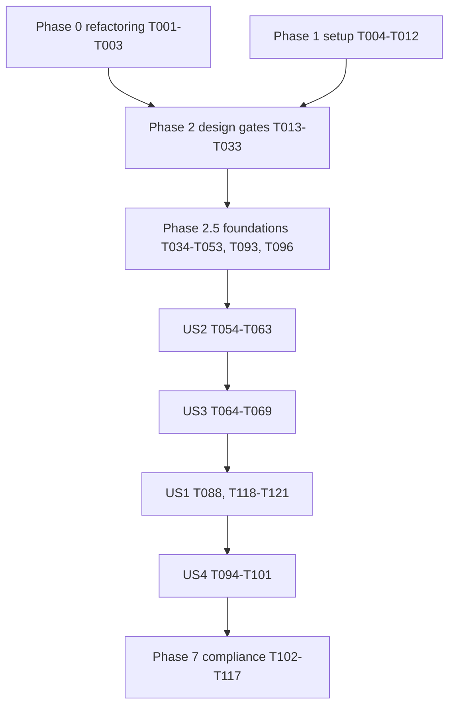

# Tasks: Policy-Driven Tool Approvals with Decision Models

**Input**: `specs/20261123-194542-decision-model-tool-approvals/` — `spec.md`, `plan.md`, `research.md`, `data-model.md`, `contracts/`, and `quickstart.md`. `decision-model-research.md` gives the guidance about decision models.

**Status**: No production code exists. The verification of D-02, D-03, D-07, D-14, and D-15 is complete (`research.md`, "Verification record"). Two gates stay open: the stakeholder approval of the contracts (T020) and the Accepted ADR (T014).

**Tests**: The spec and Constitution Principles VIII and XIII require tests. Write each test before its behavior. A test must compile and must fail on a realistic assertion. Do not use pending or skipped cases.

**Format**: `- [ ] [ID] [P?] [Story?] Description`. `[P]` shows a task that can run in parallel with its neighbors. Paths are relative to the repository root. A document name without a path is a file in the feature directory. An identifier can have a letter, for example `T056a`. Task identifiers are stable: T088, T093, and T096 are in a different phase than their numbers show and keep their identifiers.

The scope changes of 2026-11-26 (`research.md`, D-16 to D-18) removed these tasks: T008, T009, T021 to T024, T027, T028, T028a, T039, T040, T051, T056, T059, T070 to T087, T089 to T092, T090a, T095a, T100, T112, and T113. Their identifiers are not used again. T118 to T121 are new.

## Feature Scope

A decision model answers fixed typed questions about one tool call. The policy alone decides.
The call proceeds under a named rule, waits for a person, or is denied. A call that waits for a
person gets the description and the risk level that the policy derived from the answers.

Each task refers to a requirement, a scenario, or a binding constraint. A larger scope needs
stakeholder approval and a change of `spec.md` first.

Do not add these items, because the plan excludes them:

- A change to the broker, its API, its database, or the approval page
- A list of findings, a recommendation, or a notice for the approver
- A catalog file, a question set file, or a key for an individual server or tool
- A filter or a setting that withholds an argument from the model
- An evaluation run, an evaluation record, a case set, or a measurement of a model
- A fingerprint of the questions or of a tool definition
- A registry of servers or tools in the broker
- A cache of positive results
- A reload of files while the service operates
- A second gRPC protocol
- A new dependency.

**Future Work** (not part of this feature): These findings are about behavior from before the
feature. Ask the stakeholder before you open an issue for one of them.

- The existing log record "opa authorization decision" contains a tool name that configuration does not bound (`research.md`, D-12). The feature writes this record two times for an assessed call and does not change its log call.
- The approval key of the broker has no target server. Two servers on different routes that list one tool name share approvals.

---

## Phase 0: Refactoring Before the Feature

**Purpose**: Divide the approval gate into two steps without a behavior change (D-01). Commit this phase apart from the feature commits.

- [ ] T001 Divide `Gate.Evaluate` in `internal/extproc/approval/gate.go` into two steps: find an existing decision, and create a pending approval. Keep `Evaluate` as a function that calls the two steps (D-01).
- [ ] T002 Keep the caller in `internal/extproc/server/server.go` on `Evaluate`. Do not change a test in `internal/extproc/approval/gate_test.go`.
- [ ] T002a Move the arguments hash from `internal/domain/storage/tool_approval.go` to the leaf package `internal/domain/approval/toolpattern`. `storage.ComputeArgumentsHash` calls the new function. Do not change a hash value or a test (`adrs/035-shared-tool-pattern-matching.md`, D-07).
- [ ] T003 Run `just check`, `just test`, and `just test-e2e-extproc`. Make sure that `tests/e2e/extproc/approval_sync_test.go` passes without a change.

**Checkpoint**: The gate has two steps, and all existing tests pass without a change.

---

## Phase 1: Setup

**Purpose**: Prepare the environment, the gateway release, and the test doubles.

- [ ] T004 Make sure that `.specify/feature.json` names this feature directory. Read `internal/extproc/AGENTS.md`, `internal/AGENTS.md`, and `tests/e2e/AGENTS.md`.
- [ ] T005 Change the pinned agentgateway release to `v1.7.0` in `docker-compose.yml` (with the index digest of D-14), `tests/e2e/extproc/agentgateway_e2e_test.go`, `tests/e2e/agentgateway_token_exchange_e2e_test.go`, and `tests/e2e/extproc/agentgateway_image_test.go` (D-14).
- [ ] T006 [P] Change the `docker pull` steps to agentgateway `v1.7.0` in `.github/workflows/ci.yml`, `.github/workflows/container-tests.yml`, and `.github/workflows/scheduled-coverage.yml` (D-14).
- [ ] T007 Run `just test-e2e-docker` and `just test-e2e-extproc`. Make sure that the existing agentgateway suites pass. Make sure that `tests/e2e/extproc/assessment_gateway_verification_test.go` and `tests/e2e/extproc/assessment_decision_endpoint_verification_test.go` pass.
- [ ] T007a After T005, change the report entries of `tests/e2e/extproc/assessment_gateway_verification_test.go` and `tests/e2e/extproc/assessment_decision_endpoint_verification_test.go` into assertions, as `plan.md` ("Verification with agentgateway") lists them. Assert the cursor of the first listing page and a known tool of the second page. Assert the content type, the event framing, and the compression that the listing parser needs. Send the request with two `input_text` parts to the two upstream doubles, and compare the full translated body, the credential, and the returned `model` value with different request and response model names. Make the context constant and the question constant of the second file equal to `spec.md` Journey 1, step 6. Replace `Skip` with `Fail` for a missing container runtime (D-02, D-03, Principle XIII). Run T007 again.
- [ ] T010 [P] Write a test double for the decision endpoint in `tests/e2e/extproc/bootstrap/decision_endpoint.go`. It records each request. It can return set answers, a delay, a refusal, an HTTP error, and a closed connection (`contracts/decision-request.md`).
- [ ] T011 [P] Add a helper to `tests/e2e/extproc/helpers/grpc_helpers.go` that sends a `tools/list` exchange with response-phase messages. Use the observed form: `text/event-stream`, one `data:` line, and one empty end-of-stream chunk (D-02).
- [ ] T012 [P] Add synthetic fixtures under `tests/e2e/extproc/fixtures/assessment/`: one tool listing with all its pages, and one configuration with an invalid question. Add the organization values of `spec.md` Journey 1, step 1, to the test configuration. Add the policy of `spec.md` Journey 1 as `tests/e2e/extproc/fixtures/policies/tool_assessment.rego`. The policy has the rules for the session setup and for `tools/list`, so that a listing passes it.

---

## Phase 2: Design Preconditions (Blocking)

**Purpose**: Complete the design gates of the constitution. No production behavior changes before this phase is complete. The sub-phases can run in parallel.

Phases 2c (OpenAPI), 2d (database), and 2e (design system) of the task template have no task, because the feature changes no API document, no schema, and no page (API-001, DB-001, FR-038). The contract approval of Principle X is T020.

### Phase 2a: Domain Model and Glossary (Principles II, V)

- [ ] T013 Add the glossary terms of `spec.md` ("Domain Model") to the glossary in `ARCHITECTURE.md`. Add the invariant of FR-041. Correct the `OPADecision` entry, because this feature changes that type (D-05).
- [ ] T014 Write `adrs/20261124-212043-decision-model-assessment.md` with the status Proposed. Record D-01, D-02, D-03, D-05, D-07, D-14, D-15, D-16, D-17, and D-18, and copy the verification record of `research.md`. State that the ADR supersedes in part the request flow and the policy contract of `adrs/028-opa-extproc-authorization.md` and the gate of `adrs/036-extproc-approval-cache-and-gate.md`, and name each superseded decision. Do not change those two files. Set the status to Accepted after T020. Add the ADR to the ADR index in `ARCHITECTURE.md` and in `AGENTS.md`, and show the relation in the index rows of the two older ADRs (Principle II). Record that the leaf package `internal/domain/approval/toolpattern` also owns the arguments hash with its canonical form (T002a, T066), and that the import rule of `adrs/035-shared-tool-pattern-matching.md` stays.
- [ ] T015 Add the new trust boundary to `ARCHITECTURE.md` after T013 and T014, because the three tasks change one file: the decision endpoint, and the tool definition as input that the server controls (SR-011, D-02).

### Phase 2b: Configuration Design (Principle VII)

- [ ] T016 Write `examples/config/extproc-tool-assessment.yaml` with each key of `contracts/assessment-configuration.md` section 1 and its default, including the organization values and the default questions in full. Add it to `examples/config/README.md`.
- [ ] T017 [P] Review each default question of `spec.md` Journey 1, step 2, against the authoring rules of FR-027 and the findings R-04 to R-09 of `decision-model-research.md`. Make sure that no question asks for an approval decision and that no question has text for the approver. Correct each question that does not obey a rule in `spec.md`, before T035 puts the questions into code (FR-005, FR-024, FR-025, D-17).
- [ ] T018 [P] Add the assessment keys to `configs/config.extproc.docker.yaml`. Add a decision model to the `llm` section of `mocks/agentgateway/config.yaml`. Make sure that the ExtProc policy does not apply to that route (`contracts/decision-request.md`, "Gateway requirements").
- [ ] T019 [P] Add the new keys to the section "ExtProc approval configuration" in `docs/configuration.md`. State the minimum agentgateway release `v1.7.0`, the timeout guidance of D-15, the log level rule of D-13, and the fact that `oauth2.tls.allow_http` permits a plaintext decision endpoint for each host. The Helm chart does not deploy ExtProc and does not change (`adrs/011-extproc-standalone-binary.md`).

### Phase 2c: Contract Approval (Principle X)

- [ ] T020 Get the stakeholder approval for `contracts/policy-assessment.md`, `contracts/decision-request.md`, and `contracts/assessment-configuration.md`. Write the approval into the "Approval status" line of each contract (API-006).

### Phase 2f: Acceptance Test Design (Principles XIII, XIV)

- [ ] T025 Write one Ginkgo `It` for each of US1.1 to US1.3, US2.1 to US2.8, and US3.1 to US3.5 in `tests/e2e/extproc/tool_assessment_test.go`. Use the observable results of the mapping table in `plan.md`. Put the scenario identifier in a comment on each case.
- [ ] T026 Write one Ginkgo `It` for each of US4.1 to US4.4 in `tests/e2e/extproc/tool_assessment_test.go`, after T025.
- [ ] T029 Run `just test-e2e-extproc`. Make sure that the 20 cases of T025 and T026 compile and fail on their assertions. Make sure that no case in `tests/e2e/extproc/tool_assessment_test.go` uses `XIt`, `PIt`, or `Skip`. Without a local container runtime, the container-backed cases can run for the first time in CI (Principle XIII).
- [ ] T030 Compare the three journeys of `spec.md` with the approved contracts. Correct each difference. Make sure that the create request of Journey 1, step 8, agrees with `api/enduser/openapi.yaml`, which the feature does not change (Principle XIV).

### Phase 2g: Observability Design (Principle XV)

- [ ] T031 Read `coding-standards/LOGGING.md` and `coding-standards/OPENTELEMETRY.md`. Make sure that `contracts/observability.md` lists each event, span, attribute, and instrument of the feature. Amend `coding-standards/LOGGING.md` with the two scoped rules of D-13: a decision record is written at the time of the decision (section 8), and an audit record whose write error decides the action can call `Handler.Handle` with the request context (section 1). State the two changes and their reasons in the description of the pull request (Principle XV).
- [ ] T032 [P] Add the namespace `assessment` to the table in section 4.1 of `coding-standards/OPENTELEMETRY.md`. State this change in the description of the pull request (Principle XV).
- [ ] T033 [P] List the signals that need a safety test in `contracts/observability.md`: the bearer credential of the model request in log records and spans, the principal in the audit record as the output of the principal policy, the absent tool name (D-12), and the attribute set of each instrument (`LOGGING.md` section 9, `OPENTELEMETRY.md` section 7). T056a and T056b write these tests.

**Checkpoint**: The contracts have approval, the ADR is Accepted, and 20 acceptance cases fail on realistic assertions.

**Phase 2.7 (entity boilerplate)**: Not applicable. The feature adds no entity, no handler, and no repository (`plan.md`).

---

## Phase 2.5: Foundations in `internal/extproc/assessment/`

**Purpose**: Build the parts that each user story needs. Write the test task of each pair first.

- [ ] T034 Write tests in `internal/extproc/config/validate_assessment_test.go` and `internal/extproc/config/loader_assessment_test.go` for each key, default, and validation rule of `contracts/assessment-configuration.md` section 1. Cover each rule of `data-model.md` `Organization Context.name`, `.description`, and `.internal_domains`. Include a missing organization value. Make sure that the schema has no key for an individual server or tool and no key that withholds argument values (FR-016). Include assessment enabled with `log.level: warn` in each mode, and a path that is a directory (D-13).
- [ ] T035 Add the assessment keys to `internal/extproc/config/config.go`, `loader.go`, and `validate.go` until T034 passes. They apply the rules of `data-model.md` `Organization Context.name`, `.description`, and `.internal_domains` (Principle VII, D-17).
- [ ] T036 [P] Write tests in `internal/extproc/config/validate_assessment_questions_test.go` for each rejection of `contracts/assessment-configuration.md` section 2. Cover `data-model.md` `Question Set.questions`. The default value of `questions` equals the questions of `spec.md` Journey 1, step 2, and of `examples/config/extproc-tool-assessment.yaml`, and it obeys each rule. A list in the configuration replaces the full default list (FR-024, FR-028).
- [ ] T037 Extend `internal/extproc/config/validate_assessment_questions_test.go` after T036. Cover each rule of `data-model.md` `Assessment Question.name`, `.type`, `.instructions`, `.yes_when`, `.no_when`, and `.levels`. Include the placeholder rule and the length limits of the criteria and the level texts (FR-025, FR-028).
- [ ] T038 Add the key `questions` with its default to `internal/extproc/config/config.go` and `loader.go`, and its rules to `validate.go`, after T035 and until T036 and T037 pass. Apply the rules of `data-model.md` `Question Set.questions`, and of `Assessment Question.name`, `.type`, `.instructions`, `.yes_when`, `.no_when`, and `.levels`. The error names the question or the key (FR-024, FR-028, D-17).
- [ ] T041 [P] Write tests and a fuzz test in `internal/extproc/assessment/listing_test.go` for the subjects that `plan.md` lists for the listing parser. Include a tool without an input schema. Cover `data-model.md` `Tool Definition.name`, `.description`, `.input_schema`, and `.annotations`.
- [ ] T042 Write the listing parser in `internal/extproc/assessment/listing.go` until T041 passes. It applies the rules of `data-model.md` `Tool Definition.name`, `.description`, `.input_schema`, and `.annotations` (FR-013, D-02).
- [ ] T043 [P] Write tests in `internal/extproc/assessment/store_test.go`. The latest definition applies, and the limit is 10,000. A listing that ExtProc cannot read removes the definitions of its server. An oversized definition gives a marker. Cover `data-model.md` `Tool Definition.target_server_name`.
- [ ] T044 Write the tool definition store in `internal/extproc/assessment/store.go` until T043 passes. It sets `data-model.md` `Tool Definition.target_server_name` (FR-013).
- [ ] T045 [P] Write tests in `internal/extproc/assessment/context_test.go` for the subjects that `plan.md` lists for the context builder. Include a call without arguments and an argument that the input schema does not list. Cover `data-model.md` `Assessment Context.organization`, `.server`, `.tool`, and `.call` with their rules.
- [ ] T046 Write the context builder in `internal/extproc/assessment/context.go` until T045 passes. It builds `data-model.md` `Assessment Context.organization`, `.server`, `.tool`, and `.call` with their rules (FR-010 to FR-022, SR-004 to SR-006).
- [ ] T047 [P] Write tests in `internal/extproc/assessment/answers_test.go` for each status of D-04 and each invalid answer. Cover `data-model.md` `Assessment and Answer.status`, `.model`, `.answers.<name>.status`, `.answers.<name>.probability`, and `.answers.<name>.probabilities`, `score`, `confidence`.
- [ ] T048 Write the answer validation in `internal/extproc/assessment/answers.go` until T047 passes. It sets `data-model.md` `Assessment and Answer.status`, `.model`, `.answers.<name>.status`, `.answers.<name>.probability`, and `.answers.<name>.probabilities`, `score`, `confidence` (FR-030 to FR-032).
- [ ] T049 [P] Write tests in `internal/extproc/assessment/client_test.go` with `httptest`. Cover the request shape of `contracts/decision-request.md` and the composed question text. Cover the deadline, the single attempt, and the credential file. Cover the 256 KiB limit and the limit of 64 requests in progress (SC-005).
- [ ] T050 Write the model client in `internal/extproc/assessment/client.go` with `internal/extproc/httpclient` until T049 passes (FR-007, FR-024 to FR-026, D-03).
- [ ] T052 Extend `internal/extproc/authorization/decision_test.go` for `auto_approval.rule` and for the `approval_context` on an `allow` result (`contracts/policy-assessment.md` section 3). Extend `internal/extproc/authorization/authorizer_test.go` for the evaluation outcome: a result, an undefined result, an error, and a timeout, each with the prepared query and with the SDK (D-05).
- [ ] T053 Change `ParseDecision` in `internal/extproc/authorization/decision.go` and the audit switch in `internal/extproc/authorization/authorizer.go` until T052 passes. Add the evaluation outcome to the decision. The action of each outcome stays as today, and the log call of the record "opa authorization decision" does not change (D-05).
- [ ] T093 [P] Write tests in `internal/extproc/assessment/conditions_test.go` for each condition of the table "Conditions for automatic approval" in `spec.md`. Each false condition gives its `unmet_condition` value of `contracts/observability.md`. A permanent denial gives a denial, and each other false condition gives `approval_required` (FR-041 to FR-044).
- [ ] T096 Write the conditions in `internal/extproc/assessment/conditions.go` until T093 passes. A policy cannot disable a condition (FR-040, FR-043).

**Checkpoint**: Each foundation part has passing tests. The service behavior does not change.

---

## Phase 3: User Story 2 — Give the Model Sufficient and Bounded Context (P1)

**Goal**: An assessed call causes exactly one model request with the bounded context. Other calls cause no model request.

**Independent Test**: Run the cases US2.1 to US2.8 and US1.3 in `tests/e2e/extproc/tool_assessment_test.go` with the decision endpoint double.

### Tests first

- [ ] T054 [P] [US2] Write tests in `internal/extproc/assessment/assessor_test.go` for one assessment. The statuses `definition_missing` and `context_too_large` cause no model request. The policy input agrees with `contracts/policy-assessment.md` section 2 and contains no approval record (FR-034). For each status, the keys agree with the table of that section: test an absent key and the `missing` entries.
- [ ] T055 [P] [US2] Extend `internal/extproc/server/server_test.go`. A `tools/list` exchange stores its definitions. The server returns each response chunk without a change. Other responses keep the behavior of today. A batched MCP request and a request that is not MCP cause no assessment (FR-001, D-02).
- [ ] T056a [P] [US2] Write tests in `internal/extproc/assessment/telemetry_test.go` for each row of `contracts/observability.md`. Give the production constructors a JSON buffer logger, a span recorder, and a metric reader. Assert the `event` and the key attributes of `assessment.tool_call.assessed` and `assessment.question_set.loaded`. Assert that the principal value is the output of the principal policy and that the record has no tool name (D-12). Assert each span name, attribute, and status, and the attribute set of each instrument (`LOGGING.md` section 9, `OPENTELEMETRY.md` section 7, Principles VIII and XV).
- [ ] T056b [P] [US2] Write `tests/e2e/extproc/assessment_signals_test.go`. It is not an acceptance scenario. It runs the assessment cases of the fixtures and reads all log records, spans, and metric attributes. It makes sure that the record `assessment.tool_call.assessed` exists. It makes sure that no signal contains an argument value, a definition text, a question text, or the credential of the fixtures (FR-061, SR-007).

### Implementation

- [ ] T057 [US2] Write the assessor in `internal/extproc/assessment/assessor.go` until T054 passes. It joins the store, the context builder, the client, and the answer validation behind one interface (FR-001, FR-002, FR-033).
- [ ] T058 [US2] Keep a small stream state for `tools/list` requests in `internal/extproc/server/server.go`. Copy the response chunks to the listing parser and the store until T055 passes (FR-013, `max_listing_bytes`).
- [ ] T060 [US2] Add the assessment to the `approval_required` branch in `internal/extproc/server/server.go` with the sequence of D-01. Evaluate the policy a second time with `input.assessment`. For this story, each assessed call ends as a pending approval or a denial (FR-001 to FR-004).
- [ ] T061 [US2] Connect the configuration, the store, the client, and the assessor in `cmd/extproc-token-exchange/root.go` with one constructor. Use that constructor in `tests/e2e/extproc/bootstrap/`. Write the event `assessment.question_set.loaded` at startup, as T056a tests it (`contracts/observability.md`).
- [ ] T062 [US2] Write the record `assessment.tool_call.assessed`, the spans, and the instruments of `contracts/observability.md` in `internal/extproc/assessment/telemetry.go` until T056a passes (FR-060 to FR-062). T097 adds the write with an error result for an automatic approval.
- [ ] T063 [US2] Run `just test-e2e-extproc`. Make sure that US2.1 to US2.8 and US1.3 in `tests/e2e/extproc/tool_assessment_test.go` pass. Make sure that the signal test of T056b passes (FR-006, FR-061, SC-004, SC-008, SC-009).

**Checkpoint**: The model interface operates in the request path. Each assessed call still waits for a person.

---

## Phase 4: User Story 3 — Keep the Human Decision When the Assessment Fails (P1)

**Goal**: Each failure keeps the call for a person. A second identical call causes no second model request. The system rules limit each policy result.

**Independent Test**: Run the cases US3.1 to US3.5 in `tests/e2e/extproc/tool_assessment_test.go` with each failure of the double.

### Tests first

- [ ] T064 [P] [US3] Extend `internal/extproc/approval/cache_test.go` and `gate_test.go` for the pending lookup by agent, tool name, and `arguments_hash`. A call with an added argument does not match. On a match, the create request has the description and the risk level of the first evaluation. Extend the tests of `internal/domain/approval/toolpattern` for the canonical form: `1`, `1.0`, `1e0`, and numbers in nested values give one hash through the decoder of ExtProc and through the decoder of the broker, and the hash of each existing broker value does not change (FR-008, D-07).
- [ ] T065 [P] [US3] Write tests in `internal/extproc/assessment/rules_test.go` for each row of `contracts/policy-assessment.md` section 4. Cover the downgrade of an `allow` result with and without an `approval_context`. Cover the fallback to the first result after an error and after a timeout in the second evaluation, and no fallback after a `deny` result or an undefined result (FR-037).

### Implementation

- [ ] T066 [US3] Add the canonical form to the arguments hash in `internal/domain/approval/toolpattern`. Add `ArgumentsHash` to `Record` and a separate lookup for pending records in `internal/extproc/approval/cache.go`. Use it in `internal/extproc/approval/gate.go` before an assessment until T064 passes. On a match, send the create request with the result of the first evaluation. A pending record never lets a call proceed (FR-008, D-07).
- [ ] T067 [US3] Write the system rules in `internal/extproc/assessment/rules.go` until T065 passes (FR-035 to FR-037, FR-042, D-05).
- [ ] T068 [US3] Use the rules in the approval branch of `internal/extproc/server/server.go`. If the second evaluation has the outcome error or timeout, use the first result with its description and its risk level. A `deny` result and an undefined result deny the call (SR-002, D-05).
- [ ] T069 [US3] Run `just test-e2e-extproc`. Make sure that US3.1 to US3.5 in `tests/e2e/extproc/tool_assessment_test.go` pass (SR-002). T095b proves SC-002 after the automatic approval path exists.

**Checkpoint**: No failure of the model interaction lets a call proceed or removes the decision of a person.

---

## Phase 5: User Story 1 — See a Description and a Risk Level for the Specific Call (P1) 🎯 MVP

**Goal**: A call that waits for a person gets the description and the risk level that the policy derived from the answers. The approval request has no new field.

**Independent Test**: Run the cases US1.1 to US1.3 in `tests/e2e/extproc/tool_assessment_test.go`.

### Tests first

- [ ] T118 [P] [US1] Extend `internal/extproc/server/server_test.go`. After a complete assessment, the create request has the description and the risk level of the second evaluation. The create request has no field that the request of today does not have. With assessment disabled, the create request equals the request of today (FR-035, FR-036, FR-038).
- [ ] T088 [P] [US1] Write the example policy `examples/config/assessment-policy.rego` from `spec.md` Journey 1, step 3. Evaluate it with the OPA library against the first evaluation and the inputs of journeys 1 to 3 in a test in `internal/extproc/assessment/example_policy_test.go`. The test makes sure that each description is a constant text of the policy (FR-039).

### Implementation

- [ ] T119 [US1] Give the description and the risk level of the second evaluation to the gate in `internal/extproc/server/server.go` until T118 passes. Use the existing fields of `approval.Invocation`. Do not change `internal/extproc/approval/client.go` (FR-035, FR-038, D-16).
- [ ] T120 [US1] Write `docs/guides/assess-tool-calls.md`. Describe the organization values and the default question set. State that the system sends the tool name and the full arguments of each assessed call to the decision endpoint while assessment is enabled (SR-006). Give the authoring rules for questions in the configuration with one correct and one incorrect question for each rule, and an annotated organization description and question set. Give the rules for a policy description: constant texts, and no argument value or answer value. State the residual risks of SR-010. State that the default questions and the example thresholds have no measured results, and that the decision logs of the policy engine contain the call and the answers for an analysis outside the product (FR-027, FR-039, FR-061, SR-008, SR-010).
- [ ] T121 [US1] Run `just test-e2e-extproc`. Make sure that US1.1 and US1.2 in `tests/e2e/extproc/tool_assessment_test.go` pass (SC-001).

**Checkpoint**: Recommendation mode operates. Automatic approval is not possible at this point.

---

## Phase 6: User Story 4 — Let Harmless Calls Proceed Under a Named Rule (P2)

**Goal**: A call proceeds without a person only if all conditions of FR-041 are true. One audit record names the rule and the answers.

**Independent Test**: Run the cases US4.1 to US4.4 in `tests/e2e/extproc/tool_assessment_test.go` with the example rule.

### Tests first

The tests and the code of the conditions are T093 and T096 in Phase 2.5.

- [ ] T094 [P] [US4] Write tests in `internal/extproc/assessment/audit_test.go`. An error from `Handle` keeps the call for a person. A disabled INFO level also keeps the call for a person (SR-009, D-13).
- [ ] T095 [P] [US4] Extend `internal/extproc/approval/cache_test.go` for a lookup of a permanent denial. The lookup only reads. It reserves no `once` approval (D-15).
- [ ] T095b [P] [US4] Write the table-driven test `internal/extproc/server/assessment_failure_test.go` for SC-002. Each row uses the `auto_approve` mode and a rule that permits the call. Use a minimum of 20 failure conditions: a timeout, a refusal, a missing answer, an empty answer list, a malformed body, an answer with a wrong type, a probability out of range, a wrong level count, a wrong level label, a missing level value, a wrong total of a scale, an unknown answer name, a duplicate answer name, an HTTP error, a redirect, a closed connection, a response that is too large, the limit of requests in progress, an absent model value, a missing definition, an oversized context, an error in the second evaluation, and a timeout in the second evaluation. No row lets the call proceed (SC-002, SR-002).

### Implementation

- [ ] T097 [US4] Write the audit write in `internal/extproc/assessment/audit.go` until T094 passes. It writes the record of T062 through `Handler.Handle` and returns the write error. Write the record before the call proceeds (FR-060, D-13).
- [ ] T098 [US4] Add the read-only denial lookup to `internal/extproc/approval/cache.go` until T095 passes.
- [ ] T099 [US4] Add the automatic approval path to the approval branch in `internal/extproc/server/server.go` until T095b passes (SC-002). The sequence is the conditions, the denial lookup, the audit write, and then the forward of the call. A matching permanent denial denies the call (FR-042). In the `recommend` mode, record `would_auto_approve` and keep the call for a person. A call that proceeds creates no approval record (FR-041, FR-044, FR-045, DB-004).
- [ ] T100a [US4] Update `docs/guides/token-exchange-gateway.md`: the minimum agentgateway release `v1.7.0`, and the fact that in the `auto_approve` mode a call with the result `approval_required` can proceed without a pending approval and without an elicitation (FR-041, D-14).
- [ ] T101 [US4] Run `just test-e2e-extproc`. Make sure that US4.1 to US4.4 in `tests/e2e/extproc/tool_assessment_test.go` pass. Make sure that the signal test of T056b passes with the automatic approval cases (SC-006).

**Checkpoint**: All four user stories operate. Automatic approval stays disabled by default.

---

## Phase 7: Constitution Compliance and Completion

**Purpose**: Make sure that the feature obeys the constitution and that the documents agree with the code.

### Design phase verification

- [ ] T102 Make sure that each task and each change refers to a requirement of `spec.md`. Make sure that no change is unrelated to the feature (Feature Scope).
- [ ] T103 Make sure that `ARCHITECTURE.md` has the glossary terms and the trust boundary. Make sure that the ADR of T014 is Accepted, names the decisions that it supersedes, and agrees with the code. Make sure that `examples/config/README.md` refers to each new example. Make sure that the Helm chart has no key of the feature, because it does not deploy ExtProc (`adrs/011-extproc-standalone-binary.md`, Principles II, V, VII).
- [ ] T104 Make sure that the feature diff has no change under `api/`, `docs/api/`, `migrations/`, `internal/adapters/`, `internal/domain/storage/` apart from T002a, and `web/` (API-001, API-005, DB-001, FR-038, D-16). Make sure that the approval of T020 is in the pull request (Principles IV, X).
- [ ] T105 Make sure that `tests/e2e/extproc/tool_assessment_test.go` contains exactly 20 cases, one for each scenario. Each case has its scenario identifier, and no case is pending or skipped. The case of T056b is in its own file and is not a scenario case (Principle XIII).
- [ ] T105a Make sure that each journey of `spec.md` refers to its scenarios. Make sure that the configuration, the HTTP exchanges, and the default question set agree with the requirements, the contracts, and the code (Principle XIV).

### Implementation phase verification

- [ ] T106 Run the signal test of T056b and the telemetry tests of T056a on the complete feature. Make sure that no log record, span, or metric attribute contains an argument value, a definition text, a question text, or the credential of the fixtures (FR-061, SR-007).
- [ ] T107 [P] Update `internal/extproc/AGENTS.md`: the new package, the configuration table, and the response observation. Update "What is Instrumented" in `docs/configuration.md` (Principle XV).
- [ ] T108 [P] Update `docs/resources/assurance-case.md`. Add the trust boundary to the decision endpoint. Add the tool definition as input that the server controls. Add the controls of the security requirements of `spec.md` (SR-011). Add the residual risks of SR-010 and the rule for policy descriptions (SR-008).
- [ ] T109 Review the feature code against `coding-standards/LOGGING.md` and `coding-standards/OPENTELEMETRY.md` with their review checklists. Make sure that no automated check is disabled (Principle XV).
- [ ] T109a Make sure that the tests, the contract entries, and the registry entry that the two standards require exist: the credential is absent from log records and spans, the principal value is the output of the principal policy, a test asserts the attribute set of each instrument, `contracts/observability.md` lists each instrument, and `coding-standards/OPENTELEMETRY.md` has the namespace `assessment` (Principle XV).
- [ ] T110 Make sure that assessment and automatic approval are disabled by default. Make sure that each failure path keeps the call for a person or denies it. Make sure that `internal/extproc/assessment/` contains no cryptography (Principles I and III, SR-001 to SR-003).
- [ ] T111 Make sure that `internal/extproc/assessment/` imports no broker adapter (Principle VI).
- [ ] T111a Make sure that `cmd/extproc-token-exchange/root.go` is the only place that connects the assessment parts. Make sure that the broker has no change (Principle XII, `adrs/011-extproc-standalone-binary.md`).
- [ ] T112a Make sure that each behavior of the feature has a test that was written before it. Make sure that the tests changed only in small parts during implementation. Make sure that no Bash script validates code correctness. Evidence of a failed run is not necessary (Principle VIII).
- [ ] T114 Do a security review of the feature diff in `internal/extproc/` and `internal/domain/approval/`. Correct each finding that blocks a safe release. Record the result in the pull request (Principle I).
- [ ] T115 Do the eight journeys of `quickstart.md`. Record the real results and each prerequisite that was not available. Record the result for each success criterion of `spec.md`.
- [ ] T116 Run `just verify`, as `CONTRIBUTING.md` requires. Run `just test-e2e`. Record the commands and their results in the pull request.
- [ ] T117 Make sure that `spec.md`, `plan.md`, `research.md`, `data-model.md`, and the contracts agree with the final code. Keep the Simple English rules in each changed document.

---

## Dependencies and Execution Order

- **Phase 0 and Phase 1** have no dependency and can run at the same time. T005 comes before T007 and T007a. T002a comes before T066.
- **Phase 2** blocks all behavior. T020 (approval) comes before the Accepted status of T014. T013, T014, and T015 change `ARCHITECTURE.md` and run one after the other. T025 comes before T026, because they change one file. T029 follows T026. T017 comes before T016 and T035.
- **Phase 2.5** follows Phase 2. Each implementation task follows its test task. T037 follows T036 in one file. T038 follows T035, because the two tasks change the same files. T093 and T096 follow T053.
- **US2 and US3** supply the request path. US2 builds it, and US3 makes it safe for failures.
- **US1** follows US3. It gives the approver the description and the risk level of the policy. T088 and T120 do not depend on US2 and US3 and can start after Phase 2.
- **US4** follows US1. T099 follows T095b, T097, and T098.
- **Phase 7** follows all stories.

Tasks that change `internal/extproc/server/server.go` must run one after the other: T002, T058, T060, T068, T119, T099. The same applies to `tests/e2e/extproc/tool_assessment_test.go` (T025, T026) and to `internal/extproc/approval/cache.go` (T066, T098).

## Parallel Execution Examples

### Foundations

After T035, these test tasks use different files and can run at the same time: T036, T041, T043, T045, T047, T049. T093 can run at the same time as T052.

### User Story 2

T054, T055, T056a, and T056b use different test files and can run at the same time. T058 and T060 change one file and run in sequence.

### User Stories 1 and 4

T118 and T088 use different files and can run at the same time. T120 can run at the same time as T119. For US4, T094, T095, and T095b can run at the same time.

## Implementation Strategy

One pull request delivers the full feature. Do the phases in this sequence:

1. Complete Phase 0, Phase 1, and Phase 2. Stop until T020 has approval.
2. Complete the foundations.
3. Complete US2, then US3, then US1, then US4.
4. Complete Phase 7, and do the eight journeys of `quickstart.md`.

The pull request does not merge before these gates are complete: the approved contracts (T020)
and the Accepted ADR (T014).

Automatic approval is a part of the delivery. It stays disabled by default.

## Notes

- Commit after each task or each small group of tasks. Commit Phase 0 apart from the feature.
- If a test shows a defect in a completed task, add a test for the defect before you correct it.
- Do not make an assertion weaker to make a case pass.
- Stop at each checkpoint and validate the story on its own.
