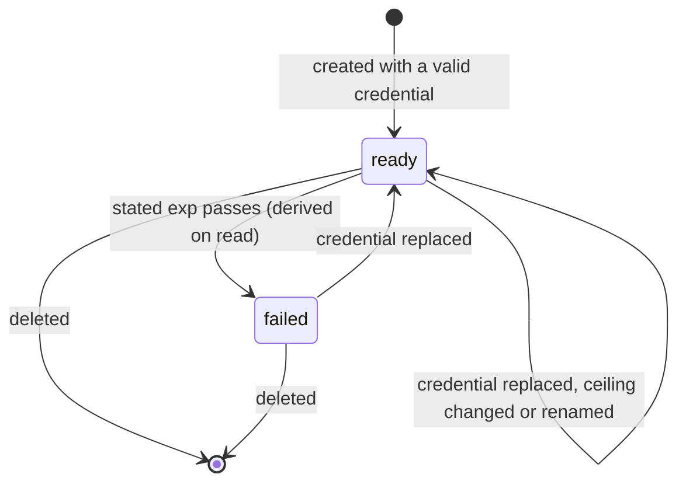
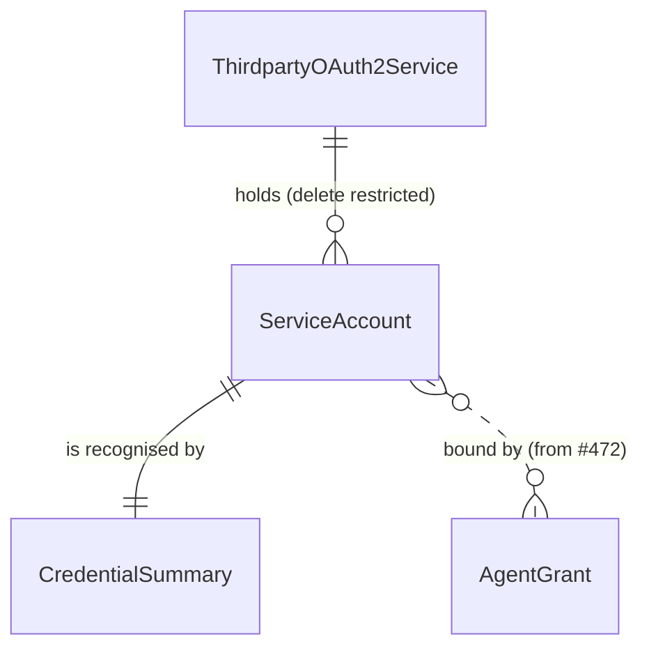

# Data Model: Service Accounts on Third-Party Services

**Feature**: [spec.md](./spec.md) | **Plan**: [plan.md](./plan.md) | **Research**: [research.md](./research.md)

## Entity: ServiceAccount

Location: `internal/domain/model/service_account.go`. Aggregate root; references its
`ThirdpartyOAuth2ProviderEntity` by `id.ServiceID`.

| Field | Type | Rules |
|---|---|---|
| `ID` | `id.ServiceAccountID` (new, UUID-backed, generated by `gen_ids.go`) | Generated by the domain service on create. Never changes. |
| `ServiceID` | `id.ServiceID` | Required. Never changes. The service must exist. |
| `CanonicalID` | `string` | Required. `canonical.Validate` rules: 1–128 characters of `[A-Za-z0-9._-]`, not UUID-shaped. Unique within the service. May be renamed. |
| `Kind` | `model.ServiceAccountKind` | Closed set; this feature: `jwt_bearer`. Never changes. |
| `Scopes` | `[]string` | The ceiling. Non-empty; each value non-empty; no duplicates. Stored in ascending byte order. |
| `Credential` | `model.Secret` | Plaintext credential document on the way in; encrypted before the repository call; never absent. |
| `Summary` | `model.CredentialSummary` | Computed from the credential on every write that carries one. |
| `CredentialExpiresAt` | `*time.Time` | The token's `exp` as a UTC instant; nil when the token states none. |
| `Version` | `int64` | Starts at 1; incremented by the store on every committed change. Source of the strong ETag. |
| `CreatedAt`, `UpdatedAt` | `time.Time` | UTC. `UpdatedAt` changes only on a committed change. |

Derived, never stored and never settable:

| Derived value | Rule |
|---|---|
| `Narrowing()` | From kind and format. `jwt_bearer` + `signed_jwt` → `none` (FR-003). |
| `StatusAt(now)` | `failed` with reason `credential_expired` when `CredentialExpiresAt != nil && !now.Before(*CredentialExpiresAt)`; otherwise `ready` (FR-014). |

## Value objects

Location: `internal/domain/model/service_account_credential.go`.

| Type | Values / fields | Notes |
|---|---|---|
| `ServiceAccountKind` | `jwt_bearer` | Typed string constant with doc comment. |
| `CredentialFormat` | `signed_jwt` | Shape of the secret within a kind. |
| `CredentialUse` | `access_token` (accepted, default); `assertion` (declared, refused with `credential.use must be access_token`) | FR-007. |
| `Narrowing` | `none` | |
| `ServiceAccountStatus` | `ready`, `failed` | Later values (`needs_bootstrap`) are added by #474. |
| `ServiceAccountFailureReason` | `credential_expired` | |
| `CredentialSummary` | `Format`, `Use`, `Iss *string`, `Sub *string`, `Kid *string`, `Exp *int64` (whole seconds, as `jwx` reads it), `Fingerprint string` | Implements `slog.LogValuer`: strings capped at 256 bytes, `sub` rendered as `id.Principal`. Holds no secret. |
| `ServiceAccountCredentialInput` | `Format`, `Use`, `JWT model.Secret` | What the handler passes to the domain service. |
| `CredentialValidationError` | `Reason` (closed set below), constant message | Never contains the submitted value. |

### Credential document (the encrypted plaintext)

```json
{ "format": "signed_jwt", "use": "access_token", "jwt": "<the submitted compact JWS, unchanged>" }
```

Encryption context: `{"service_id": "<owning service UUID>"}` ([research R3](./research.md#r3--what-is-encrypted-and-under-which-context)).

### Validation of a `signed_jwt` credential

Evaluated in order; the first failed rule decides the reason ([research R4](./research.md#r4--form-validation-of-the-jwt)).

| # | Rule | Reason | Message |
|---|---|---|---|
| 1 | `format` is `signed_jwt` | `unsupported_format` | `credential.format must be signed_jwt` |
| 2 | `use` is absent or `access_token` | `unsupported_use` | `credential.use must be access_token` |
| 3 | `jwt` is present and at most 16384 bytes | `missing_jwt` / `too_large` | `credential.jwt is required` / `credential.jwt must be at most 16384 bytes` |
| 4 | No CR or LF anywhere; `jws.Parse` with `jws.WithCompact()` yields one signature and its payload decodes as a JWT claims set | `malformed` | `credential.jwt must be a compact JWS with valid JWT claims` |
| 5 | The parsed header states an `alg` that is not `none` | `unsigned` | `credential.jwt must be a signed compact JWS` |
| 6 | The parsed expiration, when stated, is after the request time | `expired` | `credential.jwt is expired` |

What rule 4 accepts is the library's behaviour; research R4 lists the cases.

### Fingerprint

`"SHA256:" + base64.RawStdEncoding(sha256(jwt))` over the exact submitted string
([research R5](./research.md#r5--credential-summary-and-fingerprint)).

## Entity-level validation (create and update)

| Rule | Error | HTTP |
|---|---|---|
| `kind` is `jwt_bearer` | `kind must be jwt_bearer` | `400` |
| `kind` on update, when stated, equals the stored kind | `kind cannot be changed` | `400` |
| `canonical_id` passes `canonical.Validate` (required on create) | existing canonical-ID message | `400` |
| `scopes` non-empty, values non-empty and unique | `scopes must be a non-empty list of unique, non-empty values` | `400` |
| `credential` present on create | `credential is required` | `400` |
| `canonical_id` free within the service | `service account canonical_id already exists on this service` | `409` |
| Supplied `If-Match` equals the current ETag | `precondition failed` | `412` |
| No agent grant binds the account (delete; enforced from #472) | `service account is bound by an agent grant` | `409` |
| Service holds no accounts (service delete) | `cannot delete service: N service account(s) are attached to it` | `409` |

On update, an unknown `kind` is refused with `kind must be jwt_bearer` before it is compared
with the stored kind.

## State



No transition is stored. A ceiling change or rename on a `failed` account leaves it `failed`.

## Update outcomes

`ServiceAccountService.Update` returns the account and one outcome
([research R7](./research.md#r7--optimistic-concurrency-and-no-op-updates)).

| Outcome | Condition | Effect |
|---|---|---|
| `unchanged` | Same `canonical_id`, same ceiling set, and no credential or one with the stored fingerprint, format and use | No write, same version and `updated_at`, no audit record |
| `updated` | Anything else | One write, `version + 1`, `updated_at = now`, one audit record listing `changes` |

`changes` is a subset of `credential`, `scopes`, `canonical_id`.

## Repository port

`internal/ports/storage.go`:

```go
type ServiceAccountRepository interface {
    Create(ctx context.Context, account *model.ServiceAccount) error
    Get(ctx context.Context, serviceID id.ServiceID, accountID id.ServiceAccountID) (*model.ServiceAccount, error)
    GetByCanonicalID(ctx context.Context, serviceID id.ServiceID, canonicalID string) (*model.ServiceAccount, error)
    ListByService(ctx context.Context, serviceID id.ServiceID) ([]*model.ServiceAccount, error)
    Update(ctx context.Context, account *model.ServiceAccount, expectedVersion *int64) error
    Delete(ctx context.Context, serviceID id.ServiceID, accountID id.ServiceAccountID, expectedVersion *int64) error
    CountByService(ctx context.Context, serviceID id.ServiceID) (int, error)
}
```

Contract, identical for both adapters:

- The credential is encrypted on input and output; the repository treats it as opaque bytes.
- `Create`: sets `Version = 1`. Unknown service → `not_found`. Taken `(service_id, canonical_id)` →
  `conflict` wrapping `ErrServiceAccountCanonicalIDConflict`.
- `Get`, `GetByCanonicalID`: an account of another service is `not_found`.
- `ListByService`: ordered by `canonical_id` in byte order; empty slice when none.
- `Update`: writes `canonical_id`, `scopes`, `credential`, `summary`, `credential_expires_at`,
  `updated_at`; increments and returns the version on the entity. Missing → `not_found`. Taken
  name → the canonical-ID sentinel. `expectedVersion` set and different → `conflict` wrapping
  `ErrServiceAccountVersionMismatch`.
- `Delete`: missing → `not_found`; version rule as for `Update`.
- All errors are `storage.StorageError`; reads use the configured read timeout, writes the write
  timeout.

Narrow consumer interfaces in `internal/domain/thirdparty`:

```go
type ServiceAccountCounter interface {
    CountByService(ctx context.Context, serviceID id.ServiceID) (int, error)
}

type ServiceAccountBindingChecker interface {
    IsBound(ctx context.Context, accountID id.ServiceAccountID) (bool, error)
}
```

## PostgreSQL schema — migration `050_create_service_accounts`

One atomic pair, go-migrate naming, no `-- migrate:no-transaction`.

`050_create_service_accounts.up.sql` creates:

| Column | Type | Constraint |
|---|---|---|
| `id` | `UUID` | `PRIMARY KEY` |
| `service_id` | `UUID` | `NOT NULL REFERENCES thirdparty_oauth2_services(id) ON DELETE RESTRICT` |
| `canonical_id` | `VARCHAR(128)` | `NOT NULL`, `CHECK (canonical_id COLLATE "C" ~ '^[A-Za-z0-9._-]{1,128}$')` |
| `kind` | `VARCHAR(64)` | `NOT NULL`, `CHECK (kind <> '')` |
| `scopes` | `JSONB` | `NOT NULL`, `CHECK (jsonb_typeof(scopes) = 'array' AND jsonb_array_length(scopes) > 0)` |
| `credential_encrypted` | `BYTEA` | `NOT NULL`, `CHECK (octet_length(credential_encrypted) > 0)` |
| `credential_summary` | `JSONB` | `NOT NULL`, `CHECK (jsonb_typeof(credential_summary) = 'object')` |
| `credential_expires_at` | `TIMESTAMPTZ` | nullable |
| `version` | `BIGINT` | `NOT NULL DEFAULT 1`, `CHECK (version >= 1)` |
| `created_at`, `updated_at` | `TIMESTAMPTZ` | `NOT NULL DEFAULT NOW()` |

- `CONSTRAINT uq_service_accounts_service_canonical_id UNIQUE (service_id, canonical_id)`: enforces
  the name rule and serves `GetByCanonicalID`, `ListByService` and `CountByService`.
- Table and column comments state that `credential_encrypted` holds ciphertext only (DB-003).
- The set of `kind` values is enforced in the domain, not by a `CHECK`, so #474–#477 add kinds
  without a constraint migration.

`050_create_service_accounts.down.sql`: `DROP TABLE service_accounts;`. Rolling back erases stored
service-account credentials; the guide states this.

Queries list their columns explicitly (no `SELECT *`, no `RETURNING *`).

## In-memory adapter

`internal/adapters/storage/memory/service_account_repository.go`: one mutex; a map by ID and an
index by `(service_id, canonical_id)`; deep copies in and out; version rules and sentinels as
above; service existence checked through an injected function; `CountByService` consumed by the
memory provider repository's delete guard.

## Relationships



## Glossary entries to add

To `ARCHITECTURE.md` (new "Service Accounts" glossary section) and the root `AGENTS.md` glossary
table, with the definitions of #478: **Service Account**, **Kind**, **Credential Format**,
**Ceiling**, **Narrowing**, **Credential Summary**. `internal/domain/id/AGENTS.md` gains
`ServiceAccountID`.
